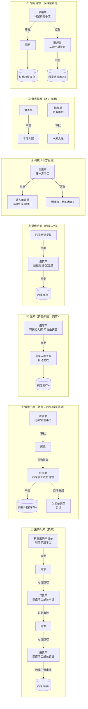

# 进销存 application/inventory 功能清单

> **范围**：`zxplat` `com.zxplat.domain.application.inventory.**`  
> **更新**：2026-07-26

**状态说明**

| 状态 | 含义 |
|------|------|
| 完成 | 后端已刷好（agree 链等核心逻辑已对齐） |
| 待刷 | 有 AppService 壳，后端逻辑尚未按规范刷过 |
| 未建 | 领域有 SupplyType，尚无第三层包 |

**文档说明**：AS = `docs/应用/zxplat-application/AppService/AS-INV-*`；SDD = `docs/领域/AppService-SDD/AS-INV-*-SDD.md`

---

## 一、业务总览（一眼看懂）

> **位置口径**：三方库存库位形态 — 药库 `WAREHOUSE`、药房 `PHARMACY`、科室药房 `DEPARTMENT_PHARMACY`（`LocationForm`）；读侧**三分不串** — 药库单据用 `listAllActiveWarehouses`，药房单据用 `listAllActivePharmacies`（仅药房），科室单据用 `listAllActiveDepartmentPharmacies`；确需并集（药库出库目的、退库入库源侧、供应类型 `16`、岗位管辖回落）显式走 `listAllActivePharmacyPartyLocations` / `listPharmacyPartyByOrganization`。科室药房供应类型头字段仍映射 `SupplyRequestType.PHARMACY`，调入壳单 type 为 `DEPT_TRANSFER_IN`。

进销存围绕 **药库 · 药房 · 科室药房** 三方库存，单据分三类：

| 类型 | 谁能建 | 审批后库存怎么动 |
|------|--------|------------------|
| **申请单** | 业务人员手工建 | 审批**仅终态**，**不**动库存、**不**自动生成执行单 |
| **执行单** | 手工建 **或** 从上游拉取生成 | 审批同意后 **落账**（扣减/增加库存） |
| **壳单（只读）** | **禁止**手工建 | 由对侧执行单 agree 时 **自动生成**，初态即同意 |

---

## 二、七条业务链路

### ① 采购入库（药库进货）

| 步骤 | 角色 | 单据 | 操作方式 | 库存 |
|------|------|------|----------|------|
| 0（可选） | 科室药房管理员 | **科室采购申请单** | 手工新建（产品定义级选品，同订货填写） | 不动 |
| 0b | — | 科室采购申请单 | 审批同意 | 不动 |
| 1 | 药库人员 | **订货单** | **手工新建**，或从已同意科室采购申请**可选拉取**预填 | 不动 |
| 2 | 财务 | 订货单 | 审批同意 | 不动 |
| 3 | 药库人员 | **进货单** | **手工新建**选品录入，或从已同意订货单**可选拉取**预填；到货后可编辑批号/发票等；同药不同批号可多行 | 不动 |
| 4 | 药库主管 | 进货单 | 审批同意（**不须**财务岗位） | **药库库存 +** |

> 申请单 agree **不**编排执行单，执行单均在下游页面另行创建。  
> **注意**：退货/退领为**强制拉源**（禁无源直建）；**退库**与订货/进货/出库同为**可选拉源**（可手工自由选品直建，亦可从入库单预填）；**进货**与订货/出库同为**可选拉源**（可手工直建，亦可从订货单预填）。  
> **科室采购申请 → 订货**：拉源为**可选**（订货仍可无源直建）；一张已同意申请至多被一张未删除订货引用（**BR-WHS-PO-012** / **AS-INV-DEP-007**）。  
> **订货 → 进货**：拉源为**可选**；一张已同意订货至多被一张未删除进货引用（**BR-WHS-IN-012**）。

### ② 请领出库（药库 → 药房 / 科室药房）

| 步骤 | 角色 | 单据 | 操作方式 | 库存 |
|------|------|------|----------|------|
| 1 | 药房或科室药房 | **请领单** | 手工新建 | 不动 |
| 2 | — | 请领单 | 审批同意 | 不动 |
| 3 | 药库人员 | **出库单** | **可**手工新建（自由选源库批号），**或**从已同意请领单拉取预填 | 不动 |
| 4 | — | 出库单 | 审批同意 | **药库 −**、**药房/科室 +** |
| 5 | — | **药房/科室入库单** | 出库 agree **自动生成**（壳单，已同意） | — |

### ③ 退库（药房 / 科室药房 → 药库）

| 步骤 | 角色 | 单据 | 操作方式 | 库存 |
|------|------|------|----------|------|
| 1 | 药房或科室药房 | **退库单** | **手工新建**自由选品，或从已同意**入库单拉取**预填（可选） | 不动 |
| 2 | — | 退库单 | 审批同意 | **药房/科室 −**、**药库 +** |
| 3 | — | **退库入库单** | 退库 agree **自动生成**（壳单，只读） | — |

### ④ 退供应商（药库 → 外）

| 步骤 | 角色 | 单据 | 操作方式 | 库存 |
|------|------|------|----------|------|
| 1 | 药库人员 | **退货单** | 从已同意**进货单拉取**新建（禁止自由选品） | 不动 |
| 2 | 财务 | 退货单 | 审批同意 | **药库 −**（退给供应商） |

### ⑤ 调拨（药库 · 药房 · 科室药房 — 三方口径统一，各形态**平级调拨**）

| 要点 | 说明 |
|------|------|
| **形态分包** | 药库 / 药房 / 科室药房各有独立调出包与调入壳单台账，**禁止跨形态互转** |
| **唯一入口** | 各包手工建本形态 **调出单**（源侧与目的侧须为**同形态**库位，源≠目的） |
| **平级示例** | 药库 A→药库 B；药房 A→药房 B；科室药房 A→科室药房 B |
| **禁止** | 药库↔药房、药库↔科室药房、药房↔科室药房等跨形态调拨；**不可**手工新建调入单 |
| **自动生成** | 调出 agree 后生成对侧同形态调入壳单：`CABINET_TRANSFER_IN` / `PHARMACY_TRANSFER_IN` / `DEPT_TRANSFER_IN` |
| **落账点** | 仅在调出 agree 时完成源库扣减 + 目的库增加 |

> 调拨**不消费**请领单；与请领出库是两条独立链路。

### ⑥ 盘点与损益（各方自用）

| 角色 | 单据 | 说明 |
|------|------|------|
| 药库 / 药房 / 科室药房 | **盘点单** | 盘实物，审批后按盈亏入账（不须财务岗位） |
| 同上 | **损益单** | 手工调整本库库存；**须财务审批** |

### ⑦ 领用与退领（仅科室药房）

> **科室专有**：药房**无**对应单据；与请领/退库/调拨独立，**单库房**操作，**不**生成壳单，**不**关联临床发药。

| 步骤 | 角色 | 单据 | 操作方式 | 库存 |
|------|------|------|----------|------|
| 1 | 科室药房药师 | **领用单** | 手工新建、选手科室药房 + **手选领用科室**、自由选品（药品/耗材批号） | 不动 |
| 2 | — | 领用单 | 审批同意（药师自审，不须财务） | **科室药房 −** |
| 3 | 科室药房药师 | **退领单** | 从已同意**领用单拉取**新建（禁止自由选品；可删行/减量；**科室药房/领用科室只读**） | 不动 |
| 4 | — | 退领单 | 审批同意 | **科室药房 +**（加回同一库位） |

> 领用语义为科室药房库存扣减（**`purpose_location_id`**）；**领用科室**为行政 Organization，客户端手选落库 **`consuming_organization_id`**（与科室药房解耦；Flyway **health-final V111**）。退领为领用未用完**退回科室药房库存**（**非**退药库，退药库走 ③ 退库）；退领 **`consuming_organization_id`** 自源领用单继承，表头只读。

---

## 三、单据属性速查

| 单据 | 归属 | 类型 | 手工新建 | 可从上游拉取 | agree 后自动生成对侧 |
|------|------|------|:--------:|:------------:|:------------------:|
| 订货单 | 药库 | 申请单 | ✅ | 科室采购申请（**可选**） | — |
| 科室采购申请单 | 科室 | 申请单 | ✅ | — | — |
| 进货单 | 药库 | 执行单 | ✅（亦可无订货直建） | 订货单（**可选**） | — |
| 请领单 | 药房/科室 | 申请单 | ✅ | — | — |
| 出库单 | 药库 | 执行单 | ✅（亦可无请领直建） | 请领单（**可选**） | 药房/科室入库壳单 |
| 入库单 | 药房/科室 | 壳单 | ❌ | — | 由出库单生成 |
| 退库单 | 药房/科室 | 执行单 | ✅（亦可无入库直建） | 药房/科室入库单（**可选**） | 退库入库单 |
| 退库入库单 | 药库 | 壳单 | ❌ | — | 由退库单生成 |
| 退货单 | 药库 | 执行单 | ❌（须拉进货） | 进货单 **必填** | — |
| 调出单 | 三方 | 执行单 | ✅ | — | 调入单 |
| 调入单 | 三方 | 壳单 | ❌ | — | 由调出单生成 |
| 盘点单 | 三方 | 执行单 | ✅ | — | — |
| 损益单 | 三方 | 执行单 | ✅ | — | — |
| 领用单 | 科室 | 执行单 | ✅ | — | — |
| 退领单 | 科室 | 执行单 | ❌（须拉领用） | 领用单 **必填** | — |

> **科室药房**与药房共享请领 / 入库 / 退库 / 调拨 / 盘点 / 损益；**另增**领用单、退领单（⑦ 单库房领用消耗与退回，与临床发药无关）。药房**无**领用/退领。

---

## 四、前端页面 ↔ 后端包

| 前端 `apps/web-ele/src/views/inventory/` | 后端包 | 链路 |
|------------------------------------------|--------|------|
| `warehouse/purchase-order` | `warehouse/purchaseorder` | ①（可选手动 / 拉科室采购申请） |
| `warehouse/purchase-inbound` | `warehouse/inboundreceipt` | ① |
| `department/purchase-request`（待建页） | `department/purchaserequest`（**未建包**） | ① 上游申请 |
| `pharmacy/requisition`（待建页） | `pharmacy/requisition` | ② |
| `warehouse/stock-out` | `warehouse/stockout` | ② |
| `pharmacy/stock-in` | `pharmacy/stockin` | ②（壳单台账） |
| `pharmacy/return-to-warehouse` | `pharmacy/returntowarehouse` | ③ |
| `warehouse/return-stock-in` | `warehouse/returnstockin` | ③（壳单台账） |
| `warehouse/return-to-supplier` | `warehouse/returntosupplier` | ④ |
| `warehouse/transfer-out` · `pharmacy/transfer-out` · `department/transfer-out`（待建页） | `warehouse/transferout` · `pharmacy/transferout` · `department/transferout` | ⑤ |
| `warehouse/transfer-in` · `pharmacy/transfer-in` · `department/transfer-in`（待建页） | `warehouse/transferin` · `pharmacy/transferin` · `department/transferin` | ⑤（只读） |
| `warehouse/stocktake` · `pharmacy/stocktake` | `warehouse/stocktake` · `pharmacy/stocktake` | ⑥ |
| `warehouse/gain-loss` · `pharmacy/gain-loss` | `warehouse/gainloss` · `pharmacy/gainloss` | ⑥ |
| `warehouse/inventory-detail` | `inventorydetail` | 库存查询 |
| `warehouse/period-balance-detail`（报表中心页） | `periodbalancedetail` | 库房期初期末明细报表 |
| `inventory/documentdetail`（待建页） | `inventory/documentdetail` | 单据详情报表（**`InventoryDocumentDetailAppService`** + **`domainScope`**） |
| `department/requisition`（待建页） | `department/requisition` | ② |
| `department/dept-return` 等（待建页） | `department/returntowarehouse` | ③ |
| `department/dept-issue`（待建页） | `department/deptissue` | ⑦ 领用 | 应用层已落地 |
| `department/dept-issue-return`（待建页） | `department/deptissuereturn` | ⑦ 退领 | 应用层已落地 |
| `department/transfer-out` · `transfer-in` · `stocktake` · `gain-loss`（待建页） | `department/transferout` 等 | ⑤⑥（后端 §七 **已完成**） |

---

## 五、药库 `warehouse/`（8）

| 包 | 业务 | 链路 | 状态 | AS | SDD |
|----|------|------|------|----|-----|
| `purchaseorder` | 订货单 | ① 申请 | 完成 | ✅ v0.9 | ✅ v2.0 |
| `inboundreceipt` | 进货单 | ① 执行 | 完成 | ✅ | ✅ |
| `stockout` | 出库单 | ② 执行 | 完成 | ✅ | ✅ |
| `returnstockin` | 退库入库单 | ③ 壳单 | 完成 | ✅ | — |
| `returntosupplier` | 退货单（退供应商） | ④ 执行 | 完成 | ✅ | ✅ |
| `transferout` | 调出单 | ⑤ 执行 | 完成 | ✅ | — |
| `transferin` | 调入单 | ⑤ 壳单 | 完成 | ✅ | — |
| `stocktake` | 盘点单 | ⑥ | 完成 | ✅ | ✅ |
| `gainloss` | 损益单 | ⑥ | 完成 | ✅ | — |

> **订货单预警快捷选品（2026-07-15）**：**IF-WHS-PO-14** 只读（最晚效期批近效 / 仅低储）；勾选后 **IF-11** 传 ids；**GAP-WHS-PO-001** 已关。

> **库存明细**、**库房期初期末明细**、**单据详情报表** 不在 `warehouse/` 子包，见 §九（**`inventory/` 直属**）。

---

## 六、药房 `pharmacy/`（7）

| 包 | 业务 | 链路 | 状态 | AS | SDD |
|----|------|------|------|----|-----|
| `requisition` | 请领单 | ② 申请 | 完成 | ✅ | ✅ |
| `stockin` | 入库单 | ② 壳单 | 完成 | ✅ | ✅ |
| `returntowarehouse` | 退库单（退药库） | ③ 执行 | 完成 | ✅ | — |
| `transferout` | 调出单 | ⑤ 执行 | 完成 | ✅ | — |
| `transferin` | 调入单 | ⑤ 壳单 | 完成 | ✅ | — |
| `stocktake` | 盘点单 | ⑥ | 完成 | ✅ | ✅ |
| `gainloss` | 损益单 | ⑥ | 完成 | ✅ | — |

> **请领单**：`PHARMACY_REQUISITION`，审批同意仅终态，不编排出库/入库执行单（与 AS-INV-PHA-002 一致）。  
> **调入单 / 入库单 / 退库入库单**：壳单由对侧 agree 生成，本包禁止二次 agree / 手工新建执行单。  
> **无领用/退领**：科室专有 **`DEPT_ISSUE` / `DEPT_ISSUE_RETURN`** 见 §七。

---

## 七、科室药房 `department/`（9 → 目标 10）

| 包 | 业务 | 链路 | 状态 | AS | SDD |
|----|------|------|------|----|-----|
| `requisition` | 请领单 | ② 申请 | 完成 | ✅ | — |
| `stockin` | 入库单 | ② 壳单 | 完成 | — | — |
| `returntowarehouse` | 退库单（退药库） | ③ 执行 | 完成 | — | — |
| `transferout` | 调出单 | ⑤ 执行 | 完成 | — | — |
| `transferin` | 调入单 | ⑤ 壳单 | 完成 | — | — |
| `stocktake` | 盘点单 | ⑥ | 完成 | ✅ | ✅ |
| `gainloss` | 损益单 | ⑥ | 完成 | ✅ | ✅ |
| `deptissue` | 领用单 | ⑦ 执行 | 完成 | ✅ | ✅ |
| `deptissuereturn` | 退领单 | ⑦ 执行 | 完成 | ✅ | ✅ |
| `purchaserequest` | **科室采购申请单** | ① 上游申请 | **未建** | ✅ **AS-INV-DEP-007** | ✅ **SDD v0.1** |

> **与药房对称（7 包）**：请领 / 入库 / 退库 / 调出 / 调入 / 盘点 / 损益 — 口径同 §六，仅库位形态为 `DEPARTMENT_PHARMACY`。  
> **科室专有（+2 包已落地）**：**领用单** `DEPT_ISSUE`（**AS-INV-DEP-004**）；**退领单** `DEPT_ISSUE_RETURN`（**AS-INV-DEP-009**）。  
> **科室专有（+1 包文档已就绪、应用未建）**：**科室采购申请单** `DEPT_PURCHASE_REQUEST`（**AS-INV-DEP-007**）——产品定义级选品、同意仅终态；药库订货**可选**拉取（**AS-INV-WHS-001** **IF-WHS-PO-12/13**）。  
> **请领单**：`DEPT_REQUISITION`，审批同意仅终态，不编排出库/入库执行单（与药房请领同构）。  
> **调入/入库类壳单**：禁止二次 agree / 手工新建（**DEPT_TI_002** 等）。**调出源侧**仅 `DEPARTMENT_PHARMACY`。

---

## 八、未建包（DM SupplyType 有定义）

| 业务线 | SupplyType | 业务 | 对称链路 | 备注 |
|--------|------------|------|----------|------|
| 药库 | `CABINET_TRANSFER_IN_REQUEST` | 调入申请 | ⑤ | |
| 药库 | `CABINET_INBOUND_RECEIPT_INSPECTION` | 进货验收 | ① | |
| 药房 | `PHARMACY_TRANSFER_IN_REQUEST` | 调入申请 | ⑤ | |
| 科室 | `DEPT_DEVICE_STOCKTAKE` | 耗材盘点 | ⑥ | |
| 科室 | `DEPT_PURCHASE_REQUEST` | **科室采购申请单** | ① 上游 | **AS/SDD 已就绪**（**AS-INV-DEP-007**）；领域枚举/方法**已落地**；应用包 `department/purchaserequest` **未建** |
| — | `MEDICATION_SUMMARY_ORDER` | 药品汇总单 | — | 护士站/住院发药链，非本目录 |

---

## 九、进销存横向（`inventory/` 直属）

| 包 | 业务 | 状态 | AS | SDD |
|----|------|------|----|-----|
| `inventorydetail` | **库存明细**（现库+备份+定时快照；`InventoryWarehouseInventoryDetailAppService`；含科室药房筛选） | 完成 | ✅ **AS-INV-WHS-004** | ✅ **SDD v0.27** |
| `periodbalancedetail` | **库房期初期末明细**（期初期末对账；消费 DOC 快照；应用层拼装各域 QS） | 完成 | ✅ **AS-INV-RPT-001 v1.4** | ✅ **SDD v0.5** |
| `documentdetail` | **单据详情报表**（三域只读；`InventoryDocumentDetailAppService`；**`domainScope`** 区分药库/药房/科室；**未传 typeEnum 查本域全部**；白名单含三房 **`*_OPENING`**；期初显式类型可含 **审核中**） | 完成 | ✅ **AS-INV-RPT-002 v1.5** | ✅ **SDD v0.8** |

> 只读/查询类能力，与 **`warehouse/`**、**`pharmacy/`**、**`department/`** 形态分包并列；**禁止** `domain.share.queries.inventorysettlement` 跨域读包。

---

## 十、汇总

| 维度 | 数量 |
|------|------|
| 第三层包（有 AppService） | **28**（药库 8 + 药房 7 + 科室 9 + 横向 3） |
| 完成 | **28** |
| 待刷 | **0** |
| 未建包（仅 SupplyType，尚无应用包） | **5**（另汇总单 1 项，见 §八 表；含 **`DEPT_PURCHASE_REQUEST`**） |
| 进销存横向（`inventory/` 直属） | **3**（库存明细 + 库房期初期末明细 + 单据详情报表，见 §九） |

---

## 十、实现增量（2026-07-02 · zyc）

> 后端提交：`4c8dae681`（药房药库修改）、`4666f46ae`（库房 bug 修改）。下列为**文档须对齐**的契约变更摘要；细节见各 AS/SDD 修订行。

### 10.1 列表库位筛选「全部」占位（`0`）

| 场景 | 请求字段 | 占位常量（`domain.share.constants`） | 行为 |
|------|----------|--------------------------------------|------|
| 药库单据列表 | `sourceLocationId` / `purposeLocationId` | `InventoryWarehouseConstants.ALL_WAREHOUSES_LIST_FILTER_LOCATION_ID`（**0**） | 展开为当前用户可见药库 id 集合（`IN`）；无可见库时用 `LIST_FILTER_NO_VISIBLE_WAREHOUSE_PLACEHOLDER_ID`（**-1**）空页 |
| 药房退库列表 | `sourceLocationId` | `InventoryPharmacyConstants.ALL_PHARMACIES_LIST_FILTER_LOCATION_ID` | 同上，锚药房 |
| 科室退库列表 | `sourceLocationId` | `InventoryDepartmentConstants.ALL_DEPARTMENT_PHARMACIES_LIST_FILTER_LOCATION_ID` | 同上，锚科室药房 |

**已落地包**：`warehouse/inboundreceipt`、`returnstockin`、`returntosupplier`、`stockout`（列表侧）；`pharmacy/returntowarehouse`、`department/returntowarehouse`。

### 10.2 选品可用量锚点（批号行级）

| 能力 | 变更 |
|------|------|
| **锚点** | 展示/校验可用量由 **`item_id + 归一化批号` 聚合** 改为 **`wkf_inventory_item.id`（`inventoryItemId`）** 行级回填 |
| **领域读** | 请领选品优先 `InventoryItemQueryService#findAvailableCatalogRowsForInventoryItemIds`；出库选品仍可调 `#findAvailableCatalogRowsForOrder`，但装配键为返回行 **`id`** |
| **过滤** | 各单据**库存批号级**选品 IF-*-11 请求增可选 **`positiveQuantityOnly`（Boolean，非必传）** → 下推 `InventoryItemPageQuery.positiveQuantityOnly`：**`true`** 仅账面量 **> 0**；**`false`/未传** 不过滤数量（含零库存行）。目录级选品（订货/进货/科室采购申请）与禁自由选品接口不适用 |
| **展示回落** | 请领选品：可用量未命中时回退**账面量**（与库存明细对齐）；出库选品：未命中展示 **0** |

**已落地包**：`pharmacy/requisition`、`department/requisition`、`warehouse/stockout`（选品 IF-11）。

### 10.3 关联单列表/预填富化

| IF | 变更 |
|----|------|
| **IF-WHS-IN-12** | 可关联订货单列表改为 **`bus_no` 聚合一行一单**（同订货单列表真源）；行内 **`supplierName`/`creatorName`/`purposeLocationName`**；选单「制单时间」= occurrence→apply→approval；**排除已被未删除进货单引用的订货单（BR-WHS-IN-012）** |
| **IF-WHS-IN-13** | 预填行类型 **`InboundReceiptDetailLineDto`**；批量产品读模型 + 与详情同口径展示富化（**行价仍取订货落库价**） |
| **IF-WHS-SO-12** | 可关联请领列表 **`creatorName`/`purposeLocationName`/`totalAmount`/`applyTime`**（一行一单） |
| **IF-WHS-SO-13** | 预填行类型 **`StockOutDetailLineDto`** + **`productCatalog`**（单位带） |
| **IF-WHS-RT-12** | 可关联进货单列表增 **`supplierName`/`applyTime`/`creatorName`/`applicantId`/`purposeLocationName`** |
| **IF-WHS-RT-13** | 表头 **`supplierName`**；可退行增 **`specification`/`manufacturer`/`unitCodeDictText`/`productCatalog`** |
| **IF-PHA-RTW-12** | 可关联药房入库单列表对齐 RT-12：**`creatorName`/`applicantId`/`applyTime`/`purposeLocationName`/`supplierName`** |
| **IF-PHA-RTW-13** | 预填库位语义纠偏：**`sourceLocationId`=入库目的药房**，**`purposeLocationId`=入库来源药库（退入药库）**；Long id **ToStringSerializer** |
| **IF-DEP-RTW-12** | 可关联科室入库单列表同 PHA-RTW-12 富化口径 |
| **IF-DEP-RTW-13** | 预填库位语义同 PHA-RTW-13（源=科室药房，目的=药库） |
| **IF-DEP-TL-12** | 可关联领用单列表增 **`creatorName`/`applicantId`/`applyTime`/`purposeLocationName`** |
| **IF-DEP-TL-13** | 可退行增 **`productName`/`specification`/`unitCodeDictText`** |
| 药房/科室退库可退行 | 同 **IF-WHS-RT-13** 产品展示字段（**行价仍取源入库落库价**） |
| **shared** | `InventoryListPractitionerNameResolver` + **`InventoryListLocationNameResolver`**（选单/侧栏展示名批量解析，禁止 Feature 互抄） |

### 10.4 退货单列表侧栏与写价（2026-07-26）

| 能力 | 变更 |
|------|------|
| **IF-WHS-RT-02** | 列表行增 **`supplierName`/`creatorName`/`approverName`/`applicantId`/`approverId`/`totalAmount`**（与 `totalPrice` 双写）；对齐进货/出库侧栏卡片 |
| **历史未落价** | 合计 0/空时读侧按进货行总额比例回补展示（**不写库**）；审中单据无需再保存即可回显金额 |
| **IF-WHS-RT-04/05** | 建改单：进货行 `price` → 命令 → `SupplyRequestWritePricingSupport#applyReturnToSupplierCommand` → 落 `price`/`total_price`（**BR-PRICE-SRC-001** / **BR-MON-001**） |

**文档**：`AS-INV-WHS-005` **v0.4**（**BR-WHS-RT-009/010**）· SDD **v0.5**（**WHS-RT-SDD-R-010/011**）· **DM-WKF-006 v1.21**（**BR-SR-019** 退货写价）。

### 10.6 退库/退库入库列表侧栏富化（2026-07-26）

| IF | 变更 |
|----|------|
| **IF-WHS-RSI-02** | 退库入库壳单列表改为 **`bus_no` 聚合一行一单**；行内 **`supplierName`/`creatorName`/`approverName`/`totalAmount`**（与 `totalPrice` 双写）；复用 `InventoryListPractitionerNameResolver` |
| **IF-PHA-RTW-02** | 药房退库单列表同构聚合 + 侧栏富化（制单人/审批人/供应商/整单合计） |
| **IF-DEPT-RTW-02** | 科室退库单列表同构聚合 + 侧栏富化（制单人/审批人/供应商/整单合计） |
| **详情效期** | 退库/退库入库详情行增 **`startTime`/`endTime`**（取自 `SupplyRequestModel` 落库效期） |

### 10.5 框架/登录（非 inventory 包，联调相关）

- `HealthApplicationConfigurationAppService` 暴露为 `/applicationConfiguration`（跳过框架同名 Bean 双注册）；`canFinanceApprove` 解析失败时降级为 **false**（不阻断登录链）。
- 用户角色加载跳过 **`role_id` 为空** 的脏关联行。

### 10.6 调入/入库壳单列表侧栏 enrich（2026-07-26）

| IF | 变更 |
|----|------|
| **IF-WHS-TI-02 / IF-PHA-TI-02 / IF-DEPT-TI-02** | 调入单列表行增 **`creatorName`/`approverName`/`totalAmount`**（Mapper 聚合各行 `total_price` 之和；AppService 经 **`InventoryListPractitionerNameResolver`** 批量解析制单人/审批人）；对齐出库/进货侧栏卡片 |
| **IF-PHA-IN-02** | 药房入库（壳单）列表同上 enrich 口径 |

### 10.7 库存单据侧栏回显通查通改（2026-07-26）

> 共享 **`application.shared.inventory.InventoryListPractitionerNameResolver`**（制单人/审批人批量解析）；退库类另经 **`InventoryListLocationNameResolver`** 解析库位/供应商展示名。下列 IF 列表均为 **`bus_no` 聚合一行一单**（若原未聚合则本次补齐），侧栏卡片对齐进货/出库。

| 单据族 | IF | 变更摘要 |
|--------|-----|----------|
| **请领（药房/科室）** | **IF-PHA-QL-02** / **IF-DEP-QL-02** | 列表 enrich **`creatorName`/`approverName`/`totalAmount`**；建改单持久化 **`end_time`**（**BR-SR-020**）；详情回显 **`startTime`/`endTime`** |
| **调入壳单** | **IF-WHS-TI-02** / **IF-PHA-TI-02** / **IF-DEPT-TI-02** | 列表 enrich 制单人/审批人/整单合计 |
| **药房入库壳单** | **IF-PHA-IN-02** | 同上 enrich 口径 |
| **药库退货** | **IF-WHS-RT-02** | 列表 enrich 制单人/审批人/供应商/总金额；建改单写价落库（见 §10.4） |
| **退库/退库入库** | **IF-WHS-RSI-02** / **IF-PHA-RTW-02** / **IF-DEPT-RTW-02** | 列表 `bus_no` 聚合 + 制单人/审批人/供应商/总金额；详情行补效期 |

**文档**：**DM-WKF-006 v1.22**（**BR-SR-020**）· **AS-INV-PHA-002 v0.4** · **AS-INV-DEP-001 v0.3** · **AS-INV-WHS-005 v0.4**

**前端**：`api/inventory/**` 列表 DTO 与 `map*ListRowToQueueCard` 映射 `applicantId_dictText`/`approverId_dictText`/`totalPrice`/`totalAmount`。

### 10.8 退库入库壳单回显纠偏（2026-07-26）

| 能力 | 变更 |
|------|------|
| **壳单生成** | 药房/科室退库 agree → type **5** 壳单：拷贝下游 **`reason`**；写入 **`approverId`/`approvalTime`**（**BR-WHS-RSI-003** / **DM-WKF-006 v1.23**） |
| **IF-WHS-RSI-02** | 历史壳单缺 `approverId` 时按 **`originalBusNo`** 只读回填后富化 `approverName`（不写库） |
| **IF-WHS-RSI-03** | 详情富化 **`productCatalog`/`unitCodeDictText`**；缺 `reason` 时按关联退库同行回填（**BR-WHS-RSI-004/005**） |

**文档**：**AS-INV-WHS-006 v0.2** · **DM-WKF-006 v1.23** / SDD

**前端**：`api/inventory/warehouse/return-stock-in` 详情 DTO 增 `productCatalog`/`unitCodeDictText`；主区 `hydrateInventoryDetailLineQtyForGrid` 消费计量带。

### 10.9 科室领用/退领明细列对齐请领（2026-07-26）

| 单据 | 变更 |
|------|------|
| **科室领用 IF-DEP-IS-03/04/05** | 详情/写行增 **`endTime`/`remake`**；领域落 `end_time`；前端网格：规格/厂家/金额/有效期/备注（保留追溯码） |
| **科室退领 IF-DEP-TL-03/04/13** | 拉取行增 **`manufacturer`/`totalPrice`/`endTime`/`remake`**；详情/写行同构；前端网格与领用对齐 |

**文档**：**AS-INV-DEP-004 v0.4** / SDD v0.3 · **AS-INV-DEP-009 v0.4** / SDD v0.5

**前端**：`dept-issue-main-pane` / `dept-issue-return-main-pane` 列族对齐 `requisition-main-pane`。

### 10.10 调入壳单审批人回显纠偏（2026-07-26）

| 能力 | 变更 |
|------|------|
| **壳单生成** | 三方调出 agree → 对侧调入壳单：写入 **`approverId`/`approvalTime`**；制单人优先沿用调出行 `applicantId`（**DM-WKF-006 v1.24**） |
| **IF-WHS-TI-02 / IF-PHA-TI-02 / IF-DEPT-TI-02** | 历史壳单缺 `approverId` 时按 **`originalBusNo`** 只读回填后富化 `approverName`（不写库） |
| **调出列表** | 主动单走 `approvalToAgree`，审批人已落库；本轮核对无缺口 |

**文档**：**AS-INV-WHS-008/009 v0.2** · **AS-INV-PHA-007/008 v0.2** · **DM-WKF-006 v1.24** / SDD

**前端**：侧栏已消费 `approverName`（`inventory-workbench-list`），无需改映射。

---

## 修订记录

| 日期 | 说明 |
|------|------|
| 2026-08-11 | **退库可选拉源 + 自由选品**：§③/§三 退库单可手工直建；`originalBusNo` 仅拉入库时必填；对齐 **AS-INV-PHA-003 v0.2** / **AS-INV-DEP-003 v0.1** / **DM-WKF-006** |
| 2026-08-05 | **进货单可选拉源**：§①/§三 恢复手工直建选品；订货单拉取为可选；同药不同批号可多行（`itemTable+itemId+lotNumber` 唯一） |
| 2026-07-26 | **领用科室解耦**：§⑦ 语义更新——**`consuming_organization_id`** 落库（health-final V111）；领用手选、退领自源单继承；对齐 **AS-INV-DEP-004 v0.6** / **009 v0.6** / **DM-WKF-006 v1.25** |
| 2026-07-26 | **调入壳单审批人回显纠偏**：§10.10；**DM-WKF-006 v1.24**；三方 `transferout` 壳单装配 + `transferin` 列表回填 |
| 2026-07-26 | **退库入库壳单回显纠偏**：§10.8；**AS-INV-WHS-006 v0.2**；**DM-WKF-006 v1.23**（壳单 `reason`/`approverId`/`approvalTime`） |
| 2026-07-26 | **关联选单/退库预填回显扫尾**：§10.3 补齐 PHA/DEP-RTW-12、DEP-TL-12 制单人/时间/库位名；RTW-13 退入药库取入库 **source**（禁止把源药房 id 写入目的药库）；init/预填库位 id 字符串序列化；共享 **`InventoryListLocationNameResolver`** |
| 2026-07-26 | **库存单据侧栏回显通查通改**：§10.7 共享 **`InventoryListPractitionerNameResolver`**；请领列表 enrich + **`end_time`** 落库（**BR-SR-020**）；调入/入库壳单/退货/退库族列表 `bus_no` 聚合 + enrich |
| 2026-07-26 | **口径纠偏**：退货单/退库单/进货单为强制拉源（§三退货「手工新建」❌）；出库单保留可无请领直建（与 **AS-INV-WHS-003** 正向路径一致）；流程图标签与 §① 注记同步，避免与「进货同构出库」误读 |
| 2026-07-24 | **库位三分不串**：`listAllActivePharmacies` 仅 `PHARMACY`；科室侧 `listAllActiveDepartmentPharmacies`；药库出库/退库入库源侧等改 **`listAllActivePharmacyPartyLocations`**；回更 **DM-ADM-003 v1.5** / **SDD**、**AS-INV-WHS-003-SDD v1.15** |
| 2026-07-15 | **订货单预警快捷选品落地**：**AS-INV-WHS-001 v0.9.1** / **SDD v2.0**；领域 **`listProductKeysWhoseLatestLotNearExpiry`**；**GAP-WHS-PO-001** 关闭 |
| 2026-07-15 | **订货单预警快捷选品**：**AS-INV-WHS-001 v0.9** / **SDD v2.0**（**IF-WHS-PO-14**、IF-11 ids、**BR-013～016**）；**DM-WKF-008 §6.2.19**；§3 **GAP-WHS-PO-001** 待关；§五 `purchaseorder` 注记 |
| 2026-07-15 | **选品 IF-*-11**：库存批号级选品统一可选 **`positiveQuantityOnly`**（非必传；true=源/盘点库位账面量>0）；请领/出库由硬编码改为前台传参；§10.2 同步 |
| 2026-07-31 | **AS-INV-RPT-002 v1.5 / SDD v0.8**：期初显式类型含审核中 `APPROVAL`（`apply_time` 窗）；其它类型仍仅 `AGREE` |
| 2026-07-31 | **AS-INV-RPT-002 v1.4 / SDD v0.7**：单据详情白名单纳入三房期初 `CABINET_OPENING`/`PHARMACY_OPENING`/`DEPT_OPENING`；与列表同条件可查可导出 |
| 2026-07-15 | **AS-INV-RPT-002 v1.3 / SDD v0.6**：单据详情未传 `typeEnum` 查本域白名单全部；默认类型仅前端用 init 回填 |
| 2026-07-15 | **科室采购申请领域 Gap 关闭**：`SupplyType.DEPT_PURCHASE_REQUEST`、`createDeptPurchaseRequest`、订货可选 `originalBusNo`/`WHS_PO_106`；AS §3 清 Gap；应用包仍未建 |
| 2026-07-15 | **科室采购申请单**：流程图/① 链路/`DEPT_PURCHASE_REQUEST`；**AS-INV-DEP-007** + SDD；**AS-INV-WHS-001 v0.7** / SDD v1.8 可选拉源；**DM-WKF-006 v1.15**；§七/§八/§四/速查表同步；应用包仍**未建** |
| 2026-07-03 | **AS-INV-RPT-002 v1.2 / SDD v0.5**：单据详情报表应用层落地 — 单包 **`inventory/documentdetail`**、**`InventoryDocumentDetailAppService`** + **`domainScope`**；§九 横向 +1；§五～§七 移除分散 `documentdetail` 行 |
| 2026-07-03 | **AS-INV-RPT-002** 单据详情报表 AS + SDD v0.1；领域 Query 扩展；操作单位数量换算、换算失败 **INV_DDC_204** 精细报错 |
| 2026-07-02 | 对齐 zyc 提交 **4c8dae681 / 4666f46ae**：§十 列表「全部库位」占位、选品 **`inventoryItemId`** 锚点、关联单富化；同步 **AS-INV-WHS-002/003/005**、**AS-INV-PHA-002**、**AS-INV-DEP-001/009**、**DM-WKF-008** |
| 2026-07-02 | **科室药房全码对齐**：**DM-ADM-003** `listLocationsByType(16)` 药房族；**DM-ADM-006** 岗位 `managedLocationIds`；**AS-OP/IP-PHA** 发退药追溯 `location_type_enum`；**AS-INV-RPT-001 v1.4** 日结 `nullifyInactiveColumns` |
| 2026-07-02 | **AS-INV-WHS-004 v0.23 / SDD v0.27**：库存明细 IF-01/BR-016 纳入科室药房筛选与 Gate |
| 2026-07-02 | **AS-INV-RPT-001 v1.3 / SDD v0.4**：文档与 **`zxplat`** 应用层 **`inventory/periodbalancedetail`** 实现对齐 |
| 2026-07-02 | 包路径对齐代码：**`inventory/inventorydetail`**、**`inventory/periodbalancedetail`**；SDD **v0.26/v0.3**；库房期初期末明细应用层 **完成** |
| 2026-07-02 | **AS-INV-RPT-001-SDD v0.2**：~~`report/inventory/periodbalancedetail`~~（已废止，见上条） |
| 2026-07-02 | **AS-INV-RPT-001-SDD v0.1** 库房期初期末明细 SDD 初稿 |
| 2026-07-02 | **AS-INV-RPT-001 v1.2**：Gap 已关；WKF-006/007 QueryService 读方法落地 |
| 2026-07-02 | **AS-INV-RPT-001** 库房期初期末明细 AS 初稿（数量最小单位汇总+包装展示；金额 BR-INV-DTL-007；消费 DOC 快照） |
| 2026-07-02 | 调拨口径：三方统一为**平级调拨**（药库↔药库、药房↔药房、科室药房↔科室药房）；禁止跨形态互转；同步 WHS/PHA 调出 AS 与三方 `transferout` 门控 |
| 2026-07-01 | **`department/deptissuereturn`** 科室退领单应用包落地 → 完成；科室 9 包全齐 |
| 2026-07-01 | 科室单据口径：与药房对称 7 包 + **专有**领用/退领（⑦）；补流程图、单据速查、§七 扩至 9 包；`deptissue` → 完成 |
| 2026-07-01 | **AS-INV-DEP-009** 科室退领单 AS + SDD（`DEPT_ISSUE_RETURN`；`department/deptissuereturn` 已落地） |
| 2026-07-01 | **AS-INV-DEP-004** 科室领用单 AS + SDD（`DEPT_ISSUE`；`department/deptissue` 已落地） |
| 2026-07-01 | 科室 **`department/requisition`** 请领单落地；DM-WKF-006 **v1.12** / SDD 同步请领 agree 口径与 `DEP_QL_*` |
| 2026-07-01 | 科室 **`department/stocktake`**、**`gainloss`** 落地；**AS-INV-DEP-005/006** + SDD；DM-WKF-006 **v1.11** |
| 2026-07-01 | 科室 `department/stockin`、`returntowarehouse` 落地；DM-WKF-006 **v1.10** / SDD 同步科室入库壳单与科室退库编排；功能清单 §七 扩至 6 包 |
| 2026-07-01 | 口径统一：进货须绑订货、进货不须财务审；退库须拉入库单；调拨三方（含 `DEPARTMENT_PHARMACY`）；损益须财务；补 AS-006/015/PHA-003/004/007/008；删 `ReturnUpstream` 僵尸代码 |
| 2026-07-01 | 重构：新增业务总览流程图、六条链路、单据属性速查、前端页面对照；原包清单按链路归类 |
| 2026-06-30 | 全量对照代码：`pharmacy/transferin`、`transferout` → 完成；新增 `pharmacy/requisition` 请领单 → 完成 |
| 2026-06-30 | 移除 `department/` 三节（后端包已删，三项归入未建包表） |
| 2026-06-30 | **AS-INV-PHA-002** 药房请领单 AS + SDD v0.1 |
| 2026-06-30 | 修正状态：W-05/06/08/09、P-02/03 后端已刷好 → 完成；缺 AS/SDD 仅体现在文档列 |
