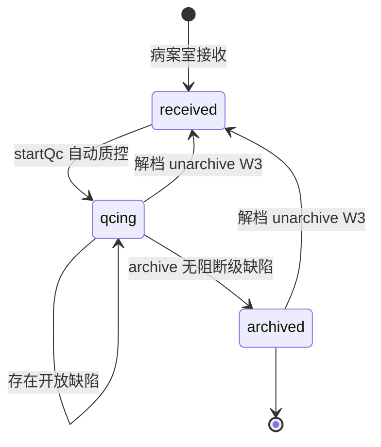
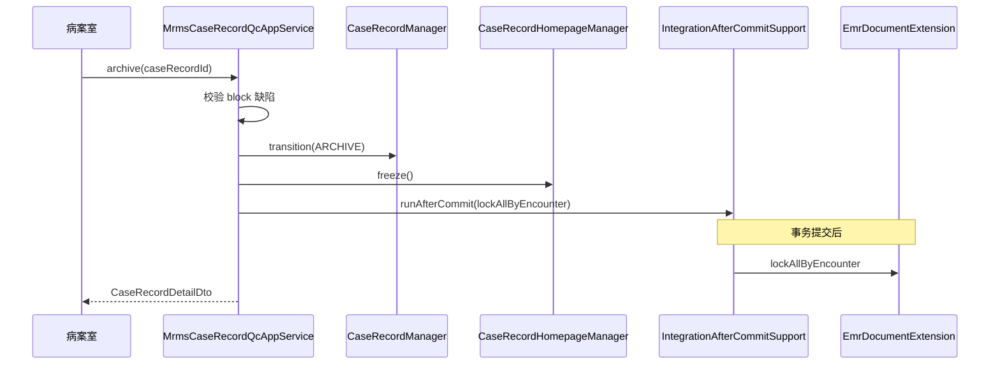

# 归档与质控 — 详细设计

> **文档性质**：详细设计（LLD），指导质控规则、缺陷闭环、归档锁定、卷宗预览与逾期预警编码  
> **上游**：[01-概要设计.md](./01-概要设计.md)、[03-病案首页-详细设计.md](./03-病案首页-详细设计.md)、[01-概要设计.md](./01-概要设计.md) §7.4  
> **版本**：v1.1 | **日期**：2026-06-19 | **AppService 真源**：[02-交互说明.md](./02-交互说明.md)

---

## 1. 范围

### 1.1 本文档覆盖

| 功能清单 | 章节 |
|----------|------|
| §4.6 病案质控（6.1～6.6） | §3～§6、§9 |
| §4.7 归档与卷宗（7.1～7.5） | §7～§8 |
| §4.8 逾期预警（8.3）、预览（8.2） | §9、§10 |

### 1.2 Wave 划分

| Wave | 内容 |
|------|------|
| **Wave 2** | 质控规则、自动质控、缺陷闭环、`startQc`、归档、卷宗目录、PDF 预览、逾期预警 |
| **Wave 3** | 强制归档（有开放缺陷）、解档 `unarchive`、预览水印 |

### 1.3 不在本文档

- 4401 上传（见 `05-对外上报-详细设计.md`）
- 借阅复印（Wave 3 另文档或概要设计 §5.7）

---

## 2. 总体流程

### 2.1 病案室主路径



```text
receive（Wave 1）
  → startQc（Wave 2）：status received → qcing，执行 QcRuleExecutor
  → 缺陷处理循环：
       医生/编码员修改首页或文书
       → markRectified（医生）
       → closeDefect / rerunQc（病案室）
  → archive：校验无 open 且 severity=block 的缺陷
       → status archived
       → homepage.freeze()
       → CaseRecordArchivedEvent
       → EMR 文书 LOCKED
```

### 2.2 与首页校验分工

| 阶段 | 组件 | 说明 |
|------|------|------|
| 医生提交 | 提交校验（`MrmsCaseRecordHomepageAppService` / domain，03 文档 §8 规则） | 必填、格式、主诊断 |
| 接收后/归档前 | `QcRuleExecutor` | 完整性、时效、编码、文书齐全 |

提交校验**不替代**质控；质控可配置更严规则。

---

## 3. 质控规则模型

### 3.1 表结构（沿用概要设计 §5.6）

**mrms_qc_rule** — 规则元数据（租户可启用/禁用）

| 列 | 说明 |
|----|------|
| `rule_code` | 唯一编码，如 `QC_HOMEPAGE_REQUIRED` |
| `rule_name` | 展示名 |
| `severity_code` | `block` / `warn` / `info` |
| `enabled` | 是否参与执行 |
| `expression_json` | 规则参数（见 §3.3） |
| `category_code` | `completeness` / `timeliness` / `consistency` / `coding` / `document` |

**mrms_qc_defect** — 质控缺陷实例

| 列 | 说明 |
|----|------|
| `case_record_id` | 病案 |
| `rule_code` | 触发规则，手工缺陷可为空 |
| `defect_message` | 描述 |
| `severity_code` | 冗余自规则 |
| `status_code` | `open` / `rectified` / `closed` |
| `responsible_practitioner_id` | 责任医生（可选） |
| `rectified_at` / `closed_at` | 时间戳 |

**mrms_qc_run**（新增，执行批次）

```sql
CREATE TABLE IF NOT EXISTS mrms_qc_run (
    id                  BIGINT PRIMARY KEY,
    case_record_id      BIGINT       NOT NULL REFERENCES mrms_case_record(id),
    trigger_code        VARCHAR(32)  NOT NULL,
    defect_open_count   INTEGER      NOT NULL DEFAULT 0,
    defect_warn_count   INTEGER      NOT NULL DEFAULT 0,
    passed              BOOLEAN      NOT NULL,
    finished_at         TIMESTAMP    NOT NULL,
    tenant_id           BIGINT       NOT NULL,
    created_at          TIMESTAMP    NOT NULL,
    created_by          BIGINT
);

CREATE INDEX IF NOT EXISTS idx_mrms_qc_run_cr
    ON mrms_qc_run (case_record_id, finished_at DESC);
```

`trigger_code`：`on_receive` | `before_archive` | `manual` | `scheduled`。

**mrms_required_doc_type** — 必写文书配置（文书完整性质控）

| 列 | 说明 |
|----|------|
| `document_type_code` | `emr_document_type.code` |
| `encounter_class_code` | 住院 `IMP` 等，空=全部 |
| `required` | 是否必写 |

### 3.2 枚举

```java
public enum QcDefectSeverity {
    BLOCK("block", "阻断"),
    WARN("warn", "警告"),
    INFO("info", "提示");
}

public enum QcDefectStatus {
    OPEN("open", "待整改"),
    RECTIFIED("rectified", "已整改待复核"),
    CLOSED("closed", "已关闭");
}

public enum QcRuleCategory {
    COMPLETENESS("completeness"),
    TIMELINESS("timeliness"),
    CONSISTENCY("consistency"),
    CODING("coding"),
    DOCUMENT("document");
}
```

### 3.3 expression_json 约定

首期**不引入** Drools/SpEL 引擎；`QcRuleExecutor` 按 `rule_code` 硬编码分支，`expression_json` 仅承载**参数**。

```json
{
  "maxDaysAfterDischarge": 30,
  "requiredFields": ["psn_name", "dscg_way_code"],
  "documentTypeCodes": ["ADMISSION_RECORD", "DISCHARGE_RECORD"]
}
```

### 3.4 QcRuleExecutor

```java
public interface QcRuleExecutor {
    QcRunResult execute(long caseRecordId, QcTrigger trigger);
}

public class QcRunResult {
    private long qcRunId;
    private boolean passed;           // 无 block 级 open 缺陷
    private List<QcDefect> defects; // 本次新发现 + 仍 open 的旧缺陷（可选策略）
}
```

**执行策略（单批）**：

1. 加载 `enabled=true` 的规则（租户 + 全局种子）。
2. 逐条 `evaluate(rule, caseRecord, homepage, ports)`。
3. 命中则 **upsert** 缺陷：同 `(case_record_id, rule_code)` 且 `status=open` 则更新 `defect_message`，否则 insert。
4. 未命中且旧缺陷为 open → **自动 close**（规则已满足）。
5. 写 `mrms_qc_run` 汇总。

---

## 4. 内置规则包（种子）

Flyway：`V3__Mrms_Qc_Seed.sql`

| rule_code | 名称 | category | severity | 实现要点 |
|-----------|------|----------|----------|----------|
| `QC_HP_SUBMIT_REQUIRED` | 首页提交必填项 | completeness | block | 复用 Homepage 提交校验规则（03 §8） |
| `QC_HP_DATE_LOGIC` | 入出院日期逻辑 | consistency | block | R01/R02（03 §8.2） |
| `QC_HP_DISCHARGE_MAIN_DIAG` | 出院主诊断 | completeness | block | 至少 1 条 discharge_main |
| `QC_DOC_REQUIRED` | 必写文书齐全 | document | block | `EmrDocumentExtension` + `mrms_required_doc_type` |
| `QC_SUBMIT_OVERDUE` | 出院后未及时提交 | timeliness | warn | 出院后 N 天仍 draft/returned |
| `QC_ARCHIVE_OVERDUE` | 出院后未及时归档 | timeliness | warn | 出院后 N 天未 archived |
| `QC_CODING_GRAY_MAIN` | 主诊断灰码 | coding | warn | Wave 2+，`IcdSearchReader.isGray` |
| `QC_CODING_SEX_DIAG` | 性别与诊断冲突 | coding | warn | Wave 2+ |
| `QC_FEE_SUM_MISSING` | 费用总额缺失 | completeness | info | `medfee_sumamt` 空 |

**默认必写文书种子**（`mrms_required_doc_type`，按租户 0 插入全局）：

| document_type_code | 说明 |
|--------------------|------|
| `ADMISSION_RECORD` | 入院记录 |
| `DISCHARGE_RECORD` | 出院记录 |
| `FIRST_PROGRESS_NOTE` | 首次病程 |

> 实际 code 与 `emr_document_type` 种子对齐，部署时核对 `V2__H2_Seed.sql`。

---

## 5. 缺陷闭环

### 5.1 缺陷状态机

```text
open ──markRectified──► rectified ──closeDefect──► closed
  │                        │
  └──closeDefect───────────┘（病案室认定无需改 / 误报）
```

| 动作 | 角色 | 前置 | 效果 |
|------|------|------|------|
| `markRectified` | 医生/编码员 | `open` | → `rectified`，写 `rectified_at` |
| `closeDefect` | 病案室 | `open` / `rectified` | → `closed`，写 `closed_at` |
| `reopenDefect` | 病案室 | `closed` | → `open`（复核不通过） |

首页保存或 `submit` 成功后，可配置**自动**将关联 `QC_HP_*` 的 `rectified` 缺陷保留，由病案室 `rerunQc` 关闭。

### 5.2 手工缺陷

病案室 `addManualDefect`：无 `rule_code`，`severity_code` 手选，`defect_message` 必填。

### 5.3 归档门禁

```text
archive 前置检查：
  1. status == qcing
  2. COUNT(defect WHERE status IN (open, rectified) AND severity_code = block) == 0
  3. 可选：rerunQc(trigger=before_archive) 刚执行且 passed
```

**强制归档**（Wave 3）：`forceArchive(reason)` — 需高权限；开放 block 缺陷仍写入审计；`quality_grade_code` 可降级。

---

## 6. 质控 API（MrmsCaseRecordQcAppService）

> serviceName：`mrmsCaseRecordQc` · 路径前缀 `POST /api/app/mrmsCaseRecordQc/`

> 路径前缀：`/api/app/caseRecordQc/{method}`

| 方法 | 入参 | 出参 | 说明 |
|------|------|------|------|
| `startQc` | `LongValueRequest`（caseRecordId） | `QcRunResultDto` | `received`→`qcing` + 执行规则 |
| `rerunQc` | `RerunQcRequest` | `QcRunResultDto` | 不迁状态；`trigger=manual` |
| `listDefects` | `ListDefectsRequest` | `List<QcDefectDto>` | 可按 status/severity 过滤 |
| `addManualDefect` | `AddManualDefectRequest` | `QcDefectDto` | |
| `markRectified` | `DefectActionRequest` | `QcDefectDto` | |
| `closeDefect` | `DefectActionRequest` | `QcDefectDto` | |
| `listQcRuns` | `LongValueRequest` | `List<QcRunSummaryDto>` | 历史批次 |
| `listQcRules` | `QueryQcRuleRequest` | `List<QcRuleDto>` | 规则配置查询 |
| `setRuleEnabled` | `SetRuleEnabledRequest` | `QcRuleDto` | 医务管理员 |

**QcRunResultDto**：`qcRunId`、`passed`、`openBlockCount`、`openWarnCount`、`defects[]`。

---

## 7. 归档设计

### 7.1 状态迁移

| 动作 | 自 | 至 | 副作用 |
|------|----|----|--------|
| `startQc` | `received` | `qcing` | 执行质控 |
| `archive` | `qcing` | `archived` | freeze、事件、冗余字段 |
| `unarchive` | `archived` | `received` | unfreeze、EMR 解锁（W3） |

`CaseRecordManager.transition` 扩展 `CaseRecordAction`：`START_QC`、`ARCHIVE`、`UNARCHIVE`。

### 7.2 归档时主档写入

| 字段 | 来源 |
|------|------|
| `archived_at` | `now()` |
| `archived_by` | `ICurrentUser` |
| `quality_grade_code` | 质控结果映射或病案室手选（甲/乙/丙） |
| 首页 `medcas_qlt_code` | 同步病案质量 |

### 7.3 CaseRecordArchivedEvent

```java
public class CaseRecordArchivedEvent {
    private final long caseRecordId;
    private final long encounterId;
    private final long patientId;
    private final long tenantId;
    private final LocalDateTime archivedAt;
}
```

发布：`CaseRecordManager` 在 `archive` 事务 `beforeCommit` 或 `@TransactionalEventListener` AFTER_COMMIT。

### 7.4 EMR 文书锁定

**现行（v1.4）**：`MrmsCaseRecordQcAppService.archive()` 在状态迁移成功后，由 `IntegrationAfterCommitSupport.runAfterCommit` 调用 `EmrDocumentExtension.lockAllByEncounter`。**已删除** `CaseRecordArchivedEmrListener`。

```java
// MrmsCaseRecordQcAppService.archive() 内（示意）
CaseRecord record = transition(..., ARCHIVE, ...);
scheduleEmrLockAfterCommit(record);  // afterCommit → emrDocumentExtension.lockAllByEncounter
return caseRecordAssembler.toDetail(record);
```

解档：`unarchive()` 同事务内调用 `emrDocumentExtension.unlockAllByEncounter`（已实现）。

**Extension 方法**（`EmrDocumentExtension`）：

```java
void lockAllByEncounter(long encounterId);
void unlockAllByEncounter(long encounterId);
```

实现调用 `DocumentManager.updateStatus` → `LOCKED`（已 `LOCKED`/`ARCHIVED` 跳过）。解档恢复 `SUBMITTED`（若此前为 `LOCKED`）；**不**恢复已单独 `ARCHIVED` 的文书。

### 7.5 首页冻结

`CaseRecordHomepageManager.freeze(caseRecordId)`：`frozen=true`；与 `archive` 同事务。

解档：`unfreeze()`，仅 `unarchive` 高权限流程调用。

---

## 8. 卷宗目录与 PDF 预览

### 8.1 卷宗目录（MrmsCaseRecordVolumeAppService）

> serviceName：`mrmsCaseRecordVolume`

| 方法 | 说明 |
|------|------|
| `getVolumeCatalog` | 返回 `VolumeCatalogDto` |

**VolumeCatalogDto**：

```java
public class VolumeCatalogDto {
    private Long caseRecordId;
    private String medcasno;
    private VolumeItemDto homepageItem;      // 病案首页 PDF
    private List<VolumeItemDto> documents;     // EMR 文书，按类型+时间排序
}

public class VolumeItemDto {
    private String itemType;       // homepage | emr_document
    private Long refId;
    private String title;
    private String documentTypeCode;
    private String documentTypeName;
    private LocalDateTime createdAt;
    private boolean printable;
}
```

数据来源：

1. 首页 — 固定虚拟项，`refId=caseRecordId`。
2. 文书 — `EmrDocumentExtension.listByEncounter(encounterId)`。

### 8.2 卷宗 PDF 预览

| 方法 | 入参 | 出参 |
|------|------|------|
| `previewVolumePdf` | `PreviewVolumeRequest` | `VolumePdfResultDto` |

**PreviewVolumeRequest**：

- `caseRecordId`（必填）
- `documentIds`（可选，空=全卷）
- `includeHomepage`（默认 true）

**编排**（`VolumePdfComposer`）：

```text
1. 若 includeHomepage：`HomepageOpenPdfRenderer.render(homepage)` → byte[]
   （首期可用简单表格 OpenPDF；与 03 首页打印共用）
2. FOR each documentId：EmrDocumentExtension.exportPdf(documentId)
3. OpenPdf merge（`application.shared.pdf.PdfMergeUtil`）
4. 返回 base64 或临时 URL（与 DocumentAppService PDF 一致）
```

**权限**：`status=archived` 或病案室角色；记审计 `MRMS_VOLUME_PREVIEW`。

### 8.3 归档 API

| 方法 | 入参 | 说明 |
|------|------|------|
| `archive` | `ArchiveCaseRecordRequest` | 含 `qualityGradeCode` 可选 |
| `unarchive` | `UnarchiveCaseRecordRequest` | 必填 `reason`（W3） |
| `getVolumeCatalog` | `LongValueRequest` | |
| `previewVolumePdf` | `PreviewVolumeRequest` | |

---

## 9. 逾期预警

### 9.1 配置

`application.yml`（或 `mrms` 前缀）：

```yaml
mrms:
  overdue:
    submit-days: 7        # 出院后 N 天未提交 → 预警
    archive-days: 30      # 出院后 N 天未归档 → 预警（对齐 SRS）
    cron: "0 0 8 * * ?"   # 每日 8 点
```

### 9.2 定时任务

```java
@Component
@ConditionalOnProperty(name = "mrms.overdue.enabled", havingValue = "true", matchIfMissing = true)
public class CaseRecordOverdueScanJob {
    @Scheduled(cron = "${mrms.overdue.cron}")
    public void scan() { ... }
}
```

**扫描逻辑**：

| 条件 | 动作 |
|------|------|
| `discharge_at + submit-days` 且 status ∈ {draft, returned} | `StaffNotificationExtension.notify` 主治医生 |
| `discharge_at + archive-days` 且 status ≠ archived | 同上 + 可写 `QC_ARCHIVE_OVERDUE` 缺陷 |

幂等：同一 caseRecord + 规则 + 自然日只通知一次（`mrms_overdue_notify_log` 可选，或 Redis set）。

### 9.3 StaffNotificationExtension 实现

`LoggingStaffNotificationExtension`：首期写 SLF4J 日志 + 站内消息占位；对接医院消息中心后续扩展。

---

## 10. 审计

| 操作 | 审计类型 code |
|------|----------------|
| startQc / rerunQc | `MRMS_QC_RUN` |
| archive | `MRMS_ARCHIVE` |
| unarchive | `MRMS_UNARCHIVE` |
| previewVolumePdf | `MRMS_VOLUME_PREVIEW` |
| forceArchive | `MRMS_FORCE_ARCHIVE` |
| 病案列表查询 | `MRMS_QUERY`（概要设计 §9） |

复用 `whale-audit`；若无则 `mrms_audit_log` 轻量表（`action_code`、`case_record_id`、`operator_id`、`detail_json`）。

---

## 11. 领域类清单（Wave 2 增量）

### mrms-domain

| 类 | 包 |
|----|-----|
| `QcRule` | entity |
| `QcDefect` | entity |
| `QcRun` | entity |
| `RequiredDocType` | entity |
| `QcRuleExecutor` / `DefaultQcRuleExecutor` | service |
| `CaseRecordArchiveService` | service |
| `CaseRecordArchivedEvent` | event |

### health-application/mrms

| 类 | 包 |
|----|-----|
| `MrmsCaseRecordQcAppService` | `application/mrms/qcworkbench` |
| `MrmsCaseRecordVolumeAppService` | `application/mrms/caserecord/volume` |
| `VolumePdfComposer` | `application/mrms/caserecord/volume/support` |
| `PdfMergeUtil` | `application/shared/pdf` |
| `HomepageOpenPdfRenderer` | `application/mrms/caserecord/homepage/support` |

### module-emr-bridge（`-Pwith-emr`）

| 类 | 包 |
|----|-----|
| `EmrDocumentExtensionImpl` | `zxplat-module-emr/module-emr-bridge/.../integration/emr/mrms` |
| `EmrAdmissionConditionExtensionImpl` | `zxplat-module-emr/module-emr-bridge/.../integration/emr/mrms` |
| `MrmsEmrAdmissionConditionResolverAdapter` | `application/mrms/caserecord/homepage/support` |

---

## 12. 时序：归档



---

## 13. 前端（病案室工作站）

| 页面/区 | API（serviceName/方法） |
|---------|-------------------------|
| 质控工作台 | `mrmsCaseRecordQc/startQc`、`listDefects`、`closeDefect` |
| 缺陷列表（医生） | `mrmsCaseRecordQc/listDefects`、`markRectified` |
| 归档按钮 | `mrmsCaseRecordQc/archive` |
| 卷宗预览 | `mrmsCaseRecordVolume/getVolumeCatalog`、`previewVolumePdf` |
| 解档 | `mrmsCaseRecordQc/unarchive`（W3） |

列表页增加列：`openDefectCount`、`qualityGradeCode`、`archivedAt`。

---

## 14. Flyway 清单

| 脚本 | 内容 |
|------|------|
| `V3__Mrms_Qc_Init.sql` | `mrms_qc_rule`、`mrms_qc_defect`、`mrms_qc_run`、`mrms_required_doc_type` |
| `V3__Mrms_Qc_Seed.sql` | §4 规则种子 + 必写文书 |
| `V4__Mrms_Audit_optional.sql` | `mrms_audit_log`（若不用 whale-audit） |

> 若 V1 已建 qc 表则 V3 仅 seed；与概要设计 §5.6 合并时调整版本号。

---

## 15. 实施顺序

| 步骤 | 交付 |
|------|------|
| 1 | Flyway V3 + 实体 Repository |
| 2 | `QcRuleExecutor` + 内置规则 QC_HP_* / QC_DOC_REQUIRED |
| 3 | `MrmsCaseRecordQcAppService` + 缺陷闭环 |
| 4 | `startQc` / `archive` 均在 `MrmsCaseRecordQcAppService` |
| 5 | `archive` + `IntegrationAfterCommitsupport → `EmrDocumentExtension.lockAllByEncounter` |
| 6 | `EmrDocumentExtension` 完整实现 + `getVolumeCatalog` |
| 7 | `VolumePdfComposer` + `previewVolumePdf` |
| 8 | `CaseRecordOverdueScanJob` + `StaffNotificationExtension` |
| 9 | 病案室前端质控/归档/预览页 |

---

## 16. 文档追溯

| 本文档 | 功能清单 | 概要设计 |
|--------|----------|----------|
| §4 规则 | §4.6.1～6.2 | §5.6 |
| §5 缺陷 | §4.6.3～6.4 | §5.6 |
| §7 归档 | §4.7 | §5.2、§11 |
| §8 卷宗 | §4.7.3～7.4 | §6.3 `EmrDocumentExtension` |
| §9 预警 | §4.6.6、§8.3 | §7.7 `StaffNotificationExtension` |

---

## 17. 修订记录

| 版本 | 日期 | 说明 |
|------|------|------|
| v1.1 | 2026-06-27 | Extension 取代旧 contracts 命名/Listener；归档 afterCommit |
| v1.0 | 2026-05-29 | 初稿：规则包、缺陷闭环、归档、卷宗 PDF、逾期预警 |
