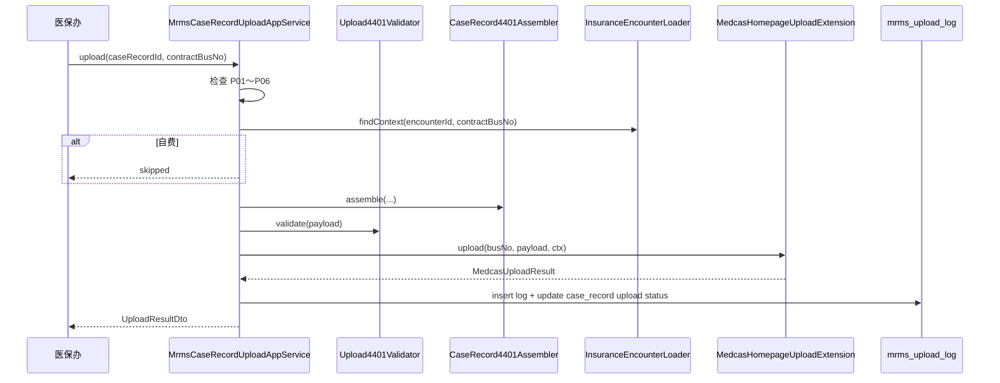

# 对外上报 — 详细设计（医保 4401）

> ⚠️ **CHS 当前态**：DTO 在 **`chs-domain`** `com.zxplat.chs.api.dto.*`；传输在 **`chs-application`**。**无** `chs-api`/`chs-impl` artifact。  
> **真源**：[01-概要设计.md](../../../模块/zxplat-module-chs-jilin/01-概要设计.md)

> **文档性质**：详细设计（LLD），指导住院病案首页医保上传（4401）组装、调用、日志与批次任务  
> **上游**：[03-病案首页-详细设计.md](./03-病案首页-详细设计.md) §10、[04-归档与质控-详细设计.md](./04-归档与质控-详细设计.md) §7、[01-概要设计.md](./01-概要设计.md) §6.4  
> **接口真源**：`docs/模块/zxplat-module-chs-jilin/apis/44xx/4401-住院病案首页信息.md`  
> **版本**：v1.9 | **日期**：2026-09-08 | **AppService 真源**：[02-交互说明.md](./02-交互说明.md)

---

## 1. 范围

### 1.1 覆盖

| 功能清单 | 说明 |
|----------|------|
| §4.10.1 | 4401 数据组装 |
| §4.10.2 | 4401 上传 invoke |
| §4.10.3 | 上传批次与日志、失败重试 |

### 1.2 Wave

| Wave | 内容 |
|------|------|
| **Wave 3** | 单条上传、上传日志、列表展示状态、手动重试 |
| **Wave 3+** | 按日批量任务、医保办批量界面 |

### 1.3 非目标

| 项 | 说明 |
|----|------|
| 4701 电子病历上传 | 归 EMR / 协同方案，不在 MRMS |
| 非医保患者 | 无 `mdtrt_id` 跳过上传，界面提示「自费无需上传」 |
| chs-impl HTTP/国密 | 已由 zxplat-module-chs-jilin 实现，本文不重复 |

---

## 2. 架构与职责

> **v1.1 对齐**：health 侧组装用 `MedcasHomepagePayload`；上传经 `MedcasHomepageUploadExtension`；CHS 内部仍用 `Chs4401Input`（adapter 内映射）。详见 [08-Extension与外部依赖.md](./08-Extension与外部依赖.md)。

```text
┌─────────────────────────────────────────────────────────────┐
│ MrmsCaseRecordUploadAppService（health-application/mrms/upload）│
│   upload / retry / queryUploadLogs / queryUploadPage / previewAssembled │
└────────────┬───────────────────────────────┬────────────────┘
             │ assemble                       │ persist log
             ▼                                ▼
┌────────────────────────────┐    ┌──────────────────────────┐
│ CaseRecord4401Assembler     │    │ mrms_upload_log           │
│ + InsuranceEncounterLoader │ mrms_case_record 上传状态 │
└────────────┬───────────────┘    └──────────────────────────┘
             │ MedcasHomepagePayload
             ▼
┌────────────────────────────┐
│ MedcasHomepageUploadExtension │
│ 实现：MedcasHomepageUploadExtensionImpl（chs-jilin-bridge）  │
└────────────┬───────────────┘
             │ JSON → Chs4401Input + InsuranceGatewayClient.invoke(4401)
             ▼
┌────────────────────────────┐
│ zxplat-module-chs-jilin / chs-jilin-application        │
└────────────────────────────┘
```

| 层 | 职责 |
|----|------|
| **health-application** | 门禁、组装（中性 DTO）、写日志、更新病案上传状态 |
| **health-integration-contracts** | `MedcasHomepagePayload`、`MedcasHomepageUploadExtension` |
| **chs-jilin-bridge** | `MedcasHomepageUploadExtensionImpl` → CHS 网关 |
| **chs-jilin-domain** | `Chs4401Input` 等国家 DTO（**仅 CHS Module**，health 不依赖） |

---

## 3. 上传前置条件

| # | 条件 | 失败提示 |
|---|------|----------|
| P01 | `case_record.status_code = archived` | 未归档不可上传 |
| P02 | 首页 `frozen = true` | 首页未冻结 |
| P03 | `InsuranceEncounterLoader` 返回有效 `mdtrt_id`（医保住院） | 非医保住院/未登记 |
| P04 | `homepage.ipt_medcas_hmpg_sn` 非空 | 首页流水号缺失 |
| P05 | `medcasno` 非空 | 病案号缺失 |
| P06 | `contractBusNo` 有效且 `fin_contract` 为医保合同 | 合同无效 |
| P07 | 4401 必填 baseinfo 字段齐全 | 组装校验汇总（见 §6） |

自费患者：`InsuranceEncounterLoader.isInsuranceInpatient(encounterId)=false` → API 返回 `skipped`，不写失败日志。

---

## 4. 4401 载荷 DTO（health 中性 + CHS 内部）

> **health 组装真源**：`com.zxplat.domain.integration.insurance.medcas.dto.MedcasHomepagePayload`（Jackson `@JsonProperty` 对齐 4401 JSON）。  
> **CHS adapter 内部**：JSON 反序列化为 `com.zxplat.chs.api.dto.national.medcas.Chs4401Input` 再 `invoke`。  
> 接口码：`MedcasInfCodes.MEDCAS_HOMEPAGE`（`"4401"`）。

### 4.1 health 根对象（现行）

```java
@Data
public class MedcasHomepagePayload {
    private MedcasHomepageBaseInfo baseinfo;
    private List<MedcasHomepageDiseInfo> diseinfo;
    private List<MedcasHomepageOprnInfo> oprninfo;
    private List<MedcasHomepageIcuInfo> icuinfo;
}
```

### 4.2 CHS 内部对象（adapter 专用，health 不依赖）

```java
@Data
public class Chs4401Input {
    private Chs4401BaseInfo baseinfo;
    private List<Chs4401DiseInfo> diseinfo;
    private List<Chs4401OprnInfo> oprninfo;
    private List<Chs4401IcuInfo> icuinfo;
}
```

### 4.3 子对象（字段与 4401 文档同名）

| 类 | JSON 节点 | 主要字段 |
|----|-----------|----------|
| `Chs4401BaseInfo` | `baseinfo`（单行） | `mdtrt_sn`、`mdtrt_id`、`psn_no`、`medcasno`、`psn_name`、`gend`、`adm_date`、`dscg_date`、`medfee_sumamt`、`fixmedins_code`、`vali_flag`… |
| `Chs4401DiseInfo` | `diseinfo[]` | `ipt_medcas_hmpg_sn`、`diag_code`、`maindiag_flag`、`ipt_patn_disediag_type_code`… |
| `Chs4401OprnInfo` | `oprninfo[]` | `oprn_oprt_code`、`oprn_oprt_date`、`main_oprn_flag`… |
| `Chs4401IcuInfo` | `icuinfo[]` | `icu_codeid`、`inpool_icu_time`、`out_icu_time`… |

完整字段清单见 **§8 映射总表**；实现时 DTO 属性与 4401 参数代码一一对应。

---

## 5. Extension 与读侧契约

> 详见 [08-Extension与外部依赖.md](./08-Extension与外部依赖.md)。**health-application 不依赖** `chs-jilin-domain`。

### 5.1 InsuranceEncounterLoader（health-application）

由 health 提供医保就诊上下文（**不**在 MRMS domain 读医保表）。结算键（`mdtrt_id`/`setl_id`/`psn_no`/票据）读 HIS 支付与回执；**定点机构终端参数**经 SPI
`InsuranceContractTerminalExtension` 读 **`chs-contract.properties`**（**禁止**读 `fin_contract.fixmedins_code` / `adm_vs` 历史列——表列常空，会导致 4401 组装校验「定点医药机构编号缺失 / mdtrt_sn 缺失」）。

```java
// 实现类：application.mrms.upload.medcas.support.InsuranceEncounterLoader
boolean isInsuranceInpatient(long encounterId);
Optional<InsuranceEncounterContext> findContext(long encounterId, String contractBusNo);

@Data
public class InsuranceEncounterContext {
    private String mdtrtId;
    private String psnNo;
    private String mdtrtSn;           // 组装时：优先 ctx；否则 fixmedins_code + ipt_no
    private String fixmedinsCode;     // chs-contract.fixmedins_code（SPI）
    private String fixmedinsName;     // chs-contract.fixmedins_name（SPI）
    private String insuplcAdmdvs;     // chs-contract.adm_vs（SPI）
}
```

| 字段 | 数据来源 |
|------|----------|
| `mdtrt_id` / `setl_id` | 支付流水 `PaymentYbSettlement` |
| `psn_no` | 结算回执 → 就诊平台映射 |
| `fixmedins_code` / `fixmedins_name` / `adm_vs` | `InsuranceContractTerminalExtension` → `chs-contract.properties` |
| 票据三要素 | `adm_invoice` + 博思电子票；`bill_code` 优先 `boss_batch_code`，空则回落发票号，再空由 4101A Mapper 用 `ipt_no`/`medcasno` 兜底（对齐老 `ifnull(billBatchCode, INVOICE_NO, ZY_NO)`） |

MRMS 仅依赖该 Loader + SPI；**不**直接依赖 `chs-jilin-domain`。

### 5.1.0 4101A 组装兜底（对齐老 SQL ifnull）

| 字段 | 组装规则 |
|------|----------|
| `bill_code` | 博思 `boss_batch_code` → 发票 `bill_no` → `biz_sn` → `ipt_no` → `medcasno`；仍空则 `Upload4101AValidator` 报 `bill_code 缺失` |
| 护理四天 | homepage 四格；**null 按 `"0"` 上送**（老 `ifnull(em.*_nurscare_days,0)`） |
| `diseinfo.adm_cond_type` | 行 `adm_cond_code`；**空默认 `"3"`（情况不明）**，避免行校验整批失败 |
| `adm_caty` / `dscg_caty` | 科室维护的 **医保编码** `yb_no`（如 `A50.13`，长度 1–10）；禁止院内 `bus_no`；首页误存 bus_no 时组装反查 |
| `diseinfo` | **仅出院诊断**；跳过 `need_yb_up=0`；`diag_type`：1 西医 / 2 中医主病 / 3 中医主证；西医主诊与中医主病 `maindiag_flag=1` 各至多一条 |

实现：`InsuranceEncounterLoader#fillInvoiceFields` + `CaseRecord4101AMapper` + `MedcasOrgCatyOutboundSupport`。

### 5.1.1 InsuranceContractTerminalExtension

| 项 | 说明 |
|----|------|
| **接口** | `integration.insurance.contract.InsuranceContractTerminalExtension` |
| **出参** | `InsuranceContractTerminalQueryExtensionOut`（`fixmedinsCode`/`fixmedinsName`/`admVs`） |
| **实现** | `InsuranceContractTerminalExtensionImpl`（`chs-jilin-bridge` → `ChsContractPropertiesAccess`） |
| **默认** | `NoOpInsuranceContractTerminalExtension`（`isEnabled()=false`） |
| **消费方** | `InsuranceEncounterLoader` |

### 5.2 MedcasHomepageUploadExtension

```java
public interface MedcasHomepageUploadExtension {
    MedcasUploadResult upload(String contractBusNo, MedcasHomepagePayload payload, InvokeContext context);
}

@Data
public class MedcasUploadResult {
    private boolean success;
    private String infcode;
    private String errMsg;
    private String warnMsg;
    private String output;
    private String msgid;
}
```

**MedcasHomepageUploadExtensionImpl**（`chs-jilin-bridge`）：

```java
Chs4401Input chsInput = objectMapper.convertValue(payload, Chs4401Input.class);
ResultBody body = gateway.invoke(contractBusNo, MedcasInfCodes.MEDCAS_HOMEPAGE, chsInput, context);
return mapResult(body);
```

`invoke` **不在** MRMS 的 DB 事务内：先 `assemble`，再短事务写 log。

---

## 6. CaseRecord4401Assembler

### 6.1 入口

```java
public MedcasHomepagePayload assemble(long caseRecordId, InsuranceEncounterContext insCtx) {
    CaseRecord cr = ...
    CaseRecordHomepage hp = ...
    List<HomepageDiagnosis> diags = ...
    List<HomepageProcedure> procs = ...
    List<HomepageIcu> icus = ...   // 可空列表
    return build(cr, hp, diags, procs, icus, insCtx);
}
```

### 6.2 baseinfo 组装规则

| 逻辑 | 说明 |
|------|------|
| 标量字段 | 首页列 → DTO 同名属性（§8.1） |
| 日期 | `LocalDateTime` → `yyyy-MM-dd` 字符串 |
| 数值 | `BigDecimal` 保留 2 位 |
| 费用分项 | 首页费用快照列写入 baseinfo（无快照则补种；不另走账单现查） |

| `mdtrt_sn` | 优先 `insCtx.mdtrtSn`；否则 `fixmedinsCode + ipt_no`（`fixmedinsCode` 来自 chs-contract SPI） |
| `patn_ipt_cnt` | `case_record.patn_ipt_cnt` 转字符串 |
| `vali_flag` | 固定 `"1"` |
| `fixmedins_code` | `insCtx.fixmedinsCode`（**chs-contract**，非 `fin_contract` 列） |

### 6.3 diseinfo 组装

- 遍历 `mrms_homepage_diagnosis`（`is_deleted=false`，按 `diag_type_code`、`sort_no`）。
- **跳过 `need_yb_up=0`**（首页「上传=否」；4401 与 4101A 同口径，该行不进 diseinfo）。
- **院内口径**：首页与住院医生站西医 `diag`/`condition` 存**国临码**（`clinical_v2`）；门诊西医仍走院内/医保目录，**本改不触及门诊**。
- **中医**：住院选码走 `tcm_dx`/`tcm_syndrome`（目录码）；不对国临→医保；预览医保列回显落库码/名、国临列空；`requireDiagnosisOutbound` 出站用该码。
- **4401 / 4101A 输出（西医/手术）**：组装时经 `MedcasDualCodeResolveSupport`：出站**仅**目录 `yb_no`；**无对照报错阻断**（禁止用国临顶替，避免平台拒收/对错账）。老系统曾有 `ifnull(..., icd10)` 末档回退，本系统不沿用。
- **结算清单预览**：`MrmsSettleListPreviewAppService#loadSettleListPreview` 同屏展示国临+医保+出站码+**是否上传（needYbUp）**；中医不标未对码；ICU/输血无数据时空数组上送。
- **首页打印**：OpenPDF 输出落库码（西医国临）。
- 跳过 `diag_code` 为空的行。
- `ipt_patn_disediag_type_code`：按 [03-病案首页 §5.1](./03-病案首页-详细设计.md) 映射。
- 每行带 `ipt_medcas_hmpg_sn`、`mdtrt_sn`、`fixmedins_code`。

### 6.4 oprninfo / icuinfo

- 手术：来自 `mrms_homepage_procedure`；无手术时传**空数组** `[]`（不传 null）。
- ICU：来自 `mrms_homepage_icu`；无 ICU 时传 `[]`（旧 openhis 曾传占位空行——**改为空数组**，若现场医保要求至少一行再配置开关）。

### 6.5 组装后校验（Upload4401Validator）

| 规则 | 说明 |
|------|------|
| U01 | `baseinfo.medcasno`、`psn_name`、`medfee_sumamt` 必填 |
| U02 | `diseinfo` 至少 1 行且含 `maindiag_flag=1` |
| U03 | 医保患者 `mdtrt_id`、`psn_no` 非空 |
| U04 | 日期字段格式合法 |

---

## 7. 上传流程

### 7.1 单条上传时序



### 7.2 InvokeContext

```java
InvokeContext ctx = InvokeContext.builder()
    .operatorId(currentUser.getUserId())
    .operatorName(currentUser.getUserName())
    .insuplcAdmdvs(insCtx.getInsuplcAdmdvs())
    .build();
```

签到：`InsuranceGatewayClientLocalImpl` 在 invoke 前自动 `ensureSigned`。

### 7.3 成功判定

```text
success = "0".equals(resultBody.getInfcode())
```

失败：`err_msg` 写入 `mrms_upload_log.error_msg`；`case_record.chs_upload_status_code = failed`。

### 7.4 重试

- `retryUpload(uploadLogId)` 或 `upload(caseRecordId)` 再次调用。
- 4401 **无输出报文**，平台侧一般为覆盖上传；同一 `medcasno` + `ipt_medcas_hmpg_sn` 可重入。
- 每次重试**新增**一条 `mrms_upload_log`（保留审计链）。

---

## 8. 字段映射总表

> **真源**：4401 文档 + [03-病案首页](./03-病案首页-详细设计.md)。下表为编码索引；DTO 属性名与 4401 `参数代码` 一致（驼峰）。

### 8.1 baseinfo（节选，Wave 3 首批实现）

| 4401 参数 | 来源表.列 / 逻辑 |
|-----------|------------------|
| mdtrt_sn | `InsuranceEncounterLoader` / `fixmedins + ipt_no`（fixmedins←chs-contract SPI） |
| mdtrt_id | `InsuranceEncounterLoader` → `mdtrtId` |
| psn_no | `InsuranceEncounterLoader` → `psnNo` |
| patn_ipt_cnt | `mrms_case_record.patn_ipt_cnt` |
| ipt_no | `homepage.ipt_no` |
| medcasno | `mrms_case_record.medcasno` |
| psn_name | `homepage.psn_name` |
| gend | `homepage.gend_code` |
| brdy | `homepage.brdy` |
| ntly / naty / certno / prfs / mrg_stas | 首页同名列 |
| curr_addr / psn_tel / coner_* | 首页同名列 |
| adm_way_code | `homepage.adm_way_code`（与就诊 `in_way_code` 同口径 **1/2/3/9**；HIS 导入经 `MrmsConstants.mapInWayCodeToAdmWayCode`） |
| adm_caty / dscg_caty | `homepage.adm_caty_code` / `dscg_caty_code` → 出站须为科室 **医保编码** `adm_organization.yb_no`（长度 1–10）；若首页误存院内 `bus_no`，组装时反查 `yb_no` |
| adm_date / dscg_date | `homepage.adm_time` / `dscg_time` |
| ipt_days | `homepage.ipt_days` |
| dscg_way | `homepage.dscg_way_code` |
| deptdrt_name … resp_nurs_name | `homepage.dept_director_name` 等 |
| medfee_sumamt / selfpay_amt | 首页快照列 `medfee_sumamt` / `selfpay_amt` |
| medfee_paymtd_code | `homepage.pay_way_code`（付费方式正式列） |
| ordn_med_servfee … oth_fee | 首页快照 `fee_items_json` |
| fixmedins_code | `InsuranceEncounterLoader` ← `InsuranceContractTerminalExtension` / chs-contract |
| vali_flag | 常量 `1` |

未列字段按 03 文档 §4 注册表正式列补齐；费用读快照（V26），仅「重新统计」或首次补种覆盖。

### 8.2 diseinfo 行

| 4401 参数 | 来源 |
|-----------|------|
| ipt_medcas_hmpg_sn | `homepage.ipt_medcas_hmpg_sn` |
| mdtrt_sn / fixmedins_code | 同 baseinfo |
| ipt_patn_disediag_type_code | `HomepageDiagType` 映射 |
| maindiag_flag | `homepage_diagnosis` 或类型推导 |
| diag_code / diag_name | 诊断行 |
| adm_cond_code | `homepage_diagnosis.adm_cond_code`；4401 透传。4101A `adm_cond_type` 空则组装默认 `3`（情况不明） |
| vali_flag | 默认 `1` |

### 8.3 oprninfo 行

| 4401 参数 | 来源列 |
|-----------|--------|
| oprn_oprt_date | `oprn_date` |
| oprn_oprt_code / oprn_oprt_name | 手术行 |
| oprn_lv_code | `oprn_level_code` |
| sinc_heal_lv_code | `sinc_heal_lv_code` |
| anst_mtd_code | `anst_mtd_code` |
| oper_name / asit_1_name / asit_name2 | 手术行 |
| main_oprn_flag | `main_oprn_flag` |
| vali_flag | 默认 `1` |

### 8.4 icuinfo 行

| 4401 参数 | 来源列 |
|-----------|--------|
| icu_codeid | `mrms_homepage_icu.icu_codeid` |
| inpool_icu_time / out_icu_time | 同表 |
| nurscare_lv_code / nurscare_days | 同表 |
| vali_flag | 默认 `1` |

---

## 9. 持久化

### 9.1 mrms_upload_log（概要设计 §5.7）

| 列 | 说明 |
|----|------|
| `status_code` | `success` / `failed` / `skipped` |
| `msgid` | 发送方报文 ID（chs 生成） |
| `request_digest` | SHA-256 前 128 字符（脱敏摘要，非全文明文） |
| `response_snapshot` | `infcode` + `err_msg` JSON |
| `contract_id` | 业务合同主键（展示用） |
| `infno` | 固定 `4401` |

### 9.2 mrms_case_record 冗余（列表展示）

```sql
ALTER TABLE mrms_case_record ADD COLUMN IF NOT EXISTS chs_upload_status_code VARCHAR(32);
ALTER TABLE mrms_case_record ADD COLUMN IF NOT EXISTS chs_upload_at TIMESTAMP;
ALTER TABLE mrms_case_record ADD COLUMN IF NOT EXISTS chs_upload_error VARCHAR(500);
```

| chs_upload_status_code | 含义 |
|------------------------|------|
| `pending` | 已点上传或重试排队（手动流程） |
| `success` | 最近上传成功 |
| `failed` | 最近上传失败 |
| `skipped` | 自费/无需上传（手动上传时判定） |
| `null` | 已归档、尚未手动上传 |

### 9.3 枚举

```java
public enum ChsUploadStatus {
    PENDING("pending"),
    SUCCESS("success"),
    FAILED("failed"),
    SKIPPED("skipped");
}
```

---

## 10. API（MrmsCaseRecordUploadAppService）

> serviceName：`mrmsCaseRecordUpload` · 页面：`chs/medcas-ops/index.vue` + `chs/api/medcas-ops.ts` · 详见 [02 §5.2](./02-交互说明.md)

> `/api/app/caseRecordUpload/{method}`

| 方法 | 入参 | 出参 | 说明 |
|------|------|------|------|
| `upload` | `Upload4401Request` | `UploadResultDto` | 单条上传 |
| `retry` | `LongValueRequest`（logId） | `UploadResultDto` | 按日志重试 |
| `listUploadLogs` | `ListUploadLogsRequest` | `List<UploadLogDto>` | 某病案历史上传 |
| `previewAssembled` | `Upload4401Request` | `MedcasHomepagePayload`（或 JSON） | 调试/医保办预检，**不 invoke** |
| `queryUploadPage` | `QueryUploadPageRequest` | `PagedResult<CaseRecordUploadSummaryDto>` | 医保办待传/失败列表 |

**Upload4401Request**：

| 字段 | 类型 | 必填 |
|------|------|------|
| `caseRecordId` | long | Y |
| `contractBusNo` | String | Y（`fin_contract.bus_no`） |

**UploadResultDto**：

| 字段 | 说明 |
|------|------|
| `statusCode` | success / failed / skipped |
| `uploadLogId` | 日志 ID |
| `infcode` / `errMsg` | 平台返回 |
| `assembledAt` | 组装时间 |

**CaseRecordUploadSummaryDto**：病案号、姓名、出院日期、归档时间、`chs_upload_status_code`、最近错误。

---

## 11. 批量上传（Wave 3+）

### 11.1 定时任务

```yaml
mrms:
  upload:
    batch-enabled: true
    cron: "0 30 1 * * ?"    # 每日凌晨 1:30，对齐 4401「定时/每天」
    contract-bus-no: ${默认医保合同 bus_no}
```

```java
public class CaseRecord4401BatchUploadJob {
    // 条件：archived + chs_upload_status in (pending, failed) + 医保
    // 逐条 upload，失败继续下一条，写汇总日志
}
```

### 11.2 批次记录（可选）

```sql
CREATE TABLE IF NOT EXISTS mrms_upload_batch (
    id BIGINT PRIMARY KEY,
    batch_date DATE NOT NULL,
    total_count INT,
    success_count INT,
    failed_count INT,
    skipped_count INT,
    finished_at TIMESTAMP,
    tenant_id BIGINT NOT NULL
);
```

首期可用日志统计代替独立批次表。

---

## 12. 前端（医保办）

| 功能 | API |
|------|-----|
| 待上传列表 | `queryUploadPage`（status=pending → null/pending/failed） |
| 单条上传 | `upload` |
| 查看平台错误 | `listUploadLogs` |
| 预检 JSON | `previewAssembled` |
| 病案列表列 | 展示 `chs_upload_status_code` |

住院患者医保界面可嵌入「上传病案首页」按钮，传入当前 `contractBusNo`。

---

## 13. 安全与审计

| 项 | 策略 |
|----|------|
| 权限 | 医保办角色；`upload` / `previewAssembled` 分权（预览可放宽） |
| 审计 | `MRMS_CHS_4401_UPLOAD`；记录 caseRecordId、contractBusNo、infcode |
| 脱敏 | 日志不存完整 `MedcasHomepagePayload`；仅 `request_digest` + 失败 err_msg |
| 合同密钥 | 仅在 chs-contract.properties，MRMS 不持有 |

---

## 14. 模块交付清单

| # | 交付项 | 模块 |
|---|--------|------|
| 1 | `MedcasInfCodes.MEDCAS_HOMEPAGE` + `Chs4401Input` 等 DTO | chs-jilin-domain（**仅 CHS**） |
| 2 | `MedcasHomepagePayload` + `MedcasHomepageUploadExtension` + `InsuranceContractTerminalExtension` | zxplat-infrastructure/.../integration |
| 3 | `InsuranceEncounterLoader`（定点编码经 SPI 读 chs-contract） | health-application |
| 4 | `CaseRecord4401Mapper`、`Upload4401Validator` | health-application/mrms/upload/medcas |
| 5 | `MrmsCaseRecordUploadAppService` | health-application/mrms/upload |
| 6 | `MedcasHomepageUploadExtensionImpl` | chs-jilin-bridge |
| 7 | Flyway：`mrms_upload_log` + case_record 上传列 | zxplat-domain |
| 8 | `CaseRecord4401BatchUploadJob`（可选，未实现） | 若实现须置于 `upload/medcas/` 包，**禁止** `application/mrms/support/job` |
| 9 | 医保办前端页 | openhis-pro-ui |

---

## 15. 测试要点

| 场景 | 预期 |
|------|------|
| 未归档上传 | 拒绝 P01 |
| 自费住院 | `skipped`，不写 failed |
| 缺 mdtrt_id | 组装校验 U03 失败 |
| 平台 infcode≠0 | log=failed，主档 `chs_upload_status_code=failed` |
| 成功后再传 | 新 log 行，状态仍 success |
| 签到过期 | chs `ensureSigned` 自动重签后重试 invoke |

金样例：从旧 openhis `Yb4401InputDto` 脱敏导出 JSON，与 Assembler 输出 diff。

---

## 16. 文档追溯

| 本文档 | 功能清单 | 其他文档 |
|--------|----------|----------|
| §6～§8 组装 | §4.10.1 | 03 §10 |
| §7 流程 | §4.10.2 | 01 §6.4 |
| §9～§11 日志批次 | §4.10.3 | 02 §5.7 |
| §5 Extension | — | [08](./08-Extension与外部依赖.md) |

---

## 17. 修订记录

| 版本 | 日期 | 说明 |
|------|------|------|
| v1.9 | 2026-09-08 | 4401 费用改读首页快照列（V26）；无快照补种；与「重新统计」同口径 |
| v1.8 | 2026-09-04 | 4103 查询结果：状态中文映射 + 详情弹窗全量子表展示口径（见交付清单 B.4） |
| v1.7 | 2026-09-04 | diseinfo 跳过 need_yb_up=0；结算清单预览回显是否上传 |
| v1.6 | 2026-09-04 | 4101A diseinfo：仅出院；diag_type 按中西医 1/2/3（修「主诊断只能各一条」） |
| v1.5 | 2026-09-04 | 入/出院科别出站改取科室医保编码 `yb_no`（禁 bus_no）；§5.1.0 / §8.1 同步 |
| v1.4 | 2026-09-04 | §5.1.0：4101A `bill_code`/护理四天/`adm_cond_type` 对齐老 ifnull 兜底；票据三要素与 diseinfo 行映射同步 |
| v1.3 | 2026-08-13 | §8.1 **adm_way_code** 与登记/首页 adm_way 字典对齐（1/2/3/9） |
| v1.2 | 2026-06-27 | §5 Extension 取代旧 contracts 命名；`MedcasHomepagePayload` 组装真源 |
| v1.1 | 2026-06-19 | 对齐 health 内嵌 MRMS |
| v1.0 | 2026-05-29 | 初稿：4401 DTO、组装、上传流程、映射表、API |
