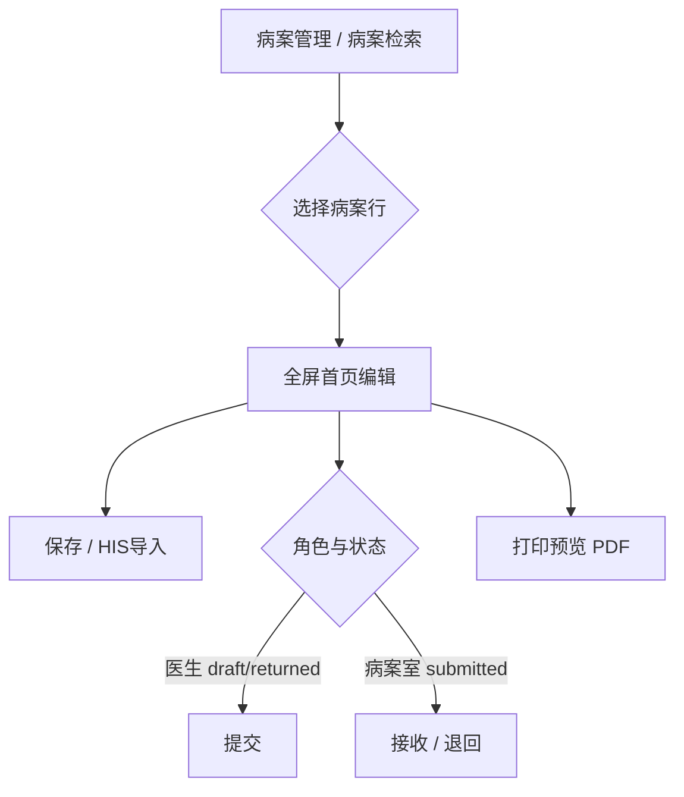

# 病案首页 — 前端设计（openhis-pro-ui）

> **文档性质**：前端详细设计（FED），指导 `openhis-pro-ui` 病案管理菜单、列表、全屏首页编辑、编码选择与打印预览  
> **上游**：[03-病案首页-详细设计.md](./03-病案首页-详细设计.md)、[01-概要设计.md](./01-概要设计.md) §8、[00-功能清单.md](./00-功能清单.md) §七 MVP  
> **代码仓库**：`openhis-pro-ui/apps/web-ele`（API：`#/api/mrms/*`；页面：`#/views/mrms/*`）  
> **版本**：v2.13 | **日期**：2026-09-09 | **AppService 真源**：[02-交互说明.md](./02-交互说明.md) | **状态**：院内首页**已齐**；**去 JSON / 费用快照落库**；临床侧栏抬头/医嘱正序打印已补；**体温单/护理记录病区写门禁**；上报 UI 壳已有，真上传见 [10](./10-病案首页交付任务清单.md) §6～§8；**中医信息**按医院 `medins_type`；打印双模板；诊断医生下拉/`organizationId`/空值 `-` 已补

---

## 1. 已确认决策摘要

| # | 决策 | 说明 |
|---|------|------|
| 1 | **不在住院医生站嵌入病案首页** | 医生、病案室均在一级菜单 **「病案管理」** 内完成填报与审核 |
| 2 | **整页保存** | 单次 `saveHomepage` 提交标量 + 诊断/手术子表全量 |
| 3 | **左锚点 + 右长表单** | 左侧章节定位器（`ElAnchor`），右侧单一滚动区展示完整首页 |
| 4 | **诊断编码数据源** | Wave 1 复用医生站 **`DiagnosisPickerDialog`**（`pickOnly=true`）；确认仅追加首页行，**saveHomepage** 落 `mrms_homepage_diagnosis`；院点 override 须支持 `pickOnly` |
| 5 | **独立一级菜单** | 「病案管理」→ 病案列表 → 全屏编辑页 |
| 6 | **列表跳转全屏编辑** | 无医生站嵌入面板 |
| 7 | **列表默认筛选** | **医生**：本人主治 + 本科出院；**病案室**：全院（见 §5.2） |
| 8 | **HIS 导入** | 顶栏 **「全部导入」** + 各章节标题旁 **「导入本章」** |
| 9 | **打印** | 后端 **OpenPDF** 渲染；Wave 1 为 **简化国标表格** 版式（非 1:1 纸质扫描版），后续精调 |
| 10 | **无 extension_json / 费用快照** | 页面对齐字段正式列；费用只读快照（`HomepageDto.fees`←落库列）+「重新统计」才按当前病案结算项重算；**「全部导入」不刷费用**；`extension_json` 列已删（V22）；费用列见 V26 |
---

## 2. 页面类型与规范

| 页面 | 主类型 | 附加 | 规范 Skill |
|------|--------|------|------------|
| 病案列表 | **T3**（带操作列表） | — | `frontend-page-type-and-style-standards` + `frontend-codegen` |
| 病案首页编辑 | **T4**（表单页） | **T5**（诊断/手术行编辑表） | 表单对齐住院挂号；T5 见 `homepage-diagnosis-grid.vue` |

**样式基线**：列表与表单视觉对齐 `views/inpatient/charge/register/`；偏差仅收敛在 `views/mrms/**` 业务组件内。

---

## 3. 信息架构与路由

### 3.1 菜单

```text
病案管理（一级菜单）
└── 病案首页          → /mrms/homepage
    └── （行操作）编辑 / 一键上报 / 打开卷宗等
```

- 编辑在同一页内面板或全屏展开；**不单独挂「病案检索」菜单**（V25 已废止）。
- 路由 `name` 建议：`MrmsCaseRecordHomepage`。
- 菜单与权限码由后台配置；前端按角色控制按钮显隐（§8）。

### 3.2 用户流



**不在范围内**：住院医生站 Tab、病历树「病案首页」节点联动（保持 EMR 树现状，不接入 MRMS 填报）。

---

## 4. 病案首页编辑页布局

### 4.1 线框

```text
┌──────────────────────────────────────────────────────────────────┐
│ 顶栏：病案号 | 患者 | 状态 Tag | v{versionNo} | [保存][全部导入][提交/接收/退回][打印] │
├────────────┬─────────────────────────────────────────────────────┤
│ ElAnchor   │  scroll-container（右侧唯一滚动区）                    │
│ (sticky)   │  #sec-basic      + SectionTitle「基本信息」 [导入本章] │
│            │  #sec-inpatient  + SectionTitle「住院信息」 [导入本章] │
│  · 基本信息 │  #sec-diagnosis  + SectionTitle「诊断编码」 [导入本章] │
│  · 住院信息 │  #sec-procedure  + SectionTitle「手术操作」 [导入本章] │
│  · 诊断编码 │  #sec-staff      + SectionTitle「医护人员」 [导入本章] │
│  · 手术操作 │                                                     │
│  · 医护人员 │                                                     │
└────────────┴─────────────────────────────────────────────────────┘
```

### 4.2 实现约束

| 项 | 约定 |
|----|------|
| 锚点 | `ElAnchor` + `ElAnchorLink`，`href="#sec-*"`；`container` 指向右侧 `ref` 滚动元素 |
| 表单模型 | **单一 SSOT**：`formModel` + `diagnosisRows` + `procedureRows`（`use-case-record-context`） |
| 章节 | Wave 1 五段：`basic` / `inpatient` / `diagnosis` / `procedure` / `staff`（与 `RefreshAutoFillRequest.sections` 一致） |
| 字段来源展示 | `fieldSources[fieldKey]==='auto'` 显示「HIS」标签；手工修改为「手工」 |
| 脏数据 | 路由离开 / 列表切行前 `formDirty` → `ElMessageBox` 确认 |
| 键盘 | T4 表单区接入 `use-form-keyboard-navigation` |

### 4.3 Wave 1 表单字段（与后端 V1 DTO 对齐）

与 [03-病案首页-详细设计.md](./03-病案首页-详细设计.md) §4 一致，仅实现 **已落库正式列**（费用走快照 `fees`，无 extension 袋）。

| 章节 | section | 主要字段（camelCase） |
|------|---------|------------------------|
| A 基本信息 | `basic` | `psnName`, `gendCode`, `brdy`, `certno`, `ntlyCode`, `natyCode`, `prfsCode`, `mrgStasCode`, `currAddr`, `psnTel`, `conerName`, `conerTel`, `conerAddr` |
| B 住院信息 | `inpatient` | `iptNo`, `admWayCode`, `admCatyCode/Name`, `dscgCatyCode/Name`, `admTime`, `dscgTime`, `actIptDays`, `dscgWayCode`, `transferDeptSummary`；**中医信息**（`tcmInfoEnabled`，医院 `medins_type`）：`clinicalPathCode`(1中医/2西医/3否)、`tcmPrepCode`/`tcmDeviceCode`/`tcmTechCode`/`syndromeNurseCode`(1是/2否) |
| C 诊断编码 | `diagnosis` | T5 表；`diagTypeCode` 分区见 §6 |
| D 手术操作 | `procedure` | T5 表；`oprnOprtCode/Name`, `oprnDate`, 等级/切口/愈合/麻醉等 |
| E 医护人员 | `staff` | `deptDirectorName`, `chfdrName`, `atddrName`, `iptDrName`, `respNursName` |

字典项（性别、**入院途径** `ADM_WAY_OPTIONS` **1/2/3/9**、**付费方式** `PAY_WAY_OPTIONS` **1～9**、离院方式等）：Wave 1 静态 options（`mrms.constants.ts`，对齐住院登记 adm_way）；**付费方式打开页由 HIS 自动带入**（险种/自费），仍可手工改；后续可接术语/CodeSystem。

---

## 5. 病案列表（T3）

### 5.1 查询与表格

**API**：`POST /api/app/mrmsCaseRecordHomepage/queryPage` → `QueryCaseRecordListRequest`

| 查询字段 | 控件 | 数据源 / 口径 |
|----------|------|----------------|
| `keyword` | Input | 住院号 / 姓名 / 身份证 / 疾病 |
| `admCatyName` | Select | **真数据**：`loadInpatientRegistrationContext.organizationOptions`；**value=科室名**（精确匹配就诊 `organizationName` / 主档入院科别） |
| `admFrom` / `admTo` | DateRange（入院时间） | **闭区间下推** `admissionDateFrom`/`admissionDateTo`（过滤就诊 `startTime`，含起止日） |
| `dscgFrom` / `dscgTo` | DateRange（出院时间） | **闭区间下推** `dischargeDateFrom`/`dischargeDateTo`（过滤就诊 `endTime`=业务出院时间/计划出院；在院无出院时间不命中） |
| `homepageUploadStatus` | Select | **真枚举** `ChsUploadStatus`：`none`/`pending`/`success`/`failed`/`skipped`（对应主档 `chs_upload_status_code`；`none`=未上传） |
| `settleUploadStatus` | Select | 同上口径；结算上传列未落库时仅 `none` 可命中 |
| `dischargedCode` / `settledCode` | Select | `1`/`0`/空 |
| `pageNo` / `pageSize` | 分页 | `TableLayout` |

| 列 | 字段 |
|----|------|
| 病案号 | `medcasno` |
| 姓名 | `patientName` / `psnName` |
| 住院号 | `iptNo` |
| 科室 | `admCatyName` |
| 费用性质 | `insuranceTypeText`（合同展示 + `·` + 险种短标，如 `市医保·职工`） |
| 入院/出院 | `admTime` / `dscgTime` |
| 首页上传 | `chsUploadStatusCode` → Tag（`none`/`pending`/`success`/`failed`/`skipped`） |
| 结算上传 | `settleUploadStatusCode`（本期可空） |
| 医保业务 | **主入口「一键上报」**（**4401→4101A→4102 正式提交**，失败分步回显）；「更多」含仅首页/仅结算/**提交审核**/**撤回审核**/查询结算 |
| 操作 | 常驻 **「病案详情」**、**「结算清单」**（独立只读预览 `/mrms/settle-list`）；「更多」含病历/医嘱/体温单/护理记录/**费用清单**/手术记录 |

> **临床侧栏宿主** `mrms-inpatient-clinical-host.vue`（2026-09-09）：
> - 列表行须带 `gendCode`→`genderEnum`、`ageText`、`bedName`、`wardName`、**`wardId`**、**`organizationId`**（后端住院就诊上下文；出院无活动床取末次已完成位置）。
> - 体温单/护理记录抬头用上述字段；床号展示去掉「原…（未占床）」包装，保留中间「房-床」段。
> - **写门禁**（`mrms-clinical-edit-gate.ts` + `mrms-managed-ward-ids.ts`）：须有 `practitionerId`；`clinicalArchived` 一律只读。
>   - 病历/医嘱：登录科室 = 行 `organizationId` → 可写。
>   - 体温单/护理记录：登录科室 = 行 `organizationId`，**或** 行 `wardId` ∈ 护士站 `loadWardTree` 管辖病区 → 可写；打开时 `forceReadOnly` 据此传入宿主。
> - 医嘱：`defaultTimeSortOrder=asc`；工具条「打印长期医嘱 / 打印临时医嘱」（`orderOpenedTimeAsc=true`，取数 `doctor_advice`=医生站已开立含已停嘱，不依赖护士已校对；`includeTcmMedication=true` 与侧栏饮片同口径）；列表行「执行记录」只读弹窗（默认全部；已执行/不执行/取消执行，不含待执行；按该行医嘱，复用护士站执行列表读接口）。
> - **长/临医嘱纸面契约（2026-10-18）**：场景 `ip-tempOrder-print` / `ip-longOrder-print`；PrintData 明细键 **`orderRows`**；库 `prt_template` 表格元素 `options.field` **必须**为 `orderRows`（误绑 `startCheckerName`/`stopCheckerName` 等单列字段会出现「抬头有患者信息、表体全空」）。列 field：`startAtText`/`orderKindText`/`orderContent`/`orderDoctorName`/`startCheckerName`/`executeAtText`（临嘱）及停嘱侧 `stop*`（长嘱）。
> - 费用清单：内嵌费用明细页自带「打印费用清单 / 打印费用明细单」（已结算默认 SETTLED）。
> - 病历：文书工具条「打印预览 / 打印」。
> - 出院后调阅/打印：读路径**不**套护士站在科可见范围（在科优先，缺失按就诊主键回落）；写操作仍按上表行门禁。
> - **不改**护士站打印中心、医生站医嘱默认倒序。

> **费用性质**：首页工作台（住院就诊列表路径）填充 `insuranceTypeText`；质控等主档状态过滤路径本期可不填。
>
> **4102 文案真源**：前端 `homepage.constants.ts` →「提交审核」「撤回审核」（与旧称「正式提交审核 / 撤回为待提交」同义）。

> **禁止**：科室下拉使用内科/外科等静态假选项；上传状态禁止自造 `submitted` 等非 `ChsUploadStatus` code。

### 5.2 默认筛选（决策 A）

| 角色 | 默认行为 | 实现要点 |
|------|----------|----------|
| **住院医生** | 本人主治 + 本科出院患者 | 列表请求：`attendingPractitionerId=当前用户 practitionerId`；`admCatyName=当前登录科室`；`statusCodes` 含 `draft`/`returned`；出院日期默认近 30 天 |
| **病案室** | 全院 | 不限制主治/科室；默认 `statusCodes` 含 `submitted`/`received`；出院日期默认近 7 天 |

> **数据前提**：列表按 `atddr_practitioner_id` 过滤，需在首页「刷新医护人员」或保存后同步冗余列（V2 迁移 + `refreshSummary`）。

### 5.3 组件

- 根布局：`Page` + `TableLayout`（`show-top-query: true`）
- 路径：`views/mrms/homepage/index.vue`
- 常量：`mrms.constants.ts` 或页内常量（状态码中文、Tag 类型、默认 query）

---

## 6. 诊断 / 手术编码

### 6.1 数据源（2026-08-13 修订）

| 类型 | Wave 1 数据源 | 组件 | 说明 |
|------|---------------|------|------|
| ICD-10（诊断） | **`ConditionDefinition` `source_enum=clinical_v2`（国临）** | **`DiagnosisPickerDialog`**（`pickOnly=true`，`station-scope="inpatient"` → 调住院 `getConditionDefinitionMetadata`） | 确认仅写入本地 `diagnosisRows`；**不**调就诊诊断保存 API；列头「国临诊断名称 / 国临码」 |
| ICD-9-CM3（手术） | 暂空目录 | `mrms-procedure-picker.vue` / `searchIcd9Cm3` | UI 预留 |

**实现**：`homepage-diagnosis-grid.vue` 嵌入 `DiagnosisPickerDialog`；院点 `projects/*/overrides` 覆盖该组件时**必须**透传并尊重 `pickOnly`（禁止确认时写 `adm_encounter_diagnosis`）。

**持久化**：整页 **`saveHomepageApi`** 携带 `diagnoses[]` 全量 → `mrms_homepage_diagnosis`。

> 原 Wave 1 设计中的独立 `mrms-diagnosis-picker.vue` + `searchIcd10` 路径已 supersede；`searchIcd10` 仍可供其他场景，首页诊断以 Picker 为准。

### 6.2 诊断 Picker 交互

| 项 | 约定 |
|----|------|
| 触发 | 诊断表「新增」→ 打开 `DiagnosisPickerDialog` |
| `pickOnly` | **true**：确认回调 `handlePickerConfirm` 仅 `push` 至当前分区 `diagnosisRows` |
| 回填 | `diagCode`, `diagName`（西医：优先国临；无绑码仍回显落库码。中医：tcm 目录码/名正常显示） |
| 列头 | 「诊断名称」「诊断编码」（首页编辑；结算清单预览另有国临/医保双列） |
| 保存 | 用户点顶栏「保存」→ `saveHomepage`（**非** Picker 确认时落库） |

### 6.3 诊断 T5 分区

| 显示块 | `diagTypeCode` | 提交必填 |
|--------|----------------|----------|
| 出院主诊断 | `discharge_main` | ≥1 条且 `diagCode` 非空 |
| 出院其他诊断 | `discharge_other` | 否 |
| 入院主/其他 | `admission_main` / `admission_other` | 否 |
| 病理 / 损伤中毒 | `pathology` / `injury_poison` | 否（底栏点选，各类型一行） |

**布局（对齐老 emrMainPage 诊断记录，可不完全同构）**：

| 区域 | 组件 / 字段 | 交互 |
|------|-------------|------|
| 顶栏门急诊 | `otpWmDise`/`wmDiseCode`、`otpTcmDise`/`tcmDiseCode` | **DiagnosisPickerDialog 点选**；编码只读回显 |
| 入院诊断表 | `HomepageDiagnosisGrid` `group=admission` | 列：类型/名称/编码/病情(admCond)/确诊时间/说明 |
| 出院诊断表 | `group=discharge`（整宽上下排布） | 列：+入院病情、病情(outIll)、**诊断医生下拉**、上传(默认是)、说明；可上移下移 |
| 底栏 | 损伤/病理点选；病理号；治愈好转/抢救/路径管理/诊断符合 | 损伤病理写子表行；其余写首页正式列 |

**诊断医生下拉**：`httpLoadAdmissionParticipantInit({ organizationId })`（与住院登记主治医生同口径）。
`organizationId` 来源：`loadPage.caseRecord.organizationId`（住院就诊上下文回填）或列表行带入表单，**不**写入首页表。
入院科室岗位无激活医师时前端回退全院医师下拉，避免「无科室医生」空白。

**未填值展示**：病案首页编辑页（含**病案附页**）内所有 Input / Select / DatePicker / InputNumber / 省市区空值统一占位 **`-`**（`HOMEPAGE_EMPTY_DISPLAY`）；附页原 Radio（过敏/尸检/质量/再住院）改为 Select，空串按未选处理才能出 placeholder；禁止保留「请选择」或空白框。

保存：整页 `saveHomepage` 携带 `diagnoses[]` 全量；或章节内改完后由整页保存一并提交（**不**按类型单独 `saveDiagnosisLines`，除非后续优化为增量接口）。

### 6.4 手术 T5

列与 [01-概要设计.md](./01-概要设计.md) §5.5 一致；编码列预留 `mrms-procedure-picker.vue`（`searchIcd9Cm3`）。

---

## 7. HIS 自动取值（决策 B）

| 入口 | `sections` | `forceOverwrite` |
|------|------------|------------------|
| 顶栏「全部导入」 | `['all']` | 默认 `false`；高级弹窗可勾选强制覆盖 |
| 章节「导入本章」 | 当前章，如 `['basic']` | 同上 |

成功后用返回 `HomepageDto` **整体覆盖**本地 `formModel`（保留 `caseRecordId`），并 `ElMessage.success`。

---

## 8. 操作与只读规则

### 8.1 状态与编辑权限

| `caseRecord.statusCode` | 医生编辑 | 病案室操作 |
|-------------------------|----------|------------|
| `draft` | ✅ | — |
| `returned` | ✅ | — |
| `submitted` | ❌ | 接收、退回 |
| `received` | ❌ | 退回 |
| 其他 | ❌ | 按 Wave 2+ 扩展 |

附加：`homepage.frozen === true` → **整页只读**（归档后）。

### 8.2 顶栏按钮

| 按钮 | 条件 |
|------|------|
| 保存 | 可编辑态 |
| 全部导入 | 可编辑态 |
| 提交 | 医生 + `draft`/`returned` |
| 接收 | 病案室 + `submitted` |
| 退回 | 病案室 + `submitted`/`received`；`AppDialog` 必填 `reason` |
| 打印预览 | 有 `caseRecordId`；有脏数据时提示先保存（见 §9） |

---

## 9. 打印（hiprint 主路径 + OpenPDF 卷宗）

### 9.1 原则

- 病案首页编辑页「打印/预览」走 **hiprint**（`prt_template`），**不**走 EMR Tiptap PDF。
- 按医院 `medins_type` → `loadPage.tcmInfoEnabled` **二选一场景**（两份 published 模板）。
- OpenPDF（`generateHomepagePdf` / 卷宗）仍为简化预览，中医段同样受 `tcmInfoEnabled` 约束。

### 9.2 hiprint 场景

| `tcmInfoEnabled` | scenario_code | 模板名 | PrintData 要点 |
|------------------|---------------|--------|----------------|
| true | `ip-homepage-tcm-print` | 中医住院病案首页（**定稿勿改**） | mapper 灌已有 field（含中医信息） |
| false | `ip-homepage-wm-print` | 西医壳（版式暂可克隆，无所谓） | 中医相关 field 置空 |

前端：`resolveInpatientHomepagePrintScenario` + `buildInpatientHomepagePrintData` / `buildInpatientHomepageWesternPrintData`。  
种子：`V23__prt_ip_homepage_western_print.sql`（**只插入西医壳**，不改中医 `ip-homepage-tcm-print`）。

### 9.3 OpenPDF（卷宗 / 查档）

| 项 | 说明 |
|----|------|
| 服务 | `MrmsCaseRecordHomepageAppService.generateHomepagePdf` |
| 渲染 | `HomepageOpenPdfRenderer`（中医段受 `tcmInfoEnabled` 门禁） |
| 版式 | 简化国标表格 A4 竖版 |

---

## 10. API 层映射

> 真源：[02-交互说明.md §3、§7](./02-交互说明.md)

| 前端函数 | 后端路径 | 用途 |
|----------|----------|------|
| `queryCaseRecordPageApi` | `mrmsCaseRecordHomepage/queryPage` | 列表 |
| `loadHomepagePageApi` | `mrmsCaseRecordHomepage/loadPage` | 编辑页一次加载主档+首页 |
| `saveHomepageApi` | `mrmsCaseRecordHomepage/saveHomepage` | 整页保存 |
| `refreshAutoFillApi` | `mrmsCaseRecordHomepage/refreshAutoFill` | HIS 导入 |
| `submitHomepageApi` | `mrmsCaseRecordHomepage/submit` | 医生提交 |
| `receiveCaseRecordApi` | `mrmsCaseRecordHomepage/receive` | 接收 |
| `returnCaseRecordApi` | `mrmsCaseRecordHomepage/returnToDoctor` | 退回 |
| `searchIcd10Api` | `mrmsCaseRecordCoding/searchIcd10` | 诊断 Picker |
| `searchIcd9Cm3Api` | `mrmsCaseRecordCoding/searchIcd9Cm3` | 手术 Picker |
| `generateHomepagePdfApi` | `mrmsCaseRecordHomepage/generateHomepagePdf` | 首页/医生站打印 |
| `getCaseRecordByEncounterApi` | `mrmsCaseRecordHomepage/getByEncounterId` | 医生站查档 |

**ID 类型**：雪花 ID 一律 **`string`**（`preserveApiIdForRequest`）。

---

## 11. 前端目录结构

```text
openhis-pro-ui/apps/web-ele/src/
├── api/mrms/
│   ├── case-record-homepage.ts   → mrmsCaseRecordHomepage（列表/编辑/查档）
│   ├── case-record-coding.ts     → mrmsCaseRecordCoding
│   ├── case-record-qc.ts
│   ├── case-record-volume.ts
│   ├── case-record-borrow.ts
│   ├── outpatient-emr.ts
│   ├── types.ts
│   └── index.ts
├── chs/api/medcas-ops.ts         → mrmsCaseRecordUpload
└── views/mrms/
    └── homepage/
        ├── index.vue
        ├── homepage.constants.ts
        ├── composables/use-homepage-context.ts
        ├── homepage-form.util.ts
        └── components/
            ├── homepage-diagnosis-grid.vue
            ├── homepage-procedure-grid.vue
            ├── homepage-qc-panel.vue
                └── mrms-diagnosis-picker.vue
```

---

## 12. 状态架构（SSOT）

| 分层 | 状态 | 写入方 |
|------|------|--------|
| 业务 | `caseRecordId`, `caseRecord`, `homepage`, `formModel`, 子表行 | `use-case-record-context` |
| 视图 | `activeAnchor`, 列表 `queryParams` | 页面 / composable |
| 临时 | `formDirty`, `saving`, `loadSeq` | 页面 |

**加载顺序**：`getById(caseRecordId)` ∥ 可选 → `getHomepage(caseRecordId)` → 填充 `formModel`。

**竞态**：`loadSeq` 递增；旧请求返回丢弃。

---

## 13. 实施顺序与验收

| 阶段 | 交付 | 验收 |
|------|------|------|
| **F1** | `api/mrms/*`、路由与菜单占位 | 接口可调通 |
| **F2** | 列表 + 默认筛选（A） | 医生/病案室默认条件正确 |
| **F3** | 全屏编辑：左锚点 + A/B/E + 整页保存 | 保存回显、锚点跳转 |
| **F4** | C/D 诊断手术 T5 + **`DiagnosisPickerDialog` pickOnly** + HIS 导入（B） | 确认仅加行；整页 saveHomepage 落库 |
| **F5** | 提交 / 接收 / 退回 | MVP 状态闭环 |
| **F6** | 后端 `generateHomepagePdf` + 前端打印（C） | PDF 预览可打印简化国标表 |

**MVP 业务验收**（对齐 [00-功能清单.md](./00-功能清单.md) §七）：

1. 病案室可按关键字/日期/状态检索并打开首页  
2. 医生在「病案管理」内可填写并保存首页  
3. 医生可提交；病案室可接收/退回  
4. 诊断编码来自 **DiagnosisPickerDialog**（pickOnly）；保存随首页整页提交  
5. 可打印简化版病案首页 PDF  

---

## 14. 文档追溯

| 本文档章节 | 后端 / 产品文档 |
|------------|-----------------|
| §4 字段与章节 | [03-病案首页-详细设计.md](./03-病案首页-详细设计.md) §2、§4 |
| §5 列表 API | [01-概要设计.md](./01-概要设计.md) §8.1 |
| §6 编码 | [01-概要设计.md](./01-概要设计.md) §8.3；`ConditionDefinitionQueryService` |
| §7 导入 | [03-病案首页-详细设计.md](./03-病案首页-详细设计.md) §7 |
| §8 状态机 | [01-概要设计.md](./01-概要设计.md) §4.3 |
| §9 打印 | EMR `OpenPdfRenderer` 模式；4401 字段见 [03](./03-病案首页-详细设计.md) §10 |

---

## 15. 修订记录

| 版本 | 日期 | 说明 |
|------|------|------|
| v2.13 | 2026-09-09 | 体温单/护理记录：同科室或管辖病区含 `wardId` 可写；列表映射 `wardId`；门禁见 `mrms-clinical-edit-gate` |
| v2.12 | 2026-09-08 | 费用改为首页快照落库；「重新统计」按当前病案结算项覆盖；不点不变；全部导入不含费用 |
| v2.11 | 2026-09-05 | 打印：`tcmInfoEnabled`→`ip-homepage-tcm-print`/`ip-homepage-wm-print`；mapper 五 Mark；OpenPDF 同门禁 |
| v2.10 | 2026-09-05 | 中医信息显隐：`loadPage.tcmInfoEnabled`（医院 `medins_type`）；废弃院点 override |
| v2.9 | 2026-09-03 | **删除 extension**：API/表单不再有 extension；费用「重新统计」不标脏 |
| v2.8 | 2026-09-03 | **去 JSON**：升列字段标量保存；费用只读现查（`fees`）；费用章强制 readonly |
| v2.7 | 2026-09-03 | 诊断医生下拉：`loadPage` 回填 `organizationId`；空值统一 `-`；科室无岗回退全院医师 |
| v2.6 | 2026-09-03 | 住院信息「中医信息」五字段：院点开关；正式列；码值 路径1/2/3、其余1是2否 |
| v2.5 | 2026-08-13 | 阶段收口：院内首页已齐；下一阶段全力上传（清单 10） |
| v2.4 | 2026-08-13 | 4102 文案「提交审核/撤回审核」；`insuranceTypeText` 注明就诊列表路径；入/出院双区间 |
| v2.3 | 2026-08-13 | 诊断改用 **`DiagnosisPickerDialog` pickOnly** + `saveHomepage`；列表列 **`insuranceTypeText`**；**`ADM_WAY_OPTIONS` 1/2/3/9** |
| v1.0 | 2026-05-29 | 初稿：菜单/布局/列表默认/HIS导入/ConditionDefinition/OpenPDF 打印；评审结论落地 |
