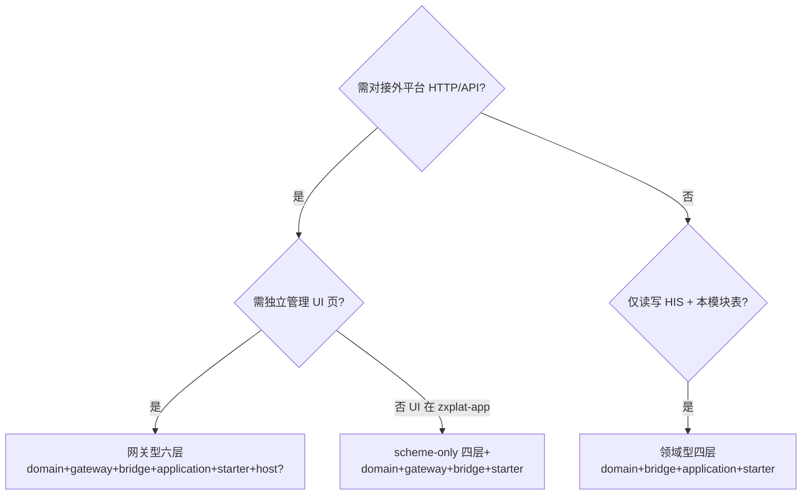

# 新扩展包开发指南

> **受众**：新建 `zxplat-module-*` 扩展 Module 的开发者  
> **前置阅读**：[模块化开发规范.md](./模块化开发规范.md) · [扩展模块架构统一约定.md](./扩展模块架构统一约定.md)  
> **版本**：v1.0 | **日期**：2026-07-12

---

## 1. 五分钟决策：选哪种骨架



| 类型 | 何时选 | 代表 Module |
|------|--------|-------------|
| **网关型六层** | 外平台 HTTP + 独立 `{mod}-application` UI | chs-jilin、einvoice-boss、elep-jilin、unionpay-bpc、crb |
| **scheme-only** | 出站走 ZXPlat.Win / 无 JVM HTTP client；UI 在 zxplat-app | work-injury |
| **领域型四层** | 无外部平台；Extension + 本模块表 | booking、emr |

**cap 切片键**（三处命名必须一致）：

| Module | 切片键 |
|--------|--------|
| CHS | `infno`（1101、2201…） |
| 工伤 WI | `Phase` + `infno` |
| ELEP | `OpCode`（A0001–A0006） |
| Boss | `serviceId`（issueEBill…） |
| BPC | 交易类型 / HTTPS API |
| CRB | EMR 表类型（push） |
| booking/emr | bounded context（appointment、document…） |

---

## 2. 新建 Module 检查清单（Day 0）

### 2.1 仓库与 Maven

- [ ] 父工程 `zxplat-module-{name}/pom.xml`，`packaging=pom`
- [ ] 子模块 **统一** `module-{short}-domain` · `module-{short}-bridge` · …（见 [统一约定 §2](./扩展模块架构统一约定.md)）
- [ ] `zxplat-dependencies/pom.xml` 增加 `dependencyManagement`
- [ ] `zxplat-app/pom.xml` 增加 `{mod}-starter`（profile 可选）
- [ ] Java 根包：`com.zxplat.{vendor}.{mod}` 或 `com.zxplat.framework.{mod}`（与现有模块风格一致）

### 2.2 文档（P0，与代码同步）

- [ ] `zxplat-module-{name}/README.md` — 六层表、装配、文档链接
- [ ] `zxplat-module-{name}/OPTIMIZATION-PLAYBOOK.md` — 复制 [`_templates/OPTIMIZATION-PLAYBOOK-template.md`](../_templates/OPTIMIZATION-PLAYBOOK-template.md)
- [ ] `docs/模块/zxplat-module-{name}/17-*-架构-v3.md`
- [ ] `docs/模块/zxplat-module-{name}/13-实现状态与文档对照.md`
- [ ] 各子模块 `module-*-{layer}/README.md` — **四块结构**（见 §4）

### 2.3 依赖护栏（Day 1，必做）

**application `pom.xml`**：

```xml
<bannedDependencies>
  <excludes>
    <exclude>com.zxplat:module-{short}-bridge</exclude>
    <exclude>com.zxplat:zxplat-application</exclude>
  </excludes>
</bannedDependencies>
```

**bridge `pom.xml`**：

```xml
<bannedDependencies>
  <excludes>
    <exclude>com.zxplat:module-{short}-application</exclude>
    <exclude>com.zxplat:zxplat-application</exclude>
    <exclude>com.zxplat:health-module-support</exclude>
  </excludes>
</bannedDependencies>
```

**ArchitectureTest**（与 Enforcer 互补）：

| 层 | 禁止 import |
|----|-------------|
| application | `...bridge.*`；**严格六层**另禁 `gateway.client/local/remote/scheme.*` |
| bridge | `...application.*` |

样板类：`EinvoiceBossApplicationArchitectureTest`、`BookingBridgeArchitectureTest`。

> **CHS 母版**：P11–P15 已将全部 cap Invoker 迁至 bridge；application main **禁止** `com.zxplat.chs.gateway.*`（与 boss/elep 严格六层对齐）。仅禁 bridge。

### 2.4 health 集成

- [ ] Extension 接口在 `zxplat-infrastructure/.../integration/{domain}/`（包 `com.zxplat.domain.infrastructure.integration`）
- [ ] ExtensionImpl 在 `bridge`
- [ ] NoOp 在 `zxplat-infrastructure/.../integration/noop/`
- [ ] `{mod}-starter` 聚合 domain + bridge +（application）+ AutoConfiguration
- [ ] `zxplat.modules.{mod}.enabled` 开关
- [ ] bridge / 依赖 SPI 的模块显式依赖 `zxplat-infrastructure`

---

## 3. 包结构约定（按层）

### domain

```text
{cap}/entity|repository|service|command|result|access|loader/
share/          错误码、常量（禁止 constants/ 根包）
enums/
```

- **access**：出站 / 跨层能力端口（application 与 bridge 共用类型）
- **loader**：HIS enrichment（bridge `context/` 实现）
- **禁止**：`import ...gateway.*`；`dto/` 包名（用 command/result）

### gateway（网关型）

```text
client/              唯一业务出站口 + client.remote.*
local/ remote/       实现
scheme/{cap}/        model | assembler | parser
session/             签到、签名
config/
```

- gateway 类名用 `*Transport` / `*Assembler` / `*Parser`，**不用** `*Invoker`

### bridge

```text
com.zxplat.domain.integration.{domain}/   ExtensionImpl

com.zxplat.{vendor}.{mod}.bridge/
  {cap}/workflow/      多步编排（Extension 链）
  {cap}/invoker/       单接口出站（implements domain access）
  {cap}/context/       ContextLoader 实现
  {cap}/mapper/        Extension ↔ 平台字段
  config/
```

### application

```text
{cap}/service/         *AppService
{cap}/request|response/
{cap}/workflow/        仅异步/多步（如 Boss issue Worker）
internal/              后台 Worker（非页面直调）
```

- **新模块推荐**：页面/AppService **只注入 domain access**；Invoker 在 bridge
- **CHS 历史**：application 内 `{cap}/invoker/` 仍合法

---

## 4. 层 README 四块模板

每个 `module-*-{layer}/README.md` 包含：

1. **职责边界** — 允许 / 禁止表  
2. **包结构树** — 当前 cap  
3. **命名约定 / 脚本索引** — P 阶段与类型后缀  
4. **与 CHS 差异** — 层数、出站、Invoker 位置  

无 gateway/host 的层在领域型 Module 中省略对应子模块 README。

---

## 5. P 阶段节奏（新建后迭代）

| 顺序 | 阶段 | 动作 | 验证 |
|------|------|------|------|
| 1 | **P0** | README + Playbook + Enforcer + ArchTest | compile |
| 2 | **P2** | domain 根级泄漏 → `{cap}/command\|result` | compile |
| 3 | **P1–P3** | application `dto` → `request/response` | compile |
| 4 | **P5–P6** | bridge `orchestration` → `{cap}/workflow` | compile |
| 5 | **P9** | bridge cap + domain access/loader | compile + enforcer |
| 6 | **P7–P8** | Invoker 迁 bridge；application 改 access 注入 | test |
| 7 | **P10** | gateway scheme cap（网关型） | test |
| 8 | **P13** | 去 `*Dto` 后缀（如有） | test |
| 9 | **P17** | Maven `module-{short}-*` 统一命名 | 全仓 compile |
| 10 | **Doc** | JavaDoc（Invoker 标 `【infno/OpCode/serviceId】`） | review |

每步脚本：`scripts/{short}-p{N}-*.ps1`，UTF-8 无 BOM，最长键优先替换 import。

**推荐样板**（按严格程度）：

| 目标 | 首选对照 |
|------|----------|
| 严格六层 + domain access | `zxplat-module-einvoice-boss` |
| 医保 infno + 大量 UI | `zxplat-module-chs-jilin` |
| Win 出站、无 application | `zxplat-module-work-injury` |
| 无 gateway | `zxplat-module-booking` |

---

## 6. 反模式（新建时禁止）

| 禁止 | 应改为 |
|------|--------|
| `contracts` / `Facade` 模块 | domain Command/Result + Extension |
| `domain/client` 放 HTTP 接口 | `gateway/client` |
| bridge 依赖 application | domain access 端口 |
| application 依赖 bridge | starter 运行时装配；编译期 enforcer |
| bridge 依赖 health-module-support（**已删除**） | zxplat-domain QueryService + bridge 自写 `*ContextLoader` |
| 为单接口建 Orchestrator | AppService 直调 Invoker / access |
| `dto` 包名 | `request/response` 或 `command/result` |
| Maven `foo-domain` 无 `module-` 前缀 | `module-foo-domain` |

---

## 7. 现有扩展包索引

| Module | 类型 | Playbook | 护栏 | 结构成熟度 |
|--------|------|----------|------|------------|
| chs-jilin | 六层 | ✅ | Enforcer + ArchTest | 高（P11–P15 全 cap Invoker 迁 bridge ✅；application 全层禁 gateway） |
| work-injury | scheme-only | ✅ | Enforcer + ArchTest | 高 |
| einvoice-boss | 六层 | ✅ P0–P17 | 严格 | **样板** |
| elep-jilin | 六层 | ✅ | 严格 | 高 |
| unionpay-bpc | 六层 | ✅ | 严格 | 高（HTTPS 占位） |
| booking | 四层 | ✅ | 严格 | 高 |
| emr | 四层 | ✅ | 严格 | 高 |
| crb | 五层 | ✅ P0–P17 | Enforcer + ArchTest | 高（scheme emrPatientInfo 参考；19 mapper 待增量） |

---

## 8. 验收命令

```bash
cd zxplat

# 单模块
mvn compile test -pl zxplat-module-{name} -am

# 扩展包矩阵（CI 建议）
mvn compile test -pl zxplat-module-chs-jilin,zxplat-module-work-injury,zxplat-module-einvoice-boss,zxplat-module-elep-jilin,zxplat-module-unionpay-bpc,zxplat-module-booking,zxplat-module-emr,zxplat-module-crb -am
```

---

## 9. 相关文档

| 文档 | 路径 |
|------|------|
| 模块化开发规范 | [模块化开发规范.md](./模块化开发规范.md) |
| 扩展模块统一约定 | [扩展模块架构统一约定.md](./扩展模块架构统一约定.md) |
| Playbook 模板 | [_templates/OPTIMIZATION-PLAYBOOK-template.md](../_templates/OPTIMIZATION-PLAYBOOK-template.md) |
| CHS 方法论 | [zxplat-module-chs-jilin/OPTIMIZATION-PLAYBOOK.md](../模块/zxplat-module-chs-jilin/OPTIMIZATION-PLAYBOOK.md) |
