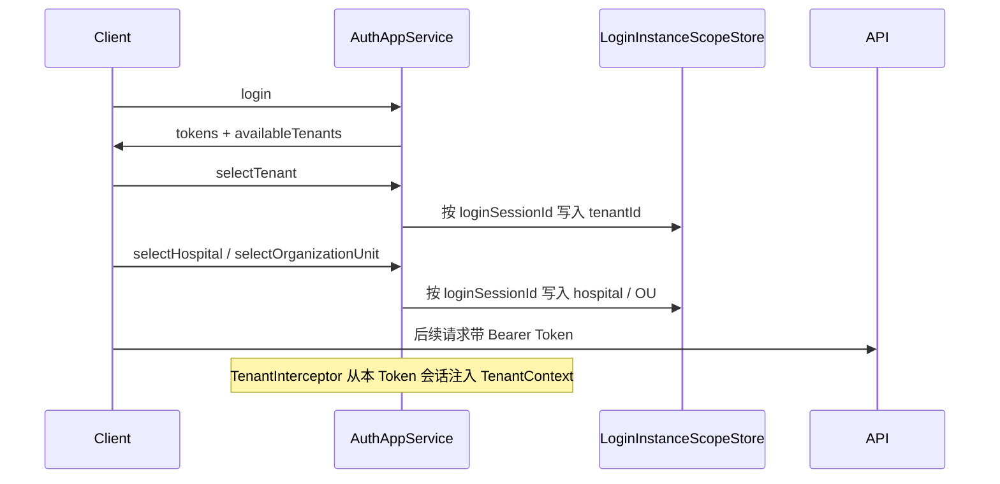

# 多租户（Multi-Tenancy）

> ZXPlat 采用 ABP 风格的共享数据库 + 共享表多租户，租户上下文由**登录会话**驱动。

## 模型

| 项 | 说明 |
|----|------|
| 隔离方式 | 同库同表，`tenant_id` 列 |
| 实体标记 | 实现 `IMultiTenant`，设置 `tenantId` |
| 宿主数据 | `tenant_id IS NULL`（平台级） |

## 租户上下文

| 组件 | 说明 |
|------|------|
| `TenantContext` | 当前线程租户 ID |
| `TenantUtils.getCurrentTenantId()` | 静态访问 |
| `TenantFilter` | JPA 查询过滤 |
| `TenantInterceptor` | HTTP 请求注入租户 |

## Header 策略

客户端可发送 `X-Tenant-Id`，但 **`TenantInterceptor` 不信任客户端 Header 作为权威来源**：

1. 已登录用户：租户来自本 Token 的进程内登录会话（JWT `loginSessionId` → `LoginInstanceScopeStore`，`AuthAppService.selectTenant` 写入）。同一用户多 Token 互不覆盖；不改 `zxplat_user_login_session` 表结构。
2. 客户端 Header 与会话不一致时，**以会话为准**并打 warn 日志。
3. 未登录请求携带 `X-Tenant-Id` 会被忽略。

这与旧文档「纯 Header 传递租户」不同，以当前代码为准。

## 登录后会话流程



## 配置

```yaml
app:
  session-store:
    type: jdbc    # 推荐生产使用 jdbc，重启后会话保留
  cache:
    tenant:
      expire-after-write: 30m
```

## 开发注意

1. 新建业务表若需租户隔离，加 `tenant_id` 并实现 `IMultiTenant`。
2. 查询/写入前确认 `TenantUtils.getCurrentTenantId()` 已设置。
3. 跨租户管理操作需显式切换上下文或使用平台账号。

## Related

- [租户.md](../包/租户.md)
- [身份认证.md](../包/身份认证.md)
- [排查手册.md](../运维/排查手册.md)

---

**上一篇**：[Web层.md](../包/Web层.md) · **下一篇**：[工作单元.md](./工作单元.md)
