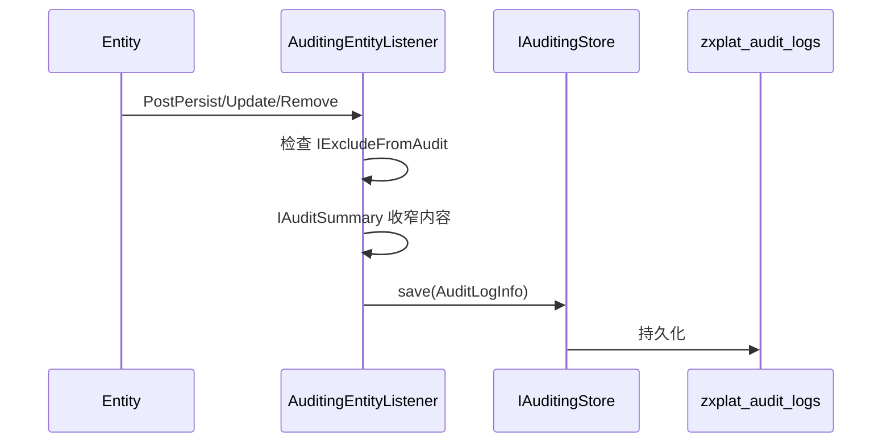

# 包 · audit（审计）

> **源码包**：`com.zxplat.framework.audit`  ·  目录：`zxplat-framework/src/main/java/com/zxplat/framework/audit/`

> 实体变更审计日志的采集与查询。

## Overview

| 项 | 值 |
|----|-----|
| 制品 | `com.zxplat:zxplat-framework`（包 audit） |
| 包根 | `com.zxplat.framework.audit` |
| AutoConfiguration | `ZxplatAuditAutoConfiguration` |
| 依赖 | `zxplat-framework`（`IAuditingStore` 接口） |

## 审计流程

## Key Types

| 类型 | 模块 | 说明 |
|------|------|------|
| `AuditingEntityListener` | core | JPA 监听器 |
| `IAuditingStore` | core | 存储接口 |
| `AuditLogInfo` | core | 审计 DTO |
| `OperationType` | core | CREATE / UPDATE / DELETE |
| `IExcludeFromAudit` | core | 排除审计 |
| `IAuditSummary` | core | 摘要审计 |
| `AuditLogAppService` | audit | 查询 API |

## AppServices · AuditLogAppService

| 方法 | 说明 |
|------|------|
| `getList` | 分页查询审计日志（只读；写入走 `IAuditingStore`） |

## 收窄策略

1. 实体实现 `IExcludeFromAudit` → 不写入 `zxplat_audit_logs`（如 `SecurityLog`）。
2. 实体实现 `IAuditSummary` → 指定操作类型只记录摘要字段（如 User 更新只记 id、userName、updatedAt）。

## Database

| 表 | 说明 |
|----|------|
| `zxplat_audit_logs` | 审计日志 |

字段含：entityType、entityId、operationType、userId、ipAddress、oldState、newState 等。

## Related

- [核心.md](./核心.md)
- [身份认证.md](./身份认证.md) — SecurityLog

---

**上一篇**：[06-菜单.md](./菜单.md) · **下一篇**：[08-定时任务.md](./定时任务.md)
