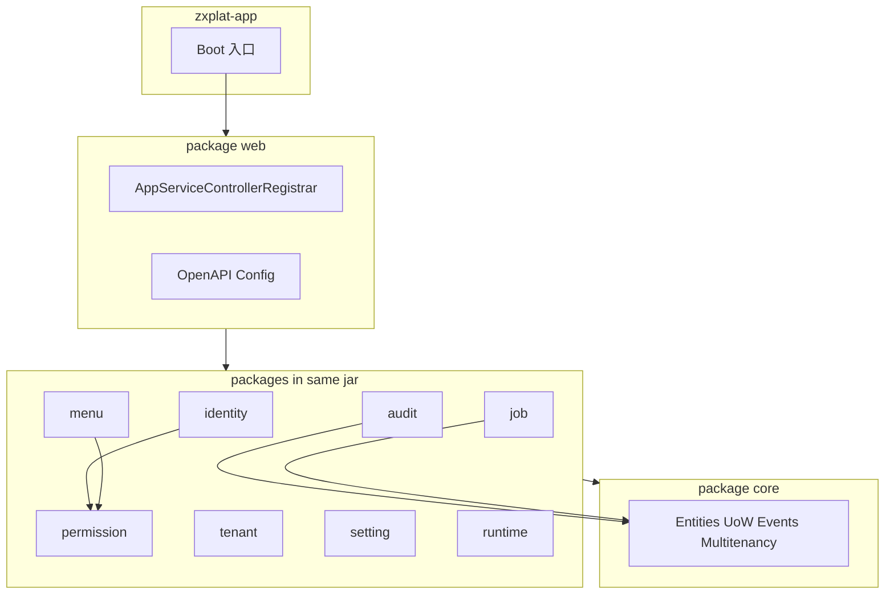

# 框架概览

> ZXPlat Framework 架构说明与 ABP 概念映射。

## 1. 定位

ZXPlat Framework 是平台的**基础框架**（源码与 `zxplat-core` 同仓公开），提供 Identity、Permission、Multi-Tenancy、Setting、Menu、Audit、Job、Auto API 等横切能力。HIS 业务代码在 `zxplat-core`；框架通过 Maven 依赖 + Spring Boot AutoConfiguration 挂载到 `zxplat-app`。

| 项 | 值 |
|----|-----|
| 代码路径 | `zxplat-framework/` |
| groupId | `com.zxplat` |
| 版本 | `2.0.9`（见 `pom.xml`） |
| 包根 | `com.zxplat.framework.*` |
| Host | `zxplat-app（入口类待迁）` |

## 2. 模块结构

框架为**单一 Maven 制品** `zxplat-framework`，原多模块能力以包分区保留：

```text
zxplat-framework/   （单一 jar，artifactId = zxplat-framework）
└── com.zxplat.framework/
    ├── core/         实体基类、异常、多租户、UoW、领域事件、序列号、Quartz 适配
    ├── identity/     用户/角色/组织单元、JWT、登录会话、代理登录
    ├── permission/   权限定义与授予
    ├── tenant/       租户 CRUD
    ├── setting/      设置 Provider（U/R/T/G）
    ├── menu/         菜单树与权限对齐
    ├── audit/        审计日志落库
    ├── job/          定时任务 CRUD + Quartz 桥接
    ├── runtime/      框架运行时状态采集/同步
    └── web/          Auto API、OpenAPI、ApplicationConfiguration
```

`web` 包聚合对外 API（Auto API / OpenAPI / ApplicationConfiguration），依赖同 jar 内其余包。

## 3. 架构关系



## 4. 装配机制

ZXPlat **不使用** ABP 的 `AbpModule` 类层次，而是用 Spring Boot 3 标准机制：

| 机制 | 说明 | 关键类 |
|------|------|--------|
| **AutoConfiguration.imports** | 单一 jar 内按行加载；**core 两行必须在最前** | 见下方顺序 |
| **Host 扫描范围** | 应用只扫描业务包（如 `com.zxplat.domain`） | 框架 Bean 靠 AutoConfiguration，不靠 Host 扫描 |
| **ZxplatModuleDescriptor** | 可选扩展模块元数据（启动日志） | `ZxplatModuleDescriptor`、`ZxplatModuleRegistryLogger` |
| **模块元数据路径** | `META-INF/zxplat/*.json` | `ZxplatClasspathModuleResources` |

**imports 当前顺序（与代码一致）：**

1. `ZxplatCoreComponentRegistrationConfiguration` — 先扫 `core` 组件  
2. `ZxplatCoreAutoConfiguration` — 再注册 core `@Bean`  
3. `ZxplatAuditAutoConfiguration`  
4. `ZxplatTenantAutoConfiguration`  
5. `ZxplatIdentityAutoConfiguration`  
6. `ZxplatPermissionAutoConfiguration`  
7. `ZxplatSettingAutoConfiguration`  
8. `ZxplatJobAutoConfiguration`  
9. `ZxplatMenuAutoConfiguration`  
10. `ZxplatRuntimeAutoConfiguration`（内含 Collector 条件装配）  
11. `ZxplatFrameworkAutoConfiguration`（web）

## 5. ABP 概念映射

| ABP 概念 | ZXPlat 实现 |
|----------|------------|
| Layered Architecture | Domain / Application / Infrastructure；HTTP 由包 `web` 提供 |
| Application Service | `*AppService` + `@Service` |
| Conventional Controllers | `AppServiceControllerRegistrar` → `POST /api/app/{service}/{method}` |
| Unit of Work | `AppServiceAspect` + `ReadOnlyTransactionAspect` |
| Multi-Tenancy | `IMultiTenant`、`TenantContext`、会话租户（见 [多租户.md](./主题/多租户.md)） |
| Permission Management | 包 `permission` + `PermissionChecker` |
| Setting Management | 包 `setting` + Provider U/R/T/G |
| Identity | 包 `identity`（含登录） |
| Audit Logging | 包 `audit` + core 的 `IAuditingStore` |
| Background Jobs | Quartz + 包 `job` |
| Local Event Bus | `IDomainEventPublisher`（Spring Events） |
| Feature / Module | 业务扩展用 `{mod}-starter` + `zxplat.modules.{mod}.enabled` |

## 6. 数据库

框架**不含** Flyway 脚本；表定义在 `zxplat-core/zxplat-domain/src/main/resources/db/migration/health/`，核心表包括：

| 表前缀 | 用途 |
|--------|------|
| `whale_users`、`whale_roles`、`whale_user_roles` | Identity |
| `whale_permissions`、`whale_permission_grants` | Permission |
| `whale_tenants`、`whale_user_tenants` | Tenant |
| `whale_settings` | Setting |
| `whale_menus` | Menu |
| `whale_audit_logs` | Audit |
| `whale_qrtz_*` | Quartz |
| `whale_sequence` | 业务序号 |
| `whale_user_login_session` | 登录会话（租户/医院/科室） |
| `whale_framework_runtime_state` | Runtime |

## 7. 业务扩展 Module

EMR、Report、Booking、CHS 等增值包**不在**本目录文档范围内，装配方式见：

[模块化开发规范.md](../架构/模块化开发规范.md)

---

**上一篇**：— · **下一篇**：[快速开始.md](./快速开始.md)
