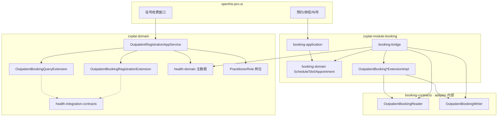
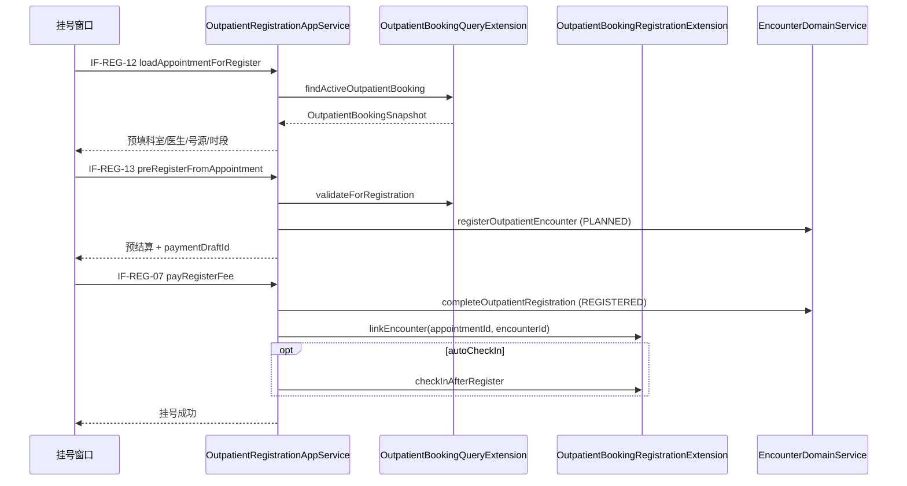

# ZXPlat Booking 概要设计

> **⚠ v2 存量 HLD**：Maven/包名以 **[17-zxplat-module-booking-架构-v3.md](./17-zxplat-module-booking-架构-v3.md)** 为准；下文 `contracts`/`adapter` 仅作业务背景。

> **文档性质**：概要设计（HLD）
> **上游**：[00-功能清单.md](./00-功能清单.md)  
> **下游**：[02-交互说明.md](./02-交互说明.md)、[03-详细设计与编码指导.md](./03-详细设计与编码指导.md)、[05-门诊排班业务规则与模板.md](./05-门诊排班业务规则与模板.md)  
> **关联 AS**：[AS-OP-FIN-001-门诊挂号.md](../cmmi3ddd/02-通用语言与领域建模/AppService/AS-OP-FIN-001-门诊挂号.md)（IF-REG-01～11）  
> **版本**：v1.1 | **日期**：2026-06-21  

---

## 1. 文档关系

```text
阅读顺序 01 → 05：

01 功能清单 …… 做什么、排期、P0～P3
02 资源与号源清单 …… 资源类型、Schedule actor 对照（待编）
03 概要设计（本文）…… 架构、Extension/Reader/Writer/Client、挂号与 booking 兼容
04 UI交互说明 …… 页面线框、路由、组件目录、挂号台增量
05 详细设计与编码指导 … 任务、验收、编码（实施真源）
07 门诊排班业务规则与模板 … 停诊转交、模板、Schedule 模式 v2
        ↓
代码
```

**本文重点**：§4～§6 描述 **岗位挂号（health）与 booking 号源/预约** 如何并存，供 P1「挂号衔接」实现与评审。

---

## 2. 系统上下文

### 2.1 架构图



**health 侧**：`OutpatientRegistrationAppService` **只**依赖 `health-integration-contracts` 中的 Extension（构造器注入 + `isEnabled()`）。**不**直接依赖 `booking-contracts`。

**booking 侧**：`OutpatientBooking*ExtensionImpl`（`@Primary`）委托 adapter 内已实现的 `OutpatientBookingReader` / `OutpatientBookingWriter`。

### 2.2 双模型分工（资格层 vs 库存层）

| 层次 | 归属 | 数据真源 | 回答的问题 |
| --- | --- | --- | --- |
| **资格层** | health-domain | `Organization`、`PractitionerRole`（`adm_pr_assign`）、`HealthcareService` | **谁能挂、在哪科挂、挂什么类型** |
| **库存层** | booking-domain | `Schedule`、`Slot`、`Appointment` | **什么时候能挂、还有多少名额、是否已预约** |

二者 **不互相替代**：岗位决定挂号台下拉「有没有这个人/这个科」；booking 决定「这个时段还有没有号、患者是否已约」。

### 2.3 依赖红线（与 [模块化开发规范.md](../01-架构/模块化开发规范.md) 对齐）

| 约束 | 说明 |
| --- | --- |
| `health-application` | **不** import `com.zxplat.plugin.booking.*`（domain / contracts / application） |
| `health-application` | 仅依赖 **`health-integration-contracts`** 中 `OutpatientBooking*Extension`；构造器注入 + `isEnabled()` 门控 |
| `health-module-support | 未装 booking 时注册 NoOp Extension（`isEnabled() == false`） |
| `booking-bridge` | 实现 Extension `@Primary` + contracts Reader/Writer/Client；**可**依赖 `booking-domain`；**禁止**依赖 `booking-application` |
| `booking-application` | 写侧直连 `booking-domain`，不经 contracts Reader/Writer 绕路 |
| Enforcer | `health-application` 禁止 `booking-contracts`、`chs-jilin-*` 等 `{mod}-contracts` |
| 未装 `booking-starter` | NoOp Extension；挂号 IF-REG-01～11 与 **纯 HIS 完全一致** |

---

## 3. 现状：岗位挂号链路（AS-OP-FIN-001）

### 3.1 下拉与主数据来源

| 挂号要素 | 当前实现 | 领域入口 |
| --- | --- | --- |
| **科室** | 全部门诊科室 | `OrganizationQueryService.listOrganizationsForOutpatientRegistration()` |
| **医生** | 选定科室下 **激活医师岗** 的在职人员 | `PractitionerRoleScopeLoader.listActivePractitionersForOutpatientRegistration(ROLE_DOCTOR, orgId)` |
| **号源类型** | 全部 **ACTIVE** 的 `HealthcareService` | `HealthcareServiceQueryService.listServicesForRegistration()` |
| **挂号落库** | `organizationId` + `serviceTypeId` + 可选 `practitionerId` → `Encounter(PLANNED)` | `OutpatientRegistrationAppService.preRegisterSettlement` |

### 3.2 与 booking 的关键差异

| 维度 | 岗位挂号（现状） | booking |
| --- | --- | --- |
| 医生/科室 | `adm_pr_assign` 静态资格 | Schedule `actor`（PRACTITIONER + LOCATION） |
| 号源类型 | 主数据全量 ACTIVE 服务 | Schedule `healthcare_service_id` + Slot 快照 |
| 时段/名额 | **不涉及** | Slot `capacity` / `bookedCount` |
| 预约单 | **无** | `Appointment(OUTPATIENT_BOOKING)` |
| 占号 | **不占** Slot | 预约时 `allocateBooking` |

### 3.3 已知缺口（接 booking 时一并收口）

| 项 | 说明 | 建议阶段 |
| --- | --- | --- |
| 号源未按岗位收窄 | `listHealthcareServiceIdsByPractitionerAndOrg` 已存在，挂号 IF-REG-01 未使用 | P1 与 booking 一并收紧 |
| 只选医生联动科室 | BR-REG-002 在 AS 已定义，前端/编排待完善 | P1 |
| 现场挂号是否占 Slot | 院点策略，见 §5.3 | P1 |

---

## 4. 兼容原则

### 4.1 三条不变量

1. **科室/医生资格真源仍在 health**：`PractitionerRole` 不被 booking Schedule 替代；booking 的 actor 引用 **同一套** `organizationId` / `practitionerId` / `healthcareServiceId`。
2. **挂号主流程（Encounter + 收费）仍在 health**：`registerOutpatientEncounter` / `completeOutpatientRegistration` 不迁入 booking。
3. **booking 只在衔接点插入**：预约带入、占号校验、缴费后回填；未装 booking 时零行为差异。

### 4.2 主键对齐表

| 挂号字段（AS-OP-FIN-001） | booking 侧 | 对齐规则 |
| --- | --- | --- |
| `organizationId` | Schedule.actor(LOCATION) 所属机构；`HealthcareService.offeredOrgId` | 预约快照与挂号提交须一致 |
| `practitionerId` | Schedule.actor(PRACTITIONER) | 科室号场景可为空；专家号必填 |
| `serviceTypeId` | Schedule.`healthcare_service_id`；Slot 服务快照 | 与 `Encounter.serviceTypeId` 同一主键 |
| `appointmentId`（**新增可选**） | `wkf_appointment_queue.id` | 预约转挂号锚点 |
| `slotId`（**新增可选**） | `Appointment.slotId` | 占号凭证；现场占号时写入 |

### 4.3 岗位排班 vs booking 门诊排班

```text
PractitionerRole 出诊模板（health · DM-ADM-006）
  adm_pr_assign_schedule（周几、时段 JSON）
        ↓ 可选同步（2.10）/ 手工维护
Schedule 号源日程（booking · DM-WKF-009）
  actor：PRACTITIONER + LOCATION [+ HEALTHCARE_SERVICE]
        ↓ 发布 + 放号策略
Slot 号源时段（booking · DM-WKF-010）
        ↓ 预约占用
Appointment（booking · DM-WKF-002）
```

| | 岗位出诊模板 | booking Schedule |
| --- | --- | --- |
| 维护入口 | health 基础资料 / 岗位管理 | booking 排班台 `OutpatientScheduleAppService` |
| 挂号是否直接读取 | **是**（医生下拉） | **否**（经 Extension 读库存） |
| 语义 | 「通常何时出诊」 | 「何时放号、多少名额」 |

---

## 5. 三种并存模式（院点策略）

策略配置目标表：`bkg_registration_policy`（P1）；键 `walk_in_slot_mode`。

| 模式 | 编码 | 场景 | 挂号台行为 |
| --- | --- | --- | --- |
| **A · 纯现场** | `WALK_IN_NO_SLOT` | 手动表单挂号 | 不占 Slot；号源类型仅 BR-REG-014 |
| **B · 先约后挂** | `APPOINTMENT_FIRST` | 患者已预约，窗口收费 | 加载预约 → 预填三要素 → 校验 → 收费 → 回填 `encounterId` |
| **C · 点选号源** | `WALK_IN_WITH_SLOT` | 窗口可点选当日 Slot | 仅显式 `slotId` 占号；表单手动挂号仍不强制占号 |

**默认建议**：装 booking 且 **未维护** `bkg_registration_policy` 时，系统默认 **C · `WALK_IN_WITH_SLOT`**（表示**允许**点选当日号源占号，**不是**强制手动挂号绑定排班）；**B**/**A** 由院点策略显式配置。

### 5.1 模式下拉收窄规则

| 下拉 | 手动挂号（无 slotId） | 点选号源 / 预约转挂 |
| --- | --- | --- |
| 科室 | 门诊科室全量 | **不变** |
| 医生 | 岗位收窄（BR-REG-005） | **不变**（资格真源） |
| 号源类型 | 未选医生：全量 ACTIVE；已选医生：用户管理可接诊号源（**BR-REG-014**；**不与当日排班求交**） | 点选/预约快照带入号源类型；仍须落在医师可接诊范围内（写侧 Gate） |

> **解绑原则**：有无排班都不收窄手动挂号号源类型下拉；「用排班」仅通过点选 Slot / 加载预约进入，与表单手动挂号互不干扰。

---

## 6. 挂号接口衔接（AS-OP-FIN-001 扩展）

> 下列 IF 在 **AS-OP-FIN-001** 基础上 **增量扩展**；未装 booking 时 IF-REG-12～14 不暴露或返回空，不影响 IF-REG-01～11。

### 6.1 接口总览

| IF 编号 | 用户动作 | 接口语义 | 读/写 | booking 衔接（Extension） | 优先级 |
| --- | --- | --- | --- | --- | --- |
| IF-REG-01 | 打开挂号页 | 初始化下拉（医师可接诊号源收窄） | 读 | **不**调用 `listBookableServiceTypes` 求交 | P1 |
| IF-REG-06 | 确认挂号（预结算） | 创建 Encounter + 支付草稿 | 混合 | 仅请求含 `slotId` 时 `allocateWalkInSlot`；预约路径 `validateForRegistration` | P1 |
| IF-REG-07 | 支付挂号费 | `PLANNED`→`REGISTERED` | 写 | `linkEncounter`；可选 `checkInAfterRegister` | P1 |
| **IF-REG-12** | 加载有效预约 | 按患者/预约单号查当日有效门诊预约 | 读 | `OutpatientBookingQueryExtension` | P1 |
| **IF-REG-13** | 预约转预结算 | 预约快照驱动 IF-REG-06（带 `appointmentId`） | 混合 | `validateForRegistration` | P1 |
| **IF-REG-14** | 可约号源提示 | 选科室/医生/日期后查剩余 Slot 摘要 | 读 | `listBookableSlots` | P2 |

HTTP 路径（与现有 Registrar 一致）：

```text
POST /api/app/outpatientRegistration/loadAppointmentForRegister   -- IF-REG-12
POST /api/app/outpatientRegistration/preRegisterFromAppointment     -- IF-REG-13
POST /api/app/outpatientRegistration/listBookableSlotHints          -- IF-REG-14
```

### 6.2 IF-REG-12 加载有效预约

**触发**：挂号员输入预约单号 / 选患者后点「加载预约」。

**主路径**：

1. 调用 `outpatientBookingQueryExtension.findActiveOutpatientBooking(command)`（`isEnabled()` 须为 true）。
2. 返回 `com.zxplat.plugin.booking.bridge.integration.result.OutpatientBookingSnapshot`：预约单号、`appointmentId`、`slotId`、`organizationId`、`practitionerId`、`healthcareServiceId`、时段起止、医师/科室/号源展示名、预约状态。
3. 前端预填 IF-REG-06 表单；禁止手工改与快照冲突的核心三要素（可配置是否允许改医生）。

**失败**：无有效预约 → `BKG-REG-404`；预约已挂过号（已有 `encounterId`）→ `BKG-REG-409`。

### 6.3 IF-REG-13 预约转预结算

**触发**：在 IF-REG-12 成功后执行，或请求体携带 `appointmentId`。

**编排（在 IF-REG-06 之前插入 Gate）**：

```text
1. outpatientBookingQueryExtension.validateForRegistration(cmd)
   - 预约状态 ∈ {BOOKED, CHECKED_IN 可配置}
   - 快照 organizationId / practitionerId / healthcareServiceId 与请求一致
   - 岗位资格：PractitionerRoleScopeLoader 复核医师仍在该科有激活岗
2. 复用既有 IF-REG-06：防重 BR-REG-011、患者分流、Encounter PLANNED、支付草稿
3. 响应附带 appointmentId、slotId 供 IF-REG-07 回填
```

**不变**：`registerOutpatientEncounter` 命令结构不改；`appointmentId` 仅应用层上下文传递，**不写入 Encounter 表**（关联写在 Appointment.`encounterId`）。

### 6.4 IF-REG-06 / IF-REG-07 增量 Gate

**IF-REG-06（预结算）追加**（`outpatientBookingRegistrationExtension.isEnabled()` 时）：

| 条件 | 动作 |
| --- | --- |
| 请求含 `appointmentId` | 执行 §6.3 校验 |
| 模式 C 且无 `appointmentId` | 按策略调用 `allocateWalkInSlot` 占当日空闲 Slot |
| 模式 A / Extension 未启用 | 跳过 |

**IF-REG-07（缴费成功）追加**：

```text
completeOutpatientRegistration 成功后：
  if appointmentId != null && outpatientBookingRegistrationExtension.isEnabled():
    outpatientBookingRegistrationExtension.linkEncounter(appointmentId, encounterId)
  if 机构策略 autoCheckInOnRegister:
    outpatientBookingRegistrationExtension.checkInAfterRegister(appointmentId, encounterId)
```

### 6.5 业务规则合并

| 规则 ID | 描述 | 绑定 IF |
| --- | --- | --- |
| **BR-REG-011**（既有） | 同日同科室 Encounter 防重；`PLANNED` 不占名额 | IF-REG-06 |
| **BR-BKG-REG-001** | 有效预约转挂号：预约 `encounterId` 必须为空 | IF-REG-12 / 13 |
| **BR-BKG-REG-002** | 预约快照三要素与挂号提交不一致则拒绝 | IF-REG-13 |
| **BR-BKG-REG-003** | 预约占号与 Encounter 防重并存：同日同科已有 **BOOKED 预约** 时提示先走预约转挂或取消预约 | IF-REG-06 |
| **BR-BKG-REG-004** | 模式 C 现场占号失败（无 Slot）时：拒绝或降级为不占号（院点配置） | IF-REG-06 |

---

## 7. 契约分层

挂号衔接涉及 **两层契约**（见 [模块化开发规范.md](../01-架构/模块化开发规范.md) §1.3）：

| 层 | 模块 | 消费者 | 实现 |
| --- | --- | --- | --- |
| **Health→Booking Extension** | `health-integration-contracts` | `OutpatientRegistrationAppService` | `booking-bridge` `@Primary` |
| **Module contracts（adapter 内部）** | `booking-contracts` | `booking-bridge` Reader/Writer/Client 实现类 | 同 adapter，读 `booking-domain` / health 主数据 |

### 7.1 OutpatientBookingQueryExtension（health 只读）

包：`com.zxplat.plugin.booking.bridge.integration.outpatient`

```java
public interface OutpatientBookingQueryExtension {

    default boolean isEnabled() { return false; }

    /** IF-REG-12 */
    Optional<OutpatientBookingSnapshot> findActiveOutpatientBooking(
        OutpatientBookingLookupCommand command);

    Optional<OutpatientBookingSnapshot> loadOutpatientBookingById(Long appointmentId);

    /** IF-REG-01 号源下拉收窄 */
    List<BookableServiceOptionSnapshot> listBookableServiceTypes(
        Long organizationId, Long practitionerId, LocalDate date);

    /** IF-REG-14 */
    List<BookableSlotHintSnapshot> listBookableSlots(
        Long organizationId, Long practitionerId, Long healthcareServiceId, LocalDate date);

    /** IF-REG-13 前置校验（只读部分） */
    void validateForRegistration(OutpatientBookingRegistrationValidateCommand command);
}
```

中性 DTO 位于 `com.zxplat.plugin.booking.bridge.integration.command` / `result`（字段与下文 §7.3 快照表一致）。

**实现**：`OutpatientBookingQueryExtensionImpl`（`booking-bridge`）→ 委托 `OutpatientBookingReader`。

### 7.2 OutpatientBookingRegistrationExtension（挂号写侧衔接）

```java
public interface OutpatientBookingRegistrationExtension {

    default boolean isEnabled() { return false; }

    void linkEncounter(Long appointmentId, Long encounterId);

    Long allocateWalkInSlot(OutpatientWalkInSlotAllocateCommand command);

    void checkInAfterRegister(Long appointmentId, Long encounterId);

    void onRegistrationCancelled(Long encounterId, OutpatientRegistrationCancelCommand reason);
}
```

**实现**：`OutpatientBookingRegistrationExtensionImpl` → 委托 `OutpatientBookingWriter`。

### 7.3 booking-contracts Reader/Writer/Client（adapter 内部，health 不依赖）

`OutpatientBookingReader` / `OutpatientBookingWriter` 及 `com.zxplat.plugin.booking.contracts.dto.*` **保留在 booking-contracts**，供 adapter 实现与 booking 模块内部使用；**health-application 不得 import**。

adapter 内 DTO 与 Extension 中性 DTO 由 `BookingIntegrationMapper`（`integration.booking.mapper`）映射。

### 7.4 快照字段（Extension `OutpatientBookingSnapshot`）

| 字段 | 类型 | 说明 |
| --- | --- | --- |
| `appointmentId` | Long | 预约主键 |
| `appointmentBusNo` | String | 预约单号（展示/扫码） |
| `slotId` | Long | 号源时段 |
| `organizationId` | Long | 科室 |
| `practitionerId` | Long | 医师（可空） |
| `healthcareServiceId` | Long | 号源类型 |
| `slotStart` / `slotEnd` | LocalDateTime | 时段 |
| `organizationName` / `practitionerName` / `serviceTypeName` | String | 展示快照 |
| `statusEnum` | String | 预约状态码 |
| `encounterId` | Long | 已转挂号时非空 |

---

## 8. 时序

### 8.1 模式 B：先约后挂



Extension 实现类在 `booking-bridge` 内委托 `OutpatientBookingReader` / `OutpatientBookingWriter`。

### 8.2 模式 A：纯现场（无 booking）

与当前实现一致；NoOp Extension（`isEnabled() == false`）；IF-REG-01～11 零改动。IF-REG-12～14 调用时返回「预约模块未启用」或空列表（与产品约定一致）。

### 8.3 退号与预约

```text
IF-REG-10 退号成功
  → outpatientBookingRegistrationExtension.onRegistrationCancelled(encounterId, reason)
  → 院点策略（bkg_registration_policy.on_cancel_policy）：
      RELEASE_SLOT_ONLY（默认）：回补 Slot bookedCount，并软删预约行
        （释放 uk_wkf_appt_patient_service_day，允许同日同服务再挂）
      CANCEL_APPOINTMENT：与 RELEASE_SLOT_ONLY 在退号回调上等价
      KEEP_SLOT：仅解除 encounterId 关联，保留号源占用与预约行（极少用；仍占防重键）
  → 现场再挂 allocateWalkInSlot：创建前清理「同日同服务且 encounter 已解绑」的未软删残留，
    唯一冲突映射为业务提示「同日同患者同服务重复预约」
```

> **修订说明（2026-08-11）**：旧口径「RELEASE_SLOT_ONLY 仅解绑 encounter、保留预约」与部分唯一索引冲突，导致退号后再挂同服务失败；现与成码对齐为**必须软删预约行**。
---

## 9. 模块与包（目标态摘要）

```text
health-integration-contracts/
  integration/booking/
    outpatient/OutpatientBookingQueryExtension.java
    outpatient/OutpatientBookingRegistrationExtension.java
    command/   OutpatientBookingLookupCommand、…
    result/    OutpatientBookingSnapshot、BookableSlotHintSnapshot、…

health-module-support/
  integration/support/booking/
    NoOpOutpatientBookingQueryExtension.java
    NoOpOutpatientBookingRegistrationExtension.java

booking-contracts/          ← health-application 不依赖
  reader/   OutpatientBookingReader、HealthEncounterReader、…
  writer/   OutpatientBookingWriter、HealthBedReservationWriter、…
  client/   BookingChannelNotifyClient
  dto/ …

booking-domain/
  schedule/   Schedule 聚合
  slot/       Slot 聚合
  appointment/ Appointment 聚合
  policy/     bkg_registration_policy、bkg_release_policy

booking-application/
  outpatient/ OutpatientScheduleAppService、BookingRegisterAppService
  queue/      QueueBoardAppService

booking-bridge/
  com.zxplat.plugin.booking.bridge.integration.outpatient/
    OutpatientBookingQueryExtensionImpl.java    @Primary → OutpatientBookingReader
    OutpatientBookingRegistrationExtensionImpl.java
  com.zxplat.plugin.booking.adapter/
    reader/   OutpatientBookingReader、HealthPractitionerRoleReader、…
    writer/   OutpatientBookingWriter、HealthBedReservationWriter、…
    client/   BookingChannelNotifyClient
    internal/ BookingSlotReaderImpl、PractitionerRoleScheduleJsonMapping、…

health-application/
  outpatient/financial/registration/
    OutpatientRegistrationAppService.java  -- 构造器注入 OutpatientBooking*Extension
```

---

## 10. 配置项

| 配置键 | 类型 | 默认 | 说明 |
| --- | --- | --- | --- |
| `zxplat.modules.booking.enabled` | boolean | false | 模块总开关 |
| `openhis.booking.registration.walk-in-slot-mode` | enum | `APPOINTMENT_FIRST` | §5 模式 A/B/C |
| `openhis.booking.registration.auto-check-in-on-register` | boolean | false | IF-REG-07 后自动报到 |
| `openhis.booking.registration.allow-edit-practitioner-from-appointment` | boolean | false | 预约转挂后是否允许改医生 |
| `openhis.booking.registration.on-cancel-policy` | enum | `RELEASE_SLOT_ONLY` | §8.3 退号后续 |

---

## 11. 验收要点（挂号衔接 P1）

1. **未装 booking**：IF-REG-01～11 行为与现网一致；无新增失败路径。
2. **模式 B**：预约 → 加载 → 预结算 → 缴费 → `Appointment.encounterId` 非空；同日同科不重复占 Encounter（BR-REG-011）。
3. **资格校验**：预约医师失去岗位后，IF-REG-13 拒绝并提示刷新排班/岗位。
4. **幂等**：同一 `appointmentId` 重复 IF-REG-07 不重复 `linkEncounter`。
5. **退号**：`onRegistrationCancelled` 默认释号并软删预约行，退号后可同日同服务再挂；`KEEP_SLOT` 仅解绑就诊。
6. **红线**：`health-application` 无 `import com.zxplat.plugin.booking.*`；Enforcer 禁止 `booking-contracts` 依赖。

---

## 修订记录

| 版本 | 日期 | 说明 |
| --- | --- | --- |
| v1.3 | 2026-08-11 | §8.3：`RELEASE_SLOT_ONLY`/`CANCEL_APPOINTMENT` 退号均软删预约行，释放 `uk_wkf_appt_patient_service_day`；现场再挂清理残留 |
| v1.2 | 2026-07-06 | contracts 命名统一为 Reader/Writer/Client；adapter 增 `internal` 包 |
| v1.1 | 2026-06-21 | 挂号衔接改 Extension：`OutpatientBooking*Extension`；health 不再依赖 `booking-contracts`；§7 契约分层 |
| v1.0 | 2026-06-13 | 初稿：岗位挂号与 booking 兼容；IF-REG-12～14 |
