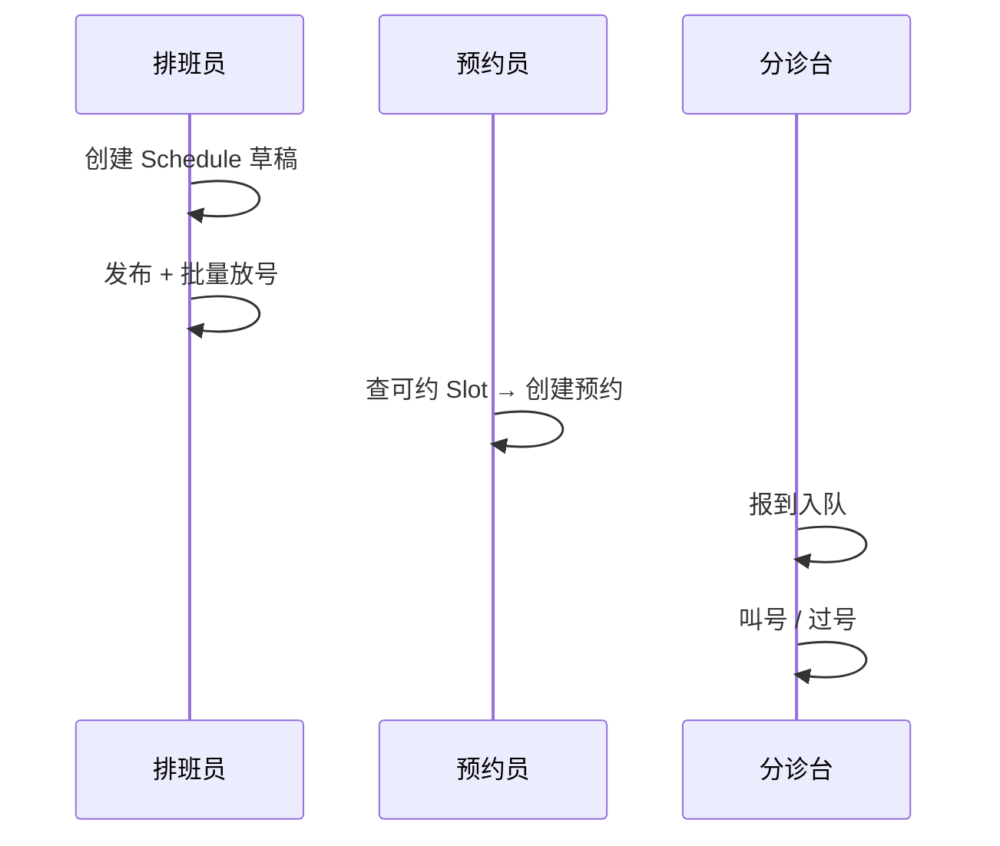

# ZXPlat Booking UI/交互说明（产品原型）

> **依据**：[00-功能清单.md](./00-功能清单.md)、[01-概要设计.md](./01-概要设计.md)、[05-门诊排班业务规则与模板.md](./05-门诊排班业务规则与模板.md)、[AS-OP-FIN-001](../cmmi3ddd/02-通用语言与领域建模/AppService/AS-OP-FIN-001-门诊挂号.md)  
> **下游**：[03-详细设计与编码指导.md](./03-详细设计与编码指导.md)  
> **前端工程**：`openhis-pro-ui/apps/web-ele`（Vue 3 + Element Plus + Vben）  
> **版本**：v1.0 | **日期**：2026-06-13  

---

## 文档说明

| 项 | 内容 |
| --- | --- |
| **目的** | 明确 booking 模块页面信息架构、布局、核心交互与接口映射，供产品/UI/前端评审与实现 |
| **范围** | P0～P2 主页面；挂号台 **增量** UI（IF-REG-12～14）；叫号大屏；与 report 打印衔接仅标入口 |
| **阅读对象** | 产品、UI/UX、前端；与 `03-概要设计` contracts/API 配合使用 |
| **线框图** | 第二节各页附 **ASCII 线框**，表示区域与控件语义；像素与组件以实现为准 |

**模块可见性**：菜单与路由仅在 `zxplat.modules.booking.enabled=true` 且装配 `booking-starter` 时注册；未装模块时 **不展示** booking 菜单，挂号页保持现网布局（见 §2.5）。

---

## 一、信息架构与导航

### 1.1 菜单结构（目标）

```text
统一预约（一级菜单，moduleId=booking）
├── 门诊排班          → /booking/outpatient-schedule        P0
├── 号源日历          → /booking/slot-calendar              P0
├── 门诊预约          → /booking/outpatient-register        P0
├── 候诊叫号          → /booking/queue-board                P0
├── 医技预约          → /booking/med-tech                   P1
├── 床位预约          → /booking/bed                        P1
├── 体检预约          → /booking/health-checkup             P1（团检）/ P2（个检）
├── 放号策略          → /booking/policy                     P1
├── 排班模板          → /booking/schedule-template          P1（见 §2.12）
├── 渠道配置          → /booking/channel                    P2
└── 叫号大屏          → /booking/queue-display            P1（独立全屏路由，可新窗口打开）
```

**与 health 菜单关系**：

| 页面 | 归属菜单 | 说明 |
| --- | --- | --- |
| 门诊挂号收费 | 门诊收费 → 挂号（**既有** `/outpatient/charge/register`） | health 页面；booking 仅 **增量** 预约带入区（§2.5） |
| 岗位/医师维护 | 基础资料 | health 主数据；booking **不重复**维护岗位 |

### 1.2 路由与 AppService 对照

| 路由 | AppService | API 前缀 |
| --- | --- | --- |
| `/booking/outpatient-schedule` | `outpatientSchedule` | `POST /api/app/outpatientSchedule/*` |
| `/booking/slot-calendar` | `slotManage` | `POST /api/app/slotManage/*` |
| `/booking/outpatient-register` | `bookingRegister` | `POST /api/app/bookingRegister/*` |
| `/booking/queue-board` | `queueBoard` | `POST /api/app/queueBoard/*` |
| `/booking/med-tech` | `medTechBooking` | `POST /api/app/medTechBooking/*` |
| `/booking/bed` | `bedBooking` | `POST /api/app/bedBooking/*` |
| `/booking/health-checkup` | `healthCheckupBooking` | `POST /api/app/healthCheckupBooking/*` |
| `/booking/policy` | `bookingPolicy` | `POST /api/app/bookingPolicy/*` |
| `/booking/channel` | `channelBooking` | `POST /api/app/channelBooking/*` |
| `/booking/queue-display` | `queueBoard`（只读轮询） | `POST /api/app/queueBoard/*` |
| `/outpatient/charge/register`（扩展） | `outpatientRegistration` | `POST /api/app/outpatientRegistration/*` |

### 1.3 核心用户路径

| 路径 | 角色 | 阶段 |
| --- | --- | --- |
| 排班 → 发布 → 放号 → 号源日历核对 | 排班员 | P0 |
| 查可约号源 → 选患者 → 创建预约 | 预约员 | P0 |
| 预约列表 → 报到入队 → 叫号 → 过号 | 分诊台 | P0 |
| 预约单加载 → 确认挂号 → 收费 → 自动报到（可选） | 挂号员 | P1 |
| 医嘱列表 → 选项目 → 预约到检时段 | 医技预约员 | P1 |
| 病区日历 → 选床预留 → 入院确认 | 住院预约员 | P1 |
| 团检批次 → 名单导入 → 批量预约 → 到检签到 | 团检管理员 | P1 |

---

## 二、主要页面与布局

### 2.1 门诊排班台（P0 · §4.2）

- **用途**：编制门诊 `Schedule`、发布、批量放号、停诊（功能 2.1～2.9）。
- **布局**：**左窄右宽** — 左侧资源筛选，右侧周历/月历。

**线框图：**

```text
┌──────────────────────────────────────────────────────────────────────────────┐
│ 门诊排班    科室▼  医师▼  诊室▼  号源类型▼   [周视图|月视图]   [新建日程] [复制周] │
├────────────┬─────────────────────────────────────────────────────────────────┤
│ 资源树/筛选 │  2026-06  ◀  第 24 周  ▶                                         │
│ □ 内科     │  ┌─────┬─────┬─────┬─────┬─────┬─────┬─────┐                      │
│   张医生   │  │ 一  │ 二  │ 三  │ 四  │ 五  │ 六  │ 日  │                      │
│   李医生   │  ├─────┼─────┼─────┼─────┼─────┼─────┼─────┤                      │
│ □ 外科     │  │草稿 │已发布│     │已发布│停诊 │     │     │  ← 单元格点击进详情   │
│            │  │上午 │上午 │     │全天 │     │     │     │                      │
│ [从岗位生成]│  └─────┴─────┴─────┴─────┴─────┴─────┴─────┘                      │
│  (P1)      │  选中格详情抽屉：Actor 列表 | 规划日期 | 状态 | [编辑][发布][放号][停诊] │
└────────────┴─────────────────────────────────────────────────────────────────┘
```

| 区域 | 控件 | 接口 |
| --- | --- | --- |
| 顶栏筛选 | 科室、医师、诊室 Location、号源类型 | `loadScheduleFormInit` |
| 周/月历 | 按日展示 Schedule 状态色块 | `pageSchedulesByCalendar` / `pageSchedulesByMonth`（月视图含顶栏摘要） |
| 新建/编辑抽屉 | Actor 多选（医师+诊室+服务）、规划起止日、备注 | `createSchedule` / `updateScheduleDraft` |
| 发布 | 确认后 `active` | `publishSchedule` |
| 放号 | 策略预览 + 批量生成 Slot | `provisionSlotBatch` |
| 停诊 | 整日或指定 Slot 封锁 | `deactivateSchedule` / `blockSlots` |

**状态色**：`draft` 灰、`active` 绿、`deactivated` 红斜线；当日有 `busy-unavailable` Slot 显示停诊标记。

**交互要点**：

- 发布前 Actor 至少含 **PRACTITIONER + LOCATION**（科室号可仅 LOCATION + SERVICE）。
- 放号成功后 Toast 提示生成 Slot 数；可跳转号源日历（§2.2）核对。
- P1「从岗位模板生成」：选医师+科室 → 读 `PractitionerRole.scheduleItems` → 生成草稿 Schedule。

---

### 2.2 号源日历（P0 · §4.3）

- **用途**：按机构/日程/日期查看 Slot 列表、封锁/解封（功能 3.1～3.3）。
- **布局**：顶栏筛选 + **日视图时间轴表格**。

**线框图：**

```text
┌──────────────────────────────────────────────────────────────────────────────┐
│ 号源日历   日期 [2026-06-13]  科室▼  医师▼  日程▼  状态▼ [查询] [封锁选中]     │
├──────────────────────────────────────────────────────────────────────────────┤
│ 时段      │ 诊室/资源     │ 号源类型 │ 容量 │ 已约 │ 剩余 │ 状态   │ 操作      │
├───────────┼───────────────┼──────────┼──────┼──────┼──────┼────────┼───────────┤
│ 08:00-08:30│ 内科一诊室   │ 专家号   │  10  │  3   │  7   │ 可约   │ [详情]    │
│ 08:30-09:00│ 内科一诊室   │ 专家号   │  10  │  10  │  0   │ 已满   │ [详情]    │
│ 09:00-09:30│ 内科一诊室   │ 专家号   │  10  │  0   │  0   │ 停诊   │ [解封]    │
└──────────────────────────────────────────────────────────────────────────────┘
```

| 列 | 说明 |
| --- | --- |
| 容量/已约/剩余 | 来自 `Slot.capacity`、`bookedCount` |
| 状态 | `free` / `full` / `busy-unavailable` / `overbooked`（P1） |
| 详情抽屉 | 预约占用列表、关联 Schedule、操作日志 |

**交互**：多选 Slot →「封锁」→ 输入原因 → 若 `previewStopClinicImpact` 扫描到有效预约则打开 **停诊向导**（§2.11，转交/取消/人工）→ 执行后 `blockSlots`；无预约则直接 `blockSlots`；解封对称 `unblockSlots`。

---

### 2.3 门诊预约登记台（P0 · §4.4）

- **用途**：窗口/前台创建、查询、取消门诊预约（功能 4.1～4.7）。
- **布局**：**左 40% 预约操作区 + 右 60% 预约列表**（与挂号台左右分栏同构）。

**线框图：**

```text
┌──────────────────────────────────────────────────────────────────────────────┐
│ 门诊预约                                                                      │
├──────────────────────────────┬───────────────────────────────────────────────┤
│ [搜索患者 SelectTable]  [清空] │  日期范围 [今日▼]  科室▼  关键字 [查询]        │
│                              │  ┌──────────────────────────────────────────┐ │
│ 预约日期 [____]              │  │ 预约列表                                  │ │
│ 科室▼  医师▼  号源类型▼      │  ├────┬────┬────┬──────┬──────┬──────┬────┤ │
│                              │  │单号│患者│科室│ 医师  │ 时段  │ 状态 │操作│ │
│ 可约时段（卡片/表格）         │  ├────┼────┼────┼──────┼──────┼──────┼────┤ │
│ ┌ 08:00 余7 ┐ ┌ 08:30 余0 ┐  │  │ A01│张三│内科│张医生│08:00 │已预约│详情│ │
│ │  选择     │ │  已满     │  │  │ A02│李四│外科│—    │09:00 │已取消│    │ │
│ └───────────┘ └───────────┘  │  └────┴────┴────┴──────┴──────┴──────┴────┘ │
│ 患者信息表单（姓名/证件/电话）│  分页                                         │
│                              │                                               │
│ [确认预约]  [改约]  [取消]    │                                               │
└──────────────────────────────┴───────────────────────────────────────────────┘
```

| 步骤 | 交互 | 接口 |
| --- | --- | --- |
| 1 | 选日期+科室+医师+号源类型 → 刷新可约 Slot 卡片 | `listBookableSlots` |
| 2 | 点选时段卡片高亮 | 本地状态 `selectedSlotId` |
| 3 | 选/新建患者 | `pagePatientsForSelect`（复用 `HealthPatientReader`） |
| 4 | 确认预约 | `createOutpatientBooking` |
| 5 | 列表行「取消」 | `cancelBooking`；「改约」P1：释放旧 Slot + 占新 Slot |

**校验提示**：同日同患者同服务重复 → `BKG-BIZ-409`；Slot 已满 → 刷新可约列表。

**打印（P2）**：预约成功后可点「打印凭证」→ 调 report `appointment_voucher` pack。

---

### 2.4 候诊叫号台（P0 · §4.5）

- **用途**：报到、叫号、过号、调序（功能 5.1～5.6）。
- **布局**：顶栏诊室/队列筛选 + **三列看板**（等候 / 当前 / 已过号）。

**线框图：**

```text
┌──────────────────────────────────────────────────────────────────────────────┐
│ 候诊叫号   科室▼  诊室▼  队列分类▼  [刷新]  [打开大屏]                          │
├──────────────────┬──────────────────┬──────────────────────────────────────────┤
│ 等候（12）        │ 当前叫号          │ 已过号 / 完成                             │
│ ┌──────────────┐ │ ┌──────────────┐ │ ┌──────────────┐                         │
│ │ 005 张三 优先 │ │ │ 003 王五      │ │ │ 001 赵六      │                         │
│ │ [报到][调序]  │ │ │ 内科一诊室    │ │ │ 过号 10:32    │                         │
│ └──────────────┘ │ │ [叫下一位][过号]│ │ └──────────────┘                         │
│  … 拖拽排序 P1   │ └──────────────┘ │                                          │
└──────────────────┴──────────────────┴──────────────────────────────────────────┘
```

| 操作 | 说明 | 接口 |
| --- | --- | --- |
| 报到 | 患者到分诊台扫码/选行 → 入队 | `checkIn` |
| 叫号 | 当前患者 → `calledAt` 记录 | `callToSee` |
| 过号 | 终态 + 原因 | `noShow` |
| 优先/调序 | P1：拖拽或按钮调 `displayOrder` | `priorityTreatment` / `reorderQueue` |

**与挂号关系**：P2 机构策略可在挂号成功后自动 `checkIn`（§2.5），分诊台仍可见队列。

---

### 2.5 挂号台 · booking 衔接（P1 · §4.6 · 扩展现有页）

> **现网页面**：`views/outpatient/charge/register/index.vue`（左 `RegisterLeftPanel` + 右 `History`）。  
> **原则**：不重构左右分栏；在左栏 Card **header** 增加预约带入区；表单区增加只读预约摘要条。

#### 2.5.1 增量布局

**线框图（左栏 header 扩展）：**

```text
┌──────────────────────────────────────────────────────────────────────────────┐
│ [搜索患者 SelectTable]  预约单号____ [加载预约]  或 扫码图标   [清空]          │
│ ─────────────────────────────────────────────────────────────────────────────  │
│ ■ 预约摘要（加载成功后展示，只读）                                            │
│   预约单 A012345 | 内科 | 张医生 | 专家号 | 2026-06-13 08:00-08:30 | 已预约   │
│   [取消带入]                                                                  │
├──────────────────────────────────────────────────────────────────────────────┤
│ 患者姓名  身份证号  …（既有患者区）                                            │
│ 科室▼  医生▼  费用性质▼  号源类型▼  挂号费展示                                 │
│ （预约带入后：科室/医生/号源类型锁定或灰显，依院点策略）                         │
│ [确认挂号]                                                                    │
└──────────────────────────────────────────────────────────────────────────────┘
```

#### 2.5.2 字段联动（对齐 01-概要设计 §5～§6）

| 场景 | 科室/医生/号源 | 接口 |
| --- | --- | --- |
| 表单手动挂号 | IF-REG-01/05：号源类型仅 BR-REG-014（医师可接诊）；**不与排班求交** | `loadRegisterFormInit` / `listPractitioners` |
| 已加载预约 | 三要素由 `OutpatientBookingSnapshot` 预填；默认 **锁定** | `loadAppointmentForRegister`（IF-REG-12） |
| 点选当日号源 | 预填三要素并带 `slotId`；提交时按 **BR-REG-016** 占该号 | 号源面板 + IF-REG-06（显式 `slotId`） |
| 可约时段提示（可选） | 选齐科室/医生后展示当日 Slot 摘要，**不收窄**号源类型下拉 | `listBookableSlotHints`（IF-REG-14） |

#### 2.5.3 提交流程增量

```text
[加载预约] → IF-REG-12 → 展示摘要 + 预填表单
[确认挂号] → 若带 appointmentId：IF-REG-13 preRegisterFromAppointment
           → 否则既有 preRegisterSettlement（IF-REG-06）
核对弹窗 → payRegisterFee（IF-REG-07）→ linkEncounter + 可选 autoCheckIn
```

**退号（既有 History 弹窗）**：IF-REG-10 成功后，若该行关联预约，按院点策略处置（默认释号并取消预约行，允许同日同服务再挂；`KEEP_SLOT` 仅解绑）（`onRegistrationCancelled`）。

#### 2.5.4 前端文件规划（增量）

| 文件 | 职责 |
| --- | --- |
| `api/outpatient-registration.ts` | 扩展 IF-REG-12～14 类型与 HTTP |
| `views/outpatient/charge/register/components/appointment-load-bar.vue` | 预约单号输入、加载、摘要条 |
| `views/outpatient/charge/register/services/register.service.ts` | 封装预约带入与预填逻辑 |
| `views/outpatient/charge/register/components/register-form-area.vue` | 锁定字段、号源收窄、时段提示 |

**特性开关**：读取机构配置或 `GET /api/app/bookingPolicy/getRegistrationMode`（待后端）；无 booking 模块时不渲染 `appointment-load-bar`。

---

### 2.6 医技预约（P1 · §4.7）

- **用途**：按就诊/医嘱预约检查检验时段（功能 7.1～7.6）。
- **布局**：**上：就诊/患者检索 → 中：医嘱可约列表 → 下：号源日历（复用 §2.2 组件）**。

**线框图：**

```text
┌──────────────────────────────────────────────────────────────────────────────┐
│ 医技预约   就诊号/患者 [查询]                                                   │
│ 患者：张三 | 就诊 ENC001 | 内科                                                 │
├──────────────────────────────────────────────────────────────────────────────┤
│ 待预约医嘱                                                                    │
│ □ 血常规  SR001  已签发   □ 胸部CT  SR002  已签发                              │
│ [预约选中项]                                                                  │
├──────────────────────────────────────────────────────────────────────────────┤
│ （嵌入 Slot 日视图，actor=设备/检查室）                                         │
└──────────────────────────────────────────────────────────────────────────────┘
```

**接口**：`listBookableServiceRequests` → `listDiagnosticBookableSlots` → `createDiagnosticBooking`。

---

### 2.7 床位预约日历（P1 · §4.8）

- **用途**：病区床位日历、预留、取消（功能 8.1～8.4）。
- **布局**：左侧病区树 + 右侧 **床位矩阵日历**（行=床位，列=日期）。

**线框图：**

```text
┌──────────┬───────────────────────────────────────────────────────────────────┐
│ 病区树    │  一病区  日期 →  6/13  6/14  6/15  …                               │
│ ▼ 一病区  │  01床    [空]   [预留] [占用]                                      │
│   二病区  │  02床    [占用] [占用] [空]                                        │
│          │  点击 [空] → 抽屉：患者、意向入院日、备注 → [预留床位]                 │
└──────────┴───────────────────────────────────────────────────────────────────┘
```

**状态色**：`NOT_IN_USE` 白、`RESERVED` 黄、`IN_USE` 红；**禁止**用 Slot 表达床位。

---

### 2.8 体检预约（改造中 · 见 18 号需求定稿）

> **真源**：[18-体检号源日历与预约-需求定稿.md](./18-体检号源日历与预约-需求定稿.md)。  
> **P0 主路径**：号源日历（月历+当日明细）+ 窗口预约页 + 小程序占号；按合同类型（学生/教职工/企业/散客）分池，有校区模块时再按校区列分池。  
> **本页不再做**：团检单位/批次/名单操作台（团检筹备在 peis）。

**号源日历（改造后 `/booking/health-checkup`）**：

```text
┌──────────────────────────────────────────────────────────────────────────────┐
│ 体检预约  [模板设置] [生成未来N天] [复制日计划]                                 │
│ 月历（余量/休息/约满） │ 当日时段表：时段 × 类型(×校区列) 容量/已约/剩余        │
│                        │ 改容量 · 开闭 · 日开放类型 · 加/删档                   │
└──────────────────────────────────────────────────────────────────────────────┘
```

**窗口预约 / 小程序**：选人→（多合同则手选合同）→ 合同类型进池（无合同=散客）→ 选套餐（必选）→（可选）校区→选日选时段→占号。

<details>
<summary>历史线框（团检/个检 Tab，已废止为主路径）</summary>

**团检 Tab**：单位档案 | 批次管理 | 名单导入 | 批量预约

```text
┌──────────────────────────────────────────────────────────────────────────────┐
│ 体检预约  [团检|个检]                                                         │
│ 批次：2026某校秋季体检  日期 9/1  时段 08:00  上限 200  已约 156              │
│ [导入名单 Excel]  [批量预约]  [到检签到]                                       │
│ 名单表：姓名 | 学号 | 预约状态 | 操作                                         │
└──────────────────────────────────────────────────────────────────────────────┘
```

**个检**：套餐选择 + §2.3 同构时段选择；签到后可打印导引单（report）。

</details>

---

### 2.9 放号策略与渠道（P1/P2 · §4.10）

| 页 | 内容 |
| --- | --- |
| 放号策略 `/booking/policy` | 提前天数、时段粒度、单段容量、渠道配额表；**Tab：挂号策略、停诊策略**（2.20）；停诊 Tab 内「转交通知/取消通知」开关**仅保留字段，产品不发送短信** |
| 渠道配置 `/booking/channel` P2 | 窗口/自助机/小程序开关、配额比例 |

表单型 CRUD 页，遵循项目 `basic/*` 列表+编辑弹窗模式。

---

### 2.10 叫号大屏（P1 · §4.5.7）

- **路由**：`/booking/queue-display?orgId=&locationId=`；建议 **F11 全屏**，隐藏系统侧栏。
- **布局**：上大标题「某某医院 内科一诊室」；中 **当前叫号** 超大字号；下等候列表滚动。
- **刷新**：轮询 `getQueueDisplaySnapshot` 3～5s；WebSocket P3 可选。
- **语音**：前端 TTS 或院点外挂；booking 只提供叫号事件 API。

```text
┌──────────────────────────────────────────────────────────────────────────────┐
│                        XX医院 · 内科一诊室 · 叫号大屏                          │
│                                                                              │
│                         请 003 号 王五 到 1 号诊室就诊                          │
│                                                                              │
│  等候：004 李四   005 张三   006 …                                           │
└──────────────────────────────────────────────────────────────────────────────┘
```

---

### 2.11 停诊向导（P1 · §4.2 · 2.18～2.19）

> **规则真源**：[07 §4](./05-门诊排班业务规则与模板.md)

- **入口**：排班台 §2.1「停诊」、**号源日历 §2.2「封锁选中」**（当 `previewStopClinicImpact.appointmentCount > 0`）。
- **触发**：有效预约数 &gt; 0 时打开向导；部分停诊传 `slotIds`，执行后封锁选中号源（不 deactivate 整日程）。

**线框图**

```text
┌──────────────────────────────────────────────────────────────────────────────┐
│ 停诊确认                                                                      │
│ 将影响：Schedule 1 条 · Slot 8 个 · 有效预约 12 · 已挂号 2（跳过）              │
├──────────────────────────────────────────────────────────────────────────────┤
│ 处置方式：  ○ 转交医师  ○ 改约其他时段  ○ 取消预约  ○ 稍后人工处理              │
│ 目标医师：[  B 医师 ▼ ]     匹配规则：同时段同号别（院点策略）                   │
├──────────────────────────────────────────────────────────────────────────────┤
│ 预览映射表                                                                    │
│  预约单号    患者    原时段      →  目标时段      状态                          │
│  A012345    张三    06-14 08:00 →  06-14 08:00   可转交                       │
│  A012346    李四    06-14 08:30 →  —              需人工（B 已满）              │
├──────────────────────────────────────────────────────────────────────────────┤
│                              [取消]  [执行并停诊]                              │
└──────────────────────────────────────────────────────────────────────────────┘
```

| 接口 | 说明 |
| --- | --- |
| `previewStopClinicImpact` | 打开向导时；若院点策略 `freeze_source_slot_on_preview=true` 则冻结源 Slot |
| `releaseStopClinicPreviewFreeze` | 向导取消/关闭时释放冻结 |
| `transferAppointmentsOnStopClinic` | 确认后：批量处置 + 停诊/封锁（执行后自动释放冻结） |

**交互要点**

- 预览后若已冻结，对话框顶部提示冻结号源数与到期时间（TC-FRZ-01）。
- 取消或关闭对话框须调用 `releaseStopClinicPreviewFreeze`，避免源 Slot 长时间不可约。

- 已报到/已叫号/已挂号行 **灰显**，说明「仅人工」。
- 执行结果 Toast + 可下载失败明细。
- 替诊（SUBSTITUTE）走独立入口，**不经过**本向导（07 §5.4）。

---

### 2.12 排班模板管理（P1 · §4.2 · 2.13～2.15）

> **规则真源**：[07 §5](./05-门诊排班业务规则与模板.md)

- **路由**：`/booking/schedule-template`
- **布局**：Tab — **日程模板(T2)** | **放号时段(T1)** | **日历例外(T3)**
- ~~节假日套系(T4)~~ **不做**（国庆/调休直接维护 T3）

```text
┌──────────────────────────────────────────────────────────────────────────────┐
│ 排班模板   [日程模板|放号时段|日历例外]                        [新建]          │
├──────────────────────────────────────────────────────────────────────────────┤
│ 日历例外 Tab：左侧月历标记 CLOSED/EXTRA · 右侧例外列表 + 编辑抽屉               │
│ 日程模板 Tab：列表 + 编辑（模式 MODE-A/B/C、Actor、关联 T1、放号策略）          │
└──────────────────────────────────────────────────────────────────────────────┘
```

| Tab | CRUD API 前缀 |
| --- | --- |
| T1 | `scheduleTemplate/pageSlotProvisionTemplates` 等 |
| T2 | `scheduleTemplate/pageScheduleTemplates` 等 |
| T3 | `calendarException/pageCalendarExceptions` 等 ✅ |

排班台 §2.1：**从模板生成**（批量物化）；**默认周模板 fallback**（2.25）：空白周补模板格，是否可约在周模板设置 **`fallback_bookable`**，见 [07 §5.7](./05-门诊排班业务规则与模板.md)。

---

## 三、核心交互流程

### 3.1 P0 闭环：排班 → 预约 → 叫号



### 3.2 P1 闭环：预约 → 挂号 → 接诊

1. 预约员在 §2.3 创建预约，患者获预约单号。
2. 挂号员 §2.5「加载预约」→ 表单预填 → 确认挂号 → 收费。
3. 可选自动报到；医生站 AS-OP-DOR-001 读 `REGISTERED` 就诊。

### 3.3 号源占用与释放（UI 侧）

| 用户动作 | UI 反馈 |
| --- | --- |
| 预约成功 | Toast + 列表刷新；Slot 卡片剩余数 -1 |
| 取消预约 | 确认弹窗 → 释放后卡片剩余数 +1 |
| 改约 P1 | 两步向导：选新 Slot → 确认释放旧号 |
| 停诊封锁 | 号源日历对应行变灰；预约台该时段不可选 |

---

## 四、组件与目录规划

### 4.1 通用组件

| 组件 | 说明 | 复用 |
| --- | --- | --- |
| `BookingPatientSelect` | 患者 SelectTable 封装 | 预约台、团检名单 |
| `BookableSlotPicker` | 可约时段卡片/表格 | 门诊预约、医技、个检 |
| `ScheduleCalendar` | 周/月历格子 | 门诊排班 |
| `SlotDayTable` | 日视图号源表 | 号源日历、医技嵌入 |
| `QueueKanban` | 等候/当前/过号三列 | 叫号台 |
| `BedMatrixCalendar` | 床位×日期矩阵 | 床位预约 |
| `AppointmentSummaryBar` | 预约摘要只读条 | 挂号台 |

### 4.2 页面目录（目标）

```text
views/booking/
  outpatient-schedule/
    index.vue
    components/schedule-calendar.vue
    components/schedule-editor-drawer.vue
  slot-calendar/
    index.vue
  outpatient-register/
    index.vue
    components/booking-left-panel.vue
    components/booking-history.vue
  queue-board/
    index.vue
    components/queue-kanban.vue
  queue-display/
    index.vue                    # 全屏大屏，无 Layout
  med-tech/
    index.vue
  bed/
    index.vue
  health-checkup/
    index.vue
    components/group-batch-tab.vue
    components/individual-tab.vue  # P2
  policy/
    index.vue
  channel/
    index.vue                    # P2

api/booking/
  outpatient-schedule.ts
  slot-manage.ts
  booking-register.ts
  queue-board.ts
  med-tech-booking.ts
  bed-booking.ts
  health-checkup-booking.ts
  booking-policy.ts
  channel-booking.ts
```

### 4.3 权限与菜单码（对齐 §4.11）

| 权限码 | 菜单/按钮 |
| --- | --- |
| `booking:schedule` | 门诊排班、号源日历 |
| `booking:register` | 门诊预约 |
| `booking:queue` | 候诊叫号、大屏 |
| `booking:medtech` | 医技预约 |
| `booking:bed` | 床位预约 |
| `booking:healthCheckup` | 体检预约 |
| `booking:channel` | 渠道配置 |
| `booking:policy` | 放号策略 |

未授权：隐藏菜单；接口 403 → `ElMessage.error`。

---

## 五、异常态与提示

| 场景 | UI 表现 |
| --- | --- |
| 模块未启用 | 不注册 booking 路由；挂号页无预约区 |
| 可约列表空 | 时段区空态：「暂无号源，请检查排班是否发布」 |
| Slot 并发抢号失败 | Toast `BKG-SLOT-409`；刷新可约列表 |
| 预约加载失败 | 摘要条不展示；保留手工挂号 |
| 预约与岗位不一致 | 加载预约时阻断：「医师岗位已变更，请改约或联系医务处」 |
| 同日同科防重 | 与现网一致 `REG-BIZ-409` Toast |
| 叫号大屏断网 | 页内「连接中断，重试中…」；指数退避轮询 |

---

## 六、与功能清单对应

| 功能清单 | 本说明 |
| --- | --- |
| §4.2 门诊排班 2.1～2.11、2.13～2.25 | §2.1 |
| §4.3 号源管理 3.1～3.7 | §2.2 |
| §4.4 门诊预约 4.1～4.8 | §2.3 |
| §4.5 候诊叫号 5.1～5.8 | §2.4、§2.10 |
| §4.6 挂号衔接 6.1～6.8 | §2.5 |
| §4.7 医技 7.1～7.8 | §2.6 |
| §4.8 床位 8.1～8.8 | §2.7 |
| §4.9 体检 9.1～9.10 | §2.8 |
| §4.10 渠道策略 10.1～10.7 | §2.9 |
| §4.2 门诊排班 2.13～2.25 | §2.11、§2.12 |
| §4.11 权限 11.2 | §4.3 |

---

## 七、与现网挂号页差异摘要

| 项 | 现网（`charge/register`） | 装 booking 后 |
| --- | --- | --- |
| 左栏 header | 仅患者搜索 | + 预约单号 + 加载预约 + 摘要条 |
| 号源类型下拉 | 全量 ACTIVE 服务 | 收窄为可约服务（P1） |
| 预结算请求体 | 无 `appointmentId` | 预约带入时带 `appointmentId` |
| 右侧列表 | 就诊记录 | 不变；退号后可选提示预约释放 |
| 路由/菜单 | 门诊收费下 | 不变；booking 菜单独立 |

---

## 修订记录

| 版本 | 日期 | 说明 |
| --- | --- | --- |
| v1.1 | 2026-08-11 | §2.5.3：退号后预约处置口径对齐概要 §8.3（默认软删可再挂） |
| v1.0 | 2026-06-13 | 初稿：P0～P2 页面线框、挂号台增量、停诊向导与排班模板页、组件与目录规划 |
