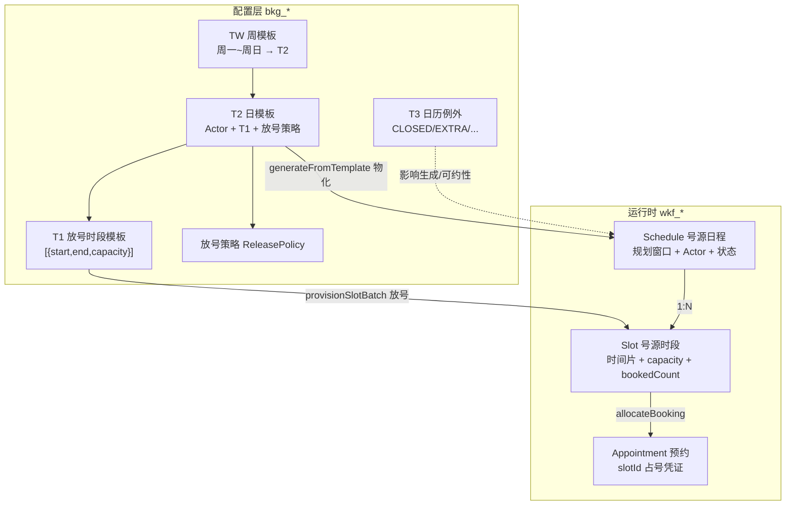

# ZXPlat Booking 门诊排班概念梳理

> **文档性质**：概念导读 — Schedule / Slot / 模板 / 预约的关系与术语对照  
> **上游**：[05-门诊排班业务规则与模板.md](./05-门诊排班业务规则与模板.md)、[01-概要设计.md](./01-概要设计.md)  
> **下游**：新人 onboarding、需求评审、代码阅读前的快速索引  
> **版本**：v1.0 | **日期**：2026-06-18

---

## 1. 阅读指引

本文是 **概念层导读**，侧重「是什么、怎么串起来」。细则（规则编号、API、验收用例）以 [07](./05-门诊排班业务规则与模板.md) 为真源。

| 想查什么 | 去哪里 |
| --- | --- |
| 业务规则编号（BR-SCH-*、BR-SLT-*） | [07 §2～§4](./05-门诊排班业务规则与模板.md) |
| 模板 ER 与字段 | [07 §5](./05-门诊排班业务规则与模板.md) |
| 功能清单与 AS 编号 | [00-功能清单.md](./00-功能清单.md) |
| 类路径与 HTTP 契约 | [03-详细设计与编码指导.md](./03-详细设计与编码指导.md) |
| 手工测试步骤 | [06-门诊排班手工测试清单.md](./06-门诊排班手工测试清单.md) |

---

## 2. 三层架构：谁管什么

ZXPlat Booking 门诊排班采用 **「配置模板 → 物化日程 → 放出号源 → 患者预约」** 四层结构，整体对齐 FHIR 的 `Schedule` / `Slot` / `Appointment` 模型。

| 层次 | 归属 | 典型数据 | 语义 |
| --- | --- | --- | --- |
| **资格层** | health 主数据 | `PractitionerRole` + 岗位排班项 | 「谁通常在哪科、周几出诊」 |
| **生产层** | booking 配置 | `bkg_*_template`、放号/停诊策略 | 「怎么放号、例外日怎么处理」 |
| **运行时** | booking 库存 | `wkf_schedule` / `wkf_slot` / `wkf_appointment_queue` | 「当日实际可约号源与占用」 |

**硬规则 BR-LAY-001**：修改岗位模板或排班模板 **不会追溯** 已发布的 Schedule，只影响后续「从模板生成」。

---

## 3. 运行时核心概念

### 3.1 号源日程（Schedule）

- **表**：`wkf_schedule`
- **聚合根**：`com.zxplat.plugin.booking.domain.schedule.entity.Schedule`
- **领域服务**：写侧 `ScheduleDomainService`；读侧 `ScheduleQueryService`
- **语义**：**「一次出诊安排」** 的容器，不是单个时间点

关键字段：

| 字段 | 含义 |
| --- | --- |
| `organizationId` | 门诊科室 |
| `planningHorizonStart/End` | 规划窗口（通常覆盖当日出诊时段） |
| `statusEnum` | 业务状态：draft / active / inactive / retired |
| `activeFlag` | 与 FHIR Schedule.active 对齐 |
| `healthcareServiceId` + JSON 快照 | 服务口径（专科、服务大类等） |
| `substitutePractitionerId` | 替诊医师（顶班显示，不改预约占用） |

状态流转：

```text
draft（草稿）→ active（已发布/可约）→ inactive（停诊）→ retired（废弃终态）
```

**注意**：草稿没有规划窗口时，日历上 **不占格**（SCH-01）。

---

### 3.2 日程参与者（ScheduleActor）

- **表**：`wkf_schedule_actor`
- **实体**：`ScheduleActor`
- **语义**：描述 **「这条日程是谁在出、什么号」**

门诊支持的三种参与者（`ScheduleActorKind`）：

| 类型 | 含义 | 是否必选 |
| --- | --- | --- |
| `PRACTITIONER` | 出诊医师 | 视模式而定 |
| `LOCATION` | 诊室/诊区 | 可选 |
| `HEALTHCARE_SERVICE` | 号源类型（专家号/普通号等） | **必选** |

三种排班模式（详见 [07 §2.1](./05-门诊排班业务规则与模板.md)）：

| 模式 | 名称 | 必选 Actor | 典型场景 |
| --- | --- | --- | --- |
| **MODE-A** | 医师门诊 | `HEALTHCARE_SERVICE` | 专家号、指名预约；可选医师 + 诊室 |
| **MODE-B** | 科室号/分诊号 | `HEALTHCARE_SERVICE` | 只排到科室，到院再分诊绑医师 |
| **MODE-C** | 诊区号 | `HEALTHCARE_SERVICE` + `LOCATION` | 有物理诊区，暂不绑医师 |

模式推断逻辑：`ScheduleActorCompositionRules.resolveScheduleMode()`。

---

### 3.3 号源时段（Slot）

- **表**：`wkf_slot`
- **聚合根**：`com.zxplat.plugin.booking.domain.slot.entity.Slot`
- **领域服务**：写侧 `SlotDomainService`；读侧 `SlotQueryService`
- **语义**：**患者真正能约的最小单元**（一个时间段 + 容量）

关键字段：

| 字段 | 含义 |
| --- | --- |
| `scheduleId` | 所属日程 |
| `startTime` / `endTime` | 时间片 |
| `capacity` | 额定容量（默认 1） |
| `bookedCount` | 已预约计数 |
| `statusCode` | free / busy / busy-unavailable / … |
| `overbookedFlag` | 超售标记 |

关系：**一个 Schedule 下有多个 Slot**（如 08:00–08:30、08:30–09:00…）。

号源状态（FHIR Slot.status，`SlotStatus` 枚举）：

| 状态 | 含义 |
| --- | --- |
| `free` | 空闲，可预约 |
| `busy` | 已有预约占用（`bookedCount > 0`） |
| `busy-unavailable` | 封锁（停诊、检修等，非预约原因） |
| `busy-tentative` | 暂定占用，待确认 |
| `entered-in-error` | 录入差错终态 |

容量规则：`bookedCount >= capacity` 则满号；允许超售时 `overbookedFlag = true`。

**边界**：Slot 聚合只维护时间片与占用事实；预约合同主数据由 `Appointment` 聚合表达。

---

### 3.4 预约（Appointment）

- **表**：`wkf_appointment_queue`（历史命名，语义为预约与候诊队列）
- **聚合根**：`com.zxplat.plugin.booking.domain.appointment.entity.Appointment`
- **语义**：**占号凭证 + 候诊队列**

门诊预约（`appointmentKind = OUTPATIENT_BOOKING`）必须绑定 `slotId` 与 `patientId`。

与挂号三要素对齐（[07 §2.3](./05-门诊排班业务规则与模板.md)）：

| 挂号字段 | 来源 |
| --- | --- |
| `organizationId` | `Schedule.organizationId` |
| `practitionerId` | Actor(PRACTITIONER)；MODE-B 可空 |
| `serviceTypeId` | `healthcare_service_id` |
| `slotId` | `Appointment.slotId` |

---

## 4. 概念关系图



---

## 5. 模板体系（怎么批量建排班）

| 类型 | 表 | 作用 |
| --- | --- | --- |
| **T1** | `bkg_slot_provision_template` | 定义时段与容量 JSON，如 `[{08:00,12:00,20}, {14:00,17:00,15}]` |
| **T2 日模板** | `bkg_schedule_template` | 单日 Actor + 关联 T1 + 放号策略；**物化最小单元** |
| **TW 周模板** | `bkg_week_schedule_template` + `_item` | 周一～周日各引用一个 T2 |
| **T3 日历例外** | `bkg_calendar_exception` | 国庆 CLOSED、调休 EXTRA 等 |

**T1 一行 = 一个 Slot**（不是自动按分钟切分）。例如上午 08:00–12:00 capacity=20，就是 **1 个 Slot 容量 20**，不是 20 个 15 分钟小格。

物化流程（`generateFromTemplate`，应用层 `GenerateFromTemplatesupport）：

```text
选 T2/TW + 日期区间
  → 创建 Schedule（draft）
  → 发布 publishSchedule（写入规划窗口，变 active）
  → provisionSlotBatch（按 T1 生成 Slot）
```

模板 Fallback 链（自动生成时按序命中，详见 [07 §5.6](./05-门诊排班业务规则与模板.md)）：

```text
1. 当日 T3 例外（OVERRIDE/EXTRA/REDUCED/CLOSED）
2. 科室 enabled T2（priority 降序，effective 内）
3. health 岗位 scheduleItems
4. 科室 default T2
5. 失败 → 告警，不静默跳过
```

---

## 6. 策略配置

| 策略 | 表 | 作用 |
| --- | --- | --- |
| **放号策略** | `bkg_release_policy` | 提前几天放号、每段分钟数、每段容量、渠道配额 |
| **停诊处置策略** | `bkg_schedule_change_policy` | 停诊时转交/改约/取消、是否冻结预览等 |
| **挂号衔接策略** | `bkg_registration_policy` | 预约与挂号衔接规则 |

---

## 7. 完整业务链路（从排班到挂号）

```text
① 排班员建 Schedule（手动 / 从 T2·TW 模板生成 / 复制上周）
      ↓
② 发布 Schedule（draft → active，设定规划窗口 = 当日出诊时段）
      ↓
③ 放号 provisionSlotBatch（按 T1 或手工，生成 wkf_slot）
      ↓
④ 患者查可约号源 listBookableSlots（查 free 且有余量的 Slot）
      ↓
⑤ 预约 allocateBooking（Slot.bookedCount++，创建 Appointment）
      ↓
⑥ 到院报到 / 转挂号（写入 encounterId，进入 health 挂号域）
```

### 7.1 周模板虚拟可约（fallback）

某周还没有真实 Schedule 时：

- 周历可展示 TW 模板格（虚线 / 「未发布」），由 `WeekTemplateFallbacksupport 合并
- 若 `fallback_bookable=true`，预约侧可返回虚拟时段
- **首次占号时 lazy 物化** Schedule + Slot（仍 respect T3 CLOSED）

详见 [07 §5.7](./05-门诊排班业务规则与模板.md)。

---

## 8. 常见变更操作对照

| 业务操作 | 影响对象 | 是否动预约 |
| --- | --- | --- |
| 整日停诊 | Schedule → inactive，Slot 封锁 | 是，需先处置预约 |
| 部分时段停诊 | 指定 Slot → busy-unavailable | 是（该 Slot 上的） |
| 替诊 | `Schedule.substitutePractitionerId` | **否**，预约/号源不变 |
| 换医师（非替诊） | 停旧 Schedule、开新 Schedule | 是，走转交流程 |
| 改容量/加号 | 追加 Slot 或改 capacity | 未约的不影响 |
| 恢复开诊 | reactivateSchedule + 解封 Slot | 一般不影响已有预约 |

### 8.1 替诊 vs 转交

| 维度 | 转交预约 | 替诊（SUBSTITUTE） |
| --- | --- | --- |
| 患者预约信息 | 改为 B 的 Slot/时段 | **不变**（仍显示 A） |
| 号源占用 | 迁移到 B 的 Slot | **不迁移** |
| 适用 | A 永久停诊、B 接替号源 | A 临时不能出诊，B 顶班 |
| 叫号/大屏 | 显示 B | 显示「B 替 A」 |
| 接口 | `rescheduleOutpatientBooking` | `substitutePractitioner` |

---

## 9. 表命名约定

| 前缀 | 含义 | 示例 |
| --- | --- | --- |
| `wkf_*` | 运行时库存层 | `wkf_schedule`、`wkf_slot`、`wkf_appointment_queue` |
| `bkg_*` | Booking 配置与扩展 | `bkg_schedule_template`、`bkg_release_policy` |

完整表清单见 `booking-application/src/main/resources/db/migration/booking/README.md`。

---

## 10. 核心代码索引

| 概念 | 实体 / 服务 | 应用入口 |
| --- | --- | --- |
| Schedule 写 | `ScheduleDomainService` | `OutpatientScheduleAppService` |
| Schedule 读 | `ScheduleQueryService` | 同上 + 日历/月视图 API |
| Slot 写 | `SlotDomainService` | `OutpatientScheduleAppService`、`SlotManageAppService` |
| Slot 读 | `SlotQueryService` | 挂号 `listBookableSlots` 等 |
| 模板生成 | `GenerateFromTemplatesupport | `generateFromTemplate` |
| 周历 fallback | `WeekTemplateFallbacksupport | `pageSchedulesByCalendar` |
| Actor 组合规则 | `ScheduleActorCompositionRules` | 创建/发布/替换 Actor 时校验 |

---

## 11. 一句话记忆

| 概念 | 一句话 |
| --- | --- |
| **Schedule（日程）** | 「谁、哪天、什么号、出诊窗口」的容器 |
| **Slot（号源）** | 「具体几点到几点、还能约几个」的可售库存 |
| **Appointment（预约）** | 「某个 Slot 被某患者占了一席」的合同 |
| **T1/T2/TW 模板** | 批量生成 Schedule + Slot 的配置蓝图 |
| **放号** | 把 Schedule 的时间窗口切成（或填入）可约 Slot |

---

## 12. 修订记录

| 版本 | 日期 | 说明 |
| --- | --- | --- |
| v1.0 | 2026-06-18 | 初版：概念导读，供 onboarding 与代码阅读前快速索引 |
