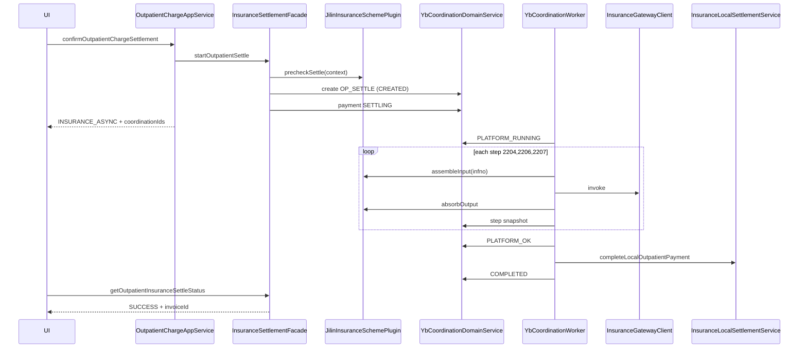
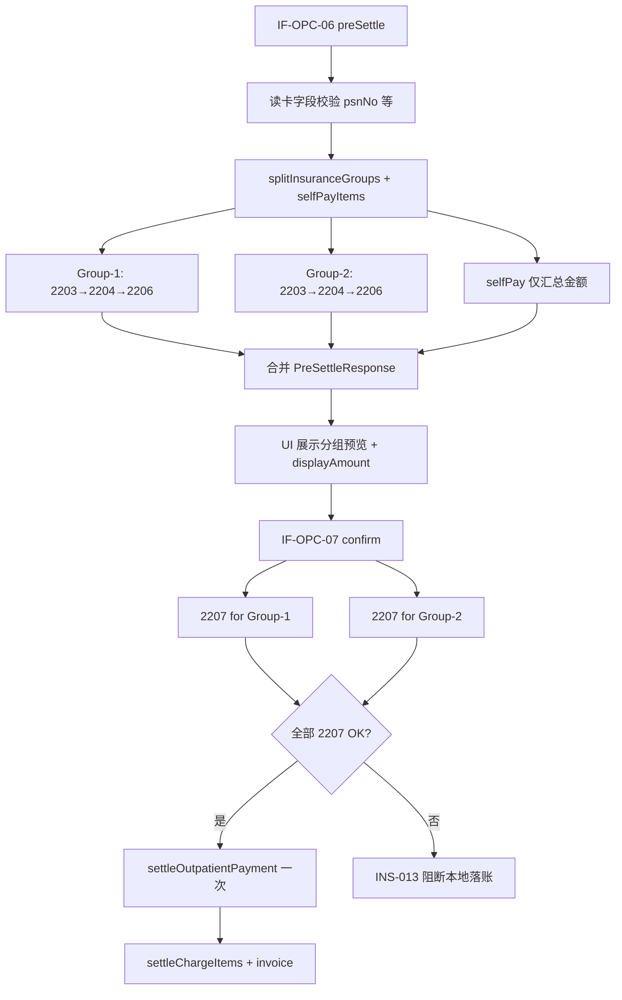

# 门诊医保结算 — 详细设计（吉林省 CHS_NATIONAL_JILIN）

> **文档性质**：LLD（Wave 1 可编码）  
> **实现状态**：[13-实现状态与文档对照.md](./13-实现状态与文档对照.md) — 同步 MVP（单组 2203→2207）已部分编码；**§14 混合结算**为 v1.1 新增规划，待编码。
> **上游**：[03-概要设计](./05-Whale吉林省医保模块-概要设计.md) | [04-多方案骨架](./17-Whale医保多方案扩展骨架.md)  
> **接口规范**：[2204](../apis/22xx/2204-门诊费用明细信息上传.md) | [2206](../apis/22xx/2206-门诊预结算.md) | [2207](../apis/22xx/2207-门诊结算.md)  
> **版本**：v1.5 | **日期**：2026-10-09

---

## 1. 范围与默认配置

### 1.1 范围

- 门诊收费场景：`OP_SETTLE` 协同单驱动 **2204 → 2206 → 2207**（默认链，可配置）。
- **混合结算**（同一就诊多 `med_type` / 医保+自费一次收银）：见 **§14**。
- 不含：2201 独立挂号结算（挂号费已在 `OutpatientRegistrationAppService` 时可另开协同类型 `OP_REG_SETTLE`，Wave 1 **默认不启用 2201**，`mdtrt_id` 由 **2203/就诊登记或院内映射表** 提供，见 §4.4）。
- infno 默认 **2207**（非 2207A）；若现场要求 A 变体，仅改配置 `insurance.schemes.CHS_NATIONAL_JILIN.settle-infno=2207A`。

### 1.2 默认步骤链（可配置）

```yaml
insurance:
  schemes:
    CHS_NATIONAL_JILIN:
      op-settle-steps:
        - infno: "2204"
          required: true
        - infno: "2206"
          required: true
        - infno: "2207"
          required: true
      # 可选前置，Wave 1 默认关闭
      op-settle-preflight: []
      # 示例: [2201, 2203]
```

---

## 2. 与现有收费流程集成

### 2.1 现状（改造前）

`OutpatientChargeAppService.confirmOutpatientChargeSettlement` 在单事务内：

1. 校验 payment DRAFT、chargeItem 一致  
2. `settleOutpatientPayment` → **SUCCESS**  
3. `settleChargeItems`  
4. `createDraftInvoiceAfterPayment`

### 2.2 改造后分支

```text
confirmOutpatientChargeSettlement(request)
  ├─ 现有校验（不变）
  ├─ group chargeItems by accountId
  ├─ insuranceGroups = 账户关联 fin_contract.yb_flag=true 或 category=PROVINCIAL_INSURANCE
  ├─ selfPayGroups = 其余
  │
  ├─ if insuranceGroups.isEmpty()
  │     └─ 走现有同步路径（纯自费）
  │
  └─ else 混合或纯医保
        ├─ InsuranceSettlementFacade.startOutpatientSettle(...)
        │     ├─ payment.status → SETTLING
        │     └─ 每个医保 account 创建一条 OP_SETTLE coordination
        ├─ if selfPayGroups 非空
        │     └─ 同一 payment 下自费明细：等平台医保 COMPLETED 后一并 settleOutpatientPayment
        │        （或 Wave 1：要求用户分两次收费，见 §2.4）
        └─ 返回 ConfirmOutpatientChargeSettlementResponse
              settlementMode=INSURANCE_ASYNC
              coordinationIds=[...]
              paymentStatus=SETTLING
```

### 2.3 混合费用策略（修订）

> **v1.1 起**：原 Wave 1「策略 A — 阻断混合账户（INS-008）」**废止**，改由 **§14 混合结算** 定义「一次收银、分组医保」同步编排。协同单异步路径（§2.2 / §2.4）仍为 Wave 2 可选增强，不与混合结算互斥。

| 策略 | 说明 | Wave | 状态 |
|------|------|------|------|
| ~~**A**~~ | ~~同一 `paymentDraft` 含多 account 时阻断（INS-008）~~ | ~~1~~ | **废止** |
| **C（混合结算，推荐）** | 同一 `paymentDraft`：医保项按分组多次 2203→2206，自费项仅本地汇总；`confirm` 时顺序 2207 后一次 `settleOutpatientPayment` | 1.5 | **本文 §14** |
| **B（协同单异步）** | 医保走 OP_SETTLE 协同单 Worker；自费等同 payment 落账 | 2 | 规划 |

用户调整费用性质：优先 **按行** `switchChargeItemAccount`；就诊级 `switchEncounterChargeItemsToInsurance` / `ToSelfPay` 保留为批量快捷操作。预结算失败或 2207 失败后，作废本批 `yb_clinic_pre_settle`（`CANCELLED`），重新 `preSettle`。

### 2.4 前端交互（SETTLING）

| 阶段 | API | 行为 |
|------|-----|------|
| 正式结算提交 | `confirmOutpatientChargeSettlement` | 返回 `settlementMode=INSURANCE_ASYNC`、`coordinationIds` |
| 轮询 | `InsuranceOutpatientSettlementAppService.getOutpatientInsuranceSettleStatus` | 2s 间隔，直到 `COMPLETED`/`FAILED`/`UNKNOWN` |
| 成功 | 同上 `COMPLETED` | 返回 `paymentId`、`invoiceId`（本地落账完成后） |
| 失败 | `FAILED` | 展示 `errorMsg`；用户改 account 后重新预结算 |
| UNKNOWN | `UNKNOWN` | 提示「结算结果待确认，请勿重复结算」；医保办处理 |

**扩展 `ConfirmOutpatientChargeSettlementResponse`：**

```java
public class ConfirmOutpatientChargeSettlementResponse {
    private Long paymentId;
    private Long invoiceId;
    /** SYNC | INSURANCE_ASYNC */
    private String settlementMode;
    private String paymentStatus;  // SETTLING | SUCCESS
    private List<Long> coordinationIds;
    private String message;
}
```

---

## 3. 合同与方案解析

### 3.1 contractId 解析链

```text
chargeItem.accountId
  → Account.contract_no (bus_no)
  → ContractQueryService.findByBusNo(contract_no)
  → fin_contract.id = contractId
  → ContractSchemeResolver.resolve(contract)
       → InsuranceSchemeCode (insurance_scheme_code 或 category 默认)
  → chs-contract.properties contract.{id}.*
```

### 3.2 类设计

```java
@Component
public class ContractSchemeResolver {
    public ResolvedContract resolve(Long contractId) {
        // Contract + InsuranceSchemeCode + ContractConfig 校验存在
    }
    public boolean isInsuranceAccount(Long accountId) {
        // account.contract_no → contract.ybFlag || category PROVINCIAL_INSURANCE
    }
}
```

---

## 4. 1101 人员信息与缓存

### 4.1 表：`yb_person_cache`

```sql
CREATE TABLE yb_person_cache (
    id              BIGINT PRIMARY KEY,
    contract_id     BIGINT NOT NULL,
    mdtrt_cert_type VARCHAR(3) NOT NULL,
    mdtrt_cert_no   VARCHAR(64) NOT NULL,
    psn_no          VARCHAR(30) NOT NULL,
    insuplc_admdvs  VARCHAR(6),
    insutype        VARCHAR(6),
    balc            NUMERIC(18,2),
    snapshot_json   TEXT NOT NULL,
    cached_at       TIMESTAMP NOT NULL,
    expire_at       TIMESTAMP NOT NULL,
    tenant_id       BIGINT NOT NULL,
    UNIQUE (contract_id, mdtrt_cert_type, mdtrt_cert_no, tenant_id)
);
```

- 有效期：**当日 23:59:59**（与 1101 文档一致）。  
- **`InsurancePersonAppService.getYbPersonInfo`（规划，未编码）**：先查缓存，miss 则 invoke 1101 后写入。

### 4.2 结算请求携带字段

`StartOpInsuranceSettleRequest` 必须含（来自 1101 或缓存）：

| 字段 | 来源 |
|------|------|
| `psnNo` | 1101 |
| `insuplcAdmdvs` | 1101 → InvokeContext |
| `mdtrtCertType` / `mdtrtCertNo` | 前端 PreSettle 已传 `ybMediumType`/`ybCardInfo` 或扩展字段 |
| `insutype` | 1101 或 Account.insutype |

**PreSettle 扩展（Wave 1）：** 在 `PreSettleOutpatientChargesRequest` 增加可选 `psnNo`、`insuplcAdmdvs`（前端读卡后填入）。

---

## 5. mdtrt_id 与 chrg_bchno

| 字段 | 生成规则 |
|------|----------|
| **mdtrt_id** | 优先：`yb_encounter_platform_map.mdtrt_id`（见 §5.1）；否则 Wave 1 **必须**在配置中启用 2201 或 2203 前置步骤 |
| **chrg_bchno** | `{fixmedins_code}{yyyyMMdd}{coordination.id 后 6 位}`，同一 OP_SETTLE 协同单内 2204/2206/2207 共用 |

### 5.1 表：`yb_encounter_platform_map`

```sql
CREATE TABLE yb_encounter_platform_map (
    id              BIGINT PRIMARY KEY,
    encounter_id    BIGINT NOT NULL,
    contract_id     BIGINT NOT NULL,
    mdtrt_id        VARCHAR(30) NOT NULL,
    psn_no          VARCHAR(30),
    ipt_otp_no      VARCHAR(30),
    created_at      TIMESTAMP NOT NULL,
    tenant_id       BIGINT NOT NULL,
    UNIQUE (encounter_id, contract_id, tenant_id)
);
```

- 2201/2401 成功时写入；门诊收费复用。  
- Wave 1 **若无 mdtrt_id**：Precheck 失败 `INS-009 MDTRT_ID_MISSING`，提示先完成医保挂号/登记。

---

## 6. 字段映射表

### 6.1 2204 费用明细（逻辑行；带子项诊疗可一对多）

> **基线**：无子项时 **单行 = 一条 ChargeItem**。  
> **带子项诊疗**（`wkf_activity_definition` 且子表有行）：院内落**父账单 + 子项账单**；回显只见父项。`ChsOutpatientInsuranceContextLoader` 经 **`ChsActivityPackageFeeExpandSupport#expandToUploadSlices`** 从父账单查子项账单冻价上传（**禁止**回查 SALE）；目录有子项但无子项账单时拒绝；父项通常无 `yb_no`，**不上传父项**。与医嘱组套无关。

| 2204 字段 | ZXPlat 来源 | 规则 |
|-----------|------------|------|
| `feedetl_sn` | 无子项：`ChargeItem.busNo` 或 `chargeItem.id`；子项账单：`{父feedetlSn}.{序号}`（≤30） | 单次就诊内唯一 |
| `mdtrt_id` | `InsuranceSettlementContext.mdtrtId` | 必填 |
| `psn_no` | context.psnNo | 必填 |
| `chrg_bchno` | context.chrgBchno | 必填 |
| `dise_codg` | 组级：`EncounterDiagnosis`（按 `chargeItem.encounterDiagnosisId`）医保码；慢特病必填 | 混合结算见 §14.3.2 |
| `rxno` | `ChargeItem.prescriptionNo` | 无则空，**禁止**伪造电子处方号 |
| `rx_circ_flag` | 固定 `"0"` | 非外购 |
| `fee_ocur_time` | `ChargeItem.occurrenceTime` | `yyyy-MM-dd HH:mm:ss` |
| `med_list_codg` | 无子项：父 Product.`ybNo`；有子项：子项账单对应 Product.`ybNo` | Precheck 非空（INS-011） |
| `medins_list_codg` | Product.`ybOrgNo` → 院内 `bus_no` → 定义主键 | 必填 |
| `det_item_fee_sumamt` | 无子项：`ChargeItem.totalPrice`；有子项：子项账单 `totalPrice` | 子项账单之和 = 父 `totalPrice` |
| `cnt` | 无子项：`ChargeItem.quantityValue`；有子项：子项账单数量 | |
| `pric` | 无子项：`ChargeItem.unitPrice`；有子项：子项账单冻价单价 | **禁止**按权重分摊父项金额；**禁止**回查 SALE |
| `bilg_dept_codg` | `Organization.ybNo`（开单科室） | |
| `bilg_dept_name` | `Organization.name` | |
| `bilg_dr_codg` | `Practitioner.ybNo`（enterer/requester） | |
| `bilg_dr_name` | `Practitioner.name` | |
| `hosp_appr_flag` | 默认 `"1"` | 吉林文档：限制使用标志未启用时按实际情况 |
| `tcmdrug_used_way` | `TcmdrugUsedWayResolver`（bridge） | 仅中草药行：同 `prescription_no` 下去重味数 **>5** 复方 `1`，**≤5** 单方 `2`；西药/中成药/诊疗**不填** |

**产品解析：** `product_table` + `product_id` → `ProductDefinitionQueryService.batchLoadAsMap` → `ybNo`。套餐时对子项 `children_id` 再批量加载目录。

**金额门禁：** 子项账单金额合计须等于父 ChargeItem `totalPrice`，否则拒绝上传（不回查 SALE）。

#### 6.1.1 中草药 `tcmdrug_used_way`（2204 / 2301 同口径）

落点：`module-chs-jilin-bridge` `TcmdrugUsedWayResolver`；门诊 `ChsOutpatientInsuranceContextLoader`、住院 `ChsInpatientInsuranceContextLoader` 写入费用行后由 2204/2301 Assembler 带出。

| 规则 | 口径 |
| --- | --- |
| 计入味数 | 药典 `medication_category_code=4`（中草药） |
| 去重键 | 药品定义 id，缺则医保码 |
| 分组 | 同一 `prescription_no`；无处方号的中草药本批次并为一组 |
| 阈值 | 去重味数 **>5** → 复方 `TcmdrugUsedWay.COMPOUND`=`1`；**≤5** → 单方 `SINGLE`=`2` |
| 非中草药 | 报文不传本字段 |

### 6.2 2206 / 2207 结算头（data 节点）

| 字段 | 来源 | 2206 | 2207 |
|------|------|------|------|
| `psn_no` | context | Y | Y |
| `mdtrt_cert_type` | userChoices | Y | Y |
| `mdtrt_cert_no` | userChoices | Y | Y |
| `med_type` | 医保分组 `medType`（`EncounterDiagnosis.medType`） | Y | Y |
| `medfee_sumamt` | sum(本批上传逻辑行 `det_item_fee_sumamt`)；套餐展开后等于 Σ 父 ChargeItem.totalPrice | Y | Y |
| `psn_setlway` | UI 默认 `"01"` 按项目 | Y | Y |
| `mdtrt_id` | context | Y | Y |
| `chrg_bchno` | context | Y | Y |
| `insutype` | Account.insutype 或 1101 | Y | Y |
| `acct_used_flag` | UI 默认 `"1"` | Y | Y |
| `invono` | 本地发票号，LOCAL 完成后回填；2207 可空 | N | 可选 |
| `fulamt_ownpay_amt` 等 | **2206 输出** → 2207 输入 | — | 2206.setlinfo 透传 |
| `minpacunt_drug_trac_cnt` | 本批次药品**应上传最小包装追溯码条数**（**`SettlementTraceCountSupport`**；与实扫枚数脱钩）。**两分支 `floor`**（**DD §4.3**）：A 收费单位已是贴码单位 → 行贡献 = 数量本身（包装个数）；B 拆零单位 → **`floor(拆零量 ÷ trace_unit_ratio)`**（主表批号比例优先）。**禁止** `ceil(cnt)`；**禁止**「单位不一致一律 0」 | N | Y |
| `mcs_trac_cnt` | 耗材追溯码条数（Wave 1 可 0） | N | Y |

**2206 → 2207：** 2206 的 `setlinfo` 中金额字段写入 context.preSettleOutput，2207 Assembler **透传**至 2207 input。

### 6.3 吉林 extData（嵌入 2203/2204/2206/2207 的 exp_content 或地方约定节点）

> 以现场接口为准；下列映射供 `JilinExtDataBuilder` 实现。

| extData 字段 | ZXPlat 来源 | 必填（Wave 1） |
|--------------|------------|----------------|
| `dept_name` | Encounter 科室 `Organization.name` | Y |
| `disediag` | 主诊断 `ConditionDefinition.ybNo` + display | Y |
| `psndisehis` | 现病史（EMR 或 Encounter 扩展；无则 `"-"`） | N |
| `adm_date` | `Encounter.startTime` → `yyyyMMddHHmmss` | Y |
| `name` | `Patient.name` | Y |
| `certno` | `Patient.idCard` | Y |
| `age` / `gend` | Patient / 1101 | Y |
| `mdtrtarea_subcent` | `Contract.admVs` 或配置 | 现场定 |
| `insuplc_subcent` | 1101 返回 | 现场定 |
| 其余 | 急诊/住院场景再填 | N |

---

## 7. 输出解析与本地落账

### 7.1 2207 输出 → 领域对象

```java
public class OpSettle2207Output {
    private String setlId;
    private String mdtrtId;
    private BigDecimal medfeeSumamt;
    private BigDecimal fundPaySumamt;
    private BigDecimal acctPay;
    private BigDecimal psnCashPay;
    private List<FundPaymentItem> setldetail;
}
```

**落库：**

1. `yb_settlement_record` 插入一行  
2. `yb_coordination.platform_setl_id = setlId`  
3. `InsuranceLocalSettlementService.completeLocalOutpatientPayment`：
   - 调用现有 `SettleOutpatientPaymentCommand`（paymentDetails 按平台 `psn_cash_pay` + 基金分项对齐）
   - `payment.yb_settle_ids` 追加 setlId  
   - `chargeItemDomainService.settleChargeItems`  
   - `invoiceDomainService.createDraftInvoiceAfterPayment`  
   - `payment.status` → SUCCESS  

### 7.2 支付明细与平台金额对齐

| PaymentDetailSubmitDto | 来源 |
|------------------------|------|
| 统筹/基金 | 渠道码配置表 `INSURANCE_FUND`（术语或配置） |
| 个账 | `INSURANCE_ACCT` |
| 现金 | `CASH` ← `psn_cash_pay` |

若 `request.paymentDetails` 与平台试算不一致（2206 后用户未刷新）：**以 2206 为准阻断 2207**（Precheck `INS-010 AMOUNT_DRIFT`）。

---

## 8. AppService 接口（完整字段）

> **混合结算扩展契约**见 **§14.8**；下列为协同单路径（Wave 2）原始形状，字段与 §14 单组形态兼容。

### 8.1 StartOpInsuranceSettleRequest

```java
@Data
public class StartOpInsuranceSettleRequest {
    @NotNull private Long paymentDraftId;
    @NotNull private Long encounterId;
    @NotNull private List<Long> chargeItemIds;
    @NotNull private Long contractId;
    @NotNull private String mdtrtCertType;
    @NotNull private String mdtrtCertNo;
    @NotNull private String psnNo;
    @NotNull private String insuplcAdmdvs;
    private String insutype;
    private String medType;
    private String acctUsedFlag;      // default "1"
    private String psnSetlway;        // default "01"
    private String diseCodg;
    private LocalDateTime billDate;
    private List<PaymentDetailSubmitDto> paymentDetails;
}
```

### 8.2 GetOpInsuranceSettleStatusResponse

```java
@Data
public class GetOpInsuranceSettleStatusResponse {
    private Long paymentId;
    private String paymentStatus;
    private List<CoordinationStatusDto> coordinations;
    private Long invoiceId;           // COMPLETED 时有值
    private boolean allCompleted;
    private boolean anyFailed;
    private boolean anyUnknown;
}

@Data
public class CoordinationStatusDto {
    private Long coordinationId;
    private Long accountId;
    private String state;
    private String errorCode;
    private String errorMsg;
    private String platformSetlId;
}
```

---

## 9. 类与包（scheme/jilin）

```text
application/insurance/scheme/jilin/
  JilinInsuranceSchemePlugin.java
  JilinOpSettleCoordinationExecutor.java
  assembler/
    JilinOp2204InputAssembler.java
    JilinOp2206InputAssembler.java
    JilinOp2207InputAssembler.java
  localization/
    JilinExtDataBuilder.java
  precheck/
    JilinCatalogPrecheckRule.java
    JilinMdtrtIdPrecheckRule.java
    JilinMixedMedTypeGroupPrecheckRule.java   // v1.1 替代 JilinMixedAccountPrecheckRule
```

---

## 10. 时序（详细）



---

## 11. 错误码（门诊补充）

| 码 | 常量 | 说明 |
|----|------|------|
| INS-008 | ~~MIXED_ACCOUNT_IN_ONE_PAYMENT~~ | **废止**（v1.1 改由 §14 混合结算支持） |
| INS-009 | MDTRT_ID_MISSING | 无 mdtrt_id |
| INS-010 | AMOUNT_DRIFT | 2206 与 paymentDetails 不一致 |
| INS-011 | CATALOG_YB_NO_MISSING | 医保分组内收费项缺少 `yb_no` |
| INS-012 | MIXED_MED_TYPE_UNGROUPED | 医保项存在多种 `med_type` 但未完成分组（内部编排错误） |
| INS-013 | INSURANCE_BATCH_PARTIAL_FAILED | 多批次 2207 中部分成功、部分失败，禁止本地落账 |
| INS-014 | INSURANCE_SETTLE_IN_PROGRESS | payment 已 SETTLING（协同单路径） |
| INS-015 | INSURANCE_CREDENTIAL_EXPIRED | 就诊凭证失效：电子凭证过期，或市医保 FMI「解密卡串失败/卡串已超时」（身份证 SignBuff、社保卡卡串）；须重读凭证并刷新预结算，禁止误报 INS-013 |

---

## 12. 测试用例（最小集）

| # | 场景 | 期望 |
|---|------|------|
| T1 | 纯自费 confirm | settlementMode=SYNC，无协同单 |
| T2 | 纯医保 confirm | SETTLING → Mock 2207 OK → COMPLETED → SUCCESS |
| T3 | 未对照 yb_no | Precheck INS-001，无 invoke |
| T4 | 2207 超时 | UNKNOWN，不二次 2207 |
| T5 | 2207 OK 本地落账失败 | LOCAL_PENDING，重试本地 |
| T6 | 11+14 或同 med_type 两病种一次勾选 | **收银拦截**（EX-OPC-311）；须分次预结算 |
| T7 | 医保+自费混合 | 仅医保项进 2204；`displayAmount` = Σ psn_cash_pay + 自费原价 |
| T8 | 第二组 2207 失败 | INS-013；第一组 2207 已成功的批次标记待冲正/人工处理 |

---

## 13. 院方确认项（编码可 stub，上线前必填）

- [ ] 是否必须 2201/2203 前置  
- [ ] 2207 或 2207A  
- [ ] extData 必填字段 subset  
- [ ] med_type 默认值（普通门诊/慢特病）  
- [ ] **同一 `mdtrt_id` 是否允许多次 2203（不同 `med_type`）**（§14.5，混合结算关键）  
- [ ] **多 `chrg_bchno` 同日结算上限与冲正规则**  
- [ ] 测试 contractId 与密钥  

---

## 14. 混合结算（一次收银）

### 14.1 业务场景

同一门诊就诊（一个 `encounter`）内，常见两类需**一次性收银**的混合：

| 场景 | 示例 | 平台/HIS 矛盾 |
|------|------|----------------|
| **混合医疗类别** | 同一就诊既开慢特病药（`med_type=14`）又开普通门诊药（`med_type=11`） | 2203/2206/2207 每次只能带 **一个** `med_type` |
| **混合费用性质** | 同一就诊既有可对码医保项，又有自费非医保项（无 `yb_no` 或挂自费账户） | 2204 只能上传医保目录项；自费项不应进平台 |

**设计目标**：收银台用户 **勾选全部待收项 → 读卡 → 预结算预览 → 一次确认结算**，后端自动拆分医保平台调用，最终 **一个 `paymentDraft`、一次本地落账**。

### 14.2 与现有 HIS 能力对齐

| HIS 已有 | 表/类 | 混合结算中的用途 |
|----------|-------|------------------|
| 诊断级 `med_type` | `adm_encounter_diagnosis.med_type`（`YbMedType`） | 分组键；2203/2206 头字段 |
| 收费项诊断锚点 | `adm_charge_item.encounter_diagnosis_id` | 解析每行 `med_type` |
| 账户绑定 | `adm_charge_item.account_id` → `fin_account` | 区分医保/自费 |
| 处方按 med_type 拆方 | `OutpatientPrescriptionSplitPlanner` | 开方侧已分区；收费侧与之对齐 |
| 待收费展示 | `PendingChargeItemRowDto.medTypeCode` / `feeNatureDisplay` | 前端分组预览 |
| 支付草稿多账户占位 | `buildPreSettlePaymentDetailDraftLines` | 已按 `accountId` 汇总；混合结算扩展金额口径 |

### 14.3 分组规则

#### 14.3.1 第一层：费用性质（account）

```text
所选 chargeItemIds
  ├─ insuranceItems = account 关联 fin_contract.yb_flag=true 或 category=PROVINCIAL_INSURANCE
  └─ selfPayItems   = 其余（含无 account 回落默认自费账户）
```

- **自费组**：不参与 2203/2204/2206/2207；仅计入本地 `paymentDraft` 占位明细（金额为 `totalPrice` 原价）。
- **医保组**：进入第二层分组，且组内每行 **必须有** `yb_no`（否则 `INS-011`）。

#### 14.3.2 第二层：医保组内按 `med_type`（+ 慢病诊断）

```text
insuranceItems
  └─ group by partitionKey:
       medType = encounterDiagnosis.med_type（缺省回落 "11" 普通门诊）
       + 当 medType ∈ {14, 140104, 140201, ...} 时追加 diseCodg = 关联诊断医保码
```

| 字段 | 来源 | 说明 |
|------|------|------|
| `medType` | `ChargeItem.encounterDiagnosisId` → `EncounterQueryService.mapMedTypeByEncounterDiagnosisIds` | 与 `OutpatientPrescriptionSplitPlanner` 分区键同源 |
| `diseCodg` | 同上诊断 → `ConditionDefinition.conditionCode`（医保码） | 慢特病 2204 行级 `dise_codg`；普通门诊可空 |
| `contractId` | 医保 `account.contract_no` → `fin_contract.id` | 多合同场景按 account 再拆（少见） |

**分组结果** = 若干 `OpInsuranceSettleGroup`，每组独立 `chrg_bchno`，共用同一 `mdtrt_id`（见 §14.5）。

#### 14.3.3 分组示例

```text
用户勾选 5 条 chargeItem：
  A 慢病药  account=医保  med_type=14  dise=糖尿病
  B 慢病药  account=医保  med_type=14  dise=糖尿病
  C 普通药  account=医保  med_type=11
  D 检查    account=医保  med_type=11
  E 自费耗材 account=自费  无 yb_no

→ Group-1 (14, 糖尿病): [A, B]  → 2203₁→2204₁→2206₁
→ Group-2 (11):         [C, D]  → 2203₂→2204₂→2206₂
→ SelfPay:              [E]     → 仅本地
```

### 14.4 编排流程（同步 MVP）



**执行顺序约束**：

1. 预结算：各医保组 **串行** 调用平台（避免同一 `mdtrt_id` 并发写冲突）；组内 2203→2204→2206 保持现有单组链。
2. 正式结算：各组 2207 **串行**；**全部成功**后才调用 `settleOutpatientPayment`。
3. 任一 2207 失败：抛 `INS-013`；已成功批次由 `OutpatientChargeInsuranceExtensionSupport` 自动 2208（同步 MVP 与 `OP_SETTLE` Worker 均已编码）。

与 §2.2 协同单路径的关系：§14 为 **同步编排**（`OutpatientInsuranceSettlementPort.preSettleBatch`），不依赖 Worker；未来可将每组映射为一条 `OP_SETTLE` 协同单，接口契约保持不变。

### 14.5 mdtrt_id 与 chrg_bchno（混合场景）

| 字段 | 混合结算规则 | 待院方确认 |
|------|--------------|------------|
| `mdtrt_id` | 同一 `encounter_id` + `contract_id` 下共用 `yb_encounter_platform_map.mdtrt_id`；各组 2203 **可多次调用**并携带不同 `med_type` | 吉林平台是否允许多次 2203 更新同一就诊 |
| `chrg_bchno` | **每组独立**生成：`{fixmedins_code}{yyyyMMdd}{6位序列}`；组内 2204/2206/2207 共用 | 一般符合国家规范 |
| `feedetl_sn` | 就诊内全局唯一（`ChargeItem.busNo` 或 `id`），跨组不重复 | — |

**默认假设（编码按此实现，联调可配置开关）**：

- `insurance.op-settle.reupload-2203-per-med-type=true`：每组预结算前调用 2203，`med_type` 取组值。
- 若现场反馈「同一 mdtrt_id 不可多次 2203」，则改为仅首组 2203、后续组跳过 2203 仅 2204（`reupload-2203-per-med-type=false`），或启用 2201 多 mdtrt（需院方确认）。

### 14.6 金额汇总与落账

#### 14.6.1 预结算响应 `displayAmount`

```text
displayAmount = Σ(各医保组 ybPsnCashPay) + Σ(自费组 chargeItem.totalPrice)
```

- 有医保预结算时，`displayAmount` **不等于** `sum(chargeItem.totalPrice)`（医保部分以 2206 试算为准）。
- 纯自费无 `contractId` 时，`displayAmount = sum(totalPrice)`（与现网一致）。

#### 14.6.2 支付草稿占位明细（`fin_payment_rec_detail`）

| 账户类型 | 占位 `amount` 口径 |
|----------|-------------------|
| 医保账户 | 对应医保组的 `psn_cash_pay`（2206 输出）；基金/个账在正式结算 `paymentDetails` 中拆分 |
| 自费账户 | `sum(totalPrice)` 原价 |

#### 14.6.3 正式结算 `paymentDetails` 校验

- `sumSubmitAmount(request)` 必须等于 `displayAmount`（预结算快照），否则 `EX-OPC-xxx` 金额不一致。
- 医保渠道拆分：每组 2207 的 `fund_pay_sumamt`、`acct_pay`、`psn_cash_pay` 汇总后填入 `PaymentDetailSubmitDto`（渠道码见 §7.2）。

### 14.7 数据模型扩展

#### 14.7.1 `yb_clinic_pre_settle`（1 paymentDraft : N 预结算快照）

现有表已支持 `payment_draft_id` 索引；混合结算下 **同一草稿对应多行**：

| 新增/明确字段 | 说明 |
|---------------|------|
| `med_type` | **新增列**（V12 迁移）：本批次医疗类别 |
| `dise_codg` | **新增列**（可选）：慢病批次主诊断医保码 |
| `charge_item_ids` | 已有 TEXT；存本组 JSON 数组 |
| `status` | `ACTIVE` → 全部 2207 成功后变 `SETTLED`；任一组失败时未结算组 `CANCELLED` |

```sql
-- V12 规划（混合结算）
ALTER TABLE yb_clinic_pre_settle
    ADD COLUMN IF NOT EXISTS med_type VARCHAR(6),
    ADD COLUMN IF NOT EXISTS dise_codg VARCHAR(30);

CREATE INDEX IF NOT EXISTS idx_yb_clinic_pre_settle_draft_status
    ON yb_clinic_pre_settle (payment_draft_id, status)
    WHERE is_deleted = FALSE;
```

#### 14.7.2 `yb_settlement_record`

每组 2207 成功插入一行；`payment_id` 在本地落账后回填。`fin_payment.yb_settle_ids` 存 **逗号分隔** 多个 `setl_id`。

### 14.8 接口契约

#### 14.8.1 IF-OPC-06 `preSettleOutpatientCharges`（扩展）

**请求** `PreSettleOutpatientChargesRequest`（在现有字段基础上，行为扩展）：

| 字段 | 类型 | 必填 | 说明 |
|------|------|------|------|
| `encounterId` | Long | Y | 就诊主键 |
| `chargeItemIds` | List\<Long\> | Y | 用户勾选集合（可含医保+自费） |
| `contractId` | Long | 条件 | 存在医保项时必填；纯自费可空 |
| `ybMediumType` | String | 条件 | 医保项存在时必填（`mdtrt_cert_type`） |
| `ybCardInfo` | String | 条件 | 医保项存在时必填（`mdtrt_cert_no`） |
| `psnNo` | String | 条件 | 医保项存在时必填（1101） |
| `payerCertno` | String | 条件 | 1101 参保人身份证号；与就诊患者比对（**AS-OP-FIN-002 BR-OPC-035** / **INS-C11**） |
| `payerPsnName` | String | 条件 | 1101 参保人姓名；就诊无证号时比对 |
| `insuplcAdmdvs` | String | 条件 | 医保项存在时必填 |
| `insutype` | String | N | 默认取 1101/账户 |
| `medType` | String | N | **废弃单值语义**：混合场景由后端按分组推导；仅当全部医保项同一 `med_type` 时可作覆盖 |

> **读卡人核验（2026-10-10）**：`ChsOutpatientPayerPatientMatchGate` 在 enrich 与 `Op2201Invoker` 断言 1101 人员与就诊患者一致；历史 `yb_encounter_platform_map` 挂错 `psn_no` 时软删后重建 2201，禁止复用串账残留。

**响应** `PreSettleOutpatientChargesResponse`（扩展）：

```java
@Data
public class PreSettleOutpatientChargesResponse {
    // --- 现有字段（保留） ---
    private Long paymentDraftId;
    private BigDecimal displayAmount;          // 见 §14.6.1
    private List<PreSettleChargeLinePreviewDto> previews;
    private Boolean insurancePreSettled;

    // --- 单组兼容字段（仅一组医保时填充，多组时取汇总） ---
    private String ybChrgBchno;
    private BigDecimal ybMedfeeSumamt;
    private BigDecimal ybFundPaySumamt;
    private BigDecimal ybAcctPay;
    private BigDecimal ybPsnCashPay;

    // --- v1.1 混合结算新增 ---
    /** MIXED | INSURANCE_ONLY | SELF_PAY_ONLY */
    private String settlementComposition;
    /** 医保分组明细（≥1 组）；纯自费时为空列表 */
    private List<OpInsurancePreSettleGroupDto> insuranceGroups;
    /** 自费汇总（无医保项时为空） */
    private OpSelfPayRollupDto selfPayRollup;
}

@Data
public class OpInsurancePreSettleGroupDto {
    /** 组序号，从 1 开始 */
    private Integer groupIndex;
    private String medType;
    private String medTypeDisplay;             // YbMedType.display
    private String diseCodg;
    private String diseName;
    private Long contractId;
    private Long accountId;
    private List<Long> chargeItemIds;
    private String chrgBchno;
    private String mdtrtId;
    private Long preSettleId;                  // yb_clinic_pre_settle.id
    private BigDecimal medfeeSumamt;
    private BigDecimal fundPaySumamt;
    private BigDecimal acctPay;
    private BigDecimal psnCashPay;
}

@Data
public class OpSelfPayRollupDto {
    private Long accountId;
    private List<Long> chargeItemIds;
    private BigDecimal totalAmount;
}
```

**`settlementComposition` 判定**：

| 值 | 条件 |
|----|------|
| `SELF_PAY_ONLY` | 所选项均在自费账户 |
| `INSURANCE_ONLY` | 所选项均在医保账户且仅一个医保分组 |
| `MIXED` | 含自费项，或医保项存在多个 `med_type` 分组 |

#### 14.8.2 IF-OPC-07 `confirmOutpatientChargeSettlement`（扩展）

**请求** `ConfirmOutpatientChargeSettlementRequest`：

| 字段 | 类型 | 必填 | 说明 |
|------|------|------|------|
| `paymentDraftId` | Long | Y | 预结算草稿 |
| `encounterId` | Long | Y | 须与草稿一致 |
| `chargeItemIds` | List\<Long\> | Y | 须与预结算一致 |
| `paymentDetails` | List\<PaymentDetailSubmitDto\> | Y | 渠道实付；总额 = 预结算 `displayAmount` |
| `billDate` | LocalDateTime | Y | |
| `outcomeEnum` | String | Y | |
| `ybChrgBchno` | String | N | **兼容单组**；多组时可省略 |
| `ybChrgBchnos` | List\<String\> | 条件 | **v1.1 新增**；多医保组时传全部 `chrg_bchno`；省略时后端按 `paymentDraftId` 查 `yb_clinic_pre_settle` |
| `ybSettleIds` | String | N | 输出回填；多 `setl_id` 逗号分隔 |

**响应** `ConfirmOutpatientChargeSettlementResponse`（不变更主结构，扩展可选字段）：

```java
@Data
public class ConfirmOutpatientChargeSettlementResponse {
    private Long paymentId;
    private Long invoiceId;
    /** 混合结算固定 SYNC；协同单路径为 INSURANCE_ASYNC */
    private String settlementMode;
    /** 多组 2207 的 setl_id */
    private List<String> ybSettleIds;
}
```

**后端 `confirm` 编排（混合）**：

```text
1. 校验草稿 / chargeItemIds / displayAmount
2. ybBatches = list ACTIVE yb_clinic_pre_settle by paymentDraftId
3. for each batch in ybBatches: confirmBeforeLocalSettle(chrgBchno)  // 2207
4. 任一失败 → INS-013，不执行 step 5
5. settleOutpatientPayment → settleChargeItems → createDraftInvoice
```

#### 14.8.3 contracts 层 `OutpatientInsuranceSettlement旧命名（已废止）（扩展）

```java
public interface OutpatientInsuranceSettlementPort {

    boolean isInsuranceContract(Long contractId);

    /** 单组预结算（现有；内部可由 preSettleBatch 调用） */
    OpInsurancePreSettleResult preSettle(OpInsurancePreSettleCommand command);

    /** v1.1：多组混合预结算编排入口 */
    OpInsurancePreSettleBatchResult preSettleBatch(OpInsurancePreSettleBatchCommand command);

    /** 单组 2207（现有） */
    OpInsuranceConfirmResult confirmBeforeLocalSettle(OpInsuranceConfirmCommand command);

    /** v1.1：按 paymentDraftId 列出待确认批次 */
    List<OpInsurancePreSettleResult> listActivePreSettlesByPaymentDraft(Long paymentDraftId);
}
```

**`OpInsurancePreSettleBatchCommand`**：

```java
@Data
public class OpInsurancePreSettleBatchCommand {
    @NotNull private Long encounterId;
    @NotNull private List<Long> chargeItemIds;   // 全部勾选，含自费
    @NotNull private Long contractId;
    @NotNull private Long paymentDraftId;
    @NotNull private String mdtrtCertType;
    @NotNull private String mdtrtCertNo;
    @NotNull private String psnNo;
    @NotNull private String insuplcAdmdvs;
    private String insutype;
}
```

**`OpInsurancePreSettleBatchResult`**：

```java
@Data
public class OpInsurancePreSettleBatchResult {
    private List<OpInsurancePreSettleGroupResult> groups;
    private OpSelfPayRollupDto selfPayRollup;
    /** Σ psn_cash_pay + selfPay */
    private BigDecimal totalPsnCashPay;
}

@Data
public class OpInsurancePreSettleGroupResult extends OpInsurancePreSettleResult {
    private Integer groupIndex;
    private String medType;
    private String diseCodg;
    private Long accountId;
    private List<Long> chargeItemIds;
    private Long preSettleId;
}
```

**`OpInsurancePreSettleCommand`（单组，现有字段 + 明确语义）**：

| 字段 | 说明 |
|------|------|
| `chargeItemIds` | **仅本组**医保项子集 |
| `medType` | 本组医疗类别（必填） |
| `paymentDraftId` | 同一草稿，多组共享 |

**上下文加载** `OutpatientInsuranceContextLoader` 改造要点：

- 新增 `loadPreSettleContextForGroup(command, groupChargeItems, diseCodg)`。
- 2204 行级 `dise_codg`：慢病组取组级 `diseCodg`；普通门诊可空。
- 不再要求自费项有 `yb_no`。

#### 14.8.4 REST / Module API 路径（不变）

| 接口 | 方法 | 路径 |
|------|------|------|
| IF-OPC-06 | POST | `/api/app/outpatientCharge/preSettleOutpatientCharges` |
| IF-OPC-07 | POST | `/api/app/outpatientCharge/confirmOutpatientChargeSettlement` |

请求/响应 JSON 字段与 §14.8.1、§14.8.2 DTO 一致；`insuranceGroups` 等新增字段向后兼容（旧前端忽略未知字段仍可走单组自费流程）。

### 14.9 前端交互（门诊收银）

| 步骤 | 行为 |
|------|------|
| 勾选明细 | 列表展示 `medTypeCode`（医疗类别）、`feeNatureDisplay`（费用性质）；混合时队列已有 `MIXED` 汇总态 |
| 读卡 | 结算前弹窗读卡；写入 `contractId`、`psnNo`、`insuplcAdmdvs`、`ybMediumType`、`ybCardInfo` |
| 预结算预览 | `settlement-dialog` 使用 `insuranceGroups` 展示分组基金/个账/现金；`selfPayRollup` 展示自费小计 |
| 确认结算 | 传 `paymentDraftId`；多组时传 `ybChrgBchnos` 或依赖后端反查 |
| 失败 | `INS-013` 提示「部分医保结算失败，请勿重复收费，联系医保办」；保留草稿供重试 |

### 14.10 错误码与补偿

| 码 | 场景 | 处理 |
|----|------|------|
| INS-011 | 医保组内缺 `yb_no` | 前端提示对码或转自费 |
| INS-012 | 编排未拆分多 `med_type` | 开发缺陷；禁止上生产 |
| INS-013 | 多组 2207 部分失败 | 阻断本地落账；已成功 `setl_id` 登记冲正 |
| INS-015 | 电子凭证 / SignBuff / 卡串超时 | 阻断本地落账；提示重读凭证并刷新预结算（非「请勿重复收费」） |
| INS-010 | 确认金额与预结算漂移 | 重新预结算 |

**补偿原则**：混合结算在 Wave 1 采用 **整单回滚**（不部分落账）；已成功 2207 由医保办按 `setl_id` 冲正后，用户重新预结算。

### 14.11 测试用例（混合结算）

| # | 场景 | 期望 |
|---|------|------|
| M1 | 仅 11 + 仅 14 两组医保 | **收银拦截**；须分次勾选 |
| M1b | 同 14 两病种一次勾选 | **收银拦截**（EX-OPC-311） |
| M1c | 普通门诊两个诊断一次勾选 | 并成一组，一次 2206；2204 不写病种码 |
| M2 | 医保 + 自费 | 自费不进 2204；`selfPayRollup.totalAmount` 正确 |
| M3 | 单组医保 | 行为与 v1.0 单组 MVP 一致；`insuranceGroups.size=1` |
| M4 | 纯自费 | 不调用 Client；`settlementComposition=SELF_PAY_ONLY` |
| M5 | 第二组 2206 失败 | 第一组 `yb_clinic_pre_settle` 标 `CANCELLED`；无 2207 |
| M6 | 确认时少传 `ybChrgBchnos` | 后端按 `paymentDraftId` 查 ACTIVE 批次仍能完成 |

---

## 15. 修订记录

| 版本 | 日期 | 说明 |
|------|------|------|
| v1.7 | 2026-10-16 | **收回同批多慢特病**：普通门诊多诊断并成一组；慢特病/特病/特药仍按病种分次。吉林 2206 按整张就诊未结算明细核对总额 |
| v1.6 | 2026-10-15 | **同 med_type 多病种一次收银**：放开组数≤1 门禁；跨 med_type 仍分次；多组 2206 起付线预览收口 + 串行 2207 + 权威现金落账；§14.11 增 M1b |
| v1.5 | 2026-10-09 | **代码先行回写**：§11 增 INS-015（电子凭证/SignBuff/卡串超时）；2207 失败须区分凭证过期与 INS-013；前端时效拦截+防连点 |
| v1.4 | 2026-10-06 | **代码先行回写**：§6.1 带子项诊疗 2204 只传子项账单冻价，禁 SALE 回落 |
| v1.2 | 2026-07-24 | §6.1 诊疗套餐 2204 展开：只传子项；`feedetl_sn={父}.{childrenId}`；数量=父×`children_num`；子项 SALE；`ChsActivityPackageFeeExpandSupport` |
| v1.1 | 2026-06-13 | 新增 §14 混合结算专节；废止 INS-008 阻断策略；补充 IF-OPC-06/07 与 contracts 契约 |
| v1.0 | 2026-05-28 | Wave 1 门诊结算 LLD |
