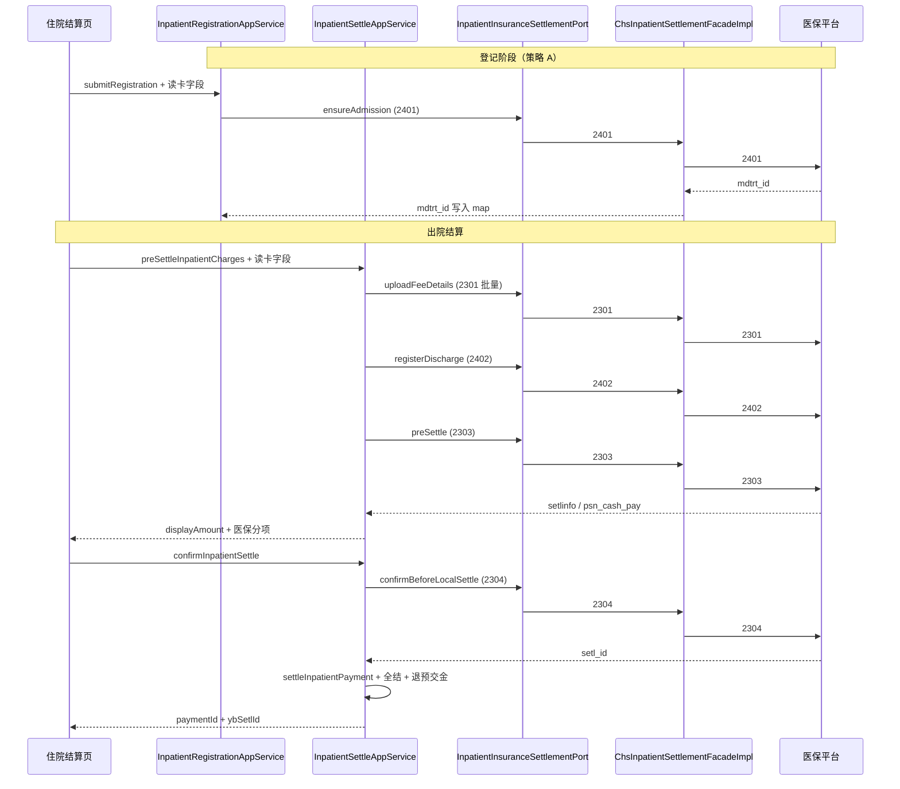

# 住院医保结算 — 详细设计（吉林省 CHS_NATIONAL_JILIN）

> **文档性质**：LLD（Wave 1 可编码）  
> **实现状态**：[13-实现状态与文档对照.md](./13-实现状态与文档对照.md) — Wave 1 **2401/2301/2402/2303/2304** 与 Wave 2 **2302/2305/2403/2404/2405** **已编码**；生产联调待验证。医护站 `MID_SETTLE` 仅本地试算（跳过 2402），**平台 `mid_setl_flag` 恒为 0**。  
> **上游**：[03-概要设计](./05-Whale吉林省医保模块-概要设计.md) | [05-门诊医保结算-详细设计](./03-门诊医保结算-详细设计.md)（复用 1101、合同解析、`yb_encounter_platform_map` 口径）  
> **接口规范**：[2401](../apis/24xx/2401-入院办理.md) | [2301](../apis/23xx/2301-住院费用明细上传.md) | [2402](../apis/24xx/2402-出院办理.md) | [2303](../apis/23xx/2303-住院预结算.md) | [2304](../apis/23xx/2304-住院结算.md)  
> **HIS 契约**：`AS-IP-FIN-001`（住院登记）| `AS-IP-FIN-003`（住院结算，IF-IP-STL-05/06；**BR-IP-STL-003/004**，成码口径见 AS v1.19）  
> **版本**：v1.4 | **日期**：2026-09-09

---

## 1. 范围与默认配置

### 1.1 Wave 1 范围

| 包含 | 不含（Wave 2+ / 现场） |
|------|----------------|
| **2401** 入院办理（医保入院登记） | **2301** 在院增量上传（划价/执行后实时） |
| **2301** 结算前**批量**费用上传 | — |
| **2402** 出院办理（**正式结算确认前**；预结算不调） | — |
| **2303** 住院预结算 | — |
| **2304** 住院正式结算 | — |
| 与 `InpatientSettleAppService` **同步 MVP** 编排 | 协同单异步 Worker、`IP_SETTLE` 状态机（可选，默认关） |
| 出院**全结** + 医保登记账户（单 account） | **2406/2407** 特殊属性 |
| 复用 **9001**、**1101**、**3301** 对码能力 | **4101A** 清单、**4401** 病案 |
| 平台就诊失效/离院死锁 **重新入院恢复**（§2.2.1） | 平台 `mid_setl_flag=1`（部分地市拒绝；本地 MID 仅跳过 2402） |
| Wave 2：**2302/2305/2403/2404/2405**（已编码） | — |

### 1.2 默认步骤链（可配置）

```yaml
insurance:
  schemes:
    CHS_NATIONAL_JILIN:
      ip-settle-steps:
        - infno: "2401"
          required: true
          trigger: REGISTRATION   # 登记时；见 §2.3
        - infno: "2301"
          required: true
          trigger: PRE_SETTLE   # 预结算前批量上传未传明细
        - infno: "2303"
          required: true
          trigger: PRE_SETTLE   # 预结算；不调 2402
        - infno: "2402"
          required: true
          trigger: CONFIRM_BEFORE_2304   # 出院全结：2304 前先离院
        - infno: "2304"
          required: true
          trigger: CONFIRM
      ip-settle-infno: "2304"    # 非 2304A；现场要求 A 变体时改配置
      ip-admission-infno: "2401"
      # 医护站试算（本地 MID_SETTLE）：同预结算链，跳过 2402；平台 mid_setl_flag 恒 0
      ip-mid-settle-steps:
        - infno: "2301"
          required: true
          trigger: PRE_SETTLE
        - infno: "2303"
          required: true
```

### 1.3 与门诊差异摘要

| 维度 | 门诊（05 文档） | 住院（本文） |
|------|----------------|--------------|
| 就诊登记 | 2201（可选）/ 2203 | **2401** 入院办理 |
| 费用上传 | 2204（带 `chrg_bchno`） | **2301**（无 `chrg_bchno`；按 `feedetl_sn` 幂等） |
| 预结算/结算 | 2206 / 2207 | **2303** / **2304** |
| 出院节点 | 无 | **2402** 出院办理（**正式结算确认前**；预结算不调） |
| 混合多 account | §14 多组 2203→2206 | 住院单登记账户；中途/全结共用 |
| 预结算快照表 | `yb_clinic_pre_settle` | `yb_inpatient_pre_settle` |
| HIS 编排入口 | `OutpatientChargeAppService` | `InpatientSettleAppService` + `InpatientRegistrationAppService` |

---

## 2. 与住院业务流程集成

### 2.1 现状（改造前）

**住院登记**（`InpatientRegistrationAppService`，IF-IP-REG-03）：创建 `IMP` 就诊、登记账户、可选首笔预交金；**不调用医保**。

**住院结算**（`InpatientSettleAppService`）：

```text
preSettleInpatientCharges (IF-IP-STL-05)
  → chargeItemDomainService.preSettleInpatientChargeItems
  → createPaymentDraftFromPreSettle (INPATIENT_CLINIC / DRAFT)
  → receivableTotal = Σ chargeItem.totalPrice（原价）

confirmInpatientSettle (IF-IP-STL-06)
  → 校验 submitTotal == expectedTotal（原价）
  → settleInpatientPayment → settleInpatientChargeItems
  → createDraftInvoiceAfterPayment
  → [出院全结] completeInpatientFinancialSettlement + 预交金多退
```

### 2.2 改造后分支（同步 MVP）

```text
preSettleInpatientCharges(request)
  ├─ 现有校验（就诊 IMP、待结算态、患者一致）
  ├─ resolveInsuranceContractId(encounter.registrationAccount)
  ├─ if 非医保合同 → 走现有纯自费路径（不变）
  └─ else 医保路径
        ├─ ensureInsuranceSignIn(contractBusNo)          // 9001
        ├─ require request.psnNo（1101 / 读卡）
        ├─ ensureMdtrtId → 2401 若 map 无记录（§5.2）
        ├─ resolveSettleMode(request, encounter, chargeItems)   // §15.2；收费处正式路径仅 DISCHARGE_FULL
        ├─ upload2301 → preSettle2303（平台 mid_setl_flag 恒 0；不调 2402）
        │     └─ 若 2303「未查询到有效就诊信息」→ §2.2.1 重新入院后重试 2303
        ├─ refreshPaymentDraftPreSettleAmounts
        │     草稿 displayAmount = max(0, psn_cash_pay − 库内预交金)   // 少补
        │     占位明细金额仍挂 psn_cash_pay
        └─ return PreSettleInpatientChargesResponse（§8.2：分项 + prepayNetBalance）

confirmInpatientSettle(request)
  ├─ 现有校验；channelPayable = 草稿 displayAmount（少补）
  ├─ if 存在 ACTIVE yb_inpatient_pre_settle
  │     ├─ confirmBeforeLocalSettle：
  │     │     ├─ ensureDischargedForSettle（2402；已离院幂等）
  │     │     ├─ 失败且就诊失效/死锁 → §2.2.1 重新入院 → 再 2402
  │     │     ├─ 2304；若「在院状态」→ 补 2402 再 2304；若「离院状态」死锁 → 重新入院→2402→2304
  │     │     └─ 2304 成功后 Extension 可再调 2402（已离院幂等忽略）
  │     └─ 失败 → INS-IP-013，禁止本地落账
  ├─ collectSettleSupplementAdvanceDeposit（channelPayable>0）
  ├─ settleInpatientPayment（从表明细写入统筹/个账/个人现金，§7.2）
  ├─ settleInpatientChargeItems
  ├─ balance −= psn_cash_pay（仅个人现金；基金/个账不走院内预交金）
  ├─ 发票草稿 → 出院全结多退盈余 → completeInpatientFinancialSettlement
```

### 2.2.1 平台就诊恢复：重新入院（成码）

> **类**：`IpPlatformReadmitForSettleSupport`、`IpPlatformDischargeRevokeSupport`（`module-chs-jilin-bridge/.../inpatient/support`）

**触发**（预结算 / 正式结算）：

| 场景 | 典型平台文案 | 动作 |
|------|--------------|------|
| 本地 map 指向的 mdtrt 已失效 | 「未查询到有效就诊信息」等 | 重新 2401 换新号 |
| 出院全结须先离院但 2402/2405 失败 | 「无法办理出院」「无法撤销本就诊出院」等 | 清在院后重新入院 |
| 2304 报在院 | 「该人员是在院状态」 | 补 2402 后再 2304 |
| 2304 报离院死锁 | 「该人员是离院状态」 | 重新入院 → 立刻 2402 → 2304 |

**步骤**（`readmitAndReupload` / `readmitAndRefreshPreSettle`）：

```text
1. 5201 查同人在院就诊（查询跨度 ≤91 天，长春限 92 天）
2. 对在院 mdtrt 调 2404 撤销入院（腾位）
3. 本地费用上传标 REVOKED；软删/换新 map（Ip2401Invoker.registerFresh）
4. 2401 新入院 → 2301 全量重传本批 → （刷新路径）2303 刷新 ACTIVE 预结算 mdtrt/setlinfo
```

### 2.4 结算模式判定（出院全结 vs 中途试算）

与 `InpatientSettleAppService` **BR-IP-STL-003 / BR-IP-STL-004** 对齐；收费处正式路径**仅出院全结**。

| 模式 | 编码 | 就诊状态 | 勾选范围 | 医保链（成码） |
|------|------|----------|----------|----------------|
| **出院全结** | `DISCHARGE_FULL` | `PENDING` | 全部待结算（真全集） | 预结算：2301→2303；确认：2402→2304（`mid_setl_flag` 恒 0） |
| **中途试算** | `MID_SETTLE` | 医护站显式传入 | 可子集 | 同预结算链，**跳过 2402**；平台 **`mid_setl_flag` 恒 0**（不映射为 1） |

**与现网异常码对应**：

| 场景 | 现网 | 医保 |
|------|------|------|
| `PENDING` 但未全选（收费处） | EX-IP-STL-107 | 拒绝；收费处不做正式中途结 |
| 非 `PENDING` 却全选（收费处） | EX-IP-STL-108 / EX-IP-STL-111 | 须先护士出院 |
| 医护站完整预结算 | — | 可传 `MID_SETTLE` 跳过 2402 做 2303 试算 |

**2402 触发**（仅 `DISCHARGE_FULL`）：**正式结算确认前**（`Ip2304Invoker` / Extension），不在预结算调用；`endtime` = 护士出院时间或结算操作时间（可配置，默认 `now()`）。

> 中途结算完整专节见 **§15**。

### 2.3 医保入院（2401）触发点

| 策略 | 时机 | 默认 |
|------|------|------|
| **A — 登记时** | `InpatientRegistrationAppService.submitRegistration` 成功且 `contract.ybFlag=true` | **推荐** |
| **B — 懒加载** | 首次住院医保预结算前，`yb_encounter_platform_map` 无 `mdtrt_id` 时补 2401 | 兜底 |

**IF-IP-REG-03 扩展请求**（医保登记时前端读卡后传入）：

| 字段 | 类型 | 必填 | 说明 |
|------|------|------|------|
| `ybMediumType` | String | 条件 | `mdtrt_cert_type` |
| `ybCardInfo` | String | 条件 | `mdtrt_cert_no` |
| `psnNo` | String | 条件 | 1101 |
| `insuplcAdmdvs` | String | 条件 | 参保地 |
| `insutype` | String | N | 险种 |
| `medType` | String | N | 默认 `21` 普通住院；现场字典 |

登记成功且 2401 成功 → 写入 `yb_encounter_platform_map`（`encounter_class=IMP`）。

---

## 3. 合同与方案解析

与 [05-门诊医保结算 §3](./03-门诊医保结算-详细设计.md#3-合同与方案解析) **完全复用**：

```text
registrationAccount.contract_no
  → ContractQueryService.findByBusNo
  → outpatientInsuranceSettlementPort.isInsuranceContract(contractId)
  → chs-contract.properties contract.{bus_no}.*
```

住院登记账户为**唯一**结算账户（`AccountQueryService.getRegistrationAccount`）；Wave 1 不按多 account 分组。

---

## 4. 1101 人员信息与签到

| 能力 | 入口 | 说明 |
|------|------|------|
| 9001 签到 | `InsuranceSessionAppService.signIn` | 预结算/登记医保入院前 `ensureInsuranceSignIn(contractBusNo)` |
| 1101 读卡 | `InsurancePersonAppService.getPersonInfo` | 复用当日缓存 `yb_person_cache`（05 §4） |
| 前端 | 住院登记弹窗、住院结算页 | 医保合同选中时展示读卡；缓存 `psnNo`/`insuplcAdmdvs`/`insutype` |

---

## 5. mdtrt_id 与费用上传状态

### 5.1 表：`yb_encounter_platform_map`（扩展复用）

门诊 05 §5.1 已定义；住院共用，增加区分列：

```sql
ALTER TABLE yb_encounter_platform_map
    ADD COLUMN IF NOT EXISTS encounter_class VARCHAR(8) DEFAULT 'AMB';

-- 住院唯一键：(encounter_id, contract_id, encounter_class, tenant_id)
```

| 字段 | 住院来源 |
|------|----------|
| `mdtrt_id` | 2401 输出 |
| `ipt_otp_no` | `Encounter.busNo`（住院号） |
| `psn_no` | 1101 / 登记请求 |
| `encounter_class` | 固定 `IMP` |

无 `mdtrt_id` 且懒加载 2401 失败 → `INS-IP-009`。

### 5.2 表：`yb_inpatient_fee_upload`（Wave 1 新增）

跟踪 2301 上传状态，支持结算前批量补传与幂等。

```sql
CREATE TABLE yb_inpatient_fee_upload (
    id              BIGINT PRIMARY KEY,
    encounter_id    BIGINT NOT NULL,
    charge_item_id  BIGINT NOT NULL,
    feedetl_sn      VARCHAR(30) NOT NULL,
    mdtrt_id        VARCHAR(30) NOT NULL,
    upload_status   VARCHAR(16) NOT NULL,  -- UPLOADED | FAILED | REVOKED
    platform_result_json TEXT,
    uploaded_at     TIMESTAMP,
    tenant_id       BIGINT NOT NULL,
    is_deleted      BOOLEAN DEFAULT FALSE,
    UNIQUE (charge_item_id, tenant_id)
);

CREATE INDEX idx_yb_ip_fee_upload_encounter
    ON yb_inpatient_fee_upload (encounter_id, upload_status)
    WHERE is_deleted = FALSE;
```

| 规则 | 说明 |
|------|------|
| `feedetl_sn` | 非套餐：优先 `ChargeItem.busNo`，无则 `chargeItem.id`；套餐子项：`{父feedetlSn}.{序号}`（≤30） |
| 幂等 | 已 `UPLOADED` 且金额/数量未变则跳过；变更则先 2302（Wave 2）或整单重传策略由现场定 |
| Wave 1 | 仅**新增上传**；退费/作废明细未传平台前直接不传；已传则 Wave 2 用 2302 |

### 5.3 表：`yb_inpatient_pre_settle`

```sql
CREATE TABLE yb_inpatient_pre_settle (
    id                  BIGINT PRIMARY KEY,
    payment_draft_id    BIGINT NOT NULL,
    encounter_id        BIGINT NOT NULL,
    contract_id         BIGINT NOT NULL,
    mdtrt_id            VARCHAR(30) NOT NULL,
    psn_no              VARCHAR(30) NOT NULL,
    med_type            VARCHAR(6),
    mid_setl_flag       VARCHAR(3) DEFAULT '0',
    medfee_sumamt       NUMERIC(18,2),
    fund_pay_sumamt     NUMERIC(18,2),
    acct_pay            NUMERIC(18,2),
    psn_cash_pay        NUMERIC(18,2),
    charge_item_ids     TEXT,                -- 本批 JSON 数组（中途结算必填）
    settle_mode         VARCHAR(20),         -- DISCHARGE_FULL | MID_SETTLE
    request_json        TEXT,
    response_json       TEXT,
    setl_id             VARCHAR(30),       -- 2304 成功后回填
    status              VARCHAR(16) NOT NULL,  -- ACTIVE | SETTLED | CANCELLED
    tenant_id           BIGINT NOT NULL,
    created_at          TIMESTAMP NOT NULL,
    is_deleted          BOOLEAN DEFAULT FALSE
);

CREATE INDEX idx_yb_ip_pre_settle_draft
    ON yb_inpatient_pre_settle (payment_draft_id, status)
    WHERE is_deleted = FALSE;
```

Wave 1：**1 paymentDraft : 1 ACTIVE 行**（无门诊式多组 `chrg_bchno`）。

---

## 6. 字段映射表

### 6.1 2401 入院办理

**节点 `mdtrtinfo`（单行）**

| 2401 字段 | ZXPlat 来源 | 规则 |
|-----------|------------|------|
| `psn_no` | 1101 | Y |
| `insutype` | 1101 / 登记险种 | Y |
| `begntime` | `Encounter.startTime` 或登记时间 | `yyyy-MM-dd HH:mm:ss` |
| `mdtrt_cert_type` / `mdtrt_cert_no` | 读卡 | Y |
| `med_type` | 登记 `medType` 或默认 `21` | Y |
| `ipt_no` | `Encounter.busNo` | 院内住院号 |
| `atddr_no` / `chfpdr_name` | 主治医生 `Practitioner.ybNo` / name | Y |
| `adm_diag_dscr` | 入院主诊断 display | Y |
| `adm_dept_codg` / `adm_dept_name` | 入院科室 `Organization.ybNo` / name | Y |
| `adm_bed` | 床位编码或 `Location.busNo` | Y |
| `dscg_maindiag_code` / `dscg_maindiag_name` | 入院主诊断医保码/名称 | Y（入院时同主诊） |
| `insuplc_admdvs` | 1101 | Y |
| `mdtrtarea_admvs` | `Contract.mdtrtareaAdmvs` 或配置 | Y |
| `dise_codg` / `dise_name` | 按病种住院时 | 条件 |
| 生育相关 | 生育住院 | Wave 2 填 |

**节点 `diseinfo`（多行）**：入院诊断列表，来自 `Condition` / `saveAdmissionDx`；`diag_type`、`maindiag_flag`、`diag_srt_no` 按 DM 入院诊断口径装配。

### 6.2 2301 费用明细（逻辑行；带子项诊疗可一对多）

> **基线**：无子项时 **单行 = 一条 ChargeItem**。  
> **带子项诊疗**：与门诊 2204 同口径——`ChsInpatientInsuranceContextLoader` 经 **`ChsActivityPackageFeeExpandSupport#expandToUploadSlices`** 只上传子项账单冻价（父项通常无 `yb_no`；无子项账单则拒绝）。

| 2301 字段 | ZXPlat 来源 | 规则 |
|-----------|------------|------|
| `feedetl_sn` | §5.2；套餐子项 `{父}.{childrenId}` | 单次就诊内唯一 |
| `mdtrt_id` | map | Y |
| `psn_no` | context | Y |
| `med_type` | 登记 `med_type` 或 `21` | Y |
| `fee_ocur_time` | `ChargeItem.occurrenceTime` | Y |
| `med_list_codg` | 无子项：父 Product.`ybNo`；有子项：子项账单 Product.`ybNo` | Precheck 非空（INS-011） |
| `medins_list_codg` | Product.`ybOrgNo` → 院内编码 → 定义主键 | Y |
| `det_item_fee_sumamt` | 无子项：`totalPrice`；有子项：子项账单 `totalPrice` | 子项账单之和 = 父 `totalPrice` |
| `cnt` / `pric` | 无子项：quantity / unitPrice；有子项：子项账单冻价数量/单价 | **禁止**分摊父项金额；**禁止**回查 SALE |
| `bilg_dept_codg` / `bilg_dept_name` | 开单科室 | Y |
| `bilg_dr_codg` / `bilg_dr_name` | 开单医生 | Y |
| `drord_no` | `ChargeItem.prescriptionNo`（有则填） | 有则填 |
| `hosp_appr_flag` | 默认 `"1"` | Y |
| `dscg_tkdrug_flag` | 出院带药 | 默认 `"0"` |
| `tcmdrug_used_way` | `TcmdrugUsedWayResolver`（与门诊 2204 **§6.1.1 同口径**） | 中草药按处方去重味数 >5 复方 `1` / ≤5 单方 `2`；非中草药不填 |

### 6.3 2402 出院办理

**节点 `dscginfo`（单行）**

| 2402 字段 | ZXPlat 来源 |
|-----------|------------|
| `mdtrt_id` / `psn_no` / `insutype` | context |
| `endtime` | 出院时间（§2.4） |
| `dscg_dept_codg` / `dscg_dept_name` | 出院科室 |
| `dscg_bed` | 出院床位 |
| `dscg_way` | 离院方式字典（默认医嘱离院） |
| `dise_codg` / `dise_name` | 按病种结算时 |

**节点 `diseinfo`**：出院诊断（含主诊）；来源护士出院/医生出院诊断；与 `EncounterStatus.PENDING` 出院流程对齐。

### 6.4 2303 / 2304 结算头（`data` 节点）

| 字段 | 来源 | 2303 | 2304 |
|------|------|------|------|
| `psn_no` | context | Y | Y |
| `mdtrt_cert_type` / `mdtrt_cert_no` | 读卡 | Y | Y |
| `medfee_sumamt` | Σ 本批 `ChargeItem.totalPrice`（已传 2301） | Y | Y |
| `psn_setlway` | UI 默认 `"01"` | Y | Y |
| `mdtrt_id` | context | Y | Y |
| `insutype` | 1101 / 账户 | Y | Y |
| `acct_used_flag` | UI 默认 `"1"` | Y | Y |
| `insuplc_admdvs` / `mdtrtarea_admvs` | 1101 / 合同 | Y | Y |
| `mid_setl_flag` | `DISCHARGE_FULL`→`0`；`MID_SETTLE`→`1`（字典） | Y | Y |
| `dscgTime` | 出院全结：出院日 `yyyy-MM-dd`；中途：本批截止日（§15.4） | 2303 条件 | — |
| `fulamt_ownpay_amt` 等 | **2303 输出** → 2304 透传 | 输出 | 输入 |
| `minpacunt_drug_trac_cnt` / `mcs_trac_cnt` | 本批**应上传最小包装追溯码条数**（药品 / 耗材）。药品：**DD §4.3 两分支 `floor`**（贴码单位直接用数量；拆零单位 `floor(量÷ratio)`）；与实扫脱钩。**禁止** `ceil` 或「单位不等→0」 | N | Y（Wave 1 可 0） |

**2303 → 2304**：`setlinfo` 金额字段写入 `yb_inpatient_pre_settle.response_json`，2304 Assembler **透传**。

### 6.5 吉林 extData

住院场景在 2401/2301 的 `exp_content` 中按现场补全；`JilinInpatientExtDataBuilder` 参照 05 §6.3，增加：

| 字段 | 来源 |
|------|------|
| `ipt_no` | 住院号 |
| `adm_date` / `dscg_date` | 入出院时间 |
| `ipt_days` | 住院天数 |

---

## 7. 输出解析与本地落账

### 7.1 2304 输出 → 领域对象

```java
public class IpSettle2304Output {
    private String setlId;
    private String mdtrtId;
    private BigDecimal medfeeSumamt;
    private BigDecimal fundPaySumamt;
    private BigDecimal acctPay;
    private BigDecimal psnCashPay;
    private List<FundPaymentItem> setldetail;
}
```

**落库顺序**（在 `settleInpatientPayment` **之前**调用 2304）：

1. `yb_inpatient_pre_settle.status` → `SETTLED`，回填 `setl_id`
2. `yb_settlement_record` 插入一行（`encounter_class=IMP`）
3. `payment.yb_settle_ids` = `setlId`
4. 现有 `settleInpatientPayment` → `settleInpatientChargeItems` → 发票 → 出院全结

### 7.2 支付明细与平台金额对齐

| PaymentDetail | 来源 | 渠道码（配置） |
|---------------|------|----------------|
| 统筹/基金分项 | `fund_pay_sumamt`（2304） | `INSURANCE_FUND` |
| 个账 | `acct_pay` | `INSURANCE_ACCT` |
| 现金 | `psn_cash_pay` | `CASHIER`（与门诊一致） |

**预交金与应收**（出院全结，对齐 **AS-IP-FIN-003** v1.19）：

```text
患者应付（院内预交金口径）= psn_cash_pay
displayAmount（渠道少补）= max(0, psn_cash_pay − 库内预交金)
正式结算：balance −= psn_cash_pay；多退 = 扣减后库内盈余（BR-IP-STL-014）
```

`confirmInpatientSettle` 金额校验：

- 前端渠道明细：`sum(paymentDetails) == payment.displayAmount`（少补；充足时为 0）
- 本地落账前：`mergeInsurancePaymentDetailsIntoSettleCommand` 写入统筹/个账/个人现金（覆盖草稿占位）

### 7.3 预结算草稿刷新

```text
paymentReconciliationDomainService.refreshPaymentDraftPreSettleAmounts(
    paymentDraftId,
    channelPayable,                  // displayAmount = 少补
    buildInpatientInsuranceCashPayDraftLines(psn_cash_pay)  // 占位金额挂个人现金
);
```

预览弹窗另回传 `prepayNetBalance`、`ybHifpPay`/`ybOthPay`/`ybActPayDedc`/`ybCvlservPay`/`ybCvlservFlag`（只读）。

---

## 8. 接口契约

### 8.1 Client：`InpatientInsuranceSettlement旧命名（已废止）

```java
public interface InpatientInsuranceSettlementPort {

    boolean isInsuranceContract(Long contractId);

    /** 2401；幂等：已有 mdtrt_id 则跳过 */
    IpInsuranceAdmissionResult ensureAdmission(IpInsuranceAdmissionCommand command);

    /** 2303 预结算 */
    IpInsurancePreSettleResult preSettle(IpInsurancePreSettleCommand command);

    /** 2304；在本地 settleInpatientPayment 之前 */
    IpInsuranceConfirmResult confirmBeforeLocalSettle(IpInsuranceConfirmCommand command);

    List<IpInsurancePreSettleResult> listActivePreSettlesByPaymentDraft(Long paymentDraftId);

    /** 按成功支付单查 SETTLED 预结算快照（取消结算用） */
    IpInsurancePreSettleResult findSettledPreSettleByPayment(Long paymentId);

    /** 2305 住院结算撤销 */
    IpInsuranceRevokeSettleResult revokeSettle(IpInsuranceRevokeSettleCommand command);

    /** 2302 费用明细撤销 */
    IpInsuranceRevokeFeeDetailResult revokeFeeDetails(IpInsuranceRevokeFeeDetailCommand command);

    /** 2404 入院撤销 */
    void revokeAdmission(IpInsuranceEncounterCommand command);

    /** 2405 出院撤销 */
    void revokeDischarge(IpInsuranceEncounterCommand command);

    /** 2403 住院信息变更 */
    void changeInpatientInfo(IpInsuranceAdmissionCommand command);
}
```

**CHS 实现**：`ChsInpatientSettlementFacadeImpl`（`chs-jilin-application/.../facadeimpl`）  
**Adapter**：`InpatientInsuranceSettlementPortImpl`（`chs-jilin-bridge`）

### 8.2 IF-IP-STL-05 `preSettleInpatientCharges`（扩展）

**请求** `PreSettleInpatientChargesRequest` 新增：

| 字段 | 类型 | 必填 | 说明 |
|------|------|------|------|
| `contractId` | Long | 条件 | 医保登记账户时必填 |
| `ybMediumType` | String | 条件 | 读卡 |
| `ybCardInfo` | String | 条件 | 读卡 |
| `psnNo` | String | 条件 | 1101 |
| `insuplcAdmdvs` | String | 条件 | 参保地 |
| `insutype` | String | N | 险种 |
| `acctUsedFlag` | String | N | 默认 `1` |
| `psnSetlway` | String | N | 默认 `01` |
| `settleMode` | String | N | `DISCHARGE_FULL` \| `MID_SETTLE`；缺省时后端按 §2.4 推导 |

**响应** `PreSettleInpatientChargesResponse` 新增：

```java
@Data
public class PreSettleInpatientChargesResponse {
    // --- 现有 ---
    private Long paymentDraftId;
    private BigDecimal receivableTotal;   // 保留：原价合计（展示用）

    // --- Wave 1 医保扩展（成码） ---
    private Boolean insurancePreSettled;
    private BigDecimal displayAmount;     // 少补：max(0, psn_cash − 预交金)
    private BigDecimal prepayNetBalance;  // 库内预交金余额
    private BigDecimal ybMedfeeSumamt;
    private BigDecimal ybFundPaySumamt;
    private BigDecimal ybAcctPay;
    private BigDecimal ybPsnCashPay;
    private BigDecimal ybHifpPay;         // 基本统筹（只读）
    private BigDecimal ybOthPay;          // 其他支出（只读）
    private BigDecimal ybActPayDedc;      // 起付线（只读）
    private BigDecimal ybCvlservPay;      // 公务员补助（只读）
    private String ybCvlservFlag;         // 公务员标志（只读）
    private String ybSetlPreviewId;       // 预结算快照 id（可选）
    private String settlementComposition; // INSURANCE_ONLY | SELF_PAY_ONLY
    /** DISCHARGE_FULL | MID_SETTLE（试算） */
    private String settleMode;
}
```

### 8.3 IF-IP-STL-06 `confirmInpatientSettle`（扩展）

**请求** 新增可选：

| 字段 | 说明 |
|------|------|
| `ybPreSettleId` | 指向 `yb_inpatient_pre_settle.id`；缺省时按 `paymentDraftId` 查 ACTIVE |

**响应** 新增：

| 字段 | 说明 |
|------|------|
| `ybSetlId` | 2304 `setl_id` |
| `insuranceSettled` | 是否走医保 |

### 8.4 IF-IP-REG-03 `submitRegistration`（扩展）

见 §2.3；响应可增加 `ybMdtrtId`（2401 成功时）。

### 8.5 取消住院结算（CHS Wave 2 外挂）

> **口径**：`AS-IP-FIN-003` 将「取消住院结算」列为非目标；本接口为 CHS 扩展，供医保反结与逆向退款编排。

**HTTP**：`POST /api/app/inpatientSettle/cancelInpatientSettle`

**编排**（`InpatientSettleAppService.cancelInpatientSettle`）：

```text
1. 校验原单 SUCCESS + 患者/就诊一致
2. findSettledPreSettleByPayment(paymentId) — 有则走医保撤销：
   2a. revokeSettle (2305)
   2b. settleMode=DISCHARGE_FULL → revokeDischarge (2405)
   2c. revokeFeeDetails (2302) — 本批 chargeItemIds
3. cancelInpatientSettleAsRefund — 生成逆向退款支付单（REFUND_PROCESSING）
4. revertInpatientSettledChargeItems — SETTLED → PENDING_SETTLEMENT
5. 出院全结时 revertInpatientFinancialSettlement — COMPLETED → PENDING
6. 出院全结时 revertDischargeAdvanceDepositOnCancel — 回补多退预交金 + 作废 HOSPITAL_DEPOSIT 流水
7. voidInvoiceLinkedToPaymentOnCancel — DRAFT 作废 / ISSUED 冲红（与 confirm 时 createDraftInvoiceAfterPayment 对称）
8. completeInpatientSettleCancelRefund — 原单/逆向单 → REFUNDED + InpatientSettleCancelledEvent
```

**请求** `CancelInpatientSettleRequest`：`paymentId`、`encounterId`、`patientId`（均必填）。

**响应** `CancelInpatientSettleResponse`：`refundPaymentId`、`insuranceRevoked`、`ybSetlId`。

### 8.6 IP_SETTLE 协同单异步（Wave 2 已编码）

> 默认 `insurance.coordination.ip-settle-async-enabled=false`，保持 §7 同步 MVP；开启后 `confirmInpatientSettle` 走协同单。

**配置**（`application-dev.yml`）：

```yaml
insurance:
  coordination:
    worker-enabled: true
    ip-settle-async-enabled: true   # 启用住院异步
```

**编排**：

```text
confirmInpatientSettle（有医保预结算 + async=true）
  ├─ markInpatientPaymentSettling — DRAFT → SETTLING
  ├─ create yb_coordination(IP_SETTLE)
  └─ 返回 settlementMode=INSURANCE_ASYNC、coordinationIds

YbCoordinationWorker（@Scheduled 5s）
  ├─ CREATED → IpSettleCoordinationExecutor
  │    ├─ 2304 confirmBeforeLocalSettle → PLATFORM_OK
  │    └─ InpatientSettleLocalCompletionService → COMPLETED
  └─ LOCAL_PENDING → 本地重试（最多 5 次，30s×2^n）

轮询：POST /api/app/insuranceInpatientSettlement/getInpatientInsuranceSettleStatus

**前端**（`use-inpatient-settle-insurance.ts`）：

- `isInpatientInsuranceAsyncConfirmResponse` — 识别 `INSURANCE_ASYNC`
- `pollInpatientInsuranceSettleStatus` — 2s 轮询至 `COMPLETED` / 失败 / 超时
- `index.vue` `handleConfirmSettleFromDialog` — 异步时全屏 Loading + 轮询后刷新
```

**启动**：`POST /api/app/insuranceInpatientSettlement/startInpatientSettle`（一般由 `confirmInpatientSettle` 内部调用）。

---

## 9. 类与包（规划）

```text
chs-jilin-domain/
  api/ChsInfNo.java                    // +2401,2402,2301,2303,2304
  domain/inpatient/entity/
    YbInpatientPreSettle.java
    YbInpatientFeeUpload.java
  domain/inpatient/repository/...

chs-jilin-application/
  application/inpatient/
    ChsInpatientSettlementFacadeImpl.java
    assembler/
      ClinicInpatientPlatformAssembler.java   // 2401/2301/2402/2303/2304
      InpatientInsuranceContextLoader.java
    localization/JilinInpatientExtDataBuilder.java
    precheck/
      JilinInpatientCatalogPrecheckRule.java
      JilinInpatientMdtrtIdPrecheckRule.java

chs-jilin-bridge/
  integration/insurance/settlement/
    InpatientInsuranceSettlementPortImpl.java

chs-jilin-contracts/
  port/InpatientInsuranceSettlementPort.java
  port/model/IpInsurance*.java

health-application/
  inpatient/financial/settle/service/InpatientSettleAppService.java  // 编排注入 Client
  inpatient/financial/registration/service/InpatientRegistrationAppService.java  // 可选 2401
```

---

## 10. 时序（出院全结 · 同步 MVP）



---

## 11. 错误码

| 码 | 场景 | 处理 |
|----|------|------|
| INS-IP-001 | `PENDING` 部分勾选却未声明中途 | 全选出院全结或传 `settleMode=MID_SETTLE` |
| INS-IP-002 | 费用项缺 `yb_no` | 对码或转自费 |
| INS-IP-009 | 无 `mdtrt_id` 且 2401 失败 | 检查登记/参保 |
| INS-IP-010 | 确认金额与 2303 漂移 | 重新预结算 |
| INS-IP-011 | 2301 部分失败 | 展示失败行；修复后重试预结算 |
| INS-IP-012 | 2402 失败（出院诊断不全等） | 补全出院诊断 |
| INS-IP-013 | 2304 失败 | **禁止**本地落账；医保办查单 |
| INS-IP-014 | 中途结算后平台仍「在院」但本地已无待结项 | 联系医保办核对；禁止重复 2402 |
| INS-IP-015 | 末次出院全结前仍有未传 2301 明细 | 补传后再预结算 |
| EX-IP-STL-106 | 沿用 | 金额不一致时优先区分是否医保 displayAmount |
| EX-IP-STL-107/108 | 沿用 | 与 §2.4、§15.2 组合判定 |

---

## 12. 前端交互（Wave 1）

| 页面 | 行为 |
|------|------|
| 住院登记 | 医保合同 → 读卡 → `submitRegistration` 带 `psnNo` 等；展示 `ybMdtrtId` |
| 住院结算 `/inpatient/charge/settle` | 医保患者 → 预结算前读卡（可复用当日 1101） |
| 预结算 | 调用扩展 IF-IP-STL-05；弹窗展示统筹/个账/现金/`displayAmount`/预交金应退；子集勾选展示「中途结算」（§15.9） |
| 正式结算 | `confirmInpatientSettle`；成功后可「打印医保结算单」（`useInsuranceSettlementPrint` 接 `setl_id`） |

**Composable 规划**：`use-inpatient-charge-insurance.ts`（对齐门诊 `use-outpatient-charge-insurance.ts`）。

---

## 13. Wave 2 规划（不含 §15 已设计项）

| 项 | 说明 |
|----|------|
| **2301 增量** | 护士划价/执行后异步上传；失败队列重试（§15.8） |
| **2302** | 退药、作废已传明细 |
| **2403** | 转科、换床、诊断变更 |
| **2305 / 2404 / 2405** | 撤销与冲正 |
| **4101A / 4401** | 清单与病案 |
| **3101** | 事前审核 |
| **协同单** | `IP_SETTLE` 异步 Worker（`YbCoordinationWorker` + `InsuranceInpatientSettlementAppService`；已编码，默认关闭） |

---

## 14. 测试用例（出院全结）

| # | 场景 | 期望 |
|---|------|------|
| I1 | 自费登记 + 自费结算 | 不调用 Client；行为与现网一致 |
| I2 | 医保登记 2401 + 出院全结 | 预结算 2301→2303；确认 2402→2304；`displayAmount=max(0,psn_cash−预交金)` |
| I3 | 登记懒加载 2401 | map 无记录时预结算补 2401 |
| I4 | 重复预结算 | 作废旧草稿 + `yb_inpatient_pre_settle` CANCELLED |
| I5 | 2304 失败 | 无 `payment SUCCESS`；提示 INS-IP-013 |
| I6 | 预交金大于个人现金 | 少补=0；账户扣个人现金后多退盈余（BR-IP-STL-014） |
| I7 | `PENDING` 部分勾选未传 `settleMode` | EX-IP-STL-107 / INS-IP-001 |
| I8 | 缺 yb_no 费用 | INS-IP-002，阻断预结算 |
| I9 | 平台 mdtrt 失效 | §2.2.1 重新入院后预结算/正式结算成功 |
| I10 | 2304 报在院 | 补 2402 后再 2304 |

---

## 15. 中途试算（本地 `MID_SETTLE`；平台 `mid_setl_flag=0`）

> **成码口径**：收费处正式路径**不做**中途结算（**AS-IP-FIN-003** **BR-IP-STL-004** / **EX-IP-STL-112**）。  
> 医护站「完整预结算」可显式传 `settleMode=MID_SETTLE`：**仅跳过 2402**、放宽就诊态做 2303 试算；网关 **`mid_setl_flag` 写死 0**（长春等地拒绝 `1`）。  
> 下文保留历史产品规划表，与现网冲突处以本段为准。

### 15.1 业务场景

| 场景 | 典型触发 | 结算模式 |
|------|----------|----------|
| 医护站完整预结算试算 | 医生站/护士站费用明细 | `MID_SETTLE`（仅预览） |
| 末次出院财务全结 | 收费处 `PENDING` 全选 | `DISCHARGE_FULL`（§2.4） |

### 15.2 模式与平台标志（成码硬约束）

| 项 | 成码 |
|----|------|
| 收费处正式结算 | 仅 `DISCHARGE_FULL`；子集/`MID_SETTLE` → **EX-IP-STL-112** |
| 医护站 `MID_SETTLE` | 仅 2303 试算；跳过 2402；**不**正式 2304 |
| 平台 `mid_setl_flag` | **恒 `"0"`**（`IpInpatientSettleInputAssembler`；`MidSetlFlag.NO`） |
| 本地 `settleMode` | 仅控制是否跳过 2402 / 就诊态放宽，**不**映射为平台 `1` |

### 15.3 医保接口链差异

| 步骤 | 出院全结 | 中途试算（医护站） |
|------|----------|-------------------|
| 2401 | 登记时或懒加载；失效则 §2.2.1 重新入院 | 同左 |
| 2301 | 本批未上传明细批量上传 | 同左 |
| 2402 | **正式结算确认前**必调 | **跳过** |
| 2303 | `mid_setl_flag=0` | `mid_setl_flag=0` |
| 2304 | 确认前已 2402；`mid_setl_flag=0` | 收费处不做 |

**`medfee_sumamt`**：本批 `Σ chargeItem.totalPrice`。

> **历史规划**：v1.1 曾规划平台 `mid_setl_flag=1` 的正式中途结与多次中途+末次全结时序；现场拒绝 `1` 后废止平台映射。旧伪代码/时序仅作存档，勿再实现。

---

## 16. 修订记录

| 版本 | 日期 | 说明 |
|------|------|------|
| v1.5 | 2026-10-06 | **代码先行回写**：§6.2 带子项诊疗 2301 只传子项账单冻价，禁 SALE 回落 |
| v1.3 | 2026-08-13 | **成码回更**：预结算链改为 2401→2301→2303（不调 2402）；确认前 2402→2304 + 就诊失效重新入院（§2.2.1）；`displayAmount`=个人现金少补；支付明细写统筹/个账/现金；账户只扣个人现金；平台 `mid_setl_flag` 恒 0；§8.2 增基金分项/`prepayNetBalance`；§15 收口为试算语义 |
| v1.2 | 2026-07-24 | §5.2/§6.2 诊疗套餐 2301 展开：只传子项；与 2204 / `ChsActivityPackageFeeExpandSupport` 同口径 |
| v1.1 | 2026-06-13 | 新增 §15 中途结算专节；§2.4 模式判定；扩展 `settleMode`/`charge_item_ids`；废止「中途仅 Wave 2」表述 |
| v1.0 | 2026-06-13 | Wave 1 住院出院全结同步 MVP；2401→2301→2402→2303→2304 链路与 Client/HIS 契约 |