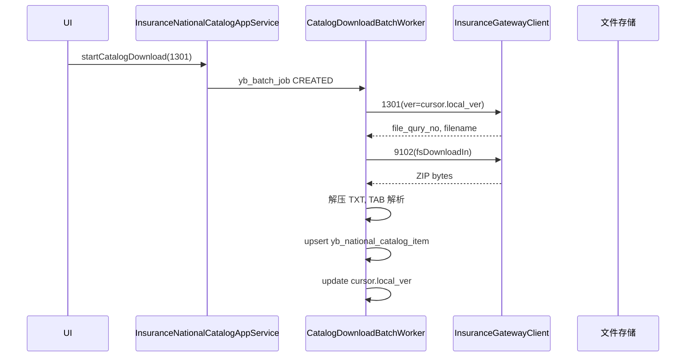

# 医保目录管理 — 详细设计（优先实施）

> **架构真源**：[01-概要设计.md](./01-概要设计.md)

> **文档性质**：LLD（目录下载 / 国家目录库 / 院内对码 / 3301·3302 上传）  
> **上游**：[04-多方案骨架](./17-Whale医保多方案扩展骨架.md) | [07-chs-impl](./06-chs-impl-详细设计.md)  
> **接口规范**：1301/1312/3301/3302/9102 见 `apis/`  
> **版本**：v1.0 | **日期**：2026-05-28

---

## 1. 为何先做目录

| 原因 | 说明 |
|------|------|
| 结算前置 | 05-门诊结算 Precheck 要求 `yb_match_flag` + `yb_no`，无目录则无法 2204 |
| 域已就绪 | 药品/诊疗/耗材/诊断定义已有 `yb_no`、`yb_match_flag` 及 Domain `sync*YbMapping` |
| 风险低 | 3301/1312 **不涉及资金单边账**，可不走路由 SETTLE 的双确认，用 **审计表 + 可选协同单** |
| 可独立验收 | 下载 → 查询 → 院内对码 → 3301 上传，链路可单独联调 |

**与 Wave 1 结算关系：** 目录 Wave **C1–C3** 可与网关签到国密 **并行**（见 [07](./06-chs-impl-详细设计.md)）；结算（05）依赖 **C3 药品或诊疗至少一种** 3301 可用 — **药品已满足**。

---

## 2. 功能范围

```text
┌─────────────────────────────────────────────────────────────┐
│ A. 国家医保目录（平台侧镜像）                                  │
│    1301/1302/… 下载 + 9102 文件 + 入库 + 1312 查询           │
├─────────────────────────────────────────────────────────────┤
│ B. 院内目录对码（HIS 已有字段）                                │
│    药品 / 诊疗 / 耗材 / 诊断 ↔ 国家目录编码                  │
├─────────────────────────────────────────────────────────────┤
│ C. 平台对照上传                                              │
│    3301 上传 / 3302 撤销 + 上传状态回写 yb_match_flag        │
└─────────────────────────────────────────────────────────────┘
```

### 2.1 本期 infno 清单

| 优先级 | infno | 名称 | 类型 |
|--------|-------|------|------|
| P0 | **1312** | 医保目录信息查询 | 实时查询（对码 UI 搜索） |
| P0 | **3301** | 目录对照上传 | 实时 |
| P0 | **3302** | 目录对照撤销 | 实时 |
| P1 | **1301** | 西药中成药目录下载 | 文件 |
| P1 | **9102** | 文件下载 | 1301 后置 |
| P2 | **1305** | 医疗服务项目目录下载 | 文件 |
| P2 | **1306** | 医用耗材目录下载 | 文件 |
| P2 | **1307** | 疾病与诊断目录下载 | 文件 |
| P3 | 1302/1303/… | 其他目录 | 按需 |

---

## 3. 与现有 ZXPlat 域映射

### 3.1 院内产品类型 → list_type（3301）

| 院内实体 | 表 | list_type（国标） | fixmedins_hilist_id 来源 |
|----------|-----|-------------------|---------------------------|
| 药品 | `med_medication_definition` | `101` 西药 / `102` 中成药（按类别字段） | `bus_no` 或 `id` 字符串 |
| 诊疗 | `wkf_activity_definition` | `201` 医疗服务项目 | `bus_no` |
| 耗材 | `adm_device_definition` | `301` 医用材料 | `bus_no` |
| 诊断 | `cli_condition_definition` | 按平台要求（ often 疾病目录） | `bus_no` |

> `list_type` 以国家字典为准；Assembler 用枚举 `YbCatalogListType`。

### 3.2 已有 Domain 写能力（本地对码，不调平台）

| 域 | Command | 更新字段 |
|----|---------|----------|
| 药品 | `SyncInsuranceCatalogMappingCommand` | ybNo, ybMatchFlag, chrgitmLv |
| 诊疗 | `SyncActivityYbMappingCommand` | ybNo, ybMatchFlag, chrgitmLv |
| 耗材 | `SyncDeviceDefinitionYbMappingCommand` | ybNo, ybMatchFlag, … |

**原则：**  
- **本地对码**（选中国家目录码、保存）→ 只写 Domain，**不**改 `yb_match_flag=true` 直到 3301 成功。  
- **3301 成功** → Domain 回写 `yb_match_flag=true`，并写 `yb_catalog_upload_record`（`UPLOAD3301`）。  
- **3302 成功** → Domain 回写 `yb_match_flag=false`（`yb_no` 一般保留），并写 `yb_catalog_upload_record`（`REVOKE3302`）。

---

## 4. 数据库设计

### 4.1 国家目录下载状态

```sql
CREATE TABLE yb_catalog_download_cursor (
    id              BIGINT PRIMARY KEY,
    contract_id     BIGINT NOT NULL,
    infno           VARCHAR(16) NOT NULL,   -- 1301, 1305...
    local_ver       VARCHAR(20) NOT NULL DEFAULT '0',
    last_file_qury_no VARCHAR(40),
    last_filename   VARCHAR(200),
    last_success_at TIMESTAMP,
    tenant_id       BIGINT NOT NULL,
    UNIQUE (contract_id, infno, tenant_id)
);
```

### 4.2 国家目录镜像（1312 查询结果 + 1301 解析行）

```sql
CREATE TABLE yb_national_catalog_item (
    id              BIGINT PRIMARY KEY,
    contract_id     BIGINT NOT NULL,
    list_type       VARCHAR(30) NOT NULL,
    hilist_code     VARCHAR(30) NOT NULL,   -- med_list_codg / 医保目录编码
    hilist_name     VARCHAR(200),
    chrgitm_lv      VARCHAR(3),
    lmt_used_flag   VARCHAR(3),
    begndate        DATE,
    enddate         DATE,
    vali_flag       VARCHAR(3),
    spec            VARCHAR(200),
    dosform         VARCHAR(200),
    aprvno          VARCHAR(30),
    pinyin          VARCHAR(30),
    raw_json        TEXT,
    source_infno    VARCHAR(16),            -- 1312 | 1301
    updt_time       TIMESTAMP,
    tenant_id       BIGINT NOT NULL,
    created_at      TIMESTAMP NOT NULL,
    UNIQUE (contract_id, list_type, hilist_code, tenant_id)
);
CREATE INDEX idx_yb_nat_cat_name ON yb_national_catalog_item (contract_id, hilist_name);
CREATE INDEX idx_yb_nat_cat_pinyin ON yb_national_catalog_item (pinyin);
```

### 4.3 3301/3302 上传审计

```sql
CREATE TABLE yb_catalog_upload_record (
    id                      BIGINT PRIMARY KEY,
    contract_id             BIGINT NOT NULL,
    operation               VARCHAR(8) NOT NULL,  -- UPLOAD3301 | REVOKE3302
    product_table           VARCHAR(64) NOT NULL,
    product_id              BIGINT NOT NULL,
    list_type               VARCHAR(30) NOT NULL,
    fixmedins_hilist_id     VARCHAR(30) NOT NULL,
    med_list_codg           VARCHAR(30) NOT NULL,
    platform_success        BOOLEAN NOT NULL,
    msgid                   VARCHAR(64),
    request_snapshot        TEXT,
    response_snapshot       TEXT,
    error_msg               VARCHAR(512),
    operator_id             BIGINT,
    tenant_id               BIGINT NOT NULL,
    created_at              TIMESTAMP NOT NULL
);
CREATE INDEX idx_yb_cat_upload_product ON yb_catalog_upload_record (product_table, product_id);
```

### 4.4 批任务（1301 链）

复用概要设计 `yb_batch_job`：

| job_type | 说明 |
|----------|------|
| `CATALOG_DOWNLOAD_1301` | 1301 → 9102 → 解析入库 |
| `CATALOG_DOWNLOAD_1305` | 诊疗 |
| `CATALOG_DOWNLOAD_1306` | 耗材 |

---

## 5. 包结构（当前已落地）

> 规划中的 `health-application/insurance/catalog` 已收敛至 **chs-jilin-bridge + chs-jilin-application**。详见 [13-实现状态与文档对照.md](./13-实现状态与文档对照.md)。

```text
chs-jilin-domain/
  com.zxplat.plugin.chs.domain.catalog.*     # yb_* 实体、Repository、facade、DTO
  com.zxplat.plugin.chs.domain.catalog.port.* # ChsInsuranceContractPort、ChsContractPropertiesPort

chs-jilin-application/
  application.catalog/
    ChsNationalCatalogAppService.java
    ChsCatalogMappingAppService.java
    CatalogDownloadPhase1Service.java
    assembler/                           # Catalog1312/3301/3302/9102...

chs-jilin-bridge/
  integration.insurance.catalog.service/
    InsuranceNationalCatalogAppService.java   # 薄代理 → ChsNationalCatalogOperations
    InsuranceCatalogMappingAppService.java    # 药品 uploadMedicationCatalog3301 / revokeMedicationCatalog3302
```

---

## 6. AppService 接口（与代码一致）

### 6.1 adapter：`InsuranceNationalCatalogAppService` → `ChsNationalCatalogOperations`

| 方法 | 说明 |
|------|------|
| `queryNationalCatalogPage` | 查本地镜像 + 可选实时 1312 补库 |
| `suggestMedicationCatalogMapping` | 药品选码推荐 |
| `refreshFromPlatform1312` | 按条件调 1312 写入镜像 |
| `startCatalogDownload` / `getCatalogDownloadJobProgress` | 130x 下载 + 异步入库 |
| `listDownloadCursors` / `previewCatalogDownload` | 游标 / 预览 |

### 6.2 adapter：`InsuranceCatalogMappingAppService` → `ChsCatalogMappingOperations`

| 方法 | 说明 | 状态 |
|------|------|------|
| `uploadMedicationCatalog3301` | 单药品 3301 + 回写 `yb_match_flag` | ✅ |
| `revokeMedicationCatalog3302` | 单药品 3302 + 回写 `yb_match_flag=false` | ✅ |
| `saveLocalMapping` / 批量 Workbench | 规划项 | ❌ 本地对码走药品 Domain 保存 |

### 6.3 CHS：`ChsCatalogMappingAppService`

| 方法 | infno |
|------|-------|
| `uploadCatalog3301` | 3301（≤100 行/批） |
| `revokeCatalog3302` | 3302（平台单次一条，多行逐条 invoke） |

> **未实现**：`pageUploadRecords`、`pagePendingUpload`、统一 Workbench 页（见 §11 规划）。

---

## 7. 3301 字段映射

| 3301 字段 | 来源 |
|-----------|------|
| `fixmedins_hilist_id` | 产品 `bus_no`（无则 `String.valueOf(id)`） |
| `fixmedins_hilist_name` | 产品 name |
| `list_type` | §3.1 枚举 |
| `med_list_codg` | 产品 `yb_no` |
| `begndate` | 请求项或 `LocalDate.now()` |
| `enddate` | 请求项或 `2099-12-31` |
| `aprvno` | 药品批准文号（Medication 扩展字段） |
| `dosform` | 剂型展示名 |
| `spec` | 规格 |
| `prcunt` | 计价单位 |

**3301 入参结构：** 多行 `data` 数组；单次建议 **≤ 100 行**，超出分批多次 invoke。

**3302 字段：**

| 字段 | 来源 |
|------|------|
| `fixmedins_code` | ContractConfig |
| `fixmedins_hilist_id` | 同 3301 |
| `list_type` | 同 3301 |
| `med_list_codg` | 产品 yb_no |

---

## 8. 1312 查询与本地镜像

### 8.1 流程

```text
queryNationalCatalogPage
  → 先查 yb_national_catalog_item（分页）
  → 若 queryPlatformIfMiss && 空
       → invoke 1312 → upsert 镜像 → 再查
```

### 8.2 1312 常用入参

```java
data.insu_admdvs = contract.admVs
data.hilist_name = keyword (optional)
data.pinyin = keyword (optional)
data.list_type = listType
data.vali_flag = "1"
data.updt_time = lastSyncTime (optional)
```

---

## 9. 1301 + 9102 下载链



**1301 输入：** `{ "data": { "ver": "0" } }`  
**9102：** `fsDownloadIn.file_qury_no`, `filename`, `fixmedins_code`

解析 1301 TXT：第 1 列 → `hilist_code`，第 4 列 → `hilist_name`（见 1301 文档列说明）。

---

## 10. 3301 上传流程（不对账）

```text
uploadMapping3301
  → load products + ContractConfig
  → Precheck: yb_no 非空、list_type 可解析
  → assemble List<Catalog3301RowInput>
  → gateway.invoke(3301)  // 分批
  → infcode=0: 
       Domain sync*YbMapping(ybMatchFlag=true)
       insert yb_catalog_upload_record
  → infcode!=0: record.error, ybMatchFlag 保持 false
```

**不用 OP_SETTLE 协同单**；失败可重试 `uploadMapping3301`（同 fixmedins_hilist_id 幂等以平台为准）。

可选：大批量走 `CATALOG_MAPPING` 协同单 + Worker（与 06 文档一致），**Wave C3 先用同步分批 invoke，C4 再异步化**。

---

## 11. 与基础目录 AppService 挂接

| 现有入口 | 扩展 |
|----------|------|
| `MedicationCatalogAppService`（basic/medicationcatalog） | 增加「从国家目录选择」→ 调 `saveLocalMapping` |
| 诊疗/耗材/诊断 catalog 同类 | 同上 |
| 新建 **医保目录工作站**（可选 T3 列表页） | 聚合 `InsuranceNationalCatalogAppService` + `InsuranceCatalogMappingAppService` |

**推荐：** 新增 `InsuranceCatalogWorkbenchAppService` 作为医保办统一入口，避免改 4 个 basic catalog 太深。

```java
// 统一工作站
pagePendingMappings(productTable, contractId)
searchNationalCatalog(keyword, listType)
bindLocalMapping(...)
uploadSelected3301(...)
revoke3302(...)
```

---

## 12. chs-api DTO（摘要）

```java
public class Catalog3301UploadInput {
    private List<Catalog3301RowInput> data;
}

public class Catalog3301RowInput {
    private String fixmedinsHilistId;
    private String fixmedinsHilistName;
    private String listType;
    private String medListCodg;
    private LocalDate begndate;
    private LocalDate enddate;
    private String aprvno;
    private String dosform;
    private String spec;
    private String prcunt;
}
```

---

## 13. 错误码

| 码 | 说明 |
|----|------|
| INS-C01 | yb_no 为空不能上传 |
| INS-C02 | list_type 无法解析 |
| INS-C03 | 1301 下载失败 |
| INS-C04 | 9102 文件解析失败 |
| INS-C05 | 3301 平台拒绝 |
| INS-C06 | 未签到（同 INS-006） |

---

## 14. 实施 Wave（目录优先）

| Wave | 交付 | 状态 | 验收 |
|------|------|------|------|
| **C0** | 9001+国密（07 文档） | ✅ | 1312/3301 能 invoke |
| **C1** | Flyway + 1312 查询入库 | ✅ | 能搜国家目录 |
| **C2** | 1301+9102+异步入库 | ✅ | 西药目录入库 |
| **C3** | 药品 3301/3302 + 选码 UI | 🔄 | 药品 ✅；诊疗 ❌；Workbench ❌ |
| **C4** | 1305/1306/1307 + 批量异步 | ⬜ | 诊疗耗材诊断 |

**结算 Wave 1（05）启动条件：** C3 对 **药品或诊疗** 至少一种 3301 可用 — **药品链路已满足**。

---

## 15. 测试要点

| # | 场景 |
|---|------|
| T1 | 1312 查询写入镜像，分页可搜 |
| T2 | saveLocalMapping 不写 matchFlag |
| T3 | 3301 成功 → matchFlag=true + upload_record |
| T4 | 3302 成功 → matchFlag=false |
| T5 | 1301 Mock ZIP 解析行数正确 |

---

## 16. 延伸：医保文件 / 目录通知（叠加层）

局发目录更新与支付对照 **不替代** 本 LLD 的 13xx 下载链，见：

- 方案：[24-医保文件与目录通知管理-方案.md](./24-医保文件与目录通知管理-方案.md)  
- AS/SDD：[AS-CHS-CAT-005](./AppService/AS-CHS-CAT-005-医保文件管理.md) · [SDD](./AppService-SDD/AS-CHS-CAT-005-医保文件管理-SDD.md)

入库钩子挂在 CAT-002 下载成功之后；选码可用合成与开单硬阻断见该 SDD。

---

## 17. 修订记录

| 版本 | 日期 | 说明 |
|------|------|------|
| v1.0 | 2026-05-28 | 目录管理优先版 LLD |
| v1.1 | 2026-06-02 | 对齐代码：包结构、AppService 方法名、Wave 进度、3302 |
| v1.2 | 2026-07-14 | 增补 CAT-005 医保文件管理交叉引用 |
