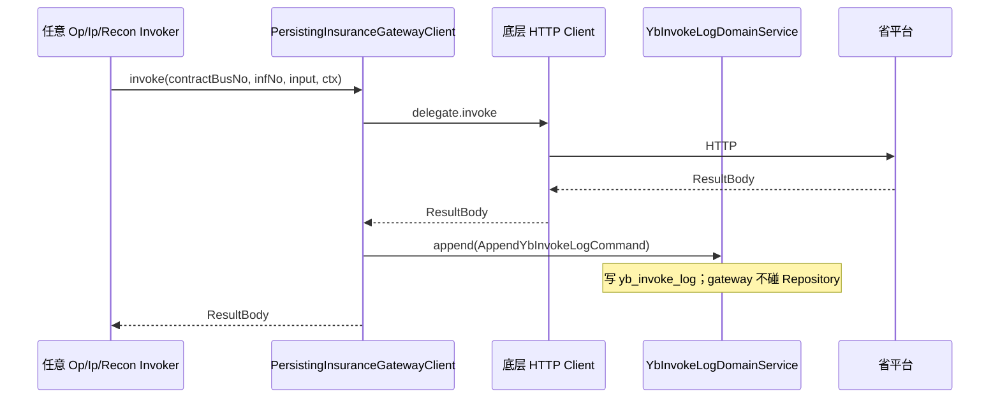
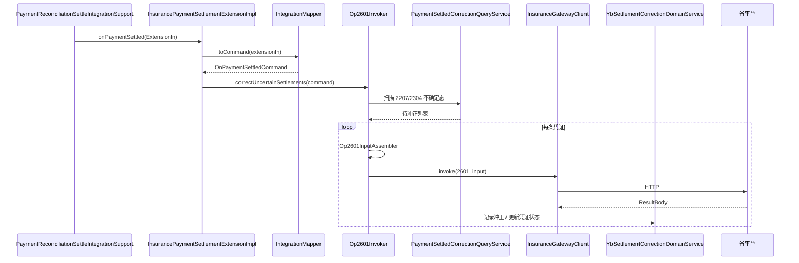

# zxplat-module-chs-jilin 架构 v3 — Gateway-Only Remote

> **文档性质**：`zxplat-module-chs-jilin` 重架构决策（覆盖 v2 中整包 remote / Support 层表述）  
> **日期**：2026-07-10  
> **代码**：[`zxplat-module-chs-jilin/代码仓库-README.md`](../zxplat-module-chs-jilin/代码仓库-README.md)

---

## 1. 与 v2 的差异

| 项 | v2（`16-CHS模块结构收敛-v2.md`） | v3（本目录） |
|----|----------------------------------|--------------|
| remote 范围 | application / bridge 整包 HTTP | **仅** `InsuranceGatewayClient` 出站 |
| bridge 编排 | `internal/*Support`、FacadeImpl | **无 Support**；ExtensionImpl + **Invoker** / `port/*PortImpl` |
| 读 HIS | ContextLoader / support 组装 | **health-domain `*QueryService`** |
| 写 HIS | — | **health-domain `*DomainService`** |
| 读/写 yb_* | **`{mod}-domain` `*QueryService` / `*DomainService`**（Repository 仅 service 层） |
| 单 infno 出站 | **`{Op\|Ip}<InfNo>Invoker`**（例 `Op2601Invoker`） |
| gateway scheme | **`{Op\|Ip\|Cat\|Inv\|Med\|Recon}<InfNo>*`** 于 `gateway/scheme/`；**不含** workinjury（独立扩展包） |
| invoke 审计 | `PersistingInsuranceGatewayClient` → `YbInvokeLogDomainService`（**无** `YbInvokeLogWriter`） |
| contracts | **无**；`chs.domain.*.loader` + domain Command/Result |

---

## 2. bridge 读写 health-domain

```text
*ExtensionImpl
  → Mapper（ExtensionIn/Out ↔ Command/Result）
  → {Op|Ip}<InfNo>Invoker（单 infno 出站时）
  → health-domain *QueryService / *DomainService
  → chs-domain *QueryService / *DomainService    ← yb_* 读写（禁止 bridge 注入 *Repository）
  → InsuranceGatewayClient
```

**禁止**：`health-module-support`、bridge/gateway **直连** `*Repository`、SQL、`*Support` 厚编排层、无 Port 接口却命名 `*PortImpl`。

细则：[`模块代码规范/references/module-domain-layer.md`](../.cursor/skills/模块代码规范/references/module-domain-layer.md) §3.4、§6；[`module-bridge-his-read.md`](../.cursor/skills/模块代码规范/references/module-bridge-his-read.md) §3.4。

**能力缺口**：在 **health-domain** 增加 Query/Domain 能力与 `queries/model`；**必须**同步更新：

- `docs/领域/DomainModel/DM-*.md`（概念模型）
- `docs/领域/DomainModel-SDD/DM-*-SDD.md`（有 SDD 的聚合）

示例：门诊预结算需批量收费项上下文 → 扩展 `ChargeItemQueryService.load…`，在 DM-ADM-011 等文档补充查询语义，**不在 bridge 写 SQL**。

---

## 3.1 health 侧 Integration 编排（与 bridge 对称）

HIS AppService 调 Extension 时，**不**在 application 内联 domain+SPI 顺序；落点 `health-infrastructure/integration/{域}/`：

| 子包 | 职责 |
|------|------|
| `assembler/` | 纯拼装 domain/Command → ExtensionIn（无 IO） |
| `orchestration/` | afterCommit 触发、SPI 补偿（2208→2601）、落账后挂接 |

2601：**路径 A** 落账 afterCommit → `onPaymentSettled` → `Op2601Invoker`；**路径 B** 收费失败 → `OutpatientChargeInsuranceCompensationOrchestration`。

细则：[`模块代码规范/references/integration-assembler-orchestration.md`](../.cursor/skills/模块代码规范/references/integration-assembler-orchestration.md)。AppService：`AS-OP-FIN-002` §8.2。

**存量**：`integration.support`、`ThirdPartyPayment*` 待各 Module 按本仓 v3 迁移后删除（**未上线：迁入即删，不设 Legacy 层**）。

---

## 3. gateway 与 domain 依赖

> 细则真源：[`module-domain-layer.md`](../.cursor/skills/模块代码规范/references/module-domain-layer.md) §3、§5。

### 3.1 编译依赖 vs 运行时调用（依赖倒置）

**gateway 是基础设施**（HTTP 传输、省平台 JSON、签到装饰器），但 **Maven 依赖方向是 gateway → domain**，不是 domain → gateway。

| 维度 | 方向 | 含义 |
|------|------|------|
| **编译依赖**（谁 import 谁的 jar） | `gateway` → `domain`；`application`/`bridge` → 两者 | 外层适配内层契约；**domain POM 不含 gateway** |
| **运行时调用**（谁在某一步被 invoke） | `Invoker` 先组 domain `Command`，再调 `InsuranceGatewayClient`，再调 `*DomainService` 写 `yb_*` | 编排层**使用** gateway，类似 Application **使用** Repository |

```text
        ┌──────────────────────────────────────────┐
        │  application / bridge（编排 Invoker）     │
        └─────────────┬──────────────┬───────────┘
                      │ 依赖         │ 依赖
          ┌───────────▼──────────┐   │
          │  gateway（基础设施）    │───┘ 编译期：gateway 依赖 domain
          │  HTTP / scheme / 审计   │
          └───────────┬──────────┘
                      │ 仅依赖、调用
          ┌───────────▼──────────┐
          │  domain（核心）       │  ← 禁止 import com.zxplat.plugin.chs.gateway.*
          │  Command/Result/实体  │
          └──────────────────────┘
```

**为何不让 domain 依赖 gateway**

- domain 若引用 `Med5201Input`、`ChsInfNo`，省平台字段/交易号变更会波及 `Yb*` 实体与 DomainService。
- domain 单测与 gateway 解耦；`YbInvUploadQueryService` 等须用 domain 内 `constants/*InfNo`，**禁止** import gateway `ChsInfNo`。
- gateway-proxy 理想态仅透传 HTTP；domain 不应绑定某一省接口报文形态。

**类比（与 health-domain 一致）**：Repository 接口在 domain，JPA 实现在 infrastructure；**使用方在外圈，稳定契约在内圈**。

### 3.2 Maven 模块依赖

| 模块 | 依赖 | 角色 |
|------|------|------|
| `chs-jilin-domain` | `zxplat-framework`、JPA | 核心：`yb_*` 实体、`*DomainService`、`*QueryService`、`Command`/`Result` |
| `chs-jilin-gateway` | **domain** + `zxplat-framework` | 基础设施：`*Input`/`*Output`、`InsuranceGatewayClient`、报文解析 |
| `chs-jilin-application` | domain + gateway + health-domain | UI 链 Invoker、`Request`→`Command` |
| `chs-jilin-bridge` | domain + gateway + health-domain | Extension 链 Invoker、ExtensionIn→`Command` |
| `chs-jilin-host` | domain + gateway | remote Client + gateway-proxy 进程 |

### 3.3 四套 DTO 与转换落点

| 层 | 入参 | 出参 | 模块 | 转换发生处 |
|----|------|------|------|------------|
| health ↔ Module | `*ExtensionIn` | `*ExtensionOut` | bridge | `*IntegrationMapper` |
| UI / hisproxy | `*Request` | `*Response` | application | AppService |
| **领域编排** | `*Command` | `*Result` | **domain** | — |
| **外平台报文** | `*Input` | `*Output` / `ResultBody` | **gateway** | `*InputAssembler`、`*OutputParser` |

典型单次出站：

```text
Command (domain)
  → *InputAssembler (gateway) → *Input (gateway)
  → InsuranceGatewayClient.invoke → ResultBody
  → *OutputParser (gateway) → Result / 值对象 (domain)
  → *DomainService (domain) → yb_* 表
```

**domain 无实体包**（`contract`、`medicalinfo`、`platform/model`、`share`）仍是领域契约：防腐键、写库前值对象、跨包错误码；**不是** gateway `*Input` 的替代品（见各 DM/SDD CHS 注记）。

### 3.4 红线（审查用）

| 规则 | 说明 |
|------|------|
| domain **禁止** `import com.zxplat.plugin.chs.gateway.*` | 交易号用 `{context}/constants/*InfNo`（如 `ChsSettlementInfNo`） |
| gateway **禁止**在 `gateway/` 包内**定义** `*DomainService`/`*QueryService` | 可**调用** domain 已有 Service（如 `YbInvokeLogDomainService.append`） |
| gateway **禁止**注入 `*Repository` | 审计落库经 `YbInvokeLogDomainService` |
| bridge/application **禁止**注入 chs/health 的 `*Repository` | 读写经 `*QueryService`/`*DomainService` |
| domain **禁止**顶层 `*Input`/`*Output` | 报文类型只在 `gateway/scheme/` |

### 3.5 部署与 gateway-proxy

| 组件 | 编译依赖 domain | 典型部署 |
|------|-----------------|----------|
| `ChsHttpTransport` | 否 | HIS local / gateway-proxy |
| `gateway/scheme/*`（Assembler/Parser） | **是**（读写的 Command/Result/部分 model） | HIS 与 bridge 同进程 |
| `PersistingInsuranceGatewayClient` | 是（调 `YbInvokeLogDomainService`） | 仅 HIS |
| 签到 `yb_pub_sign` | 是 | HIS；proxy 可选扫 `domain.session` |
| gateway-proxy Controller | 透传为主 | 医保网独立 jar |

**scheme 包**（`com.zxplat.plugin.chs.gateway.scheme`）：门诊 `Op*`、住院 `Ip*`、目录 `Cat*`、进销存 `Inv*`、查询 `Med*`、对账 `Recon*`；**不含** `workinjury/`。

**工伤边界**：`zxplat-module-chs-jilin` **不承载**工伤 domain/bridge/gateway scheme；存量保留至 `zxplat-module-work-injury`（规划名）。

**迁移期说明**：规范理想态为 `ChsSetlinfoOutput` ↔ `PlatformSetlinfoFields` 等映射尽量在 **bridge/application**；现状部分 Assembler/Parser 在 gateway 内直接产出 domain `Command`/`Result`/`ChsFeeUploadResultRow`——仍满足 **domain ↛ gateway**，优于 domain 依赖 gateway。

### 3.6 调用时序示例

#### 示例 A — 管理页对账【3201】（application 链）

`Recon3201Invoker`：UI `Request` 已转为 `ReconDaily3201Command`；出站后写 `yb_recon_daily`。

```mermaid
sequenceDiagram
    participant UI as InsuranceReconAppService
    participant Inv as Recon3201Invoker
    participant Dom as YbReconciliationDomainService
    participant GW as InsuranceGatewayClient
    participant Asm as ReconPlatformInputAssembler
    participant Par as ReconPlatformOutputParser
    participant Plat as 省平台

    UI->>Inv: ReconDaily3201Command
    Inv->>Inv: ReconPlatformSupport.resolveContract
    Inv->>Asm: assemble3201(command)
    Asm-->>Inv: Recon3201Input
    Inv->>GW: invoke(busNo, 3201, input, ctx)
    Note over GW: PersistingInsuranceGatewayClient 装饰器可在此 append yb_invoke_log
    GW->>Plat: HTTP infno=3201
    Plat-->>GW: ResultBody
    GW-->>Inv: ResultBody
    Inv->>Par: parse3201StmtInfo(body)
    Par-->>Inv: stmtinfo JSON
    Inv->>Dom: saveReconDaily(contractId, command, stmtRslt, …)
    Dom-->>Inv: YbReconDaily
    Inv-->>UI: ReconDaily3201Result
```

#### 示例 B — 门诊预结算【2204】（bridge 临床链）

`OpOutpatientPreSettleOrchestrator`：`OpPreSettleCommand` 已由 bridge ContextLoader 从 **health-domain** 组装；2204 回包经 gateway 解析为 domain 值对象后写 `yb_clinic_fee_upload`。

```mermaid
sequenceDiagram
    participant Ext as OutpatientChargeInsuranceExtensionImpl
    participant Orch as OpOutpatientPreSettleOrchestrator
    participant H as health-domain QueryService
    participant I4 as Op2204Invoker
    participant GW as InsuranceGatewayClient
    participant Par as Op2204OutputParser
    participant Fee as YbClinicFeeUploadDomainService
    participant Plat as 省平台

    Ext->>H: ChargeItemQueryService / EncounterContext…
    H-->>Ext: 收费项与就诊上下文
    Ext->>Orch: OpPreSettleCommand
    Orch->>I4: invoke(busNo, command, mdtrtId, chrgBchno)
    I4->>I4: Op2204InputAssembler.assemble
    I4->>GW: invoke(2204, Op2204Input)
    GW->>Plat: HTTP
    Plat-->>GW: ResultBody
    GW-->>I4: ResultBody
    I4-->>Orch: ResultBody
    Orch->>Par: indexByFeedetlSn(body)
    Par-->>Orch: Map feedetlSn, ChsFeeUploadResultRow
    Orch->>Fee: persistFrom2204(encounterId, lines, platformRows)
    Fee-->>Orch: 写入 yb_clinic_fee_upload
```

#### 示例 C — 每次出站审计（gateway 装饰器）

任意 Invoker 注入的 `InsuranceGatewayClient` 常为 `PersistingInsuranceGatewayClient`：**运行时** gateway 调 domain 落审计，体现「外圈使用内圈服务」。



#### 示例 D — 收银落账后【2601】冲正（health Extension → bridge）

health `afterCommit` 触发 Extension；bridge 读 chs-domain 不确定态凭证，再出站 2601。



---

## 4. 变更记录

| 版本 | 日期 | 说明 |
|------|------|------|
| v3.14 | 2026-07-12 | **P15 foundation**：sign/platformdict→bridge/foundation；domain `session.access`/`platformdict.access` 端口；application 全 cap 禁 gateway import（Invoker 迁移完成） |
| v3.13 | 2026-07-12 | **P14 inventory**：删除 application 重复 Inv3501–3506；3507/35xx/workflow/support→bridge；domain `inventory.access` 端口；application inventory 禁 gateway import |
| v3.12 | 2026-07-12 | **P13 catalog**：1312/13xx/3301/3302 + download/mapping workflow→bridge；domain `catalog.access` 端口；application catalog 禁 gateway import |
| v3.11 | 2026-07-12 | **P12 reconciliation**：3201–3209A + 3202 编排迁 bridge；`Cat9102FileDownloadAccess`；application reconciliation 禁 gateway import |
| v3.10 | 2026-07-12 | **P11 medicalinfo**：5201–5301 全量迁 bridge `medicalinfo/invoker`；domain access 端口；application medicalinfo 禁 gateway import |
| v3.9 | 2026-07-11 | **5206/5301**：`medicalinfo.access` 出站端口；删除 application 重复 Invoker；bridge `Med5206Invoker`/`Med5301Invoker` 单 Bean 供 UI 与挂号待遇 Extension 共用 |
| v3.8 | 2026-07-11 | **adapter→bridge**：删除 `com.zxplat.plugin.chs.adapter`；契约/ContextLoader/Assembler 迁至 `com.zxplat.plugin.chs.bridge.*`；`ChsBridgeAutoConfiguration` 替代 adapter starter |
| v3.7 | 2026-07-11 | §3 扩充：gateway↔domain 依赖倒置、四套 DTO、红线、四条调用时序（3201/2204/审计/2601） |
| v3.6 | 2026-07-10 | **1101**：`Op1101InputAssembler` + `Op1101Invoker`；`InsuranceRegisterBenefitQueryExtensionImpl.queryPerson` |
| v3.5 | 2026-07-10 | **未上线**：禁止 Legacy 委托/双 starter；迁入即删旧类；2601 路径 B 在 bridge `OutpatientChargeInsuranceExtensionImpl` → `Op2601Invoker` |
| v3.4 | 2026-07-10 | health 侧 `integration/{域}/assembler` + `orchestration`；2601 双路径 |
| v3.3 | 2026-07-10 | **禁止**工伤迁入 chs-jilin；工伤独立扩展 Module |
| v3.2 | 2026-07-10 | gateway scheme 命名（Op/Ip/Cat/…）；observability 审计装饰；domain model/constants |
| v3.1 | 2026-07-10 | Invoker 命名；Repository 仅 service 层；invoke 经 DomainService 落库 |
| v3.0 | 2026-07-10 | Gateway-Only Remote；去掉 Support；bridge 直调 health-domain 服务 |
