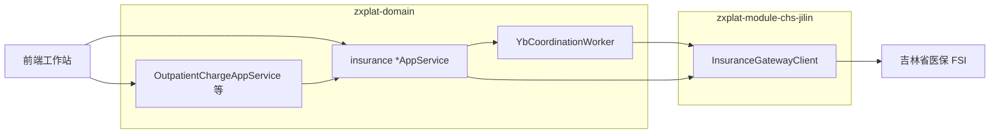
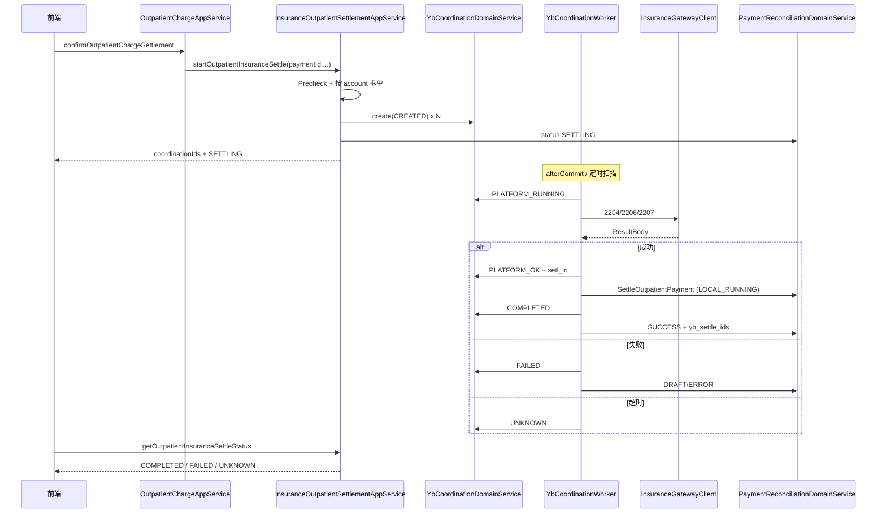
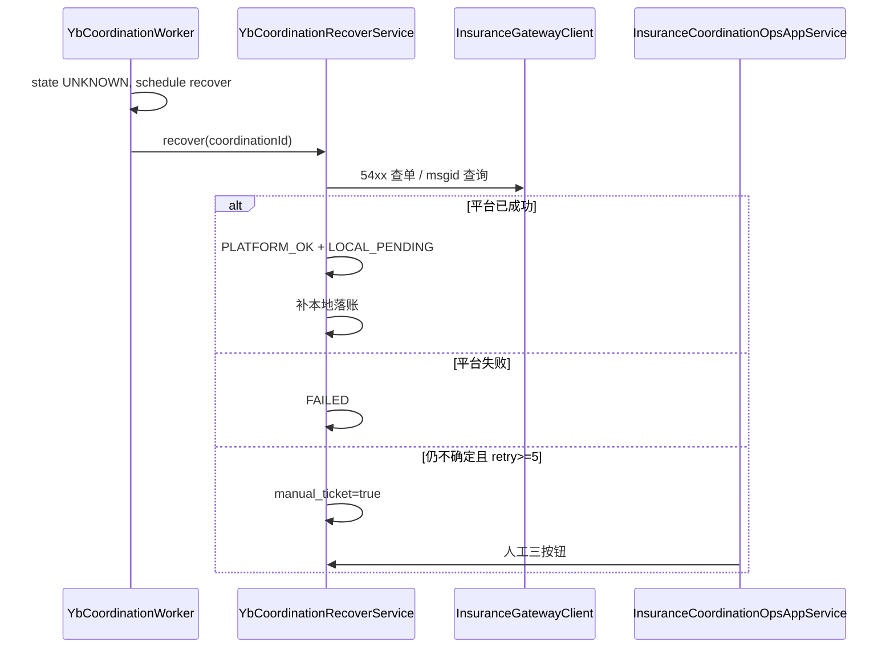

# ZXPlat 吉林省医保模块 — 概要设计

> ⚠️ **Maven/包名当前态**：`chs-api/chs-impl` → **`chs-jilin-domain` + `chs-jilin-application`**；`yb_*` 在 chs-jilin-domain。  
> **真源**：[01-概要设计.md](./01-概要设计.md) | [13-实现状态与文档对照.md](./13-实现状态与文档对照.md) — 本文 §2 模块表等为迁移前规划，**编码以真源为准**。

> **文档性质**：概要设计（HLD），指导模块划分、表结构、接口契约与主流程实现  
> **上游文档**：[02-Whale吉林省医保模块-架构设计.md](./02-Whale吉林省医保模块-架构设计.md)  
> **下游文档**：单接口字段以 `apis/**` 为准；类级详细设计在编码阶段按 Wave 补充  
> **版本**：v1.0 | **日期**：2026-05-28

---

## 1. 文档关系

```text
02 架构设计  →  03 概要设计  →  05/06/07 详细设计  →  代码
     │              │                  │
  决策与边界      模块/表/接口        字段映射/状态机/网关
  04 多方案骨架（贯穿各层）
```

---

## 2. 系统上下文



| 外部系统 | 交互方式 | 说明 |
|----------|----------|------|
| 吉林省 FSI | HTTPS + OAuth2 + SM2/SM4 | `callFsiService/callService` |
| Redis（可选） | 缓存 Token/sign_no | 集群部署推荐 |
| PostgreSQL | JPA + Flyway | 协同单、结算记录、批任务 |

---

## 3. Maven 模块与包规划

> **多方案骨架**：业务代码分为 `insurance/core`（共用）与 `insurance/scheme/jilin`（吉林实现）；详见 [04-Whale医保多方案扩展骨架.md](./04-Whale医保多方案扩展骨架.md)。

### 3.1 zxplat-module-chs-jilin

| 模块 | 包 | 新增/变更类（概要） |
|------|-----|---------------------|
| **chs-api** | `com.zxplat.plugin.chs.api.core` | `InsuranceGatewayClient`、`InvokeContext`、`ResultBody` |
| **chs-api** | `com.zxplat.plugin.chs.api.dto.national.*` | 国家基线 DTO（1101、2207、2305、3201、4101…） |
| **chs-api** | `com.zxplat.plugin.chs.api.dto.scheme.jilin` | `JilinExtDataDto`、`Clear3203AInput` 等 **吉林增量** |
| **chs-api** | `com.zxplat.plugin.chs.api.dto.scheme.workinjury` | 二期占位 |
| **chs-impl** | `com.zxplat.plugin.chs.impl.core.*` | `ChsHttpAccessor`、国密、签到、local/remote |
| **chs-impl** | `com.zxplat.plugin.chs.application.gateway.scheme.jilin` | `JilinInsuplcAdmdvsRule` 等协议薄适配 |
| **chs-impl** | `com.zxplat.plugin.chs.impl.server`（remote） | `ChsGatewayController` |

（原 flat 包规划已收敛为 **core + scheme/jilin**；national DTO 多省复用，吉林仅 extData 与 320xA。）

### 3.2 zxplat-domain

| 模块 | 包 | 职责 |
|------|-----|------|
| **health-domain-shared** | `domain.share.enums.insurance` | `InsuranceSchemeCode`、`YbCoordinationBizType`、`YbCoordinationState` |
| **health-domain** | `domain.insurance.coordination.*` | 协同单聚合（**方案无关**） |
| **health-domain-shared** | `domain.share.enums` | **`PaymentStatus.SETTLING`** |
| **health-application** | `application.insurance.core.*` | Facade、Worker、Registry、Ops |
| **health-application** | `application.insurance.scheme.jilin.*` | `JilinInsuranceSchemePlugin`、Assembler、Executor |
| **health-application** | `application.insurance.scheme.workinjury` | 二期占位 |
| **health-infrastructure** | `db/migration/health` | Flyway；`yb_coordination.scheme_code`、`fin_contract.insurance_scheme_code` |

---

## 4. 领域模型

### 4.1 聚合：医保协同单（YbCoordination）

```text
YbCoordination（聚合根）
  ├── YbCoordinationStep[]（实体，1:N，多 infno 链）
  └── 关联 YbSettlementRecord（1:0..1，SETTLE 成功时）

外部关联（非聚合内）：
  PaymentReconciliation（fin_payment_reconciliation）
  ChargeItem[]（按 account_id 分组）
  Contract（fin_contract）
```

**不变量：**

1. 同一 `(payment_id, account_id, biz_type)` 在 `state NOT IN (COMPLETED, CANCELLED, COMPENSATED)` 时最多一条（唯一约束）。
2. `state=COMPLETED` 时 SETTLE 类必须有 `platform_setl_id`。
3. `state=UNKNOWN` 禁止同 payment+account 新建 SETTLE 协同单（须先 RECOVER 或 COMPENSATE）。
4. `msgid` 创建后不可变更。

### 4.2 枚举

#### YbCoordinationBizType

```java
// health-domain-shared
public enum YbCoordinationBizType {
    OP_SETTLE, OP_SETTLE_REVERSE, OP_FEE_UPLOAD,
    IP_ADMIT, IP_FEE_UPLOAD, IP_PRE_SETTLE, IP_SETTLE, IP_SETTLE_REVERSE, IP_DISCHARGE,
    DISPENSE_UPLOAD, CATALOG_MAPPING,
    RECON_DAILY, RECON_DETAIL, RECON_CLEAR_JL,
    SETTLEMENT_LIST, PLATFORM_COMP, UNKNOWN_RECOVER
}
```

#### YbCoordinationState

```java
public enum YbCoordinationState {
    CREATED,
    PLATFORM_RUNNING,
    PLATFORM_OK,
    LOCAL_RUNNING,
    LOCAL_PENDING,
    COMPLETED,
    FAILED,
    UNKNOWN,
    RECOVERING,
    COMPENSATING,
    COMPENSATED,
    CANCELLED
}
```

#### YbCoordinationPriority

```java
public enum YbCoordinationPriority { P0, P1, P2 }
```

---

## 5. 数据库设计

> Flyway 脚本建议：`health-infrastructure/.../V{next}__yb_insurance_coordination.sql`

### 5.1 yb_coordination

```sql
CREATE TABLE yb_coordination (
    id                  BIGINT PRIMARY KEY,
    biz_type            VARCHAR(32)  NOT NULL,
    scheme_code         VARCHAR(32)  NOT NULL DEFAULT 'CHS_NATIONAL_JILIN',
    state               VARCHAR(32)  NOT NULL,
    biz_id              BIGINT       NOT NULL,          -- payment_id / encounter_id / batch_id
    account_id          BIGINT,                          -- 拆单账户，自费可为 NULL
    contract_id         BIGINT       NOT NULL,
    parent_id           BIGINT,
    payment_id          BIGINT,                          -- 冗余，便于查询
    payment_no          VARCHAR(64),
    encounter_id        BIGINT       NOT NULL,
    patient_id          BIGINT       NOT NULL,
    msgid               VARCHAR(64)  NOT NULL,
    infno               VARCHAR(16),
    platform_setl_id    VARCHAR(64),
    priority            VARCHAR(8)   NOT NULL DEFAULT 'P1',
    blocking            BOOLEAN      NOT NULL DEFAULT TRUE,
    request_snapshot    TEXT,
    response_snapshot   TEXT,
    platform_amount     NUMERIC(18,2),
    retry_count         INT          NOT NULL DEFAULT 0,
    next_retry_at       TIMESTAMP,
    error_code          VARCHAR(64),
    error_msg           VARCHAR(512),
    manual_ticket       BOOLEAN      NOT NULL DEFAULT FALSE,
    operator_id         BIGINT,
    version             INT          NOT NULL DEFAULT 0,
    tenant_id           BIGINT       NOT NULL,
    created_at          TIMESTAMP    NOT NULL,
    updated_at          TIMESTAMP,
    created_by          BIGINT,
    updated_by          BIGINT,
    is_deleted          BOOLEAN      NOT NULL DEFAULT FALSE
);

CREATE UNIQUE INDEX uk_yb_coord_active_settle
    ON yb_coordination (payment_id, account_id, biz_type)
    WHERE state NOT IN ('COMPLETED','CANCELLED','COMPENSATED') AND is_deleted = FALSE
      AND biz_type IN ('OP_SETTLE','IP_SETTLE');

CREATE INDEX idx_yb_coord_state_retry ON yb_coordination (state, next_retry_at);
CREATE INDEX idx_yb_coord_encounter ON yb_coordination (encounter_id);
CREATE INDEX idx_yb_coord_manual ON yb_coordination (manual_ticket, priority, updated_at);
```

### 5.2 yb_coordination_step

```sql
CREATE TABLE yb_coordination_step (
    id                  BIGINT PRIMARY KEY,
    coordination_id     BIGINT       NOT NULL REFERENCES yb_coordination(id),
    step_order          INT          NOT NULL,
    infno               VARCHAR(16)  NOT NULL,
    state               VARCHAR(32)  NOT NULL,
    msgid               VARCHAR(64)  NOT NULL,
    request_snapshot    TEXT,
    response_snapshot   TEXT,
    error_code          VARCHAR(64),
    error_msg           VARCHAR(512),
    tenant_id           BIGINT       NOT NULL,
    created_at          TIMESTAMP    NOT NULL,
    updated_at          TIMESTAMP,
    UNIQUE (coordination_id, step_order)
);
```

### 5.3 yb_settlement_record

```sql
CREATE TABLE yb_settlement_record (
    id                  BIGINT PRIMARY KEY,
    coordination_id     BIGINT       NOT NULL REFERENCES yb_coordination(id),
    setl_id             VARCHAR(64)  NOT NULL,
    payment_id          BIGINT       NOT NULL,
    account_id          BIGINT,
    psn_no              VARCHAR(64),
    mdtrt_id            VARCHAR(64),
    medfee_sumamt       NUMERIC(18,2),
    fund_pay_sumamt     NUMERIC(18,2),
    acct_pay            NUMERIC(18,2),
    psn_cash_pay        NUMERIC(18,2),
    fund_breakdown_json TEXT,
    tenant_id           BIGINT       NOT NULL,
    created_at          TIMESTAMP    NOT NULL,
    UNIQUE (setl_id, contract_id)
);
```

### 5.4 yb_batch_job（目录下载等，非协同单）

```sql
CREATE TABLE yb_batch_job (
    id                  BIGINT PRIMARY KEY,
    job_type            VARCHAR(32)  NOT NULL,   -- CATALOG_DOWNLOAD_1301 等
    contract_id         BIGINT       NOT NULL,
    state               VARCHAR(32)  NOT NULL,
    params_json         TEXT,
    result_json         TEXT,
    scheduled_at        TIMESTAMP,
    started_at          TIMESTAMP,
    finished_at         TIMESTAMP,
    tenant_id           BIGINT       NOT NULL,
    created_at          TIMESTAMP    NOT NULL
);
```

### 5.5 chs 侧可选：yb_invoke_log

```sql
-- 可放在 health 或 chs-impl 独立 schema；记录每次 invoke（脱敏）
CREATE TABLE yb_invoke_log (
    id              BIGINT PRIMARY KEY,
    contract_id     BIGINT NOT NULL,
    infno           VARCHAR(16) NOT NULL,
    msgid           VARCHAR(64) NOT NULL,
    coordination_id BIGINT,
    infcode         VARCHAR(8),
    duration_ms     INT,
    request_digest  VARCHAR(128),
    created_at      TIMESTAMP NOT NULL
);
```

### 5.6 fin_contract 扩展

```sql
ALTER TABLE fin_contract ADD COLUMN IF NOT EXISTS insurance_scheme_code VARCHAR(32);
-- 为空时按 ContractCategory 默认映射，见 04-多方案扩展骨架 §2.3
```

---

## 6. 与现有财务模型衔接

### 6.1 PaymentReconciliation 扩展策略

| 字段 | 用途 |
|------|------|
| `status_enum` | 新增 **`SETTLING`**：医保协同进行中，禁止重复确认 |
| `yb_settle_ids` | COMPLETED 后写入，多 account 时逗号分隔或 JSON 数组 |
| `yb_clear_flag` | 对账/清算完成后置 true |
| `account_id` | 与 chargeItem 拆单对齐 |

### 6.2 PaymentStatus 新增

```java
// 插入 DRAFT 与 SUCCESS 之间
SETTLING(0L, "SETTLING", "结算中（医保平台协同进行）", "", 0L),
```

**规则：**

- `confirmOutpatientChargeSettlement` 识别医保 account → payment 先 `SETTLING`，协同 `COMPLETED` 后 → `SUCCESS`。
- 协同 `FAILED`/`CANCELLED` → payment 回 `DRAFT` 或 `ERROR`（按是否可重试）。

### 6.3 ChargeItem 拆单

```java
// 伪代码：InsuranceOutpatientSettlementAppService
Map<Long, List<ChargeItem>> byAccount = chargeItems.stream()
    .collect(groupingBy(ChargeItem::getAccountId));

for (Map.Entry<Long, List<ChargeItem>> e : byAccount.entrySet()) {
    Account account = accountQueryService.mustGet(e.getKey());
    if (!account.isInsuranceAccount()) {  // 依据 contract_no / ChargeTypeCategory
        continue; // 自费组：仅本地 SettleOutpatientPayment，无协同单
    }
    createCoordination(OP_SETTLE, paymentId, e.getKey(), e.getValue());
}
```

`Account` 是否医保：通过 `account.contract_no` → `fin_contract` → `ContractCategory.PROVINCIAL_INSURANCE` 判定。

---

## 7. 核心组件职责

### 7.1 zxplat-module-chs-jilin

| 类 | 职责 |
|----|------|
| `InsuranceGatewayClient` | 统一 `invoke(contractId, infNo, input, context)` |
| `InsuranceGatewayClientLocalImpl` | `@ConditionalOnProperty local` → 委托 `ChsHttpAccessor` |
| `InsuranceGatewayClientRemoteImpl` | `@ConditionalOnProperty remote` → HTTP 调 chs 独立服务 |
| `ChsHttpAccessor` | Token、TransBody、加解密、POST、解析 ResultBody |
| `InsuranceSignSessionService` | 9001/9002；缓存 sign_no |
| `ChsSmCryptoService` | SM2 签名、SM4 加解密 |
| `ContractConfigLoader` | 读 `chs-contract.properties` |
| `ChsGatewayController` | remote 模式 REST：`POST /chs/gateway/invoke` |

### 7.2 zxplat-domain insurance

| 类 | 职责 |
|----|------|
| `InsuranceSettlementContextLoader` | 批量加载 Encounter/Patient/ChargeItem/Diagnosis/Product/Practitioner |
| `InsurancePrecheckService` | 未对照阻断、险种/合同校验 |
| `Insurance2204InputAssembler` | Context → OpFee2204Input |
| `Insurance2207InputAssembler` | Context + 2206 结果 → OpSettle2207Input |
| `JilinExtDataBuilder` | Context → JilinExtDataDto |
| `InsuranceSettlementFacade` | **按 contractId 解析 scheme**，委托 Plugin；业务 AppService 只调 Facade |
| `InsuranceSchemeRegistry` | `InsuranceSchemeCode` → `InsuranceSchemePlugin` |
| `JilinInsuranceSchemePlugin` | 吉林：Precheck、步骤链、Assembler（`scheme/jilin`） |
| `YbCoordinationDomainService` | 创建/推进协同单状态（带乐观锁） |
| `YbCoordinationWorker` | 扫描待处理协同单、执行平台/本地步骤 |
| `YbCoordinationRecoverService` | UNKNOWN 查单与恢复 |
| `InsuranceLocalSettlementService` | 平台 OK 后调用 `SettleOutpatientPaymentCommand` |
| `InsuranceCoordinationOpsAppService` | 运维列表、人工三按钮 |

---

## 8. 应用服务接口（AppService 契约）

> 暴露路径：`/api/app/{ServiceName}/{method}`（zxplat-app 自动注册）

### 8.1 InsuranceSessionAppService

| 方法 | 说明 |
|------|------|
| `signIn(SignInRequest)` | 9001，按 contractId + operator |
| `signOut(SignOutRequest)` | 9002 |

### 8.2 InsurancePersonAppService

| 方法 | 说明 |
|------|------|
| `getYbPersonInfo(QueryYbPersonRequest)` | 1101；request：contractId、mdtrt_cert_type/no |

### 8.3 InsuranceOutpatientSettlementAppService

| 方法 | 说明 |
|------|------|
| `startOutpatientInsuranceSettle(StartOpInsuranceSettleRequest)` | 创建协同单、payment→SETTLING；返回 coordinationIds |
| `getOutpatientInsuranceSettleStatus(GetOpInsuranceSettleStatusRequest)` | 轮询协同单状态 |
| `cancelOutpatientInsuranceSettle(CancelOpInsuranceSettleRequest)` | 用户改 account 前取消，CANCELLED |
| `reverseOutpatientInsuranceSettle(ReverseOpInsuranceSettleRequest)` | 2208 撤销 |

**StartOpInsuranceSettleRequest（概要字段）：**

```java
Long paymentId;           // 必填，DRAFT/SETTLING
Long contractId;          // 省医保合同
String mdtrtCertType;
String mdtrtCertNo;
String insuplcAdmdvs;     // 1101 返回，可缓存前端传
String psnNo;             // 1101 返回
// 可选：medType、diseCodg 等 UI 选择项
```

### 8.4 InsuranceInpatientSettlementAppService

| 方法 | 说明 |
|------|------|
| `startInpatientAdmit(...)` | IP_ADMIT / 2401 |
| `uploadInpatientFees(...)` | IP_FEE_UPLOAD |
| `startInpatientSettle(...)` | IP_SETTLE / 2305 链 |
| `dischargeInpatient(...)` | IP_DISCHARGE |

### 8.5 InsuranceReconciliationAppService

| 方法 | 说明 |
|------|------|
| `runDailyReconciliation(ReconDailyRequest)` | 3201 |
| `runDetailReconciliation(ReconDetailRequest)` | 3202 |
| `applyJilinClearing(Clear3203ARequest)` | 3203A |
| `revokeJilinClearing(...)` | 3204A |
| `queryJilinClearingStatus(...)` | 3205A |

### 8.6 InsuranceSettlementListAppService

| 方法 | 说明 |
|------|------|
| `uploadSettlementList(Upload4101Request)` | 4101，按 encounter/出院批次 |

### 8.7 InsuranceDrugTraceAppService

| 方法 | 说明 |
|------|------|
| `uploadDispenseTrace(Upload350xRequest)` | 发药后异步，DISPENSE_UPLOAD |

### 8.8 InsuranceCoordinationOpsAppService

| 方法 | 说明 |
|------|------|
| `pageCoordination(CoordinationPageRequest)` | 运维分页，按 state/priority/encounter |
| `getCoordinationDetail(Long id)` | 含 step、snapshot |
| `confirmPlatformSuccess(ManualRecoverRequest)` | 人工：平台已成功 → 补本地 |
| `confirmPlatformFailed(ManualRecoverRequest)` | 人工：平台未成功 → 关单 |
| `triggerCompensation(CompensationRequest)` | 人工：2601/2208 |

---

## 9. 主流程时序

### 9.1 门诊医保结算（OP_SETTLE，双确认）



### 9.2 挂接点：OutpatientChargeAppService

**修改点 `confirmOutpatientChargeSettlement`：**

```text
1. validateConfirmSettleRequest（已有）
2. 判断 payment 是否含医保 account 的 chargeItem
3. 若含医保：
     a. 不在此方法内直接 SettleOutpatientPayment SUCCESS
     b. 调用 InsuranceOutpatientSettlementAppService.start...
     c. 返回 SETTLING + coordinationIds，前端轮询
4. 若纯自费：保持现有 SettleOutpatientPayment 路径
5. 混合（医保+自费 account）：
     a. 医保组走协同单
     b. 自费组在同一 payment 下本地 settle（或分 payment，按现有 PreSettle 结构）
     c. 全部 COMPLETED 后 payment SUCCESS
```

### 9.3 UNKNOWN 恢复



### 9.4 发药上传（DISPENSE_UPLOAD，异步弱一致）

```text
OutpatientPharmacyDispenseAppService.dispenseOutpatientMedications
  → 本地发药成功（不变）
  → InsuranceDrugTraceAppService.uploadDispenseTraceAsync(dispenseIds)
  → 创建 DISPENSE_UPLOAD 协同单，失败仅告警，不 rollback 发药
```

---

## 10. Worker 与调度

### 10.1 YbCoordinationWorker

| 项 | 设计 |
|----|------|
| 触发 | `@Scheduled(fixedDelay=5s)` + `afterCommit` 事件（可选 `@TransactionalEventListener`） |
| 扫描 | `state IN (CREATED, LOCAL_PENDING)` AND `next_retry_at <= now()` |
| 并发 | 同一 `coordination_id` 分布式锁或 `SELECT FOR UPDATE SKIP LOCKED` |
| 重试 | 指数退避：30s, 1m, 5m, 15m；SETTLE 类最多 3 次自动平台重试 |
| 事务 | **平台 invoke 不在 DB 事务内**；状态更新单独短事务 |

### 10.2 步骤执行器（Strategy）

```java
public interface YbCoordinationStepExecutor {
    YbCoordinationBizType supportedBizType();
    void executePlatform(YbCoordination coord, YbCoordinationStep step);
    void executeLocal(YbCoordination coord);
}
```

| 实现类 | biz_type |
|--------|----------|
| `OpSettleCoordinationExecutor` | OP_SETTLE |
| `IpSettleCoordinationExecutor` | IP_SETTLE |
| `DispenseUploadCoordinationExecutor` | DISPENSE_UPLOAD |
| `ReconDailyCoordinationExecutor` | RECON_DAILY |
| `SettlementListCoordinationExecutor` | SETTLEMENT_LIST |
| ... | ... |

---

## 11. 入参组装（InsuranceSettlementContext）

### 11.1 Context 结构

```java
public class InsuranceSettlementContext {
    Long paymentId;
    Long accountId;
    Long encounterId;
    Long contractId;
    PaymentReconciliationQueryModel payment;
    EncounterDetailQueryModel encounter;
    Patient patient;
    List<ChargeItem> chargeItems;
    List<ConditionBatchItemQueryModel> diagnoses;
    Map<String, ProductDefinitionDisplayDto> productsByKey;
    Map<Long, Practitioner> practitionersById;
    Map<Long, Organization> organizationsById;
    // 前序步骤产出
    String mdtrtId;
    String psnNo;
    String insuplcAdmdvs;
    OpPreSettle2206Output preSettleOutput;
    // 用户输入
    InsuranceUserChoices userChoices;
}
```

### 11.2 Loader 调用链

```text
InsuranceSettlementContextLoader.load(LoadContextCommand cmd)
  → ChargeItemQueryService.listByPaymentAndAccount
  → EncounterQueryService.mustGetEncounter
  → PatientRepository / AccountQueryService
  → ConditionQueryService.batchByEncounter
  → ProductDefinitionBatchLoader.loadAsMap
  → PractitionerQueryService / OrganizationQueryService
  → ContractQueryService.mustGetContract
```

### 11.3 Precheck 规则

| 规则码 | 条件 | 动作 |
|--------|------|------|
| `UNMAPPED_CATALOG` | 医保 account 下任一 chargeItem 对应产品 `yb_match_flag != true` 或 `yb_no` 空 | 抛 BusinessException，不建协同单 |
| `MISSING_DIAGNOSIS` | 门诊结算必填诊断为空 | 阻断 |
| `MISSING_YB_ORG_CODE` | 开单科室 `yb_no` 空 | 阻断 |
| `ACTIVE_COORDINATION_EXISTS` | 同 payment+account 已有进行中 SETTLE | 阻断 |

---

## 12. chs-api DTO 概要（门诊 2207 示例）

```java
// OpSettle2207Input — 字段映射见 apis/2-医保服务/2207-*.md
public class OpSettle2207Input {
    private String psnNo;
    private String mdtrtCertType;
    private String mdtrtCertNo;
    private String medType;
    private String mdtrtId;
    private BigDecimal medfeeSumamt;
    private String psnSetlway;
    private String acctUsedFlag;
    private String insuplcAdmdvs;
    private JilinExtDataDto extData;  // 吉林
    // ... 按规范补全
}

// OpSettle2207Output — 解析 ResultBody.output.setlinfo / setldetail
public class OpSettle2207Output {
    private String setlId;
    private BigDecimal medfeeSumamt;
    private BigDecimal fundPaySumamt;
    private BigDecimal acctPay;
    private BigDecimal psnCashPay;
    private List<FundPaymentItem> setldetail;
}
```

**InsuranceGatewayClient 扩展（可选，内部仍 invoke）：**

```java
default OpSettle2207Output invoke2207(Long contractId, OpSettle2207Input input, InvokeContext ctx) {
    ResultBody body = invoke(contractId, "2207", input, ctx);
    return ChsResponseParser.parse2207(body);
}
```

---

## 13. 配置项

### 13.1 application.yml（health-app）

```yaml
insurance:
  gateway:
    mode: local          # local | remote
    remote-base-url:     # mode=remote 时必填
  coordination:
    worker-enabled: true
    worker-fixed-delay-ms: 5000
    settle-max-retry: 3
    unknown-recover-delays: 30s,1m,5m,15m,15m
```

### 13.2 chs-contract.properties

```properties
contract.{id}.base_url=http://ddjk.jlhs.gov.cn:20215
contract.{id}.fixmedins_code=H22010402403
contract.{id}.adm_vs=229900
contract.{id}.client_id=
contract.{id}.client_secret=
contract.{id}.username=
contract.{id}.password=
contract.{id}.cli_prv_key=
contract.{id}.cli_pub_key=
contract.{id}.server_pub_key=
contract.{id}.encrypt=true
```

---

## 14. 错误码（health-domain-shared）

| 码 | 常量建议 | 说明 |
|----|----------|------|
| INS-001 | `INSURANCE_UNMAPPED_CATALOG` | 未对照阻断 |
| INS-002 | `INSURANCE_PLATFORM_REJECTED` | infcode != 0 |
| INS-003 | `INSURANCE_COORDINATION_CONFLICT` | 进行中协同单冲突 |
| INS-004 | `INSURANCE_UNKNOWN_PENDING` | UNKNOWN 待人工 |
| INS-005 | `INSURANCE_LOCAL_SETTLE_FAILED` | 平台成功本地失败 |
| INS-006 | `INSURANCE_SIGN_REQUIRED` | 未签到 |
| INS-007 | `INSURANCE_CONTRACT_NOT_FOUND` | contractId 无 Config |

---

## 15. 部署概要

### 15.1 local 模式

```text
health-app.jar
  ├── health-application
  ├── chs-impl（InsuranceGatewayClientLocalImpl）
  └── chs-contract.properties（或外挂）
```

### 15.2 remote 模式

```text
health-app.jar                    chs-gateway.jar
  ├── chs-api                       ├── chs-impl
  └── RemoteClient                  └── ChsGatewayController
        POST /chs/gateway/invoke
```

---

## 16. 实施交付物清单（按 Wave）

### Wave 1 文件清单

| 层级 | 交付物 |
|------|--------|
| DB | `V*__yb_insurance_coordination.sql` |
| domain-shared | `YbCoordination*` 枚举、`PaymentStatus.SETTLING`、错误码 |
| domain | `YbCoordination` 实体、Repository、DomainService、QueryService |
| chs-api | `OpSettle2207Input/Output`、`JilinExtDataDto` |
| chs-impl | 9001、国密、`InsuranceSignSessionService` |
| application | ContextLoader、2207 Assembler、OutpatientSettlementAppService、Worker、OpsAppService |
| 挂接 | `OutpatientChargeAppService.confirmOutpatientChargeSettlement` 改造 |

### Wave 2–4

见架构设计 §12；每 Wave 增加对应 `*CoordinationExecutor` + AppService + Assembler。

---

## 17. 测试要点

| 类型 | 范围 |
|------|------|
| 单元 | Assembler 字段映射、Precheck、状态机转移 |
| 集成 | Mock Gateway：双确认成功/平台失败/UNKNOWN/LOCAL_PENDING |
| 并发 | 同 payment 双请求，唯一约束生效 |
| E2E | 1101 → startSettle → 轮询 COMPLETED → payment SUCCESS |

---

## 18. 修订记录

| 版本 | 日期 | 说明 |
|------|------|------|
| v1.1 | 2026-05-28 | 对齐 04 多方案骨架：core + scheme/jilin 包、scheme_code 字段 |
| v1.0 | 2026-05-28 | 基于架构设计 v1.0 编写概要设计 |
