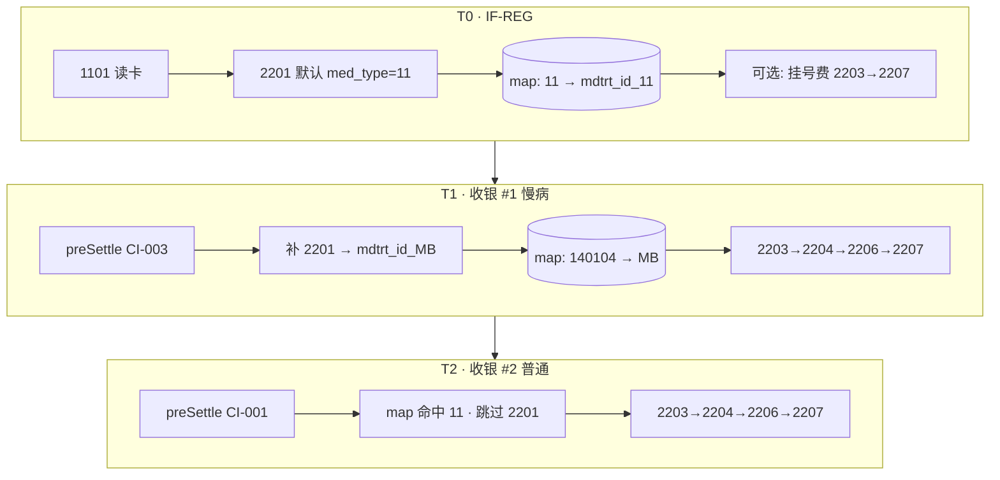
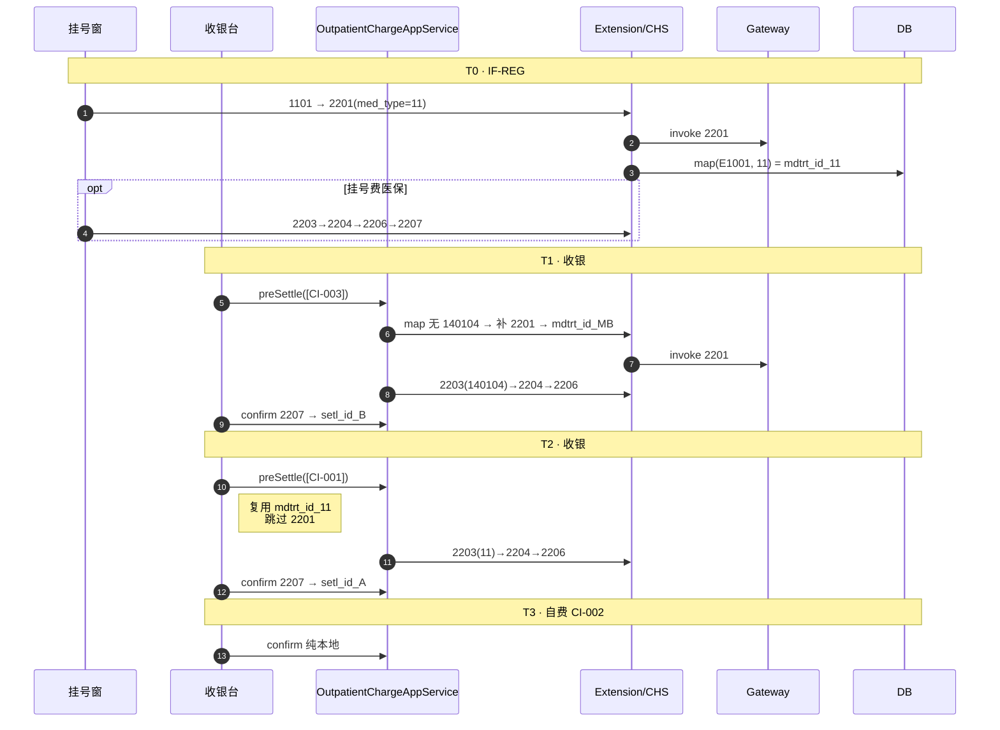

# 场景 · 慢病多科室混合结算 — 数据时序

> **文档性质**：端到端数据时序（业务 + HIS + CHS 平台）  
> **上游**：[03-门诊医保结算-详细设计](./03-门诊医保结算-详细设计.md) §14 · [19-结算领域模型定稿](./19-结算领域模型定稿.md)  
> **版本**：v1.6 · **日期**：2026-06-20

---

## 1. 场景摘要

| 维度 | 说明 |
|------|------|
| 患者 | 已备案门诊慢病的参保人（1101 可读卡） |
| 就诊 | **同一自然日、同一 `encounter_id`** 内多科室开药 |
| 起付线前提 | 假设患者 **本年度门诊统筹（`med_type=11`）起付线尚未满足** |
| **平台身份（定稿）** | **`encounter` : `mdtrt_id` = 1 : N**；按 **`med_type`** 分行映射（见 §1.3） |
| **2201 定稿** | **挂号必 2201**（默认 `med_type=11`）；结算时 **仅对 map 中尚不存在的 `med_type` 后台补 2201**（用户无感） |
| 挂号费 | **可走医保**（依赖挂号窗 2201 已建 `med_type=11` 的 `mdtrt_id`；见 §2.2） |
| 收银约束 | 起付线场景下 **分次收银**（§1.2）；非「三行一次勾选」 |
| 费用构成 | 医保可报 150 元（2 个 `med_type` 批次）+ 自费 200 元 |

### 1.1 三笔费用（业务口径）

| 序号 | 开单科室 | 金额 | 药品性质 | 费用账户 | `med_type` | 是否上平台 |
|------|----------|------|----------|----------|------------|------------|
| CI-001 | 内科 | 100 元 | 甲类药（医保目录内） | 省医保账户 | `11` 普通门诊 | 是 → **Batch-A**（统筹池，受起付线约束） |
| CI-002 | 外科 | 200 元 | 非医保药（无目录码 / 自费品种） | 自费账户 | — | **否**，仅本地 |
| CI-003 | 慢病内科 | 50 元 | 慢病用药 | 省医保账户 | `140104` 门诊慢病 | 是 → **Batch-B**（慢病池，**不走**门诊统筹起付线） |

**收银原价合计**：350 元。  
**平台 `medfee_sumamt` 合计**：150 元（Batch-A + Batch-B，但 **分两次** 2206/2207）。  
**患者总实付**：见 §6（起付线场景下 Batch-A 可能 **几乎全额自付**）。

### 1.2 为何不能满足「一次勾选、一次读卡、一次确认」

[03 §14](./03-门诊医保结算-详细设计.md) 的「一次收银」指 **同一 `paymentDraft` 内后端自动拆 `chrg_bchno`**；本场景在 **起付线未满足** 时，窗口侧 **不应** 合并勾选，原因如下。

| # | 约束 | 说明 |
|---|------|------|
| 1 | **统筹池分离** | `med_type=11`（门诊统筹）与 `140104`（门诊慢病）在平台侧 **分池累计**；2206 回包字段 `act_pay_dedc`（实际支付起付线）、`crt_dedc`（本次起付线）仅作用于 **对应 `med_type` 池**，不可合并为一个 `setl_id` 理解。 |
| 2 | **Batch-A 报销结构特殊** | 起付线未满足时，CI-001 的 100 元甲类药 **大部分或全部计入起付线**（`fund_pay_sumamt≈0`，`psn_cash_pay≈medfee`），与 Batch-B 慢病（通常 `act_pay_dedc≈0`、统筹可报）**收银语义完全不同**；合并预览会让患者误以为「150 元医保药能一起报销」。 |
| 3 | **2207 顺序与累计** | 若强行一次 confirm 串行两批 2207，**第一批 2207（Batch-A）会立刻写入统筹起付累计**；第二批 2206 虽在预结算阶段已试算，但与窗口 **「先结慢病、再结普通门诊起付」** 的操作习惯不一致，且部分机构要求 **普通门诊统筹须单独一单** 以便核对起付线。 |
| 4 | **与 §14 的边界** | §14 一次收银适用于：**单一医保池**、或 **均已过起付线** 的多 `med_type` 混合；**本场景为例外**，应走 §4 分单路径。 |

```text
结论（窗口操作）：
  收银单 #1：仅 [CI-003] 慢病     → 1×读卡 → 1×2206/2207
  收银单 #2：仅 [CI-001] 普通门诊 → 1×读卡 → 1×2206/2207（界面提示「计入起付线」）
  收银单 #3：仅 [CI-002] 自费     → 无读卡 → 纯本地（可与 #2 同单仅本地部分，但不得与 #1 合并医保读卡）
```

> 若 CI-001 的业务目的就是 **纯刷起付线**，开单侧亦可将诊断设为 `med_type=29`（起付线治疗）；收银路径与 Batch-A 相同，仍 **不得与慢病 Batch-B 合并**。

### 1.3 平台身份模型（最终定稿）

**一个 HIS `encounter` 对应多个平台 `mdtrt_id`**，拆分键为 **`med_type`**（+ `contract_id`）。

```text
encounter E1001  (1)
    │
    └── yb_encounter_platform_map  (N)
            ├─ med_type=11      → mdtrt_id_11     ← 挂号窗 2201（默认）创建
            ├─ med_type=140104  → mdtrt_id_MB     ← 慢病收银 preSettle 补 2201
            └─ med_type=…       → …               ← 首次遇到该类型时再补 2201
```

| 规则 | 说明 |
|------|------|
| **挂号** | IF-REG 读卡后 **必须 2201**；`med_type` **默认 `11` 普通门诊**（可配置）；写入 map 首行 |
| **挂号费医保** | 可选：2203(11) → 2204(挂号费) → 2206 → 2207，**复用** `mdtrt_id_11` |
| **结算 · 已有 med_type** | `resolveMdtrtId(encounter, contract, medType)` **命中 map → 跳过 2201**，直接 2203→2204→2206 |
| **结算 · 新 med_type** | map **未命中** → **后台补 2201**（用户无二次挂号）→ 写 map → 2203→… |
| **本场景** | 挂号已建 `11`；慢病批 **补** `140104`；普通药批 **复用** `11`（CI-001 不再 2201） |

**2201 次数（本场景）**：共 **2 次**——挂号 1 次 + 慢病结算补 1 次；普通药结算 **0 次** supplementary 2201。

---

## 2. 前置数据与平台登记（T0–T1）

### 2.1 临床与主数据（T0 · 进收银前）

以下在 **进入收银台之前** 已存在；混合结算依赖这些锚点做分组。

```text
adm_patient                    患者主档（姓名、证件号）
adm_encounter                  encounter_id = E1001（今日门诊就诊）
adm_encounter_diagnosis
  ├─ DX-NEI   encounter_diagnosis_id = 10001  科室=内科    med_type = 11
  └─ DX-MB    encounter_diagnosis_id = 10002  科室=慢病内科 med_type = 140104
               condition_code = E11.900（示例：2 型糖尿病，作 dise_codg）
adm_charge_item
  ├─ CI-001  total_price=100  account_id=医保  encounter_diagnosis_id=10001  yb_no=✓
  ├─ CI-002  total_price=200  account_id=自费  encounter_diagnosis_id=可空   yb_no=✗
  └─ CI-003  total_price=50   account_id=医保  encounter_diagnosis_id=10002  yb_no=✓
fin_account / fin_contract     医保账户 → contract.yb_flag=true
yb_person_cache                可选；1101 读卡后可写入/命中（见 §2.2）
yb_encounter_platform_map      挂号后已有 (E1001, contract, 11)→mdtrt_id_11；慢病批后增 (…,140104)
```

**T0 挂号后 map 示例**：

```text
(E1001, contract, med_type=11) → mdtrt_id_11    ← IF-REG 2201
```

**全部医保收银完成后**：

```text
(E1001, contract, med_type=11)     → mdtrt_id_11    ← 挂号创建；CI-001 复用
(E1001, contract, med_type=140104) → mdtrt_id_MB    ← 收银 #1 补 2201
```

**关键不变量**：

- CI-001、CI-003 必须有 **医保目录码**（`product.yb_no`），否则预结算 Precheck `INS-011`。
- CI-002 挂 **自费账户**，不参与 2201/2203/2204/2206/2207。
- CI-001 与 CI-003 的 `med_type` 不同 → 规范要求 **两个 `chrg_bchno`**，且 **2203 各调一次**（见 [19 §2](./19-结算领域模型定稿.md)、[2203 重点说明](./apis/22xx/2203-门诊就诊信息上传.md)）。

### 2.2 2201 / 2203 何时调用（最终定稿）

#### 2.2.1 总规则

```text
resolveMdtrtId(encounterId, contractId, medType):
  1. 查 yb_encounter_platform_map(encounter, contract, medType)
  2. 命中 → 返回 mdtrt_id（不调 2201）
  3. 未命中 → invoke 2201（上下文 medType + 科室/医师）→ 写 map → 返回 mdtrt_id

preSettle 固定链：resolveMdtrtId → 2203(medType) → 2204 → 2206
confirm：2207（不再 2201/2203）
```

| 阶段 | 2201 | med_type | mdtrt_id |
|------|------|----------|----------|
| **IF-REG 挂号** | **必须**（读卡后） | **默认 `11`** | 创建 `mdtrt_id_11` |
| **IF-REG 挂号费医保**（可选） | 跳过（复用） | `11` | `ybRegisterFee=true` → 2203→2204→2206；`payRegisterFee` → 2207 |
| **收银 #1 慢病** | **补**（map 无 140104） | `140104` | 新建 `mdtrt_id_MB` |
| **收银 #2 普通药** | **跳过**（map 已有 11） | `11` | **复用** `mdtrt_id_11` |

| infno | 本场景总次数 |
|-------|-------------|
| 2201 | **2**（挂号 1 + 慢病补 1） |
| 2203 | **3**（挂号费医保可选 1 + 慢病 1 + 普通 1） |

> 挂号 `med_type` 默认 **`11` 普通门诊**，不用 `12` 门诊挂号码，以便与普通药费 **共用同一 `mdtrt_id_11`**；若院方强制挂号用 `12`，则普通药 `11` 仍需 **补 2201**，map 会多一行（联调配置项）。

#### 2.2.2 本场景分阶段明细

**T0 · IF-REG（挂号窗）**

| 步骤 | infno | 说明 |
|------|-------|------|
| 1 | 1101 | 读卡 |
| 2 | **2201** | 默认 `med_type=11`；挂号科室/医师 → **`mdtrt_id_11`** |
| 3 | （可选）2203→2204→2206→2207 | 挂号费走医保时；`mdtrt_id_11` |
| — | IF-REG 本地 | 挂号费自费时：仅步骤 1–2，挂号费现金 |

**T1 · 收银 #1 慢病 `[CI-003]`**

| 步骤 | 2201 | 说明 |
|------|------|------|
| preSettle | **补 2201** | map 无 `140104` → `mdtrt_id_MB` |
| 随后 | 2203(140104) → 2204 → 2206 | |
| confirm | 2207 | `setl_id_B` |

**T2 · 收银 #2 普通 `[CI-001]`**

| 步骤 | 2201 | 说明 |
|------|------|------|
| preSettle | **跳过** | 复用 `mdtrt_id_11` |
| 随后 | 2203(11) → 2204 → 2206 | 起付线：`act_pay_dedc` 高 |
| confirm | 2207 | `setl_id_A` |

#### 2.2.3 映射表（定稿 · 已实现）

```sql
-- UK：V15 已落地
UNIQUE (encounter_id, contract_id, med_type, tenant_id)
```

| 项 | 定稿 | 代码落点 |
|----|------|----------|
| 实体 `med_type` | `YbEncounterPlatformMap.medType` | `chs-jilin-domain` + Flyway **V15** |
| 查 map | `findFirstByEncounterIdAndContractIdAndMedType…` | `YbEncounterPlatformMapRepository` |
| 挂号 2201 | IF-REG **必 2201**，默认 `med_type=11` | `OutpatientRegistrationInsuranceExtension` → `ensurePlatformRegistration` |
| 挂号费医保 | 可选 `ybRegisterFee=true` → 2203→2206；`payRegisterFee` → **2207** | `OutpatientRegistrationAppService` + `OutpatientChargeInsuranceExtension` |
| 门诊 preSettle | **按批 medType** resolve；仅 miss 时 2201 | `ChsOutpatientSettlementFacadeImpl`（resolveMdtrtId） |

#### 2.2.4 时序总览



#### 2.2.5 废止/附录对照

| 模式 | 状态 |
|------|------|
| 挂号不调 2201、药费才 2201 | **废止**（v1.4 方案） |
| 每 med_type 结算都 2201（含复用 11） | **废止** |
| 一 mdtrt_id 多次 2203 换 med_type | **附录 B**，不采用 |
| **挂号 2201 + 结算补缺失 med_type** | **最终定稿（本文）** |

---

## 3. 分组结果（单次医保收银内的内存视图）

分单后，**每次** `preSettleOutpatientCharges` 只勾选 **同一医保池** 的行；下图为 **收银单 #1（仅 CI-003）** 与 **收银单 #2（仅 CI-001）** 各自的分组，而非三行合并。

### 3.1 收银单 #1 · 慢病（`[CI-003]`）

```text
InsuranceSettlementSession（paymentDraft #1）
└─ ChargeBatch-B
     med_type=140104, dise_codg=E11.900
     chargeItems: [CI-003]
     chrg_bchno: CB202606200001
     mdtrt_id: mdtrt_id_MB（**补** 2201，med_type=140104）
     medfee_sumamt: 50
```

### 3.2 收银单 #2 · 普通门诊（`[CI-001]`）

```text
InsuranceSettlementSession（paymentDraft #2）
└─ ChargeBatch-A
     med_type=11
     chargeItems: [CI-001]
     chrg_bchno: CB202606200002
     mdtrt_id: mdtrt_id_11（**复用** 挂号 2201，本批 **不再** 2201）
     medfee_sumamt: 100
     2206 特征: act_pay_dedc 高、fund_pay_sumamt≈0（起付线未满足）
```

### 3.3 收银单 #3 · 自费（`[CI-002]`）

```text
InsuranceSettlementSession（paymentDraft #3，或无 contractId）
└─ SelfPay: [CI-002], amount=200，无 2203–2207
```

> **附录 A** 保留「三行强行合并勾选」的技术分组视图，仅供与 [03 §14](./03-门诊医保结算-详细设计.md) 对照，**不作为本场景推荐路径**。

---

## 4. 主时序（分次收银 · T2–T5）

### 4.1 总览



### 4.2 阶段说明

| 阶段 | 位置 | 2201 | mdtrt_id | 2203 |
|------|------|------|----------|------|
| T0 | IF-REG 挂号 | **1**（默认 11） | 创建 `mdtrt_id_11` | 可选（挂号费医保） |
| T1 | 收银 #1 慢病 | **补 1** | `mdtrt_id_MB` | 140104 |
| T2 | 收银 #2 普通 | **0**（复用 11） | `mdtrt_id_11` | 11 |
| T3 | 收银 #3 自费 | — | — | — |

---

## 5. 平台调用明细（按收银单）

### 5.1 收银单 #1 · Batch-B · 慢病（CI-003 · 50 元）

| 步骤 | infno | 关键入参 | 持久化 |
|------|-------|----------|--------|
| 0 | **2201** | map 无 140104 → **补** 2201 | `mdtrt_id_MB` → map(140104) |
| 1 | **2203** | **`mdtrt_id_MB`**, `med_type=140104`, `dise_codg` | `yb_invoke_log` |
| 2 | **2204** | `chrg_bchno=CB…0001`, CI-003, 行级 `dise_codg` | `yb_clinic_fee_upload` |
| 3 | **2206** | `medfee_sumamt=50`, `med_type=140104` | `yb_clinic_pre_settle`（`act_pay_dedc` 通常≈0） |
| 4 | **2207** | 透传 2206 四金额 | `yb_settlement_record#setl_id_B` |

### 5.2 收银单 #2 · Batch-A · 普通门诊（CI-001 · 100 元 · 起付线）

| 步骤 | infno | 关键入参 | 持久化 |
|------|-------|----------|--------|
| 0 | **2201** | **跳过**（复用挂号 `mdtrt_id_11`） | — |
| 1 | **2203** | **`mdtrt_id_11`**, `med_type=11` | `yb_invoke_log` |
| 2 | **2204** | `chrg_bchno=CB…0002`, CI-001, `det_item_fee_sumamt=100` | `yb_clinic_fee_upload` |
| 3 | **2206** | `medfee_sumamt=100`, `med_type=11` | `yb_clinic_pre_settle`；**关注 `act_pay_dedc`、`fund_pay_sumamt`** |
| 4 | **2207** | 透传 2206 四金额 | `yb_settlement_record#setl_id_A`；**写入统筹起付累计** |

### 5.3 收银单 #3 · 自费（CI-002 · 200 元）

| 步骤 | 平台 | HIS |
|------|------|-----|
| 预结算 | **无 invoke** | `paymentDraft` 占位明细：`amount=200`（原价） |
| 正式结算 | **无 invoke** | 并入 `fin_payment_rec_detail` 现金渠道 |

> 若院方启用 **4205 自费病人门诊上传**，本场景仍可在 Wave 1 不走 42xx；自费项仅本地落账（见 [03 §14.3.1](./03-门诊医保结算-详细设计.md)）。

---

## 6. 金额示例（起付线未满足 · 示意）

下列数字 **仅示意**；以现场 2206 回包及 5206 累计为准。

### 6.1 2206 试算（起付线场景）

| 收银单 | 批次 | medfee | act_pay_dedc | fund_pay | acct_pay | psn_cash | 说明 |
|--------|------|--------|--------------|----------|----------|----------|------|
| #1 | Batch-B 慢病 | 50 | 0 | 40 | 5 | 5 | 慢病池，不受门诊统筹起付线影响 |
| #2 | Batch-A 普通门诊 | 100 | **100** | **0** | 0 | **100** | 整笔计入起付线，统筹不支付 |
| #3 | 自费 | 200 | — | — | — | 200 | 不进 2206 |
| | **合计** | **350** | **100** | **40** | **5** | **305** | |

```text
收银单 #1 displayAmount ≈ 5 + 5 = 10（个账+现金，示意）
收银单 #2 displayAmount ≈ 100（几乎全部现金，起付线提示）
收银单 #3 displayAmount = 200
患者总实付 ≈ 305（≠ 合并预结算时的简单加总心理预期）
```

> **对比（已过起付线时）**：若 Batch-A 的 `act_pay_dedc=0`，则 #2 可能出现 fund_pay>0、psn_cash 下降；此时 #1+#2 **仍建议分单**（`med_type` 不同），但窗口体验更接近 §14 多组一次收银。

### 6.2 各收银单 `paymentDetails`（示意）

**#1 慢病**

| 渠道 | 金额 |
|------|------|
| `INSURANCE_FUND` | 40 |
| `INSURANCE_ACCT` | 5 |
| `CASH` | 5 |

**#2 普通门诊（起付线）**

| 渠道 | 金额 |
|------|------|
| `INSURANCE_FUND` | 0 |
| `INSURANCE_ACCT` | 0 |
| `CASH` | 100 |

**#3 自费**

| 渠道 | 金额 |
|------|------|
| `CASH` | 200 |

---

## 7. 落库快照（三单全部完成后）

### 7.1 CHS 侧

| 表 | 收银单 #1 | 收银单 #2 | 说明 |
|----|-----------|-----------|------|
| `yb_encounter_platform_map` | — | 复用 11 | **2 行**：T0 写 11；T1 写 140104 |
| `yb_clinic_fee_upload` | CI-003 | CI-001 | 各 1 行；**不同 mdtrt_id** |
| `yb_clinic_pre_settle` | 140104 / MB | 11 / mdtrt_id_11 | 各 1 行 |
| `yb_settlement_record` | setl_id_B | setl_id_A | 各 1 凭证 |
| `yb_invoke_log` | 补2201+2203/4/6/7 | 2203/4/6/7（无2201） | T0 另有 2201 |

### 7.2 health 侧

| 表 | 行数/内容 |
|----|-----------|
| `fin_payment_reconciliation` | **3 笔**（或 #2+#3 合并为 2 笔）；各含对应 `charge_item_ids` |
| `fin_payment_yb_settlement` | **2 行**（#1、#2 各 1×`setl_id`；#3 无） |
| `adm_charge_item` | CI-001/002/003 均 `SETTLED`（分属不同 payment 或同 encounter 多次结算） |
| 发票 | 院政口径：1 张总票或多张分票（与分单策略一致即可） |

---

## 8. 状态机（与本场景相关）

```text
adm_charge_item（每条独立推进）
  PLANNED ──所在收银单 confirm 成功──► SETTLED

yb_clinic_pre_settle（每收银单 1 行）
  ACTIVE ──本单 2207 OK──► SETTLED

InsuranceSettlementSession（每收银单 1 个）
  DRAFT ──preSettle──► PRE_SETTLED ──confirm 2207 + 落账──► COMPLETED
```

---

## 9. 异常与回退（简）

| 故障点 | 行为 | 数据态 |
|--------|------|--------|
| #1 2207 失败 | 仅 CI-003 未结算；#2/#3 仍可继续 | CI-003 仍 PLANNED |
| #2 2207 失败 | CI-001 未结算；**#1 已成功则不自动回滚** | 需 2208 撤销 setl_id_B 仅当业务要求整单作废 |
| 误合并三行预结算 | 产品应 **Precheck 阻断** 或 UI 按 `med_type` 分 Tab 禁止全选 | 见 §1.2、附录 A |
| 用户改费 | 仅作废 **当前收银单** 的 pre_settle；2205 撤销对应 `chrg_bchno` | 不影响已结算的其他收银单 |

---

## 10. 与文档/代码对照

| 主题 | 文档 | 代码/产品建议 |
|------|------|----------------|
| 1:N 模型 | 本文 §1.3 | `yb_encounter_platform_map` + `med_type` |
| 挂号 2201 | [AS-OP-FIN-001](../health/AppService/AS-OP-FIN-001-门诊挂号.md) | 挂号 Extension **待接** |
| resolveMdtrtId | `ChsOutpatientSettlementFacadeImpl` | 按 medType 查/补 2201 |
| 起付线字段 | [2206 门诊预结算](./apis/22xx/2206-门诊预结算.md) `act_pay_dedc` | 预结算预览须展示「计入起付线」 |
| ChargeBatch | [19 §3.2](./19-结算领域模型定稿.md) | 每收银单 1 个 ChargeBatch |
| 收费明细 | [DM-ADM-011](../health/DomainModel/DM-ADM-011-ChargeItem-收费明细.md) | `medTypeCode` 驱动分单提示 |

---

## 11. 联调检查清单

- [ ] CI-001/003 已对照 `yb_no`；CI-002 挂自费账户  
- [ ] 5206/历史结算确认患者 **11 池起付线未满足**  
- [ ] IF-REG：1101 → **2201(11)** → map 写入 `mdtrt_id_11`  
- [ ] 收银 #1：map 无 140104 → **补 2201** → 2203(140104)→2207  
- [ ] 收银 #2：**无 2201**，2203 使用 **`mdtrt_id_11`**  
- [ ] `yb_encounter_platform_map` 同一 encounter **2 行**（11 + 140104）  
- [ ] 5201 可见 **2 个 mdtrt_id**（或同一 psn 当日两条就诊记录）  
- [ ] **禁止**三行一次勾选走医保读卡；#1 仅 CI-003、#2 仅 CI-001  
- [ ] #2 预结算 UI 展示 `act_pay_dedc`、`fund_pay_sumamt=0` 类提示  
- [ ] 完成后 2×`fin_payment_yb_settlement`、3×`fin_payment`（或 2×）、3 行 charge_item `SETTLED`  

---

## 附录 A · 强行合并勾选（不推荐 · 对照 §14）

仅说明后端 **若** 收到 `[CI-001, CI-002, CI-003]` 一次 preSettle 时的技术分组；**起付线场景下窗口不应触发**。

```text
1 个 paymentDraft
├─ SelfPay: [CI-002] 200
├─ ChargeBatch-A (11): [CI-001] → chrg_bchno …001
└─ ChargeBatch-B (140104): [CI-003] → chrg_bchno …002
   串行 2×(2203→2204→2206) → 1×confirm 2×2207 → 1×落账
```

与 §1.2 矛盾点：合并 `displayAmount` 掩盖 Batch-A **全自付起付** 与 Batch-B **可统筹** 的差异；且违背分池收银规范。

---

## 附录 B · 一 mdtrt_id + 多次 2203（院方不采用）

ZXPlat [03 §14.5](./03-门诊医保结算-详细设计.md) 原技术假设：一次 2201，各 med_type 批次 preSettle 前 **重调 2203**。  
**本场景院方定稿不采用**（吉林是否允许多次 2203 未证实；med_type 可能被覆盖）。保留供与其他省份方案对照。

---

## 12. 修订记录

| 版本 | 日期 | 说明 |
|------|------|------|
| v1.6 | 2026-06-20 | 挂号费医保 2203→2207 落地；§2.2.3 标记已实现 |
| v1.5 | 2026-06-20 | **最终定稿**：挂号必 2201(默认11)；encounter:mdtrt_id=1:N；结算仅补缺失 med_type |
| v1.4 | 2026-06-20 | §1.3 结算时才 2201（已废止） |
| v1.2 | 2026-06-20 | §2.2 明确 2201/2203/1101 调用时机与两种院方模式 |
| v1.1 | 2026-06-20 | 起付线约束：改为分次收银主路径；§14 一次合并降为附录 |
| v1.0 | 2026-06-20 | 首版：慢病+普通门诊+自费三科室混合结算数据时序 |
