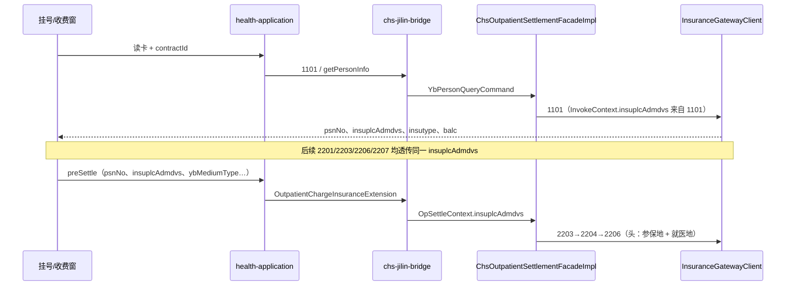

# 异地就医与省市医保双通道 — 说明

> **文档性质**：业务概念 + ZXPlat/CHS 落地说明（非接口逐字段手册）  
> **上游**：[17-Whale医保多方案扩展骨架](./17-Whale医保多方案扩展骨架.md) · [03-门诊医保结算-详细设计](./03-门诊医保结算-详细设计.md) · [1101 人员信息](./apis/1-基础信息/1101-人员信息获取.md)  
> **版本**：v1.0 · **日期**：2026-06-20

---

## 1. 文档目的与术语辨析

本文说明两类在院端高频出现、且容易混用的概念在 **ZXPlat + 吉林省国家平台（CHS）** 中的含义与实现边界。

| 术语 | 本文所指 | **不是** |
|------|----------|----------|
| **异地就医** | 参保人**参保地医保区划**与**定点就医地**不一致时的结算与对账 | 单纯「外地患者来院看病」的行政描述（未走医保时不涉及） |
| **省市医保双通道** | 同一机构同时维护 **省级统筹合同** 与 **市级医保合同** 两条费用性质/对接通道，HIS 按 `fin_contract` 分流 | [boc-pay 正扫/反扫双通道](../zxplat-module-boc-pay/00-功能清单.md)（支付通道类比） |
| **国谈药品双通道** | 国家谈判药「定点医疗机构 + 定点零售药店」购药政策 | 本文 **不展开**；ZXPlat 侧仅体现为目录/处方/结算是否可报，无单独「双通道模块」 |

---

## 2. 异地就医

### 2.1 业务概念

```text
参保地（insuplc_admdvs）     就医地（mdtrtarea_admvs / 定点 adm_vs）
        │                              │
        │    1101 返回 insuinfo         │  chs-contract.adm_vs（如吉林 229900）
        └──────────┬───────────────────┘
                   ▼
            国家/省级平台路由结算
                   ▼
        本地/异地/跨省 清算与对账规则不同
```

- **本地参保、本地就医**：`insuplc_admdvs` 与定点 `adm_vs` 同属省级统筹区（或同城），走常规 3201 日对账、3203A 清算。
- **异地参保、本地就医**（院端最常见）：患者持异地卡/电子凭证在吉林定点结算；报文头 **`insuplc_admdvs` 必须为患者参保地**，而非定点机构区划。
- **分类**（平台字典，见合订本 `PAY_LOC` / 3209A 说明）：

| 类型 | 典型含义 | 院端感知 |
|------|----------|----------|
| 本地 | 同城/同统筹区 | 1101 参保区划 ≈ 定点区划前缀 |
| 省内异地 | 省内跨统筹区 | `insuplc_admdvs` 与 `adm_vs` 同省不同市 |
| 跨省异地 | 省际 | 区划前两位不同；需 **3209A** 等跨省对账 |

### 2.2 平台关键字段

| 字段 | 位置 | 含义 | ZXPlat 来源 |
|------|------|------|------------|
| `insuplc_admdvs` | 报文头 | **参保地**医保区划 | 1101 → 前端/读卡缓存 → `InvokeContext` |
| `mdtrtarea_admvs` | 报文头 | **就医地**区划 | `ContractConfig.admVs`（`chs-contract.properties`） |
| `insuplc_admdvs`（业务） | 2206/2303 等 | 与报文头一致 | `OpSettleContext` / 预结算快照 `yb_clinic_pre_settle.insuplc_admdvs` |
| `out_flag` / `out_setl_flag` | 52xx 查询、3101/3102 | 异地标志 | 平台返回；ZXPlat **未**单独落库 |
| `exp_content.trum_content` | 2206/2207/2401 等 | 异地扩展（外伤等） | **规划** `JilinExtDataBuilder`，首期未统一组装 |
| `exp_content.mdtrt_grp_content` | 同上 | 异地人群类型 | 同上 |
| `hi_feesetl_type` | 350x 进销存 | 0 非医保 / 1 本地 / 2 异地 | [09-进销存](./09-医保进销存-详细设计.md) |

### 2.3 ZXPlat 数据流（读卡 → 结算）



**约定**：

1. **1101 是参保区划真源**；多险种时 UI 须让用户选定一行 `insuinfo`，再进入结算。
2. 预结算/挂号/入院请求中的 `insuplcAdmdvs` 应与 1101 一致；**禁止**写死为定点 `adm_vs`（否则异地人员结算失败或路由错误）。
3. 同一自然日、同一凭证可复用 `yb_person_cache`（见 `ChsOutpatientSettlementFacadeImpl.getPersonInfo`）。

### 2.4 报文头区划规则（已实现）

`InsuplcAdmdvsRule`（`chs-jilin-application`）决定 HTTP 报文头 `insuplc_admdvs`：

| 优先级 | 规则 |
|--------|------|
| 1 | `InvokeContext.insuplcAdmdvs`（读卡/业务透传） |
| 2 | 特定 infno（1101、9001、3203A–3209A、3301/3302）→ 使用定点 **`config.admVs`** |
| 3 | 入参 JSON 中的 `clr_optins` / `setl_optins` / `insuplcAdmdvs` |
| 4 | 回落 `config.admVs` |

```text
多数结算类交易（2203/2204/2206/2207）：优先 Context 中的「参保地」
清算/对账/签到/1101：部分交易强制「就医地」adm_vs
```

代码位置：

```text
zxplat-module-chs-jilin/chs-jilin-application/.../gateway/InsuplcAdmdvsRule.java
zxplat-module-chs-jilin/chs-jilin-application/.../gateway/client/ChsHttpAccessor.java
```

### 2.5 异地扩展报文（待统一）

国家规范要求 **异地就医** 时在 2206/2207/2401 等交易的 `exp_content` 中按需填写：

- `trum_content`（外伤）
- `mdtrt_grp_content`（异地就诊人群）

ZXPlat **首期**走基线报文；异地场景若平台返回字段缺失/审核不通过，需在 **`JilinExtDataBuilder`**（规划，见 [scheme/jilin/README](./scheme/jilin/README.md)）按院方规则补全。**实施前须与吉林 FSI 联调确认必填项。**

### 2.6 对账与清算差异

| 场景 | 交易 | ZXPlat 落点 |
|------|------|------------|
| 本地/省内常规日对账 | 3201 / 3202 | `ChsReconciliationAppService` |
| 省内月清算 | 3203A–3206A | 同上 |
| **跨省异地** 三方对账失败查询 | **3209A** | `ChsReconciliationAppService` / `InsuranceReconciliationAppService` |

3209A 要点（见 [3209A 文档](./apis/32xx/3209A-查询跨省三方对账未成功数据(吉林省).md)）：

- 查询 **跨省异地** 患者在本定点结算、但三方对账未成功的 `setl_id`；
- 输入 `clr_optins` 须为准确 6 位清算机构编码（可由 3206A 获取）；
- **begndate / enddate 须同月**。

运维入口：对账清算 UI「月清算」Tab → 3209A 查询（见 [13-实现状态与文档对照](./13-实现状态与文档对照.md)）。

### 2.7 前端 / 窗口操作要点

| 步骤 | 要求 |
|------|------|
| 读卡 | 必须拿到 `psnNo`、`insuplcAdmdvs`、`insutype`；异地卡与本地卡 **UI 流程相同** |
| 费用性质 | 仍选 **省医保合同**（`PROVINCIAL_INSURANCE`）；异地属性由平台按参保地路由，**不需要**单独「异地合同」 |
| 展示 | 建议展示「参保地 vs 就医地」对比，便于收费员识别跨省（对账异常时排查） |
| 失败 | 平台报「参保地不匹配」「异地未备案」等 → 引导备案查询（5301/5302/2505 等），**勿**静默改自费 |

### 2.8 当前实现状态

| 能力 | 状态 |
|------|------|
| 读卡 1101 + 人员缓存 | ✅ `getPersonInfo` / `yb_person_cache` |
| 结算透传 `insuplcAdmdvs` | ✅ 门诊/住院 Extension → `InvokeContext` |
| `InsuplcAdmdvsRule` | ✅ |
| 3209A 跨省对账查询 | ✅ |
| 异地 `exp_content` 统一组装 | ⏳ 规划 |
| 异地备案/待遇前置校验（2001 等） | ⏳ 按院方选配 |
| UI 异地标识展示 | ⏳ 前端 |

---

## 3. 省市医保双通道

### 3.1 业务含义

部分医疗机构同时对接：

1. **省级统筹**（如吉林省国家平台 `PROVINCIAL_INSURANCE`）
2. **市级补充**（如长春市医保 `MUNICIPAL_INSURANCE`，政策、目录、清算机构可能与省平台不同）

在 ZXPlat 中称为 **「双通道」= 两套 `fin_contract` + 两套账户 + 两套（或共享）网关配置**，而不是两套读卡流程。

```text
                    fin_contract（费用性质）
                              │
         ┌────────────────────┼────────────────────┐
         ▼                    ▼                    ▼
  PROVINCIAL_INSURANCE   MUNICIPAL_INSURANCE   SELF_CHARGE
  bus_no=H22xxxx         bus_no=市平台编码      自费
  scheme=CHS_NATIONAL_JILIN   scheme=CHS_MUNICIPAL   NONE
         │                    │
         ▼                    ▼
  fin_account（就诊下）   fin_account（就诊下）
  contract_no 指向不同行
         │                    │
         └────────┬───────────┘
                  ▼
        chargeItem.account_id 决定走哪条通道
                  ▼
        OutpatientInsuranceChargeGrouper → 对应 contractId 预结算
```

### 3.2 三层标识（与 17 号文档对齐）

| 层 | 枚举/配置 | 作用 |
|----|-----------|------|
| 业务费用性质 | `ContractCategory` | `PROVINCIAL_INSURANCE` / `MUNICIPAL_INSURANCE` / `SELF_CHARGE` … |
| 技术对接方案 | `InsuranceSchemeCode`（规划列 `fin_contract.insurance_scheme_code`） | 路由到吉林插件 / 市级插件 / 工伤插件 |
| 平台连接 | `chs-contract.properties` → `ContractConfig` | `base_url`、`fixmedins_code`、`adm_vs`、密钥 |

默认映射（见 [17-Whale医保多方案扩展骨架 §2.3](./17-Whale医保多方案扩展骨架.md)）：

| ContractCategory | 默认 Scheme | 说明 |
|------------------|-------------|------|
| `PROVINCIAL_INSURANCE` | `CHS_NATIONAL_JILIN` | **首期已落地** |
| `MUNICIPAL_INSURANCE` | `CHS_MUNICIPAL` 或与省同 scheme | 依院方：同 URL 或独立 endpoint |
| `SELF_CHARGE` | `NONE` | 不走医保编排 |

### 3.3 HIS 侧如何「选通道」

**原则：业务 AppService 只认 `contractId` + `accountId`，不写 if-else「省/市」。**

| 环节 | 行为 |
|------|------|
| 挂号/接诊 | 用户选择 **费用性质**（下拉对应 `fin_contract`） |
| 开立医嘱/收费项 | 写入 `chargeItem.account_id`（关联账户的 `contract_no`） |
| 转医保/转自费 | `switchChargeItemAccount` → 切换至对应 `fin_account` |
| 预结算 | `OutpatientInsuranceChargeGrouper`：按 account → contract 是否 `yb_flag` / `PROVINCIAL_INSURANCE` 分组 |
| 平台调用 | `contract.bus_no` → `ContractConfigLoader` → 网关 URL 与 `adm_vs` |

**混合场景**（同一就诊既有省医保项又有市医保项）：与 [03 §14 混合结算](./03-门诊医保结算-详细设计.md) 相同 —— 按 **account（合同）** 再按 **med_type** 分组，每组独立 `chrg_bchno`；**省/市若各用不同 `mdtrt_id` 规则，须按合同分别维护 `yb_encounter_platform_map`（键：`encounter + contract + med_type`）。**

### 3.4 配置示例（双合同）

```properties
# chs-contract.properties — 省统筹
contract.H22010402403.base_url=http://ddjk.jlhs.gov.cn:20215
contract.H22010402403.fixmedins_code=H22010402403
contract.H22010402403.adm_vs=229900

# 市医保（示例：独立 bus_no；若与省同平台可共用 URL，仍建议分 contract 行）
contract.H22010000001.base_url=http://市平台地址
contract.H22010000001.fixmedins_code=H22010000001
contract.H22010000001.adm_vs=220100
```

`fin_contract` 表建议：

| 字段 | 省通道 | 市通道 |
|------|--------|--------|
| `category_enum` | `PROVINCIAL_INSURANCE` | `MUNICIPAL_INSURANCE` |
| `bus_no` | `H22010402403` | `H22010000001` |
| `yb_flag` | true | true |
| `insurance_scheme_code` | `CHS_NATIONAL_JILIN` | `CHS_MUNICIPAL`（待列扩展） |

### 3.5 与「异地就医」的关系

| 维度 | 省市双通道 | 异地就医 |
|------|------------|----------|
| 决定因素 | 院内选的 **费用性质/合同** | 患者 **参保地** vs 就医地 |
| 配置 | 多套 `fin_contract` | 单合同也可结算异地人员 |
| 典型组合 | 本地参保人选「省医保」或「市医保」账户 | 异地参保人在「省医保」合同下读卡，`insuplc_admdvs=外省` |

二者 **正交**：异地患者可以走省通道结算；本地患者也可能因特殊人群走市通道 —— 以院方费别规则为准。

### 3.6 当前实现状态

| 能力 | 状态 |
|------|------|
| `ContractCategory.MUNICIPAL_INSURANCE` 枚举 | ✅ domain-shared |
| `InsuranceSchemeCode` / 多 scheme 骨架 | ✅ 文档与枚举（[17](./17-Whale医保多方案扩展骨架.md)） |
| 省医保结算全链路 | ✅ `chs-jilin-*` |
| `OutpatientInsuranceSettlementPort.isInsuranceContract` | ✅ 识别 `yb_flag` **或** `PROVINCIAL_INSURANCE` |
| 市医保 **独立** Extension / `CHS_MUNICIPAL` 插件 | ⏳ 需院方接口差异评估后增模块 |
| 就诊下 **多医保默认账户**（省+市各一个 default） | ⏳ 开户策略待产品定稿 |
| Grouper 同时识别 `MUNICIPAL_INSURANCE` | ⏳ 建议与省医保同等纳入 `isInsuranceContract` |

**首期建议**：若市平台与国家平台 **URL/报文一致**，可仅增 `fin_contract` + `MUNICIPAL_INSURANCE` 行，共用 `chs-jilin-bridge`，通过不同 `bus_no`/`adm_vs` 区分；若接口子集不同，再拆 `scheme/municipal` 模块。

---

## 4. 端到端场景对照

### 4.1 本地参保 + 省医保通道（最常见）

```text
1101 → insuplc=229900…（吉林参保）
2201(11) → 2203→2206→2207
3201 日对账 → 3203A 清算（clr_optins 省内）
```

### 4.2 跨省异地 + 省医保通道

```text
1101 → insuplc=11xxxx（外省参保）
结算链路与 4.1 相同（insuplc 透传）
对账：关注 3209A 未成功清单；exp_content 可能需补
```

### 4.3 本地参保 + 市医保通道（双通道）

```text
费用性质选市合同 → account.contract_no=市 bus_no
1101 仍获取参保信息；scheme 路由市 ContractConfig
若市平台独立：adm_vs=220100 等
```

### 4.4 省+市混合收费（同一就诊）

```text
chargeItem A → 省医保 account → preSettle 批次 1（contractId=省）
chargeItem B → 市医保 account → preSettle 批次 2（contractId=市）
confirm：各批次 2207 后一次本地落账（与慢病混合场景同构）
```

---

## 5. 联调与验收清单

### 5.1 异地就医

- [ ] 1101 返回外省 `insuplc_admdvs`，2206 试算成功
- [ ] 报文头 `insuplc_admdvs` ≠ 定点 `adm_vs` 时仍成功
- [ ] 跨省结算后 3209A 能查到或确认无未对账记录
- [ ] 进销存上传 `hi_feesetl_type=2`（若院方要求）

### 5.2 省市双通道

- [ ] `fin_contract` 配置省、市两行，下拉均可选
- [ ] 同一就诊开立两个医保账户，chargeItem 分挂不同 account
- [ ] 分别预结算/结算，网关 `contractBusNo` 与合同一致
- [ ] 对账/清算按 **各 bus_no** 独立跑 3201/3203A

---

## 6. 相关文档

| 文档 | 内容 |
|------|------|
| [17-Whale医保多方案扩展骨架](./17-Whale医保多方案扩展骨架.md) | ContractCategory / InsuranceSchemeCode |
| [20-场景-慢病多科室混合结算](./20-场景-慢病多科室混合结算-数据时序.md) | med_type 多批次（与双合同正交） |
| [3209A](./apis/32xx/3209A-查询跨省三方对账未成功数据(吉林省).md) | 跨省对账 |
| [1101](./apis/1-基础信息/1101-人员信息获取.md) | 参保地真源 |
| [scheme/jilin/README](./scheme/jilin/README.md) | 吉林本地化与 extData |
| 合订本字典 `PAY_LOC`、`out_flag` | [参考规范](./参考/医疗保障信息平台定点基线版医药机构接口规范-AI.md) |

---

## 7. 修订记录

| 版本 | 日期 | 说明 |
|------|------|------|
| v1.0 | 2026-06-20 | 首版：异地就医 + 省市医保双通道概念与 ZXPlat 落点 |
