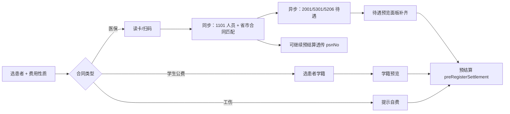

# 挂号页「待遇确认」— 设计说明

> **文档性质**：产品交互 + 后端/前端落点  
> **关联**：[1101 人员信息](./apis/1-基础信息/1101-人员信息获取.md) · [2001 待遇检查](./apis/20xx/2001-人员待遇享受检查.md) · [21-异地就医与省市医保双通道](./21-异地就医与省市医保双通道说明.md) · [13-实现状态与文档对照](./13-实现状态与文档对照.md)  
> **版本**：v2.1 · **日期**：2026-07-17

---

## 1. 结论

**挂号页「待遇确认」已落地 MVP**（读卡/扫码 → **同步** 1101 人员 + 省市合同匹配 → **异步** 2001/5301/5206 待遇补齐 → 预结算透传 `psnNo`/`insuplc`/`insutype`）。与 ZXPlat v3 分层一致：

| 费用性质 | 读卡/识别 | 确认内容 | 后端能力 |
|----------|-----------|----------|----------|
| **省/市医保** | 读卡终端 / 医保码 → **1101**（同步）+ **2001**/5301/5206（异步） | 参保信息、险种、余额、待遇检查、慢病摘要、异地提示 | ✅ |
| **学生公费** | 选患者 → **院内学籍** | 学号、院系、公费资格 | ✅ |
| **工伤** | — | 提示 9102 + 挂号费自费 | ✅ 提示态 |

收款员在 **预结算/2201 之前** 完成读卡；人员与省市推荐先出，待遇明细后台补齐后再核对亦可进入 `preRegisterSettlement`。

---

## 2. 落地对照（v2.0）

### 2.1 已实现

| 能力 | 位置 |
|------|------|
| 1101 读卡 API | `POST /api/app/insurancePerson/getPersonInfo` → `foundation.person.InsurancePersonAppService` |
| 1101 出站 + 当日缓存 | `bridge/benefit/Op1101Invoker` · `yb_person_cache` |
| 1101 结构化 `insuinfoList` | `YbPersonInfoResult` / `Op1101ResultMapper` |
| 挂号待遇预览 API | `POST /api/app/outpatientRegistration/loadRegisterBenefitPreview` |
| 2001 / 5301 / 5206 链 | `InsuranceRegisterBenefitQueryExtensionImpl` → `Op2001Invoker`、`Med5301Invoker`、`Med5206Invoker` |
| 学生公费预览 | `PatientQueryService.loadPatientStudentProfile` + `checkStudentPublicExpenseEligibility` |
| 挂号 UI 读卡 + 待遇面板 | `openhis-pro-ui/.../register/` · `useRegisterBenefit` · `register-benefit-preview-panel.vue` |
| 预结算透传读卡字段 | `PreRegisterSettlementRequest`（`psnNo`、`insuplcAdmdvs`、`ybMediumType`…） |
| 住院登记复用 | `inpatient/charge/register/index.vue` 复用 `requiresInsuranceBenefitFlow` |

### 2.2 未实现 / 可选增强

| 项 | 说明 | 优先级 |
|----|------|--------|
| `confirmRegisterBenefit` + `confirmToken` | 设计稿中的显式「确认并继续」与服务端门控；当前以 **预览成功 + 前端透传 psnNo** 代替 | 低 |
| `preRegisterSettlement` 校验 `confirmToken` | 缺 token 抛 `REG-VAL-003`；当前服务端未强制 | 低 |
| 独立 `InsuranceTreatmentAppService` | 2001 已走 Extension，**不需要**独立 `/insuranceTreatment/*` 页 | — |

---

## 3. 交互设计（IF-REG 增强）

### 3.1 流程（当前实现）



### 3.2 挂号页行为

| 动作 | 实现 |
|------|------|
| 读卡/扫码 | `register-left-panel` → `useRegisterBenefit.syncInsuranceBenefit` |
| **同步阶段** | `loadRegisterBenefitPreview`（`runTreatment*=false`）→ 人员信息 + `contractMatch`（省/市推荐）立即回填 |
| **异步阶段** | 同 API 以 `psnNo+insutype` 再拉 2001/5301/5206，合并进预览面板（`treatmentSyncing`） |
| 待遇预览 | 表单区 `RegisterBenefitPreviewPanel`（人员先出，待遇明细后补） |
| 险种切换 | 面板内 chip → `refreshTreatmentCheck` 仅重拉 2001 |
| 学生公费 | `syncStudentBenefit` → 学籍 + eligibility |
| 预结算 | `register-left-panel.handleSubmit` 透传 `lastYbPreview` 字段 |

### 3.3 医保预览展示项

与 v1.0 §3.3 一致，数据源为 `YbRegisterBenefitPreviewDto`（含 `insuinfoList`、`treatmentLines`、`opspFilingList`、`cumulativeLines`、`areaHint`）。

---

## 4. 后端 API

### 4.1 已落地

```text
POST /api/app/outpatientRegistration/loadRegisterBenefitPreview
```

**Request（医保）**：`contractId`、`ybMediumType`、`ybCardInfo`、`psnNo`（可选）、`insutype`、`medType`（默认 11）、`runTreatmentCheck`、`runOpspFilingQuery`、`runCumulativeQuery`

读卡首包：前端显式传 `run*=false`，仅 1101 + `contractMatch`；待遇包：传 `psnNo`/`insutype` 且 `run*=true`。

**Response**：`benefitKind` + `ybPreview` / `studentPreview` / `studentEligibility` + `contractMatch`

**CHS 侧**：1101 经 `InsurancePersonAppService` 或 Extension；2001/5301/5206 经 `InsuranceRegisterBenefitQueryExtensionImpl`（`module-chs-jilin-bridge`）。

### 4.2 可选（未落地）

```text
POST /api/app/outpatientRegistration/confirmRegisterBenefit   # confirmToken 写入
```

`preRegisterSettlement` 增强：医保/公费合同且 token 缺失 → `REG-VAL-003 请先完成待遇确认`。

---

## 5. 前端落点

| 文件 | 职责 |
|------|------|
| `register-left-panel.vue` | 读卡、同步预览、预结算提交 |
| `register-form-area.vue` | 待遇信息展示区 |
| `register-benefit-preview-panel.vue` | 1101/2001/5301 明细；`externalTreatmentLoading` 异步态 |
| `use-register-benefit.ts` | 两段式：`syncInsuranceBenefit` + `scheduleTreatmentLoad` |
| `register-benefit.service.ts` | API + 展示 DTO 转换 |

---

## 6. 与结算链关系

```text
读卡同步（1101 + 省市匹配）→ 可立即透传 psnNo / insuplc / insutype
待遇异步（2001/5301/5206）→ 面板补齐，不阻塞人员回填
    ↓
preRegisterSettlement
    ↓ runInsuranceRegistrationIfNeeded → 2201(11)
payRegisterFee
    ↓ 2207（若医保挂号费）
```

**1101 与 2201 不重复**：1101 为确认视图；2201 为平台就诊登记。

---

## 7. 修订记录

| 版本 | 日期 | 说明 |
|------|------|------|
| v2.1 | 2026-07-17 | 读卡两段式：同步人员+省市匹配，异步待遇（2001/5301/5206） |
| v2.0 | 2026-07-11 | 对齐代码真源：MVP 已落地；`confirmToken` 降为可选；更新 API/包路径 |
| v1.0 | 2026-06-20 | 首版：可行性 + API/交互草案（待实施） |
