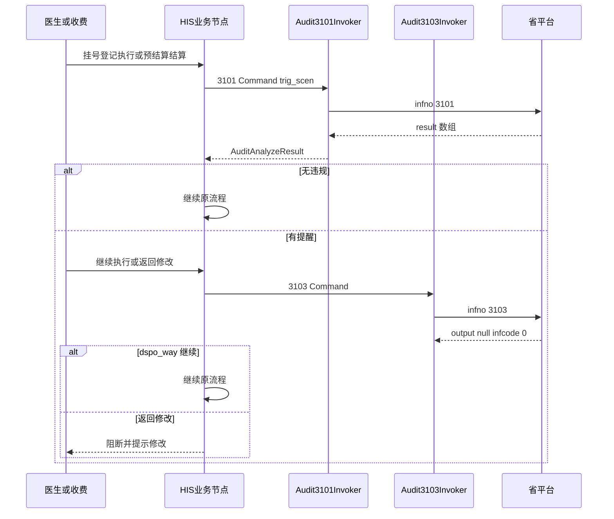

# 明细审核（31xx）— 详细设计

> **文档性质**：LLD（吉林事前提醒：3101 + 3103 平台出站 + 后续挂接规划）  
> **实现状态**：**W1+W2+W2.1+W3 已交付**（试调 / 主路径挂接 / 医护预结算 / 统计研讨页）— 进度以 [13-实现状态与文档对照.md](./13-实现状态与文档对照.md) 为准  
> **架构真源**：[17-zxplat-module-chs-jilin-架构-v3.md](./17-zxplat-module-chs-jilin-架构-v3.md)  
> **国家接口规范**：[`apis/31xx/`](./apis/31xx/) · **联调**：[附件：全省事前联调方案1.5.md](./运维/医保文件/附件：全省事前联调方案1.5.md) · **样例**：[samples-31xx-joint/](./运维/医保文件/samples-31xx-joint/)  
> **版本**：v0.10（自费明细跳过 3101）| **日期**：2026-10-10 · **UI/性能**：§2.5、§2.6；套餐展开与 2204/2301 同源；§2.6.4 P0 已落地；§2.6.5 自费过滤

---

## 0. 评审要点（请先看）

> **已拍板（对话）**：成码范围 **W1 + W2 + W3 全做**（2026-07-23）。实施顺序仍建议 W1→W2→W3，不并行糊成一团。

| # | 待裁决项 | 本文默认（已按联调 1.5 收敛） | 影响 | 状态 |
|---|----------|------------------------------|------|------|
| R0 | 做几个 Wave | **W1+W2+W3 全做** | 含平台出站、业务挂接+嵌入 UI、运维试调页 | **已定** |
| R1 | 实施顺序 | **严格 W1→W2→W3**；每 Wave 可独立联调/验收 | 避免未出站先堆 UI | **已定** |
| **R2** | 实现哪些 infno | **仅 3101 + 3103**；**不做 3102** | 吉林联调 v1.2 | **已定** |
| R3 | 域包与类前缀 | 新建 `audit` 域；前缀 **`Audit`** | 避免与 `MedType` 3101/3102 混淆 | **已定** |
| R4 | W1 是否落库 | **落库（选项 B）**：W1 建表持久化违规头/明细与 3103 反馈 | 需 Flyway + Entity + JPA 扫描 | **已定** |
| R4b | 落库粒度 | **仅结构化字段（选项 A）**；完整报文靠 `yb_invoke_log` | 不落 request/output JSON 到业务表 | **已定** |
| R5 | HIS 组装来源 | **W1 即从就诊自动组装**（`AuditFeeSnapshot`） | Snapshot 进 W1 | **已定** |
| R5b | W1 自动组装入口 | **选项 C：W1 含运维试调页**（从就诊拉取 + 调 3101/3103）；嵌入对话框仍属 W2 | 原 W3 试调页并入 W1 | **已定** |
| R6 | UI 形态 | **三套**：W1 试调页；W2 嵌入对话框；**W3 统计研讨页** | §2.5 | **已定** |
| R6b | 统计页归属 Wave | **W3（选项 A）** | 依赖 W1 落库有数 | **已定** |
| **R7** | `warn_rslt_id` 填谁 | **按 `jrd_id`（选项 B）**；与国家「jr_id」文案冲突，以吉林联调样例批注为准 | 3103 Assembler / 对话框批量策略 | **已定** |
| **R8** | 与费用上传重叠 | 报文不重叠、组装源重叠；**W1 起共享 Snapshot**，禁止平行二次扫库 | 见 §2.6 | **已定** |

> **§0 与补充题 Q9–Q12 已全部敲定。** 文头已改为「待编码」；可开 **W1**。

---

## 1. 背景与目标

### 1.1 业务背景

吉林省要求定点机构接入 **事前提醒**：在挂号/登记/执行医嘱/预结算/结算/购药等节点调用 **3101**，将人员与就诊明细提交规则引擎；若有提醒，经人工选择后调用 **3103** 反馈「继续执行」或「返回修改」。

| infno | 名称（联调口径） | 吉林要求 | 说明 |
|-------|------------------|----------|------|
| **3101** | 明细审核事前提醒分析服务 | **必须实现** | 事前 +（原事中）统一入口；用 `trig_scen` 区分场景 |
| **3102** | 明细审核事中分析服务 | **不作废改造 / 不实现** | 联调方案 v1.2（2024-12-20）：作废并入 3101 |
| **3103** | 事前提醒服务反馈服务 | **必须实现** | 采集处置方式；`output` 为 null |

住院结算详细设计曾将 3101 列为后续能力，见 [04-住院医保结算-详细设计.md](./04-住院医保结算-详细设计.md)。本 LLD 以 **联调方案 1.5** 为吉林落地权威。

### 1.2 设计原则

| 原则 | 说明 |
|------|------|
| **吉林必改清单优先** | 成码范围 = 联调表1（3101、3103），不以国家合订本「有 3102」为由扩 scope |
| **Gateway-Only Remote** | 仅 `InsuranceGatewayClient` 出站 |
| **强类型 scheme** | 禁止 Assembler 内 `new JSONObject()`；`@JSONField(name=snake_case)` |
| **一 infno 一 Invoker** | `Audit3101Invoker`、`Audit3103Invoker`（无 3102） |
| **domain access 端口** | 禁止 application/Extension import `gateway.*` |
| **发送形态规范化** | `patient_dtos` / `fsi_encounter_dtos` / 诊断与医嘱 **一律 JSON 数组**（联调脏样例中的单对象不作为发送形态） |
| **不与 MedType 混淆** | `MedType` 的 `3101`/`3102` 是医疗类别码，不是交易号 |

### 1.3 Wave 划分

| Wave | 目标 | 交付物 | 非目标 |
|------|------|--------|--------|
| **W1** | 出站 + 就诊组装 + 落库 + **试调页** | scheme、Invoker、Snapshot、`yb_detail_audit_*`、AppService、`/chs/detail-audit-try`、AS/SDD（试调） | 收费主路径嵌入对话框、全量 Extension 挂接、**3102** |
| **W2** | 业务挂接 + 嵌入对话框；**住院医/护站完整预结算（3101→2303）** | 挂接 2/7/9 ✅；医护预结算入口 ✅（W2.1） | — |
| **W3** | **违规统计研讨页** + 收尾 | 按医生/时间等查询 `yb_detail_audit_*` ✅；导出（可选未做） | 不重复试调页 |

> **产品裁决**：试调页 **W1**（R5b=C）；嵌入对话框 **W2**；**新增统计研讨页默认 W3**（待 R6b 确认）。

```text
W1:  试调页 ──► Snapshot ──► 3101/3103 ──► 落库
W2:  主路径 ──►【嵌入对话框】──► 3103
W3:  统计研讨页 ──► 查 yb_detail_audit_*（医生/时间等）
```

> **产品裁决**：组装不放到 W2 才做；**W1 就必须能从就诊自动拼 3101 树**（与 2204/2301 同源 Context，§2.6）。
---

## 2. 接口全景

> 国家字段全表：`apis/31xx/`。吉林改造清单与触发场景：联调方案 §一 / §二。

### 2.1 【3101】明细审核事前提醒分析

| 项 | 内容 |
|----|------|
| 输入根 | `input.data` |
| 必填摘要 | `syscode`、`patient_dtos`；**优先 `trig_scen`**（与 `rule_ids` 二选一） |
| 嵌套 | patient → encounter → diagnose / order /（手术）；`fsi_his_data_dto` 可 `{}` |
| 输出 | `output.result`：**JSON 数组**（联调样例确认；多条违规） |
| 违规明细 | 每条 `judge_result_detail_dtos[]` |
| 关键回传 | 违规头 `jr_id`；明细 `jrd_id` → **3103 用 `jrd_id`**（R7=B） |

### 2.2 触发场景 `trig_scen`（联调表2 · 成码常量）

| 编码 | 名称 | 建议 W2 挂接点（产品可裁剪） |
|------|------|------------------------------|
| **1** | 门诊挂号 | 后挂 |
| **2** | 门诊收费登记 | **门诊医生站**：处方/处置**签名发送后** |
| **3** | 住院登记 | 后挂 |
| **4** | 住院收费登记 | **不挂医嘱提交**（无费用明细） |
| **5** | 住院执行医嘱 | 后挂；W2 首批不靠执行节点审 |
| **6** | 门诊结算 | 后挂 |
| **7** | 门诊预结算 | **门诊收费处**预结算前 |
| **8** | 住院结算 | 后挂 |
| **9** | 住院预结算 | **住院医生站 / 护士站（新增预结算）/ 收费处** 预结算时 |
| **10** | 购药划卡 | 后挂 |

**W2 首批挂接（已定部分）**

```text
门诊医生站  处方/处置签名发送后  → 3101(trig_scen=2) → 嵌入对话框
门诊收费处  预结算前            → 3101(trig_scen=7) → 嵌入对话框
住院医生站  【新增】完整预结算 → 3101(9) → 对话框 → 2303 展示金额
住院护士站  【新增】完整预结算 → 3101(9) → 对话框 → 2303 展示金额
住院收费处  预结算前            → 3101(9) → 对话框 → 2303
```

> **产品裁决（Q9b / Q10=A）**：医护站预结算 = **完整链**（3101 + 通过后 2303），不是仅审核预览。不做住院医嘱提交→4。

常量类：`ChsDetailAuditConstants.TrigScen`（String code `"1"`…`"10"`）。

### 2.3 【3103】事前提醒服务反馈

| 字段 | 必填 | 说明 |
|------|------|------|
| `warn_type` | Y | `1` 事前 / `2` 事中（联调样例出现 `"2"`；W2 按场景语义赋值，不由 Invoker 猜测） |
| `warns[]` | Y | 处理数据集合 |
| `warns[].warn_rslt_id` | Y | **填明细 `jrd_id`**（产品 R7=B；国家文案写 jr_id，吉林样例批注为准） |
| `warns[].dspo_way` | Y | `1` 继续执行；`2` 返回修改 |
| `warns[].dspo_way_rea` | 条件 | **`dspo_way=1` 时必填**（国家规范 20250630） |
| 输出 | — | 联调样例：`output: null`，成功看 `infcode=0` |

### 2.4 接入时序（联调 §三）



### 2.5 UI 元素与交互（产品契约）

> **定位**：主业务用 **阻断式对话框**（W2）；另有 W1 试调页、W3 统计页。

#### 2.5.1 出现时机

| `trig_scen` | 宿主页面/动作（HIS） | 弹窗时机 |
|-------------|----------------------|----------|
| **2** | **门诊医生站** · 处方/处置签名发送 | 签名发送成功后；**医生可见** |
| **7** | **门诊收费** · 预结算 | **2206 前** |
| **9** | **住院医生站 / 护士站 / 收费处** · **完整预结算** | 先 3101(9)；通过后 **2303** 展示金额；医护站 **新增预结算入口** |
| 1 / 3 / 4 / 5 / 6 / 8 / 10 | 后挂 | 见 §2.2 |

**无违规**（`result` 空）：不弹窗，静默继续。  
**全自费跳过**（`skipped=true`）：不弹窗，静默继续（与无违规同 UX；见 §2.6.5）。  
**有违规**：必须弹窗提示；完成 3103 前不得继续预结算/结算资金链；医生站签名发送（trig=2）则不得视为签名完成。

#### 2.5.2 对话框结构（主 UI）

```text
┌─ 医保事前提醒 ─────────────────────────────────────┐
│ 标题：发现 N 条规则提醒 · 就诊号 {mdtrtId}          │
│ 副文：请处理后再继续。严重程度见列表。              │
│                                                     │
│ ┌ 违规列表（主表）─────────────────────────────┐   │
│ │ 严重程度 | 规则名称 | 违规内容 | 违规金额 | … │   │
│ └───────────────────────────────────────────────┘   │
│                                                     │
│ ┌ 选中行 · 违规明细（子表）────────────────────┐   │
│ │ 明细类型 | 处方/医嘱ID | 金额 | …            │   │
│ └───────────────────────────────────────────────┘   │
│                                                     │
│ 处理方式 ○ 继续执行医嘱/业务  ○ 返回修改           │
│ 处理原因 [________________________]  （继续时必填） │
│                                                     │
│              [ 取消/关闭 ]    [ 确认并继续 ]         │
└─────────────────────────────────────────────────────┘
```

#### 2.5.3 元素清单与数据绑定

| 元素 ID | 控件 | 绑定字段 | 行为 |
|---------|------|----------|------|
| `dlg.title` | 对话框标题 | 固定文案 + `violations.length` | — |
| `tbl.violation` | 主表 | `jrId`, `sevDeg`(字典色), `ruleName`, `volaCont`, `volaAmt`, `volaBhvrType`, `ruleId` | 单选行驱动子表；默认选中第一条 |
| `tag.sevDeg` | 严重程度标签 | `sevDeg` | 字典 `RULE_SEV_DEG`；高严重度用警示色 |
| `tbl.detail` | 子表 | `jrdId`, `volaItemType`, `rxId`, `volaAmt`, `mdtrtId` | 随主表选中行刷新 |
| `lnk.rx` | 可选链接 | `rxId` | 能跳转则打开医嘱/费用行；不能则纯展示 |
| `radio.dspoWay` | 单选 | `dspo_way`：`1` 继续 / `2` 返回修改 | 默认 **返回修改**（保守） |
| `txt.dspoWayRea` | 多行文本 | `dspo_way_rea` | `dspo_way=1` 时必填校验；`=2` 时可空 |
| `btn.confirm` | 主按钮 | — | 校验 → 调 **3103**（可批量：每条违规一条 warn，或整单一次，见下）→ 成功后关窗 |
| `btn.cancel` | 次按钮 | — | 等同「返回修改」且 **不调 3103**？→ **禁止**；取消须仍调 3103 `dspo_way=2` 或保持阻断不关窗（产品默认：**关闭=返回修改并调 3103**） |

**3103 批量策略（默认）**：对当前弹窗内全部违规的 **每条 `jrd_id`**（无明细则回退该条 `jr_id`）生成 `warns[]`，共用同一 `dspo_way` / `dspo_way_rea`。

**前端状态机**：

```text
业务动作
  → loading「事前提醒校验中」
  → 3101
  → 无违规 → 继续原动作
  → 有违规 → 打开对话框（业务事务挂起）
       → 确认继续 → 3103(dspo=1) → 恢复原动作
       → 返回修改 → 3103(dspo=2) → 中止原动作，停留当前页
       → 3101/3103 平台失败 → Toast + 保持阻断（不可静默跳过）
```

#### 2.5.4 可选：运维试调页（W3）

| 区域 | 元素 | 说明 |
|------|------|------|
| 查询区 | 契约、`trig_scen` 下拉、就诊号/人员号 | 手工触发 3101 |
| 编辑区 | JSON/表单切换 | 高级：贴入联调样例；普通：从就诊拉 Snapshot |
| 结果区 | 同 §2.5.2 主/子表 | 只读展示 |
| 操作 | 「发送 3101」「模拟反馈 3103」 | 不进入收费资金链 |

路由：`/chs/detail-audit-try`（菜单：医保办 · 事前提醒试调）。**归属 W1**（R5b=C）；正式收费主路径仍以 §2.5.2 嵌入对话框为准（W2）。

#### 2.5.5 违规统计研讨页（院方研讨 · **W3**）

> 需求（2026-07-23）：按 **医生、时间** 等条件拉取违规明细，供医保办/临床质控研讨；**只读**，不调 3101/3103。

| 区域 | 元素（草案） | 说明 |
|------|--------------|------|
| 筛选区 | 日期范围、开单/责任医生、科室、`trig_scen`、严重程度、`dspo_way`、关键字（规则名/违规内容） | 医生维度对齐落库的 `drord_dr_*` / 操作人（表结构需带医生字段，见下） |
| 汇总条 | 违规条数、涉及就诊数、涉及医生数、总违规金额 | 可选 |
| 主表 | 时间、医生、科室、就诊、规则名称、严重程度、违规内容、金额、触发场景、反馈方式 | 来自 `yb_detail_audit_hit` + feedback |
| 明细抽屉 | `hit_line` 处方/项目行 | 行点击展开 |
| 导出 | Excel（可选） | 研讨材料 |

**落库补强（相对 §3.4）**：统计页要按医生筛，W1 表需冗余 `dr_codg`/`dr_name`（及可选 `dept_codg`），从 Snapshot/医嘱行回填；否则只能按操作人凑合。

路由建议：`/chs/detail-audit-stats`（菜单：医保办 · 事前提醒统计）。

#### 2.5.6 非目标 UI

- 不在医生站首页做常驻「提醒铃铛」列表（W2 不做异步堆积）
- 不把 3101 结果写入独立待办中心（除非院点另提需求）
- 不与 feeAi 两库规则弹窗混用同一组件（可共享视觉规范，数据源分离）

---

### 2.6 与费用上传的参数重叠与性能设计

#### 2.6.1 结论（先看）

| 问题 | 答案 |
|------|------|
| 是否和 2204/2301 **报文高度重叠**？ | **否。** 2204/2301 只有扁平 `feedetail[]`；3101 是 **patient → encounter → diagnose/order** 树。 |
| 是否和费用上传 **组装源高度重叠**？ | **是（费用行语义层）。** 目录码、数量单价金额、开单科室医师、`mdtrt_id`/`psn_no`、主诊等与 `OpSettleChargeLine` / `IpSettleChargeLine` / ContextLoader **同源**；诊疗套餐在 ContextLoader 已展开为子项逻辑行后，3101 Snapshot 亦消费展开后的 `chargeLines`（与 2204/2301 一致）。 |
| 性能风险 | 若 3101 再独立扫一遍 ChargeItem + 目录 + 医师，在预结算路径上会对 **同一就诊重复 I/O**，且报文更大、平台 RT 更高。 |

#### 2.6.2 字段重叠矩阵

**A. 可从费用上传组装源直接/轻映射（推荐共享 Snapshot）**

| 3101 字段 | 2204/2301 / Context 源 | 备注 |
|-----------|------------------------|------|
| `mdtrt_id` / `curr_mdtrt_id` | Context.`mdtrtId` | |
| `patn_id` | 常用 `psn_no` | 与联调样例业务 ID 约定需统一 |
| `hilist_code` | `med_list_codg` | |
| `hosplist_code` | `medins_list_codg` | |
| `cnt` / `pric` / `sumamt` | `cnt` / `pric` / `det_item_fee_sumamt` | |
| `drord_dept_*` / `drord_dr_*` | `bilg_dept_*` / `bilg_dr_*` | |
| `rxno` / `rx_id` | 门 `rxno`；住 `drord_no`；可用 `feedetl_sn` 作 `rx_id` | 场景约定写入 Snapshot |
| `med_type` / `insutype` / `medfee_sumamt` | Context | |
| `dscg_main_dise_*` | Context 主诊 | |
| `adm/dscg_dept_*` / `dr_codg` | Context | |
| `medins_id/name` | `ContractConfig.fixmedins_*` | |
| 诊断集合 | **2203/2401 同源**诊断行 | 不在 feedetail 内 |

**B. 费用报文没有、须另取或扩展 Snapshot**

| 3101 字段 | 取数建议 |
|-----------|----------|
| `trig_scen` / `syscode` / `task_id` | 场景入参 + 配置 |
| `gend` / `brdy` | Encounter 患者上下文（已有 birthDate/gender，须写入 Snapshot） |
| `medins_type` / `medins_lv` | 契约扩展配置或机构主数据缓存 |
| `med_mdtrt_type` / `matn_stas` / `reim_flag` / `out_setl_flag` | 结算上下文补齐；缺省按字典安全默认 |
| `hilist_type` / `hilist_dosform` / `spec` / `spec_unt` / `hilist_name` | 目录/Definition 一次加载进 Snapshot |
| `hilist_lv` / `chrg_type` | 优先：若本就诊已 2204/2301 成功，从 `yb_*_fee_upload` 分割结果回填；否则目录估填 |
| `drord_dr_profttl` | Practitioner 扩展字段；缺省字典默认值 |
| `long_drord_flag` / `drord_bhvr` / `curr_drord_flag` | 医嘱属性；无则 `"0"` / `"1"` 等联调常用默认 |
| 支付拆分 `ownpay_amt` 等 | 预结算前可空/0；预结算后可从预结算结果填 |
| `fsi_operation_dtos` | 手术源；无则 `[]` |
| `fsi_his_data_dto` | 固定 `{}`（W1/W2） |

#### 2.6.3 共享组装架构（性能核心 · **W1 起落地**）

> 产品裁决：W1 即从就诊自动组装，**不**再采用「W1 仅手工 Command」。

```text
                    ┌─ Op2204InputAssembler ──► 2204 feedetail
ContextLoader ──► AuditFeeSnapshot ─┼─ Ip2301 assembler ──► 2301 feedetail
（一次读 HIS）                       └─ Audit3101SnapshotAssembler ──► 3101 树
```

| 组件 | 职责 |
|------|------|
| `AuditFeeSnapshot`（domain 中性模型） | 一次装载：患者、就诊、诊断、费用行、机构、医师补全字段 |
| 现有 `ChsOutpatientInsuranceContextLoader` / `ChsInpatientInsuranceContextLoader` | **扩展**写出 Snapshot（或 Snapshot 由 Loader 结果投影），禁止 3101 再开平行 Loader |
| `Audit3101SnapshotAssembler` | Snapshot → `AuditAnalyze3101Command` / scheme Input |
| 2204/2301 Assembler | 继续只投影 `ChsFeeDetailLine`（可改为「从同一 Snapshot 投影」，减少双轨） |

**同请求内复用**：门诊预结算链若顺序为「3101(trig=7) → 2203 → 2204 → 2206」，则 **同一次 Orchestrator 调用** 只建一份 Snapshot，三处 Assembler 共用。

#### 2.6.4 性能优化设计（可落地）

| 级别 | 手段 | 说明 | 落地状态 |
|------|------|------|----------|
| **P0 同请求去重** | 请求级 Snapshot（Orchestrator 局部变量 / 短生命周期对象） | 消除「提醒 + 费用上传」双倍 ChargeItem 查询 | 部分：Gate settle 路径收费项与 enrich 复用；跨 HTTP Gate→预结算仍各自装载 |
| **P0 批量 I/O** | Snapshot 构建时 `findAllById` 目录/医师/科室 | 禁止按费用行 N+1 | **已落地（2026-08）**：局文 overlay `mapOverlaysByHilistCodes`；套餐 `listChildrenByActivityIds` + SALE 批价；门诊 ELEP hi_rxno 按处方号请求级缓存 |
| **P1 增量订单** | `trig_scen=5`（执行医嘱）只传 **本批新执行** 医嘱 + 必要就诊头/诊断 | 避免全住院历史医嘱撑爆报文 | 未做 |
| **P1 上传后回填** | `trig_scen=2/4` 若选「上传后提醒」 | 用 `yb_*_fee_upload` 已落库的 `chrgitm_lv`/`med_chrgitm_type` 填 `hilist_lv`/`chrg_type`，少打目录 | 未做 |
| **P1 短路** | 配置 `zxplat.chs.audit.enabled-scen` | 院点可关闭低频场景（如仅开 7/9 预结算） | 未做（属产品开关，非纯性能） |
| **P2 结果短缓存** | 键：`tenant+mdtrtId+trigScen+feeFingerprint`；TTL 30–120s | 同一预结算按钮连点不重复打 3101；**费用行变更则指纹变、缓存失效** | 未做 |
| **P2 异步预热（可选）** | 划价完成后后台预组 Snapshot（不调 3101） | 降低点击预结算时的组装毛刺；注意数据新鲜度 | 未做 |
| **P2 报文瘦身** | 不传空可选节点；`fsi_his_data_dto` 不传或 `{}`；手术空则 `[]` | 降低序列化与平台解析成本 | 未做 |
| **P2 可观测** | Gate 分段日志 `enrichMs` / `mdtrtMs` / `platform3101Ms` / `totalMs` | 区分本地组装与平台 RT | **已落地**：`DetailAuditGateInvokerImpl` info 日志 |
| **P3 熔断** | 3101/3103 **平台失败一律阻断**（产品 Q11=A）；Toast + 可重试；**不做** degrade 继续 | 防静默跳过审核 | 保持 |

**正确性硬约束（性能优化不得破坏）**：上传/审核行集合、金额、yb_no、overlay 门禁结论、rxno、mdtrt 语义与优化前一致；仅批量化读库与请求内缓存，不改断言规则与报文字段。  
**自费剔除后**：审核行集合 = 医保账户子集（与 2204 可上传集合对齐），见 §2.6.5——不属于「静默跳过审核」的 P3 熔断例外。

**复核补丁（2026-08-03）**：`mapOverlaysByHilistCodes` 在 `listType=null` 时曾误用「首行 listType」再 `pickBest`，与单条 `getOverlay` 不一致，可能导致门禁命中不同 overlay。已改为与 `getOverlay` 同口径（listType 原样传入）；单测 `CatalogNoticeOverlayRulesPickTest` 锁定契约优先语义。

#### 2.6.5 自费明细不进 3101（与 2204 同口径）

| 项 | 口径 |
|----|------|
| **识别** | `ChargeItem.accountId` → Account → Contract：非医保契约（含个人现金）= 自费；缺账户回落就诊默认自费户；代煎行强制自费（与 `OutpatientInsuranceChargeGrouper` 一致） |
| **场景** | 收费台「转自费」、医生站选自费合同开立、代煎挂个人现金户等——**改挂账后不再对自费行做事前/事中判定** |
| **混合批** | 仅医保账户行进入 Snapshot / 3101；自费行剔除 |
| **全自费** | `DetailAuditGateResult.skipped=true`，`skipReason=ChsDetailAuditConstants.SKIP_REASON_ALL_SELF_PAY`，**不出站**；前端 `gateHasViolations` 视为无违规 |
| **落点** | `DetailAuditGateInvokerImpl`（enrich 前）；`OutpatientInsuranceChargeGrouper#listInsuranceChargeItemIds` |
| **文档** | [AS-CHS-AUD-002](./AppService/AS-CHS-AUD-002-事前提醒主路径门禁.md) v0.7 |

**明确不做**：

- 不把完整 3101 请求 JSON 落库做「二次发送缓存」（体积大且含隐私）；需要审计时只记 `task_id`/`jr_id`/指纹。
- 不从 2204 Input DTO **反向**还原 3101 树（信息不足）。
- W1 不做分布式缓存；P2 仅进程内 Caffeine/请求缓存即可。
- **不做** fail-open / 关闭 trig 冒充性能优化。

#### 2.6.5 推荐调用顺序（收费热点路径）

**门诊预结算（trig=7）**

```text
1. ContextLoader → Snapshot          // 一次
2. 3101(trig_scen=7)                 // 用 Snapshot
3. 若有违规 → UI 对话框 → 3103
4. 2203 → 2204 → 2206                // 仍用同一 Snapshot 投影 feedetail
```

**住院预结算（trig=9）**：同构，2301/2303 替换 2204/2206。

**费用登记（trig=2/4）**：若提醒在上传前，Snapshot → 3101 →（通过）→ 2204/2301；避免「先上传再全量重查」。

---

### 2.7 与其它 infno / 国家合订本边界

| 对比 | 吉林落地 | 国家合订本 |
|------|----------|------------|
| 3101 | **必须** | 有 |
| 3102 | **不实现** | 仍有独立文档 |
| 3103 | **必须** | 有（文案含「事前事中」） |
| 触发 | 联调表2 共 10 个 `trig_scen` | 字典 `TRIG_SCEN` |

---

## 3. 架构与模块（W1）

```text
[单测 / 未来 Extension / 嵌入式 UI]
  ↓ domain.audit.access.Audit3101Invoker / Audit3103Invoker
[chs-jilin-bridge] bridge.audit.invoker.*
  ↓（W2）DetailAuditGate：enrich → 补齐参保人 → resolveOrRegister(2201/2401) → Snapshot → 3101
  ↓ 门诊 2201：出站凭证统一 02+身份证（见 AS-CHS-AUD-002 / Op2201Invoker）
  ↓ Assembler → InsuranceGatewayClient.invoke
[chs-jilin-gateway] scheme/audit/*
  ↓
[吉林省医保平台] 3101 / 3103（及按需 2201/2401）
```

> W2 与 2204/2301 **共享 Snapshot**，见 §2.6；W1 仍接受调用方直接传入 Command。  
> 医生站 trig=2 **不要求读卡**；Gate 从预结算/人缓存补 `psnNo`/`insuplcAdmdvs`，2201 用 Encounter 身份证作 `02` 凭证。

### 3.1 包落位

| 模块 | 内容 |
|------|------|
| `chs-jilin-domain` | `domain.audit.access` / `command` / `result` / `entity` / `repository` / `*DomainService`；`ChsInfNo`；`ChsDetailAuditConstants` |
| `chs-jilin-gateway` | `gateway.scheme.audit.model|assembler|parser`：`Audit3101*`、`Audit3103*` |
| `chs-jilin-bridge` | `Audit3101Invoker`、`Audit3103Invoker`、`Audit3101ResultMapper`；调用后写 domain 落库 |
| `chs-jilin-application` / starter | Flyway `db/migration/chs/`：`yb_detail_audit_hit`（违规头）、`yb_detail_audit_hit_line`（明细）、`yb_detail_audit_feedback`（3103） |
| JPA | 新增 `domain.audit` 包时同步 `ChsModuleDomainAutoConfiguration` 白名单 |

**不新增**：AppService（W3 再加）、业务 Extension（W2）、**任何 3102 类型**。  
**W1 落库范围（产品 B）**：见 §3.4；**禁止**把完整 3101 请求 JSON 默认落库（隐私/体积）。

### 3.2 `ChsInfNo`

```java
/** 【3101】明细审核事前提醒分析（吉林：含原事中场景） */
public static final String DETAIL_AUDIT_PRIOR = "3101";
/** 【3103】事前提醒服务反馈 */
public static final String DETAIL_AUDIT_FEEDBACK = "3103";
// 不定义 DETAIL_AUDIT_INTRA = "3102"
```

### 3.3 Scheme 命名

| 项 | 约定 |
|----|------|
| 域包 | `gateway.scheme.audit/` |
| 前缀 | `Audit` |
| 3101 | `Audit3101Input`、嵌套 `*PatientRow` / `*EncounterRow` / `*DiagnoseRow` / `*OrderRow` / `*OperationRow`；`Audit3101Output`（`List<Audit3101ViolationRow> result`） |
| 3103 | `Audit3103Input`、`Audit3103WarnRow`；无 Output Parser（只校验 `infcode`） |
| 手术节点名 | Assembler **优先**发 `fsi_operation_dtos`；若联调实测只认 `operation_dtos`，再开兼容开关（见 §8 C2） |

### 3.4 W1 落库模型（产品裁决：落库 B + 粒度 A）

> Invoker 成功解析后由 `YbDetailAuditDomainService` 落库；3103 成功后回写反馈。网关 `yb_invoke_log` 仍记整包调用，业务表只记可查询摘要。

| 表（拟） | 粒度 | 关键列 |
|----------|------|--------|
| `yb_detail_audit_hit` | 每条违规头（对应 `result[]` 一行） | `jr_id`(uk)、`task_id`、`trig_scen`、`contract_bus_no`、`mdtrt_id`、`patn_id`、`rule_id`、`rule_name`、`vola_cont`、`vola_amt`、`sev_deg`、`vola_bhvr_type`、**`dr_codg`/`dr_name`/`dept_codg`/`dept_name`**（供统计页）、`operator_id`、时间戳 |
| `yb_detail_audit_hit_line` | 违规明细 | `jrd_id`(uk)、`jr_id`、`rx_id`、`vola_item_type`、`vola_amt` |
| `yb_detail_audit_feedback` | 3103 每条 warn | `warn_rslt_id`（**存 jrd_id**）、`dspo_way`、`dspo_way_rea`、`warn_type`、关联 `jr_id`（可空冗余）、时间戳 |

**默认不落**：完整 3101 `input` / 平台 `output` JSON（**R4b=A**）；排障查 `yb_invoke_log`。

---

## 4. Domain Command / Result（W1）

### 4.1 `AuditAnalyze3101Command`

```text
contractId / contractBusNo / operatorId / insuplcAdmdvs
syscode          // **必填**；来自配置 zxplat.chs.audit.syscode 或入参覆盖；无默认（Q12=C）
taskId           // 可选 UUID
trigScen         // 必填优先；"1"…"10"
ruleIds          // 可选；有 trigScen 时可不传
patients[]       // → patient_dtos（List）
  encounters[]   // → fsi_encounter_dtos（List）
    diagnoses[] / orders[] / operations[]
  hisData        // 可选；默认不传或空对象（联调多用 {}）
```

### 4.2 `AuditAnalyzeResult`

```text
taskId?
violations[]                 // 对应 output.result[]
  jrId, ruleId, ruleName, volaCont, patnId, mdtrtId
  volaAmt, volaAmtStas, sevDeg, volaEvid, volaBhvrType
  details[]                  // judge_result_detail_dtos
    jrdId, patnId, mdtrtId, rxId, volaItemType, volaAmt
```

空违规 → `violations` 空列表（非 null）。

### 4.3 `AuditFeedback3103Command`

```text
warnType                     // "1" | "2"
warns[]
  warnRsltId                 // = jrdId（R7=B）
  dspoWay                    // "1" | "2"
  dspoWayRea                 // dspoWay=1 必填
```

`Audit3103Invoker.invoke` → `void`；失败抛 `BusinessException`。

### 4.4 access

```text
Audit3101Invoker  # AuditAnalyzeResult invoke(AuditAnalyze3101Command)
Audit3103Invoker  # void invoke(AuditFeedback3103Command)
```

---

## 5. Invoker 要点（W1）

```text
1. Gate：contractBusNo、syscode、trigScen（或 ruleIds）、patient 树必填；
         3103：warns 非空；dspo_way=1 时 dspo_way_rea 非空
2. ContractConfigLoader（机构编码等若需默认填入 medins_*）
3. Assembler → 强类型 Input（集合字段保证 List）
4. gatewayClient.invoke(..., ChsInfNo.DETAIL_AUDIT_*, ...)
5. requireSuccess(body, infno)
6. 3101：Parser 读 result 数组 → ResultMapper
   3103：结束
```

**机构区划**：`medins_admdvs` 必须与定点归属一致（国家规范强调）；W1 由 Command 显式传入，缺省 Gate 失败。

**药店约定**（联调购药样例）：科室编码/名称 `LD-99`；`med_mdtrt_type=3`；`med_type=41`；机构码可 `P` 开头。W1 不特判，由 Command 填对即可。

---

## 6. 常量

```text
ChsDetailAuditConstants
  WARN_TYPE_PRIOR = "1"
  WARN_TYPE_INTRA = "2"
  DSPO_CONTINUE = "1"
  DSPO_RETURN_MODIFY = "2"
  TrigScen.OP_REG = "1" … PHARMACY_SWIPE = "10"
```

`syscode`：**无全局默认**（产品 Q12=C）；须配置 `zxplat.chs.audit.syscode` 或 Command/契约显式传入，缺则 Gate 失败。

---

## 7. 测试与联调（W1）

| 类型 | 内容 |
|------|------|
| Golden | 以 [`samples-31xx-joint/`](./运维/医保文件/samples-31xx-joint/) 为对照：Assembler 输出树与 input 样例关键节点一致（允许字段顺序不同） |
| 单测 | Parser：`result` 多元素；空数组；单元素 |
| 单测 | 3103 Gate：`dspo_way=1` 缺原因失败 |
| 联调 | 测试地址见联调方案 §五；先测后正式；联系方式见 §六 |

**不在 W1**：前端 E2E、结算链回归、3102。

---

## 8. 冲突与开放项

| ID | 项 | 证据 | 本文裁决 |
|----|----|------|----------|
| **C1** | `warn_rslt_id` = `jr_id` 还是 `jrd_id`？ | 国家 3103：传 **jr_id**；联调样例批注：**jrd_id** | **产品裁决 B：按 `jrd_id` 成码**；若平台拒收再回退 jr_id |
| **C2** | 手术节点名 | 国家 `fsi_operation_dtos`；样例 1 `operation_dtos: []` | **先发 `fsi_operation_dtos`**；实测失败再兼容 |
| **C3** | 集合单对象 | 样例 2 的 `patient_dtos`/`fsi_encounter_dtos` 为对象 | **只发送数组**；Parser 可读单对象并包成单元素列表 |
| Q6 / Q9 | W2 首批挂接 | 门诊医生签名→**2**；门诊收费预结算→**7**；住院医/护/收费完整预结算→**9**（含 2303） | **已定** |
| Q10 | 住院医护预结算形态 | **完整链 A**：3101(9)→对话框→2303 | **已定** |
| Q11 | 3101/3103 平台失败 | **阻断 A**；不可静默继续 | **已定** |
| Q12 | `syscode` | **无默认 C**：必配 `zxplat.chs.audit.syscode` 或入参，缺则失败 | **已定** |
| Q7 | 是否要运维试调页 | — | **要做，且并入 W1**（R5b=C） |

---

## 9. 文档与索引联动

| 文档 | 动作 |
|------|------|
| 本文 | 评审通过 →「待编码」 |
| [联调方案 MD](./运维/医保文件/附件：全省事前联调方案1.5.md) | 已整理；样例在 `samples-31xx-joint/` |
| [13-实现状态](./13-实现状态与文档对照.md) | 3101/3103 📄；**3102 标吉林不作废实现** |
| [00-功能清单](./00-功能清单.md) | 明细审核族 → 3101/3103 |
| [15-接口总表](./15-接口总表.md) | 3102 注明吉林废止 |
| [17-平台Scheme约定](./17-平台Scheme约定.md) | `audit/` + `Audit` 前缀 |
| `apis/31xx/3102-*.md` | 保留国家文档 + Whale「吉林不改造」说明 |

---

## 10. 成码检查清单（评审通过后）

```text
□ ChsInfNo：3101、3103（无 3102）
□ ChsDetailAuditConstants（含 TrigScen 1–10）
□ gateway.scheme.audit：Audit3101* + Audit3103*
□ domain.audit command/result/access
□ bridge Audit3101Invoker / Audit3103Invoker + ResultMapper
□ golden 对齐 samples-31xx-joint
□ 更新 13 / 15 / apis 落地说明
□ @代码生成通用规范（注释 + P0 rg + 编译）
□（W1）Flyway `yb_detail_audit_*` + Entity + DomainService；同步 JPA 扫描白名单
□（W2）AuditFeeSnapshot + 与 ContextLoader 去重；嵌入式提醒对话框按 §2.5 ✅
□（W2）同请求内 3101 与 2204/2301 共享 Snapshot（禁止平行二次扫库）— Gate 独立装载；收费链内复用属后续优化
□（W1）试调页 AS/SDD + `/chs/detail-audit-try` ✅
□（W2）Gate AppService + 收费/医生站挂接（2/7/9）✅；医护完整预结算入口 ✅（W2.1）
□（W3）统计研讨页 `/chs/detail-audit-stats` ✅（AUD-003；Excel 导出未做）
```

---

## 11. 关联文档

| 文档 | 关系 |
|------|------|
| [运维/…/附件：全省事前联调方案1.5.md](./运维/医保文件/附件：全省事前联调方案1.5.md) | **吉林改造权威** |
| [apis/31xx/3101-…](./apis/31xx/3101-明细审核事前分析服务.md) | 国家报文 |
| [apis/31xx/3103-…](./apis/31xx/3103-事前事中服务反馈服务.md) | 国家报文 |
| [apis/31xx/3102-…](./apis/31xx/3102-明细审核事中分析服务.md) | 国家仍在；吉林不改造 |
| [03-门诊医保结算-详细设计.md](./03-门诊医保结算-详细设计.md) | 2204/2206/2207；W2 挂接与 Snapshot 复用 |
| [04-住院医保结算-详细设计.md](./04-住院医保结算-详细设计.md) | 2301/2303/2304；曾列 3101 后续 |
| [14-报文格式与约定.md](./14-报文格式与约定.md) | 公共报文头 |

---

## 12. 修订记录

| 版本 | 日期 | 说明 |
|------|------|------|
| v0.10 | 2026-10-10 | §2.6.5：自费明细（转自费/代煎等）不进 3101，与 Grouper/2204 同口径；全自费 skipped |
| v0.9 | 2026-08-03 | §2.6.4：落地 P0 批量 I/O（overlay/套餐/ELEP）+ Gate settle 收费项复用 + enrich/mdtrt/3101 分段耗时日志；明确正确性硬约束 |
| v0.8 | 2026-07-24 | §2.6：ContextLoader 套餐子项展开后，3101 Snapshot 与 2204/2301 共用展开后的 `chargeLines` |
| v0.7 | 2026-07-24 | W3：统计研讨页 `/chs/detail-audit-stats` + AUD-003；菜单 V19 |
| v0.6 | 2026-07-24 | W2.1：住院医/护站「完整预结算」入口（复用 Gate + inpatientSettle 预结算，仅预览） |
| v0.5 | 2026-07-24 | W2 主路径挂接交付：Gate + 嵌入对话框（trig 2/7/9）；医护完整预结算标 W2.1 |
| v0.4 | 2026-07-23 | 对话决策收口：W123、落库、试调/统计页、挂接 2/7/9、医护完整预结算、失败阻断、syscode 必配、warn=`jrd_id`；文头→待编码 |
| v0.3 | 2026-07-23 | §2.5 UI；§2.6 费用重叠/性能；对话拍板 R0–R3；**R4=落库 B** |
| v0.2 | 2026-07-23 | 对齐联调方案 1.5：废止 3102；trig_scen 1–10；result 数组；syscode 配置；C1/C2/C3 |
| v0.1 | 2026-07-23 | 初稿（国家合订本视角，含 3102） |