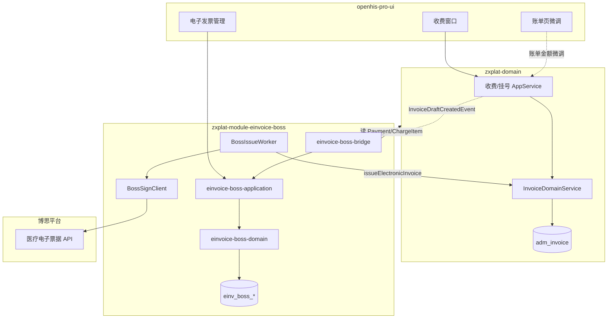

# Whale EInvoice-Boss 概要设计

> **⚠ v2 存量 HLD**：Maven/包名以 **[17-zxplat-module-einvoice-boss-架构-v3.md](./17-zxplat-module-einvoice-boss-架构-v3.md)** 为准。

> **文档性质**：概要设计（HLD）  
> **上游**：[00-功能清单.md](./00-功能清单.md)、[医疗电子票据管理平台-接口规范.md](./医疗电子票据管理平台-接口规范.md)  
> **下游**：[02-交互说明.md](./02-交互说明.md)、[03-详细设计与编码指导.md](./03-详细设计与编码指导.md)（含 [`../.cursor`](../.cursor) 成码规范）  
> **版本**：v1.0 | **日期**：2026-06-18 | **实施状态**：待开发

---

## 1. 文档关系

```text
01 功能清单 …… 做什么、P0～P3
02 博思接口对照表 …… 报文字段、错误码（待编）
03 概要设计（本文）…… 表、类、流程、API、UI
04 UI交互说明 …… 页面原型与提醒文案
05 详细设计与编码指导 …… 任务拆分、Flyway、验收（见 05 文档）
```

---

## 2. 设计原则

| 原则 | 说明 |
| --- | --- |
| **双存储** | `adm_invoice` 存**业务发票**（状态、支付关联、票面号）；boss 模块自管**电子发票**快照与明细 |
| **异步出站** | 收费/结算 API 不等待博思；开具在任务 Worker 中执行 |
| **金额自洽** | 出站前 `sum(明细) == totalAmt`，否则禁止调博思 |
| **金额可纠** | HIS 账单与明细不一致时，health 侧账单页微调 + boss 侧电子发票金额查看/调整 |
| **可补偿** | 事件丢失或任务失败时，UI 可手动补偿开票，并显著提醒 |
| **含医保分项** | 有 CHS 结算回执时按 setlinfo 组装基金金额段；无结算回落自费/现金口径 |

---

## 3. 系统上下文



### 3.1 依赖约束

| 约束 | 说明 |
| --- | --- |
| health-application | **不** import `com.zxplat.plugin.einvoice.boss.*` |
| health-domain | **不** import boss 包；仅发布 `InvoiceDraftCreatedEvent` 等 |
| einvoice-boss-bridge | 实现 Client；可读 health 库表，**不**依赖 health-application |
| einvoice-boss-application | **不**被 health-application 直接依赖 |

挂接方式：`einvoice-boss-contracts` 定义 `ElectronicInvoice旧命名（已废止）；adapter 监听领域事件 + 提供 `@Primary` 实现（同 CHS Extension 模式）。

### 3.2 模块装配

| 项 | 值 |
| --- | --- |
| 扩展仓库 | `zxplat-module-einvoice-boss` |
| Maven Profile | `with-einvoice-boss` |
| 开关 | `zxplat.modules.einvoice-boss.enabled` |
| embedded | `einvoice-boss-starter` |
| remote 中转 | `einvoice-boss-host`（`POST /eleInvoice/forward`） |
| Flyway | `classpath:db/migration/einvoice_boss` → `flyway_schema_history_einvoice_boss` |

```text
zxplat-module-einvoice-boss/
  einvoice-boss-contracts/     Client + 集成 DTO
  einvoice-boss-domain/          电子发票实体、Repository
  einvoice-boss-application/     AppService、Worker、BossClient、AutoConfiguration
  einvoice-boss-bridge/         Reader/Client 实现、事件监听、health 读模型
  einvoice-boss-starter/
  einvoice-boss-host/
```

---

## 4. 数据模型：双存储

### 4.1 分工

| 存储 | 归属 | 职责 |
| --- | --- | --- |
| **adm_invoice** | health · DM-ADM-012 | 业务发票：患者、支付单、金额、状态、busNo、billNo、issuedAt |
| **einv_boss_*** | einvoice-boss | 电子发票：博思报文快照、明细行、任务、调用日志、人工调额记录 |

`adm_invoice` **不扩展**博思专有字段（QR、batchCode、random 等），避免 health 耦合博思；回写时仅更新 `bill_no`、`issued_at`、`status_enum`。

电子票展示字段存 boss 表，UI 经 boss API 查询。

### 4.2 boss 实体（einvoice-boss-domain）

#### 4.2.1 `einv_boss_document` — 电子发票单据

一次开具尝试对应一条 document（与 `adm_invoice.id` 1:1）。

| 列 | 类型 | 说明 |
| --- | --- | --- |
| id | BIGINT PK | |
| tenant_id | BIGINT | |
| invoice_id | BIGINT UK | 关联 adm_invoice.id |
| payment_id | BIGINT | 冗余，便于查询 |
| issue_kind | VARCHAR | REG / AMB / IMP |
| bus_no | VARCHAR | 与 adm_invoice.bus_no 一致 |
| bus_type | VARCHAR | 06 / 02 / 01 |
| total_amt | DECIMAL(14,2) | 开票总额（可调） |
| payment_amt | DECIMAL(14,2) | 支付单金额（只读快照） |
| amount_status | VARCHAR | `MATCH` / `MISMATCH` / `ADJUSTED` |
| boss_bill_no | VARCHAR | 博思返回 |
| boss_batch_code | VARCHAR | |
| random | VARCHAR | |
| picture_url | VARCHAR | |
| picture_net_url | VARCHAR | |
| bill_qr_code | VARCHAR | |
| payload_json | TEXT | 最后一次出站 JSON（脱敏） |
| platform_profile | VARCHAR | |
| created_at / updated_at | | 审计 |

#### 4.2.2 `einv_boss_line` — 电子发票明细行

博思 `chargeDetail` / `listDetail` 的持久化，**支持人工调额**。

| 列 | 类型 | 说明 |
| --- | --- | --- |
| id | BIGINT PK | |
| document_id | BIGINT FK | |
| line_type | VARCHAR | `CHARGE`（汇总）/ `LIST`（清单） |
| line_no | INT | 行序 |
| charge_code | VARCHAR | 博思收费编码 |
| charge_name | VARCHAR | |
| std_amount | DECIMAL(14,2) | 自 HIS 计算的原始金额 |
| amount | DECIMAL(14,2) | **实际出站金额**（可人工改） |
| quantity | DECIMAL | |
| unit | VARCHAR | |
| source_charge_item_id | BIGINT | 院内 ChargeItem（可空） |
| adjusted | BOOLEAN | 是否人工调整过 |
| adjust_reason | VARCHAR | |

#### 4.2.3 `einv_boss_amount_adjust_log` — 调额审计

| 列 | 说明 |
| --- | --- |
| document_id | |
| operator_id | |
| before_total / after_total | |
| diff_json | 各行变更摘要 |
| reason | 必填 |

#### 4.2.4 `einv_boss_issue_task` — 异步开具任务

| 列 | 说明 |
| --- | --- |
| invoice_id | UK（活跃任务） |
| document_id | |
| status | PENDING / PROCESSING / SUCCESS / FAILED |
| attempt_count | |
| next_retry_at | |
| last_error_code | 如 `AMOUNT_MISMATCH`、`BOSS_TIMEOUT` |
| last_error_msg | |
| trigger_source | `EVENT` / `SCAN` / `MANUAL` |

#### 4.2.5 `einv_boss_invoke_log` — 集成日志

| 列 | 说明 |
| --- | --- |
| task_id | |
| service_id | 如 invoiceEBillOutpatient |
| request_digest / response_digest | |
| result_code | S0000 等 |
| duration_ms | |

#### 4.2.6 `einv_charge_contrast` — 收费对照

院内码 → 博思 chargeCode（P0 seed 挂号费等）。

### 4.3 adm_invoice（health · 只读引用）

现有字段满足业务发票需求，**P0 不增列**：

| 字段 | 用途 |
| --- | --- |
| payment_id | 关联支付 |
| bus_no | 博思业务流水号 |
| amount | 业务票面金额 |
| bill_no | 博思票号（ISSUED 后回写） |
| status_enum | DRAFT / ISSUED / CANCELLED |

---

## 5. 核心流程

### 5.1 异步开具（主路径）

```text
1. 支付事务
   createDraftInvoiceAfterPayment → adm_invoice(DRAFT)
   publish InvoiceDraftCreatedEvent

2. 返回收费窗（invoiceStatus=DRAFT）

3. AFTER_COMMIT + Async
   BossIssueTaskEnqueueService → einv_boss_issue_task(PENDING)
   初始化 einv_boss_document + einv_boss_line（从 Payment/ChargeItem 加载）

4. BossIssueWorker
   a. 比对 payment_amt 与 sum(lines) → amount_status
   b. BossInvoiceAmountValidator：sum(lines.amount) == document.total_amt
      - 失败 → task FAILED(AMOUNT_MISMATCH)，不调博思
   c. 组装 payload → BossSignClient → 博思
   d. 成功 → 写 boss 表 QR 等 + InvoiceDomainService.issueElectronicInvoice
```

### 5.2 金额不一致处理

两类不一致分开处理：

| 类型 | 检测点 | 处理 |
| --- | --- | --- |
| **A · 明细合计 ≠ totalAmt** | Worker 出站校验 | 自动 FAILED，进「待调整」列表 |
| **B · 明细合计 ≠ 支付金额** | document 初始化 / 保存时 | `amount_status=MISMATCH`；health **账单页**可微调 ChargeItem；boss **电子发票页**可调 line.amount |

**调额后重开**：

```text
财务打开「电子发票金额」页
  → 查看 payment_amt / total_amt / 各行 std_amount vs amount
  → 修改行金额或 total_amt（需满足 sum(lines)==total_amt）
  → 填写 adjust_reason → 保存
  → amount_status=ADJUSTED
  → 点击「重新开具」→ 新 task(MANUAL) → Worker 重跑
```

默认 `total_amt` 初始值 = `adm_invoice.amount`；调额仅改 boss 表，**不回写** adm_invoice.amount（业务发票金额以支付为准）。

### 5.3 冲红

| adm_invoice 状态 | 行为 |
| --- | --- |
| ISSUED | 异步入队冲红任务 → writeOffEBill → markCancelled |
| DRAFT | 仅 `voidDraft`，不调博思 |

### 5.4 手动补偿（事件丢失 / 任务失败）

适用：`DRAFT` 且（无 task / task=FAILED / 超时未 ISSUED）。

```text
UI「待补偿开票」列表（带醒目提醒）
  → 操作：重新入队 / 立即开具 / busNo 查票补偿(getEBillByBusNo)
  → 二次确认弹窗（说明重复开票风险与操作后果）
  → trigger_source=MANUAL
```

---

## 6. Client 与 Application 服务

### 6.1 `ElectronicInvoice旧命名（已废止）（contracts）

```java
// 异步入队（事件监听内部调用）
void scheduleIssueAsync(Long invoiceId);

// Worker / 手工补偿（同步调博思）
BossInvoiceIssueResult issueByDocument(Long documentId);

// 冲红
void scheduleWriteOffAsync(Long invoiceId, String reason);
BossInvoiceIssueResult writeOff(Long invoiceId, String reason);

// 超时补偿
Optional<BossInvoiceIssueResult> recoverByBusNo(String busNo);
```

health **不**直接调用 `issueByDocument`；仅通过事件触发 `scheduleIssueAsync`（由 adapter 订阅 `InvoiceDraftCreatedEvent`）。

### 6.2 AppService 清单

| 类 | 职责 |
| --- | --- |
| `EinvoiceBossIssueAppService` | 任务入队、Worker 调度、手工补偿、busNo 查票 |
| `EinvoiceBossDocumentAppService` | document/line CRUD、金额比对、调额保存 |
| `EinvoiceBossQueryAppService` | 列表、进度、QR、待补偿统计 |
| `BossPayloadBuilder` | adm_invoice + einv_boss_line → 博思 JSON |
| `BossInvoiceAmountValidator` | sum(lines)==totalAmt，否则抛异常 |
| `BossSignClient` | 签名、HTTP、验签 |
| `BossIssueWorker` | 抢锁消费 task |

### 6.3 adapter 读模型

| Loader | 来源 |
| --- | --- |
| `PaymentSnapshotLoader` | payment 金额、方式 |
| `ChargeItemSnapshotLoader` | 账单明细 → 初始化 einv_boss_line |
| `PatientEncounterLoader` | 患者、就诊、开票点 |

---

## 7. API 概要

前缀：`/api/einvoice-boss`（需模块启用 + 权限）

### 7.1 查询（P0/P1）

| 方法 | 路径 | 说明 |
| --- | --- | --- |
| GET | `/documents/by-invoice/{invoiceId}` | 电子发票单据 + 明细 |
| GET | `/issue-status` | `?paymentId=` 开票进度 |
| GET | `/tasks/pending-compensation` | 待补偿列表（含统计） |
| GET | `/documents/page` | 管理端分页 |

### 7.2 金额调整（P1）

| 方法 | 路径 | 说明 |
| --- | --- | --- |
| PUT | `/documents/{id}/lines` | 批量更新行金额 |
| PUT | `/documents/{id}/total-amt` | 改 total_amt（须仍等于明细合） |
| POST | `/documents/{id}/validate-amount` | 预校验，返回差额 |

### 7.3 补偿与补开（P0/P1）

| 方法 | 路径 | 说明 |
| --- | --- | --- |
| POST | `/tasks/{invoiceId}/requeue` | 重新入队 |
| POST | `/tasks/{invoiceId}/issue-now` | 立即开具（手工） |
| POST | `/tasks/{invoiceId}/recover-by-busno` | busNo 查票补偿 |

### 7.4 收费窗（P1）

| 方法 | 路径 | 说明 |
| --- | --- | --- |
| GET | `/cashier/qr` | `?paymentId=` ISSUED 后返回 QR |

---

## 8. UI 概要

### 8.1 页面清单

| 页面 | 路由（建议） | 角色 | 优先级 |
| --- | --- | --- | --- |
| 待补偿开票 | `/finance/einvoice/compensation` | 财务/收费班长 | P0 |
| 电子发票金额调整 | `/finance/einvoice/document/:id/amount` | 财务 | P1 |
| 电子发票查询 | `/finance/einvoice/list` | 财务 | P1 |
| 开票进度（嵌入） | 收费窗组件 | 收费员 | P1 |
| 账单微调（health） | 现有账单页增强 | 收费员 | P1 |

### 8.2 待补偿开票 · 提醒设计（P0 必做）

**全局提醒**

- 菜单「财务管理」旁 **角标**：待补偿数量
- 登录后若 `pendingCount > 0`，顶部 **Alert 条**（warning 色）：  
  「有 {n} 笔电子发票待补偿开票，可能影响患者取票，请尽快处理。」→ 跳转列表

**列表行状态**

| 条件 | 标签 | 操作 |
| --- | --- | --- |
| DRAFT + 无 task | `事件丢失` | 重新入队 |
| task=FAILED + AMOUNT_MISMATCH | `金额待调整` | 去调额 / 重试 |
| task=FAILED + 其他 | `开票失败` | 立即开具 / busNo 补偿 |
| DRAFT 超 30min 未 ISSUED | `超时待查` | busNo 补偿 |

**操作确认弹窗（必填文案）**

- 立即开具：「将向博思平台发起开具，请确认金额已核对。重复操作可能导致重复开票。」
- busNo 补偿：「将按业务流水号向博思查询是否已开票，查回后直接标记已开具。」

### 8.3 电子发票金额调整页（P1）

布局三区：

```text
┌─ 概要 ─────────────────────────────────────┐
│ 患者 / 支付单号 / busNo / 支付金额          │
│ 开票总额 total_amt [可编辑]  差额高亮       │
│ amount_status 标签                         │
├─ 明细表 ───────────────────────────────────┤
│ 行号 | 项目名称 | 标准金额 | 出站金额[可编] │
│ 合计行（自动汇总，≠ total 时红色）          │
├─ 操作 ─────────────────────────────────────┤
│ 调整原因 [必填]  [保存] [校验] [重新开具]   │
└────────────────────────────────────────────┘
```

保存时服务端再次执行 `BossInvoiceAmountValidator`；不通过禁止保存。

### 8.4 账单页微调（health · 协同）

在 **门诊/住院账单详情** 增加轻量提示（非 boss 模块代码，由 health UI 实现）：

- 当 ChargeItem 合计 ≠ Payment.amount：行内 warning「账单金额不一致，请微调后再开票」
- 提供链接「查看电子发票」→ 跳转 boss 金额页（若已有 document）

---

## 9. 配置项

| 键 | 默认 | 说明 |
| --- | --- | --- |
| `zxplat.modules.einvoice-boss.enabled` | false | 模块开关 |
| `einvoice.boss.issue.mode` | async | async / sync（联调） |
| `einvoice.boss.platformProfile` | boss-medical-cn-v1 | |
| `app_id` / `key` / `url` | — | 博思连接 |
| `forwardSwitch` | — | 0=中转 1=直连 |
| `invoiceUrl` | — | 中转根 URL |
| `einvoice.boss.issue.retry.maxAttempts` | 5 | |
| `einvoice.boss.compensation.alertThreshold` | 1 | ≥N 条待补偿时顶栏提醒 |
| `einvoice.boss.compensation.staleMinutes` | 30 | 超时待查阈值 |

---

## 10. 报文组装（含医保分项）

`BossPayloadBuilder` 自 `einv_boss_document` + `einv_boss_line` 生成博思 JSON：

| 段 | 来源 |
| --- | --- |
| totalAmt | document.total_amt |
| chargeDetail / listDetail | einv_boss_line（按 line_type）；listDetail.name=药名，remark/medicalCareType=甲乙丙 |
| 患者 / 就诊 / 开票点 | adapter Loader |
| 票头医保类型 | fin_contract.category_enum → 省医保/市医保/自费 |
| 医保金额段 | 有结算：`InsuranceSettlementRecordLookupExtension.findFundByPaymentId`（otherfundPay=七项显式和）；无结算：自费口径 + otherInfo 14/15 零值 |

---

## 11. 验收映射

| 功能清单 AC | 概要设计落点 |
| --- | --- |
| AC-02 异步不阻塞 | §5.1 步骤 2 |
| AC-06/07 金额校验 | §5.1 步骤 4b、§6.2 Validator |
| AC-05 busNo 补偿 | §5.4、API recover-by-busno |
| 待补偿提醒 | §8.2 |
| 金额调整 | §5.2、§8.3 |

---

## 12. 修订记录

| 版本 | 日期 | 说明 |
| --- | --- | --- |
| v1.0 | 2026-06-18 | 初稿：双存储、boss 实体、异步流程、金额调整、补偿 UI |
