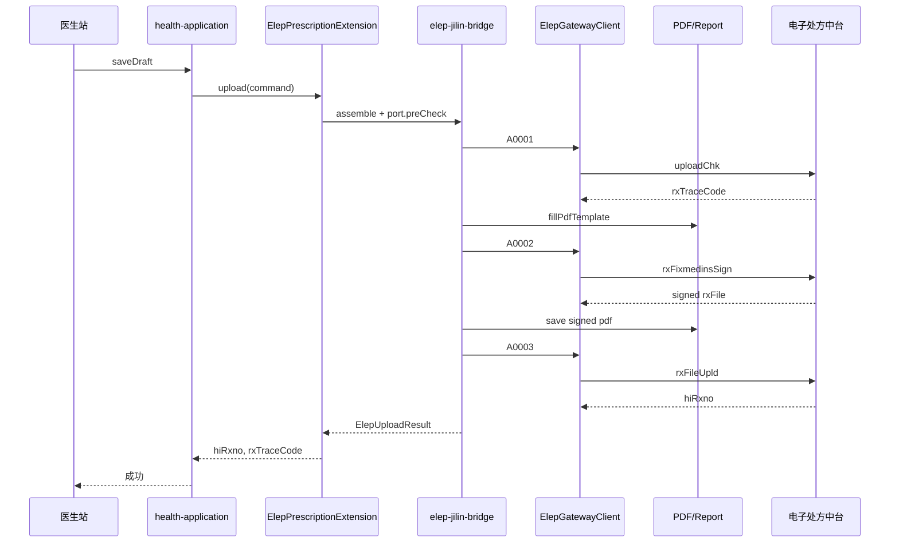

# 电子处方上传链路 — 详细设计

> **范围**：A0001 预核验 → 本地 PDF → A0002 签名 → A0003 上传；失败与撤销见 A0004。  
> **ybapp 参考**：`YbElepServiceImpl`、`ElepHandlerServiceImpl`  
> **版本**：v1.1 | **日期**：2026-09-09

---

## 1. 状态机

```text
DRAFT → PRE_CHECKED → SIGNED → UPLOADED → REVOKED
              ↘ FAILED（任一步明确失败）
```

| 状态 | 触发 | 持久化 |
|------|------|--------|
| `DRAFT` | 医生保存草稿 | INSERT `yb_elep_prescription` |
| `PRE_CHECKED` | A0001 成功 | UPDATE `rx_trace_code`；写 snapshot.request |
| `SIGNED` | A0002 成功 | UPDATE snapshot.sign；写 PDF 路径 |
| `UPLOADED` | A0003 成功 | UPDATE `hi_rxno`；**进入患者历史列表** |
| `REVOKED` | A0004 成功 | UPDATE `local_status` |
| `FAILED` | 任一步失败 | UPDATE + `yb_elep_upload_log` |

---

## 2. 时序



---

## 3. ElepGatewayClient

```java
public interface ElepGatewayClient {
    ElepGatewayResponse invoke(
        ElepOpCode opCode,
        Object input,
        ElepInvokeContext context   // busNo, tenantId, operatorId
    );
}
```

`ElepOpCode` 枚举（path 为代码常量）：

| 枚举 | path |
|------|------|
| `A0001` | `/fixmedins/uploadChk` |
| `A0002` | `/fixmedins/rxFixmedinsSign` |
| `A0003` | `/fixmedins/rxFileUpld` |
| `A0004` | `/fixmedins/rxUndo` |
| `A0005` | `/fixmedins/hospRxDetlQuery` |
| `A0006` | `/fixmedins/rxSetlInfoQuery` |

完整 URL：`ElepContractConfig.eleBaseUrl + opCode.path`（注意 base 末尾 `/` 规范化）。

---

## 4. 加解密（自 ybapp 迁移）

迁移源：

- `ElepHandlerServiceImpl.initTransBody` → `HseEncAndDecSupport.encryptRequest`
- `ElepHandlerServiceImpl.sendDatas` → `ElepHttpAccessor.post`
- 响应 `code==0` 时 SM4 解密 `encData`

密钥来源：**仅** `ElepContractConfigLoader.getByBusNo(busNo)`，禁止从 Command 传入。

---

## 5. PDF 生成

### 5.1 策略

| 方案 | 说明 | Wave |
|------|------|------|
| A | 迁移 ybapp `PDFTemplateFillerUtil` 至 elep-application | P2 快速 |
| B | adapter 调 `whale-Report 处方数据集 + 统一 PDF 引擎 | P2+ 推荐 |

### 5.2 路径规则（对齐 ybapp）

```text
{output_path}{yyyyMMdd}/{hospRxno}.pdf
```

写入 `yb_elep_prescription_snapshot.pdf_file_path`。

A0002 签名后覆盖同路径或写入 `{hospRxno}_signed.pdf`（实现时二选一，文档锁定一种）。

---

## 6. 入参组装（adapter 职责）

### 6.1 主表字段来源

| 平台字段 | HIS 来源 |
|----------|----------|
| `hospRxno` | 新生成院内处方号 |
| `initRxno` | 续方时 = 源方 `hi_rxno` |
| `mdtrtinfo.*` | 当前 encounter + patient + practitioner |
| `diseinfo.*` | 就诊诊断（医保码经目录校验） |
| `rxdrugdetail.*` | 药品医嘱 + 1301 目录码 `medListCodg` |

### 6.2 关键节点（ybapp domain）

- `PreCheckPrescription` — A0001  body
- `ElepSignatureInput` — A0002（`originalRxFile` = PDF base64）
- `ElepUploadInput` — A0003（`rxFile` = 签名后 PDF base64）

字段定义见 ybapp `com.openhis.domain.ElepVeri*` / `PreCheckPrescription`。

---

## 7. 日志与重试

每笔 A000x 调用 INSERT `yb_elep_upload_log`：

| 列 | 说明 |
|----|------|
| `prescription_id` | FK |
| `op_code` | A0001… |
| `request_json` / `response_json` | 脱敏后存储 |
| `success` | boolean |
| `error_message` | 失败原因 |

**资金类不重试自动上传**：失败保持 `FAILED`，医生修正后 **新建** `hosp_rxno` 重走链路（同 CHS 防单边账精神，避免重复 upload）。

---

## 8. AppService 表面（规划）

| Bean | 类 | 职责 |
|------|-----|------|
| `elepPrescription` | `ElepPrescriptionAppService` | upload/revoke/query 编排 |
| `elepCatalogSearch` | `ElepCatalogSearchAppService` | 目录 Picker |

Bridge（adapter 暴露给前端，前缀规划）：

| 前缀 | 说明 |
|------|------|
| `/api/app/elepPrescription/*` | 上传、撤销、历史、clone |
| `/api/app/elepCatalogSearch/*` | 药品/诊断搜索 |

---

## 9. 验收要点

- [ ] A0001 成功返回 `rxTraceCode` 且本地 PDF 落盘
- [ ] A0002 成功且 PDF 可打开
- [ ] A0003 成功返回 `hi_rxno` 且 `yb_elep_prescription.local_status=UPLOADED`
- [ ] 密钥仅来自 properties，抓包/日志无 `prePrvKey` 明文
- [ ] 失败不自动重发 A0003

---

## 10. 修订记录

| 版本 | 日期 | 说明 |
|------|------|------|
| v1.1 | 2026-09-09 | 对照 `90768295c`：开方走 `ElepEncounterContextLoader` + `ElepA0001BodyAssembler`；克隆 `ElepPrescriptionCloneService`；详见 [13 §5](./13-实现状态与文档对照.md) |
| v1.0 | 2026-06-18 | 初稿：A0001→PDF→A0002→A0003 状态机与时序 |
