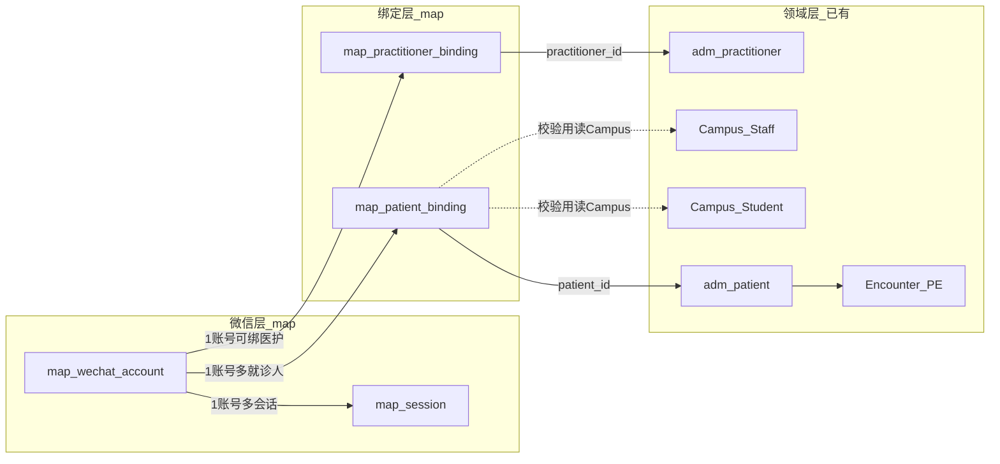
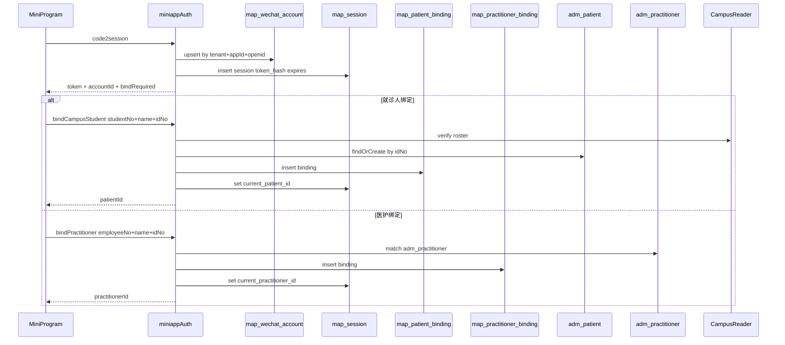
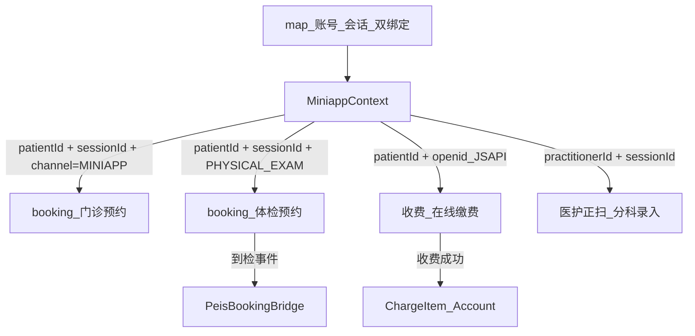

# DM-MAP-AUTH · 微信登录与就诊人绑定（表设计真源）

> **文档性质**：miniapp 身份层表设计与业务约定真源  
> **模块**：`zxplat-module-miniapp` · 表前缀 `map_` · Flyway `db/migration/miniapp/` · history `flyway_schema_history_miniapp`  
> **关联**：[00-功能清单.md](./00-功能清单.md)、[AS-PEIS-BKG-001](../health/AppService/AS-PEIS-BKG-001-预约衔接.md)、booking `channelCode=MINIAPP`  
> **对照遗留**：`old_peis` `WxAuthService` / `peis_customer.open_id1`（**不迁移该模型**）  
> **版本**：v1.1 | **日期**：2026-07-26 | **状态**：已定稿（Flyway / 鉴权骨架已成码）  
> **v1.1**：医护 = health `adm_practitioner`；同套微信登录；新增 `map_practitioner_binding`

---

## 1. 为何不沿用 old_peis

| 问题 | 表现 |
|------|------|
| **身份混叠** | `openid` 写在 `peis_customer.open_id1`，微信账号 = 体检客户主档 |
| **临时户脏数据** | 首次登录建空 customer，绑定已有人时删临时户 + 迁移 openid |
| **无唯一约束** | 按 openid 取「第一条」，并发/脏数据易串号 |
| **角色靠 JOIN 猜** | student/teacher/doctor 靠 `customer_id` 推断 |
| **与 HIS Patient 断裂** | 无法直接支撑门诊预约、全院缴费 |

**默认范围**：以体检小程序为主，表挂 miniapp，可复用全院就诊人；**不**在 `peis_*` / `adm_patient` 上加 openid 列。

---

## 2. 目标模型（三层分离）



**口径**：

1. 微信账号 ≠ 患者 ≠ 医疗参与者 ≠ 校园学籍/人事  
2. **登录只保证「有 openid 会话」**（学生/教职工/就诊人/医护共用 `map_wechat_account` + `map_session`）  
3. 实名分两路：  
   - 就诊侧：绑定 `Patient`（`map_patient_binding`）  
   - 医护侧：绑定 `Practitioner`（`map_practitioner_binding` → `adm_practitioner`）  
4. 体检「学生/教职工」：绑定校验走 **Campus Reader**，结果落在 `Patient` + binding 元数据，**不**新建 `peis_customer`  
5. 医护正扫：权限以会话 `current_practitioner_id` 为准，**不**假绑 Patient  
6. **小程序门禁只认 `patientId` / `practitionerId`（能力叠加）；`role` 仅展示标签，禁止参与鉴权**

---

## 3. 表设计（P0 三张）

### 3.1 `map_wechat_account` — 微信账号（稳定身份）

| 列 | 类型 | 说明 |
|----|------|------|
| `id` | int8 PK | 雪花 |
| `tenant_id` | int8 | 租户 |
| `app_id` | varchar(64) | 小程序 appId（多小程序） |
| `openid` | varchar(64) | 微信 openid |
| `union_id` | varchar(64) null | 开放平台 unionid |
| `status_enum` | varchar(32) | `active` / `disabled` |
| `last_login_at` | timestamptz | 最近登录 |
| 审计列 | … | created/updated/soft-delete/version |

**约束**：

- `UNIQUE (tenant_id, app_id, openid) WHERE is_deleted = false`
- `UNIQUE (tenant_id, app_id, union_id) WHERE union_id IS NOT NULL AND is_deleted = false`（可选，防双绑）

### 3.2 `map_session` — 登录会话

| 列 | 类型 | 说明 |
|----|------|------|
| `id` | int8 PK | = 对外 `sessionId` / JWT jti |
| `tenant_id` | int8 | |
| `wechat_account_id` | int8 FK | → map_wechat_account |
| `token_hash` | varchar(128) | 存 hash，不存明文 token |
| `current_patient_id` | int8 null | 当前选中就诊人 |
| `current_practitioner_id` | int8 null | 当前选中医疗参与者（医护） |
| `client_type_enum` | varchar(32) | 默认 `miniapp` |
| `expires_at` | timestamptz | 与 JWT TTL 对齐 |
| `revoked_at` | timestamptz null | 主动登出 |
| 审计列 | … | |

**索引**：`(wechat_account_id, expires_at)`；`(token_hash)` 唯一（未撤销）。

热路径可用 Redis 缓存，**以 DB 为准**。

### 3.3 `map_patient_binding` — 微信账号 ↔ 就诊人

| 列 | 类型 | 说明 |
|----|------|------|
| `id` | int8 PK | |
| `tenant_id` | int8 | |
| `wechat_account_id` | int8 FK | |
| `patient_id` | int8 | → `adm_patient.id` |
| `bind_channel_enum` | varchar(32) | `id_card` / `campus_student` / `campus_staff` / `manual` |
| `campus_ref_type` | varchar(32) null | `student` / `staff` |
| `campus_ref_id` | int8 null | Campus 档案主键（可选缓存） |
| `campus_biz_no` | varchar(64) null | 学号/工号快照（展示用） |
| `is_default` | bool | 默认就诊人 |
| `bound_at` / `unbound_at` | timestamptz | 解绑软失效用 unbound_at |
| 审计列 | … | |

**约束**：

- `UNIQUE (tenant_id, wechat_account_id, patient_id) WHERE unbound_at IS NULL AND is_deleted = false`
- 同一账号下 `is_default=true` 最多一条（部分唯一索引或应用保证）

**相对 old_peis `customer-bind`**：不再删临时 customer 迁移 openid；openid 始终留在 `map_wechat_account`；证件对应 Patient 已存在则直接绑，否则经 health 建 `adm_patient` 再绑。

### 3.4 `map_practitioner_binding` — 微信账号 ↔ 医疗参与者

| 列 | 类型 | 说明 |
|----|------|------|
| `id` | int8 PK | |
| `tenant_id` | int8 | |
| `wechat_account_id` | int8 FK | |
| `practitioner_id` | int8 | → `adm_practitioner.id` |
| `bind_channel_enum` | varchar(32) | `employee_no` / `manual` |
| `employee_no` | varchar(64) null | 工号快照（展示用） |
| `is_default` | bool | 默认参与者 |
| `bound_at` / `unbound_at` | timestamptz | |
| 审计列 | … | |

**约束**：

- `UNIQUE (tenant_id, wechat_account_id, practitioner_id) WHERE unbound_at IS NULL AND is_deleted = false`
- 同一账号下 `is_default=true` 最多一条

**绑定校验**：工号 + 姓名 + 证件 → `PractitionerQueryService` / 人事主数据匹配 `adm_practitioner`；**禁止**为医护伪造 `Patient` 绑定冒充身份。

**同一微信账号**：可同时存在 Patient 绑定与 Practitioner 绑定（本人预约 + 医护正扫），会话分别用 `current_patient_id` / `current_practitioner_id`。

### 3.5 `map_invoke_log`（P1 可选）

调用审计：login / bind / unbind / 敏感查询。首版可省略。

### 3.6 明确不建 / 不改

| 项 | 决定 |
|----|------|
| `peis_customer` / `open_id1` | **不复活**；迁移时 openid → `map_wechat_account`，客户 → `adm_patient` |
| `adm_patient` / `adm_practitioner` 加 openid 列 | **禁止** |
| `peis_encounter_ext` 存 openid | **禁止** |
| 独立 `peis_wx_*` | **不建**；微信能力归 miniapp |
| 为预约/缴费建 `map_appointment_ref` | **不建**；业务状态属 booking / charge |

Campus 表只读校验，不以 PEIS 写 `customer_id` 反向外键。

---

## 4. 登录 / 绑定流程



**角色展示**（对齐 old_peis role 1/2/3/4）：

| 条件 | 角色 |
|------|------|
| 无有效 binding | `anonymous` |
| `campus_ref_type=student` | 学生 |
| `campus_ref_type=staff` | 教职工 |
| 仅身份证绑 Patient、无 campus | `patient` |
| 有效 `map_practitioner_binding` | `medic`（医护 · Practitioner） |

**API 能力（目标）**：`autoLogin` / `bind`（Patient 或 Practitioner） / `unbind` / `logout` / `switchPatient` / `switchPractitioner`。

---

## 5. 能力评审：门诊预约 / 体检预约 / 在线缴费

**结论：能支撑。** 身份底座为微信账号 + 会话 +（Patient 和/或 Practitioner）绑定；预约与缴费消费 `patientId`；医护正扫消费 `practitionerId`。

### 5.1 依赖关系



| 能力 | 需要的身份事实 | 本方案覆盖 | 业务落点 |
|------|----------------|------------|----------|
| **门诊预约** | `patientId`；`MINIAPP`；`originChannelSessionId` | `current_patient_id` + `map_session.id` | booking O 线 |
| **体检预约** | 同上 + 可选校园展示；`PHYSICAL_EXAM`；到检 → PE Encounter | binding campus 元数据；Patient 统一 | booking H 线 + AS-PEIS-BKG-001 |
| **在线缴费** | 账单 `patientId`；JSAPI **openid**；医保 `opter_type=3` | account.openid；session 可审计 | ChargeItem / 第三方支付 |
| **医护正扫** | `practitionerId`；会话有效 | `current_practitioner_id` + Practitioner binding | PEIS 分科录入（小程序） |

### 5.2 旧模型为何撑不住

- openid 挂体检客户 → 跨门诊/缴费串档，无法一号多就诊人  
- 无会话 → 无法满足 `originChannelSessionId`  
- 无稳定账号表 → JSAPI 无法可靠定位 payer  

### 5.3 业务约定（C1–C6，不扩表）

网关注入：

```text
MiniappContext {
  accountId, openid, sessionId,
  patientId?,          // 就诊侧；预约/缴费必填
  practitionerId?,     // 医护侧；正扫必填
  tenantId, appId
}
```

| 约定 | 内容 | 否则风险 |
|------|------|----------|
| **C1** | 预约/缴费：`current_patient_id` 非空，否则 `BIND_REQUIRED` | 匿名占号、错账 |
| **C1b** | 医护正扫：`current_practitioner_id` 非空，否则 `PRACTITIONER_BIND_REQUIRED` | 无权限录入 |
| **C2** | 统一注入 MiniappContext，禁止各业务自行解 JWT | 上下文不一致 |
| **C3** | 写预约：`channelCode=MINIAPP`，`originChannelSessionId=session.id` | 无法追责/退号 |
| **C4** | JSAPI 只用本会话 `account.openid`，禁止客户端传 openid | 盗刷/串付 |
| **C5** | 切换就诊人只改 `session.current_patient_id`，在途单不自动改归属 | 账人错位 |
| **C5b** | 切换参与者只改 `session.current_practitioner_id` | 操作者错位 |
| **C6** | 有未完成预约/待缴费时拒绝解绑 Patient 或二次确认 | 孤儿业务单 |

### 5.4 不在本身份方案内

| 能力 | 归属 |
|------|------|
| 号源 / Slot / 锁号 | booking |
| 体检套餐 / 团检批次 | peis + booking H |
| 待缴账单 / 支付单 | charge / 支付扩展（payer 键仍为 openid + patientId） |
| 模板消息订阅 | 用 account.openid 即可，无需改表 |

### 5.5 P1 可选增强（非阻塞）

- `union_id` 多端收敛  
- `map_invoke_log`  
- Redis 缓存 session（DB 权威）

---

## 6. 成功标准

- openid **只**出现在 `map_wechat_account`  
- 一账号多 `Patient`，可切换 `current_patient_id`  
- 一账号可绑 `Practitioner`，可切换 `current_practitioner_id`  
- 校园绑定不创建 `peis_customer`；医护绑定不伪造 Patient  
- `(tenant_id, app_id, openid)` 唯一  
- PEIS / 门诊 / 收费业务表 **零**微信字段  
- 预约与缴费凭 `patientId` Context；正扫凭 `practitionerId` Context  

---

## 7. 实施顺序（后续）

1. ~~定稿本文~~  
2. ~~Flyway `miniapp/V1__map_auth_ddl.sql`（含 patient + practitioner binding）~~  
3. ~~`miniappAuth` + MiniappContext 过滤器~~（成码：`MiniappAuthAppService` / `MiniappAuthFilter`）  
7. ~~正式微信 `code2session`~~（已接；无 secret 时 mock 回落）  
8. ~~Campus 学号/工号绑定~~（`bindCampusStudent` / `bindCampusStaff`）  
9. 小程序端页面（`openhis-pro-mini`）  
10. 迁移：`peis_customer.open_id1` → `map_wechat_account` / binding / session  
11. 门诊预约、体检预约、在线缴费、医护正扫消费 Context

---

## 8. 关联待编文档

| 文档 | 说明 |
|------|------|
| `DM-MAP-001 WechatAccount` | 可从本文 §3.1 拆出 |
| `DM-MAP-002 Session` | 可从本文 §3.2 拆出 |
| `DM-MAP-003 PatientBinding` | 可从本文 §3.3 拆出 |
| `DM-MAP-004 PractitionerBinding` | 可从本文 §3.4 拆出 |
| `AS-MAP-AUTH-001` | 登录/绑定/切换 API + C1–C6 |
| [00-功能清单.md](./00-功能清单.md) | 引用本文为身份层真源 |
