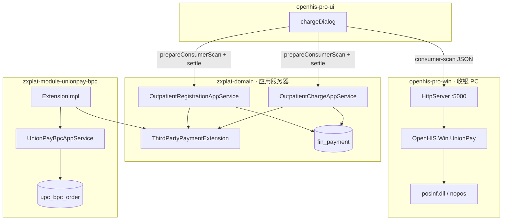

# Whale UnionPay-BPC 概要设计

> **⚠ v2 存量 HLD**：Maven/包名以 **[17-zxplat-module-unionpay-bpc-架构-v3.md](./17-zxplat-module-unionpay-bpc-架构-v3.md)** 为准；下文 `contracts`/`adapter` 仅作业务背景。

> **文档性质**：概要设计（HLD）  
> **上游**：[00-功能清单.md](./00-功能清单.md) · [05-BPC接口对照表.md](./05-BPC接口对照表.md)  
> **下游**：[02-交互说明.md](./02-交互说明.md)、[03-详细设计与编码指导.md](./03-详细设计与编码指导.md)  
> **领域真源**：[DM-FIN-002 PaymentReconciliation](../health/DomainModel/DM-FIN-002-PaymentReconciliation-支付流水.md) · 支付渠道编码见本文 §3  
> **架构真源**：[模块化开发规范.md](../01-架构/模块化开发规范.md) §12  
> **版本**：v1.8 | **日期**：2026-06-23 | **实施状态**：待开发  
> **P0 出站真源（DLL 签约院点）**：[08-OpenHIS.Win银联本地桥接.md](./08-OpenHIS.Win银联本地桥接.md)

---

## 1. 文档关系

```text
00 功能清单 …… 做什么、优先级、验收口径
01 概要设计（本文）…… 架构、表、Extension、流程、Profile
08 OpenHIS.Win …… P0 DLL 出站
02 交互说明 …… 收银 UI
03 详细设计 …… 任务、DDL、Maven、配置键
04 定长接口 …… 银联官方 MIS 规范
05 BPC 对照表 …… 通道 A JSON
06 测试清单 …… 手工用例
07 上线手册 …… 院点部署
```

**本文重点**：§2 三通道、§3 系统上下文、§4 双存储、§5 Extension 契约、§6 核心流程。

---

## 2. 定位与三通道

### 2.1 模块是什么

**zxplat-module-unionpay-bpc** 是 HIS 的**银联商务 BPC 统一收单扩展包**（独立可售 Module）。在收银场景完成被扫/主扫、查询、退货，并将结果回写 **支付流水（PaymentReconciliation）**。

| 在 BPC Module | 不在 BPC Module |
| --- | --- |
| 第三方订单落库、payType 映射、Extension 落账 | **posinf.dll 调用**（OpenHIS.Win · 通道 C） |
| 通道 A 时：BPC HTTPS 出站、签名 | 支付单领域、结算编排（health） |
| `upc_bpc_order` 映射 merTradeNo ↔ payment | 患者主档、Encounter 创建 |
| Profile / contract.properties / posNo 解析 | 医保基金段（chs-jilin） |
| 财务查单、对账 API（P1+） | 博思电子票开具（einvoice-boss） |

### 2.2 三通道（2026-06-23 定稿）

| 通道 | 协议 | 出站位置 | 阶段 | 文档 |
| --- | --- | --- | --- | --- |
| **A · BPC HTTPS** | JSON POST + Header `sign` | Whale Java 服务端 | 院点开通 HTTPS 后 | [05-BPC接口对照表](./05-BPC接口对照表.md) |
| **B · UnionPayPlugin** | 定长 + `:19994` HTTP | 独立 exe | **退役** | [unionpay-bpc-client](./unionpay-bpc-client/README.md) |
| **C · OpenHIS.Win** | 定长 `bankall` + JSON HTTP | **OpenHIS.Win `:5000`** | **P0（H22010402403 等 DLL 签约院点）** | [08-OpenHIS.Win银联本地桥接](./08-OpenHIS.Win银联本地桥接.md) |

```text
P0 收银（通道 C · 朝阳定稿）：
  Vue chargeDialog → Whale 预结算 + prepareConsumerScan（merTradeNo）
  → POST http://127.0.0.1:5000/api/unionpay/consumer-scan（OpenHIS.Win）
  → posinf.dll 定长 → 银联云（DLL 内部 HTTPS）
  → Vue 携带 clientScanResult → health settle
  → Extension.applyClientScanResult → upc_bpc_order SUCCESS → settleOutpatientPayment

将来（通道 A · 院点开通 BPC HTTPS）：
  Vue → health → Extension.consumerScan → BpcTransactionClient → BPC HTTPS
  （Whale 服务端出站；收银 PC 无需 DLL）
```

> **禁止**将 [04-定长接口](./04-银联商务MIS-POS系统标准接口文档-定长接口.md) 与 [05 JSON](./05-BPC接口对照表.md) 混为同一实现；**禁止** P0 假设已有 `request_url`/`md5_secret`。

---

## 3. 系统上下文

### 3.1 架构图（通道 C · P0）



### 3.2 依赖约束

| 约束 | 说明 |
| --- | --- |
| `health-application` | **禁止** import `com.zxplat.plugin.unionpay.bpc.*`；**禁止**依赖 `unionpay-bpc-contracts` |
| `health-application` | **只**注入 `ThirdPartyPaymentExtension`（`health-integration-contracts`） |
| `unionpay-bpc-bridge` | 实现 Extension；可读 `health-domain`（payment、practitioner）；**禁止** `unionpay-bpc-application`、`health-application` |
| `unionpay-bpc-application` | BpcClient、AppService、Flyway；**不被** health-application 直接依赖 |
| `unionpay-bpc-contracts` | 模块内 DTO / Client 接口；**仅** adapter + application 使用 |

挂接方式：同 [BossElectronicInvoiceExtension](../01-架构/模块化开发规范.md) — adapter `@Primary` + `@ConditionalOnProperty(zxplat.modules.unionpay-bpc.enabled=true)`；未装配时 NoOp Extension（`isEnabled()=false`）。

### 3.3 模块装配

| 项 | 值 |
| --- | --- |
| 扩展仓库 | `zxplat-module-unionpay-bpc` |
| Maven Profile | `with-unionpay-bpc` |
| 开关 | `zxplat.modules.unionpay-bpc.enabled` |
| 安装 | `unionpay-bpc-starter`（adapter + application） |
| Flyway | `classpath:db/migration/unionpay_bpc` → `flyway_schema_history_unionpay_bpc` |
| http-starter | **P0 无**；P2 可选 `unionpay-bpc-proxy-starter`（DMZ 代理） |

```text
zxplat-module-zxplat-module-unionpay-bpc/   unionpay-bpc-contracts/     Bpc DTO、BpcPaymentClient 接口
  unionpay-bpc-domain/        upc_bpc_order、Profile 枚举
  unionpay-bpc-application/   UnionPayBpcAppService、BpcTransactionClient、Flyway
  unionpay-bpc-bridge/       ThirdPartyPaymentExtensionImpl；读 health
  unionpay-bpc-starter/
```

---

## 4. 数据模型：双存储

### 4.1 分工

| 存储 | 归属 | 职责 |
| --- | --- | --- |
| **fin_payment / fin_payment_rec_detail** | health · DM-FIN-002 | 支付单、明细、渠道、结算状态 |
| **upc_bpc_*** | unionpay-bpc | 第三方订单、BPC tradeNo、merTradeNo、调用日志 |

health **不扩展** BPC 专有字段（tradeNo、merTradeNo、payType 响应码等）；收银成功后 `PaymentRecDetail` 仅写 **渠道 + 金额**；BPC 全量快照在 `upc_bpc_order`。

### 4.2 `upc_bpc_order` — 第三方订单

一次 BPC 扣款尝试对应一条（混合支付同一 payment 多明细 → 多行，`detail_index` 区分）。

| 列 | 类型 | 说明 |
| --- | --- | --- |
| id | BIGINT PK | |
| tenant_id | BIGINT | |
| payment_id | BIGINT | 关联 fin_payment.id |
| detail_index | INT | 混合支付明细序号（默认 0） |
| mer_trade_no | VARCHAR UK | 商户订单号（Generator 产出） |
| trade_no | VARCHAR | BPC 返回 tradeNo（成功后有值） |
| tran_type | VARCHAR | C/G/R/… |
| txn_amt_fen | BIGINT | 请求金额（分） |
| pay_type | VARCHAR | UPAY/WEIX/ZFBA/… |
| status | VARCHAR | PENDING / SUCCESS / FAILED / REFUNDED |
| resp_code | VARCHAR | BPC respCode |
| resp_msg | VARCHAR | 可展示文案 |
| profile_id | VARCHAR | acquirerProfile |
| pos_no | VARCHAR | 终端编号快照 |
| scan_code_digest | VARCHAR | 付款码摘要（**禁止**存明文） |
| created_at / updated_at | | 审计 |

### 4.3 `upc_bpc_invoke_log` — 集成日志（P1）

| 列 | 说明 |
| --- | --- |
| order_id | 关联 upc_bpc_order |
| tran_type | |
| request_digest / response_digest | 脱敏 JSON 摘要 |
| resp_code | |
| duration_ms | |
| profile_id / tenant_id | |

### 4.4 health 侧变更（P0 · DEP）

| 项 | 说明 |
| --- | --- |
| `PaymentChannel` / 477 术语 | 语义码 `CASH`/`WECHAT`/`ALIPAY`/`BANK_CARD`；`SCAN_PAY` 仅 UI（院点 Flyway 可选）；见 [01-概要设计](./01-概要设计.md) |
| `BpcPayTypeMapper` | 已在 `health-domain-shared`；`UPAY` → **`BANK_CARD`**（不新增 `UNION_PAY`） |
| `Practitioner.pos_no` | VARCHAR 可空；Flyway 扩展 adm_practitioner；默认读 `contract.*.pos_no` |
| `ThirdPartyPaymentExtension` | 新增于 `health-integration-contracts`（见 §5） |

---

## 5. Extension 与模块内 Client

### 5.1 `ThirdPartyPaymentExtension`（health-integration-contracts）

包：`com.openhis.health.integration.payment`

| 方法 | 说明 | 阶段 |
| --- | --- | --- |
| `default boolean isEnabled()` | NoOp 返回 false | P0 |
| `default boolean supportsChannel(String channelCode)` | 是否走 BPC（`SCAN_PAY` / 扫码聚合） | P0 |
| `ThirdPartyScanResult consumerScan(ThirdPartyScanCommand cmd)` | 被扫 C（**通道 A** 服务端出站） | A |
| `ThirdPartyScanResult applyClientScanResult(ThirdPartyScanConfirmCommand cmd)` | 确认 Win 回传（**通道 C**） | P0 |
| `ThirdPartyQueryResult queryOrder(ThirdPartyQueryCommand cmd)` | 查单 G（A）或读 Win 结果（C） | P0 |
| `ThirdPartyRefundResult applyClientRefundResult(ThirdPartyRefundConfirmCommand cmd)` | 确认 Win 退货 R（**通道 C**） | P0 |
| `ThirdPartyRefundResult refund(ThirdPartyRefundCommand cmd)` | 退货 R（**通道 A**） | A |
| `ThirdPartyReverseResult reverse(ThirdPartyReverseCommand cmd)` | 撤销 D | P2 |

**Command 中性字段**（不含 mid/tid/secret）：

| 字段 | 说明 |
| --- | --- |
| paymentId | HIS 支付单 |
| detailIndex | 混合支付序号 |
| amount | 元，BigDecimal scale=2 |
| scanCode | 付款码 |
| operatorId | 当前收银员 |
| orgId | 院区（多 mid 路由） |

**Result**：

| 字段 | 说明 |
| --- | --- |
| success | respCode=00 |
| thirdPartyOrderId | upc_bpc_order.id |
| tradeNo / payType / respMsg | BPC 回传 |
| channelCode | 映射后 PaymentChannel |

### 5.2 模块内 `BpcPaymentClient`（unionpay-bpc-application）

adapter 的 ExtensionImpl **委托** application 层 Client（非 health 可见）：

| 方法 | tranType |
| --- | --- |
| `submitConsumerScan(BpcScanRequest)` | C |
| `submitQuery(BpcQueryRequest)` | G |
| `submitRefund(BpcRefundRequest)` | R |

**通道 A**：`BpcAcquirerProfile` → `MerTradeNoGenerator` → `BpcSignClient` → HTTPS。  
**通道 C**：不经过 Client；Win 已完成 DLL 出站，application 仅 **校验 + 落库**。

### 5.3 Profile 框架（B 层）

| 组件 | 职责 |
| --- | --- |
| `BpcAcquirerProfileRegistry` | profileId → 能力位、PayType 映射、respCode 表 |
| `bpc-ums-cn-v1` | P0 默认；迁移 `BankPosCloudAppServiceImpl` |
| `MerTradeNoGenerator` | 默认 `PAYMENT_INDEX_TS`；project-H* 可 `@Primary` 覆盖 |

---

## 6. 核心流程

### 6.1 门诊被扫（P0 · 通道 C）

```text
1. 收费员选「扫码支付」→ chargeDialog
2. health 创建 payment 草稿（DRAFT）
3. （若医保）CHS confirm 成功 → 自付段 amount
4. UnionPayBpcAppService#prepareConsumerScan → merTradeNo；upc_bpc_order=PENDING
5. web-ele POST OpenHIS.Win /api/unionpay/consumer-scan（scanCode、amount）
6. Win → bankall → 返回 tradeNo、payType、respCode
7. 失败 → 不 settle；UI 重扫或改现金
8. 成功 → settle：`paymentDetails` 含 `{ payChannelCode: SCAN_PAY, amount }` + 顶层 `clientScanResult`
9. health AppService 内 `Extension.applyClientScanResult` → `upc_bpc_order` SUCCESS；行替换为语义码
10. `settleOutpatientPayment` 落库（`PaymentChannelGate` 见替换后语义码）
11. settle 失败 → 半成功补偿（§6.5）；禁止重复 consumer-scan
```

**时序定稿**：`draft →（CHS confirm）→ BPC 成功 → settle`（与旧 `nenuBpcPay` 一致）。

### 6.2 查单补单（P0）

```text
被扫返回处理中 / 超时
  → 前端轮询 OpenHIS.Win /api/unionpay/query-order（或通道 A 时 queryOrder G）
  → SUCCESS → 允许 settle
  → 超时（query_timeout_sec）→ FAILED；不调 S（bpc-ums-cn-v1 默认）
```

### 6.3 医保 + 扫码混合（P0）

```text
CHS 预结算 + confirm（2207/2304）成功
  → 个人自付段 amount（含工伤自付）
  → Win consumer-scan（仅自付段）
  → PaymentRecDetail(WECHAT|ALIPAY|BANK_CARD)
  → settle
```

CHS confirm **失败**时不发起 BPC C。BPC Module 不调 CHS 接口。

### 6.4 退货（P0 · 同事务）

```text
OutpatientRefundAppService / 退号 / 住院逆向
  通道 C：web-ele submitScanRefund
    → 退货金额 = 原 upc_bpc_order.paid_amt_fen（无则 txn_amt_fen；渠道患者实付）
      （禁止账单合计/医保个账；医院 HIS 冲账仍按 txn_amt_fen，互不混用）
    → Win /api/unionpay/refund（或已退幂等：BPC REFUNDED / 银联「已全额退款」）
    → session 缓存 clientRefundResult（重试前校验 merTradeNo+渠道退货金额）
  退费 IF 顶层 clientRefundResult → health AppService 内 applyClientRefundResult
    → Gate：退货分须等于渠道实付分（paid_amt_fen，无则 txn_amt_fen）；原单已 REFUNDED 幂等（无 R 行则补记）
    → 本地退费 **同一服务端事务**（见 03 §3.11；HIS 金额仍按下单）
  Win R 失败 → **不**进入本地退费
  半成功（银联已退、HIS 未退）→ 本页重试带凭证收口；禁止另行人工退货加重头寸
  本地失败且银联未退 → SOP（禁止「HIS 已退、银联未退」）
```

### 6.5 半成功补偿（P0）

```text
upc_bpc_order.status=SUCCESS 且 payment.status=DRAFT
  → WARN 日志 + 列表/收银提示
  → 收费员：retrySettleFromBpcOrder（或 health 补偿 settle）
  → 请求重传完整 clientScanResult + 同结构 paymentDetails（见 03 §3.12）
  → 补写 PaymentRecDetail + 条件 settle（DRAFT→SUCCESS）
  → 禁止对同一 merTradeNo 重复 C
  → 禁止预结算/签退/重预结算裸作废该 DRAFT（health BR-OPC-025 / BR-IP-STL-010；须先退货或补结算）
  → PreSettlementAborted 监听仅 abandon PENDING，不自动退 SUCCESS
```

---

## 7. AppService API（Module 对外）

health 收银 **不直接调** 下列 API；经 Extension。财务/运维/kiosk 可调。

| 类 | serviceName | 典型方法 | 阶段 |
| --- | --- | --- | --- |
| `UnionPayBpcAppService` | `unionPayBpc` | `scanPay`、`queryOrder`、`getOrderByPayment`、**`retrySettleFromBpcOrder`** | P0 |
| `UnionPayBpcReconcileAppService` | `unionPayBpcReconcile` | **`pagePendingSettleOrders`**、查单补单列表 | P0 |
| `UnionPayBpcConfigAppService` | `unionPayBpcConfig` | `getProfileCapabilities`、`testConnection` | P1 |

路由：`POST /api/app/{serviceName}/{methodName}`（Whale 统一约定）。

---

## 8. 配置

### 8.1 开关与 Profile

```yaml
openhis:
  modules:
    unionpay-bpc:
      enabled: true
```

### 8.2 unionpay-bpc-contract.properties（L1 · 对齐 CHS）

> **禁止** `whale_settings` / Setting 存 mid/tid/密钥。参考 [zxplat-module-chs-jilin/06-chs-impl §2](../zxplat-module-chs-jilin/06-chs-impl-详细设计.md)。

| 键 | 说明 |
| --- | --- |
| `contract.{org}.enabled` | 该院点启用 BPC |
| `contract.{org}.mid` / `tid` | 商户号 / 终端号 |
| `contract.{org}.trans旧命名（已废止） | `openhis-win`（P0）\| `bpc-https`（A） |
| `contract.{org}.md5_secret` | **仅通道 A** |
| `contract.{org}.request_url` | **仅通道 A** |
| `contract.{org}.acquirer_profile` | 默认 `bpc-ums-cn-v1` |
| `contract.{org}.sign_version` | 默认 `md5-body-ampersand-secret-v1` |
| `contract.{org}.mer_trade_no_rule` | 默认 `PAYMENT_INDEX_TS` |
| `contract.{org}.query_timeout_sec` | 默认 300 |
| `contract.{org}.poll_interval_ms` | 前端轮询间隔，默认 2000 |
| `contract.{org}.pos_no` | 默认终端编号（多数院点 = tid） |

**加载器**：`BpcContractConfigLoader.getByFixmedinsCode(fixmedinsCode)`。  
**外挂**：`-Dunionpay.bpc.contract.config.path` 或 `UNIONPAY_BPC_CONTRACT_CONFIG_PATH`。  
**路由键**：`contract.{fixmedins_code}.*`（如 `H22010402403`）；与 CHS `bus_no`（如 `H22010402403-220199`）**独立**。

---

## 9. 与相邻 Module

### 9.1 zxplat-domain

| 维度 | unionpay-bpc | zxplat-domain |
| --- | --- | --- |
| 支付单与结算 | — | **DM-FIN-002**、`PaymentReconciliationDomainService` |
| 挂接 | `ThirdPartyPaymentExtension` | 注入 Extension → `isEnabled()` → settle 门控 |
| 编译红线 | — | **禁止** import `com.zxplat.plugin.unionpay.bpc.*` |

### 9.2 其它 Module

| Module | 关系 |
| --- | --- |
| **openhis-pro-win** | P0 DLL 出站（通道 C）；与 Java 落账分离 |
| **einvoice-boss** | 读 PaymentRecDetail 开票；无编译依赖 |
| **chs-jilin** | 医保段在前、扫码自付段在后；无反向依赖 |
| **boc-pay** | **单卖单装**；文档 [zxplat-module-boc-pay/](../zxplat-module-boc-pay/README.md) · `zxplat-module-boc-pay` |
| **kiosk / miniapp** | P1 可调 Module API |
| **report** | P2 日结 `uniCashSum` |

---

## 10. Profile 与院点差异

### 10.1 三维度

| 维度 | 含义 | 配置键 | 示例 |
| --- | --- | --- | --- |
| **A · 签名** | HTTP sign 算法 | `sign_version` | `md5-body-ampersand-secret-v1`（**通道 A**） |
| **B · Profile** | 收单行能力差异 | `acquirer_profile` | `mis-pos-v1`（C）/ `bpc-ums-cn-v1`（A） |
| **C · 院点策略** | merTradeNo、posNo、超时 | properties + project-H* | `PAYMENT_INDEX_TS` |

### 10.2 Profile 能力位

| 能力 | 说明 |
| --- | --- |
| TranType 能力位 | 如 `supportsCloseOrder=false` → UI 隐藏关单 |
| PayType 映射 | BPC payType ↔ pay_enum |
| respCode 表 | 00 成功；其它 → 业务文案 |
| 金额单位 | 默认「分」 |

### 10.3 配置分层

| 层级 | 位置 | 内容 |
| --- | --- | --- |
| L0 | `application.yml` | 仅 `zxplat.modules.unionpay-bpc.enabled` |
| L1 Whale | `unionpay-bpc-contract.properties` | mid/tid/transport/merTradeNo/pos_no |
| L1 DLL | `native/unionpay/nopos/*.ini` | APPID/KEY/银联云 URL（**通道 C**） |
| L2 | `project-H*` | 覆盖 properties；自定义 Generator |
| L3 | Practitioner（可选） | `pos_no` 覆盖 |

> **禁止** `whale_settings` 存 mid/tid/密钥。对齐 [zxplat-module-chs-jilin/06-chs-impl §2](../zxplat-module-chs-jilin/06-chs-impl-详细设计.md)。

---

## 11. 安全与运维

| 项 | 规则 |
| --- | --- |
| 密钥 | 环境变量 / properties 占位；日志脱敏；禁止明文 scanCode |
| SSL | P0 可配置 truststore；**禁止**生产默认 trustAllCerts |
| 幂等 | 同一 merTradeNo 不重复扣款 |
| 多租户 | mid/url/secret 按 tenantId 隔离 |
| Flyway | 独立 history 表 |

---

## 12. 迁移对照（OpenHis → Whale）

| 旧组件 | 新归属 |
| --- | --- |
| `UnionPayPlugin` / `:19994` | **openhis-pro-win** `/api/unionpay/*`（[08](./08-OpenHIS.Win银联本地桥接.md)） |
| `PaymentRecServiceImpl#nenuBpcPay` | Win scan + `applyClientScanResult` |
| `BankPosCloudAppServiceImpl` / `BpcHttpUtil` | 通道 A：`BpcTransactionClient`（将来） |
| `TenantOptionDict` BPC_* | `unionpay-bpc-contract.properties` |
| `TransactionResponse` 临时表 | `upc_bpc_order` |
| UI `chargeDialog` isWebPay | [02](./02-交互说明.md) |

---

## 13. 风险与待决

| 项 | 说明 | 建议 |
| --- | --- | --- |
| 同码多源 | 同一 `pay_enum`（如 `WECHAT`）可能来自 health 手工或银联被扫 | 以有无 `upc_bpc_order` 区分；见 ADR-PAY-001 §4.4 |
| 跨进程退费 | Win R 与 DB 非同一物理事务 | D-04：R 成功门控 + 本地单事务 |
| BPC 成功 settle 失败 | 半成功 | D-05 补偿 API |
| 收单行 S/D 不支持 | 能力位 + UI 隐藏 | Profile |
| SSL trustAllCerts | 旧代码习惯 | 生产用 truststore |

---

## 修订记录

| 版本 | 日期 | 说明 |
| --- | --- | --- |
| v1.10 | 2026-08-31 | §6.5：半成功 DRAFT 禁止 health 裸作废（BR-OPC-025）；PreSettlementAborted 仅关 PENDING |
| v1.10 | 2026-09-22 | §6.4：**双账** Win R=`paid_amt_fen`（无则 txn）；HIS 冲账仍按下单 |
| v1.9 | 2026-08-01 | §6.4：退货金额=txnAmtFen；半成功凭证缓存/等额幂等；对齐 AS-OP-FIN-003 v1.0.15 |
| v1.8 | 2026-06-23 | §6.4/§6.5 退费/半成功 DTO 定稿（clientRefundResult、retry 重传 clientScanResult） |
| v1.7 | 2026-06-23 | §6.1 settle 定稿：SCAN_PAY 行 + clientScanResult；AppService 内 Extension |
| v1.6 | 2026-06-23 | 对齐 ADR-PAY-001：语义码 pay_enum；UPAY→BANK_CARD；SCAN_PAY UI |
| v1.5 | 2026-06-23 | 文档整理：吸收 00 中 Profile/迁移/风险；与 00 v2.0 分工 |
| v1.4 | 2026-06-23 | 通道 C OpenHIS.Win；三通道定稿 |
| v1.3 | 2026-06-23 | P0 升格；payType 双存；CHS→BPC 顺序；退费同事务；半成功补偿 |
| v1.2 | 2026-06-23 | 配置改 unionpay-bpc-contract.properties（同 CHS）；禁止 Setting |
| v1.1 | 2026-06-22 | 完整 HLD：双通道、Extension、表、流程、API |
| v1.0 | 2026-06-19 | 占位骨架 |
