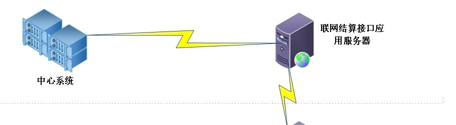

# 吉林省工伤保险联网结算协议机构接口开发手册

> 医院项目 H22010402403（长春市朝阳区中医院）专用 · 来源：核4吉林省工伤保险信息系统协议机构接口开发手册 V1.3

|  |  |  |  |
|:--:|:--:|:--:|:--:|
| 版本号 | 更改条款及内容 | 修改日期 | 修改人 |
| V1.0 | 建立文档 | 2023.7.27 | 方今、孙晓旭 |
| V1.1 | 增加学历字典，修改部分报文示例的问题 | 2023.8.17 | 毛胤全 |
| V1.2 | 去掉统筹区字段，新增行政区划字典，修改读卡交易说明 | 2023.9.13 | 毛胤全 |
| V1.3 | 增加1323交易“对账确认撤销”。在院端完成某个结算期对账确认后，在中心未办理月结算前可以进行撤销。 | 2023.11.22 | MJL |

# 引言

## 文档编制目的

吉林省工伤保险联网结算协议机构接口开发手册主要表述了吉林省工伤保险联网结算接口设计方案和对协议机构的交易描述。

本报告的阅读对象主要包括吉林省工伤保险信息系统用户方相关人员、协议机构软件开发人员及相关的其他人员等。

## 背景

系统框架设计为工伤联网部署，工伤联网结算业务相对独立运行，各协议机构需要与中心端系统进行对接。

根据工伤保险业务的发展趋势，需要完成对工伤联网结算系统的改造，使之满足工伤联网精细化、科学化管理的业务要求。

本次系统建设过程将严格依循系统建设规范标准，建成后的系统功能符合相关部门的需求，并进行流程、效率方面的优化，确保系统可靠、稳定、高效运行。

- 按照部版标准“核心平台四版”为基准建设。

- 实现全省数据大集中，应用一卡通。

## 词汇表

|  |  |  |
|:--:|:--:|:--:|
| 词汇名称 | 词汇含义 | 备注 |
| 交易 | 工伤联网接口客户端向接口发出的一种请求消息，接口需要作出应答 |  |
| 工伤联网接口 | 人社部门向协议机构公开的服务，是人社部门和协议机构之间的一个接口系统，完成两者之间的信息传递，使协议机构具备工伤联网患者业务实时处理功能 |  |

# 总体设计

## 系统架构

> 系统建设过程中将对已有的部分业务进行优化，涉及工伤联网的全部业务在协议机构自身系统进行操作，全部通过接口方式实现，无用户界面，输入输出均通过动态库方式完成。

<figure>

</figure>

## 网络环境：

协议机构通过专线与工伤联网接口应用连接。从安全可靠方面建议可采用不同运营商的双线路。

## 机器要求：

大型协议机构配置集群服务器，建议做成双机备份。小型协议机构建议采取集中托管模式。

# 系统接口设计

## 接口列表

按照服务内容不同，接口共分成5个大类、30个交易，接口编号为4位阿拉伯数字。接口分类框架和接口列表参见表

<table>
<colgroup>
<col style="width: 13%" />
<col style="width: 9%" />
<col style="width: 27%" />
<col style="width: 14%" />
<col style="width: 35%" />
</colgroup>
<thead>
<tr>
<th style="text-align: center;">接口编号</th>
<th style="text-align: center;">分类</th>
<th style="text-align: center;">接口名称</th>
<th style="text-align: center;">调用方式</th>
<th style="text-align: center;">描述</th>
</tr>
</thead>
<tbody>
<tr>
<td style="text-align: center;">1101</td>
<td rowspan="10" style="text-align: center;">业务类</td>
<td style="text-align: center;">读卡</td>
<td style="text-align: center;">实时</td>
<td style="text-align: center;"></td>
</tr>
<tr>
<td style="text-align: center;">2201</td>
<td style="text-align: center;">门诊/住院登记</td>
<td style="text-align: center;">实时</td>
<td style="text-align: center;"></td>
</tr>
<tr>
<td style="text-align: center;">2202</td>
<td style="text-align: center;">登记(挂号)撤销</td>
<td style="text-align: center;">实时</td>
<td style="text-align: center;"></td>
</tr>
<tr>
<td style="text-align: center;">2203</td>
<td style="text-align: center;">登记信息修改</td>
<td style="text-align: center;">实时</td>
<td style="text-align: center;"></td>
</tr>
<tr>
<td style="text-align: center;">2204</td>
<td style="text-align: center;">费用明细上报</td>
<td style="text-align: center;">实时</td>
<td style="text-align: center;"></td>
</tr>
<tr>
<td style="text-align: center;">2205</td>
<td style="text-align: center;">费用明细撤销</td>
<td style="text-align: center;">实时</td>
<td style="text-align: center;"></td>
</tr>
<tr>
<td style="text-align: center;">2206</td>
<td style="text-align: center;">费用预结算</td>
<td style="text-align: center;">实时</td>
<td style="text-align: center;"></td>
</tr>
<tr>
<td style="text-align: center;">2207</td>
<td style="text-align: center;">费用结算</td>
<td style="text-align: center;">实时</td>
<td style="text-align: center;"></td>
</tr>
<tr>
<td style="text-align: center;">2208</td>
<td style="text-align: center;">费用结算撤销</td>
<td style="text-align: center;">实时</td>
<td style="text-align: center;"></td>
</tr>
<tr>
<td style="text-align: center;">2209</td>
<td style="text-align: center;">冲正交易</td>
<td style="text-align: center;">实时</td>
<td style="text-align: center;"></td>
</tr>
<tr>
<td style="text-align: center;">2301</td>
<td rowspan="5" style="text-align: center;">上传类</td>
<td style="text-align: center;">审批信息上传</td>
<td style="text-align: center;">实时</td>
<td style="text-align: center;"></td>
</tr>
<tr>
<td style="text-align: center;">2302</td>
<td style="text-align: center;">上传审批信息撤销</td>
<td style="text-align: center;">实时</td>
<td style="text-align: center;"></td>
</tr>
<tr>
<td style="text-align: center;">2303</td>
<td style="text-align: center;">医师信息上传</td>
<td style="text-align: center;">实时</td>
<td style="text-align: center;"></td>
</tr>
<tr>
<td style="text-align: center;">2304</td>
<td style="text-align: center;">科室信息上传</td>
<td style="text-align: center;">实时</td>
<td style="text-align: center;"></td>
</tr>
<tr>
<td style="text-align: center;">2305</td>
<td style="text-align: center;">入院记录上传</td>
<td style="text-align: center;">实时</td>
<td style="text-align: center;"></td>
</tr>
<tr>
<td style="text-align: center;">1320</td>
<td rowspan="3" style="text-align: center;">对账类</td>
<td style="text-align: center;">总额对账</td>
<td style="text-align: center;">实时</td>
<td style="text-align: center;"></td>
</tr>
<tr>
<td style="text-align: center;">1321</td>
<td style="text-align: center;">明细对账</td>
<td style="text-align: center;">实时</td>
<td style="text-align: center;"></td>
</tr>
<tr>
<td style="text-align: center;">1322</td>
<td style="text-align: center;">对账确认</td>
<td style="text-align: center;">实时</td>
<td style="text-align: center;"></td>
</tr>
<tr>
<td style="text-align: center;">9001</td>
<td rowspan="2" style="text-align: center;">签到类</td>
<td style="text-align: center;">签到</td>
<td style="text-align: center;">实时</td>
<td style="text-align: center;"></td>
</tr>
<tr>
<td style="text-align: center;">9002</td>
<td style="text-align: center;">签退</td>
<td style="text-align: center;">实时</td>
<td style="text-align: center;"></td>
</tr>
<tr>
<td style="text-align: center;">1800</td>
<td rowspan="10" style="text-align: center;">查询类</td>
<td style="text-align: center;">获取中心端时间查询</td>
<td style="text-align: center;">实时</td>
<td style="text-align: center;"></td>
</tr>
<tr>
<td style="text-align: center;">9102</td>
<td style="text-align: center;">审批信息查询</td>
<td style="text-align: center;">实时</td>
<td style="text-align: center;"></td>
</tr>
<tr>
<td style="text-align: center;">9103</td>
<td style="text-align: center;">费用明细详细信息查询</td>
<td style="text-align: center;">实时</td>
<td style="text-align: center;"></td>
</tr>
<tr>
<td style="text-align: center;">9104</td>
<td style="text-align: center;">处方明细查询</td>
<td style="text-align: center;">实时</td>
<td style="text-align: center;"></td>
</tr>
<tr>
<td style="text-align: center;">9105</td>
<td style="text-align: center;">参保人近期就诊信息查询</td>
<td style="text-align: center;">实时</td>
<td style="text-align: center;"></td>
</tr>
<tr>
<td style="text-align: center;">9106</td>
<td style="text-align: center;">参保人在院信息查询</td>
<td style="text-align: center;">实时</td>
<td style="text-align: center;"></td>
</tr>
<tr>
<td style="text-align: center;">9200</td>
<td style="text-align: center;">辅助器具目录查询</td>
<td style="text-align: center;">实时</td>
<td style="text-align: center;"></td>
</tr>
<tr>
<td style="text-align: center;">9201</td>
<td style="text-align: center;">协议机构信息查询</td>
<td style="text-align: center;">实时</td>
<td style="text-align: center;"></td>
</tr>
<tr>
<td style="text-align: center;">9202</td>
<td style="text-align: center;">医师信息查询</td>
<td style="text-align: center;">实时</td>
<td style="text-align: center;"></td>
</tr>
<tr>
<td style="text-align: center;">9203</td>
<td style="text-align: center;">科室信息查询</td>
<td style="text-align: center;">实时</td>
<td style="text-align: center;"></td>
</tr>
</tbody>
</table>

## 用户接口函数

### 整体说明

- 本系统提供给医院的是一个动态库接口，无用户界面，输入输出均通过DLL完成。

- 程序文件名：JLSiInterface.dll

- 对外提供的接口函数：

  - 初始化函数:

    - int Si_INIT(char \* pErrMsg)

    - 功能描述：检查整个运行环境：包括网络环境、运行所需文件、参数等的检查

    - 返回值： 成功：返回0 ； 失败：返回 -1

  - 交易函数：

    - int Si_Busi(char\* inputdata, char\* outputdata)

    - 输入参数：inputdata

    - 输出参数：outputdata char\*

    - 返回值： 成功 =0 失败 \<0

### 报文格式

- 输入、输出参数采用JSON格式的字符串，区分大小写。没有入参的交易也要上传“交易输入”inputdata{}。

### 接口输入、输出报文格式定义

#### 入参格式

**inputdata**

交易输入参数定义

<table style="width:91%;">
<colgroup>
<col style="width: 7%" />
<col style="width: 12%" />
<col style="width: 15%" />
<col style="width: 6%" />
<col style="width: 5%" />
<col style="width: 5%" />
<col style="width: 6%" />
<col style="width: 29%" />
</colgroup>
<tbody>
<tr>
<td><blockquote>

序

号

</blockquote></td>
<td style="text-align: left;"><blockquote>

数据元标识

</blockquote></td>
<td style="text-align: left;"><blockquote>

数据元名称

</blockquote></td>
<td><blockquote>

类型

</blockquote></td>
<td><blockquote>

长度

</blockquote></td>
<td><blockquote>

代码

标识

</blockquote></td>
<td style="text-align: center;">是否必填</td>
<td style="text-align: center;"><blockquote>

备注

</blockquote></td>
</tr>
<tr>
<td><blockquote>

1

</blockquote></td>
<td style="text-align: center;">infno</td>
<td style="text-align: center;"><blockquote>

交易编号

</blockquote></td>
<td><blockquote>

字符型

</blockquote></td>
<td style="text-align: center;"><blockquote>

4

</blockquote></td>
<td style="text-align: center;"></td>
<td style="text-align: center;">Y</td>
<td style="text-align: left;"><blockquote>

交易编号详见接口列表

</blockquote></td>
</tr>
<tr>
<td><blockquote>

2

</blockquote></td>
<td style="text-align: center;">msgid</td>
<td style="text-align: left;"><blockquote>

发送方报文ID

</blockquote></td>
<td><blockquote>

字符型

</blockquote></td>
<td style="text-align: left;"><blockquote>

30

</blockquote></td>
<td style="text-align: center;"></td>
<td style="text-align: center;">Y</td>
<td style="text-align: left;"><blockquote>

协议机构编号(6)+时间(14)+ 顺序号(4)

时间格式：yyyyMMddHHmmss

不可重复

</blockquote></td>
</tr>
<tr>
<td><blockquote>

3

</blockquote></td>
<td style="text-align: center;">recer_sys_code</td>
<td style="text-align: left;">接收方系统代码</td>
<td><blockquote>

字符型

</blockquote></td>
<td style="text-align: left;"><blockquote>

10

</blockquote></td>
<td style="text-align: center;"></td>
<td style="text-align: center;">Y</td>
<td style="text-align: left;"><blockquote>

用于多套系统接入，区分不同系统使用。一期建设默认传入“JLYTH”

</blockquote></td>
</tr>
<tr>
<td><blockquote>

6

</blockquote></td>
<td style="text-align: center;">infver</td>
<td style="text-align: left;"><blockquote>

接口版本号

</blockquote></td>
<td><blockquote>

字符型

</blockquote></td>
<td style="text-align: center;"><blockquote>

6

</blockquote></td>
<td style="text-align: center;"></td>
<td style="text-align: center;">Y</td>
<td style="text-align: left;"><blockquote>

例如：“V1.0”，版本号由社保下发接口开发手册版本号为准。

</blockquote></td>
</tr>
<tr>
<td><blockquote>

7

</blockquote></td>
<td style="text-align: center;">opter_type</td>
<td style="text-align: left;"><blockquote>

经办人类别

</blockquote></td>
<td><blockquote>

字符型

</blockquote></td>
<td style="text-align: center;"><blockquote>

3

</blockquote></td>
<td style="text-align: center;">Y</td>
<td style="text-align: center;">Y</td>
<td style="text-align: left;"><blockquote>

1-经办人；2-自助终端；3-移动终端

</blockquote></td>
</tr>
<tr>
<td><blockquote>

8

</blockquote></td>
<td style="text-align: center;">opter</td>
<td style="text-align: center;">经办人</td>
<td><blockquote>

字符型

</blockquote></td>
<td style="text-align: left;"><blockquote>

30

</blockquote></td>
<td style="text-align: center;"></td>
<td style="text-align: center;">Y</td>
<td style="text-align: center;"><blockquote>

按要求传入经办人/终端编号

</blockquote></td>
</tr>
<tr>
<td><blockquote>

9

</blockquote></td>
<td style="text-align: center;">opter_name</td>
<td style="text-align: left;"><blockquote>

经办人姓名

</blockquote></td>
<td><blockquote>

字符型

</blockquote></td>
<td style="text-align: left;"><blockquote>

50

</blockquote></td>
<td style="text-align: center;"></td>
<td style="text-align: center;">Y</td>
<td style="text-align: left;"><blockquote>

按要求传入经办人姓名/终端名称

</blockquote></td>
</tr>
<tr>
<td><blockquote>

10

</blockquote></td>
<td style="text-align: center;">inf_time</td>
<td style="text-align: center;"><blockquote>

交易时间

</blockquote></td>
<td style="text-align: center;">日期时间型</td>
<td style="text-align: left;"><blockquote>

20

</blockquote></td>
<td style="text-align: center;"></td>
<td style="text-align: center;">Y</td>
<td style="text-align: left;"><blockquote>

时间格式：yyyyMMddHHmmss

</blockquote></td>
</tr>
<tr>
<td><blockquote>

11

</blockquote></td>
<td style="text-align: left;"><blockquote>

fixmedins_code

</blockquote></td>
<td style="text-align: left;">协议机构编号</td>
<td>字符型</td>
<td style="text-align: left;"><blockquote>

12

</blockquote></td>
<td style="text-align: center;"></td>
<td style="text-align: center;">Y</td>
<td style="text-align: left;"></td>
</tr>
<tr>
<td><blockquote>

12

</blockquote></td>
<td style="text-align: center;">sign_no</td>
<td style="text-align: left;"><blockquote>

签到流水号

</blockquote></td>
<td><blockquote>

字符型

</blockquote></td>
<td style="text-align: left;"><blockquote>

30

</blockquote></td>
<td style="text-align: center;"></td>
<td style="text-align: center;"><blockquote>

Y

</blockquote></td>
<td style="text-align: left;"><blockquote>

通过签到【9100】交易获取，除签到交易外不可为空。

</blockquote></td>
</tr>
<tr>
<td><blockquote>

13

</blockquote></td>
<td style="text-align: center;">idfi_mode</td>
<td style="text-align: left;"><blockquote>

识别方式

</blockquote></td>
<td><blockquote>

字符型

</blockquote></td>
<td style="text-align: center;"><blockquote>

3

</blockquote></td>
<td style="text-align: center;">Y</td>
<td style="text-align: center;">Y</td>
<td style="text-align: center;">
1.实体社保卡；2-电子社保卡

暂时只支持实体社保卡，后续会扩展
</td>
</tr>
<tr>
<td><blockquote>

14

</blockquote></td>
<td style="text-align: center;">input</td>
<td style="text-align: center;"><blockquote>

交易输入

</blockquote></td>
<td><blockquote>

字符型

</blockquote></td>
<td><blockquote>

40000

</blockquote></td>
<td style="text-align: left;"></td>
<td style="text-align: center;">Y</td>
<td style="text-align: center;"></td>
</tr>
</tbody>
</table>

> 交易格式定义如下：

<table style="width:86%;">
<colgroup>
<col style="width: 86%" />
</colgroup>
<tbody>
<tr>
<td style="text-align: left;">
//单行输入

{

     "inputdata": {

        "infno": "9001",

        "msgid": "H000001202008050101010001",

        "recer_sys_code": "JLYTH",

        "infver": "V1.0",

        "opter_type": "1",

        "opter": "1001",

        "opter_name": "测试HIS操作员",

        "inf_time": "20200805010101",

        "fixmedins_code": "102",

        "sign_no": "CS1001100120220908103053",

        "idfi_mode": "1",

        "input": {

           "data1": "string1",

"data2": "string2",

……

"datan": "stringn"

        }

    }

}
</td>
</tr>
<tr>
<td style="text-align: left;">
//多行输入

{

     "inputdata": {

        "infno": "2303",

        "msgid": "H000001202008050101010001",

        "recer_sys_code": "JLYTH",

        "infver": "V1.0",

        "opter_type": "1",

        "opter": "1001",

        "opter_name": "测试HIS操作员",

        "inf_time": "20200805010101",

        "fixmedins_code": "102",

        "sign_no": "CS1001100120220908103053",

        "idfi_mode": "1",

        "inputs": [{

           "data1": "string1",

"data2": "string2",

……

"datan": "stringn"

        },{

 "data1": "string1",

"data2": "string2",

……

"datan": "stringn"

}]

    }

}
</td>
</tr>
</tbody>
</table>

#### 出参格式

交易输出参数定义

<table style="width:87%;">
<colgroup>
<col style="width: 3%" />
<col style="width: 12%" />
<col style="width: 14%" />
<col style="width: 7%" />
<col style="width: 5%" />
<col style="width: 5%" />
<col style="width: 6%" />
<col style="width: 30%" />
</colgroup>
<tbody>
<tr>
<td><blockquote>

序

号

</blockquote></td>
<td><blockquote>

数据元标识

</blockquote></td>
<td style="text-align: left;"><blockquote>

数据元名称

</blockquote></td>
<td style="text-align: left;"><blockquote>

类型

</blockquote></td>
<td><blockquote>

长度

</blockquote></td>
<td><blockquote>

代码

标识

</blockquote></td>
<td><blockquote>

是否

非空

</blockquote></td>
<td style="text-align: center;">备注</td>
</tr>
<tr>
<td style="text-align: left;"><blockquote>

1

</blockquote></td>
<td style="text-align: center;">infcode</td>
<td style="text-align: left;"><blockquote>

交易状态码

</blockquote></td>
<td style="text-align: left;"><blockquote>

数值型

</blockquote></td>
<td style="text-align: center;">4</td>
<td style="text-align: center;"></td>
<td style="text-align: center;">Y</td>
<td style="text-align: left;">详见下节</td>
</tr>
<tr>
<td style="text-align: left;"><blockquote>

2

</blockquote></td>
<td><blockquote>

inf_refmsgid

</blockquote></td>
<td style="text-align: left;"><blockquote>

接收方报文ID

</blockquote></td>
<td style="text-align: left;"><blockquote>

字符型

</blockquote></td>
<td style="text-align: center;">30</td>
<td style="text-align: center;"></td>
<td style="text-align: center;">Y</td>
<td style="text-align: center;">
接收方返回，接收方系统区划代码

(6)+时间(14)+流水号(10) 时间格式：yyyyMMddHHmmss
</td>
</tr>
<tr>
<td style="text-align: left;"><blockquote>

3

</blockquote></td>
<td style="text-align: left;"><blockquote>

refmsg_time

</blockquote></td>
<td style="text-align: left;"><blockquote>

接收报文时间

</blockquote></td>
<td style="text-align: left;"><blockquote>

字符型

</blockquote></td>
<td style="text-align: center;">17</td>
<td style="text-align: center;"></td>
<td style="text-align: center;">Y</td>
<td style="text-align: left;">格式：yyyyMMddHHmmssSSS</td>
</tr>
<tr>
<td style="text-align: left;"><blockquote>

4

</blockquote></td>
<td><blockquote>

respond_time

</blockquote></td>
<td style="text-align: left;"><blockquote>

响应报文时间

</blockquote></td>
<td style="text-align: left;"><blockquote>

字符型

</blockquote></td>
<td style="text-align: center;">17</td>
<td style="text-align: center;"></td>
<td style="text-align: center;">Y</td>
<td style="text-align: left;">格式：yyyyMMddHHmmssSSS</td>
</tr>
<tr>
<td style="text-align: left;"><blockquote>

7

</blockquote></td>
<td style="text-align: center;">err_msg</td>
<td style="text-align: center;">错误信息</td>
<td style="text-align: left;"><blockquote>

字符型

</blockquote></td>
<td style="text-align: left;"><blockquote>

200

</blockquote></td>
<td style="text-align: center;"></td>
<td style="text-align: center;"></td>
<td style="text-align: left;">交易失败状态下，业务返回的错误信息</td>
</tr>
<tr>
<td style="text-align: left;"></td>
<td style="text-align: center;">warn_msg</td>
<td style="text-align: center;">提示信息</td>
<td style="text-align: left;"><blockquote>

字符型

</blockquote></td>
<td style="text-align: left;"><blockquote>

200

</blockquote></td>
<td style="text-align: center;"></td>
<td style="text-align: center;"></td>
<td style="text-align: left;">交易成功状态下，业务返回的提示信息</td>
</tr>
<tr>
<td style="text-align: left;"><blockquote>

8

</blockquote></td>
<td style="text-align: center;">output</td>
<td style="text-align: center;">交易输出</td>
<td style="text-align: left;"><blockquote>

字符型

</blockquote></td>
<td><blockquote>

40000

</blockquote></td>
<td style="text-align: center;"></td>
<td style="text-align: center;"></td>
<td style="text-align: center;"></td>
</tr>
</tbody>
</table>

### 交易状态码说明

> 交易状态码(infcode)为2位编码，表示本次请求省工伤保险信息系统是否正常接收成功。具体规格如下表：
>
> 报文状态说明

|      |          |        |      |
|:-----|:--------:|:------:|:----:|
| 序号 | STATUS值 | 值说明 | 备注 |
| 1    |    0     |  成功  |      |
| 2    |    -1    |  失败  |      |

# 接口关键流程

## 认证类流程图

## 医院门诊/住院登记开发流程图

## 医院处方明细上传流程图

## 医院费用结算流程图

## 医院费用结算撤消、登记（挂号）撤消流程图

# 接口交易详细设计

此部分主要对工伤联网接口交易的各具体业务作详细说明。

## 业务类

### 交易功能描述

- 该类交易主要完成参保患者挂号登记、处方上报、预结算、结算及撤销结算等各项业务处理。

- 在事务提交方面，由工伤联网接口自动控制事务。如果客户端需要取消事务，可以发起撤销交易请求。

### 交易设计

#### 读卡（1101）

##### 交易说明

- 通过此交易获取人员信息。

- qualification_id，工伤医疗费资格审核信息ID为读卡患者当前有效的就医审批(不包括工伤定点审批)，如果该患者当前存在多条有效审批，则只返回一条审批的信息ID。如果直接用于登记，可能造成没有审批问题。故建议通过审批信息查询交易查询该患者所有审批后根据医疗实际情况再行选择审核信息ID进行登记。

- 无输入，输出为单行数据。

##### 输入

- 无

##### 输出

输出-基本信息（节点标识：output）

<table style="width:87%;">
<colgroup>
<col style="width: 5%" />
<col style="width: 17%" />
<col style="width: 15%" />
<col style="width: 9%" />
<col style="width: 8%" />
<col style="width: 8%" />
<col style="width: 9%" />
<col style="width: 11%" />
</colgroup>
<tbody>
<tr>
<td>序号</td>
<td style="text-align: center;">参数代码</td>
<td style="text-align: center;">参数名称</td>
<td><blockquote>

参数类型

</blockquote></td>
<td><blockquote>

参数长度

</blockquote></td>
<td><blockquote>

代码标识

</blockquote></td>
<td><blockquote>

是否非空

</blockquote></td>
<td style="text-align: center;">说明</td>
</tr>
<tr>
<td style="text-align: center;">1</td>
<td style="text-align: center;">psn_no</td>
<td style="text-align: center;">个人唯一识别码</td>
<td style="text-align: left;"><blockquote>

数值型

</blockquote></td>
<td style="text-align: center;">20</td>
<td style="text-align: center;"></td>
<td style="text-align: center;">Y</td>
<td style="text-align: left;"></td>
</tr>
<tr>
<td style="text-align: center;">2</td>
<td style="text-align: center;">emp_no</td>
<td style="text-align: left;"><blockquote>

单位唯一识别码

</blockquote></td>
<td style="text-align: left;"><blockquote>

数值型

</blockquote></td>
<td style="text-align: center;">16</td>
<td style="text-align: center;"></td>
<td style="text-align: center;">Y</td>
<td style="text-align: left;"></td>
</tr>
<tr>
<td style="text-align: center;">3</td>
<td style="text-align: center;">emp_name</td>
<td style="text-align: center;"><mark>单位名称</mark></td>
<td style="text-align: left;"><blockquote>

字符型

</blockquote></td>
<td style="text-align: center;">200</td>
<td style="text-align: center;"></td>
<td style="text-align: center;">Y</td>
<td style="text-align: left;"></td>
</tr>
<tr>
<td style="text-align: center;">4</td>
<td style="text-align: center;">certno</td>
<td style="text-align: center;">证件号码</td>
<td style="text-align: left;"><blockquote>

字符型

</blockquote></td>
<td style="text-align: center;">50</td>
<td style="text-align: center;"></td>
<td style="text-align: center;">Y</td>
<td style="text-align: left;"></td>
</tr>
<tr>
<td style="text-align: center;">5</td>
<td style="text-align: center;">psn_name</td>
<td style="text-align: center;"><mark>姓名</mark></td>
<td style="text-align: left;"><blockquote>

字符型

</blockquote></td>
<td style="text-align: center;">50</td>
<td style="text-align: center;"></td>
<td style="text-align: center;">Y</td>
<td style="text-align: left;"></td>
</tr>
<tr>
<td style="text-align: center;">6</td>
<td style="text-align: center;">gend</td>
<td style="text-align: center;">性别</td>
<td style="text-align: left;"><blockquote>

字符型

</blockquote></td>
<td style="text-align: center;">6</td>
<td style="text-align: center;">Y</td>
<td style="text-align: center;">Y</td>
<td style="text-align: left;"></td>
</tr>
<tr>
<td style="text-align: center;">7</td>
<td style="text-align: center;">age</td>
<td style="text-align: center;">年龄</td>
<td style="text-align: left;"><blockquote>

数值型

</blockquote></td>
<td style="text-align: center;">4,1</td>
<td style="text-align: center;"></td>
<td style="text-align: center;">Y</td>
<td style="text-align: left;"></td>
</tr>
<tr>
<td style="text-align: center;">8</td>
<td style="text-align: center;">inhosp_stas</td>
<td style="text-align: center;"><mark>在院状态</mark></td>
<td style="text-align: left;"><blockquote>

字符型

</blockquote></td>
<td style="text-align: center;">3</td>
<td style="text-align: center;">Y</td>
<td style="text-align: center;">Y</td>
<td style="text-align: left;"></td>
</tr>
<tr>
<td style="text-align: center;">9</td>
<td style="text-align: center;">certificate_type</td>
<td style="text-align: center;"><mark>证件类型</mark></td>
<td style="text-align: left;"><blockquote>

<mark>字符型</mark>

</blockquote></td>
<td style="text-align: center;">3</td>
<td style="text-align: center;"><blockquote>

Y

</blockquote></td>
<td style="text-align: center;"></td>
<td style="text-align: left;"></td>
</tr>
<tr>
<td style="text-align: center;">10</td>
<td style="text-align: center;">birthday</td>
<td style="text-align: center;">出生日期</td>
<td style="text-align: left;"><blockquote>

数值型

</blockquote></td>
<td style="text-align: center;">8</td>
<td style="text-align: center;"></td>
<td style="text-align: center;"></td>
<td style="text-align: left;"><blockquote>

yyyyMMdd

</blockquote></td>
</tr>
</tbody>
</table>

输出-工伤诊断结论（节点标识diagnosis）多条参数

<table style="width:87%;">
<colgroup>
<col style="width: 5%" />
<col style="width: 17%" />
<col style="width: 15%" />
<col style="width: 9%" />
<col style="width: 8%" />
<col style="width: 8%" />
<col style="width: 9%" />
<col style="width: 11%" />
</colgroup>
<tbody>
<tr>
<td>序号</td>
<td style="text-align: center;">参数代码</td>
<td style="text-align: center;">参数名称</td>
<td><blockquote>

参数类型

</blockquote></td>
<td><blockquote>

参数长度

</blockquote></td>
<td><blockquote>

代码标识

</blockquote></td>
<td><blockquote>

是否非空

</blockquote></td>
<td style="text-align: center;">说明</td>
</tr>
<tr>
<td style="text-align: center;">1</td>
<td style="text-align: center;">psn_type</td>
<td style="text-align: center;">工伤人员类别</td>
<td style="text-align: left;"><blockquote>

字符型

</blockquote></td>
<td style="text-align: center;">3</td>
<td style="text-align: center;">Y</td>
<td style="text-align: center;"></td>
<td style="text-align: left;"></td>
</tr>
<tr>
<td style="text-align: center;">2</td>
<td style="text-align: center;">trt_chk_rslt</td>
<td style="text-align: center;"><mark>待遇不享受原因</mark></td>
<td><mark>字符型</mark></td>
<td style="text-align: center;">500</td>
<td style="text-align: center;"></td>
<td style="text-align: center;"></td>
<td style="text-align: left;"></td>
</tr>
<tr>
<td style="text-align: center;">3</td>
<td style="text-align: left;"><blockquote>

injured_conclusion

</blockquote></td>
<td style="text-align: left;"><blockquote>

认定诊断结论

</blockquote></td>
<td style="text-align: left;"><blockquote>

字符型

</blockquote></td>
<td style="text-align: center;">500</td>
<td style="text-align: center;"></td>
<td style="text-align: center;"></td>
<td style="text-align: left;"></td>
</tr>
<tr>
<td style="text-align: center;">4</td>
<td style="text-align: center;">visit_type</td>
<td style="text-align: center;">就诊类型</td>
<td style="text-align: left;"><blockquote>

字符型

</blockquote></td>
<td style="text-align: center;">500</td>
<td style="text-align: center;"><blockquote>

Y

</blockquote></td>
<td style="text-align: center;"></td>
<td style="text-align: left;"></td>
</tr>
<tr>
<td style="text-align: center;">5</td>
<td style="text-align: center;">insu_admdvs</td>
<td style="text-align: center;"><mark>统筹区号</mark></td>
<td style="text-align: left;"><blockquote>

字符型

</blockquote></td>
<td style="text-align: center;">16</td>
<td style="text-align: center;"><blockquote>

Y

</blockquote></td>
<td style="text-align: center;"></td>
<td style="text-align: left;"></td>
</tr>
<tr>
<td style="text-align: center;">6</td>
<td style="text-align: center;">injureAffirmID</td>
<td style="text-align: center;"><mark>认定信息ID</mark></td>
<td><blockquote>

数值型

</blockquote></td>
<td style="text-align: center;">16</td>
<td style="text-align: center;"></td>
<td style="text-align: center;"></td>
<td style="text-align: left;"></td>
</tr>
<tr>
<td style="text-align: center;">7</td>
<td style="text-align: center;">qualification_id</td>
<td style="text-align: center;">工伤医疗费资格审核信息ID</td>
<td><blockquote>

数值型

</blockquote></td>
<td style="text-align: center;">16</td>
<td style="text-align: center;"></td>
<td style="text-align: center;"></td>
<td style="text-align: left;"></td>
</tr>
<tr>
<td style="text-align: center;">8</td>
<td style="text-align: center;">injured_sites</td>
<td style="text-align: center;">认定受伤部位</td>
<td style="text-align: left;"><blockquote>

字符型

</blockquote></td>
<td style="text-align: center;">500</td>
<td style="text-align: center;"></td>
<td style="text-align: center;"></td>
<td style="text-align: left;"><blockquote>

如果存在多部位，则用分号“；”隔开

</blockquote></td>
</tr>
<tr>
<td style="text-align: center;">9</td>
<td style="text-align: center;">injured_site_details</td>
<td style="text-align: center;">认定受伤部位简述</td>
<td style="text-align: left;"><blockquote>

字符型

</blockquote></td>
<td style="text-align: center;">3000</td>
<td style="text-align: center;"></td>
<td style="text-align: center;"></td>
<td style="text-align: left;"><blockquote>

如果存在多部位，则用分号“；”隔开

</blockquote></td>
</tr>
<tr>
<td style="text-align: center;">10</td>
<td style="text-align: center;">injured_part</td>
<td style="text-align: center;">鉴定受伤部位</td>
<td style="text-align: left;"><blockquote>

字符型

</blockquote></td>
<td style="text-align: center;">500</td>
<td style="text-align: center;"></td>
<td style="text-align: center;"></td>
<td style="text-align: left;"></td>
</tr>
<tr>
<td style="text-align: center;">11</td>
<td style="text-align: center;">injured_part_detail</td>
<td style="text-align: center;">鉴定受伤部位简述</td>
<td style="text-align: left;"><blockquote>

字符型

</blockquote></td>
<td style="text-align: center;">3000</td>
<td style="text-align: center;"></td>
<td style="text-align: center;"></td>
<td style="text-align: left;"></td>
</tr>
<tr>
<td style="text-align: center;">12</td>
<td style="text-align: center;">once_med_flag</td>
<td style="text-align: center;">是否领取一次性医疗补助</td>
<td style="text-align: left;"><blockquote>

字符型

</blockquote></td>
<td style="text-align: center;">3</td>
<td style="text-align: center;"><blockquote>

Y

</blockquote></td>
<td style="text-align: center;"></td>
<td style="text-align: left;"></td>
</tr>
</tbody>
</table>

##### 报文示例

<table style="width:88%;">
<colgroup>
<col style="width: 6%" />
<col style="width: 81%" />
</colgroup>
<tbody>
<tr>
<td style="text-align: center;">输入报文</td>
<td style="text-align: left;">
{

    "inputdata":{

        "infno":"1101",

        "msgid":"H000001202008050101010001",

        "recer_sys_code":"LNYTH",

        "infver":"V1.0",

        "opter_type":"1",

        "opter":"1001",

        "opter_name":"测试HIS操作员",

        "inf_time":"20200805010101",

        "fixmedins_code":"102",

        "sign_no":"CS1001100120220908103053",

        "idfi_mode":"1",

        "input":{

        }

    }

}
</td>
</tr>
<tr>
<td style="text-align: center;">输出报文</td>
<td style="text-align: left;">
{

    "infcode": "0",

    "inf_refmsgid": "410000050236671620221014161211",

    "refmsg_time": "20221014161211",

    "respond_time": "20221014161216",

    "err_msg": null,

    "warn_msg": null,

    "output": {

        "psn_no": "2101005010401",

        "emp_no": "21180120107479",

        "emp_name": "234234",

        "certno": "210112197403122451",

        "psn_name": "孙国贵",

        "gend": "1",

        "age": "48",

        "insu_admdvs": null,

        "inhosp_stas": "0",

        "certificate_type": "01",

        "birthday": 19171215,

        "diagnosis": [

            {

                "qualification_id": 4100000502364490,

                "psn_type": "01",

                "trt_chk_rslt": "是否享受待遇校验:受伤当月未参保",

                "insu_admdvs": "219900",

                "injureAffirmID": 21180100014540,

                "injured_injured_conclusion": "给发射点发射点发",

                "visit_type": "11,13",

                "injured_sites":"",

                "injured_site_details":"",

                "injured_part":"",

                "injured_part_detail":"",

                "once_med_flag":"0"

            }

        ]

    }

}
</td>
</tr>
</tbody>
</table>

#### 门诊/住院登记(2201)

##### 交易说明

- 门诊/住院流水号应保持院内唯一，不得重复，包括不能与老系统历史数据重复。取消挂号或无费退院后重新办理的，应更换门诊/住院流水号。冲正处理后，再次挂号或住院登记可使用原门诊/住院流水号。

- 中心校验就诊类别、人员身份的对应关系。

- 输入为单行数据，无输出。

##### 输入

输入（节点标识：input）

<table style="width:86%;">
<colgroup>
<col style="width: 4%" />
<col style="width: 17%" />
<col style="width: 16%" />
<col style="width: 7%" />
<col style="width: 7%" />
<col style="width: 5%" />
<col style="width: 6%" />
<col style="width: 21%" />
</colgroup>
<tbody>
<tr>
<td><blockquote>

序

号

</blockquote></td>
<td style="text-align: center;">参数代码</td>
<td style="text-align: center;">参数名称</td>
<td style="text-align: center;">参数类型</td>
<td><blockquote>

参数

长度

</blockquote></td>
<td><blockquote>

代码

标识

</blockquote></td>
<td><blockquote>

是否

必填

</blockquote></td>
<td style="text-align: center;">说明</td>
</tr>
<tr>
<td style="text-align: center;">1</td>
<td style="text-align: center;">ipt_otp_no</td>
<td style="text-align: center;"><mark>门诊/住院流水号</mark></td>
<td style="text-align: center;"><blockquote>

字符型

</blockquote></td>
<td style="text-align: center;">20</td>
<td style="text-align: center;"></td>
<td style="text-align: center;">Y</td>
<td style="text-align: center;"><mark>唯一</mark></td>
</tr>
<tr>
<td style="text-align: center;">2</td>
<td style="text-align: center;">med_type</td>
<td style="text-align: center;"><mark>就诊类别</mark></td>
<td style="text-align: center;"><blockquote>

字符型

</blockquote></td>
<td style="text-align: center;">3</td>
<td style="text-align: center;">Y</td>
<td style="text-align: center;">Y</td>
<td style="text-align: left;"></td>
</tr>
<tr>
<td style="text-align: center;">3</td>
<td style="text-align: center;">adm_time</td>
<td style="text-align: center;"><mark>门诊/住院入院时间</mark></td>
<td style="text-align: center;">数值型</td>
<td style="text-align: center;"></td>
<td style="text-align: center;"></td>
<td style="text-align: left;">Y</td>
<td style="text-align: left;">
按照日期格式

YYYYMMDDHH24MISS
</td>
</tr>
<tr>
<td style="text-align: center;">4</td>
<td style="text-align: left;"><blockquote>

adm_diag_dscr

</blockquote></td>
<td style="text-align: left;"><blockquote>

<mark>诊断疾病编码</mark>

</blockquote></td>
<td style="text-align: center;"><blockquote>

字符型

</blockquote></td>
<td style="text-align: center;">20</td>
<td style="text-align: center;"></td>
<td style="text-align: center;">Y</td>
<td style="text-align: left;">ICD10病种库，入院只能上传一个病种编码</td>
</tr>
<tr>
<td style="text-align: center;">5</td>
<td style="text-align: center;">wardarea_name</td>
<td style="text-align: left;"><blockquote>

<mark>病区名称</mark>

</blockquote></td>
<td style="text-align: center;"><blockquote>

字符型

</blockquote></td>
<td style="text-align: center;">50</td>
<td style="text-align: center;"></td>
<td style="text-align: center;"></td>
<td style="text-align: left;"></td>
</tr>
<tr>
<td style="text-align: center;">6</td>
<td style="text-align: center;">adm_dept_codg</td>
<td style="text-align: left;"><blockquote>

<mark>科室编码</mark>

</blockquote></td>
<td style="text-align: center;"><blockquote>

字符型

</blockquote></td>
<td style="text-align: center;">20</td>
<td style="text-align: center;"></td>
<td style="text-align: center;">Y</td>
<td style="text-align: left;"></td>
</tr>
<tr>
<td style="text-align: center;">7</td>
<td style="text-align: center;">adm_bed</td>
<td style="text-align: left;"><blockquote>

<mark>床位号</mark>

</blockquote></td>
<td style="text-align: center;"><blockquote>

字符型

</blockquote></td>
<td style="text-align: center;">20</td>
<td style="text-align: center;"></td>
<td style="text-align: center;"></td>
<td style="text-align: left;">院内真实床位号</td>
</tr>
<tr>
<td style="text-align: center;">8</td>
<td style="text-align: center;">atddr_no</td>
<td style="text-align: center;"><mark>医生编码</mark></td>
<td style="text-align: center;"><blockquote>

字符型

</blockquote></td>
<td style="text-align: center;">20</td>
<td style="text-align: center;"></td>
<td style="text-align: center;">Y</td>
<td style="text-align: left;"></td>
</tr>
<tr>
<td style="text-align: left;"><blockquote>

9

</blockquote></td>
<td style="text-align: center;">tel</td>
<td style="text-align: center;"><mark>病人联系电话</mark></td>
<td style="text-align: center;"><blockquote>

字符型

</blockquote></td>
<td style="text-align: center;">20</td>
<td style="text-align: center;"></td>
<td style="text-align: center;">Y</td>
<td style="text-align: left;">如果无法获取，可以默认传“0”</td>
</tr>
<tr>
<td style="text-align: left;"><blockquote>

10

</blockquote></td>
<td style="text-align: center;">psn_no</td>
<td style="text-align: center;">个人唯一识别码</td>
<td style="text-align: center;"><blockquote>

数值型

</blockquote></td>
<td style="text-align: center;">20</td>
<td style="text-align: center;"></td>
<td style="text-align: center;">Y</td>
<td style="text-align: left;"></td>
</tr>
<tr>
<td style="text-align: left;"><blockquote>

11

</blockquote></td>
<td style="text-align: center;">ipt_no</td>
<td style="text-align: center;"><mark>住院号</mark></td>
<td style="text-align: center;"><blockquote>

字符型

</blockquote></td>
<td style="text-align: center;">50</td>
<td style="text-align: center;"></td>
<td style="text-align: center;"></td>
<td style="text-align: left;">住院类交易住院号不能为空</td>
</tr>
<tr>
<td style="text-align: left;"><blockquote>

12

</blockquote></td>
<td style="text-align: center;">qualification_id</td>
<td style="text-align: center;">工伤医疗费资格审核信息ID</td>
<td style="text-align: center;"><blockquote>

数值型

</blockquote></td>
<td style="text-align: center;">16</td>
<td style="text-align: center;"></td>
<td style="text-align: center;">Y</td>
<td style="text-align: left;"></td>
</tr>
</tbody>
</table>

##### 输出

- 无

##### 报文示例

<table style="width:88%;">
<colgroup>
<col style="width: 6%" />
<col style="width: 81%" />
</colgroup>
<tbody>
<tr>
<td style="text-align: center;">输入报文</td>
<td style="text-align: left;">
{

    "inputdata":{

        "infno":"2201",

        "msgid":"l122132ab4011",

        "recer_sys_code":"LNYTH",

        "infver":"V1.0",

        "opter_type":"1",

        "opter":"1001",

        "opter_name":"测试HIS操作员",

        "inf_time":"20200905010101",

        "fixmedins_code":"102",

        "sign_no":"102100120230612154626",

        "idfi_mode":"1",

        "input":{

            "ipt_otp_no":"lzf91",

            "med_type":"11",

            "adm_time":"20230207120101",

            "adm_diag_dscr":"bz0001",

            "wardarea_name":"测试病区",

            "adm_dept_codg":"ks1101",

            "adm_bed":"01",

            "atddr_no":"123",

            "tel":"18666666666",

            "psn_no":"21180111223415",

            "ipt_no":"2",

            "qualification_id":"4100000502404103"

        }

    }

}
</td>
</tr>
<tr>
<td style="text-align: center;">输出报文</td>
<td style="text-align: left;">
{

    "err_msg": "",

    "inf_refmsgid": "3562120230721100127",

    "infcode": "0",

    "output": {},

    "refmsg_time": "20230721100127",

    "respond_time": "20230721100127",

    "warn_msg": ""

}
</td>
</tr>
</tbody>
</table>

#### 登记(挂号)撤销(2202)

##### 交易说明

- 要撤销的门诊/住院号没有发生费用可以进行登记撤销。如果已发生费用且没有费用结算的，自动将已上传处方作废处理并撤销登记(挂号)。如果已发生费用且已费用结算，则不允许撤销登记(挂号)，需要先进行费用结算撤销。

- 输入为单行数据，无输出。

##### 输入

输入（节点标识：input）

<table style="width:86%;">
<colgroup>
<col style="width: 4%" />
<col style="width: 14%" />
<col style="width: 18%" />
<col style="width: 8%" />
<col style="width: 8%" />
<col style="width: 5%" />
<col style="width: 6%" />
<col style="width: 19%" />
</colgroup>
<tbody>
<tr>
<td><blockquote>

序

号

</blockquote></td>
<td style="text-align: center;">参数代码</td>
<td style="text-align: center;">参数名称</td>
<td style="text-align: center;">参数类型</td>
<td><blockquote>

参数

长度

</blockquote></td>
<td><blockquote>

代码

标识

</blockquote></td>
<td><blockquote>

是否

必填

</blockquote></td>
<td style="text-align: center;">说明</td>
</tr>
<tr>
<td style="text-align: center;">1</td>
<td style="text-align: center;">ipt_otp_no</td>
<td style="text-align: center;"><mark>门诊/住院流水号</mark></td>
<td style="text-align: center;"><blockquote>

字符型

</blockquote></td>
<td style="text-align: center;">20</td>
<td style="text-align: center;"></td>
<td style="text-align: center;">Y</td>
<td style="text-align: center;">同登记时的门诊/住院流水号</td>
</tr>
</tbody>
</table>

##### 输出

- 无

##### 报文示例

<table style="width:88%;">
<colgroup>
<col style="width: 6%" />
<col style="width: 81%" />
</colgroup>
<tbody>
<tr>
<td style="text-align: center;">输入报文</td>
<td style="text-align: left;">
{

    "inputdata":{

        "infno":"2202",

        "msgid":"l122132ab131-13",

        "recer_sys_code":"LNYTH",

        "infver":"V1.0",

        "opter_type":"1",

        "opter":"1001",

        "opter_name":"测试HIS操作员",

        "inf_time":"20201204010101",

        "fixmedins_code":"102",

        "sign_no":"102100120230612154626",

        "idfi_mode":"1",

        "input":{

            "ipt_otp_no":"lzf92-562"

        }

    }

}
</td>
</tr>
<tr>
<td style="text-align: center;">输出报文</td>
<td style="text-align: left;">
{

    "err_msg": "",

    "inf_refmsgid": "3562120230721100127",

    "infcode": "0",

    "output": {},

    "refmsg_time": "20230721100127",

    "respond_time": "20230721100127",

    "warn_msg": ""

}
</td>
</tr>
</tbody>
</table>

#### 登记信息修改(2203)

##### 交易说明

- 用于在院期间修改住院类登记的疾病、病区、科室等信息。

- 输入为单行数据，无输出。

- 前四位入参不可以修改。第五位后的入参只针对非空信息修改中心就诊登记数据。

##### 输入

输入（节点标识：input）

<table style="width:86%;">
<colgroup>
<col style="width: 4%" />
<col style="width: 15%" />
<col style="width: 17%" />
<col style="width: 7%" />
<col style="width: 7%" />
<col style="width: 5%" />
<col style="width: 6%" />
<col style="width: 21%" />
</colgroup>
<tbody>
<tr>
<td><blockquote>

序

号

</blockquote></td>
<td style="text-align: center;">参数代码</td>
<td style="text-align: center;">参数名称</td>
<td style="text-align: center;">参数类型</td>
<td><blockquote>

参数

长度

</blockquote></td>
<td><blockquote>

代码

标识

</blockquote></td>
<td><blockquote>

是否

必填

</blockquote></td>
<td style="text-align: center;">说明</td>
</tr>
<tr>
<td style="text-align: center;">1</td>
<td style="text-align: center;">ipt_otp_no</td>
<td style="text-align: center;"><mark>住院流水号</mark></td>
<td style="text-align: center;"><blockquote>

字符型

</blockquote></td>
<td style="text-align: center;">20</td>
<td style="text-align: center;"></td>
<td style="text-align: center;">Y</td>
<td style="text-align: center;">同登记时的住院流水号</td>
</tr>
<tr>
<td style="text-align: center;">2</td>
<td style="text-align: center;">adm_time</td>
<td style="text-align: center;"><mark>住院入院时间</mark></td>
<td style="text-align: center;">字符型</td>
<td style="text-align: center;"></td>
<td style="text-align: center;"></td>
<td style="text-align: left;">Y</td>
<td style="text-align: left;">
按照日期格式

YYYYMMDDHH24MISS
</td>
</tr>
<tr>
<td style="text-align: center;">3</td>
<td style="text-align: center;">psn_no</td>
<td style="text-align: center;">个人唯一识别码</td>
<td style="text-align: center;"><blockquote>

数值型

</blockquote></td>
<td style="text-align: center;">20</td>
<td style="text-align: center;"></td>
<td style="text-align: center;">Y</td>
<td style="text-align: left;"></td>
</tr>
<tr>
<td style="text-align: center;">4</td>
<td style="text-align: center;">med_type</td>
<td style="text-align: center;"><mark>就诊类别</mark></td>
<td style="text-align: center;"><blockquote>

字符型

</blockquote></td>
<td style="text-align: center;">3</td>
<td style="text-align: center;"><blockquote>

Y

</blockquote></td>
<td style="text-align: center;"></td>
<td style="text-align: left;"></td>
</tr>
<tr>
<td style="text-align: center;">5</td>
<td style="text-align: left;"><blockquote>

adm_diag_dscr

</blockquote></td>
<td style="text-align: left;"><blockquote>

<mark>诊断疾病编码</mark>

</blockquote></td>
<td style="text-align: center;"><blockquote>

字符型

</blockquote></td>
<td style="text-align: center;">20</td>
<td style="text-align: center;"></td>
<td style="text-align: center;"></td>
<td style="text-align: left;">ICD10病种库</td>
</tr>
<tr>
<td style="text-align: center;">6</td>
<td style="text-align: center;">wardarea_name</td>
<td style="text-align: left;"><blockquote>

<mark>病区名称</mark>

</blockquote></td>
<td style="text-align: center;"><blockquote>

字符型

</blockquote></td>
<td style="text-align: center;">50</td>
<td style="text-align: center;"></td>
<td style="text-align: center;"></td>
<td style="text-align: left;"></td>
</tr>
<tr>
<td style="text-align: center;">7</td>
<td style="text-align: center;">adm_dept_codg</td>
<td style="text-align: left;"><blockquote>

<mark>科室编码</mark>

</blockquote></td>
<td style="text-align: center;"><blockquote>

字符型

</blockquote></td>
<td style="text-align: center;">20</td>
<td style="text-align: center;"></td>
<td style="text-align: center;"></td>
<td style="text-align: left;"></td>
</tr>
<tr>
<td style="text-align: center;">8</td>
<td style="text-align: center;">adm_bed</td>
<td style="text-align: left;"><blockquote>

<mark>床位号</mark>

</blockquote></td>
<td style="text-align: center;"><blockquote>

字符型

</blockquote></td>
<td style="text-align: center;">20</td>
<td style="text-align: center;"></td>
<td style="text-align: center;"></td>
<td style="text-align: left;">院内唯一流水</td>
</tr>
<tr>
<td style="text-align: center;">9</td>
<td style="text-align: center;">atddr_no</td>
<td style="text-align: center;"><mark>医生编码</mark></td>
<td style="text-align: center;"><blockquote>

字符型

</blockquote></td>
<td style="text-align: center;">520</td>
<td style="text-align: center;"></td>
<td style="text-align: center;"></td>
<td style="text-align: left;"></td>
</tr>
<tr>
<td style="text-align: center;">10</td>
<td style="text-align: center;">tel</td>
<td style="text-align: center;"><mark>病人联系电话</mark></td>
<td style="text-align: center;"><blockquote>

字符型

</blockquote></td>
<td style="text-align: center;">20</td>
<td style="text-align: center;"></td>
<td style="text-align: center;"></td>
<td style="text-align: left;"></td>
</tr>
<tr>
<td style="text-align: center;">11</td>
<td style="text-align: center;">ipt_no</td>
<td style="text-align: center;"><mark>住院号</mark></td>
<td style="text-align: center;"><blockquote>

字符型

</blockquote></td>
<td style="text-align: center;">50</td>
<td style="text-align: center;"></td>
<td style="text-align: center;"></td>
<td style="text-align: left;">住院类交易住院号不能为空</td>
</tr>
</tbody>
</table>

##### 输出

> ●无

##### 报文示例

<table style="width:88%;">
<colgroup>
<col style="width: 6%" />
<col style="width: 81%" />
</colgroup>
<tbody>
<tr>
<td style="text-align: center;">输入报文</td>
<td style="text-align: left;">
{

   "inputdata":{

        "infno":"2203",

        "msgid":"l122132ab7",

        "recer_sys_code":"LNYTH",

        "infver":"V1.0",

        "opter_type":"1",

        "opter":"1001",

        "opter_name":"测试HIS操作员",

        "inf_time":"20200805010101",

        "fixmedins_code":"102",

        "sign_no":"102100120230612154626",

        "idfi_mode":"1",

        "input":{

            "ipt_otp_no":"lzf92-563",

            "adm_time":"20230409120101",

            "adm_diag_dscr":"bz0001",

            "wardarea_name":"测试病区",

            "adm_dept_codg":"ks11088",

            "adm_bed":"34994",

            "med_type":"21",

            "atddr_no":"123321",

            "tel":"18666666666",

            "psn_no":"2202992010124556",

            "ipt_no":"144455"

        }

    }

}
</td>
</tr>
<tr>
<td style="text-align: center;">输出报文</td>
<td style="text-align: left;">
{

    "err_msg": "",

    "inf_refmsgid": "3562120230721100127",

    "infcode": "0",

    "output": {},

    "refmsg_time": "20230721100127",

    "respond_time": "20230721100127",

    "warn_msg": ""

}
</td>
</tr>
</tbody>
</table>

#### 处方明细上报(2204)

##### 交易说明

- 允许同时上传多条处方明细。

- 协议机构门诊随时上传处方，住院可以在摆药时上传，也可以每天晚上批量上传。

- 按处方时间顺序上传，同一药品、项目、材料正数在前，负数在后。

- 负处方的数量只能小于等于原处方的数量

- 第九位入参总金额为单条处方数据的费用总额，等于第七位入参单价乘以第八位入参数量后四舍五入到小数点后两位。

- 第十二位入参是否按最小计量单位，如果为是表示该处方按最小计量单位收费。中心进行限价控制时会使用整装的限价除以包装数量后的最小计量限价进行计算。

- 单次交易最多允许上传50条处方。

- 输入为多行数据，输出与输入行数一一对应。

##### 输入

> 输入-费用明细列表（节点标识：inputs）

<table style="width:93%;">
<colgroup>
<col style="width: 3%" />
<col style="width: 15%" />
<col style="width: 20%" />
<col style="width: 8%" />
<col style="width: 7%" />
<col style="width: 7%" />
<col style="width: 7%" />
<col style="width: 22%" />
</colgroup>
<tbody>
<tr>
<td><blockquote>

序

号

</blockquote></td>
<td style="text-align: center;">参数代码</td>
<td style="text-align: left;"><blockquote>

参数名称

</blockquote></td>
<td style="text-align: center;">参数类型</td>
<td><blockquote>

参数

长度

</blockquote></td>
<td><blockquote>

代码

标识

</blockquote></td>
<td><blockquote>

是否

必填

</blockquote></td>
<td style="text-align: center;">说明</td>
</tr>
<tr>
<td style="text-align: center;">1</td>
<td style="text-align: center;">ipt_otp_no</td>
<td style="text-align: center;"><mark>门诊/住院流水号</mark></td>
<td style="text-align: center;"><blockquote>

字符型

</blockquote></td>
<td style="text-align: center;">20</td>
<td style="text-align: center;"></td>
<td style="text-align: center;">Y</td>
<td style="text-align: left;">同登记时的门诊/住院流水号</td>
</tr>
<tr>
<td style="text-align: left;"><blockquote>

2

</blockquote></td>
<td style="text-align: center;">list_type</td>
<td style="text-align: center;">三大目录类别</td>
<td style="text-align: center;"><blockquote>

字符型

</blockquote></td>
<td style="text-align: center;">3</td>
<td style="text-align: center;"><blockquote>

Y

</blockquote></td>
<td style="text-align: center;">Y</td>
<td style="text-align: left;"></td>
</tr>
<tr>
<td style="text-align: left;"><blockquote>

3

</blockquote></td>
<td style="text-align: center;">rxno</td>
<td style="text-align: left;"><blockquote>

<mark>处方号</mark>

</blockquote></td>
<td style="text-align: center;"><blockquote>

字符型

</blockquote></td>
<td style="text-align: center;">20</td>
<td style="text-align: center;"></td>
<td style="text-align: center;">Y</td>
<td style="text-align: left;"></td>
</tr>
<tr>
<td style="text-align: left;"><blockquote>

4

</blockquote></td>
<td style="text-align: center;">feedetl_sn</td>
<td style="text-align: left;"><blockquote>

<mark>处方流水号</mark>

</blockquote></td>
<td style="text-align: center;"><blockquote>

字符型

</blockquote></td>
<td style="text-align: center;">30</td>
<td style="text-align: center;"></td>
<td><blockquote>

Y

</blockquote></td>
<td style="text-align: left;">单次就诊内唯一</td>
</tr>
<tr>
<td style="text-align: left;"><blockquote>

5

</blockquote></td>
<td style="text-align: center;">fee_ocur_time</td>
<td style="text-align: center;"><mark>处方日期</mark></td>
<td style="text-align: center;">数值型</td>
<td style="text-align: center;"></td>
<td style="text-align: center;"></td>
<td style="text-align: left;">Y</td>
<td style="text-align: left;">
按照日期格式

YYYYMMDDHH24MISS
</td>
</tr>
<tr>
<td style="text-align: left;"><blockquote>

6

</blockquote></td>
<td style="text-align: left;"><blockquote>

med_list_codg

</blockquote></td>
<td style="text-align: center;"><mark>收费项目中心编码</mark></td>
<td style="text-align: center;"><blockquote>

字符型

</blockquote></td>
<td style="text-align: center;">50</td>
<td style="text-align: center;"></td>
<td style="text-align: center;">Y</td>
<td style="text-align: left;"></td>
</tr>
<tr>
<td style="text-align: left;"><blockquote>

7

</blockquote></td>
<td style="text-align: left;"><blockquote>

pric

</blockquote></td>
<td style="text-align: center;"><mark>单价</mark></td>
<td style="text-align: center;"><blockquote>

数值型

</blockquote></td>
<td style="text-align: center;">16,4</td>
<td style="text-align: center;"></td>
<td style="text-align: center;">Y</td>
<td style="text-align: left;"></td>
</tr>
<tr>
<td style="text-align: left;"><blockquote>

8

</blockquote></td>
<td style="text-align: center;">cnt</td>
<td style="text-align: center;"><mark>数量</mark></td>
<td style="text-align: center;"><blockquote>

数值型

</blockquote></td>
<td style="text-align: center;">16,4</td>
<td style="text-align: center;"></td>
<td style="text-align: center;">Y</td>
<td style="text-align: left;"></td>
</tr>
<tr>
<td style="text-align: left;"><blockquote>

9

</blockquote></td>
<td style="text-align: center;">umamt</td>
<td style="text-align: center;"><mark>总金额</mark></td>
<td style="text-align: center;"><blockquote>

数值型

</blockquote></td>
<td style="text-align: center;">16,2</td>
<td style="text-align: center;"></td>
<td style="text-align: center;">Y</td>
<td style="text-align: left;">单条处方的总金额等于单价*数量后四舍五入两位。</td>
</tr>
<tr>
<td style="text-align: left;"><blockquote>

10

</blockquote></td>
<td style="text-align: center;">bilg_dr_codg</td>
<td style="text-align: center;"><mark>医生编码</mark></td>
<td style="text-align: center;"><blockquote>

字符型

</blockquote></td>
<td style="text-align: left;"><blockquote>

20

</blockquote></td>
<td style="text-align: center;"></td>
<td style="text-align: center;">Y</td>
<td style="text-align: left;"></td>
</tr>
<tr>
<td style="text-align: left;"><blockquote>

11

</blockquote></td>
<td style="text-align: center;">bilg_dept_codg</td>
<td style="text-align: center;"><mark>科室编码</mark></td>
<td style="text-align: center;"><blockquote>

字符型

</blockquote></td>
<td style="text-align: left;"><blockquote>

20

</blockquote></td>
<td style="text-align: center;"></td>
<td style="text-align: center;">Y</td>
<td style="text-align: left;"></td>
</tr>
<tr>
<td style="text-align: left;"><blockquote>

12

</blockquote></td>
<td style="text-align: center;">min_unit</td>
<td style="text-align: center;"><mark>是否最小计量单位</mark></td>
<td style="text-align: center;"><blockquote>

字符型

</blockquote></td>
<td style="text-align: center;">3</td>
<td style="text-align: center;"><blockquote>

Y

</blockquote></td>
<td style="text-align: center;"></td>
<td style="text-align: left;">暂未开通次功能</td>
</tr>
<tr>
<td style="text-align: left;"><blockquote>

13

</blockquote></td>
<td style="text-align: center;">allSelfFlag</td>
<td style="text-align: center;"><mark>全额自费标志</mark></td>
<td style="text-align: center;"><blockquote>

字符型

</blockquote></td>
<td style="text-align: center;">3</td>
<td style="text-align: center;"><blockquote>

Y

</blockquote></td>
<td style="text-align: center;"></td>
<td style="text-align: left;">空默认为否</td>
</tr>
</tbody>
</table>

##### 输出

> 输出（节点标识：output）

<table style="width:92%;">
<colgroup>
<col style="width: 3%" />
<col style="width: 14%" />
<col style="width: 19%" />
<col style="width: 8%" />
<col style="width: 8%" />
<col style="width: 8%" />
<col style="width: 5%" />
<col style="width: 21%" />
</colgroup>
<tbody>
<tr>
<td><blockquote>

序

号

</blockquote></td>
<td style="text-align: center;">参数代码</td>
<td style="text-align: left;">参数名称</td>
<td style="text-align: center;">参数类型</td>
<td style="text-align: center;">参数长度</td>
<td style="text-align: center;">代码标识</td>
<td style="text-align: center;">是否非空</td>
<td style="text-align: center;">说明</td>
</tr>
<tr>
<td style="text-align: center;">1</td>
<td style="text-align: center;">rxno</td>
<td style="text-align: left;"><blockquote>

<mark>处方号</mark>

</blockquote></td>
<td style="text-align: center;"><blockquote>

字符型

</blockquote></td>
<td style="text-align: center;">20</td>
<td style="text-align: center;"></td>
<td style="text-align: center;">Y</td>
<td style="text-align: left;"></td>
</tr>
<tr>
<td style="text-align: center;">2</td>
<td style="text-align: center;">feedetl_sn</td>
<td style="text-align: left;"><blockquote>

<mark>处方流水号</mark>

</blockquote></td>
<td style="text-align: center;"><blockquote>

字符型

</blockquote></td>
<td style="text-align: center;">30</td>
<td style="text-align: center;"></td>
<td style="text-align: center;"></td>
<td style="text-align: left;">单次就诊内唯一</td>
</tr>
<tr>
<td style="text-align: left;"></td>
<td style="text-align: center;">fee_ocur_time</td>
<td style="text-align: center;"><mark>处方日期</mark></td>
<td style="text-align: center;">数值型</td>
<td style="text-align: center;"></td>
<td style="text-align: center;"></td>
<td style="text-align: left;">Y</td>
<td style="text-align: left;">
按照日期格式

YYYYMMDDHH24MISS
</td>
</tr>
<tr>
<td style="text-align: center;">3</td>
<td style="text-align: left;"><blockquote>

med_list_codg

</blockquote></td>
<td style="text-align: center;"><mark>收费项目中心编码</mark></td>
<td style="text-align: center;"><blockquote>

字符型

</blockquote></td>
<td style="text-align: center;">20</td>
<td style="text-align: center;"></td>
<td style="text-align: center;">Y</td>
<td style="text-align: left;">yyyy-MM-dd HH:mm:ss</td>
</tr>
<tr>
<td style="text-align: center;">4</td>
<td style="text-align: center;">umamt</td>
<td style="text-align: center;"><mark>总金额</mark></td>
<td style="text-align: center;"><blockquote>

数值型

</blockquote></td>
<td style="text-align: center;">16,2</td>
<td style="text-align: center;"></td>
<td style="text-align: center;">Y</td>
<td style="text-align: left;"></td>
</tr>
<tr>
<td style="text-align: center;">5</td>
<td style="text-align: left;"><blockquote>

ownpay_amt

</blockquote></td>
<td style="text-align: left;"><blockquote>

<mark>自费金额</mark>

</blockquote></td>
<td style="text-align: center;"><blockquote>

数值型

</blockquote></td>
<td style="text-align: center;">16,2</td>
<td style="text-align: center;"></td>
<td style="text-align: center;">Y</td>
<td style="text-align: left;">丙类费用</td>
</tr>
<tr>
<td style="text-align: center;">6</td>
<td style="text-align: center;">alwpay_amt</td>
<td style="text-align: left;"><mark>超限价金额</mark></td>
<td style="text-align: center;"><blockquote>

数值型

</blockquote></td>
<td style="text-align: center;">16,2</td>
<td style="text-align: center;"></td>
<td style="text-align: center;"></td>
<td style="text-align: left;">超上限部分</td>
</tr>
<tr>
<td style="text-align: center;">7</td>
<td style="text-align: center;">pric_uplmt_amt</td>
<td style="text-align: left;"><mark>支付上限</mark></td>
<td style="text-align: center;"><blockquote>

数值型

</blockquote></td>
<td style="text-align: center;">16,2</td>
<td style="text-align: center;"></td>
<td style="text-align: center;"></td>
<td style="text-align: left;"></td>
</tr>
<tr>
<td style="text-align: center;">8</td>
<td style="text-align: center;">chrgitm_lv</td>
<td style="text-align: left;"><blockquote>

<mark>收费项目等级</mark>

</blockquote></td>
<td style="text-align: center;"><blockquote>

字符型

</blockquote></td>
<td style="text-align: center;">3</td>
<td style="text-align: center;"><blockquote>

Y

</blockquote></td>
<td style="text-align: center;"></td>
<td style="text-align: left;"></td>
</tr>
<tr>
<td style="text-align: center;">9</td>
<td style="text-align: left;"><blockquote>

memo

</blockquote></td>
<td style="text-align: left;"><blockquote>

<mark>说明信息</mark>

</blockquote></td>
<td style="text-align: center;"><blockquote>

字符型

</blockquote></td>
<td style="text-align: center;">1000</td>
<td style="text-align: center;"></td>
<td style="text-align: center;"></td>
<td style="text-align: left;"></td>
</tr>
</tbody>
</table>

##### 报文示例

<table style="width:88%;">
<colgroup>
<col style="width: 6%" />
<col style="width: 81%" />
</colgroup>
<tbody>
<tr>
<td style="text-align: center;">输入报文</td>
<td style="text-align: left;">
{

    "inputdata":{

        "infno":"2204",

        "msgid":"20230509085611112-2",

        "recer_sys_code":"LNYTH",

        "infver":"V1.0",

        "opter_type":"1",

        "opter":"1001",

        "opter_name":"测试HIS操作员",

        "inf_time":"20200805010101",

        "fixmedins_code":"102",

        "sign_no":"102100120230612154626",

        "idfi_mode":"1",

        "inputs":[

            {"ipt_otp_no":"lzf92-563",

            "list_type":"1",

            "rxno":"110-1",

            "feedetl_sn":"005",

            "fee_ocur_time":"20230408120101",

            "med_list_codg":"TYYP_001",

            "pric":"3000",

            "cnt":"2",

            "umamt":"6000",

            "bilg_dr_codg":"YS001",

            "bilg_dept_codg":"KS001",

            "min_unit":""

            },

             {"ipt_otp_no":"lzf92-563",

            "list_type":"1",

            "rxno":"110-1",

            "feedetl_sn":"006",

            "fee_ocur_time":"20230408120101",

            "med_list_codg":"TYYP_003",

            "pric":"3000",

            "cnt":"2",

            "umamt":"6000",

            "bilg_dr_codg":"YS001",

            "bilg_dept_codg":"KS001",

            "min_unit":""

            }

        ]

    }

}
</td>
</tr>
<tr>
<td style="text-align: center;">输出报文</td>
<td style="text-align: left;">
{

    "inf_refmsgid": "410000050235041320220913191406",

    "infcode": "0",

    "output": [

        {

            "alwpay_amt": 0,

            "chrgitm_lv": "1",

            "fee_ocur_time": "20220912020101",

            "feedetl_sn": "3",

            "med_list_codg": "asd",

            "ownpay_amt": 0,

            "pric_uplmt_amt": 0,

            "rxno": "1",

            "umamt": 2

        },

        {

            "alwpay_amt": 0,

            "chrgitm_lv": "1",

            "fee_ocur_time": "20220912020101",

            "feedetl_sn": "3",

            "med_list_codg": "asd",

            "ownpay_amt": 0,

            "pric_uplmt_amt": 0,

            "rxno": "1",

            "umamt": 2

        }

    ],

    "err_msg": null,

    "warn_msg": null,

    "refmsg_time": "20220913191406",

    "respond_time": "20220913191408"

}
</td>
</tr>
</tbody>
</table>

#### 处方明细撤销(2205)

##### 交易说明

- 如果只传入门诊/住院流水号，处方号和处方流水号为空，则撤销该门诊/住院流水号下所有未结算处方。

- 如果传入门诊/住院流水号和处方号，处方流水号为空，则撤销该门诊/住院流水号下该处方号的所有未结算处方。

- 如果传入门诊/住院流水号、处方号和处方流水号，则撤销该门诊/住院流水号下该处方号对应的处方流水号的未结算处方。

- 不允许传入处方号为空且处方流水号非空。

- 输入为单行数据，无输出。

- 不允许开发商为了方便，而在每次上传处方前，先撤销原来的处方，然后重新上传所有的处方。因为那样中心会产生非常多的垃圾数据。

##### 输入

> 输入（节点标识：input）

<table style="width:93%;">
<colgroup>
<col style="width: 3%" />
<col style="width: 15%" />
<col style="width: 20%" />
<col style="width: 8%" />
<col style="width: 7%" />
<col style="width: 7%" />
<col style="width: 7%" />
<col style="width: 22%" />
</colgroup>
<tbody>
<tr>
<td><blockquote>

序

号

</blockquote></td>
<td style="text-align: center;">参数代码</td>
<td style="text-align: left;"><blockquote>

参数名称

</blockquote></td>
<td style="text-align: center;">参数类型</td>
<td><blockquote>

参数

长度

</blockquote></td>
<td><blockquote>

代码

标识

</blockquote></td>
<td><blockquote>

是否

必填

</blockquote></td>
<td style="text-align: center;">说明</td>
</tr>
<tr>
<td style="text-align: center;">1</td>
<td style="text-align: center;">ipt_otp_no</td>
<td style="text-align: center;"><mark>门诊/住院流水号</mark></td>
<td style="text-align: center;"><blockquote>

字符型

</blockquote></td>
<td style="text-align: center;">20</td>
<td style="text-align: center;"></td>
<td style="text-align: center;">Y</td>
<td style="text-align: left;">同登记时的门诊/住院流水号</td>
</tr>
<tr>
<td style="text-align: left;"><blockquote>

2

</blockquote></td>
<td style="text-align: center;">rxno</td>
<td style="text-align: left;"><blockquote>

<mark>处方号</mark>

</blockquote></td>
<td style="text-align: center;"><blockquote>

字符型

</blockquote></td>
<td style="text-align: center;">20</td>
<td style="text-align: center;"></td>
<td style="text-align: center;"></td>
<td style="text-align: left;"></td>
</tr>
<tr>
<td style="text-align: left;"><blockquote>

3

</blockquote></td>
<td style="text-align: center;">feedetl_sn</td>
<td style="text-align: left;"><blockquote>

<mark>处方流水号</mark>

</blockquote></td>
<td style="text-align: center;"><blockquote>

字符型

</blockquote></td>
<td style="text-align: center;">30</td>
<td style="text-align: center;"></td>
<td style="text-align: center;"></td>
<td style="text-align: left;">单次就诊内唯一</td>
</tr>
</tbody>
</table>

##### 输出

- 无

##### 报文示例

<table style="width:88%;">
<colgroup>
<col style="width: 6%" />
<col style="width: 81%" />
</colgroup>
<tbody>
<tr>
<td style="text-align: center;">输入报文</td>
<td style="text-align: left;">
{

    "inputdata": {

        "infno": "2205",

        "msgid": "H0000012020101101011101103",

        "recer_sys_code": "LNYTH",

        "infver": "V1.0",

        "opter_type": "1",

        "opter": "1001",

        "opter_name": "测试HIS操作员",

        "inf_time": "20200805010101",

        "fixmedins_code": "102",

        "sign_no": "102100120230612154626",

        "idfi_mode": "1",

        "input": {

            "ipt_otp_no": "lzf92-563",

            "rxno": "110-1",

            "feedetl_sn": ""

        }

    }

}
</td>
</tr>
<tr>
<td style="text-align: center;">输出报文</td>
<td style="text-align: left;">
{

    "inf_refmsgid": "410000050235041320220913191406",

    "infcode": "0",

    "output":{},

    "err_msg": null,

    "warn_msg": null,

    "refmsg_time": "20220913191406",

    "respond_time": "20220913191408"

}
</td>
</tr>
</tbody>
</table>

#### 费用预结算(2206)

##### 交易说明

- 预结算只计算待遇享受信息，不对数据进行保存及提交，可多次进行预结算。

- 出参平衡关系说明：本次医疗费总额=本次统筹支付金额+ 现金。

- 门诊类允许一次就诊登记多次进行结算。住院类一次就诊登记只能进行一次结算。

- 输入为单行数据，输出为单行数据。

##### 输入

> 输入（节点标识：input）

<table style="width:93%;">
<colgroup>
<col style="width: 3%" />
<col style="width: 16%" />
<col style="width: 20%" />
<col style="width: 8%" />
<col style="width: 7%" />
<col style="width: 7%" />
<col style="width: 7%" />
<col style="width: 22%" />
</colgroup>
<tbody>
<tr>
<td><blockquote>

序

号

</blockquote></td>
<td style="text-align: center;">参数代码</td>
<td style="text-align: left;"><blockquote>

参数名称

</blockquote></td>
<td style="text-align: center;">参数类型</td>
<td><blockquote>

参数

长度

</blockquote></td>
<td><blockquote>

代码

标识

</blockquote></td>
<td><blockquote>

是否

必填

</blockquote></td>
<td style="text-align: center;">说明</td>
</tr>
<tr>
<td style="text-align: center;">1</td>
<td style="text-align: center;">ipt_otp_no</td>
<td style="text-align: center;"><mark>门诊/住院流水号</mark></td>
<td style="text-align: center;"><blockquote>

字符型

</blockquote></td>
<td style="text-align: center;">20</td>
<td style="text-align: center;"></td>
<td style="text-align: center;">Y</td>
<td style="text-align: left;">同登记时的门诊/住院流水号</td>
</tr>
<tr>
<td style="text-align: left;"><blockquote>

2

</blockquote></td>
<td style="text-align: center;">mdtrt_id</td>
<td style="text-align: center;"><mark>单据号</mark></td>
<td style="text-align: center;"><blockquote>

字符型

</blockquote></td>
<td style="text-align: center;">20</td>
<td style="text-align: center;"></td>
<td style="text-align: center;">Y</td>
<td style="text-align: left;">预结算传空，结算时必传且不能为0</td>
</tr>
<tr>
<td style="text-align: left;"><blockquote>

3

</blockquote></td>
<td style="text-align: center;">med_type</td>
<td style="text-align: center;"><mark>就诊类别</mark></td>
<td style="text-align: center;"><blockquote>

字符型

</blockquote></td>
<td style="text-align: center;">3</td>
<td style="text-align: center;">Y</td>
<td style="text-align: center;">Y</td>
<td style="text-align: left;"></td>
</tr>
<tr>
<td style="text-align: left;"><blockquote>

4

</blockquote></td>
<td style="text-align: center;">setl_time</td>
<td style="text-align: left;"><blockquote>

<mark>结算日期</mark>

</blockquote></td>
<td style="text-align: center;">数值型</td>
<td style="text-align: center;"></td>
<td style="text-align: center;"></td>
<td style="text-align: left;">Y</td>
<td style="text-align: left;">
按照日期格式

YYYYMMDDHH24MISS
</td>
</tr>
<tr>
<td style="text-align: left;"><blockquote>

5

</blockquote></td>
<td style="text-align: center;">dscg_time</td>
<td style="text-align: center;"><mark>出院日期</mark></td>
<td style="text-align: center;">数值型</td>
<td style="text-align: center;"></td>
<td style="text-align: center;"></td>
<td style="text-align: left;">Y</td>
<td style="text-align: left;">
按照日期格式

YYYYMMDDHH24MISS
</td>
</tr>
<tr>
<td style="text-align: left;"><blockquote>

6

</blockquote></td>
<td style="text-align: left;"><blockquote>

dscg_trt_rslt

</blockquote></td>
<td style="text-align: center;"><mark>出院原因</mark></td>
<td style="text-align: center;"><blockquote>

字符型

</blockquote></td>
<td style="text-align: center;">3</td>
<td style="text-align: center;"><blockquote>

Y

</blockquote></td>
<td style="text-align: center;">Y</td>
<td style="text-align: left;"></td>
</tr>
<tr>
<td style="text-align: left;"><blockquote>

7

</blockquote></td>
<td style="text-align: left;">diag_code</td>
<td style="text-align: center;"><mark>出院诊断疾病主编码</mark></td>
<td style="text-align: center;"><blockquote>

字符型

</blockquote></td>
<td style="text-align: center;">50</td>
<td style="text-align: center;"></td>
<td style="text-align: center;">Y</td>
<td style="text-align: left;">ICD10编码</td>
</tr>
<tr>
<td style="text-align: left;"><blockquote>

8

</blockquote></td>
<td style="text-align: center;">psn_no</td>
<td style="text-align: center;">个人唯一识别码</td>
<td style="text-align: center;"><blockquote>

数值型

</blockquote></td>
<td style="text-align: center;">20</td>
<td style="text-align: center;"></td>
<td style="text-align: center;">Y</td>
<td style="text-align: left;"></td>
</tr>
<tr>
<td style="text-align: left;"><blockquote>

9

</blockquote></td>
<td style="text-align: center;">adm_dept_codg</td>
<td style="text-align: left;"><blockquote>

<mark>科室编码</mark>

</blockquote></td>
<td style="text-align: center;"><blockquote>

字符型

</blockquote></td>
<td style="text-align: center;">20</td>
<td style="text-align: center;"></td>
<td style="text-align: center;">Y</td>
<td style="text-align: left;"></td>
</tr>
<tr>
<td style="text-align: left;"><blockquote>

10

</blockquote></td>
<td style="text-align: center;">atddr_no</td>
<td style="text-align: center;"><mark>医生编码</mark></td>
<td style="text-align: center;"><blockquote>

字符型

</blockquote></td>
<td style="text-align: center;">20</td>
<td style="text-align: center;"></td>
<td style="text-align: center;">Y</td>
<td style="text-align: left;"></td>
</tr>
<tr>
<td style="text-align: left;"><blockquote>

11

</blockquote></td>
<td style="text-align: center;">diag_dscr</td>
<td style="text-align: center;"><mark>出院诊断</mark></td>
<td style="text-align: center;"><blockquote>

字符型

</blockquote></td>
<td style="text-align: center;">500</td>
<td style="text-align: center;"></td>
<td style="text-align: center;"></td>
<td style="text-align: left;">最多可上传三个ICD10病种编码，以“|”分隔</td>
</tr>
<tr>
<td style="text-align: left;"><blockquote>

12

</blockquote></td>
<td style="text-align: center;">occupationalType</td>
<td style="text-align: center;"><mark>职业病类型</mark></td>
<td style="text-align: center;"><blockquote>

字符型

</blockquote></td>
<td style="text-align: center;">3</td>
<td style="text-align: center;"><blockquote>

Y

</blockquote></td>
<td style="text-align: center;"></td>
<td style="text-align: left;">预留字段，暂时传空</td>
</tr>
</tbody>
</table>

##### 输出

> 输出（节点标识：output）

<table style="width:92%;">
<colgroup>
<col style="width: 4%" />
<col style="width: 17%" />
<col style="width: 20%" />
<col style="width: 10%" />
<col style="width: 6%" />
<col style="width: 6%" />
<col style="width: 7%" />
<col style="width: 17%" />
</colgroup>
<tbody>
<tr>
<td><blockquote>

序

号

</blockquote></td>
<td style="text-align: center;">参数代码</td>
<td style="text-align: left;">参数名称</td>
<td style="text-align: center;">参数类型</td>
<td style="text-align: center;">参数长度</td>
<td style="text-align: center;">代码标识</td>
<td style="text-align: center;">是否非空</td>
<td style="text-align: center;">说明</td>
</tr>
<tr>
<td style="text-align: center;">1</td>
<td style="text-align: center;">ipt_otp_no</td>
<td style="text-align: center;"><mark>门诊/住院流水号</mark></td>
<td style="text-align: center;"><blockquote>

字符型

</blockquote></td>
<td style="text-align: center;">20</td>
<td style="text-align: center;"></td>
<td style="text-align: center;">Y</td>
<td style="text-align: left;"></td>
</tr>
<tr>
<td style="text-align: left;"><blockquote>

2

</blockquote></td>
<td style="text-align: center;">mdtrt_id</td>
<td style="text-align: center;"><mark>单据号</mark></td>
<td style="text-align: center;"><blockquote>

字符型

</blockquote></td>
<td style="text-align: center;">20</td>
<td style="text-align: center;"></td>
<td style="text-align: center;">Y</td>
<td style="text-align: left;"></td>
</tr>
<tr>
<td style="text-align: center;">3</td>
<td style="text-align: center;">medfee_sumamt</td>
<td style="text-align: left;"><blockquote>

<mark>本次医疗费总额</mark>

</blockquote></td>
<td style="text-align: center;"><blockquote>

数值型

</blockquote></td>
<td style="text-align: center;">16,2</td>
<td style="text-align: center;"></td>
<td style="text-align: center;">Y</td>
<td style="text-align: left;"></td>
</tr>
<tr>
<td style="text-align: center;">4</td>
<td style="text-align: center;">hifp_pay</td>
<td style="text-align: left;"><mark>本次统筹支付金额</mark></td>
<td style="text-align: center;"><blockquote>

数值型

</blockquote></td>
<td style="text-align: center;">16,2</td>
<td style="text-align: center;"></td>
<td style="text-align: center;"></td>
<td style="text-align: left;"></td>
</tr>
<tr>
<td style="text-align: center;">5</td>
<td style="text-align: center;">psn_cash_pay</td>
<td style="text-align: center;"><mark>本次现金支付总额</mark></td>
<td style="text-align: center;"><blockquote>

数值型

</blockquote></td>
<td style="text-align: center;">16,2</td>
<td style="text-align: center;"></td>
<td style="text-align: left;">Y</td>
<td style="text-align: left;"></td>
</tr>
<tr>
<td style="text-align: center;">6</td>
<td style="text-align: left;"><blockquote>

med_list_codg

</blockquote></td>
<td style="text-align: center;"><mark>说明信息</mark></td>
<td style="text-align: center;"><blockquote>

字符型

</blockquote></td>
<td style="text-align: center;">200</td>
<td style="text-align: center;"></td>
<td style="text-align: center;"></td>
<td style="text-align: left;"></td>
</tr>
<tr>
<td style="text-align: center;">7</td>
<td style="text-align: left;"><blockquote>

drug_fee

</blockquote></td>
<td style="text-align: left;"><blockquote>

<mark>药费合计</mark>

</blockquote></td>
<td style="text-align: center;"><blockquote>

数值型

</blockquote></td>
<td style="text-align: center;">16,2</td>
<td style="text-align: center;"></td>
<td style="text-align: center;"></td>
<td style="text-align: left;"></td>
</tr>
<tr>
<td style="text-align: center;">8</td>
<td style="text-align: center;">dati_fee</td>
<td style="text-align: left;"><mark>诊疗项目费合计</mark></td>
<td style="text-align: center;"><blockquote>

数值型

</blockquote></td>
<td style="text-align: center;">16,2</td>
<td style="text-align: center;"></td>
<td style="text-align: center;"></td>
<td style="text-align: left;"></td>
</tr>
<tr>
<td style="text-align: center;">9</td>
<td style="text-align: center;">ms_fee</td>
<td style="text-align: center;">材料费合计</td>
<td style="text-align: center;">数值型</td>
<td style="text-align: center;">16,2</td>
<td style="text-align: center;"></td>
<td style="text-align: center;"></td>
<td style="text-align: left;"></td>
</tr>
<tr>
<td style="text-align: center;">10</td>
<td style="text-align: center;">bedDaysInHospital</td>
<td style="text-align: center;">住院床日</td>
<td style="text-align: center;">数值型</td>
<td style="text-align: center;">16</td>
<td style="text-align: center;"></td>
<td style="text-align: center;"></td>
<td style="text-align: center;"></td>
</tr>
<tr>
<td style="text-align: center;">11</td>
<td style="text-align: center;">board_pay</td>
<td style="text-align: center;">工伤伙食补助金额</td>
<td style="text-align: center;">数值型</td>
<td style="text-align: center;">16,2</td>
<td style="text-align: center;"></td>
<td style="text-align: center;"></td>
<td style="text-align: center;">各地区补助金额是分开的，维护则有数值，不维护则返回0;(如果要报销伙食补助，出院时间不能为空)</td>
</tr>
</tbody>
</table>

##### 报文示例

<table style="width:88%;">
<colgroup>
<col style="width: 6%" />
<col style="width: 81%" />
</colgroup>
<tbody>
<tr>
<td style="text-align: center;">输入报文</td>
<td style="text-align: left;">
{

    "inputdata":{

        "infno":"2206",

        "msgid":"l122312342s6212-11",

        "recer_sys_code":"LNYTH",

        "infver":"V1.0",

        "opter_type":"1",

        "opter":"1001",

        "opter_name":"测试HIS操作员",

        "inf_time":"20200805010101",

        "fixmedins_code":"102",

        "sign_no":"102100120230612154626",

        "idfi_mode":"1",

        "input":{

            "ipt_otp_no":"lzf92-563",

            "mdtrt_id":"13333",

            "med_type":"21",

            "setl_time":"20230503120101",

            "dscg_time":"20230414120101",

            "dscg_trt_rslt":"01",

            "diag_code":"bz0001",

            "psn_no":"2202992010124556",

            "adm_dept_codg":"ks1101",

            "atddr_no":"ys001",

            "diag_dscr":"bz0001"

        }

    }

}
</td>
</tr>
<tr>
<td style="text-align: center;">输出报文</td>
<td style="text-align: left;">
{

    "inf_refmsgid": "410000050235041620220913191427",

    "infcode": "0",

    "output": {

        "dati_fee": 0,

        "drug_fee": 0,

        "hifp_pay": 2,

        "ipt_otp_no": "2",

        "mdtrt_id": "3",

        "med_list_codg": "",

        "medfee_sumamt": 2,

        "ms_fee": 2,

        "psn_cash_pay": 0

    },

    "err_msg": null,

    "warn_msg": null,

    "refmsg_time": "20220913191427",

    "respond_time": "20220913191442"

}
</td>
</tr>
</tbody>
</table>

#### 费用结算(2207)

##### 交易说明

- 出参平衡关系说明：本次医疗费总额=本次统筹支付金额+ 现金。

- 门诊类允许一次就诊登记多次进行结算。住院类一次就诊登记只能进行一次结算。

- 输入为单行数据，输出为单行数据。

##### 输入

同费用预结算2206，参数2单据号不能为空，传入实际的单据号。

##### 输出

同费用预结算2206

##### 报文示例

同费用预结算2206

#### 费用结算撤销(2208)

##### 交易说明

- 要撤销的门诊/住院号通过第四位出参“是否保留处方标志”控制是否保留处方，保留的处方可以继续进行处方撤销、费用结算。

- 如果结算交易和撤销结算交易跨月结算结算期，则结算交易数据在上一结算期进行月结算撤销结算数据在下一结算期进行月结算。

- 输入为单行数据，无输出。

##### 输入

> 输入（节点标识：input）

<table style="width:93%;">
<colgroup>
<col style="width: 3%" />
<col style="width: 15%" />
<col style="width: 20%" />
<col style="width: 8%" />
<col style="width: 7%" />
<col style="width: 7%" />
<col style="width: 7%" />
<col style="width: 22%" />
</colgroup>
<tbody>
<tr>
<td><blockquote>

序

号

</blockquote></td>
<td style="text-align: center;">参数代码</td>
<td style="text-align: left;"><blockquote>

参数名称

</blockquote></td>
<td style="text-align: center;">参数类型</td>
<td><blockquote>

参数

长度

</blockquote></td>
<td><blockquote>

代码

标识

</blockquote></td>
<td><blockquote>

是否

必填

</blockquote></td>
<td style="text-align: center;">说明</td>
</tr>
<tr>
<td style="text-align: center;">1</td>
<td style="text-align: center;">ipt_otp_no</td>
<td style="text-align: center;"><mark>门诊/住院流水号</mark></td>
<td style="text-align: center;"><blockquote>

字符型

</blockquote></td>
<td style="text-align: center;">20</td>
<td style="text-align: center;"></td>
<td style="text-align: center;">Y</td>
<td style="text-align: left;">同登记时的门诊/住院流水号</td>
</tr>
<tr>
<td style="text-align: left;"><blockquote>

2

</blockquote></td>
<td style="text-align: center;">mdtrt_id</td>
<td style="text-align: center;"><mark>单据号</mark></td>
<td style="text-align: center;"><blockquote>

字符型

</blockquote></td>
<td style="text-align: center;">20</td>
<td style="text-align: center;"></td>
<td style="text-align: center;">Y</td>
<td style="text-align: left;">同结算时的单据号</td>
</tr>
<tr>
<td style="text-align: left;"><blockquote>

3

</blockquote></td>
<td style="text-align: center;">setl_time</td>
<td style="text-align: left;"><mark>结算撤销日期</mark></td>
<td style="text-align: center;">数值型</td>
<td style="text-align: center;"></td>
<td style="text-align: center;"></td>
<td style="text-align: left;">Y</td>
<td style="text-align: left;">
按照日期格式

YYYYMMDDHH24MISS
</td>
</tr>
<tr>
<td style="text-align: left;"><blockquote>

4

</blockquote></td>
<td style="text-align: left;"><blockquote>

keep_tp_type

</blockquote></td>
<td style="text-align: center;"><mark>是否保留处方标志</mark></td>
<td style="text-align: center;"><blockquote>

字符型

</blockquote></td>
<td style="text-align: center;">3</td>
<td style="text-align: center;"><blockquote>

Y

</blockquote></td>
<td style="text-align: center;">Y</td>
<td style="text-align: left;"></td>
</tr>
</tbody>
</table>

##### 输出

- 无

##### 报文示例

<table style="width:88%;">
<colgroup>
<col style="width: 6%" />
<col style="width: 81%" />
</colgroup>
<tbody>
<tr>
<td style="text-align: center;">输入报文</td>
<td style="text-align: left;">
{

   "inputdata":{

        "infno":"2208",

        "msgid":"l122312342s62122212",

        "recer_sys_code":"LNYTH",

        "infver":"V1.0",

        "opter_type":"1",

        "opter":"1001",

        "opter_name":"测试HIS操作员",

        "inf_time":"20200805010101",

        "fixmedins_code":"102",

        "sign_no":"102100120230612154626",

        "idfi_mode":"1",

        "input":{

            "ipt_otp_no":"lzf92-563",

            "mdtrt_id":"133332",

            "setl_time":"20230503130101",

            "keep_tp_type":"1"

        }

    }

}
</td>
</tr>
<tr>
<td style="text-align: center;">输出报文</td>
<td style="text-align: left;">
{

    "inf_refmsgid": "410000050235041620220913191427",

    "infcode": "0",

    "output": {},

    "err_msg": null,

    "warn_msg": null,

    "refmsg_time": "20220913191427",

    "respond_time": "20220913191442"

}
</td>
</tr>
</tbody>
</table>

#### 冲正交易(2209)

##### 交易说明

- 供HIS处理冲正交易时调用，建议只有协议机构数据和中心端数据出现单边账时调用。正常情况建议通过费用结算撤销交易2208撤销费用。月结算后不允许进行冲正，注意每月及时对帐；月结算后数据以中心端为准。

- 允许冲正交易编号：2201、2207、2208

- 输入为单行数据，输出为单行数据。

##### 输入

输入（节点标识：input）

<table style="width:92%;">
<colgroup>
<col style="width: 4%" />
<col style="width: 13%" />
<col style="width: 15%" />
<col style="width: 6%" />
<col style="width: 5%" />
<col style="width: 7%" />
<col style="width: 6%" />
<col style="width: 32%" />
</colgroup>
<tbody>
<tr>
<td><blockquote>

序

号

</blockquote></td>
<td style="text-align: left;"><blockquote>

数据元标识

</blockquote></td>
<td style="text-align: left;"><blockquote>

数据元名称

</blockquote></td>
<td><blockquote>

类型

</blockquote></td>
<td><blockquote>

长度

</blockquote></td>
<td><blockquote>

代码

标识

</blockquote></td>
<td style="text-align: center;">是否必填</td>
<td style="text-align: center;"><blockquote>

备注

</blockquote></td>
</tr>
<tr>
<td><blockquote>

1

</blockquote></td>
<td style="text-align: center;">infno</td>
<td style="text-align: center;"><blockquote>

冲正交易编号

</blockquote></td>
<td><blockquote>

字符型

</blockquote></td>
<td style="text-align: center;"><blockquote>

4

</blockquote></td>
<td style="text-align: center;"></td>
<td style="text-align: center;">Y</td>
<td style="text-align: left;"><blockquote>

可冲正交易编号：2201、2207、2208

</blockquote></td>
</tr>
<tr>
<td><blockquote>

2

</blockquote></td>
<td style="text-align: center;">msgid</td>
<td style="text-align: left;"><blockquote>

发送方报文ID

</blockquote></td>
<td><blockquote>

字符型

</blockquote></td>
<td style="text-align: left;"><blockquote>

30

</blockquote></td>
<td style="text-align: center;"></td>
<td style="text-align: center;">Y</td>
<td style="text-align: left;"><blockquote>

协议机构发送交易时上传的报文ID

</blockquote></td>
</tr>
</tbody>
</table>

##### 输出

输出（节点标识：output）

<table style="width:92%;">
<colgroup>
<col style="width: 3%" />
<col style="width: 18%" />
<col style="width: 21%" />
<col style="width: 11%" />
<col style="width: 5%" />
<col style="width: 6%" />
<col style="width: 7%" />
<col style="width: 18%" />
</colgroup>
<tbody>
<tr>
<td><blockquote>

序

号

</blockquote></td>
<td style="text-align: center;">参数代码</td>
<td style="text-align: left;">参数名称</td>
<td style="text-align: center;">参数类型</td>
<td style="text-align: center;">参数长度</td>
<td style="text-align: center;">代码标识</td>
<td style="text-align: center;">是否非空</td>
<td style="text-align: center;">说明</td>
</tr>
<tr>
<td style="text-align: center;">1</td>
<td style="text-align: center;">rec_state</td>
<td style="text-align: left;"><blockquote>

<mark> 冲正状态</mark>

</blockquote></td>
<td style="text-align: center;"><blockquote>

字符型

</blockquote></td>
<td style="text-align: center;">3</td>
<td style="text-align: center;"><blockquote>

Y

</blockquote></td>
<td style="text-align: center;">Y</td>
<td style="text-align: left;"></td>
</tr>
<tr>
<td style="text-align: center;">2</td>
<td style="text-align: center;">medfee_sumamt</td>
<td style="text-align: left;"><mark>冲正医疗费总额</mark></td>
<td style="text-align: center;"><blockquote>

数值型

</blockquote></td>
<td style="text-align: center;">16,2</td>
<td style="text-align: center;"></td>
<td style="text-align: center;"></td>
<td style="text-align: left;"></td>
</tr>
</tbody>
</table>

##### 报文示例

<table style="width:88%;">
<colgroup>
<col style="width: 6%" />
<col style="width: 81%" />
</colgroup>
<tbody>
<tr>
<td style="text-align: center;">输入报文</td>
<td style="text-align: left;">
{

    "inputdata": {

        "fixmedins_code": "102",

        "idfi_mode": "1",

        "inf_time": "20200805010101",

        "infno": "2209",

        "infver": "V1.0",

        "input": {

            "infno": "2201",

            "msgid": "10210012023042415174211-999"

        },

        "msgid": "LZF1011122",

        "opter": "1001",

        "opter_name": "测试HIS操作员",

        "opter_type": "1",

        "recer_sys_code": "CS1001",

        "sign_no": "102100120230612154626"

    }

}
</td>
</tr>
<tr>
<td style="text-align: center;">输出报文</td>
<td style="text-align: left;">
{

    "inf_refmsgid": "410000050235042020220913205446",

    "infcode": "0",

    "output": {

        "medfee_sumamt": "2",

        "rec_state": "1"

    },

    "err_msg": null,

    "warn_msg": null,

    "refmsg_time": "20220913205446",

    "respond_time": "20220913205448"

}
</td>
</tr>
</tbody>
</table>

## 上传类

### 交易功能描述

该类交易目的主要完成审批、科室、医师等就医信息上传功能。

### 交易设计

#### 审批信息上传(2301)

##### 交易说明

- 将工伤患者的审批申请信息上传至中心。

- 输入为单行数据，AuxiliaryApplianceApply节点为多行

##### 输入

输入（节点标识：input）

<table style="width:86%;">
<colgroup>
<col style="width: 4%" />
<col style="width: 21%" />
<col style="width: 14%" />
<col style="width: 9%" />
<col style="width: 5%" />
<col style="width: 4%" />
<col style="width: 6%" />
<col style="width: 19%" />
</colgroup>
<tbody>
<tr>
<td style="text-align: center;">
序

号
</td>
<td style="text-align: center;">参数代码</td>
<td style="text-align: center;">参数名称</td>
<td style="text-align: center;">参数类型</td>
<td style="text-align: center;">
参数

长度
</td>
<td style="text-align: center;">
代码

标识
</td>
<td style="text-align: center;">
是否

必填
</td>
<td style="text-align: center;">说明</td>
</tr>
<tr>
<td style="text-align: center;">1</td>
<td style="text-align: center;">psn_no</td>
<td style="text-align: center;">个人唯一识别码</td>
<td style="text-align: center;">数值型</td>
<td style="text-align: center;">20</td>
<td style="text-align: center;"></td>
<td style="text-align: center;">Y</td>
<td style="text-align: center;"></td>
</tr>
<tr>
<td style="text-align: center;">2</td>
<td style="text-align: center;">approveType</td>
<td style="text-align: center;">审批类型</td>
<td style="text-align: center;">字符型</td>
<td style="text-align: center;">3</td>
<td style="text-align: center;">Y</td>
<td style="text-align: center;">Y</td>
<td style="text-align: center;"></td>
</tr>
<tr>
<td style="text-align: center;">3</td>
<td style="text-align: center;">orgCode</td>
<td style="text-align: center;">转入机构编码</td>
<td style="text-align: center;">字符型</td>
<td style="text-align: center;">50</td>
<td style="text-align: center;"></td>
<td style="text-align: center;"></td>
<td style="text-align: center;">省内异地类和省内转诊类的审批必须上传</td>
</tr>
<tr>
<td style="text-align: center;">4</td>
<td style="text-align: center;">orgName</td>
<td style="text-align: center;">转入机构名称</td>
<td style="text-align: center;">字符型</td>
<td style="text-align: center;">150</td>
<td style="text-align: center;"></td>
<td style="text-align: center;"></td>
<td style="text-align: center;">省内异地类和省内转诊类的审批必须上传</td>
</tr>
<tr>
<td style="text-align: center;">5</td>
<td style="text-align: center;">startDate</td>
<td style="text-align: center;">开始日期</td>
<td style="text-align: center;">数值型</td>
<td style="text-align: center;"></td>
<td style="text-align: center;"></td>
<td style="text-align: center;">Y</td>
<td style="text-align: center;">
按照日期格式

YYYYMMDD
</td>
</tr>
<tr>
<td style="text-align: center;">6</td>
<td style="text-align: center;">endDate</td>
<td style="text-align: center;">终止日期</td>
<td style="text-align: center;">数值型</td>
<td style="text-align: center;"></td>
<td style="text-align: center;"></td>
<td style="text-align: center;"></td>
<td style="text-align: center;">
按照日期格式

YYYYMMDD

如果传空，则默认开始时间后30天终止
</td>
</tr>
<tr>
<td style="text-align: center;">7</td>
<td style="text-align: center;">terminReason</td>
<td style="text-align: center;">终止原因</td>
<td style="text-align: center;">字符型</td>
<td style="text-align: center;">200</td>
<td style="text-align: center;"></td>
<td style="text-align: center;">Y</td>
<td style="text-align: center;"></td>
</tr>
<tr>
<td style="text-align: center;">8</td>
<td style="text-align: center;">injureAffirmID</td>
<td style="text-align: center;"><mark>认定信息ID</mark></td>
<td style="text-align: center;"><blockquote>

数值型

</blockquote></td>
<td style="text-align: center;">16</td>
<td style="text-align: center;"></td>
<td style="text-align: center;">Y</td>
<td style="text-align: center;">通过读卡交易出参“工伤诊断结论”中获取</td>
</tr>
<tr>
<td style="text-align: center;">9</td>
<td style="text-align: center;">auxiliaryApplianceApply</td>
<td style="text-align: center;">辅助器具配置信息</td>
<td style="text-align: center;"></td>
<td style="text-align: center;"></td>
<td style="text-align: center;"></td>
<td style="text-align: center;"></td>
<td style="text-align: center;"></td>
</tr>
</tbody>
</table>

输入（节点标识：auxiliaryApplianceApply）

<table style="width:86%;">
<colgroup>
<col style="width: 4%" />
<col style="width: 18%" />
<col style="width: 16%" />
<col style="width: 9%" />
<col style="width: 5%" />
<col style="width: 5%" />
<col style="width: 6%" />
<col style="width: 20%" />
</colgroup>
<tbody>
<tr>
<td style="text-align: center;">
序

号
</td>
<td style="text-align: center;">参数代码</td>
<td style="text-align: center;">参数名称</td>
<td style="text-align: center;">参数类型</td>
<td style="text-align: center;">
参数

长度
</td>
<td style="text-align: center;">
代码

标识
</td>
<td style="text-align: center;">
是否

必填
</td>
<td style="text-align: center;">说明</td>
</tr>
<tr>
<td style="text-align: center;">1</td>
<td style="text-align: center;">auxiliaryID</td>
<td style="text-align: center;">辅助器具配置项目信息ID</td>
<td style="text-align: center;">数值型</td>
<td style="text-align: center;">20</td>
<td style="text-align: center;"></td>
<td style="text-align: center;">Y</td>
<td style="text-align: center;"></td>
</tr>
<tr>
<td style="text-align: center;">2</td>
<td style="text-align: center;">auxiliaryName</td>
<td style="text-align: center;">辅助器具名称</td>
<td style="text-align: center;">字符型</td>
<td style="text-align: center;">200</td>
<td style="text-align: center;"></td>
<td style="text-align: center;">Y</td>
<td style="text-align: center;"></td>
</tr>
<tr>
<td style="text-align: center;">3</td>
<td style="text-align: center;">startDate</td>
<td style="text-align: center;">开始日期</td>
<td style="text-align: center;">数值型</td>
<td style="text-align: center;">14</td>
<td style="text-align: center;"></td>
<td style="text-align: center;">Y</td>
<td style="text-align: center;">
按照日期格式

YYYYMMDD
</td>
</tr>
<tr>
<td style="text-align: center;">4</td>
<td style="text-align: center;">endDate</td>
<td style="text-align: center;">终止日期</td>
<td style="text-align: center;">数值型</td>
<td style="text-align: center;">14</td>
<td style="text-align: center;"></td>
<td style="text-align: center;"></td>
<td style="text-align: center;">
按照日期格式

YYYYMMDD

如果传空，则默认开始时间后30天终止
</td>
</tr>
<tr>
<td style="text-align: center;">5</td>
<td style="text-align: center;">minimumYear</td>
<td style="text-align: center;">最低使用年限</td>
<td style="text-align: center;">数值型</td>
<td style="text-align: center;">16</td>
<td style="text-align: center;"></td>
<td style="text-align: center;">Y</td>
<td style="text-align: center;"></td>
</tr>
<tr>
<td style="text-align: center;">6</td>
<td style="text-align: center;">maximumAmout</td>
<td style="text-align: center;">单个最高支付限额</td>
<td style="text-align: center;">数值型</td>
<td style="text-align: center;">16,2</td>
<td style="text-align: center;"></td>
<td style="text-align: center;">Y</td>
<td style="text-align: center;"></td>
</tr>
<tr>
<td style="text-align: center;">7</td>
<td style="text-align: center;">auxiliaryNumber</td>
<td style="text-align: center;">数量</td>
<td style="text-align: center;">数值型</td>
<td style="text-align: center;">16</td>
<td style="text-align: center;"></td>
<td style="text-align: center;">Y</td>
<td style="text-align: center;"></td>
</tr>
<tr>
<td style="text-align: center;">8</td>
<td style="text-align: center;">injure_part</td>
<td style="text-align: center;">受伤部位详情</td>
<td style="text-align: center;">字符型</td>
<td style="text-align: center;">200</td>
<td style="text-align: center;"></td>
<td style="text-align: center;">Y</td>
<td style="text-align: center;"></td>
</tr>
</tbody>
</table>

##### 输出

输出（节点标识：output）

<table style="width:86%;">
<colgroup>
<col style="width: 4%" />
<col style="width: 18%" />
<col style="width: 16%" />
<col style="width: 9%" />
<col style="width: 5%" />
<col style="width: 5%" />
<col style="width: 6%" />
<col style="width: 20%" />
</colgroup>
<tbody>
<tr>
<td><blockquote>

序

号

</blockquote></td>
<td style="text-align: center;">参数代码</td>
<td style="text-align: center;">参数名称</td>
<td style="text-align: center;">参数类型</td>
<td><blockquote>

参数

长度

</blockquote></td>
<td><blockquote>

代码

标识

</blockquote></td>
<td><blockquote>

是否

必填

</blockquote></td>
<td style="text-align: center;">说明</td>
</tr>
<tr>
<td style="text-align: center;">1</td>
<td style="text-align: center;">referral_id</td>
<td style="text-align: center;">审批信息ID</td>
<td style="text-align: center;"><blockquote>

数值型

</blockquote></td>
<td style="text-align: center;">16</td>
<td style="text-align: center;"></td>
<td style="text-align: center;">Y</td>
<td style="text-align: left;"></td>
</tr>
</tbody>
</table>

##### 报文示例

<table style="width:88%;">
<colgroup>
<col style="width: 6%" />
<col style="width: 81%" />
</colgroup>
<tbody>
<tr>
<td style="text-align: center;">输入报文</td>
<td style="text-align: left;">
{

    "inputdata": {

        "infno": "2301",

        "msgid": "H000001202008050101010001",

        "recer_sys_code": "LNYTH",

        "infver": "V1.0",

        "opter_type": "1",

        "opter": "1001",

        "opter_name": "测试HIS操作员",

        "inf_time": "20200805010101",

        "fixmedins_code": "CS1001",

        "sign_no": "CS1001100120220908103053",

        "idfi_mode": "1",

        "input": {

            "startDate": 20220908,

            "endDate": 20220910,

            "psn_no": 2101005010401,

            "approveType": "23",

            "orgCode": "CS1001",

            "orgName": "",

            "terminReason": "测试",

            "qualification_id": "4100000502364490",

            "auxiliaryApplianceApply": [

                {

                    "auxiliaryID": "001",

                    "auxiliaryName": "假手",

                    "startDate": 20230601,

                    "endDate": 20230630,

                    "minimumYear": 10,

                    "maximumAmout": 5000.00,

                    "auxiliaryNumber": 1,

                    "injure_part": "手"

                },

                {

                    "auxiliaryID": "002",

                    "auxiliaryName": "义眼",

                    "startDate": 20230601,

                    "endDate": 20230630,

                    "minimumYear": 10,

                    "maximumAmout": 5000.00,

                    "auxiliaryNumber": 1,

                    "injure_part": "眼睛"

                }

            ]

        }

    }

}
</td>
</tr>
<tr>
<td style="text-align: center;">输出报文</td>
<td style="text-align: left;">
{

    "err_msg": "",

    "inf_refmsgid": "3400920230707160854",

    "infcode": "0",

"output": {

"referral_id": "4100000502339220"

},

    "refmsg_time": "20230707160854",

    "respond_time": "20230707160900",

    "warn_msg": ""

}
</td>
</tr>
</tbody>
</table>

#### 上传审批信息撤销(2302)

##### 交易说明

- 将工伤患者已上传至中心的审批申请信息撤销。

- 输入为单行数据，无输出。

##### 输入

输入（节点标识：input）

<table style="width:86%;">
<colgroup>
<col style="width: 4%" />
<col style="width: 18%" />
<col style="width: 16%" />
<col style="width: 9%" />
<col style="width: 5%" />
<col style="width: 5%" />
<col style="width: 6%" />
<col style="width: 20%" />
</colgroup>
<tbody>
<tr>
<td><blockquote>

序

号

</blockquote></td>
<td style="text-align: center;">参数代码</td>
<td style="text-align: center;">参数名称</td>
<td style="text-align: center;">参数类型</td>
<td><blockquote>

参数

长度

</blockquote></td>
<td><blockquote>

代码

标识

</blockquote></td>
<td><blockquote>

是否

必填

</blockquote></td>
<td style="text-align: center;">说明</td>
</tr>
<tr>
<td style="text-align: center;">1</td>
<td style="text-align: center;">referral_id</td>
<td style="text-align: center;">审批信息ID</td>
<td style="text-align: center;"><blockquote>

数值型

</blockquote></td>
<td style="text-align: center;">16</td>
<td style="text-align: center;"></td>
<td style="text-align: center;">Y</td>
<td style="text-align: left;">通过审批信息查询交易出参中获取</td>
</tr>
</tbody>
</table>

##### 输出

无

##### 报文示例

<table style="width:88%;">
<colgroup>
<col style="width: 6%" />
<col style="width: 81%" />
</colgroup>
<tbody>
<tr>
<td style="text-align: center;">输入报文</td>
<td style="text-align: left;">
{

    "inputdata": {

        "infno": "2302",

        "msgid": "H000001202008050101010001",

        "recer_sys_code": "LNYTH",

        "infver": "V1.0",

        "opter_type": "1",

        "opter": "1001",

        "opter_name": "测试HIS操作员",

        "inf_time": "20200805010101",

        "fixmedins_code": "102",

        "sign_no": "CS1001100120220908103053",

        "idfi_mode": "1",

        "input": {

            "referral_id": "4100000502339220"

        }

    }

}
</td>
</tr>
<tr>
<td style="text-align: center;">输出报文</td>
<td style="text-align: left;">
{

    "err_msg": "",

    "inf_refmsgid": "3400920230707160854",

    "infcode": "0",

    "output": {},

    "refmsg_time": "20230707160854",

    "respond_time": "20230707160900",

    "warn_msg": ""

}
</td>
</tr>
</tbody>
</table>

#### 医师信息上传(2303)

##### 交易说明

- 将医院的医师信息上传至社保局

- 输入多行，但是每次不能超过50条，输出多行

##### 输入

输入（节点标识：inputs）

<table style="width:86%;">
<colgroup>
<col style="width: 4%" />
<col style="width: 18%" />
<col style="width: 16%" />
<col style="width: 9%" />
<col style="width: 5%" />
<col style="width: 5%" />
<col style="width: 6%" />
<col style="width: 20%" />
</colgroup>
<tbody>
<tr>
<td><blockquote>

序

号

</blockquote></td>
<td style="text-align: center;">参数代码</td>
<td style="text-align: center;">参数名称</td>
<td style="text-align: center;">参数类型</td>
<td><blockquote>

参数

长度

</blockquote></td>
<td><blockquote>

代码

标识

</blockquote></td>
<td><blockquote>

是否

必填

</blockquote></td>
<td style="text-align: center;">说明</td>
</tr>
<tr>
<td style="text-align: center;">1</td>
<td style="text-align: center;">doctor_id</td>
<td style="text-align: center;">医生信息ID</td>
<td style="text-align: center;"><blockquote>

数值型

</blockquote></td>
<td style="text-align: center;">16</td>
<td style="text-align: center;"></td>
<td style="text-align: center;"></td>
<td style="text-align: left;">新增医师时传空，更新医师信息则传需要更新的医生信息ID</td>
</tr>
<tr>
<td style="text-align: center;">2</td>
<td style="text-align: center;">department_id</td>
<td style="text-align: center;">科室信息ID</td>
<td style="text-align: center;"><blockquote>

数值型

</blockquote></td>
<td style="text-align: center;">16</td>
<td style="text-align: center;"></td>
<td style="text-align: center;">Y</td>
<td style="text-align: left;"></td>
</tr>
<tr>
<td style="text-align: center;">3</td>
<td style="text-align: center;">physician_code</td>
<td style="text-align: center;">医师编码</td>
<td style="text-align: center;"><blockquote>

数值型

</blockquote></td>
<td style="text-align: center;">16</td>
<td style="text-align: center;"></td>
<td style="text-align: center;">Y</td>
<td style="text-align: left;"></td>
</tr>
<tr>
<td style="text-align: center;">4</td>
<td style="text-align: center;">physicial_name</td>
<td style="text-align: center;">医师姓名</td>
<td style="text-align: center;"><blockquote>

字符型

</blockquote></td>
<td style="text-align: center;">16</td>
<td style="text-align: center;"></td>
<td style="text-align: center;">Y</td>
<td style="text-align: left;"></td>
</tr>
<tr>
<td style="text-align: center;">5</td>
<td style="text-align: center;">certno</td>
<td style="text-align: center;">证件号码</td>
<td style="text-align: left;"><blockquote>

字符型

</blockquote></td>
<td style="text-align: center;">50</td>
<td style="text-align: center;"></td>
<td style="text-align: center;">Y</td>
<td style="text-align: left;"></td>
</tr>
<tr>
<td style="text-align: center;">6</td>
<td style="text-align: center;">education</td>
<td style="text-align: center;">学历</td>
<td style="text-align: left;"><blockquote>

字符型

</blockquote></td>
<td style="text-align: center;">3</td>
<td style="text-align: center;"><blockquote>

Y

</blockquote></td>
<td style="text-align: center;">Y</td>
<td style="text-align: left;"></td>
</tr>
<tr>
<td style="text-align: center;">7</td>
<td style="text-align: center;">major_studied</td>
<td style="text-align: center;">所学专业</td>
<td style="text-align: left;"><blockquote>

字符型

</blockquote></td>
<td style="text-align: center;">50</td>
<td style="text-align: center;"></td>
<td style="text-align: center;"></td>
<td style="text-align: left;"></td>
</tr>
<tr>
<td style="text-align: center;">8</td>
<td style="text-align: center;">qualification_number</td>
<td style="text-align: center;">资格证书编号</td>
<td style="text-align: left;"><blockquote>

字符型

</blockquote></td>
<td style="text-align: center;">50</td>
<td style="text-align: center;"></td>
<td style="text-align: center;"></td>
<td style="text-align: left;"></td>
</tr>
<tr>
<td style="text-align: center;">9</td>
<td style="text-align: center;">registration_number</td>
<td style="text-align: center;">注册证书编号</td>
<td style="text-align: left;"><blockquote>

字符型

</blockquote></td>
<td style="text-align: center;">50</td>
<td style="text-align: center;"></td>
<td style="text-align: center;"></td>
<td style="text-align: left;"></td>
</tr>
<tr>
<td style="text-align: center;">10</td>
<td style="text-align: center;">phone</td>
<td style="text-align: center;">手机号</td>
<td style="text-align: center;"><blockquote>

数值型

</blockquote></td>
<td style="text-align: center;">16</td>
<td style="text-align: center;"></td>
<td style="text-align: center;"></td>
<td style="text-align: left;"></td>
</tr>
</tbody>
</table>

##### 输出

输出（节点标识：outputs）

<table style="width:86%;">
<colgroup>
<col style="width: 4%" />
<col style="width: 18%" />
<col style="width: 16%" />
<col style="width: 9%" />
<col style="width: 5%" />
<col style="width: 5%" />
<col style="width: 6%" />
<col style="width: 20%" />
</colgroup>
<tbody>
<tr>
<td><blockquote>

序

号

</blockquote></td>
<td style="text-align: center;">参数代码</td>
<td style="text-align: center;">参数名称</td>
<td style="text-align: center;">参数类型</td>
<td><blockquote>

参数

长度

</blockquote></td>
<td><blockquote>

代码

标识

</blockquote></td>
<td><blockquote>

是否

必填

</blockquote></td>
<td style="text-align: center;">说明</td>
</tr>
<tr>
<td style="text-align: center;">1</td>
<td style="text-align: center;">doctor_id</td>
<td style="text-align: center;">医生信息ID</td>
<td style="text-align: center;"><blockquote>

数值型

</blockquote></td>
<td style="text-align: center;">16</td>
<td style="text-align: center;"></td>
<td style="text-align: center;"></td>
<td style="text-align: left;"></td>
</tr>
<tr>
<td style="text-align: center;">2</td>
<td style="text-align: center;">physician_code</td>
<td style="text-align: center;">医师编码</td>
<td style="text-align: center;"><blockquote>

数值型

</blockquote></td>
<td style="text-align: center;">16</td>
<td style="text-align: center;"></td>
<td style="text-align: center;"></td>
<td style="text-align: left;"></td>
</tr>
</tbody>
</table>

##### 报文示例

<table style="width:88%;">
<colgroup>
<col style="width: 6%" />
<col style="width: 81%" />
</colgroup>
<tbody>
<tr>
<td style="text-align: center;">输入报文</td>
<td style="text-align: left;">
{

    "inputdata":{

        "infno":"2303",

        "msgid":"20230707085611112",

        "recer_sys_code":"LNYTH",

        "infver":"V1.0",

        "opter_type":"1",

        "opter":"1001",

        "opter_name":"测试HIS操作员",

        "inf_time":"20200805010101",

        "fixmedins_code":"102",

        "sign_no":"102100120230612154626",

        "idfi_mode":"1",

        "inputs":[

            {"doctor_id":"",

            "department_id":"010",

            "physician_code":"111",

            "physicial_name":"张三",

            "certno":"220101198001010016",

            "education":"06",

            "major_studied":"麻醉",

            "qualification_number":"lwfjowenbx2849830",

            "registration_number":"93g248g3h8i4gh03svd",

            "phone":"18848858688"

            },

             {"doctor_id":"",

            "department_id":"010",

            "physician_code":"112",

            "physicial_name":"张三四",

            "certno":"220101198001010059",

            "education":"05",

            "major_studied":"胸外",

            "qualification_number":"lwfjo900jbx2849830",

            "registration_number":"93g248yy0y8n3svd",

            "phone":"134834908763"

            },

            {"doctor_id":"",

            "department_id":"011",

            "physician_code":"114",

            "physicial_name":"李四五",

            "certno":"220101198001010331",

            "education":"06",

            "major_studied":"手足外",

            "qualification_number":"oojoo900jbx2849830",

            "registration_number":"93g248yy0y8n9jvnj",

            "phone":"1859304382309"

            }

        ]

    }

}
</td>
</tr>
<tr>
<td style="text-align: center;">输出报文</td>
<td style="text-align: left;">
{

    "err_msg": "",

    "inf_refmsgid": "3400920230707160854",

    "infcode": "0",

    "output": [

        {

            "doctor_id": "460034010",

            "physician_code": "111"

        },

        {

            "doctor_id": "460034011",

            "physician_code": "112"

        },

        {

            "doctor_id": "460034012",

            "physician_code": "114"

        }

    ],

    "refmsg_time": "20230707160854",

    "respond_time": "20230707160900",

    "warn_msg": ""

}
</td>
</tr>
</tbody>
</table>

#### 科室信息上传(2304)

##### 交易说明

- 将科室信息上传到社保局

- 输入为多行数据，但是每次不能超过50条，输出为多行

##### 输入

输入（节点标识：inputs）

<table style="width:86%;">
<colgroup>
<col style="width: 4%" />
<col style="width: 18%" />
<col style="width: 16%" />
<col style="width: 9%" />
<col style="width: 5%" />
<col style="width: 5%" />
<col style="width: 6%" />
<col style="width: 20%" />
</colgroup>
<tbody>
<tr>
<td><blockquote>

序

号

</blockquote></td>
<td style="text-align: center;">参数代码</td>
<td style="text-align: center;">参数名称</td>
<td style="text-align: center;">参数类型</td>
<td><blockquote>

参数

长度

</blockquote></td>
<td><blockquote>

代码

标识

</blockquote></td>
<td><blockquote>

是否

必填

</blockquote></td>
<td style="text-align: center;">说明</td>
</tr>
<tr>
<td style="text-align: center;">1</td>
<td style="text-align: center;">department_id</td>
<td style="text-align: center;">科室信息ID</td>
<td style="text-align: center;"><blockquote>

数值型

</blockquote></td>
<td style="text-align: center;">16</td>
<td style="text-align: center;"></td>
<td style="text-align: center;"></td>
<td style="text-align: left;">新增科室时传空，更新科室信息则传需要更新的科室信息ID</td>
</tr>
<tr>
<td style="text-align: center;">2</td>
<td style="text-align: center;">department_code</td>
<td style="text-align: center;">科室编号</td>
<td style="text-align: center;"><blockquote>

字符型

</blockquote></td>
<td style="text-align: center;">50</td>
<td style="text-align: center;"></td>
<td style="text-align: center;">Y</td>
<td style="text-align: left;"></td>
</tr>
<tr>
<td style="text-align: center;">3</td>
<td style="text-align: center;">department_name</td>
<td style="text-align: center;">科室名称</td>
<td style="text-align: center;"><blockquote>

数值型

</blockquote></td>
<td style="text-align: center;">16</td>
<td style="text-align: center;"></td>
<td style="text-align: center;">Y</td>
<td style="text-align: left;"></td>
</tr>
<tr>
<td style="text-align: center;">4</td>
<td style="text-align: center;">affiliate_ward</td>
<td style="text-align: center;">所属病区</td>
<td style="text-align: center;"><blockquote>

字符型

</blockquote></td>
<td style="text-align: center;">50</td>
<td style="text-align: center;"></td>
<td style="text-align: center;">Y</td>
<td style="text-align: left;"></td>
</tr>
<tr>
<td style="text-align: center;">6</td>
<td style="text-align: center;">simpleBed_num</td>
<td style="text-align: center;">单人间床位数</td>
<td style="text-align: center;"><blockquote>

数值型

</blockquote></td>
<td style="text-align: center;">16</td>
<td style="text-align: center;"></td>
<td style="text-align: center;">Y</td>
<td style="text-align: left;"></td>
</tr>
<tr>
<td style="text-align: center;">7</td>
<td style="text-align: center;">doubleBed_num</td>
<td style="text-align: center;">双人间床位数</td>
<td style="text-align: center;"><blockquote>

数值型

</blockquote></td>
<td style="text-align: center;">16</td>
<td style="text-align: center;"></td>
<td style="text-align: center;">Y</td>
<td style="text-align: left;"></td>
</tr>
<tr>
<td style="text-align: center;">8</td>
<td style="text-align: center;">tribleBed_num</td>
<td style="text-align: center;">三人间床位数</td>
<td style="text-align: center;"><blockquote>

数值型

</blockquote></td>
<td style="text-align: center;">16</td>
<td style="text-align: center;"></td>
<td style="text-align: center;">Y</td>
<td style="text-align: left;"></td>
</tr>
<tr>
<td style="text-align: center;">9</td>
<td style="text-align: center;">bed_num</td>
<td style="text-align: center;">普通床位数</td>
<td style="text-align: center;"><blockquote>

数值型

</blockquote></td>
<td style="text-align: center;">16</td>
<td style="text-align: center;"></td>
<td style="text-align: center;">Y</td>
<td style="text-align: left;"></td>
</tr>
<tr>
<td style="text-align: center;">10</td>
<td style="text-align: center;">spicialBed_num</td>
<td style="text-align: center;">特需床位数</td>
<td style="text-align: center;"><blockquote>

数值型

</blockquote></td>
<td style="text-align: center;">16</td>
<td style="text-align: center;"></td>
<td style="text-align: center;">Y</td>
<td style="text-align: left;"></td>
</tr>
<tr>
<td style="text-align: center;">11</td>
<td style="text-align: center;">otherBed_num</td>
<td style="text-align: center;">其他床位数</td>
<td style="text-align: center;"><blockquote>

数值型

</blockquote></td>
<td style="text-align: center;">16</td>
<td style="text-align: center;"></td>
<td style="text-align: center;">Y</td>
<td style="text-align: left;"></td>
</tr>
</tbody>
</table>

##### 输出

输出（节点标识：output）

<table style="width:86%;">
<colgroup>
<col style="width: 4%" />
<col style="width: 18%" />
<col style="width: 16%" />
<col style="width: 9%" />
<col style="width: 5%" />
<col style="width: 5%" />
<col style="width: 6%" />
<col style="width: 20%" />
</colgroup>
<tbody>
<tr>
<td><blockquote>

序

号

</blockquote></td>
<td style="text-align: center;">参数代码</td>
<td style="text-align: center;">参数名称</td>
<td style="text-align: center;">参数类型</td>
<td><blockquote>

参数

长度

</blockquote></td>
<td><blockquote>

代码

标识

</blockquote></td>
<td><blockquote>

是否

必填

</blockquote></td>
<td style="text-align: center;">说明</td>
</tr>
<tr>
<td style="text-align: center;">1</td>
<td style="text-align: center;">department_id</td>
<td style="text-align: center;">科室信息ID</td>
<td style="text-align: center;"><blockquote>

数值型

</blockquote></td>
<td style="text-align: center;">16</td>
<td style="text-align: center;"></td>
<td style="text-align: center;">Y</td>
<td style="text-align: left;"></td>
</tr>
<tr>
<td style="text-align: center;">2</td>
<td style="text-align: center;">department_code</td>
<td style="text-align: center;">科室编号</td>
<td style="text-align: center;"><blockquote>

字符型

</blockquote></td>
<td style="text-align: center;">50</td>
<td style="text-align: center;"></td>
<td style="text-align: center;">Y</td>
<td style="text-align: left;"></td>
</tr>
<tr>
<td style="text-align: center;">3</td>
<td style="text-align: center;">department_name</td>
<td style="text-align: center;">科室名称</td>
<td style="text-align: center;"><blockquote>

数值型

</blockquote></td>
<td style="text-align: center;">16</td>
<td style="text-align: center;"></td>
<td style="text-align: center;">Y</td>
<td style="text-align: left;"></td>
</tr>
</tbody>
</table>

##### 报文示例

<table style="width:88%;">
<colgroup>
<col style="width: 6%" />
<col style="width: 81%" />
</colgroup>
<tbody>
<tr>
<td style="text-align: center;">输入报文</td>
<td style="text-align: left;">
{

    "inputdata": {

        "infno": "2304",

        "msgid": "20230707085611112",

        "recer_sys_code": "LNYTH",

        "infver": "V1.0",

        "opter_type": "1",

        "opter": "1001",

        "opter_name": "测试HIS操作员",

        "inf_time": "20200805010101",

        "fixmedins_code": "102",

        "sign_no": "102100120230612154626",

        "idfi_mode": "1",

        "inputs": [

            {

                "department_id": "",

                "department_code": "0101",

                "department_name": "内科一室",

                "affiliate_ward": "内科",

                "simpleBed_num": 30,

                "doubleBed_num": 20,

                "tribleBed_num": 10,

                "bed_num": 50,

                "spicialBed_num": 30,

                "otherBed_num": 20

            },

            {

                "department_id": "",

                "department_code": "0102",

                "department_name": "内科二室",

                "affiliate_ward": "内科",

                "simpleBed_num": 300,

                "doubleBed_num": 200,

                "tribleBed_num": 100,

                "bed_num": 500,

                "spicialBed_num": 300,

                "otherBed_num": 200

            }

        ]

    }

}
</td>
</tr>
<tr>
<td style="text-align: center;">输出报文</td>
<td style="text-align: left;">
{

    "err_msg": "",

    "inf_refmsgid": "3562120230721100127",

    "infcode": "0",

    "output": [

        {

            "department_id": "001",

            "department_code": "0101",

            "department_name": "内科一室"

        },

        {

            "department_id": "002",

            "department_code": "0102",

            "department_name": "内科二室"

        }

    ],

    "refmsg_time": "20230721100127",

    "respond_time": "20230721100127",

    "warn_msg": ""

}
</td>
</tr>
</tbody>
</table>

#### 入院记录上传(2305)

##### 交易功能描述

- 将入院的病例记录上传到社保局

<!-- -->

- 输入为多行数据，但是每次不能超过50条，无输出

##### 输入

输入（节点标识：inputs）

<table style="width:86%;">
<colgroup>
<col style="width: 4%" />
<col style="width: 18%" />
<col style="width: 15%" />
<col style="width: 9%" />
<col style="width: 6%" />
<col style="width: 5%" />
<col style="width: 6%" />
<col style="width: 20%" />
</colgroup>
<tbody>
<tr>
<td><blockquote>

序

号

</blockquote></td>
<td style="text-align: center;">参数代码</td>
<td style="text-align: center;">参数名称</td>
<td style="text-align: center;">参数类型</td>
<td><blockquote>

参数

长度

</blockquote></td>
<td><blockquote>

代码

标识

</blockquote></td>
<td><blockquote>

是否

必填

</blockquote></td>
<td style="text-align: center;">说明</td>
</tr>
<tr>
<td style="text-align: center;">1</td>
<td style="text-align: center;">ipt_otp_no</td>
<td style="text-align: center;"><mark>门诊/住院流水号</mark></td>
<td style="text-align: center;"><blockquote>

字符型

</blockquote></td>
<td style="text-align: center;">20</td>
<td style="text-align: center;"></td>
<td style="text-align: center;">Y</td>
<td style="text-align: left;"></td>
</tr>
<tr>
<td style="text-align: center;">2</td>
<td style="text-align: center;">mdtrt_id</td>
<td style="text-align: center;"><mark>单据号</mark></td>
<td style="text-align: center;"><blockquote>

字符型

</blockquote></td>
<td style="text-align: center;">20</td>
<td style="text-align: center;"></td>
<td style="text-align: center;">Y</td>
<td style="text-align: left;"></td>
</tr>
<tr>
<td style="text-align: center;">3</td>
<td style="text-align: center;">chfcomp</td>
<td style="text-align: center;">主诉</td>
<td style="text-align: center;">字符型</td>
<td>100</td>
<td style="text-align: center;"></td>
<td style="text-align: center;">Y</td>
<td style="text-align: left;"></td>
</tr>
<tr>
<td style="text-align: center;">4</td>
<td style="text-align: center;">dise_now</td>
<td style="text-align: center;">现病史</td>
<td style="text-align: center;">字符型</td>
<td>2000</td>
<td style="text-align: center;"></td>
<td style="text-align: center;">Y</td>
<td style="text-align: left;"></td>
</tr>
<tr>
<td style="text-align: center;">5</td>
<td style="text-align: center;">adm_dscr</td>
<td style="text-align: center;">入院描述</td>
<td style="text-align: center;"><blockquote>

字符型

</blockquote></td>
<td style="text-align: center;">5000</td>
<td style="text-align: center;"></td>
<td style="text-align: center;">Y</td>
<td style="text-align: left;"></td>
</tr>
<tr>
<td style="text-align: center;">6</td>
<td style="text-align: center;">hlcon</td>
<td style="text-align: center;">健康状况</td>
<td style="text-align: center;">字符型</td>
<td>3</td>
<td style="text-align: center;">Y</td>
<td style="text-align: center;"></td>
<td style="text-align: center;"></td>
</tr>
<tr>
<td style="text-align: center;">7</td>
<td style="text-align: center;">spcy_info</td>
<td style="text-align: center;">专科情况</td>
<td style="text-align: center;">字符型</td>
<td>2000</td>
<td style="text-align: center;"></td>
<td style="text-align: center;"></td>
<td style="text-align: center;"></td>
</tr>
<tr>
<td style="text-align: center;">8</td>
<td style="text-align: center;">asst_exam_rslt</td>
<td style="text-align: center;">辅助检查结果</td>
<td style="text-align: center;">字符型</td>
<td>2000</td>
<td style="text-align: center;"></td>
<td></td>
<td style="text-align: center;"></td>
</tr>
<tr>
<td style="text-align: center;">9</td>
<td style="text-align: center;">oprn_time</td>
<td style="text-align: center;">手术日期</td>
<td style="text-align: center;">数值型</td>
<td>8</td>
<td style="text-align: center;"></td>
<td style="text-align: center;"></td>
<td style="text-align: center;">YYYYMMDD</td>
</tr>
<tr>
<td style="text-align: center;">10</td>
<td style="text-align: center;">oprn_describe</td>
<td style="text-align: center;">手术描述</td>
<td style="text-align: center;">字符</td>
<td>2000</td>
<td style="text-align: center;"></td>
<td style="text-align: center;"></td>
<td style="text-align: center;"></td>
</tr>
</tbody>
</table>

##### 输出

无

##### 报文示例

<table style="width:88%;">
<colgroup>
<col style="width: 6%" />
<col style="width: 81%" />
</colgroup>
<tbody>
<tr>
<td style="text-align: center;">输入报文</td>
<td style="text-align: left;">
{

    "inputdata": {

        "infno": "2305",

        "msgid": "20230707085611112",

        "recer_sys_code": "LNYTH",

        "infver": "V1.0",

        "opter_type": "1",

        "opter": "1001",

        "opter_name": "测试HIS操作员",

        "inf_time": "20200805010101",

        "fixmedins_code": "106",

        "sign_no": "106100120230708161830",

        "idfi_mode": "1",

        "inputs": [

            {

                "ipt_otp_no": "ZX15523008",

                "mdtrt_id": "ZX00165056",

                "chfcomp": "头疼闹热咳嗽2",

                "dise_now": "无2",

                "adm_dscr": "发烧头疼2",

                "hlcon": "健康状态2",

                "spcy_info": "23hserh",

                "asst_exam_rslt": "wrte4sksrykrwhy",

                "oprn_time": 20230606,

                "oprn_describe": "wajejtrajkdtaeyhat5j"

            },

            {

                "ipt_otp_no": "ZX15526794",

                "mdtrt_id": "ZX00172855",

                "chfcomp": "头疼闹热咳嗽3",

                "dise_now": "无3",

                "adm_dscr": "发烧头疼3",

                "hlcon": "satejsyjrtjaery",

                "spcy_info": "aerajtszjt",

                "asst_exam_rslt": "aerjajrtfhsrehy",

                "oprn_time": 20230607,

                "oprn_describe": "aejrsahgrwsehyeh"

            }

        ]

    }

}
</td>
</tr>
<tr>
<td style="text-align: center;">输出报文</td>
<td style="text-align: left;">
{

    "err_msg": "",

    "inf_refmsgid": "3562120230721100127",

    "infcode": "0",

    "output": {},

    "refmsg_time": "20230721100127",

    "respond_time": "20230721100127",

    "warn_msg": ""

}
</td>
</tr>
</tbody>
</table>

## 对账类

### 交易功能描述

该交易目前主要完成对帐业务。确保协议机构数据与省工伤保险信息系统数据一致性。

### 交易设计

#### 总额对帐（1320）

##### 交易说明

- HIS系统发起对帐请求，中心返回费用信息。

- 如果各项费用中某一项与HIS方费用不一致，需要进行费用明细下载后逐条比对。

- 可以通过参数“是否包含退费记录”控制是否统计退费记录（一正一负两条）。

- 输入参数的对账结束时间与对账开始时间之间的差不能超过31天。

- 可以传入对帐开始时间和对帐结束时间，也可以单独传入签到流水号，时间段与签到流水号不应同时传入。

- 输入为单行数据，输出为单行数据。

##### 输入

输入（节点标识：input）

<table style="width:87%;">
<colgroup>
<col style="width: 4%" />
<col style="width: 17%" />
<col style="width: 19%" />
<col style="width: 8%" />
<col style="width: 8%" />
<col style="width: 8%" />
<col style="width: 8%" />
<col style="width: 9%" />
</colgroup>
<tbody>
<tr>
<td><blockquote>

序号

</blockquote></td>
<td style="text-align: left;">参数代码</td>
<td style="text-align: center;">参数名称</td>
<td><blockquote>

参数类型

</blockquote></td>
<td><blockquote>

参数长度

</blockquote></td>
<td><blockquote>

代码标识

</blockquote></td>
<td><blockquote>

是否必填

</blockquote></td>
<td style="text-align: left;"><blockquote>

说明

</blockquote></td>
</tr>
<tr>
<td style="text-align: left;"><blockquote>

1

</blockquote></td>
<td style="text-align: center;">stmt_begindate</td>
<td style="text-align: center;"><mark>对帐开始时间</mark></td>
<td><blockquote>

字符型

</blockquote></td>
<td style="text-align: center;">8</td>
<td style="text-align: center;"></td>
<td style="text-align: center;">Y</td>
<td style="text-align: left;"></td>
</tr>
<tr>
<td style="text-align: left;"><blockquote>

2

</blockquote></td>
<td style="text-align: center;">stmt_enddate</td>
<td style="text-align: center;"><mark>对帐结束时间</mark></td>
<td><blockquote>

字符型

</blockquote></td>
<td style="text-align: center;"><blockquote>

8

</blockquote></td>
<td style="text-align: center;"></td>
<td style="text-align: center;">Y</td>
<td style="text-align: left;"></td>
</tr>
<tr>
<td style="text-align: left;"><blockquote>

3

</blockquote></td>
<td style="text-align: center;">sign_no</td>
<td style="text-align: center;">签到流水号</td>
<td><blockquote>

字符型

</blockquote></td>
<td style="text-align: center;"><blockquote>

30

</blockquote></td>
<td style="text-align: center;"></td>
<td style="text-align: center;"></td>
<td style="text-align: left;"></td>
</tr>
<tr>
<td style="text-align: left;"><blockquote>

4

</blockquote></td>
<td style="text-align: center;">refd_setl_flag</td>
<td style="text-align: center;"><mark>是否包含退费记录</mark></td>
<td style="text-align: center;">字符型</td>
<td style="text-align: center;"><blockquote>

3

</blockquote></td>
<td style="text-align: center;"><blockquote>

Y

</blockquote></td>
<td style="text-align: center;"></td>
<td style="text-align: left;"><blockquote>

默认是

</blockquote></td>
</tr>
<tr>
<td style="text-align: left;"><blockquote>

5

</blockquote></td>
<td style="text-align: center;">opter</td>
<td style="text-align: center;"><mark>医院经办人</mark></td>
<td style="text-align: center;">字符型</td>
<td style="text-align: center;"><blockquote>

30

</blockquote></td>
<td style="text-align: center;"></td>
<td style="text-align: center;"><blockquote>

Y

</blockquote></td>
<td style="text-align: left;"></td>
</tr>
<tr>
<td style="text-align: left;"><blockquote>

6

</blockquote></td>
<td style="text-align: center;">social_pool_code</td>
<td style="text-align: center;">统筹区</td>
<td><blockquote>

字符型

</blockquote></td>
<td style="text-align: center;">20</td>
<td style="text-align: center;"></td>
<td style="text-align: center;"><blockquote>

Y

</blockquote></td>
<td style="text-align: left;"></td>
</tr>
</tbody>
</table>

##### 输出

输出（节点标识：output）

<table style="width:87%;">
<colgroup>
<col style="width: 4%" />
<col style="width: 17%" />
<col style="width: 19%" />
<col style="width: 8%" />
<col style="width: 8%" />
<col style="width: 8%" />
<col style="width: 8%" />
<col style="width: 9%" />
</colgroup>
<tbody>
<tr>
<td>序号</td>
<td style="text-align: center;">参数代码</td>
<td style="text-align: center;">参数名称</td>
<td><blockquote>

参数类型

</blockquote></td>
<td><blockquote>

参数长度

</blockquote></td>
<td><blockquote>

代码标识

</blockquote></td>
<td><blockquote>

是否非空

</blockquote></td>
<td style="text-align: center;">说明</td>
</tr>
<tr>
<td style="text-align: center;">1</td>
<td style="text-align: left;"><blockquote>

medfee_sumamt

</blockquote></td>
<td style="text-align: left;"><blockquote>

<mark>医疗费总额</mark>

</blockquote></td>
<td><blockquote>

数值型

</blockquote></td>
<td style="text-align: left;"><blockquote>

16,2

</blockquote></td>
<td style="text-align: center;"></td>
<td style="text-align: center;">Y</td>
<td style="text-align: left;"></td>
</tr>
<tr>
<td style="text-align: center;">2</td>
<td style="text-align: center;">hifp_pay</td>
<td style="text-align: center;"><mark>统筹支付金额</mark></td>
<td style="text-align: left;"><blockquote>

数值型

</blockquote></td>
<td style="text-align: center;">16,2</td>
<td style="text-align: center;"></td>
<td style="text-align: center;">Y</td>
<td style="text-align: left;"></td>
</tr>
<tr>
<td style="text-align: center;">3</td>
<td style="text-align: center;">psn_cash_pay</td>
<td style="text-align: center;"><mark>现金支付总额</mark></td>
<td style="text-align: left;"><blockquote>

数值型

</blockquote></td>
<td style="text-align: center;">16,2</td>
<td style="text-align: center;"></td>
<td style="text-align: center;">Y</td>
<td style="text-align: left;"></td>
</tr>
</tbody>
</table>

##### 报文示例

<table style="width:88%;">
<colgroup>
<col style="width: 6%" />
<col style="width: 81%" />
</colgroup>
<tbody>
<tr>
<td style="text-align: center;">输入报文</td>
<td style="text-align: left;">
{

      "inputdata" : {

         "fixmedins_code" : "102",

         "idfi_mode" : "1",

         "inf_time" : "20201026103043",

         "infno" : "1320",

         "infver" : "V1.0",

         "msgid" : "000A06202010261030431011",

         "opter" : "1011",

         "opter_name" : "system",

         "opter_type" : "1",

         "recer_sys_code" : "LNYTH",

         "sign_no" : "CS1001100120220908103053",

         "input" : {

            "refd_setl_flag" : "",

            "sign_no" : "",

            "stmt_begindate" : "",

            "stmt_enddate" : "",

            "opter" : "",

"social_pool_code":"220100"

         }

      }

   }
</td>
</tr>
<tr>
<td style="text-align: center;">输出报文</td>
<td style="text-align: left;">
{

    "inf_refmsgid": "410000050235049120220913215852",

    "infcode": "0",

    "output": {

        "hifp_pay": 0,

        "medfee_sumamt": 0,

        "psn_cash_pay": 0

    },

    "err_msg": null,

    "warn_msg": null,

    "refmsg_time": "20220913215852",

    "respond_time": "20220913215852"

}
</td>
</tr>
</tbody>
</table>

#### 明细对帐（1321）

##### 交易说明

- HIS系统发起明细对帐请求，中心返回指定查询条件的处方明细的合计信息。

- 如果各项费用中某一项与HIS方费用不一致，需要进行处方明细下载后逐条比对。

- 中心系统只统计有效的处方明细信息, 有效处方明细指正常参与结算的处方。

- 输入为单行数据，输出为单行数据。

##### 输入

输入（节点标识：input）

<table style="width:87%;">
<colgroup>
<col style="width: 4%" />
<col style="width: 17%" />
<col style="width: 19%" />
<col style="width: 8%" />
<col style="width: 8%" />
<col style="width: 8%" />
<col style="width: 8%" />
<col style="width: 9%" />
</colgroup>
<tbody>
<tr>
<td><blockquote>

序号

</blockquote></td>
<td style="text-align: left;">参数代码</td>
<td style="text-align: center;">参数名称</td>
<td><blockquote>

参数类型

</blockquote></td>
<td><blockquote>

参数长度

</blockquote></td>
<td><blockquote>

代码标识

</blockquote></td>
<td><blockquote>

是否必填

</blockquote></td>
<td style="text-align: left;"><blockquote>

说明

</blockquote></td>
</tr>
<tr>
<td style="text-align: left;"><blockquote>

1

</blockquote></td>
<td style="text-align: center;">ipt_otp_no</td>
<td style="text-align: center;"><mark>门诊/住院流水号</mark></td>
<td><blockquote>

字符型

</blockquote></td>
<td style="text-align: center;">20</td>
<td style="text-align: center;"></td>
<td style="text-align: center;">Y</td>
<td style="text-align: left;"></td>
</tr>
<tr>
<td style="text-align: left;"><blockquote>

2

</blockquote></td>
<td style="text-align: center;">medrcdno</td>
<td style="text-align: center;"><mark>单据号</mark></td>
<td><blockquote>

字符型

</blockquote></td>
<td style="text-align: center;">20</td>
<td style="text-align: center;"></td>
<td style="text-align: center;"></td>
<td style="text-align: left;"></td>
</tr>
<tr>
<td style="text-align: left;"><blockquote>

3

</blockquote></td>
<td style="text-align: center;">opter</td>
<td style="text-align: center;"><mark>医院经办人</mark></td>
<td style="text-align: center;">字符型</td>
<td style="text-align: center;"><blockquote>

30

</blockquote></td>
<td style="text-align: center;"></td>
<td style="text-align: center;"></td>
<td style="text-align: left;"></td>
</tr>
<tr>
<td style="text-align: left;"><blockquote>

4

</blockquote></td>
<td style="text-align: center;">social_pool_code</td>
<td style="text-align: center;">统筹区</td>
<td><blockquote>

字符型

</blockquote></td>
<td style="text-align: center;">20</td>
<td style="text-align: center;"></td>
<td style="text-align: center;"><blockquote>

Y

</blockquote></td>
<td style="text-align: left;"></td>
</tr>
</tbody>
</table>

##### 输出

输出（节点标识：output）

<table style="width:87%;">
<colgroup>
<col style="width: 4%" />
<col style="width: 17%" />
<col style="width: 19%" />
<col style="width: 8%" />
<col style="width: 8%" />
<col style="width: 8%" />
<col style="width: 8%" />
<col style="width: 9%" />
</colgroup>
<tbody>
<tr>
<td>序号</td>
<td style="text-align: center;">参数代码</td>
<td style="text-align: center;">参数名称</td>
<td><blockquote>

参数类型

</blockquote></td>
<td><blockquote>

参数长度

</blockquote></td>
<td><blockquote>

代码标识

</blockquote></td>
<td><blockquote>

是否非空

</blockquote></td>
<td style="text-align: center;">说明</td>
</tr>
<tr>
<td style="text-align: center;">1</td>
<td style="text-align: center;">ipt_otp_no</td>
<td style="text-align: center;">门诊/住院流水号</td>
<td style="text-align: center;">字符型</td>
<td style="text-align: center;">20</td>
<td style="text-align: center;"></td>
<td style="text-align: center;">Y</td>
<td style="text-align: center;"></td>
</tr>
<tr>
<td style="text-align: center;">2</td>
<td style="text-align: center;">medrcdno</td>
<td style="text-align: center;">单据号</td>
<td style="text-align: center;">字符型</td>
<td style="text-align: center;">20</td>
<td style="text-align: center;"></td>
<td style="text-align: center;">Y</td>
<td style="text-align: center;"></td>
</tr>
<tr>
<td style="text-align: center;">3</td>
<td style="text-align: left;"><blockquote>

medfee_sumamt

</blockquote></td>
<td style="text-align: left;"><blockquote>

<mark>医疗费总额</mark>

</blockquote></td>
<td>数值型</td>
<td style="text-align: center;">16,2</td>
<td style="text-align: center;"></td>
<td style="text-align: center;">Y</td>
<td style="text-align: left;"></td>
</tr>
<tr>
<td style="text-align: center;">4</td>
<td style="text-align: center;">hifp_pay</td>
<td style="text-align: center;"><mark>统筹支付金额</mark></td>
<td>数值型</td>
<td style="text-align: center;">16,2</td>
<td style="text-align: center;"></td>
<td style="text-align: center;">Y</td>
<td style="text-align: left;"></td>
</tr>
<tr>
<td style="text-align: center;">5</td>
<td style="text-align: center;">psn_cash_pay</td>
<td style="text-align: center;"><mark>现金支付总额</mark></td>
<td>数值型</td>
<td style="text-align: center;">16,2</td>
<td style="text-align: center;"></td>
<td style="text-align: center;">Y</td>
<td style="text-align: left;"></td>
</tr>
</tbody>
</table>

##### 报文示例

<table style="width:88%;">
<colgroup>
<col style="width: 6%" />
<col style="width: 81%" />
</colgroup>
<tbody>
<tr>
<td style="text-align: center;">输入报文</td>
<td style="text-align: left;">
{

   "inputdata": {

      "fixmedins_code": "102",

      "idfi_mode": "1",

      "inf_time": "20201026103043",

      "infno": "1321",

      "infver": "V1.0",

      "msgid": "000A06202010261030431011",

      "opter": "1011",

      "opter_name": "system",

      "opter_type": "1",

      "recer_sys_code": "LNYTH",

      "sign_no": "CS1001100120220908103053",

      "input": {

         "ipt_otp_no": "ZY040300339199614",

         "medrcdno": "0",

         "opter": "009995",

"social_pool_code":"220100"

      }

   }

}
</td>
</tr>
<tr>
<td style="text-align: center;">输出报文</td>
<td style="text-align: left;">
{

    "inf_refmsgid": "410000050235049320220913215908",

    "infcode": "0",

    "output": {

        "hifp_pay": 0,

        "ipt_otp_no": "",

        "medfee_sumamt": 0,

        "medrcdno": "",

        "psn_cash_pay": 0

    },

    "refmsg_time": "20220913215908",

    "respond_time": "20220913215908"

}
</td>
</tr>
</tbody>
</table>

#### 对账确认（1322）

##### 交易说明

- 协议机构针对某结算期内所有类型的费用均对账成功后，发起该交易

- 发起该交易后，社保局默认该结算期内的所有费用均已对账正确。开展后续业务

##### 输入

输入（节点标识：input）

<table style="width:87%;">
<colgroup>
<col style="width: 4%" />
<col style="width: 17%" />
<col style="width: 19%" />
<col style="width: 8%" />
<col style="width: 8%" />
<col style="width: 8%" />
<col style="width: 8%" />
<col style="width: 9%" />
</colgroup>
<tbody>
<tr>
<td><blockquote>

序号

</blockquote></td>
<td style="text-align: left;">参数代码</td>
<td style="text-align: center;">参数名称</td>
<td><blockquote>

参数类型

</blockquote></td>
<td><blockquote>

参数长度

</blockquote></td>
<td><blockquote>

代码标识

</blockquote></td>
<td><blockquote>

是否必填

</blockquote></td>
<td style="text-align: left;"><blockquote>

说明

</blockquote></td>
</tr>
<tr>
<td style="text-align: left;"><blockquote>

1

</blockquote></td>
<td style="text-align: center;">month</td>
<td style="text-align: center;">结算期</td>
<td><blockquote>

字符型

</blockquote></td>
<td style="text-align: center;">6</td>
<td style="text-align: center;"></td>
<td style="text-align: center;">Y</td>
<td style="text-align: left;"></td>
</tr>
</tbody>
</table>

##### 输出

- 无

##### 报文示例

<table style="width:88%;">
<colgroup>
<col style="width: 6%" />
<col style="width: 81%" />
</colgroup>
<tbody>
<tr>
<td style="text-align: center;">输入报文</td>
<td style="text-align: left;">
{

   "inputdata": {

      "fixmedins_code": "102",

      "idfi_mode": "1",

      "inf_time": "20201026103043",

      "infno": "1322",

      "infver": "V1.0",

      "msgid": "000A06202010261030431011",

      "opter": "1011",

      "opter_name": "system",

      "opter_type": "1",

      "recer_sys_code": "LNYTH",

      "sign_no": "CS1001100120220908103053",

      "input": {

         "month": "202306"

      }

   }

}
</td>
</tr>
<tr>
<td style="text-align: center;">输出报文</td>
<td style="text-align: left;">
{

    "inf_refmsgid": "410000050235049320220913215908",

    "infcode": "0",

    "output": {},

    "refmsg_time": "20220913215908",

    "respond_time": "20220913215908"

}
</td>
</tr>
</tbody>
</table>

#### 对账确认撤销（1323）

##### 交易说明

- 协议机构针对某个结算期对账确认操作进行撤销，若中心端已开展后续业务则不允许撤销。

##### 输入

输入（节点标识：input）

<table style="width:87%;">
<colgroup>
<col style="width: 4%" />
<col style="width: 17%" />
<col style="width: 19%" />
<col style="width: 8%" />
<col style="width: 8%" />
<col style="width: 8%" />
<col style="width: 8%" />
<col style="width: 9%" />
</colgroup>
<tbody>
<tr>
<td><blockquote>

序号

</blockquote></td>
<td style="text-align: left;">参数代码</td>
<td style="text-align: center;">参数名称</td>
<td><blockquote>

参数类型

</blockquote></td>
<td><blockquote>

参数长度

</blockquote></td>
<td><blockquote>

代码标识

</blockquote></td>
<td><blockquote>

是否必填

</blockquote></td>
<td style="text-align: left;"><blockquote>

说明

</blockquote></td>
</tr>
<tr>
<td style="text-align: left;"><blockquote>

1

</blockquote></td>
<td style="text-align: center;">month</td>
<td style="text-align: center;">结算期</td>
<td><blockquote>

字符型

</blockquote></td>
<td style="text-align: center;">8</td>
<td style="text-align: center;"></td>
<td style="text-align: center;">Y</td>
<td style="text-align: left;"></td>
</tr>
</tbody>
</table>

##### 输出

- 无

##### 报文示例

<table style="width:88%;">
<colgroup>
<col style="width: 6%" />
<col style="width: 81%" />
</colgroup>
<tbody>
<tr>
<td style="text-align: center;">输入报文</td>
<td style="text-align: left;">
{

   "inputdata": {

      "fixmedins_code": "102",

      "idfi_mode": "1",

      "inf_time": "20201026103043",

      "infno": "1322",

      "infver": "V1.0",

      "msgid": "000A06202010261030431011",

      "opter": "1011",

      "opter_name": "system",

      "opter_type": "1",

      "recer_sys_code": "LNYTH",

      "sign_no": "CS1001100120220908103053",

      "input": {

         "month": "202306"

      }

   }

}
</td>
</tr>
<tr>
<td style="text-align: center;">输出报文</td>
<td style="text-align: left;">
{

    "inf_refmsgid": "410000050235049320220913215908",

    "infcode": "0",

    "output": {},

    "refmsg_time": "20220913215908",

    "respond_time": "20220913215908"

}
</td>
</tr>
</tbody>
</table>

## 签到类

### 交易功能描述

- 认证交易开发商直接调用，不需要传入入参。

### 交易设计

#### 签到(9001)

##### 交易说明

- 进行业务类交易操作前必须进行签到，只有传入有效的业务周期号才能进行业务类操作。

- 同一个操作员可在不同的设备签到。

- 不同操作员可在同一个设备签到。

- 重复签到或在不同设备签到时返回原业务周期号。

- 无输入，输出为单行数据。

##### 输入

- 无

##### 输出

输出（节点标识：output）

<table style="width:88%;">
<colgroup>
<col style="width: 3%" />
<col style="width: 12%" />
<col style="width: 11%" />
<col style="width: 8%" />
<col style="width: 8%" />
<col style="width: 8%" />
<col style="width: 8%" />
<col style="width: 23%" />
</colgroup>
<tbody>
<tr>
<td><blockquote>

序

号

</blockquote></td>
<td style="text-align: left;"><blockquote>

参数代码

</blockquote></td>
<td style="text-align: left;"><blockquote>

参数名称

</blockquote></td>
<td><blockquote>

参数类型

</blockquote></td>
<td><blockquote>

参数长度

</blockquote></td>
<td><blockquote>

代码标识

</blockquote></td>
<td><blockquote>

是否非空

</blockquote></td>
<td style="text-align: center;">说明</td>
</tr>
<tr>
<td style="text-align: left;"><blockquote>

1

</blockquote></td>
<td style="text-align: center;">sign_time</td>
<td style="text-align: left;"><blockquote>

签到时间

</blockquote></td>
<td style="text-align: center;">日期时间型</td>
<td style="text-align: center;"></td>
<td style="text-align: center;"></td>
<td style="text-align: center;">Y</td>
<td style="text-align: left;">yyyyMMddHHmmss</td>
</tr>
<tr>
<td style="text-align: left;"><blockquote>

2

</blockquote></td>
<td style="text-align: center;">sign_no</td>
<td style="text-align: left;"><blockquote>

签到流水号

</blockquote></td>
<td><blockquote>

字符型

</blockquote></td>
<td style="text-align: center;">30</td>
<td style="text-align: center;"></td>
<td style="text-align: center;">Y</td>
<td style="text-align: left;">中心根据操作员和中心时间，生成</td>
</tr>
</tbody>
</table>

##### 报文示例

<table style="width:88%;">
<colgroup>
<col style="width: 6%" />
<col style="width: 81%" />
</colgroup>
<tbody>
<tr>
<td style="text-align: center;">输入报文</td>
<td style="text-align: left;">
{

    "inputdata": {

        "infno": "9001",

        "msgid": "H000001202008050101010001",

        "recer_sys_code": "LNYTH",

        "infver": "V1.0",

        "opter_type": "1",

        "opter": "1001",

        "opter_name": "测试HIS操作员",

        "inf_time": "20200805010101",

        "fixmedins_code": "106",

        "sign_no": "CS1001100120220908103053",

        "idfi_mode": "1",

        "input": {}

    }

}
</td>
</tr>
<tr>
<td style="text-align: center;">输出报文</td>
<td style="text-align: left;">
{

    "err_msg": "",

    "inf_refmsgid": "3591520230725112928",

    "infcode": "0",

    "output": {

        "sign_no": "106100120230708161830",

        "sign_time": "20230708161830"

    },

    "refmsg_time": "20230725112928",

    "respond_time": "20230725112928",

    "warn_msg": ""

}
</td>
</tr>
</tbody>
</table>

#### 签退(9002)

##### 交易说明

- 可以在任何机器签退，签退时撤销该操作员所有设备的签到。

##### 输入

- 无

##### 输出

> ●无

##### 报文示例

<table style="width:88%;">
<colgroup>
<col style="width: 6%" />
<col style="width: 81%" />
</colgroup>
<tbody>
<tr>
<td style="text-align: center;">输入报文</td>
<td style="text-align: left;">
{

    "inputdata": {

        "infno": "9002",

        "msgid": "H000001202008050101010001",

        "recer_sys_code": "LNYTH",

        "infver": "V1.0",

        "opter_type": "1",

        "opter": "1001",

        "opter_name": "测试HIS操作员",

        "inf_time": "20200805010101",

        "fixmedins_code": "102",

        "sign_no": "106100120230708161830",

        "idfi_mode": "1",

        "input": {}

    }

}
</td>
</tr>
<tr>
<td style="text-align: center;">输出报文</td>
<td style="text-align: left;">
{

    "inf_refmsgid": "410000050235049120220913215852",

    "infcode": "0",

    "output": {},

    "err_msg": null,

    "warn_msg": null,

    "refmsg_time": "20220913215852",

    "respond_time": "20220913215852"

}
</td>
</tr>
</tbody>
</table>

## 查询类

### 交易功能描述

- 根据接口内容，实时获取社保局对应的信息。

### 交易设计

#### 获取中心系统时间(1800)

##### 交易说明

为了避免HIS系统的系统时间和中心端的系统时间可能有时间差，需要his系统调用该交易获取医保中心系统时间，与HIS系统进行校验。

##### 输入

无

##### 输出

<table style="width:88%;">
<colgroup>
<col style="width: 3%" />
<col style="width: 12%" />
<col style="width: 14%" />
<col style="width: 6%" />
<col style="width: 8%" />
<col style="width: 8%" />
<col style="width: 8%" />
<col style="width: 23%" />
</colgroup>
<tbody>
<tr>
<td><blockquote>

序

号

</blockquote></td>
<td style="text-align: left;"><blockquote>

参数代码

</blockquote></td>
<td style="text-align: left;"><blockquote>

参数名称

</blockquote></td>
<td><blockquote>

参数类型

</blockquote></td>
<td><blockquote>

参数长度

</blockquote></td>
<td><blockquote>

代码标识

</blockquote></td>
<td><blockquote>

是否非空

</blockquote></td>
<td style="text-align: center;">说明</td>
</tr>
<tr>
<td style="text-align: left;"><blockquote>

1

</blockquote></td>
<td style="text-align: center;">time</td>
<td style="text-align: center;"><blockquote>

中心系统时间

</blockquote></td>
<td style="text-align: center;">日期时间型</td>
<td style="text-align: center;"></td>
<td style="text-align: center;"></td>
<td style="text-align: center;">Y</td>
<td style="text-align: left;">yyyyMMddHHmmss</td>
</tr>
</tbody>
</table>

##### 报文示例

<table style="width:88%;">
<colgroup>
<col style="width: 6%" />
<col style="width: 81%" />
</colgroup>
<tbody>
<tr>
<td style="text-align: center;">输入报文</td>
<td style="text-align: left;">
{

    "inputdata": {

        "infno": "1800",

        "msgid": "20230707085611112",

        "recer_sys_code": "LNYTH",

        "infver": "V1.0",

        "opter_type": "1",

        "opter": "1001",

        "opter_name": "测试HIS操作员",

        "inf_time": "20200805010101",

        "fixmedins_code": "102",

        "sign_no": "102100120230612154626",

        "idfi_mode": "1",

        "input": {}

    }

}
</td>
</tr>
<tr>
<td style="text-align: center;">输出报文</td>
<td style="text-align: left;">
{

    "err_msg": "",

    "inf_refmsgid": "3562120230721100127",

    "infcode": "0",

    "output": {

        "time": "20230721100127"

    },

    "refmsg_time": "20230721100127",

    "respond_time": "20230721100127",

    "warn_msg": ""

}
</td>
</tr>
</tbody>
</table>

#### 审批信息查询(9102)

##### 交易说明

- 查询工伤患者在本医院申请的审批信息。

- 输入为单行数据，输出为多行数据。

##### 输入

输入（节点标识：input）

<table style="width:86%;">
<colgroup>
<col style="width: 4%" />
<col style="width: 18%" />
<col style="width: 16%" />
<col style="width: 9%" />
<col style="width: 5%" />
<col style="width: 5%" />
<col style="width: 6%" />
<col style="width: 20%" />
</colgroup>
<tbody>
<tr>
<td><blockquote>

序

号

</blockquote></td>
<td style="text-align: center;">参数代码</td>
<td style="text-align: center;">参数名称</td>
<td style="text-align: center;">参数类型</td>
<td><blockquote>

参数

长度

</blockquote></td>
<td><blockquote>

代码

标识

</blockquote></td>
<td><blockquote>

是否

必填

</blockquote></td>
<td style="text-align: center;">说明</td>
</tr>
<tr>
<td style="text-align: center;">1</td>
<td style="text-align: center;">startTime</td>
<td style="text-align: center;">查询开始日期</td>
<td style="text-align: center;"><blockquote>

字符型

</blockquote></td>
<td style="text-align: center;"></td>
<td style="text-align: center;"></td>
<td style="text-align: center;"></td>
<td style="text-align: left;">
按照日期格式

YYYYMMDD

与申请时间比较
</td>
</tr>
<tr>
<td style="text-align: center;">2</td>
<td style="text-align: center;">endTime</td>
<td style="text-align: center;"><mark>查询终止日期</mark></td>
<td style="text-align: center;"><blockquote>

字符型

</blockquote></td>
<td style="text-align: center;"></td>
<td style="text-align: center;"></td>
<td style="text-align: center;"></td>
<td style="text-align: left;">
按照日期格式

YYYYMMDD

与申请时间比较
</td>
</tr>
<tr>
<td style="text-align: left;"><blockquote>

3

</blockquote></td>
<td style="text-align: center;">psn_no</td>
<td style="text-align: center;">个人唯一识别码</td>
<td style="text-align: left;"><blockquote>

数值型

</blockquote></td>
<td style="text-align: center;">20</td>
<td style="text-align: center;"></td>
<td style="text-align: center;">Y</td>
<td style="text-align: left;">通过读卡交易出参“工伤诊断结论”中获取</td>
</tr>
</tbody>
</table>

##### 输出

输出（节点标识：output）

<table style="width:86%;">
<colgroup>
<col style="width: 4%" />
<col style="width: 21%" />
<col style="width: 16%" />
<col style="width: 7%" />
<col style="width: 7%" />
<col style="width: 5%" />
<col style="width: 7%" />
<col style="width: 16%" />
</colgroup>
<tbody>
<tr>
<td><blockquote>

序

号

</blockquote></td>
<td style="text-align: center;">参数代码</td>
<td style="text-align: center;">参数名称</td>
<td style="text-align: center;">参数类型</td>
<td><blockquote>

参数

长度

</blockquote></td>
<td><blockquote>

代码

标识

</blockquote></td>
<td><blockquote>

是否

必填

</blockquote></td>
<td style="text-align: center;">说明</td>
</tr>
<tr>
<td style="text-align: center;">1</td>
<td style="text-align: center;">psn_no</td>
<td style="text-align: center;">个人唯一识别码</td>
<td style="text-align: left;">数值型</td>
<td style="text-align: center;">20</td>
<td style="text-align: center;"></td>
<td style="text-align: center;">Y</td>
<td style="text-align: left;"></td>
</tr>
<tr>
<td style="text-align: center;">2</td>
<td style="text-align: center;">psn_name</td>
<td style="text-align: center;"><mark>姓名</mark></td>
<td style="text-align: left;">字符型</td>
<td style="text-align: center;">50</td>
<td style="text-align: center;"></td>
<td style="text-align: center;">Y</td>
<td style="text-align: left;"></td>
</tr>
<tr>
<td style="text-align: center;">3</td>
<td style="text-align: center;">gend</td>
<td style="text-align: center;">性别</td>
<td style="text-align: left;">字符型</td>
<td style="text-align: center;">6</td>
<td style="text-align: center;">Y</td>
<td style="text-align: center;">Y</td>
<td style="text-align: left;"></td>
</tr>
<tr>
<td style="text-align: center;">4</td>
<td style="text-align: center;">approveType</td>
<td style="text-align: center;"><mark>审批类型</mark></td>
<td style="text-align: center;">字符型</td>
<td style="text-align: center;">3</td>
<td style="text-align: center;"><blockquote>

Y

</blockquote></td>
<td style="text-align: center;">Y</td>
<td style="text-align: center;"></td>
</tr>
<tr>
<td style="text-align: center;">5</td>
<td style="text-align: center;">orgCode</td>
<td style="text-align: center;">转入机构编码</td>
<td style="text-align: center;">字符型</td>
<td style="text-align: center;"><blockquote>

50

</blockquote></td>
<td style="text-align: center;"></td>
<td style="text-align: left;">Y</td>
<td style="text-align: left;"></td>
</tr>
<tr>
<td style="text-align: center;">6</td>
<td style="text-align: left;"><blockquote>

orgName

</blockquote></td>
<td style="text-align: left;"><blockquote>

转入机构名称

</blockquote></td>
<td style="text-align: center;">字符型</td>
<td style="text-align: center;">150</td>
<td style="text-align: center;"></td>
<td style="text-align: center;">Y</td>
<td style="text-align: left;"></td>
</tr>
<tr>
<td style="text-align: center;">7</td>
<td style="text-align: center;">startDate</td>
<td style="text-align: left;">开始日期</td>
<td style="text-align: center;"><blockquote>

数值型

</blockquote></td>
<td style="text-align: center;">14</td>
<td style="text-align: center;"></td>
<td>Y</td>
<td style="text-align: left;">
按照日期格式

YYYYMMDD
</td>
</tr>
<tr>
<td style="text-align: center;">8</td>
<td style="text-align: center;">endDate</td>
<td style="text-align: left;">终止日期</td>
<td style="text-align: center;"><blockquote>

数值型

</blockquote></td>
<td style="text-align: center;">14</td>
<td style="text-align: center;"></td>
<td style="text-align: center;"></td>
<td style="text-align: left;">
按照日期格式

YYYYMMDD
</td>
</tr>
<tr>
<td style="text-align: center;">9</td>
<td style="text-align: center;">terminReason</td>
<td style="text-align: left;">终止原因</td>
<td style="text-align: center;"><blockquote>

字符型

</blockquote></td>
<td style="text-align: center;">200</td>
<td style="text-align: center;"></td>
<td style="text-align: center;">Y</td>
<td style="text-align: left;"></td>
</tr>
<tr>
<td style="text-align: left;"><blockquote>

10

</blockquote></td>
<td style="text-align: center;">referral_id</td>
<td style="text-align: center;">审批信息ID</td>
<td style="text-align: center;"><blockquote>

数值型

</blockquote></td>
<td style="text-align: center;">16</td>
<td style="text-align: center;"></td>
<td style="text-align: center;">Y</td>
<td style="text-align: left;"></td>
</tr>
<tr>
<td style="text-align: left;"><blockquote>

11

</blockquote></td>
<td style="text-align: center;">auxiliaryApplianceApply</td>
<td style="text-align: center;">辅助器具配置信息</td>
<td style="text-align: center;"></td>
<td style="text-align: center;"></td>
<td style="text-align: center;"></td>
<td style="text-align: center;"></td>
<td style="text-align: left;"></td>
</tr>
</tbody>
</table>

输出（节点标识：auxiliaryApplianceApply）

<table style="width:86%;">
<colgroup>
<col style="width: 4%" />
<col style="width: 18%" />
<col style="width: 16%" />
<col style="width: 9%" />
<col style="width: 5%" />
<col style="width: 5%" />
<col style="width: 6%" />
<col style="width: 20%" />
</colgroup>
<tbody>
<tr>
<td style="text-align: center;">
序

号
</td>
<td style="text-align: center;">参数代码</td>
<td style="text-align: center;">参数名称</td>
<td style="text-align: center;">参数类型</td>
<td style="text-align: center;">
参数

长度
</td>
<td style="text-align: center;">
代码

标识
</td>
<td style="text-align: center;">
是否

必填
</td>
<td style="text-align: center;">说明</td>
</tr>
<tr>
<td style="text-align: center;">1</td>
<td style="text-align: center;">auxiliaryID</td>
<td style="text-align: center;">辅助器具配置项目信息ID</td>
<td style="text-align: center;">数值型</td>
<td style="text-align: center;">20</td>
<td style="text-align: center;"></td>
<td style="text-align: center;"></td>
<td style="text-align: center;"></td>
</tr>
<tr>
<td style="text-align: center;">2</td>
<td style="text-align: center;">auxiliaryName</td>
<td style="text-align: center;">辅助器具名称</td>
<td style="text-align: center;">字符型</td>
<td style="text-align: center;">200</td>
<td style="text-align: center;"></td>
<td style="text-align: center;"></td>
<td style="text-align: center;"></td>
</tr>
<tr>
<td style="text-align: center;">3</td>
<td style="text-align: center;">startDate</td>
<td style="text-align: center;">开始日期</td>
<td style="text-align: center;">数值型</td>
<td style="text-align: center;">14</td>
<td style="text-align: center;"></td>
<td style="text-align: center;"></td>
<td style="text-align: center;">
按照日期格式

YYYYMMDD
</td>
</tr>
<tr>
<td style="text-align: center;">4</td>
<td style="text-align: center;">endDate</td>
<td style="text-align: center;">终止日期</td>
<td style="text-align: center;">数值型</td>
<td style="text-align: center;">14</td>
<td style="text-align: center;"></td>
<td style="text-align: center;"></td>
<td style="text-align: center;">
按照日期格式

YYYYMMDD

如果传空，则默认开始时间后30天终止
</td>
</tr>
<tr>
<td style="text-align: center;">5</td>
<td style="text-align: center;">minimumYear</td>
<td style="text-align: center;">最低使用年限</td>
<td style="text-align: center;">数值型</td>
<td style="text-align: center;">16</td>
<td style="text-align: center;"></td>
<td style="text-align: center;"></td>
<td style="text-align: center;"></td>
</tr>
<tr>
<td style="text-align: center;">6</td>
<td style="text-align: center;">maximumAmout</td>
<td style="text-align: center;">单个最高支付限额</td>
<td style="text-align: center;">数值型</td>
<td style="text-align: center;">16,2</td>
<td style="text-align: center;"></td>
<td style="text-align: center;"></td>
<td style="text-align: center;"></td>
</tr>
<tr>
<td style="text-align: center;">7</td>
<td style="text-align: center;">auxiliaryNumber</td>
<td style="text-align: center;">数量</td>
<td style="text-align: center;">数值型</td>
<td style="text-align: center;">16</td>
<td style="text-align: center;"></td>
<td style="text-align: center;"></td>
<td style="text-align: center;"></td>
</tr>
<tr>
<td style="text-align: center;">8</td>
<td style="text-align: center;">injure_part</td>
<td style="text-align: center;">受伤部位详情</td>
<td style="text-align: center;">字符型</td>
<td style="text-align: center;">200</td>
<td style="text-align: center;"></td>
<td style="text-align: center;"></td>
<td style="text-align: center;"></td>
</tr>
</tbody>
</table>

##### 报文示例

<table style="width:90%;">
<colgroup>
<col style="width: 6%" />
<col style="width: 84%" />
</colgroup>
<tbody>
<tr>
<td style="text-align: center;">输入报文</td>
<td style="text-align: left;">
{

    "inputdata": {

        "infno": "9102",

        "msgid": "20230707085611112",

        "recer_sys_code": "LNYTH",

        "infver": "V1.0",

        "opter_type": "1",

        "opter": "1001",

        "opter_name": "测试HIS操作员",

        "inf_time": "20200805010101",

        "fixmedins_code": "102",

        "sign_no": "102100120230612154626",

        "idfi_mode": "1",

        "input": {

            "startTime": "",

            "endTime": "",

            "psn_no": 2224269060126266

        }

    }

}
</td>
</tr>
<tr>
<td style="text-align: center;">输出报文</td>
<td style="text-align: left;">
{

    "err_msg": "",

    "inf_refmsgid": "3589920230725100314",

    "infcode": "0",

    "refmsg_time": "20230725100314",

    "respond_time": "20230725100315",

    "output": [

        {

            "startDate": 20220908,

            "endDate": 20220910,

            "psn_no": 2101005010401,

            "psn_name":"张三",

            "gend":"1",

            "approveType": "23",

            "orgCode": "CS1001",

            "orgName": "",

            "terminReason": "测试",

            "referral_id": "4100000502364490",

            "auxiliaryApplianceApply": [

                {

                    "auxiliaryID": "001",

                    "auxiliaryName": "假手",

                    "startDate": 20230601,

                    "endDate": 20230630,

                    "minimumYear": 10,

                    "maximumAmout": 5000,

                    "auxiliaryNumber": 1,

                    "injure_part": "手"

                },

                {

                    "auxiliaryID": "002",

                    "auxiliaryName": "义眼",

                    "startDate": 20230601,

                    "endDate": 20230630,

                    "minimumYear": 10,

                    "maximumAmout": 5000,

                    "auxiliaryNumber": 1,

                    "injure_part": "眼睛"

                }

            ]

        }

    ],

    "warn_msg": ""

}
</td>
</tr>
</tbody>
</table>

#### 费用明细详细信息查询(9103)

##### 交易说明

- 当总额对帐（1320）不一致时，通过该交易可以将指定的查询日期范围内的中心保存的有效的费用明细下载到HIS系统中, HIS方可与自己系统中记载的费用明细数据进行比对, 有效费用指结算以后没有进行结算撤销的费用。

- 输入参数的查询结束日期与查询开始日期之间的差不能超过31天。

- 输入为单行数据，输出为多行数据。

- 接口才用分页形式，每页定值30行，出参的每一行中包含总页数（查询总条数/30，后向上取整，如2.1取整后为3）且每行该参数相同。入参中页码未传则默认查询第一页，输入页码则按照输入值查询。如查询后出参中总页数大于1则代表查询结果超过30行，如需查询下一页的结果，则其他入参不变，页码数+1后传入，并再次执行该查询。页码值范围（1\<=页码\<=查询后返回的总页数）。

##### 输入

输入（节点标识：input）

<table style="width:92%;">
<colgroup>
<col style="width: 4%" />
<col style="width: 14%" />
<col style="width: 15%" />
<col style="width: 6%" />
<col style="width: 5%" />
<col style="width: 7%" />
<col style="width: 6%" />
<col style="width: 31%" />
</colgroup>
<tbody>
<tr>
<td><blockquote>

序

号

</blockquote></td>
<td style="text-align: left;"><blockquote>

数据元标识

</blockquote></td>
<td style="text-align: left;"><blockquote>

数据元名称

</blockquote></td>
<td><blockquote>

类型

</blockquote></td>
<td><blockquote>

长度

</blockquote></td>
<td><blockquote>

代码

标识

</blockquote></td>
<td style="text-align: center;">是否必填</td>
<td style="text-align: center;"><blockquote>

备注

</blockquote></td>
</tr>
<tr>
<td><blockquote>

1

</blockquote></td>
<td style="text-align: center;">begindate</td>
<td style="text-align: center;"><blockquote>

查询开始日期

</blockquote></td>
<td style="text-align: center;">字符型</td>
<td style="text-align: center;"></td>
<td style="text-align: center;"></td>
<td style="text-align: left;">Y</td>
<td style="text-align: left;">
按照日期格式

YYYYMMDD
</td>
</tr>
<tr>
<td><blockquote>

2

</blockquote></td>
<td style="text-align: center;"><blockquote>

endDate

</blockquote></td>
<td style="text-align: left;"><blockquote>

查询结束日期

</blockquote></td>
<td style="text-align: center;">字符型</td>
<td style="text-align: center;"></td>
<td style="text-align: center;"></td>
<td style="text-align: left;">Y</td>
<td style="text-align: left;">
按照日期格式

YYYYMMDD
</td>
</tr>
<tr>
<td><blockquote>

3

</blockquote></td>
<td style="text-align: center;"><blockquote>

pageNumber

</blockquote></td>
<td style="text-align: left;"><blockquote>

页码

</blockquote></td>
<td style="text-align: center;">数值型</td>
<td style="text-align: center;"></td>
<td style="text-align: center;"></td>
<td style="text-align: left;">Y</td>
<td style="text-align: left;">
整数值

未传默认值为1
</td>
</tr>
<tr>
<td><blockquote>

4

</blockquote></td>
<td style="text-align: center;">social_pool_code</td>
<td style="text-align: center;">统筹区</td>
<td><blockquote>

字符型

</blockquote></td>
<td style="text-align: center;">20</td>
<td style="text-align: center;"></td>
<td style="text-align: left;"></td>
<td style="text-align: left;"></td>
</tr>
</tbody>
</table>

##### 输出

输出（节点标识：settlement）

<table style="width:91%;">
<colgroup>
<col style="width: 4%" />
<col style="width: 18%" />
<col style="width: 16%" />
<col style="width: 7%" />
<col style="width: 8%" />
<col style="width: 6%" />
<col style="width: 7%" />
<col style="width: 21%" />
</colgroup>
<tbody>
<tr>
<td>序号</td>
<td style="text-align: center;">参数代码</td>
<td style="text-align: center;">参数名称</td>
<td><blockquote>

参数类型

</blockquote></td>
<td><blockquote>

参数长度

</blockquote></td>
<td><blockquote>

代码标识

</blockquote></td>
<td><blockquote>

是否非空

</blockquote></td>
<td style="text-align: center;">说明</td>
</tr>
<tr>
<td style="text-align: center;">1</td>
<td style="text-align: center;">ipt_otp_no</td>
<td style="text-align: center;">门诊/住院流水号</td>
<td>字符型</td>
<td>20</td>
<td style="text-align: center;"></td>
<td style="text-align: center;">Y</td>
<td style="text-align: center;"></td>
</tr>
<tr>
<td style="text-align: center;">2</td>
<td style="text-align: center;">medrcdno</td>
<td style="text-align: center;">单据号</td>
<td>字符型</td>
<td>20</td>
<td style="text-align: center;"></td>
<td style="text-align: center;">Y</td>
<td style="text-align: center;"></td>
</tr>
<tr>
<td style="text-align: center;">3</td>
<td style="text-align: left;"><blockquote>

medfee_sumamt

</blockquote></td>
<td style="text-align: center;">中心医疗费总额</td>
<td>数值型</td>
<td style="text-align: center;">16,2</td>
<td style="text-align: center;"></td>
<td style="text-align: center;">Y</td>
<td style="text-align: left;"></td>
</tr>
<tr>
<td style="text-align: center;">4</td>
<td style="text-align: center;">hifp_pay</td>
<td style="text-align: center;">中心统筹支付金额</td>
<td>数值型</td>
<td style="text-align: center;">16,2</td>
<td style="text-align: center;"></td>
<td style="text-align: center;">Y</td>
<td style="text-align: left;"></td>
</tr>
<tr>
<td style="text-align: center;">5</td>
<td style="text-align: center;">psn_cash_pay</td>
<td style="text-align: center;">中心现金支付总额</td>
<td>数值型</td>
<td style="text-align: center;">16,2</td>
<td style="text-align: center;"></td>
<td style="text-align: center;">Y</td>
<td style="text-align: left;"></td>
</tr>
<tr>
<td style="text-align: center;">6</td>
<td style="text-align: center;">msgid</td>
<td style="text-align: center;">发送方报文ID</td>
<td>字符型</td>
<td style="text-align: center;">30</td>
<td style="text-align: center;"></td>
<td style="text-align: center;">Y</td>
<td style="text-align: left;"></td>
</tr>
<tr>
<td style="text-align: center;">7</td>
<td style="text-align: center;">med_type</td>
<td style="text-align: center;">就诊类别</td>
<td>字符型</td>
<td style="text-align: center;">3</td>
<td style="text-align: center;"><blockquote>

Y

</blockquote></td>
<td style="text-align: center;">Y</td>
<td style="text-align: left;"></td>
</tr>
<tr>
<td style="text-align: center;">8</td>
<td style="text-align: center;">psn_no</td>
<td style="text-align: center;">个人唯一识别码</td>
<td>数值型</td>
<td style="text-align: center;">20</td>
<td style="text-align: center;"></td>
<td style="text-align: center;">Y</td>
<td style="text-align: left;"></td>
</tr>
<tr>
<td style="text-align: center;">9</td>
<td style="text-align: center;">psn_name</td>
<td style="text-align: center;">参保人姓名</td>
<td>字符型</td>
<td>50</td>
<td style="text-align: center;"></td>
<td style="text-align: center;">Y</td>
<td style="text-align: left;"></td>
</tr>
<tr>
<td style="text-align: center;">10</td>
<td style="text-align: center;">setl_time</td>
<td style="text-align: center;">结算日期</td>
<td></td>
<td style="text-align: center;"></td>
<td style="text-align: center;"></td>
<td style="text-align: center;">Y</td>
<td style="text-align: left;"><blockquote>

YYYYMMDDHH24MISS

</blockquote></td>
</tr>
<tr>
<td style="text-align: center;">11</td>
<td style="text-align: center;">opter</td>
<td style="text-align: center;">HIS操作员编码</td>
<td>字符型</td>
<td style="text-align: center;">30</td>
<td style="text-align: center;"></td>
<td style="text-align: center;"></td>
<td style="text-align: left;"></td>
</tr>
<tr>
<td style="text-align: center;">12</td>
<td style="text-align: center;">pageCount</td>
<td style="text-align: left;">总页数</td>
<td>数值型</td>
<td style="text-align: center;"></td>
<td style="text-align: center;"></td>
<td style="text-align: center;">Y</td>
<td style="text-align: left;">
整数值

<blockquote>

按照每页30行的标准自动输出的总页数，可按照此数值定义总页数。

</blockquote></td>
</tr>
</tbody>
</table>

##### 报文示例

<table style="width:90%;">
<colgroup>
<col style="width: 6%" />
<col style="width: 84%" />
</colgroup>
<tbody>
<tr>
<td style="text-align: center;">输入报文</td>
<td style="text-align: left;">
{

    "inputdata": {

        "fixmedins_code": "102",

        "idfi_mode": "1",

        "inf_time": "20201026103043",

        "infno": "9103",

        "infver": "V1.0",

        "msgid": "000A06202010261030431011",

        "opter": "1011",

        "opter_name": "system",

        "opter_type": "1",

        "recer_sys_code": "LNYTH",

        "sign_no": "102100120230612154626",

        "input": {

            "begindate": "20230601",

            "endDate": "20230630",

            "pageNumber": "1",

            "social_pool_code":"220100"

        }

    }

}
</td>
</tr>
<tr>
<td style="text-align: center;">输出报文</td>
<td style="text-align: left;">
{

    "err_msg": "",

    "inf_refmsgid": "3589920230725100314",

    "infcode": "0",

    "refmsg_time": "20230725100314",

    "respond_time": "20230725100315",

    "settlement": [

        {

            "hifp_pay": "6521.85",

            "ipt_otp_no": "ZX15543008",

            "med_type": "24",

            "medfee_sumamt": "6778.43",

            "medrcdno": "ZX00203899",

            "msgid": "0000-20211224124229-762",

            "opter": "",

            "pageCount": 1,

            "psn_cash_pay": "256.58",

            "psn_name": "矫芳肇",

            "psn_no": 2224269060126266,

            "setl_time": "20230617123916"

        }

    ],

    "warn_msg": ""

}
</td>
</tr>
</tbody>
</table>

#### 处方明细查询(9104)

##### 交易说明

当明细对帐（1321）结果与HIS方不一致时，通过该交易可以将指定查询条件的中心保存的有效的处方明细下载到HIS系统中, HIS方可与自己系统中记载的处方明细数据进行比对，有效处方明细指正常参与结算的处方。

输入为单行数据，输出为多行数据。

接口才用分页形式，每页定值30行，出参的每一行中包含总页数（查询总条数/30，后向上取整，如2.1取整后为3）且每行该参数相同。入参中页码未传则默认查询第一页，输入页码则按照输入值查询。如查询后出参中总页数大于1则代表查询结果超过30行，如需查询下一页的结果，则其他入参不变，页码数+1后传入，并再次执行该查询。页码值范围（1\<=页码\<=查询后返回的总页数）。

##### 输入

输入（节点标识：input）

<table style="width:92%;">
<colgroup>
<col style="width: 4%" />
<col style="width: 13%" />
<col style="width: 15%" />
<col style="width: 6%" />
<col style="width: 5%" />
<col style="width: 7%" />
<col style="width: 6%" />
<col style="width: 32%" />
</colgroup>
<tbody>
<tr>
<td><blockquote>

序

号

</blockquote></td>
<td style="text-align: left;"><blockquote>

数据元标识

</blockquote></td>
<td style="text-align: left;"><blockquote>

数据元名称

</blockquote></td>
<td><blockquote>

类型

</blockquote></td>
<td><blockquote>

长度

</blockquote></td>
<td><blockquote>

代码

标识

</blockquote></td>
<td style="text-align: center;">是否必填</td>
<td style="text-align: center;"><blockquote>

备注

</blockquote></td>
</tr>
<tr>
<td style="text-align: center;">1</td>
<td style="text-align: center;">ipt_otp_no</td>
<td style="text-align: center;"><mark>门诊/住院流水号</mark></td>
<td><blockquote>

字符型

</blockquote></td>
<td style="text-align: center;">20</td>
<td style="text-align: center;"></td>
<td style="text-align: center;">Y</td>
<td style="text-align: left;">同结算时的门诊/住院流水号</td>
</tr>
<tr>
<td style="text-align: left;"><blockquote>

2

</blockquote></td>
<td style="text-align: center;">mdtrt_id</td>
<td style="text-align: center;"><mark>单据号</mark></td>
<td><blockquote>

字符型

</blockquote></td>
<td style="text-align: center;">20</td>
<td style="text-align: center;"></td>
<td style="text-align: center;">Y</td>
<td style="text-align: left;">同结算时的单据号</td>
</tr>
<tr>
<td><blockquote>

3

</blockquote></td>
<td style="text-align: center;"><blockquote>

pageNumber

</blockquote></td>
<td style="text-align: left;"><blockquote>

页码

</blockquote></td>
<td style="text-align: center;">数值型</td>
<td style="text-align: center;"></td>
<td style="text-align: center;"></td>
<td style="text-align: left;">Y</td>
<td style="text-align: left;">
整数值

未传默认值为1
</td>
</tr>
</tbody>
</table>

##### 输出

输出（节点标识：output）

<table style="width:93%;">
<colgroup>
<col style="width: 5%" />
<col style="width: 19%" />
<col style="width: 16%" />
<col style="width: 7%" />
<col style="width: 8%" />
<col style="width: 6%" />
<col style="width: 7%" />
<col style="width: 21%" />
</colgroup>
<tbody>
<tr>
<td>序号</td>
<td style="text-align: center;">参数代码</td>
<td style="text-align: center;">参数名称</td>
<td><blockquote>

参数类型

</blockquote></td>
<td><blockquote>

参数长度

</blockquote></td>
<td><blockquote>

代码标识

</blockquote></td>
<td><blockquote>

是否非空

</blockquote></td>
<td style="text-align: center;">说明</td>
</tr>
<tr>
<td style="text-align: center;">1</td>
<td style="text-align: center;">ipt_otp_no</td>
<td style="text-align: center;">门诊/住院流水号</td>
<td>字符型</td>
<td>20</td>
<td style="text-align: center;"></td>
<td style="text-align: center;">Y</td>
<td style="text-align: center;"></td>
</tr>
<tr>
<td style="text-align: center;">2</td>
<td style="text-align: center;">medrcdno</td>
<td style="text-align: center;">单据号</td>
<td>字符型</td>
<td>20</td>
<td style="text-align: center;"></td>
<td style="text-align: center;">Y</td>
<td style="text-align: center;"></td>
</tr>
<tr>
<td style="text-align: center;">3</td>
<td style="text-align: center;"><blockquote>

rxno

</blockquote></td>
<td style="text-align: center;">处方号</td>
<td>字符型</td>
<td style="text-align: center;">20</td>
<td style="text-align: center;"></td>
<td style="text-align: center;">Y</td>
<td style="text-align: left;"></td>
</tr>
<tr>
<td style="text-align: center;">4</td>
<td style="text-align: center;">feedetl_sn</td>
<td style="text-align: center;">处方流水号</td>
<td>字符型</td>
<td style="text-align: center;">30</td>
<td style="text-align: center;"></td>
<td style="text-align: center;">Y</td>
<td style="text-align: left;"></td>
</tr>
<tr>
<td style="text-align: center;">5</td>
<td style="text-align: center;">fee_ocur_time</td>
<td style="text-align: center;">处方日期</td>
<td></td>
<td style="text-align: center;"></td>
<td style="text-align: center;"></td>
<td style="text-align: center;">Y</td>
<td style="text-align: left;"><blockquote>

YYYYMMDDHH24MISS

</blockquote></td>
</tr>
<tr>
<td style="text-align: center;">6</td>
<td style="text-align: center;">med_list_codg</td>
<td style="text-align: center;">处方中心编码</td>
<td>字符型</td>
<td style="text-align: center;">20</td>
<td style="text-align: center;"></td>
<td style="text-align: center;">Y</td>
<td style="text-align: left;"></td>
</tr>
<tr>
<td style="text-align: center;">7</td>
<td style="text-align: center;">pric</td>
<td style="text-align: center;">单价</td>
<td>数值型</td>
<td style="text-align: center;">16,4</td>
<td style="text-align: center;"></td>
<td style="text-align: center;">Y</td>
<td style="text-align: left;"></td>
</tr>
<tr>
<td style="text-align: center;">8</td>
<td style="text-align: center;">cnt</td>
<td style="text-align: center;">数量</td>
<td>数值型</td>
<td style="text-align: center;">16,4</td>
<td style="text-align: center;"></td>
<td style="text-align: center;">Y</td>
<td style="text-align: left;"></td>
</tr>
<tr>
<td style="text-align: center;">9</td>
<td style="text-align: center;">umamt</td>
<td style="text-align: center;">金额</td>
<td>数值型</td>
<td>16,2</td>
<td style="text-align: center;"></td>
<td style="text-align: center;">Y</td>
<td style="text-align: left;"></td>
</tr>
<tr>
<td style="text-align: center;">10</td>
<td style="text-align: center;">ownpay_amt</td>
<td style="text-align: center;">自费金额</td>
<td>数值型</td>
<td style="text-align: center;">16,2</td>
<td style="text-align: center;"></td>
<td style="text-align: center;">Y</td>
<td style="text-align: left;"></td>
</tr>
<tr>
<td style="text-align: center;">11</td>
<td style="text-align: center;">alwpay_amt</td>
<td style="text-align: center;">超限价金额</td>
<td>数值型</td>
<td style="text-align: center;">16,2</td>
<td style="text-align: center;"></td>
<td style="text-align: center;"></td>
<td style="text-align: left;"></td>
</tr>
<tr>
<td style="text-align: center;">12</td>
<td style="text-align: center;">pric_uplmt_amt</td>
<td style="text-align: center;">限价</td>
<td>数值型</td>
<td style="text-align: center;">16,2</td>
<td style="text-align: center;"></td>
<td style="text-align: center;"></td>
<td style="text-align: left;"></td>
</tr>
<tr>
<td style="text-align: center;">13</td>
<td style="text-align: center;">chrgitm_lv</td>
<td style="text-align: center;">收费项目等级</td>
<td>字符型</td>
<td style="text-align: center;">3</td>
<td style="text-align: center;"><blockquote>

Y

</blockquote></td>
<td style="text-align: center;"></td>
<td style="text-align: left;"></td>
</tr>
<tr>
<td style="text-align: center;">14</td>
<td style="text-align: center;">memo</td>
<td style="text-align: center;">说明信息</td>
<td>字符型</td>
<td style="text-align: center;">1000</td>
<td style="text-align: center;"></td>
<td style="text-align: center;"></td>
<td style="text-align: left;"></td>
</tr>
<tr>
<td style="text-align: center;">15</td>
<td style="text-align: center;">list_type</td>
<td style="text-align: center;">收费项目种类</td>
<td>字符型</td>
<td style="text-align: center;">3</td>
<td style="text-align: center;"><blockquote>

Y

</blockquote></td>
<td style="text-align: center;"></td>
<td style="text-align: left;"></td>
</tr>
<tr>
<td style="text-align: center;">16</td>
<td style="text-align: center;">pageCount</td>
<td style="text-align: left;">总页数</td>
<td>数值型</td>
<td style="text-align: center;"></td>
<td style="text-align: center;"></td>
<td style="text-align: center;">Y</td>
<td style="text-align: left;">
整数值

<blockquote>

按照每页30行的标准自动输出的总页数，可按照此数值定义总页数。

</blockquote></td>
</tr>
</tbody>
</table>

##### 报文示例

<table style="width:90%;">
<colgroup>
<col style="width: 6%" />
<col style="width: 84%" />
</colgroup>
<tbody>
<tr>
<td style="text-align: center;">输入报文</td>
<td style="text-align: left;">
{

   "inputdata": {

        "infno": "9104",

        "msgid": "20230707085611112",

        "recer_sys_code": "LNYTH",

        "infver": "V1.0",

        "opter_type": "1",

        "opter": "1001",

        "opter_name": "测试HIS操作员",

        "inf_time": "20200805010101",

        "fixmedins_code": "102",

        "sign_no": "102100120230612154626",

        "idfi_mode": "1",

        "input": {

            "ipt_otp_no": "10007664_4606",

            "mdtrt_id": "V0017438_19136937",

            "pageNumber":""

        }

    }

}
</td>
</tr>
<tr>
<td style="text-align: center;">输出报文</td>
<td style="text-align: left;">
{

    "err_msg": "",

    "inf_refmsgid": "3580220230721180734",

    "infcode": "0",

    "output": [

        {

            "alwpay_amt": "0",

            "chrgitm_lv": "1",

            "cnt": "10",

            "fee_ocur_time": "20210105100829",

            "feedetl_sn": "V0017438_19136937",

            "ipt_otp_no": "10007664_4606",

            "list_type": "1",

            "med_list_codg": "JLYP110136_2",

            "medrcdno": "V0017438_19136937",

            "memo": "",

            "ownpay_amt": "0",

            "pageCount": 1,

            "pric": "25.49",

            "pric_uplmt_amt": "0",

            "rxno": "V0017438_19136937",

            "umamt": "254.9"

        },

        {

            "alwpay_amt": "0",

            "chrgitm_lv": "1",

            "cnt": "1",

            "fee_ocur_time": "20210105100829",

            "feedetl_sn": "V0017438_19136937",

            "ipt_otp_no": "10007664_4606",

            "list_type": "2",

            "med_list_codg": "JLZL00005",

            "medrcdno": "V0017438_19136937",

            "memo": "",

            "ownpay_amt": "0",

            "pageCount": 1,

            "pric": "4",

            "pric_uplmt_amt": "0",

            "rxno": "V0017438_19136937",

            "umamt": "4"

        },

        {

            "alwpay_amt": "0",

            "chrgitm_lv": "1",

            "cnt": "10",

            "fee_ocur_time": "20210105100829",

            "feedetl_sn": "V0017438_19136937",

            "ipt_otp_no": "10007664_4606",

            "list_type": "1",

            "med_list_codg": "JLYP133728",

            "medrcdno": "V0017438_19136937",

            "memo": "",

            "ownpay_amt": "0",

            "pageCount": 1,

            "pric": "33.01",

            "pric_uplmt_amt": "0",

            "rxno": "V0017438_19136937",

            "umamt": "330.1"

        },

        {

            "alwpay_amt": "0",

            "chrgitm_lv": "1",

            "cnt": "6",

            "fee_ocur_time": "20210105100829",

            "feedetl_sn": "V0017438_19136937",

            "ipt_otp_no": "10007664_4606",

            "list_type": "1",

            "med_list_codg": "JLYP115588",

            "medrcdno": "V0017438_19136937",

            "memo": "",

            "ownpay_amt": "0",

            "pageCount": 1,

            "pric": "23.57",

            "pric_uplmt_amt": "0",

            "rxno": "V0017438_19136937",

            "umamt": "141.42"

        },

        {

            "alwpay_amt": "0",

            "chrgitm_lv": "2",

            "cnt": "10",

            "fee_ocur_time": "20210105100829",

            "feedetl_sn": "V0017438_19136937",

            "ipt_otp_no": "10007664_4606",

            "list_type": "1",

            "med_list_codg": "JLYP128533",

            "medrcdno": "V0017438_19136937",

            "memo": "",

            "ownpay_amt": "0",

            "pageCount": 1,

            "pric": "39.93",

            "pric_uplmt_amt": "0",

            "rxno": "V0017438_19136937",

            "umamt": "399.3"

        }

    ],

    "refmsg_time": "20230721180734",

    "respond_time": "20230721180735",

    "warn_msg": ""

}
</td>
</tr>
</tbody>
</table>

#### 参保人近期就诊信息查询(9105)

##### 交易说明

- 为避免工伤参保人重复就医增加此查询交易。

- 通过读卡返回的个人识别码，可以查询此人近期发生的30笔就诊信息。不足30则查询全部数据。

- 输入为单行数据，输出为多行数据。

##### 输入

输入（节点标识：input）

<table style="width:92%;">
<colgroup>
<col style="width: 3%" />
<col style="width: 33%" />
<col style="width: 11%" />
<col style="width: 5%" />
<col style="width: 4%" />
<col style="width: 5%" />
<col style="width: 4%" />
<col style="width: 21%" />
</colgroup>
<tbody>
<tr>
<td><blockquote>

序

号

</blockquote></td>
<td style="text-align: left;"><blockquote>

数据元标识

</blockquote></td>
<td style="text-align: left;"><blockquote>

数据元名称

</blockquote></td>
<td><blockquote>

类型

</blockquote></td>
<td><blockquote>

长度

</blockquote></td>
<td><blockquote>

代码

标识

</blockquote></td>
<td style="text-align: center;">是否必填</td>
<td style="text-align: center;"><blockquote>

备注

</blockquote></td>
</tr>
<tr>
<td><blockquote>

1

</blockquote></td>
<td style="text-align: center;">psn_no</td>
<td style="text-align: center;">个人唯一识别码</td>
<td><blockquote>

数值型

</blockquote></td>
<td style="text-align: center;">20</td>
<td style="text-align: center;"></td>
<td style="text-align: center;">Y</td>
<td style="text-align: left;"></td>
</tr>
</tbody>
</table>

##### 输出

输出（节点标识：output）

<table style="width:91%;">
<colgroup>
<col style="width: 4%" />
<col style="width: 19%" />
<col style="width: 16%" />
<col style="width: 7%" />
<col style="width: 8%" />
<col style="width: 6%" />
<col style="width: 7%" />
<col style="width: 21%" />
</colgroup>
<tbody>
<tr>
<td>序号</td>
<td style="text-align: center;">参数代码</td>
<td style="text-align: center;">参数名称</td>
<td><blockquote>

参数类型

</blockquote></td>
<td><blockquote>

参数长度

</blockquote></td>
<td><blockquote>

代码标识

</blockquote></td>
<td><blockquote>

是否非空

</blockquote></td>
<td style="text-align: center;">说明</td>
</tr>
<tr>
<td style="text-align: center;">1</td>
<td style="text-align: center;">fixmedins_code</td>
<td style="text-align: center;">协议机构编号</td>
<td>字符型</td>
<td style="text-align: left;"><blockquote>

50

</blockquote></td>
<td style="text-align: center;"></td>
<td style="text-align: center;">Y</td>
<td style="text-align: left;"></td>
</tr>
<tr>
<td style="text-align: center;">2</td>
<td style="text-align: center;">fixmedins_name</td>
<td style="text-align: center;">协议机构名称</td>
<td>字符型</td>
<td style="text-align: left;"><blockquote>

200

</blockquote></td>
<td style="text-align: center;"></td>
<td style="text-align: center;">Y</td>
<td style="text-align: center;"></td>
</tr>
<tr>
<td style="text-align: center;">3</td>
<td style="text-align: center;">adm_time</td>
<td style="text-align: center;"><mark>入院时间</mark></td>
<td style="text-align: center;">字符型</td>
<td style="text-align: left;"></td>
<td style="text-align: center;"></td>
<td style="text-align: center;">Y</td>
<td style="text-align: left;">YYYYMMDDHH24MISS</td>
</tr>
<tr>
<td style="text-align: left;"><blockquote>

4

</blockquote></td>
<td style="text-align: center;">dscg_time</td>
<td style="text-align: center;"><mark>出院日期</mark></td>
<td style="text-align: center;">字符型</td>
<td style="text-align: left;"></td>
<td style="text-align: center;"></td>
<td style="text-align: left;">Y</td>
<td style="text-align: left;">YYYYMMDDHH24MISS</td>
</tr>
<tr>
<td style="text-align: left;"><blockquote>

5

</blockquote></td>
<td style="text-align: left;">dscg_trt_rslt</td>
<td style="text-align: center;"><mark>出院原因</mark></td>
<td>字符型</td>
<td style="text-align: left;"><blockquote>

3

</blockquote></td>
<td style="text-align: center;"><blockquote>

Y

</blockquote></td>
<td style="text-align: center;">Y</td>
<td style="text-align: left;">
二级代码参照

2206交易
</td>
</tr>
<tr>
<td style="text-align: left;"><blockquote>

6

</blockquote></td>
<td style="text-align: left;">diag_code</td>
<td style="text-align: center;"><mark>出院诊断疾病编码</mark></td>
<td>字符型</td>
<td style="text-align: left;"><blockquote>

50

</blockquote></td>
<td style="text-align: center;"></td>
<td style="text-align: center;">Y</td>
<td style="text-align: left;">ICD10编码</td>
</tr>
<tr>
<td style="text-align: center;">7</td>
<td style="text-align: center;">med_type</td>
<td style="text-align: center;">就诊类别</td>
<td>字符型</td>
<td style="text-align: left;"><blockquote>

3

</blockquote></td>
<td style="text-align: center;"><blockquote>

Y

</blockquote></td>
<td style="text-align: center;">Y</td>
<td style="text-align: left;"></td>
</tr>
<tr>
<td style="text-align: center;">8</td>
<td style="text-align: left;"><blockquote>

medfee_sumamt

</blockquote></td>
<td style="text-align: center;">中心医疗费总额</td>
<td>数值型</td>
<td style="text-align: left;"><blockquote>

16,2

</blockquote></td>
<td style="text-align: center;"></td>
<td style="text-align: center;">Y</td>
<td style="text-align: left;"></td>
</tr>
<tr>
<td style="text-align: center;">9</td>
<td style="text-align: center;">setl_time</td>
<td style="text-align: center;">结算日期</td>
<td></td>
<td style="text-align: left;"></td>
<td style="text-align: center;"></td>
<td style="text-align: center;">Y</td>
<td style="text-align: left;"><blockquote>

YYYYMMDDHH24MISS

</blockquote></td>
</tr>
<tr>
<td style="text-align: center;">10</td>
<td style="text-align: center;">ipt_otp_no</td>
<td style="text-align: center;">门诊/住院流水号</td>
<td>字符型</td>
<td>20</td>
<td style="text-align: center;"></td>
<td style="text-align: center;">Y</td>
<td style="text-align: center;"></td>
</tr>
<tr>
<td style="text-align: center;">11</td>
<td style="text-align: center;">medrcdno</td>
<td style="text-align: center;">单据号</td>
<td>字符型</td>
<td>20</td>
<td style="text-align: center;"></td>
<td style="text-align: center;">Y</td>
<td style="text-align: center;"></td>
</tr>
</tbody>
</table>

##### 报文示例

<table style="width:90%;">
<colgroup>
<col style="width: 6%" />
<col style="width: 84%" />
</colgroup>
<tbody>
<tr>
<td style="text-align: center;">输入报文</td>
<td style="text-align: left;">
{

    "inputdata": {

        "infno": "9105",

        "msgid": "20230707085611112",

        "recer_sys_code": "LNYTH",

        "infver": "V1.0",

        "opter_type": "1",

        "opter": "1001",

        "opter_name": "测试HIS操作员",

        "inf_time": "20200805010101",

        "fixmedins_code": "102",

        "sign_no": "102100120230612154626",

        "idfi_mode": "1",

        "input": {

            "psn_no": 2224249050020560

        }

    }

}
</td>
</tr>
<tr>
<td style="text-align: center;">输出报文</td>
<td style="text-align: left;">
{

    "err_msg": "",

    "inf_refmsgid": "3578820230721173213",

    "infcode": "0",

    "output": [

        {

            "adm_time": "20210306",

            "diag_code": "S09.900",

            "dscg_time": "20210307",

            "dscg_trt_rslt": "",

            "fixmedins_code": "111",

            "fixmedins_name": "延边脑科医院",

            "ipt_otp_no": "ZX15525538",

            "med_type": "14",

            "medfee_sumamt": -142,

            "medrcdno": "ZX00170120",

            "setl_time": "20230622141802"

        },

        {

            "adm_time": "20210306",

            "diag_code": "S09.900",

            "dscg_time": "20210307",

            "dscg_trt_rslt": "",

            "fixmedins_code": "111",

            "fixmedins_name": "延边脑科医院",

            "ipt_otp_no": "ZX15525538",

            "med_type": "14",

            "medfee_sumamt": 142,

            "medrcdno": "ZX00170120",

            "setl_time": "20230622141802"

        },

        {

            "adm_time": "20210306",

            "diag_code": "S09.900",

            "dscg_time": "20210307",

            "dscg_trt_rslt": "",

            "fixmedins_code": "111",

            "fixmedins_name": "延边脑科医院",

            "ipt_otp_no": "ZX15525538",

            "med_type": "14",

            "medfee_sumamt": 142,

            "medrcdno": "ZX00170120",

            "setl_time": "20230622141802"

        },

        {

            "adm_time": "20210306",

            "diag_code": "S09.900",

            "dscg_time": "20210307",

            "dscg_trt_rslt": "",

            "fixmedins_code": "111",

            "fixmedins_name": "延边脑科医院",

            "ipt_otp_no": "ZX15525538",

            "med_type": "14",

            "medfee_sumamt": -142,

            "medrcdno": "ZX00170119",

            "setl_time": "20230622141753"

        },

        {

            "adm_time": "20210306",

            "diag_code": "S09.900",

            "dscg_time": "20210307",

            "dscg_trt_rslt": "",

            "fixmedins_code": "111",

            "fixmedins_name": "延边脑科医院",

            "ipt_otp_no": "ZX15525538",

            "med_type": "14",

            "medfee_sumamt": 142,

            "medrcdno": "ZX00170119",

            "setl_time": "20230622141753"

        },

        {

            "adm_time": "20210306",

            "diag_code": "S09.900",

            "dscg_time": "20210307",

            "dscg_trt_rslt": "",

            "fixmedins_code": "111",

            "fixmedins_name": "延边脑科医院",

            "ipt_otp_no": "ZX15525538",

            "med_type": "14",

            "medfee_sumamt": 142,

            "medrcdno": "ZX00170119",

            "setl_time": "20230622141753"

        },

        {

            "adm_time": "20210306",

            "diag_code": "S09.900",

            "dscg_time": "20210307",

            "dscg_trt_rslt": "",

            "fixmedins_code": "111",

            "fixmedins_name": "延边脑科医院",

            "ipt_otp_no": "ZX15525538",

            "med_type": "14",

            "medfee_sumamt": -142,

            "medrcdno": "ZX00170119",

            "setl_time": "20230622141733"

        },

        {

            "adm_time": "20210306",

            "diag_code": "S09.900",

            "dscg_time": "20210307",

            "dscg_trt_rslt": "",

            "fixmedins_code": "111",

            "fixmedins_name": "延边脑科医院",

            "ipt_otp_no": "ZX15525538",

            "med_type": "14",

            "medfee_sumamt": 142,

            "medrcdno": "ZX00170119",

            "setl_time": "20230622141733"

        },

        {

            "adm_time": "20210306",

            "diag_code": "S09.900",

            "dscg_time": "20210307",

            "dscg_trt_rslt": "",

            "fixmedins_code": "111",

            "fixmedins_name": "延边脑科医院",

            "ipt_otp_no": "ZX15525538",

            "med_type": "14",

            "medfee_sumamt": 142,

            "medrcdno": "ZX00170119",

            "setl_time": "20230622141733"

        },

        {

            "adm_time": "20210306",

            "diag_code": "S09.900",

            "dscg_time": "20210307",

            "dscg_trt_rslt": "",

            "fixmedins_code": "111",

            "fixmedins_name": "延边脑科医院",

            "ipt_otp_no": "ZX15525386",

            "med_type": "14",

            "medfee_sumamt": -143,

            "medrcdno": "ZX00169828",

            "setl_time": "20230622141506"

        },

        {

            "adm_time": "20210306",

            "diag_code": "S09.900",

            "dscg_time": "20210307",

            "dscg_trt_rslt": "",

            "fixmedins_code": "111",

            "fixmedins_name": "延边脑科医院",

            "ipt_otp_no": "ZX15525386",

            "med_type": "14",

            "medfee_sumamt": 143,

            "medrcdno": "ZX00169828",

            "setl_time": "20230622141506"

        }

    ],

    "refmsg_time": "20230721173213",

    "respond_time": "20230721173218",

    "warn_msg": ""

}
</td>
</tr>
</tbody>
</table>

####  参保人在院信息查询(9106)

##### 交易说明

- 查询参保人在院情况，以便识别是否发生单边数据问题

- 输入单条，输出单条

##### 输入

输入（节点标识：input）

<table style="width:92%;">
<colgroup>
<col style="width: 4%" />
<col style="width: 13%" />
<col style="width: 15%" />
<col style="width: 6%" />
<col style="width: 5%" />
<col style="width: 7%" />
<col style="width: 6%" />
<col style="width: 32%" />
</colgroup>
<tbody>
<tr>
<td><blockquote>

序

号

</blockquote></td>
<td style="text-align: left;"><blockquote>

数据元标识

</blockquote></td>
<td style="text-align: left;"><blockquote>

数据元名称

</blockquote></td>
<td><blockquote>

类型

</blockquote></td>
<td><blockquote>

长度

</blockquote></td>
<td><blockquote>

代码

标识

</blockquote></td>
<td style="text-align: center;">是否必填</td>
<td style="text-align: center;"><blockquote>

备注

</blockquote></td>
</tr>
<tr>
<td><blockquote>

1

</blockquote></td>
<td style="text-align: center;">psn_no</td>
<td style="text-align: center;">个人唯一识别码</td>
<td><blockquote>

数值型

</blockquote></td>
<td style="text-align: center;">20</td>
<td style="text-align: center;"></td>
<td style="text-align: center;">Y</td>
<td style="text-align: left;"></td>
</tr>
</tbody>
</table>

##### 输出

输出（节点标识：output）

<table style="width:91%;">
<colgroup>
<col style="width: 4%" />
<col style="width: 19%" />
<col style="width: 16%" />
<col style="width: 9%" />
<col style="width: 5%" />
<col style="width: 6%" />
<col style="width: 7%" />
<col style="width: 21%" />
</colgroup>
<tbody>
<tr>
<td>序号</td>
<td style="text-align: center;">参数代码</td>
<td style="text-align: center;">参数名称</td>
<td><blockquote>

参数类型

</blockquote></td>
<td><blockquote>

参数长度

</blockquote></td>
<td><blockquote>

代码标识

</blockquote></td>
<td><blockquote>

是否非空

</blockquote></td>
<td style="text-align: center;">说明</td>
</tr>
<tr>
<td style="text-align: center;">1</td>
<td style="text-align: center;">fixmedins_code</td>
<td style="text-align: center;">协议机构编号</td>
<td>字符型</td>
<td style="text-align: left;"><blockquote>

50

</blockquote></td>
<td style="text-align: center;"></td>
<td style="text-align: center;"></td>
<td style="text-align: left;"></td>
</tr>
<tr>
<td style="text-align: center;">2</td>
<td style="text-align: center;">fixmedins_name</td>
<td style="text-align: center;">协议机构名称</td>
<td>字符型</td>
<td style="text-align: left;"><blockquote>

200

</blockquote></td>
<td style="text-align: center;"></td>
<td style="text-align: center;"></td>
<td style="text-align: center;"></td>
</tr>
<tr>
<td style="text-align: center;">3</td>
<td style="text-align: center;">adm_time</td>
<td style="text-align: center;"><mark>入院时间</mark></td>
<td style="text-align: center;">数值型</td>
<td style="text-align: left;"></td>
<td style="text-align: center;"></td>
<td style="text-align: center;"></td>
<td style="text-align: left;">YYYYMMDDHH24MISS</td>
</tr>
<tr>
<td style="text-align: center;">4</td>
<td style="text-align: center;">med_type</td>
<td style="text-align: center;">就诊类别</td>
<td>字符型</td>
<td style="text-align: left;"><blockquote>

3

</blockquote></td>
<td style="text-align: center;"><blockquote>

Y

</blockquote></td>
<td style="text-align: center;"></td>
<td style="text-align: left;"></td>
</tr>
<tr>
<td style="text-align: center;">5</td>
<td style="text-align: center;">ipt_otp_no</td>
<td style="text-align: center;">门诊/住院流水号</td>
<td>字符型</td>
<td>20</td>
<td style="text-align: center;"></td>
<td style="text-align: center;"></td>
<td style="text-align: center;"></td>
</tr>
<tr>
<td style="text-align: center;">6</td>
<td style="text-align: center;">psn_no</td>
<td style="text-align: center;">个人唯一识别码</td>
<td><blockquote>

数值型

</blockquote></td>
<td style="text-align: center;">20</td>
<td style="text-align: center;"></td>
<td style="text-align: center;"></td>
<td style="text-align: center;"></td>
</tr>
<tr>
<td style="text-align: center;">7</td>
<td style="text-align: center;">inhosp_stas</td>
<td style="text-align: center;">在院状态</td>
<td>字符型</td>
<td style="text-align: left;"><blockquote>

3

</blockquote></td>
<td style="text-align: center;">Y</td>
<td style="text-align: center;"></td>
<td style="text-align: center;"></td>
</tr>
</tbody>
</table>

##### 报文示例

<table style="width:90%;">
<colgroup>
<col style="width: 6%" />
<col style="width: 84%" />
</colgroup>
<tbody>
<tr>
<td style="text-align: center;">输入报文</td>
<td style="text-align: left;">
{

    "inputdata": {

        "infno": "9106",

        "msgid": "20230707085611112",

        "recer_sys_code": "LNYTH",

        "infver": "V1.0",

        "opter_type": "1",

        "opter": "1001",

        "opter_name": "测试HIS操作员",

        "inf_time": "20200805010101",

        "fixmedins_code": "102",

        "sign_no": "102100120230612154626",

        "idfi_mode": "1",

        "input": {

            "psn_no": 2224249050003382

        }

    }

}
</td>
</tr>
<tr>
<td style="text-align: center;">输出报文</td>
<td style="text-align: left;">
{

    "err_msg": "",

    "inf_refmsgid": "3575420230721165158",

    "infcode": "0",

    "output": {

        "adm_time": 20230720,

        "fixmedins_code": "102",

        "fixmedins_name": "延边大学附属医院（延边医院）西区医院",

        "inhosp_stas": "1",

        "ipt_otp_no": "ZX15514316",

        "med_type": "21",

        "psn_no": "2224249050003382"

    },

    "refmsg_time": "20230721165158",

    "respond_time": "20230721165158",

    "warn_msg": ""

}
</td>
</tr>
</tbody>
</table>

#### 辅助器具目录查询（9200）

##### 交易说明

根据此交易查询辅助器具目录，用于进行辅助器具相关医疗类别就医上传处方

##### 输入

输入（节点标识：input）

<table style="width:92%;">
<colgroup>
<col style="width: 4%" />
<col style="width: 13%" />
<col style="width: 17%" />
<col style="width: 6%" />
<col style="width: 3%" />
<col style="width: 7%" />
<col style="width: 6%" />
<col style="width: 32%" />
</colgroup>
<tbody>
<tr>
<td><blockquote>

序

号

</blockquote></td>
<td style="text-align: left;"><blockquote>

数据元标识

</blockquote></td>
<td style="text-align: left;"><blockquote>

数据元名称

</blockquote></td>
<td><blockquote>

类型

</blockquote></td>
<td><blockquote>

长度

</blockquote></td>
<td><blockquote>

代码

标识

</blockquote></td>
<td style="text-align: center;">是否必填</td>
<td style="text-align: center;"><blockquote>

备注

</blockquote></td>
</tr>
<tr>
<td><blockquote>

1

</blockquote></td>
<td style="text-align: center;">aux_name</td>
<td style="text-align: center;">辅助器具项目名称</td>
<td><blockquote>

数值型

</blockquote></td>
<td style="text-align: center;">20</td>
<td style="text-align: center;"></td>
<td style="text-align: center;"></td>
<td style="text-align: left;">如果传空，则查询所有的目录，需要查具体目录，则上传具体名称，支持模糊查询</td>
</tr>
</tbody>
</table>

##### 输出

输出（节点标识：assistTools）

<table style="width:92%;">
<colgroup>
<col style="width: 4%" />
<col style="width: 13%" />
<col style="width: 15%" />
<col style="width: 6%" />
<col style="width: 5%" />
<col style="width: 7%" />
<col style="width: 6%" />
<col style="width: 32%" />
</colgroup>
<tbody>
<tr>
<td><blockquote>

序

号

</blockquote></td>
<td style="text-align: left;"><blockquote>

数据元标识

</blockquote></td>
<td style="text-align: left;"><blockquote>

数据元名称

</blockquote></td>
<td><blockquote>

类型

</blockquote></td>
<td><blockquote>

长度

</blockquote></td>
<td><blockquote>

代码

标识

</blockquote></td>
<td style="text-align: center;">是否必填</td>
<td style="text-align: center;"><blockquote>

备注

</blockquote></td>
</tr>
<tr>
<td><blockquote>

1

</blockquote></td>
<td style="text-align: center;">aux_num</td>
<td style="text-align: center;">辅助器具项目编码</td>
<td><blockquote>

数值型

</blockquote></td>
<td style="text-align: center;">20</td>
<td style="text-align: center;"></td>
<td style="text-align: center;">Y</td>
<td style="text-align: left;"></td>
</tr>
<tr>
<td><blockquote>

2

</blockquote></td>
<td style="text-align: center;">aux_name</td>
<td style="text-align: center;">辅助器具项目名称</td>
<td><blockquote>

字符型

</blockquote></td>
<td style="text-align: center;">100</td>
<td style="text-align: center;"></td>
<td style="text-align: center;">Y</td>
<td style="text-align: left;"></td>
</tr>
<tr>
<td><blockquote>

3

</blockquote></td>
<td style="text-align: center;">unit</td>
<td style="text-align: center;">单位</td>
<td><blockquote>

字符型

</blockquote></td>
<td style="text-align: center;">100</td>
<td style="text-align: center;"></td>
<td style="text-align: center;"></td>
<td style="text-align: left;"></td>
</tr>
<tr>
<td><blockquote>

4

</blockquote></td>
<td style="text-align: center;">main_part</td>
<td style="text-align: center;">主要部件</td>
<td><blockquote>

字符型

</blockquote></td>
<td style="text-align: center;">100</td>
<td style="text-align: center;"></td>
<td style="text-align: center;"></td>
<td style="text-align: left;"></td>
</tr>
<tr>
<td><blockquote>

5

</blockquote></td>
<td style="text-align: center;">function</td>
<td style="text-align: center;">功能</td>
<td><blockquote>

字符型

</blockquote></td>
<td style="text-align: center;">500</td>
<td style="text-align: center;"></td>
<td style="text-align: center;"></td>
<td style="text-align: left;"></td>
</tr>
<tr>
<td><blockquote>

6

</blockquote></td>
<td style="text-align: center;">range</td>
<td style="text-align: center;">适用范围</td>
<td><blockquote>

字符型

</blockquote></td>
<td style="text-align: center;">500</td>
<td style="text-align: center;"></td>
<td style="text-align: center;"></td>
<td style="text-align: left;"></td>
</tr>
<tr>
<td><blockquote>

7

</blockquote></td>
<td style="text-align: center;">least_time</td>
<td style="text-align: center;">有效期(月数)</td>
<td><blockquote>

数值型

</blockquote></td>
<td style="text-align: center;">4</td>
<td style="text-align: center;"></td>
<td style="text-align: center;"></td>
<td style="text-align: left;"></td>
</tr>
<tr>
<td><blockquote>

8

</blockquote></td>
<td style="text-align: center;">max_price</td>
<td style="text-align: center;">最高支付限额</td>
<td><blockquote>

数值型

</blockquote></td>
<td style="text-align: center;">16,2</td>
<td style="text-align: center;"></td>
<td style="text-align: center;"></td>
<td style="text-align: left;"></td>
</tr>
<tr>
<td><blockquote>

9

</blockquote></td>
<td style="text-align: center;">begin_time</td>
<td style="text-align: center;">开始时间</td>
<td><blockquote>

数值型

</blockquote></td>
<td style="text-align: center;">8</td>
<td style="text-align: center;"></td>
<td style="text-align: center;"></td>
<td style="text-align: left;">YYYYMM</td>
</tr>
<tr>
<td><blockquote>

10

</blockquote></td>
<td style="text-align: center;">end_time</td>
<td style="text-align: center;">终止时间</td>
<td><blockquote>

数值型

</blockquote></td>
<td style="text-align: center;">8</td>
<td style="text-align: center;"></td>
<td style="text-align: center;"></td>
<td style="text-align: left;">YYYYMM</td>
</tr>
</tbody>
</table>

##### 报文示例

<table style="width:90%;">
<colgroup>
<col style="width: 6%" />
<col style="width: 84%" />
</colgroup>
<tbody>
<tr>
<td style="text-align: center;">输入报文</td>
<td style="text-align: left;">
{

    "inputdata": {

        "infno": "9200",

        "msgid": "20230707085611112",

        "recer_sys_code": "LNYTH",

        "infver": "V1.0",

        "opter_type": "1",

        "opter": "1001",

        "opter_name": "测试HIS操作员",

        "inf_time": "20200805010101",

        "fixmedins_code": "102",

        "sign_no": "102100120230612154626",

        "idfi_mode": "1",

        "input": {

            "aux_name": ""

        }

    }

}
</td>
</tr>
<tr>
<td style="text-align: center;">输出报文</td>
<td style="text-align: left;">
{

    "err_msg": "",

    "inf_refmsgid": "3572320230721153649",

    "infcode": "0",

    "output": [

        {

            "aux_name": "辅助器具1",

            "aux_num": 1001,

            "begin_time": 202301,

            "function": "",

            "main_part": "",

            "range": "",

            "unit": ""

        },

        {

            "aux_name": "辅助器具2",

            "aux_num": 1002,

            "begin_time": 202301,

            "function": "",

            "main_part": "",

            "range": "",

            "unit": ""

        },

        {

            "aux_name": "辅助器具3",

            "aux_num": 1003,

            "begin_time": 202301,

            "function": "",

            "main_part": "",

            "range": "",

            "unit": ""

        },

        {

            "aux_name": "辅助器具4",

            "aux_num": 1004,

            "begin_time": 202301,

            "function": "",

            "main_part": "",

            "range": "",

            "unit": ""

        },

        {

            "aux_name": "辅助器具5",

            "aux_num": 1005,

            "begin_time": 202301,

            "function": "",

            "main_part": "",

            "range": "",

            "unit": ""

        }

    ],

    "refmsg_time": "20230721153649",

    "respond_time": "20230721153649",

    "warn_msg": ""

}
</td>
</tr>
</tbody>
</table>

#### 协议机构信息查询(9201)

##### 交易说明

- 查询省内协议机构信息，用于转诊申请是时选择医院

##### 输入

输入（节点标识：input）

<table style="width:92%;">
<colgroup>
<col style="width: 4%" />
<col style="width: 16%" />
<col style="width: 16%" />
<col style="width: 6%" />
<col style="width: 3%" />
<col style="width: 7%" />
<col style="width: 5%" />
<col style="width: 30%" />
</colgroup>
<tbody>
<tr>
<td><blockquote>

序

号

</blockquote></td>
<td style="text-align: left;"><blockquote>

数据元标识

</blockquote></td>
<td style="text-align: left;"><blockquote>

数据元名称

</blockquote></td>
<td><blockquote>

类型

</blockquote></td>
<td><blockquote>

长度

</blockquote></td>
<td><blockquote>

代码

标识

</blockquote></td>
<td style="text-align: center;">是否必填</td>
<td style="text-align: center;"><blockquote>

备注

</blockquote></td>
</tr>
<tr>
<td><blockquote>

1

</blockquote></td>
<td style="text-align: center;">fixmedins_name</td>
<td style="text-align: center;">协议机构名称</td>
<td><blockquote>

字符型

</blockquote></td>
<td style="text-align: center;">20</td>
<td style="text-align: center;"></td>
<td style="text-align: center;"></td>
<td style="text-align: left;">如果传空，则查询所有的协议机构，需要查具体医院，则上传具体医院名称,支持模糊查询</td>
</tr>
<tr>
<td><blockquote>

2

</blockquote></td>
<td style="text-align: center;">social_pool_code</td>
<td style="text-align: center;">统筹区</td>
<td><blockquote>

字符型

</blockquote></td>
<td style="text-align: center;">20</td>
<td style="text-align: center;"></td>
<td style="text-align: center;"></td>
<td style="text-align: left;"></td>
</tr>
</tbody>
</table>

##### 输出

输出（节点标识：output）

<table style="width:92%;">
<colgroup>
<col style="width: 4%" />
<col style="width: 14%" />
<col style="width: 15%" />
<col style="width: 6%" />
<col style="width: 5%" />
<col style="width: 7%" />
<col style="width: 6%" />
<col style="width: 31%" />
</colgroup>
<tbody>
<tr>
<td><blockquote>

序

号

</blockquote></td>
<td style="text-align: left;"><blockquote>

数据元标识

</blockquote></td>
<td style="text-align: left;"><blockquote>

数据元名称

</blockquote></td>
<td><blockquote>

类型

</blockquote></td>
<td><blockquote>

长度

</blockquote></td>
<td><blockquote>

代码

标识

</blockquote></td>
<td style="text-align: center;">是否必填</td>
<td style="text-align: center;"><blockquote>

备注

</blockquote></td>
</tr>
<tr>
<td><blockquote>

1

</blockquote></td>
<td style="text-align: center;">org_code</td>
<td style="text-align: center;">协议机构编号</td>
<td><blockquote>

数值型

</blockquote></td>
<td style="text-align: center;">20</td>
<td style="text-align: center;"></td>
<td style="text-align: center;"></td>
<td style="text-align: left;"></td>
</tr>
<tr>
<td><blockquote>

2

</blockquote></td>
<td style="text-align: center;">org_name</td>
<td style="text-align: center;">协议机构名称</td>
<td><blockquote>

字符型

</blockquote></td>
<td style="text-align: center;">100</td>
<td style="text-align: center;"></td>
<td style="text-align: center;"></td>
<td style="text-align: left;"></td>
</tr>
<tr>
<td><blockquote>

3

</blockquote></td>
<td style="text-align: center;">grade</td>
<td style="text-align: center;">医院等级</td>
<td><blockquote>

字符型

</blockquote></td>
<td style="text-align: center;">3</td>
<td style="text-align: center;"></td>
<td style="text-align: center;"></td>
<td style="text-align: left;"></td>
</tr>
<tr>
<td><blockquote>

4

</blockquote></td>
<td style="text-align: center;">address</td>
<td style="text-align: center;">地址</td>
<td><blockquote>

字符型

</blockquote></td>
<td style="text-align: center;">500</td>
<td style="text-align: center;"></td>
<td style="text-align: center;"></td>
<td style="text-align: left;"></td>
</tr>
<tr>
<td><blockquote>

5

</blockquote></td>
<td style="text-align: center;">social_pool_code</td>
<td style="text-align: center;">统筹区</td>
<td><blockquote>

字符型

</blockquote></td>
<td style="text-align: center;">20</td>
<td style="text-align: center;"></td>
<td style="text-align: center;"></td>
<td style="text-align: left;"></td>
</tr>
</tbody>
</table>

##### 报文示例

<table style="width:90%;">
<colgroup>
<col style="width: 6%" />
<col style="width: 84%" />
</colgroup>
<tbody>
<tr>
<td style="text-align: center;">输入报文</td>
<td style="text-align: left;">
{

    "inputdata": {

        "infno": "9201",

        "msgid": "20230707085611112",

        "recer_sys_code": "LNYTH",

        "infver": "V1.0",

        "opter_type": "1",

        "opter": "1001",

        "opter_name": "测试HIS操作员",

        "inf_time": "20200805010101",

        "fixmedins_code": "102",

        "sign_no": "102100120230612154626",

        "idfi_mode": "1",

        "input": {

            "fixmedins_name": "中心医院",

            "social_pool_code":"220500"

        }

    }

}
</td>
</tr>
<tr>
<td style="text-align: center;">输出报文</td>
<td style="text-align: left;">
{

    "err_msg": "",

    "inf_refmsgid": "3570320230721150311",

    "infcode": "0",

    "output": [

        {

            "address": "",

            "grade": "1",

            "org_code": "2205993101",

            "org_name": "通化市中心医院",

            "social_pool_code": "220500"

        }

    ],

    "refmsg_time": "20230721150311",

    "respond_time": "20230721150311",

    "warn_msg": ""

}
</td>
</tr>
</tbody>
</table>

#### 医师信息查询(9202)

##### 交易说明

- 查询已经上传的医院的医师信息

##### 输入

输入（节点标识：input）

<table style="width:92%;">
<colgroup>
<col style="width: 4%" />
<col style="width: 14%" />
<col style="width: 17%" />
<col style="width: 6%" />
<col style="width: 3%" />
<col style="width: 7%" />
<col style="width: 6%" />
<col style="width: 31%" />
</colgroup>
<tbody>
<tr>
<td><blockquote>

序

号

</blockquote></td>
<td style="text-align: left;"><blockquote>

数据元标识

</blockquote></td>
<td style="text-align: left;"><blockquote>

数据元名称

</blockquote></td>
<td><blockquote>

类型

</blockquote></td>
<td><blockquote>

长度

</blockquote></td>
<td><blockquote>

代码

标识

</blockquote></td>
<td style="text-align: center;">是否必填</td>
<td style="text-align: center;"><blockquote>

备注

</blockquote></td>
</tr>
<tr>
<td style="text-align: center;"><blockquote>

1

</blockquote></td>
<td style="text-align: center;">physician_code</td>
<td style="text-align: center;">医师编码</td>
<td style="text-align: center;"><blockquote>

数值型

</blockquote></td>
<td style="text-align: center;">20</td>
<td style="text-align: center;"></td>
<td style="text-align: center;"></td>
<td style="text-align: center;">如果传空，则查询所有的信息，需要查具体信息，则上传具体信息</td>
</tr>
</tbody>
</table>

##### 输出

输出（节点标识：output）

<table style="width:92%;">
<colgroup>
<col style="width: 9%" />
<col style="width: 18%" />
<col style="width: 16%" />
<col style="width: 9%" />
<col style="width: 5%" />
<col style="width: 5%" />
<col style="width: 6%" />
<col style="width: 20%" />
</colgroup>
<tbody>
<tr>
<td><blockquote>

序

号

</blockquote></td>
<td style="text-align: center;">参数代码</td>
<td style="text-align: center;">参数名称</td>
<td style="text-align: center;">参数类型</td>
<td><blockquote>

参数

长度

</blockquote></td>
<td><blockquote>

代码

标识

</blockquote></td>
<td><blockquote>

是否

必填

</blockquote></td>
<td style="text-align: center;">说明</td>
</tr>
<tr>
<td style="text-align: center;">1</td>
<td style="text-align: center;">doctor_id</td>
<td style="text-align: center;">医生信息ID</td>
<td style="text-align: center;"><blockquote>

数值型

</blockquote></td>
<td style="text-align: center;">16</td>
<td style="text-align: center;"></td>
<td style="text-align: center;"></td>
<td style="text-align: left;">新增医师时传空，更新医师信息则传需要更新的医生信息ID</td>
</tr>
<tr>
<td style="text-align: center;">2</td>
<td style="text-align: center;">department_id</td>
<td style="text-align: center;">科室信息ID</td>
<td style="text-align: center;"><blockquote>

数值型

</blockquote></td>
<td style="text-align: center;">16</td>
<td style="text-align: center;"></td>
<td style="text-align: center;">Y</td>
<td style="text-align: left;"></td>
</tr>
<tr>
<td style="text-align: center;">3</td>
<td style="text-align: center;">physician_code</td>
<td style="text-align: center;">医师编码</td>
<td style="text-align: center;"><blockquote>

数值型

</blockquote></td>
<td style="text-align: center;">16</td>
<td style="text-align: center;"></td>
<td style="text-align: center;">Y</td>
<td style="text-align: left;"></td>
</tr>
<tr>
<td style="text-align: center;">4</td>
<td style="text-align: center;">physicial_name</td>
<td style="text-align: center;">医师姓名</td>
<td style="text-align: center;"><blockquote>

数值型

</blockquote></td>
<td style="text-align: center;">16</td>
<td style="text-align: center;"></td>
<td style="text-align: center;">Y</td>
<td style="text-align: left;"></td>
</tr>
<tr>
<td style="text-align: center;">5</td>
<td style="text-align: center;">certno</td>
<td style="text-align: center;">证件号码</td>
<td style="text-align: left;"><blockquote>

字符型

</blockquote></td>
<td style="text-align: center;">50</td>
<td style="text-align: center;"></td>
<td style="text-align: center;">Y</td>
<td style="text-align: left;"></td>
</tr>
<tr>
<td style="text-align: center;">6</td>
<td style="text-align: center;">education</td>
<td style="text-align: center;">学历</td>
<td style="text-align: left;"><blockquote>

字符型

</blockquote></td>
<td style="text-align: center;">3</td>
<td style="text-align: center;"><blockquote>

Y

</blockquote></td>
<td style="text-align: center;">Y</td>
<td style="text-align: left;"></td>
</tr>
<tr>
<td style="text-align: center;">7</td>
<td style="text-align: center;">major_studied</td>
<td style="text-align: center;">所学专业</td>
<td style="text-align: left;"><blockquote>

字符型

</blockquote></td>
<td style="text-align: center;">50</td>
<td style="text-align: center;"></td>
<td style="text-align: center;"></td>
<td style="text-align: left;"></td>
</tr>
<tr>
<td style="text-align: center;">8</td>
<td style="text-align: center;">qualification_number</td>
<td style="text-align: center;">资格证书编号</td>
<td style="text-align: left;"><blockquote>

字符型

</blockquote></td>
<td style="text-align: center;">50</td>
<td style="text-align: center;"></td>
<td style="text-align: center;"></td>
<td style="text-align: left;"></td>
</tr>
<tr>
<td style="text-align: center;">9</td>
<td style="text-align: center;">registration_number</td>
<td style="text-align: center;">注册证书编号</td>
<td style="text-align: left;"><blockquote>

字符型

</blockquote></td>
<td style="text-align: center;">50</td>
<td style="text-align: center;"></td>
<td style="text-align: center;"></td>
<td style="text-align: left;"></td>
</tr>
<tr>
<td style="text-align: center;">10</td>
<td style="text-align: center;">phone</td>
<td style="text-align: center;">手机号</td>
<td style="text-align: center;"><blockquote>

数值型

</blockquote></td>
<td style="text-align: center;">16</td>
<td style="text-align: center;"></td>
<td style="text-align: center;"></td>
<td style="text-align: left;"></td>
</tr>
</tbody>
</table>

##### 报文示例

<table style="width:88%;">
<colgroup>
<col style="width: 6%" />
<col style="width: 81%" />
</colgroup>
<tbody>
<tr>
<td style="text-align: center;">输入报文</td>
<td style="text-align: left;">
{

    "inputdata": {

        "infno": "9202",

        "msgid": "20230707085611112",

        "recer_sys_code": "LNYTH",

        "infver": "V1.0",

        "opter_type": "1",

        "opter": "1001",

        "opter_name": "测试HIS操作员",

        "inf_time": "20200805010101",

        "fixmedins_code": "102",

        "sign_no": "102100120230612154626",

        "idfi_mode": "1",

        "input": {

            "physician_code": "111"

        }

    }

}
</td>
</tr>
<tr>
<td style="text-align: center;">输出报文</td>
<td style="text-align: left;">
{

    "err_msg": "",

    "inf_refmsgid": "3567020230721112545",

    "infcode": "0",

    "output": [

        {

            "certno": "220101198001010016",

            "department_id": "10",

            "doctor_id": "460034003",

            "education": "06",

            "major_studied": "麻醉",

            "phone": "18848858688",

            "physician_code": "111",

            "physician_name": "",

            "qualification_number": "lwfjowenbx2849830",

            "registration_number": "93g248g3h8i4gh03svd"

        },

        {

            "certno": "220101198001010016",

            "department_id": "10",

            "doctor_id": "460034010",

            "education": "06",

            "major_studied": "麻醉",

            "phone": "18848858688",

            "physician_code": "111",

            "physician_name": "",

            "qualification_number": "lwfjowenbx2849830",

            "registration_number": "93g248g3h8i4gh03svd"

        }

    ],

    "refmsg_time": "20230721112545",

    "respond_time": "20230721112557",

    "warn_msg": ""

}
</td>
</tr>
</tbody>
</table>

#### 科室信息查询(9203)

##### 交易说明

- 查询已经上传的医院的科室信息

##### 输入

输入（节点标识：input）

<table style="width:92%;">
<colgroup>
<col style="width: 4%" />
<col style="width: 16%" />
<col style="width: 17%" />
<col style="width: 6%" />
<col style="width: 3%" />
<col style="width: 7%" />
<col style="width: 5%" />
<col style="width: 30%" />
</colgroup>
<tbody>
<tr>
<td><blockquote>

序

号

</blockquote></td>
<td style="text-align: left;"><blockquote>

数据元标识

</blockquote></td>
<td style="text-align: left;"><blockquote>

数据元名称

</blockquote></td>
<td><blockquote>

类型

</blockquote></td>
<td><blockquote>

长度

</blockquote></td>
<td><blockquote>

代码

标识

</blockquote></td>
<td style="text-align: center;">是否必填</td>
<td style="text-align: center;"><blockquote>

备注

</blockquote></td>
</tr>
<tr>
<td style="text-align: center;"><blockquote>

1

</blockquote></td>
<td style="text-align: center;">department_code</td>
<td style="text-align: center;">科室编码</td>
<td style="text-align: center;"><blockquote>

数值型

</blockquote></td>
<td style="text-align: center;">20</td>
<td style="text-align: center;"></td>
<td style="text-align: center;"></td>
<td style="text-align: center;">如果传空，则查询所有的信息，需要查具体信息，则上传具体信息</td>
</tr>
</tbody>
</table>

##### 报文示例

<table style="width:88%;">
<colgroup>
<col style="width: 6%" />
<col style="width: 81%" />
</colgroup>
<tbody>
<tr>
<td style="text-align: center;">输入报文</td>
<td style="text-align: left;">
{

    "inputdata": {

        "infno": "9203",

        "msgid": "20230707085611112",

        "recer_sys_code": "LNYTH",

        "infver": "V1.0",

        "opter_type": "1",

        "opter": "1001",

        "opter_name": "测试HIS操作员",

        "inf_time": "20200805010101",

        "fixmedins_code": "102",

        "sign_no": "102100120230612154626",

        "idfi_mode": "1",

        "input": {

            "department_code":""

        }

    }

}
</td>
</tr>
<tr>
<td style="text-align: center;">输出报文</td>
<td style="text-align: left;">
{

    "err_msg": "",

    "inf_refmsgid": "3562420230721105020",

    "infcode": "0",

    "output": [

        {

            "affiliate_ward": "内科",

            "bed_num": 50,

            "department_code": "0101",

            "department_id": "460034046",

            "department_name": "内科一室",

            "doubleBed_num": 20,

            "otherBed_num": 20,

            "simpleBed_num": 30,

            "spicialBed_num": 30,

            "tribleBed_num": 10

        },

        {

            "affiliate_ward": "内科",

            "bed_num": 500,

            "department_code": "0102",

            "department_id": "460034047",

            "department_name": "内科二室",

            "doubleBed_num": 200,

            "otherBed_num": 200,

            "simpleBed_num": 300,

            "spicialBed_num": 300,

            "tribleBed_num": 100

        },

        {

            "affiliate_ward": "外科",

            "bed_num": 5000,

            "department_code": "0201",

            "department_id": "460034048",

            "department_name": "外科一室",

            "doubleBed_num": 2000,

            "otherBed_num": 2000,

            "simpleBed_num": 3000,

            "spicialBed_num": 3000,

            "tribleBed_num": 1000

        },

        {

            "affiliate_ward": "内科",

            "bed_num": 50,

            "department_code": "0101",

            "department_id": "460034168",

            "department_name": "内科一室",

            "doubleBed_num": 20,

            "otherBed_num": 20,

            "simpleBed_num": 30,

            "spicialBed_num": 30,

            "tribleBed_num": 10

        }

    ],

    "refmsg_time": "20230721105020",

    "respond_time": "20230721105020",

    "warn_msg": ""

}
</td>
</tr>
</tbody>
</table>

##### 输出

输出（节点标识：output）

<table style="width:91%;">
<colgroup>
<col style="width: 4%" />
<col style="width: 18%" />
<col style="width: 16%" />
<col style="width: 9%" />
<col style="width: 5%" />
<col style="width: 5%" />
<col style="width: 6%" />
<col style="width: 25%" />
</colgroup>
<tbody>
<tr>
<td><blockquote>

序

号

</blockquote></td>
<td style="text-align: center;">参数代码</td>
<td style="text-align: center;">参数名称</td>
<td style="text-align: center;">参数类型</td>
<td><blockquote>

参数

长度

</blockquote></td>
<td><blockquote>

代码

标识

</blockquote></td>
<td><blockquote>

是否

必填

</blockquote></td>
<td style="text-align: center;">说明</td>
</tr>
<tr>
<td style="text-align: center;">1</td>
<td style="text-align: center;">department_id</td>
<td style="text-align: center;">科室信息ID</td>
<td style="text-align: center;"><blockquote>

数值型

</blockquote></td>
<td style="text-align: center;">16</td>
<td style="text-align: center;"></td>
<td style="text-align: center;">Y</td>
<td style="text-align: left;"></td>
</tr>
<tr>
<td style="text-align: center;">2</td>
<td style="text-align: center;">department_code</td>
<td style="text-align: center;">科室编号</td>
<td style="text-align: center;"><blockquote>

字符型

</blockquote></td>
<td style="text-align: center;">50</td>
<td style="text-align: center;"></td>
<td style="text-align: center;">Y</td>
<td style="text-align: left;"></td>
</tr>
<tr>
<td style="text-align: center;">3</td>
<td style="text-align: center;">department_name</td>
<td style="text-align: center;">科室名称</td>
<td style="text-align: center;"><blockquote>

数值型

</blockquote></td>
<td style="text-align: center;">16</td>
<td style="text-align: center;"></td>
<td style="text-align: center;">Y</td>
<td style="text-align: left;"></td>
</tr>
<tr>
<td style="text-align: center;">4</td>
<td style="text-align: center;">affiliate_ward</td>
<td style="text-align: center;">所属病区</td>
<td style="text-align: center;"><blockquote>

字符型

</blockquote></td>
<td style="text-align: center;">50</td>
<td style="text-align: center;"></td>
<td style="text-align: center;">Y</td>
<td style="text-align: left;"></td>
</tr>
<tr>
<td style="text-align: center;">6</td>
<td style="text-align: center;">simpleBed_num</td>
<td style="text-align: center;">单人间床位数</td>
<td style="text-align: center;"><blockquote>

数值型

</blockquote></td>
<td style="text-align: center;">16</td>
<td style="text-align: center;"></td>
<td style="text-align: center;">Y</td>
<td style="text-align: left;"></td>
</tr>
<tr>
<td style="text-align: center;">7</td>
<td style="text-align: center;">doubleBed_num</td>
<td style="text-align: center;">双人间床位数</td>
<td style="text-align: center;"><blockquote>

数值型

</blockquote></td>
<td style="text-align: center;">16</td>
<td style="text-align: center;"></td>
<td style="text-align: center;">Y</td>
<td style="text-align: left;"></td>
</tr>
<tr>
<td style="text-align: center;">8</td>
<td style="text-align: center;">tribleBed_num</td>
<td style="text-align: center;">三人间床位数</td>
<td style="text-align: center;"><blockquote>

数值型

</blockquote></td>
<td style="text-align: center;">16</td>
<td style="text-align: center;"></td>
<td style="text-align: center;">Y</td>
<td style="text-align: left;"></td>
</tr>
<tr>
<td style="text-align: center;">9</td>
<td style="text-align: center;">bed_num</td>
<td style="text-align: center;">普通床位数</td>
<td style="text-align: center;"><blockquote>

数值型

</blockquote></td>
<td style="text-align: center;">16</td>
<td style="text-align: center;"></td>
<td style="text-align: center;">Y</td>
<td style="text-align: left;"></td>
</tr>
<tr>
<td style="text-align: center;">10</td>
<td style="text-align: center;">spicialBed_num</td>
<td style="text-align: center;">特需床位数</td>
<td style="text-align: center;"><blockquote>

数值型

</blockquote></td>
<td style="text-align: center;">16</td>
<td style="text-align: center;"></td>
<td style="text-align: center;">Y</td>
<td style="text-align: left;"></td>
</tr>
<tr>
<td style="text-align: center;">11</td>
<td style="text-align: center;">otherBed_num</td>
<td style="text-align: center;">其他床位数</td>
<td style="text-align: center;"><blockquote>

数值型

</blockquote></td>
<td style="text-align: center;">16</td>
<td style="text-align: center;"></td>
<td style="text-align: center;">Y</td>
<td style="text-align: left;"></td>
</tr>
</tbody>
</table>

# 数据字典

|  |  |  |  |
|:--:|:--:|----|----|
| 类别名称 | 代码值 | 代码名称 | 备注 |
| 性别 | 0 | 未知的性别 |  |
| 性别 | 1 | 男 |  |
| 性别 | 2 | 女 |  |
| 性别 | 9 | 未说明性别 |  |
| 工伤人员类别 | 01 | 新工伤 |  |
| 工伤人员类别 | 02 | 老工伤 |  |
| 工伤人员类别 | 99 | 省外工伤人员 |  |
| 在院状态 | 0 | 未在院 |  |
| 在院状态 | 1 | 工伤在院 |  |
| 证件类型 | 01 | 居民身份证（户口簿） |  |
| 证件类型 | 02 | 中国人民解放军军官证 |  |
| 证件类型 | 03 | 中国人民武装警察警官证 |  |
| 证件类型 | 04 | 香港特区护照/港澳居民来往内地通行证 |  |
| 证件类型 | 05 | 澳门特区护照/港澳居民来往内地通行证 |  |
| 证件类型 | 06 | 台湾居民来往大陆通行证 |  |
| 证件类型 | 07 | 外国人永久居留证 |  |
| 证件类型 | 08 | 外国人护照 |  |
| 证件类型 | 09 | 残疾人证 |  |
| 证件类型 | 10 | 军烈属证明 |  |
| 证件类型 | 11 | 外国人就业证 |  |
| 证件类型 | 12 | 外国专家证 |  |
| 证件类型 | 13 | 外国人常驻记者证 |  |
| 证件类型 | 14 | 台港澳人员就业证 |  |
| 证件类型 | 15 | 回国（来华）定居专家证 |  |
| 证件类型 | 16 | 港澳台居民居住证 |  |
| 证件类型 | 17 | 护照 |  |
| 证件类型 | 18 | 中国护照 |  |
| 证件类型 | 90 | 社会保障卡 |  |
| 证件类型 | 99 | 其他身份证件 |  |
| 就诊类别 | 11 | 康复门诊 |  |
| 就诊类别 | 12 | 旧伤复发门诊 |  |
| 就诊类别 | 13 | 辅助器具门诊 |  |
| 就诊类别 | 14 | 省内安置康复门诊 |  |
| 就诊类别 | 15 | 省内安置旧伤复发门诊 |  |
| 就诊类别 | 16 | 省内安置辅助器具门诊 |  |
| 就诊类别 | 17 | 省内转诊康复门诊 |  |
| 就诊类别 | 18 | 省内转诊旧伤复发门诊 |  |
| 就诊类别 | 19 | 省内转诊辅助器具门诊 |  |
| 就诊类别 | 21 | 康复住院 |  |
| 就诊类别 | 22 | 旧伤复发住院 |  |
| 就诊类别 | 23 | 辅助器具住院 |  |
| 就诊类别 | 24 | 省内安置康复住院 |  |
| 就诊类别 | 25 | 省内安置旧伤复发住院 |  |
| 就诊类别 | 26 | 省内安置辅助器具住院 |  |
| 就诊类别 | 27 | 省内转诊康复住院 |  |
| 就诊类别 | 28 | 省内转诊旧伤复发住院 |  |
| 就诊类别 | 29 | 省内转诊辅助器具住院 |  |
| 就诊类别 | 31 | 跨省异地就医门诊 |  |
| 就诊类别 | 32 | 跨省异地就医住院 |  |
| 三大目录类别 | 1 | 药品 |  |
| 三大目录类别 | 2 | 诊疗项目 |  |
| 三大目录类别 | 3 | 材料 |  |
| 是否最小计量单位 | 0 | 否 |  |
| 是否最小计量单位 | 1 | 是 |  |
| 收费项目等级 | 1 | 甲类 |  |
| 收费项目等级 | 2 | 乙类 |  |
| 收费项目等级 | 3 | 丙类 |  |
| 全额自费标志 | 0 | 否 |  |
| 全额自费标志 | 1 | 是 |  |
| 出院原因 | 01 | 治愈 |  |
| 出院原因 | 02 | 死亡 |  |
| 出院原因 | 03 | 转院 |  |
| 出院原因 | 04 | 其它 |  |
| 出院原因 | 05 | 好转 |  |
| 是否保留处方标志 | 0 | 不保留 |  |
| 是否保留处方标志 | 1 | 保留 |  |
| 冲正状态 | 1 | 有正单据 | 发起的冲正交易流水号找到并冲正成功 |
| 冲正状态 | 0 | 无正单据 | 发起的冲正交易流水号未找到 |
| 是否包含退费记录 | 1 | 是 |  |
| 是否包含退费记录 | 0 | 否 |  |
| 医院等级 | 3 | 三级 |  |
| 医院等级 | 2 | 二级 |  |
| 医院等级 | 1 | 一级 |  |
| 医院等级 | 0 | 无等级 |  |
| 审批类别 | 11 | 康复门诊申请 |  |
| 审批类别 | 12 | 旧伤复发门诊申请 |  |
| 审批类别 | 13 | 辅助器具门诊申请 |  |
| 审批类别 | 14 | 省内安置康复门诊申请 |  |
| 审批类别 | 15 | 省内安置旧伤复发门诊申请 |  |
| 审批类别 | 16 | 省内安置辅助器具门诊申请 |  |
| 审批类别 | 17 | 省内转诊康复门诊申请 |  |
| 审批类别 | 18 | 省内转诊旧伤复发门诊申请 |  |
| 审批类别 | 19 | 省内转诊辅助器具门诊申请 |  |
| 审批类别 | 20 | 住院期间门诊申请 |  |
| 审批类别 | 21 | 康复住院申请 |  |
| 审批类别 | 22 | 旧伤复发住院申请 |  |
| 审批类别 | 23 | 辅助器具住院申请 |  |
| 审批类别 | 24 | 省内安置康复住院申请 |  |
| 审批类别 | 25 | 省内安置旧伤复发住院申请 |  |
| 审批类别 | 26 | 省内安置辅助器具住院申请 |  |
| 审批类别 | 27 | 省内转诊康复住院申请 |  |
| 审批类别 | 28 | 省内转诊旧伤复发住院申请 |  |
| 审批类别 | 29 | 省内转诊辅助器具住院申请 |  |
| 是否领取一次性医疗补助金 | 0 | 未领取 |  |
| 是否领取一次性医疗补助金 | 1 | 已领取 |  |
| 学历 | 01 | 小学 |  |
| 学历 | 02 | 初中 |  |
| 学历 | 03 | 高中 |  |
| 学历 | 04 | 大专 |  |
| 学历 | 05 | 本科 |  |
| 学历 | 06 | 硕士 |  |
| 学历 | 07 | 博士 |  |
| 行政区划 | 229900 | 吉林省本级 | 行政区划 |
| 行政区划 | 220199 | 长春市 | 行政区划 |
| 行政区划 | 220112 | 双阳区 | 行政区划 |
| 行政区划 | 220181 | 九台市 | 行政区划 |
| 行政区划 | 220122 | 农安县 | 行政区划 |
| 行政区划 | 220182 | 榆树市 | 行政区划 |
| 行政区划 | 220183 | 德惠市 | 行政区划 |
| 行政区划 | 220184 | 公主岭市 | 行政区划 |
| 行政区划 | 220299 | 吉林市 | 行政区划 |
| 行政区划 | 220221 | 永吉县 | 行政区划 |
| 行政区划 | 220281 | 蛟河市 | 行政区划 |
| 行政区划 | 220282 | 桦甸市 | 行政区划 |
| 行政区划 | 220283 | 舒兰市 | 行政区划 |
| 行政区划 | 220284 | 磐石市 | 行政区划 |
| 行政区划 | 220399 | 四平 | 行政区划 |
| 行政区划 | 220322 | 梨树县 | 行政区划 |
| 行政区划 | 220323 | 伊通满族自治县 | 行政区划 |
| 行政区划 | 220382 | 双辽市 | 行政区划 |
| 行政区划 | 220499 | 辽源市 | 行政区划 |
| 行政区划 | 220421 | 东丰县 | 行政区划 |
| 行政区划 | 220422 | 东辽县 | 行政区划 |
| 行政区划 | 220599 | 通化市 | 行政区划 |
| 行政区划 | 220521 | 通化县 | 行政区划 |
| 行政区划 | 220523 | 辉南县 | 行政区划 |
| 行政区划 | 220524 | 柳河县 | 行政区划 |
| 行政区划 | 220582 | 集安市 | 行政区划 |
| 行政区划 | 220581 | 梅河口市 | 行政区划 |
| 行政区划 | 220699 | 白山市 | 行政区划 |
| 行政区划 | 220605 | 江源区 | 行政区划 |
| 行政区划 | 220621 | 抚松县 | 行政区划 |
| 行政区划 | 220622 | 靖宇县 | 行政区划 |
| 行政区划 | 220623 | 长白朝鲜族自治县 | 行政区划 |
| 行政区划 | 220681 | 临江市 | 行政区划 |
| 行政区划 | 220799 | 松原市 | 行政区划 |
| 行政区划 | 220721 | 前郭尔罗斯蒙古族自治县 | 行政区划 |
| 行政区划 | 220722 | 长岭县 | 行政区划 |
| 行政区划 | 220723 | 乾安县 | 行政区划 |
| 行政区划 | 220724 | 扶余县 | 行政区划 |
| 行政区划 | 220899 | 白城市 | 行政区划 |
| 行政区划 | 220821 | 镇赉县 | 行政区划 |
| 行政区划 | 220822 | 通榆县 | 行政区划 |
| 行政区划 | 220881 | 洮南市 | 行政区划 |
| 行政区划 | 220882 | 大安市 | 行政区划 |
| 行政区划 | 222299 | 长白山保护开发区 | 行政区划 |
| 行政区划 | 222401 | 延吉市 | 行政区划 |
| 行政区划 | 222402 | 图们市 | 行政区划 |
| 行政区划 | 222403 | 敦化市 | 行政区划 |
| 行政区划 | 222405 | 龙井市 | 行政区划 |
| 行政区划 | 222406 | 和龙市 | 行政区划 |
| 行政区划 | 222424 | 汪清县 | 行政区划 |
| 行政区划 | 222426 | 安图县 | 行政区划 |
| 行政区划 | 222404 | 珲春市 | 行政区划 |
