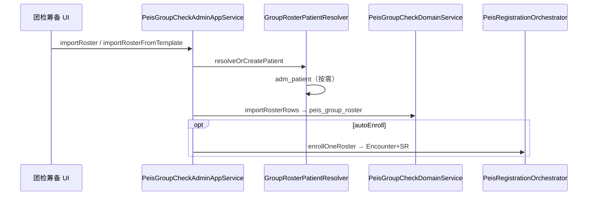
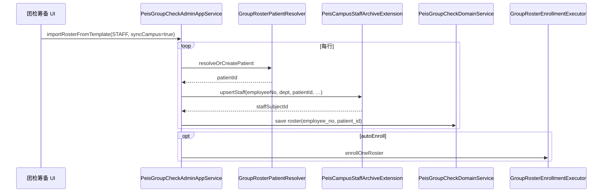

# 教职工导入同步 Campus 方案

> **编码**：PEIS-IMP-CMP-STF-001 · **版本**：v1.1 · **日期**：2026-08-22  
> **关联**：AS-PEIS-GRP-001 v1.3 · GAP-PEIS-GRP-02 · Campus BAS-03  
> **状态**：方案定版（待开发）

---

## 1. 背景与目标

### 1.1 问题

当前团检筹备「企事业/教职工」模板导入（`importRoster` / `importRosterFromTemplate`）仅写：

- `adm_patient`（按需建档）
- `peis_group_roster`（`employee_no` 仅存名册冗余）
- 可选自动建单：`adm_encounter` + `peis_encounter_ext` + `wf_service_request` + …

**不写** Campus 教职工主数据（`cmp_patient_staff`），与产品口径不一致：

| 文档口径 | 现状 |
|----------|------|
| 学院/学生/教职工真源在 **Campus** | 教职工工号只在 `peis_group_roster` |
| GRP-04 名册导入应 **读/写 Campus** | 仅读侧 SPI `PeisCampusIdentityPort`（按工号解析） |
| 健康档案/历年体检按工号反查 | 无 Campus 记录时只能走名册兜底 |

校医院场景下，筹备页导入教职工名单，应视为 **「挂册 + 同步 Campus 教职工档案」**，而不是只记一条团检名册。

### 1.2 目标

| 目标 | 说明 |
|------|------|
| **G1** | 教职工模板/手工导入时，**幂等 upsert** `cmp_patient_staff`，并绑定 `patient_id` |
| **G2** | 团检名册 `peis_group_roster` 与 Campus 教职工 **工号一致、患者一致** |
| **G3** | Campus 未启用时，行为与现网一致（仅 PEIS 直写，不报错） |
| **G4** | 与现有 **导入后自动建单**、模板导入、撤销建单/到检 兼容 |
| **G5** | 为学生同步预留对称扩展（`cmp_patient_student`，另文档） |

### 1.3 非目标（本版不做）

- 不在 PEIS 维护学院/部门主数据 CRUD（仍由 Campus 模块或迁移工具）
- 不做教职工 Excel 在 Campus 模块内的独立菜单（筹备页一条链路完成）
- 不替代 FIN-002 收费建单路径
- 不做跨租户批量历史回迁（走 PeisMigrator P2.5）

---

## 2. 现状架构（v1.3）



**读 Campus（已有）**：`PeisCampusIdentityPort.resolveByEmployeeNo` — 用于 HIST/ARCH 按工号查人，**无写接口**。

---

## 3. 目标架构

### 3.1 分层原则

| 层 | 职责 |
|----|------|
| **PEIS 应用层** | 编排：解析模板 → 患者 → **Campus 同步** → 名册 → 建单 |
| **Campus 模块** | 教职工主数据真源：`cmp_patient_staff`、部门/校区 FK |
| **SPI** | health 不依赖 campus 模块 JAR，通过 **Extension**（`domain.share.extension.campus`）由 `zxplat-module-campus` 实现 |

### 3.2 目标时序



---

## 4. Extension 设计

> **命名约定**：Campus 集成走 `com.zxplat.domain.share.extension.campus`（与现有 `PeisCampusIdentityPort` 同包）；GRP SDD 依赖表亦将 Campus 能力标为 **Extension**，**不**在 health 新增 `*WritePort`。  
> Campus 模块实现类放 `module-campus-application`，委托 `CampusStaffAppService`，health **禁止**依赖 `campus.application.*` Request。

### 4.1 现有（只读 Extension / Port）

```text
PeisCampusIdentityPort          ← 读身份（HIST/ARCH 已用）
CampusArchiveQueryReader        ← 读组织/档案 View（Campus domain，GRP SDD Extension）
```

### 4.2 新增（写侧 Extension）

**接口**：`PeisCampusStaffArchiveExtension`  
**包路径**：`com.zxplat.domain.share.extension.campus`  
**实现**：`PeisCampusStaffArchiveExtensionImpl`（`module-campus-application`，Campus 启用时装配；无 Bean 时 PEIS 跳过）

```java
/**
 * PEIS 团检名册 → Campus 教职工档案写侧 Extension。
 *
 * <p>Campus 未启用时无 Bean；调用方须 {@code ObjectProvider} 可选注入。</p>
 */
public interface PeisCampusStaffArchiveExtension {

    /**
     * 按工号幂等 upsert 教职工，并绑定患者（团检导入专用编排入口）。
     *
     * @return 教职工主键（cmp_patient_staff.id）与是否新建
     */
    PeisCampusStaffUpsertResult upsertStaffForRosterImport(PeisCampusStaffUpsertCommand command);

    /**
     * 按部门批量解析在职教职工（供「从 Campus 勾选导入」，P1）。
     */
    List<PeisCampusStaffSummaryView> listActiveStaffByDepartment(
        Long tenantId, Long departmentId, PeisCampusStaffListQuery query);
}
```

**实现委托链（Campus 模块内）**

```text
PeisCampusStaffArchiveExtensionImpl
  → CampusStaffAppService.createStaff / updateStaff / bindStaffPatient
  → PatientStaffDomainService → cmp_patient_staff
```

导入场景 `changeSource` 记 `PEIS_ROSTER_IMPORT`（对齐 `CampusArchiveChangeLog` 既有 `CHANGE_SOURCE_*`）。

**`PeisCampusStaffUpsertCommand` 字段（建议）**

| 字段 | 必填 | 说明 |
|------|:--:|------|
| `tenantId` / `orgId` | 是 | 租户、机构 |
| `employeeNo` | 是 | 工号（业务唯一键） |
| `patientId` | 是 | 已解析的患者 |
| `fullName` | 是 | 姓名 |
| `genderEnum` | 否 | MALE/FEMALE/UNKNOWN |
| `idCardNo` | 否 | |
| `mobilePhone` | 否 | |
| `departmentId` | 否* | Campus 部门 FK |
| `departmentName` | 否* | 部门名（无 id 时按名称解析/自动建，可配置） |
| `collegeId` | 否 | 来自 `peis_group_company.campus_college_id` |
| `campusSiteId` | 否 | 默认主校区，可配置 |
| `operatorId` | 是 | |

\* `departmentId` 与 `departmentName` 至少其一（教职工场景）；解析失败抛 `DEPARTMENT_NOT_FOUND`。

**`PeisCampusStaffUpsertResult`**

| 字段 | 说明 |
|------|------|
| `staffSubjectId` | `cmp_patient_staff.id` |
| `created` | 是否新建 |
| `patientId` | 回写确认 |

### 4.3 应用层编排类（建议）

`com.zxplat.domain.application.peis.group.support.GroupRosterCampusStaffSyncSupport`

- 注入 `ObjectProvider<PeisCampusStaffArchiveExtension>`
- `syncStaffIfEnabled(RosterImportRowDto row, PeisGroupCompany company, Long patientId, Long operatorId)`
- Campus 无 Bean → 直接 return（与现网一致）
- `syncCampus=false` → skip

---

## 5. 数据写入与表清单

### 5.1 教职工导入 1 人（Campus 已启用 + 自动建单）

| 顺序 | 表 | 份数 | 负责模块 |
|:--:|----|:--:|----------|
| 1 | `adm_patient` | 0~1 | health（已有） |
| 2 | **`cmp_patient_staff`** | **1** | **Campus（新增）** |
| 3 | `peis_group_roster` | 1 | PEIS（已有） |
| 4 | `adm_encounter` | 0~1 | health（autoEnroll） |
| 5 | `peis_encounter_ext` | 0~1 | PEIS |
| 6 | `wf_service_request` | 0~N | health |
| 7 | `peis_service_request_ext` | 0~N | PEIS |

相对现网：**每人多 1 条 `cmp_patient_staff`（新建时）或 0 条（仅更新绑定）**。

### 5.2 名册表扩展（可选 P1）

| 字段 | 类型 | 说明 |
|------|------|------|
| `campus_staff_id` | BIGINT | 冗余 Campus 教职工主键，便于反查（非必须，工号已可关联） |

Flyway：`peis_group_roster.campus_staff_id` 可空，**P1** 再加；**P0 可仅用 `employee_no` 关联**。

### 5.3 部门解析策略

| 优先级 | 规则 |
|:--:|------|
| 1 | 请求/模板显式 `departmentId`（后续 UI 下拉） |
| 2 | 模板「部门」列文本 → `cmp_campus_department` 按 `college_id` + `name` 精确匹配 |
| 3 | 单位 `campus_college_id` 下默认教职工部门（配置项，对齐 Migrator `DefaultDepartmentId`） |
| 4 | 失败 → 该行导入失败，**不影响**同批其他行（REQUIRES_NEW 或行级 try/catch） |

---

## 6. 幂等与冲突（BR-CMP-STF-01～03）

| 编号 | 规则 |
|------|------|
| **BR-CMP-STF-01** | 工号在租户内唯一；`upsertStaff` 以 `employee_no` 为幂等键 |
| **BR-CMP-STF-02** | 已存在教职工且 `patient_id` 与本次不一致 → `STAFF_PATIENT_CONFLICT`，该行失败 |
| **BR-CMP-STF-03** | 已存在教职工且 `patient_id` 为空 → 补绑本次 `patient_id` |
| **BR-CMP-STF-04** | 身份证与 Campus 内其他教职工冲突 → 拒绝，提示人工核对 |
| **BR-CMP-STF-05** | 同批次重复 `patient_id` 导入名册 → 仍按现有 `importRosterRows` 跳过 |

**与患者解析顺序**：先 `resolveOrCreatePatient`（身份证优先），再 `upsertStaff`，避免 Campus 与 adm_patient 双轨建档。

---

## 7. 接口变更（PEIS）

### 7.1 扩展现有请求

**`ImportRosterRequest` / `ImportRosterFromTemplateRequest`**

| 字段 | 类型 | 默认 | 说明 |
|------|------|------|------|
| `syncCampus` | Boolean | `true`（Campus 启用时） | 是否同步教职工到 Campus |
| `departmentId` | Long | 空 | 批量导入统一部门（可选） |

**`ImportRosterResponse` 扩展**

| 字段 | 说明 |
|------|------|
| `campusSyncedCount` | Campus 同步成功行数 |
| `campusFailures` | 与 `enrollmentFailures` 同结构，message 区分 |

### 7.2 新增接口（P1）

| IF | 方法 | 说明 |
|----|------|------|
| **IF-PEIS-GRP-04d** | `importRosterFromCampusDepartment` | 按 Campus 部门勾选在职教职工批量挂册（无需 Excel） |
| **IF-PEIS-GRP-04e** | `listCampusDepartmentsForCompany` | 按团检单位 `campus_college_id` 列部门下拉 |

### 7.3 前端（筹备页）

| 控件 | 行为 |
|------|------|
| 复选框「同步到 Campus 教职工档案」 | 默认勾选；Campus 未启用时隐藏 |
| 部门下拉（P1） | 批量指定 `departmentId`；不选则用模板「部门」列 |
| 模板说明 | 企事业模板增加：部门列需与 Campus 部门名称一致 |

---

## 8. 实施阶段

### P0 — 教职工 Excel/手工导入同步 Campus（建议 3~5 人日）

| # | 任务 | 验收 |
|---|------|------|
| 1 | `PeisCampusStaffArchiveExtension` + `PeisCampusStaffArchiveExtensionImpl` | 单测：新建/更新/冲突 |
| 2 | `GroupRosterCampusStaffSyncSupport` 接入 `importRosterRows` 前置 | STAFF 行写 `cmp_patient_staff` |
| 3 | `syncCampus` 开关 + 响应 `campusSyncedCount` | 关闭时与现网一致 |
| 4 | 部门名解析（college 来自团检单位） | 模板「技术部」可匹配 |
| 5 | 集成测试：导入 → HIST 按工号可查 Campus | `resolveByEmployeeNo` 有值 |

### P1 — 体验与可追溯

| # | 任务 |
|---|------|
| 1 | `peis_group_roster.campus_staff_id` 冗余 |
| 2 | `importRosterFromCampusDepartment` |
| 3 | 筹备页部门下拉 + 从 Campus 勾选导入 |
| 4 | 导入失败 Excel 标注（部门不存在 / 工号冲突） |

### P2 — 学生对称 + Port 迁移

| # | 任务 |
|---|------|
| 1 | `PeisCampusStudentArchiveExtension` + 学生模板 `syncCampus` |
| 2 | `PeisGroupBookingPort` 落地，GRP 直写表迁 Port |
| 3 | `importRosterByCollegeClass`（按学院班级拉学生） |

---

## 9. 配置项

| 配置键 | 默认 | 说明 |
|--------|------|------|
| `peis.group.import.sync-campus-staff` | `true` | 全局默认是否同步教职工 |
| `peis.group.import.auto-create-department` | `false` | 部门名不存在时是否自动建（建议 P1 默认 false） |
| `peis.group.import.default-campus-site-id` | 主校区 | 与 Migrator `DefaultCampusSiteId` 对齐 |
| `peis.group.import.default-department-id` | 空 | 无部门列时兜底 |

---

## 10. 风险与回滚

| 风险 | 缓解 |
|------|------|
| Campus 未部署导致 NPE | `ObjectProvider` + 无 Bean 跳过 |
| 部门名称不一致导致大批量失败 | 行级失败汇总；P1 部门下拉 |
| 工号与历史 patient 不一致 | BR-CMP-STF-02 显式失败，不静默覆盖 |
| 撤销建单后 Campus 记录残留 | **不删** `cmp_patient_staff`（主数据保留）；仅回退 `peis_group_roster` + void Encounter |
| 事务跨模块 | Campus `upsertStaff` 与 PEIS 名册 **同 UoW 可选**；建议 Campus 实现 `REQUIRES_NEW` 行级提交，失败不污染已成功行 |

---

## 11. 测试要点

1. **新建教职工**：无 `cmp_patient_staff`、无 `adm_patient` → 两表各 1 条 + 名册 + 建单  
2. **已有 Campus 教职工**：仅补 `peis_group_roster` + 建单，`cmp_patient_staff` 不重复  
3. **已有患者+身份证**：匹配患者，Campus 补绑 `patient_id`  
4. **工号冲突**：不同 patient → 行失败，名册不写  
5. **Campus 关闭**：`syncCampus` 无效果，与现网一致  
6. **HIST/ARCH**：导入后 `resolveByEmployeeNo` 返回 `subjectType=STAFF`  

---

## 12. 文档与缺口清单更新

| 文档 | 动作 |
|------|------|
| AS-PEIS-GRP-001 | §1.5 增加 BR-CMP-STF-*；GRP-04 注明 syncCampus |
| AS-PEIS-GRP-001-SDD | 补充 `PeisCampusStaffArchiveExtension` 白名单与 IF-PEIS-GRP-04d |
| PEIS-现场需求与缺口清单 | GAP-PEIS-GRP-02 拆为 STF P0 / STU P2 |
| Campus 模块 SDD | 实现 `PeisCampusStaffArchiveExtension` |

---

## 13. 与学生导入的关系（预告）

学生同步逻辑对称，但字段更多（学院、班级、年级、学籍状态），且团检单位常带 `campus_college_id`：

- 写表：`cmp_patient_student`
- 幂等键：`student_no`
- 接口：`PeisCampusStudentArchiveExtension` + `importRosterByCollegeClass`

**本方案 P0 仅教职工**；学生列入 GAP-PEIS-GRP-02b，避免一次改动过大。

---

*方案版本：v1.1 · 2026-08-22 · v1.1 写侧由 `*WritePort` 改为 `PeisCampusStaffArchiveExtension`（对齐 extension.campus 包与 GRP SDD）*
