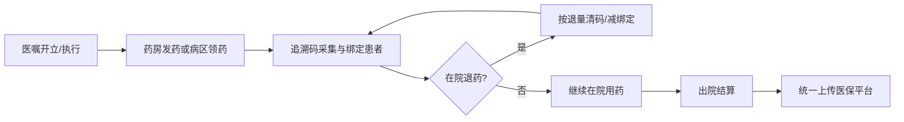
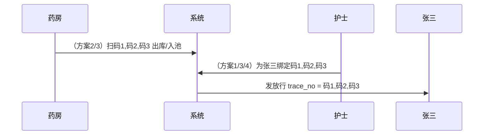
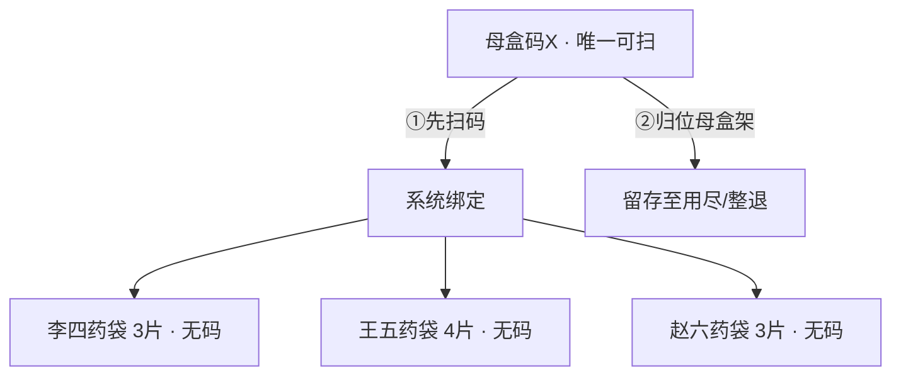
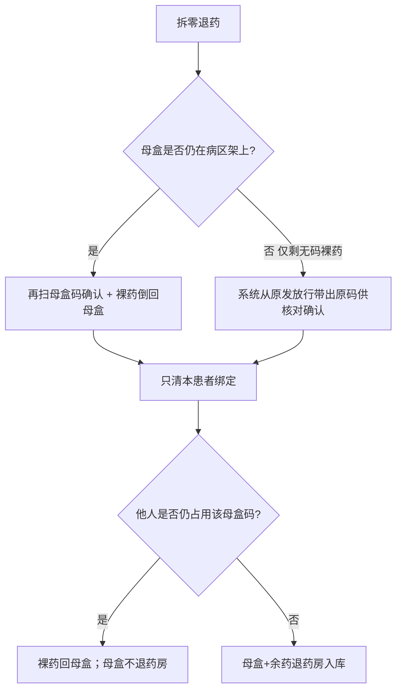
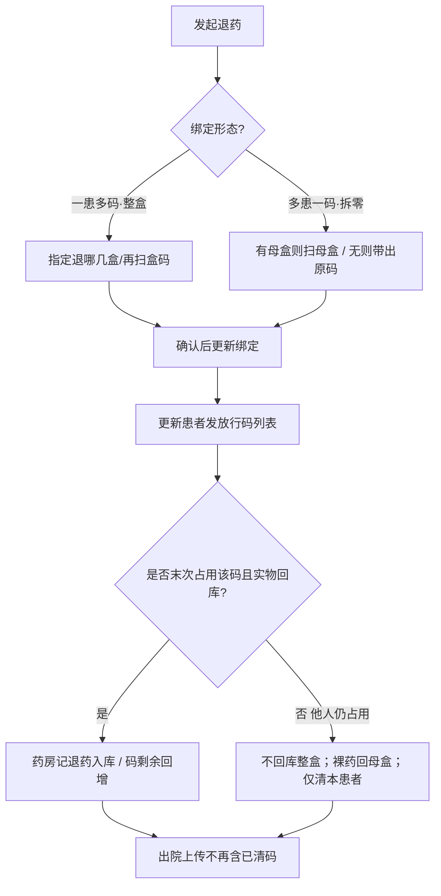
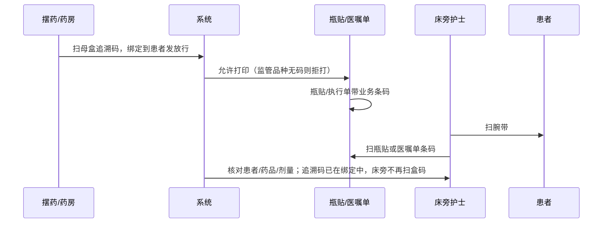

# 住院药品追溯码采集与上传方案（院方选型）

> **文档用途**：供院方业务、护理、药房、信息科共同评审与排班选型。  
> **范围**：住院药品（含整盒、多盒、拆零共用）追溯码的**采集、绑定、退药清除、出院统一上传医保平台**。  
> **版本**：v1.4 · **日期**：2026-07-17  
> **关联产品能力**（供信息科参考）：`AS-CUS-TRC-001` 追溯码流转、`AS-IP-PHA-002` 汇总核发、`AS-IP-NUR-015` 护士站追溯码分配、住院结算出院上传。  
> **分册（谁扫/何时扫/怎么扫）**：[方案索引](./README-追溯码方案索引.md) · [方案1](./方案1-护士摆药扫码.md) · [方案2](./方案2-药房发药扫码.md) · [方案3](./方案3-药房护士双扫.md) · [方案4](./方案4-瓶贴医嘱单闭环.md) · [方案5](./方案5-分级组合扫码.md)  
> **院方会议 PPT**：[住院药品追溯码上传方案-院方会议.pptx](./住院药品追溯码上传方案-院方会议.pptx)

---

## 1. 背景与目标

### 1.1 监管要求（共性）

| 要求 | 说明 |
| --- | --- |
| **应扫尽扫** | 纳入监管的药品，发药/用药链路须采集药品追溯码 |
| **一物一码可追溯** | 码与药品、批号、患者用药事实可关联，支持飞检抽查 |
| **退药闭环** | 在院退药须同步解除/回退已绑定追溯码，避免「码已上传但药已退」 |
| **医保上报** | 住院场景按院方约定在**出院结算时统一上传**医保平台（与门诊「收费即传」可区分） |

### 1.2 本方案要解决的问题

1. **谁扫码**：药房药师 / 病区护士 / 双方 / 床旁 PDA。  
2. **何时落库**：发药时、摆药时、还是床旁给药时。  
3. **一患者多盒**：发 3 盒如何扫 3 码、部分退 1 盒如何只清 1 码。  
4. **多患者一盒（拆零共用）**：一盒拆给多人时如何共用同一追溯码、一人退药如何不清掉别人的码。  
5. **拆零无码实物**：拆开后**只有包装盒/瓶上有追溯码**，倒出的片/粒/支本身无码——如何扫、如何退、母盒如何保管。  
6. **正逆向闭环**：发药绑定 ↔ 退药清码 ↔ 出院上传的完整链路。  
7. **何时上传医保**：默认**出院统一上传**；在院期间码只存在院内系统。  
8. **如何排班落地**：各岗位工作量、设备、培训与考核口径。

### 1.3 共性约定（四套方案均适用）

| 约定项 | 建议口径 |
| --- | --- |
| **上传时点** | 住院患者办理出院/结算时，按本住院期间已绑定且未清除的追溯码统一上传医保 |
| **在院期间** | 追溯码仅存 HIS，不实时上传；便于退药改码、纠错 |
| **整盒发药** | 发 N 盒（销售包装）→ 须扫 **N 个**不同追溯码（1 码 = 1 盒）；整盒药袋/盒体上有码，可随药再扫 |
| **拆零发药** | 拆零不免扫；扫的是**原包装（母盒）上的码**，不是药杯/药袋；不满一盒至少绑定 1 码；多人可共用同一母盒码 |
| **母盒留存** | 拆零期间母盒（带码包装）必须留存至该盒用尽或整盒退库；**禁止拆完即扔包装** |
| **共用码** | 允许同一追溯码字符串出现在多名患者的发放记录上（非一码独占） |
| **退药** | 须按「退多少清多少」解除绑定；共用码只清本患者；**裸药无码时不得要求「扫药片」**，改为扫母盒或系统带出原码 |
| **纠错** | 上传前允许覆盖/重绑；上传成功后原则上禁止随意改码（需走纠错流程） |
| **责任边界** | 扫码岗位对「码实相符」负责；系统对「码数、在院态、拆零剩余、重复出库」做门控 |

---

## 2. 码与数量关系模型（选型前必读）

住院追溯的核心不是「扫一下就完」，而是把**发药数量**、**追溯码个数**、**患者绑定**、**实物能否再扫**四件事对齐。

### 2.0 实物铁律：码在包装上，拆出的药没有码

这是拆零场景一切流程设计的前提，院方培训必须讲透。

```text
┌─────────────────────────────┐
│  销售包装（母盒/药瓶）         │  ← 追溯码贴在这里（唯一可扫载体）
│  ┌─────┐ 码X                 │
│  │片/粒│ 倒出后 → 药杯/药袋   │  ← 无追溯码，无法再扫「药本身」
│  └─────┘                     │
└─────────────────────────────┘
```

| 事实 | 业务含义 |
| --- | --- |
| **码只在最小销售包装上** | 扫码动作永远对着**盒/瓶/袋装原包装**，不是对着已摆好的片剂、水针拆零袋 |
| **拆出的药无码** | 发到患者药杯、口服药袋、注射摆药盘后，**无法从药上找回追溯码** |
| **再扫依赖母盒** | 二次核对、退药再扫、床旁确认，都必须还能拿到**同一母盒**，或系统已记住原码并允许「带出确认」 |
| **扔包装 = 断链** | 母盒提前丢弃 → 后续无法再扫、退药难举证、飞检无法码实相符 |

**因此拆零必须同时满足：**

1. **扫码时点**：在「打开包装取药」的当时或之前，对着母盒完成扫码绑定（不能等药已分到各患者袋后再找码）。  
2. **母盒保管**：母盒放入病区「拆零母盒架 / 药车母盒位」，一盒一码一位，用尽或整退才可处理包装。  
3. **退药两条路**：  
   - **有母盒**：再扫母盒码确认；  
   - **仅有裸药、母盒已不在手边**：系统从原发放行**带出原码**供确认（勾选/核对），**禁止**要求护士去扫药杯。

> **整盒对照**：整盒发出且包装未拆时，码随盒走，退药可再扫盒码——与拆零难度不同，制度上应分开写清。

### 2.1 形态 A：同一患者用多盒药（一患多码 · 包装未拆或整盒发出）

| 项目 | 口径 |
| --- | --- |
| **业务例子** | 患者张三发阿莫西林 **3 盒**，每盒 1 个追溯码 |
| **扫码结果** | 张三本条发放记录绑定 `码1,码2,码3`（多码逗号分隔或等价多码结构） |
| **码数规则** | 业务单位 = 销售包装（盒）时：**码个数 = 发药盒数** |
| **库存/在院** | 每码扣减 1 盒对应拆零量；三码全部耗尽后各自可翻为「不在院」 |
| **出院上传** | 张三上传 3 个码（若中途退了 1 盒，则只传剩余 2 个） |

```text
张三 ←── 码1（盒1）
     ←── 码2（盒2）
     ←── 码3（盒3）
```

### 2.2 形态 B：多个患者用同一盒药（多患一码 / 拆零共用）

| 项目 | 口径 |
| --- | --- |
| **业务例子** | 一盒 10 片，李四发 3 片、王五发 4 片、赵六发 3 片，共用盒码 `码X` |
| **实物过程** | 打开母盒 → **先扫母盒码X** → 再按量倒入各患者药杯/药袋；三人药袋上**都没有码** |
| **扫码结果** | 李四、王五、赵六的发放记录上**都出现** `码X`（码来自同一母盒，不是来自药袋） |
| **码数规则** | 业务单位 = 拆零（片/支等）时：**不满一盒至少 1 码**；多人可重复绑定同一码 |
| **库存/在院** | 主档按拆零剩余递减；剩余 > 0 仍「在院」；耗尽后才「不在院」 |
| **母盒** | 三人用药期间母盒必须留存；用尽后按院规销毁/回收包装 |
| **出院上传** | 三名患者出院时**各自**上报 `码X`（医保侧按销售明细/数量口径计数，院内须与医保办定规则） |

```text
母盒（唯一带码）码X
  │ 扫一次或多次（对着母盒）
  ├── 李四药袋 3片（无码）← 系统记录绑码X
  ├── 王五药袋 4片（无码）← 系统记录绑码X
  └── 赵六药袋 3片（无码）← 系统记录绑码X
```

### 2.3 形态 C：混合（常见）

| 例子 | 处理 |
| --- | --- |
| 张三发 2 整盒 + 另拆 5 片（来自第三盒） | 整盒扫 `码1,码2`（码在盒上）；拆零时扫母盒 `码3` 再倒 5 片入袋；共 3 码 |
| 汇总发药：病区共领 5 盒，分给 8 名患者（含拆零） | 药房先入 **5 码码池**；护士拆零时持母盒扫池内码后分药；药袋无码 |

### 2.4 数量门控（系统应强制）

| 规则 | 整盒（销售包装） | 拆零 |
| --- | --- | --- |
| 最少码数 | = 发药盒数 | ≥ 1（来自母盒） |
| 最多码数 | = 发药盒数 | ≤ 发药拆零量对应上限（院内可定：通常 1 码即可） |
| 同一码能否多人 | 否（整盒应一人独占该码） | **是**（共用母盒码） |
| 同一人多码 | **是** | 跨多母盒拆零则多码 |
| 扫码载体 | 盒体本身 | **仅母盒**；药杯/药袋不可扫 |

> **院方拍板点**：整盒禁止共用码；拆零必须扫并共用**原母盒码**；禁止拆完即扔包装；禁止要求对无码药袋「补扫」。

### 2.5 拆零作业标准动作（建议写入护理/药房 SOP）

| 顺序 | 动作 | 说明 |
| --- | --- | --- |
| ① | 取出母盒 | 确认品名、批号、效期 |
| ② | **扫母盒追溯码** | 完成系统绑定（一人或多人待绑） |
| ③ | 按量取药入杯/袋 | 此时药已无码，依赖②已完成 |
| ④ | 母盒归位母盒架 | 标签：药品名 + 码末几位 + 剩余量 |
| ⑤ | 用尽/整退 | 系统剩余为 0 或整盒退库后，方可处理空包装 |
---

## 3. 端到端主流程（共性）



| 环节 | 系统动作 | 业务动作 |
| --- | --- | --- |
| 采集 | 扫入 1～N 个码；校验在院、格式、码数与发药量 | 扫药盒最小销售包装上的追溯码 |
| 绑定 | 码与患者、药品、批号、数量关联；支持多码、共用码 | 确认「这些盒/这盒拆零给谁」 |
| 退药清除 | 按退量从患者绑定中移除对应码；共用码只解本患者 | 实物退回 + 再扫确认（或带出原码） |
| 出院上传 | 按患者汇总**仍有效**的码列表上传 | 结算触发/随结算自动 |

---

## 4. 正向流程详解

正向 = 从发药到码落到患者名下（尚未退药、尚未上传）。

### 4.1 正向 · 形态 A（一患者多盒）

**例子**：张三，阿莫西林 3 盒 → 扫 `码1,码2,码3`。

| 步骤 | 方案1 护士摆药扫 | 方案2 药房发药扫 | 方案3 双扫 | 方案4 床旁 PDA |
| --- | --- | --- | --- | --- |
| 1. 出库/领药 | 药房发 3 盒，不扫 | 药师连续扫 3 码 | 药师扫 3 码入码池 | 药房发 3 盒（4B 可预扫入池） |
| 2. 落到患者 | 护士对张三连扫 3 码保存 | 发药时直接绑张三，或按患者行写入 3 码 | 护士从池内选/再扫 3 码归因张三 | **推荐 4D**：摆药/打印瓶贴时绑 3 码；床旁扫腕带+瓶贴/医嘱单（不扫盒码） |
| 3. 校验 | 码数=3；药+批匹配 | 同左 + 在院剩余 | 码须 ∈ 码池；码数=3 | 同左；可与医嘱执行次数对齐 |
| 4. 结果 | 张三发放行 = `码1,码2,码3` | 同左 | 同左 | 同左（可能分多次写入后合并） |



**操作要点**

- 必须**连扫满 N 盒**，少 1 码不得保存（监管品种）。  
- 扫重（同一码扫两次）应提示重复，不得顶替另一盒。  
- 分次给药（方案4）：**4D** 每次给药扫当次瓶贴/执行单即可；追溯码已在打印时绑定，出院前合并有效码并集。  
- 旧变体 4A（床旁直接扫盒码）仅适用于整盒且包装随药；拆零不推荐。

### 4.2 正向 · 形态 B（多患者一盒 / 拆零 · 药袋无码）

**例子**：一盒 10 片，母盒码 `码X` → 李四 3 片、王五 4 片、赵六 3 片。药装入三人药袋后**袋上无码**。

| 步骤 | 方案1 | 方案2 | 方案3 | 方案4 |
| --- | --- | --- | --- | --- |
| 1. 出库 | 药房发母盒，不扫 | 药师**扫母盒码X**后发出（或入池） | 药师扫母盒入码池 | 药房发母盒（4B 预扫入池） |
| 2. 拆零扫码 | 摆药台：**先扫母盒**，再分倒入各患者袋 | 发药时已绑码到各患者行；病区只分药 | 护士**扫/确认池内母盒码**后归因到多人，再分药 | **推荐 4D**：分装/打瓶贴时扫母盒绑码并打出瓶贴；床旁只扫瓶贴（不扫母盒、不扫药袋） |
| 3. 校验 | 每人至少 1 码；允许共用；扫码载体=母盒 | 拆零剩余足够 | 码 ∈ 池；共用合法 | 同左 |
| 4. 结果 | 三人发放行均含 `码X`；三人药袋无码；母盒留架 | 同左 | 同左 | 同左 |



**操作要点（拆零专用）**

- **顺序强制**：扫母盒 → 再分药；禁止先分袋后再找码。  
- **禁止**给每个患者药袋另贴/另扫无关空盒码「凑数」。  
- **方案4**：旧做法「床旁扫盒码」在拆零场景会失败；**推荐改为 4D（瓶贴/医嘱单闭环）**——追溯码在打印前绑定，床旁扫瓶贴即可，无需母盒随车。  
- 方案2 若只扫一次不写到患者行，出院无法按人上传 → 拆零必须归因到患者。

### 4.3 正向 · 形态 C（汇总领药后再分患者）

| 步骤 | 说明 |
| --- | --- |
| 药房汇总核发 | 病区申领某药 5 盒 → 扫 5 个**母盒码**进入码池（方案2/3/4B） |
| 护士分到人 | 整盒：码随盒；拆零：**持母盒扫池内码**后分倒，药袋无码 |
| 池与母盒 | 池内码与在架母盒一一对应；丢盒则池内码无法再实物核对 |
| 方案1 差异 | 无池：护士拆零时直接扫实物母盒码落到人 |

### 4.4 正向异常与处理

| 异常 | 处理 |
| --- | --- |
| 应扫 3 码只扫 2 | 拒绝保存；提示缺码 |
| 扫了别的药品的码 | 药+批不匹配，拒绝 |
| 码已不在院 / 剩余不足 | 拒绝；查是否已发出或扫错盒 |
| 整盒码被第二人再绑 | 警告或拒绝（建议整盒独占） |
| 拆零共用超盒总量 | 剩余拆零不足，拒绝继续绑定 |
| 方案3 扫了池外码 | 拒绝 |
| **药已分袋、母盒已扔，尚未绑码** | **无法补扫药袋**；按制度：从药房补发同批母盒重做，或科主任审批手工关联历史码（审计）；计入质控缺陷 |
| **床旁只拿到无码药袋且未打瓶贴** | 禁止空扫；补打瓶贴（须已绑追溯码）或退回摆药台 |
| **已打瓶贴但追溯码未绑** | 打印门控：无追溯码不得出瓶贴/执行单（监管品种） |

---

## 5. 逆向流程详解

逆向 = 退药、纠错、取消绑定。原则：**退多少清多少；共用码只清本患者；清码先于或同步于退费/回库；裸药无码时不要求扫药片**。

### 5.0 拆零退药的实物分岔（有母盒 / 仅裸药）

拆零发出后，患者手上往往只有**无码药袋/药杯**，追溯码仍在母盒上。退药时必须区分：



| 路径 | 何时用 | 扫码动作 | 风险 |
| --- | --- | --- | --- |
| **路径甲：有母盒** | 母盒架上仍在 | **再扫母盒**（不是扫药袋） | 低；推荐默认 |
| **路径乙：仅裸药** | 母盒已用尽销毁、丢失、或在药房 | **禁止扫药袋**；系统**带出原绑定码**，护士/药师勾选确认「确系该笔退药」 | 中；须双人核对或权限；计入审计 |
| **禁止路径** | — | 要求对药片/药袋扫追溯码、或随意补扫其他空盒码 | 必然失败或造假 |

> **制度建议**：拆零退药默认走路径甲；路径乙仅作例外，并规定「母盒用尽前不得销毁包装」。

### 5.1 逆向总览



### 5.2 逆向 · 形态 A：一患者多盒（包装可再扫）

#### 5.2.1 全退（3 盒全退）

| 项目 | 说明 |
| --- | --- |
| **动作** | 清除张三名下 `码1,码2,码3` 全部 |
| **再扫** | 包装未拆：再扫 3 个盒码；若已拆开仅剩裸药：按 §5.0 路径乙带出原码 |
| **结果** | 张三该笔无有效码；三码回库/恢复在院可再发 |
| **出院** | 不上传这 3 码 |

#### 5.2.2 部分退（3 盒退 1 盒）

| 项目 | 说明 |
| --- | --- |
| **动作** | 仅从张三绑定中移除 `码2`（举例），保留 `码1,码3` |
| **关键** | 有包装：再扫被退盒码；无包装：列表勾选系统带出的对应码 |
| **禁止** | 只减数量不减码、或随机删一个码与实物不符 |
| **结果** | 张三剩余 2 码；`码2` 回库 |
| **出院** | 只传 `码1,码3` |

```text
退前：张三 = 码1,码2,码3
退码2后：张三 = 码1,码3    码2 → 回库可再发
```

#### 5.2.3 部分退多盒（3 盒退 2 盒）

同 5.2.2，一次再扫/勾选 2 个码移除；剩余 1 码留患者。

### 5.3 逆向 · 形态 B：多患者共用一盒（药袋无码）

#### 5.3.1 其中一人退药（他人仍在用）

**例子**：李四、王五、赵六共用母盒 `码X`；李四退回 3 片（在无码药袋中）。

| 项目 | 说明 |
| --- | --- |
| **动作** | 仅解除**李四**发放行上的 `码X`；王五、赵六绑定不变 |
| **实物** | 李四药袋中的片剂**倒回母盒**；母盒不退药房 |
| **确认码** | **优先扫母盒码X**；若操作处只有药袋、母盒在架上 → 取母盒再扫，或系统带出码X 确认 |
| **禁止** | 试图扫描李四药袋（无码）；误用其他药品母盒码「顶替」 |
| **库存** | 拆零剩余回增李四退量；主档仍在院 |
| **出院** | 李四不传 `码X`；王五/赵六出院仍传 `码X` |

```text
退前：母盒码X → 李四、王五、赵六（三人药袋均无码）
李四退后：码X → 王五、赵六；李四药倒回母盒
```

#### 5.3.2 最后一人退药 / 整盒退回药房

| 项目 | 说明 |
| --- | --- |
| **动作** | 解除最后占用患者的绑定；**母盒 + 余药**退回药房 |
| **再扫** | 药房扫母盒 `码X` 入库（此时有包装可扫） |
| **结果** | 无患者再绑 `码X`；码剩余恢复，可再次出库 |
| **空包装** | 若药已用尽仅退「空母盒」：按院规是否允许空盒退库；通常用尽销毁并在系统标记耗尽即可 |

#### 5.3.3 共用盒部分退量（一人退一部分）

**例子**：王五原绑 4 片，退 2 片（无码药袋中的 2 片），仍留 2 片。

| 项目 | 说明 |
| --- | --- |
| **码** | 王五发放行**仍保留** `码X`（未整笔退光） |
| **数量** | 发药/计费数量改为 2；拆零剩余回增 2 |
| **确认** | 扫母盒或带出原码；退回的 2 片倒入母盒 |
| **清码条件** | 仅当该患者此码对应数量退至 0 时，才从该患者移除 `码X` |

#### 5.3.4 特殊：已给药、药已服下 / 药袋丢失

| 情况 | 处理 |
| --- | --- |
| 已服下无法退实物 | 走「不退药」或费用政策；**不清码**（药已消耗，码应保留至出院上传） |
| 药袋丢失但未服 | 按损失报损流程；码是否保留由药事与医保定；一般已绑码视为已发出 |
| 母盒丢失且需退药 | 路径乙带出原码 + 双人签字；质控记缺陷；加强母盒架管理 |

### 5.4 逆向 · 四方案责任对照

| 逆向场景 | 方案1 | 方案2 | 方案3 | 方案4 |
| --- | --- | --- | --- | --- |
| 多盒全退（有包装） | 护士再扫盒码 | 药房再扫退回盒 | 护士带码 + 药房确认 | PDA/站内清 |
| 拆零一人退（有母盒） | 护士扫**母盒**，裸药回盒，只清该患者 | 药房扫母盒清该患者行 | 护士清绑定 + 药房视是否回库 | 取母盒扫或带出原码 |
| 拆零一人退（仅裸药无母盒） | 系统带出原码确认；禁止扫药袋 | 同左（药房确认） | 同左 | 同左 |
| 拆零末人退整盒 | 母盒交药房回库 | 药房扫母盒入库 | 药房入库为终态 | 清绑定后母盒回库 |
| 主要风险 | 母盒乱扔后只能走路径乙 | 裸药退回但母盒不在药房 | 两端状态不一致 | 4A 无码袋失败；**4D 靠瓶贴，须防错贴/漏打** |

### 5.5 其他逆向：纠错 / 换码 / 取消发药

| 场景 | 处理 |
| --- | --- |
| 扫错母盒码（尚未上传） | 覆盖重绑：须再拿正确母盒扫码；审计留痕 |
| 多扫了 1 个码 | 从患者码列表删除；若已出库则回滚 |
| 发药单整单取消 | 按全退；拆零须母盒与裸药一并处理 |
| 已出院上传后的退药 | **禁止**静默改码；走医保冲正或院内特例 |

### 5.6 逆向硬约束（建议系统强制）

| 规则 ID | 描述 |
| --- | --- |
| R-01 | 有绑定码的退药，必须「再扫母盒/盒码」或「系统带出原码确认」，禁止无码空退（急救补录除外） |
| R-02 | 一患多码部分退：移除的码集合必须与退回实物一致 |
| R-03 | 多患一码：解除绑定不得删除其他患者行上的同一码 |
| R-04 | 仅当「无任何患者绑定且实物（母盒）回库」时，才做整码退药入库 |
| R-05 | 退药完成前，该码不得进入本患者出院上传清单 |
| R-06 | **拆零退药界面不得引导扫描药袋/药杯**；无母盒时仅提供「带出原码确认」 |
| R-07 | 整盒与拆零退药分入口或分提示，避免用整盒再扫逻辑强套拆零裸药 |
---

## 6. 方案一览与利弊

### 6.1 方案对照

| 方案 | 一句话 | 药房扫码 | 护士扫码 | 典型场景 |
| --- | --- | --- | --- | --- |
| **方案1** | 药房不扫，护士摆药时扫 | 否 | 是（摆药/配发） | 药房人力紧、病区集中摆药台 |
| **方案2** | 药房发药时扫，护士不扫 | 是 | 否 | 药房集中管控、病区不愿加扫码岗 |
| **方案3** | 药房+护士双扫 | 是（码池） | 是（归因患者） | 高飞检压力、需双重核对 |
| **方案4** | 床旁扫瓶贴/医嘱单（推荐），不强制扫盒码 | 摆药/打印时扫母盒 | 是（扫业务条码） | 移动护理 + 瓶贴闭环 |
| **方案5** | **分级组合**（整盒/拆零/高值用不同积木） | 按切片 | 按切片 | **大多数医院默认推荐** |
| **方案6** | 中心单剂量分包机绑码+打袋 | 中心机 | 是（扫袋码） | 大型医院中期可选 |

### 6.2 方案1：药房不扫码，护士摆药时扫码

#### 流程说明

1. 药房发药不采集追溯码。  
2. 护士摆药时按患者扫码：整盒连扫 N 码；**拆零须先扫母盒再分药入袋**（药袋无码）。  
3. 退药：整盒再扫盒码；拆零优先扫母盒，裸药倒回；无母盒则系统带出原码确认。  
4. 出院统一上传剩余有效码。

#### 岗位与排班

| 岗位 | 新增工作 | 设备 | 排班建议 |
| --- | --- | --- | --- |
| 药房 | 无扫码增量 | — | 维持发药班 |
| 护士 | 摆药扫码；维护母盒架；退药扫母盒/带出原码 | 固定扫码枪 + 母盒架 | 摆药班；高峰增派 |
| 结算 | 出院前待扫/异常清单 | — | 结算前核对 |

#### 利

- 药房零增量；码在病区按患者绑定，多盒/拆零归因直观。  
- 退药在病区完成，共用盒未退药房时也可先清患者绑定。  
- 设备投入低。

#### 弊

- 护士量大；多盒连扫易漏 1 码；**母盒架管理是额外负担**。  
- 无药房码池，飞检「码从哪出库」较弱。  
- 部分退扫错盒、共用码误清他人（若系统未做患者隔离）风险高；**母盒乱扔后只能走路径乙**。

#### 对多盒 / 拆零无码袋的特别影响

| 点 | 说明 |
| --- | --- |
| 一患多盒 | 摆药台一次扫齐最顺；漏扫靠出院闸门兜住 |
| 拆零无码袋 | **最适合在摆药台「先扫母盒再分袋」**；药袋发出后不必再扫 |
| 多患一盒 | 护士管母盒最清楚；须培训「退一人只倒药回盒、不清他人码」 |

### 6.3 方案2：药房发药时扫码，护士不扫码

#### 流程说明

1. 药房发药扫码：3 盒扫 3 码绑患者；**拆零扫母盒码并写到各患者行**（分药可在病区，但码已在药房绑好）。  
2. 护士不扫追溯码，但须**保管母盒**供退药再扫。  
3. 退药：有母盒则药房/病区扫母盒清码；**仅退无码药袋时**由系统带出原码，药房确认。  
4. 出院统一上传。

#### 岗位与排班

| 岗位 | 新增工作 | 设备 | 排班建议 |
| --- | --- | --- | --- |
| 药房 | 发药多码连扫；退药再扫 | 窗口枪 | 拣+扫可双人 |
| 护士 | 保证退药原盒/说明共用盒去向 | — | 维持护理班 |
| 运送 | 整盒退须原盒回药房 | — | 无盒不办退 |

#### 利

- 护士零增量；出库与码同源，合规清晰。  
- 整盒多码在窗口连扫专业、差错率较低。

#### 弊

- 药房瓶颈；**拆零多患者归因**是最大难点。  
- 退药时病区常只有无码药袋，**母盒若未随退回，药房无法再扫**——必须上「带出原码」或强制母盒留存。  
- 汇总发药若不拆到人，出院无法按患者传码。

#### 对多盒 / 拆零无码袋的特别影响

| 点 | 说明 |
| --- | --- |
| 一患多盒 | 窗口连扫 N 码最合适（盒上有码） |
| 拆零无码袋 | 码在药房已绑好，病区分袋不再扫——**避开「药袋无码」矛盾**；但退药依赖母盒或带出原码 |
| 多患一盒 | **必须**一码写多患者行；护士负责母盒架 |

### 6.4 方案3：药房与护士都扫（双扫）

#### 流程说明

1. 药房核发：整盒扫 N 码入池；**拆零扫母盒码入池**（发出的是带码母盒）。  
2. 护士归因：整盒独占池内码；拆零**持母盒扫/确认池内码**后分入无码药袋，多人可共用同一母盒码。  
3. 退药：有母盒则再扫；仅裸药则带出原码；一人退不入库整盒。  
4. 出院上传以患者最终绑定为准。

#### 利

- 多盒、拆零无码袋都能管住：池管「发出哪些母盒」，护士管「给了谁」。  
- 防串码；与现有产品（码池+护士分配）最贴近。  
- 护士归因发生在分袋前，**天然避开药袋无码**。

#### 弊

- 人力最高；两端都要处理多码连扫与母盒架规则，培训成本高。  
- 退药协同复杂（见 §5.4）。

#### 适用

- 飞检严、**拆零占比高**的医院优先；可对监管品种先双扫。

### 6.5 方案4：床旁扫瓶贴 / 医嘱单（推荐不扫盒码）

> **结论先说**：方案4**不必**在床旁扫药品追溯盒码。更优做法是：在**摆药/打印瓶贴或医嘱执行单时**扫母盒追溯码并写入系统，同时把「患者 + 药品 + 本次发放/执行 + 已绑追溯码」编码进**瓶贴条码或医嘱单条码**；床旁护士用 PDA 扫**腕带 + 瓶贴/医嘱单**完成闭环。对拆零（药袋无码）尤其友好。

#### 6.5.1 推荐主路径（变体 4D：瓶贴/医嘱单闭环）



| 步骤 | 谁做 | 扫什么 | 作用 |
| --- | --- | --- | --- |
| ① 绑追溯码 | 摆药护士或药房 | **母盒追溯码** | 码落入患者发放行（多盒连扫、拆零扫母盒共用） |
| ② 打印 | 同一人或紧随后 | — | 打出瓶贴 / 口服药袋贴 / 医嘱执行单；条码关联本次执行 |
| ③ 床旁给药 | 责任护士 | **腕带 + 瓶贴/医嘱单** | 闭环核对「对的人、对的药、对的次」；**不扫盒码** |
| ④ 退药 | 护士/药房 | 母盒或带出原码；可扫瓶贴定位到发放行 | 按 §5 清码 |
| ⑤ 出院 | 结算 | — | 上传已绑且未清的追溯码 |

**为何比「床旁扫盒码」更好**

| 对比项 | 床旁扫盒码（旧 4A） | 床旁扫瓶贴/医嘱单（4D） |
| --- | --- | --- |
| 拆零药袋无码 | 扫不到，必须母盒随车 | **无影响**（码已在打印前绑定） |
| 护理体验 | 床旁连扫多盒码，慢 | 与闭环给药习惯一致，通常更快 |
| 母盒是否随车 | 拆零几乎必须 | **不必**；母盒留架即可 |
| 闭环护理 | 仅追溯，身份核对另做 | **追溯绑定 + 身份/药品核对一次完成** |
| 错药风险 | 扫错盒可能绑错 | 瓶贴错贴仍有风险，但可与医嘱单交叉 |
| 系统改造 | 低 | 需瓶贴/执行单条码与发放行、追溯码关联 |

#### 6.5.2 打印与条码设计要点（院方+信息科）

| 要点 | 建议 |
| --- | --- |
| **打印门控** | 监管品种：未绑定足量追溯码 → **禁止打印**瓶贴/该条执行单 |
| **条码载荷** | 建议编码「发放行 ID / 执行记录 ID」；追溯码存库，不必把 20 位追溯码印成长码给人扫（也可印明文供目视） |
| **一患多盒** | 可一张贴对应一行发放（含多码），或一盒一贴；床旁扫贴即可确认该次药 |
| **多患一盒** | 每人一张瓶贴，系统行内追溯码均为同一母盒码；床旁各扫各的贴 |
| **医嘱单 vs 瓶贴** | 瓶贴贴在实物上防拿错；医嘱/执行单适合注射、输液等；可两者都打，床旁扫其一即可 |
| **补打** | 补打须同一发放行；作废旧贴；审计 |

#### 6.5.3 岗位与排班

| 岗位 | 新增工作 | 设备 | 排班建议 |
| --- | --- | --- | --- |
| 摆药/药房 | 扫母盒绑码 + 打瓶贴/执行单 | 扫码枪 + 瓶贴打印机 | 与摆药班合并；高峰增派打印岗 |
| 床旁护士 | 扫腕带+瓶贴/医嘱单 | PDA | 与移动护理同一班次 |
| 信息科 | 条码规则、打印门控、闭环接口 | — | 上线前联调 T13～T15 |

#### 6.5.4 利与弊（相对方案1～3及旧4A）

**利**

- **完美避开「拆出药无码」**：床旁不依赖盒码。  
- **闭环护理体验好**：一次扫贴完成身份与药品核对，比单独为追溯加扫盒码更易被护士接受。  
- **母盒不必随车**：母盒架管理即可，退药仍按 §5。  
- **整盒与拆零同一套床旁动作**：都是扫贴，培训统一。

**弊**

- 依赖**瓶贴/执行单打印**与条码体系，初期改造与耗材成本高于纯扫码枪方案。  
- **错贴、漏打、贴错患者**仍会导致给错药——须打印门控 + 床旁腕带双扫兜底。  
- 追溯码绑定仍发生在摆药/打印环节，该环节漏扫会卡打印，摆药岗工作量接近方案1。  
- 退药清码不能只靠撕瓶贴，仍要母盒或带出原码。

#### 6.5.5 变体一览（方案4内部选型）

| 变体 | 床旁扫什么 | 追溯码何时绑 | 适用 | 推荐度 |
| --- | --- | --- | --- | --- |
| **4D 瓶贴/医嘱单闭环** | 腕带 + 瓶贴或执行单 | 打印前扫母盒 | 有移动护理+瓶贴打印 | **首选** |
| **4C 混合** | 整盒可扫盒；拆零走摆药台或 4D | 分场景 | 过渡期 | 可选 |
| **4B 药房预扫+床旁确认** | 腕带+贴或再确认 | 药房入池+护士归因 | 要码池约束 | 与 4D 可叠加 |
| **4A 床旁直接扫盒码** | 腕带 + 盒上追溯码 | 床旁 | 仅整盒且包装随药 | **拆零不推荐** |

---

## 7. 出院统一上传（含多盒/共用）

### 7.1 上传范围

| 患者维度 | 规则 |
| --- | --- |
| 上传什么 | 本住院就诊下**仍绑定且未清除**的追溯码列表 |
| 一患多码 | 剩余几个码传几个（例：曾绑 3 退 1 → 传 2） |
| 多患一码 | 每人出院各自携带该共用码（若本人未退清） |
| 不传 | 已退清、纠错作废、从未绑定成功的码 |

### 7.2 医保计数口径（须医保办拍板）

| 议题 | 选项 |
| --- | --- |
| 同一患者同一码出现多次发药 | 传 1 次还是按发药次数传 |
| 多人共用同一码 | 每人一条销售明细都带该码，还是仅首次/末次 |
| 拆零数量 | 明细数量用片还是折合盒；与码如何对应 |
| 部分退后再出院 | 以出院前最终绑定快照为准 |

### 7.3 上传前闸门

| 闸门 | 说明 |
| --- | --- |
| 应扫未扫 | 监管品种已发未绑码 → 提醒或阻断 |
| 码数不足 | 整盒发 3 只绑 2 → 阻断 |
| 退药未清 | 退药中或码状态异常 → 阻断 |
| 共用超量 | 同码累计拆零 > 包装量 → 人工复核 |
| 上传失败 | 重试队列；是否阻断结算由院方定 |

### 7.4 为何住院用「出院统一传」

| 对比 | 出院统一上传 | 发药即上传 |
| --- | --- | --- |
| 多盒部分退 | 改绑定即可 | 需逐码冲正 |
| 共用码一人退 | 该患者不再带码即可 | 平台侧难只冲一人 |
| 长住院 | 一次汇总 | 多次碎调用 |
| 推荐 | **住院默认** | 门诊更常见 |

---

## 8. 综合对比与选型建议

### 8.0 还有没有「更好」的方案？

**短答**：在 1～4（含 4D）之外，通常没有第五种「全新扫码岗位」能全面碾压；真正更好的是下面两类——**按品种分级组合**，以及有条件时上 **中心单剂量分包**。方案 1～4 应视为积木，而不是互斥终局。

#### 8.0.1 为何不宜再发明「第五种谁扫码」

| 已覆盖的轴 | 说明 |
| --- | --- |
| 谁绑追溯码 | 药房 / 护士摆药 / 双扫 / 打印前（4D） |
| 床旁做什么 | 不扫 / 扫盒 / 扫瓶贴 |
| 拆零无码 | 母盒架、先扫后分、带出原码、瓶贴闭环 |

再增加「第六个人扫一次」只会加成本，很少提高码实相符率。瓶颈已不在「再想一个扫码点」，而在 **制度分级、打印门控、退药清码、设备自动化**。

#### 8.0.2 更优路径 A：方案5 · 分级组合策略（强烈推荐大多数医院）

不选「全院唯一方案」，而按 **药品形态 × 风险等级** 组合积木：

| 药品类型 | 追溯绑定 | 床旁 | 退药 |
| --- | --- | --- | --- |
| 监管·整盒 | **方案2**（药房发药扫）或方案3 码池 | 可选 4D 扫瓶贴做闭环 | 原盒回药房再扫 |
| 监管·拆零 | **4D**（打印前扫母盒）或方案1 摆药扫 | 腕带+瓶贴 | 母盒/带出原码 |
| 高值 / 精麻 / 飞检重点 | **方案3**（药房池+护士归因）+ 打印门控 | 腕带+瓶贴 | 双侧确认 |
| 非监管常备 | 可配置免扫或抽查 | 按护理规范 | 常规退药 |

```text
                    ┌─ 整盒 ────────► 方案2（快）或 方案3（严）
  监管品种 ─────────┤
                    └─ 拆零 ────────► 4D（打印前绑码+床旁扫贴）
  非监管 ──────────────────────────► 免扫 / 抽查（院方定）
  全品种出院 ──────────────────────► 统一上传（有效码快照）
```

**为何比「单选方案1或2或3」更好**

- 整盒走药房扫，不拖垮护理；拆零走 4D，不逼护士床旁找盒码。  
- 人力打在风险最高的品种上，飞检口径清晰。  
- 与现有产品能力可分段对齐（码池、护士分配、瓶贴、结算上传）。  
- 排班可分期：先整盒方案2，再拆零 4D，高值再上双扫。

**代价**：制度与系统要支持「按品种策略」配置，培训要分场景，不能一张 SOP 打天下。

#### 8.0.3 更优路径 B：方案6 · 中心单剂量分包（有条件三甲/床位量大）

药房或静配中心用 **单剂量分包机 / 摆药机**：

1. 上机前扫母盒追溯码（或机内扫码工位）；  
2. 机器按患者、按顿分装，袋上打印业务条码（可含患者、药品、执行次，并关联已绑追溯码）；  
3. 病区核收后床旁扫腕带+药袋条码（同 4D 体验，但绑码与分装在中心完成）；  
4. 退药：未拆封袋可整袋退并清码；已拆封同 §5 裸药路径。

| 相对 4D 手工摆药 | 说明 |
| --- | --- |
| **更好之处** | 拆零标准化、错分率低、病区不再维护大量母盒架、床旁体验统一 |
| **前提** | 设备投资大、药品目录适配、包材与机修、与 HIS/追溯接口 |
| **不适合** | 床位少、拆零品种少、短期要合规上线的医院 |

> **定位**：方案6 = 「工业级 4D」。逻辑相同（绑码在分装/打印前，床旁扫业务码），执行从病区前移到药房中心。

#### 8.0.4 不推荐当作「更好方案」的做法

| 做法 | 原因 |
| --- | --- |
| 全院强制床旁扫盒码（纯 4A） | 拆零无码，失败率高 |
| 只扫不绑到患者（汇总池不归因） | 出院无法按人上传 |
| 发药即传医保替代出院统一传 | 住院退药/共用码冲正极痛 |
| 无母盒时随意补扫其他空盒码 | 飞检造假风险 |
| 再增加「运送途中扫第三遍」 | 无增量价值 |

#### 8.0.5 推荐结论（给院领导一页纸）

| 医院条件 | 推荐落点 |
| --- | --- |
| 大多数医院（含县医院、未上分包机） | **方案5 分级组合**：整盒→2，拆零→4D，高值→3 |
| 已有移动护理+瓶贴，暂无分包机 | 组合中拆零/闭环部分直接上 **4D** |
| 大型三甲、拆零量大、有预算 | 中期规划 **方案6 中心分包**，短期仍用方案5 |
| 只要最快合规、少改护理 | 先 **方案2 监管整盒**，拆零并行上 4D 打印门控 |

### 8.1 对比矩阵

| 评价维度 | 方案1 | 方案2 | 方案3 | 方案4（推荐 4D） |
| --- | --- | --- | --- | --- |
| 护士工作量 | 高（摆药扫） | 低 | 高 | 中（摆药绑码+打贴；床旁扫贴） |
| 药房工作量 | 低 | 高 | 高 | 低～中 |
| 一患多盒友好度 | 高 | **最高** | 高 | **高**（打印时绑齐，床旁扫贴） |
| 拆零无码袋友好度 | **高** | **高** | **最高** | **高（4D）** / 低（4A） |
| 多患一盒友好度 | **高** | 中 | **最高** | **高（每人一贴，同母盒码）** |
| 床旁闭环体验 | 无 | 无 | 无 | **最好（4D）** |
| 部分退清码 | 中 | 中 | 高 | 中高（可贴定位行） |
| 监管强度 | 中 | 中高 | **最高** | 高（打印门控可加强） |
| 设备投入 | 低 | 低 | 中 | **高**（PDA+瓶贴机） |
| 与现有产品契合 | 需确认无池可扫 | 高 | **最高** | 需移动护理+打印条码 |

### 8.2 选型指引

| 院情 | 更合适 |
| --- | --- |
| **默认推荐** | **方案5 分级组合**（整盒2 / 拆零4D / 高值3） |
| 整盒为主、护理紧、先求合规 | 先落地组合中的 **方案2** 切片 |
| 拆零多、已有瓶贴/PDA | 组合中优先打满 **4D** |
| 飞检极严、愿投双人扫 | 高值/监管加 **方案3** |
| 床位大、有分包机预算 | 中期上 **方案6**，短期仍方案5 |
| 有移动护理但暂无瓶贴闭环 | 过渡 4C，尽快 4D |
| 只想「四选一」且已有瓶贴 | 单选里选 **4D**；否则选 **方案3** |

### 8.3 分步落地（按方案5组合）

```text
第一阶段（2～4 周）——合规切片
  · 监管整盒：方案2；出院上传提醒不阻断
  · 1～2 病区；验收 T1～T3

第二阶段——拆零与闭环
  · 拆零上 4D：打印前绑母盒码 + 无码拒打 + 床旁扫贴
  · 母盒架 + §5.0 退药；验收 T4～T7、T13～T15

第三阶段——加严与可选自动化
  · 高值/精麻加方案3；出院闸门升级为阻断
  · 评估是否立项方案6 中心分包
```

---

## 9. 排班与考核清单（院内会议用）

### 9.1 需院方拍板

- [ ] 主路径：是否采用 **方案5 分级组合**（推荐）还是四选一  
- [ ] 组合切片：整盒=? 拆零=? 高值=?（建议 2 / 4D / 3）  
- [ ] 若单选方案4：是否采用 **4D**  
- [ ] 中期是否规划 **方案6 中心单剂量分包**  
- [ ] 打印门控：无追溯码是否禁止出瓶贴/执行单  
- [ ] 瓶贴与医嘱单是否都打、床旁以哪张为准  
- [ ] 整盒：码数是否强制 = 盒数  
- [ ] 拆零：是否允许多患者共用一母盒码；禁止整盒共用  
- [ ] **拆零扫码时点**：是否强制「先扫母盒、再分装/打印」  
- [ ] **母盒架**：是否设立；用尽前是否禁止销毁包装  
- [ ] 拆零退药：有母盒再扫 / 仅裸药「带出原码」是否允许、谁双签  
- [ ] 应扫未扫：提醒还是阻断  
- [ ] 出院上传失败是否阻断结算  
- [ ] 多人同码的医保上传计数规则  
- [ ] 抢救免扫与补录时限  

### 9.2 岗位 SOP 摘要

**方案1**

- 摆药：整盒连扫 N 码；**拆零先扫母盒再分袋**；母盒归架。  
- 退药：整盒扫盒；拆零扫母盒或带出原码；裸药倒回母盒；只清本患者。  
- 结算：查待扫、码数不足、退药未清。

**方案2**

- 发药：整盒 N 码绑患者；拆零扫母盒并写到每个患者行。  
- 病区：分袋不再扫；**保管母盒**。  
- 退药：有母盒再扫；仅裸药走带出原码。

**方案3**

- 药房：母盒码入池。  
- 护士：持母盒池内归因后分袋；整盒独占、拆零可共用。  
- 退药：护士带码 + 药房确认；末人退才整盒入库。

**方案4（推荐 4D）**

- 摆药/打印：扫母盒绑追溯码 → 打瓶贴或医嘱执行单（无码拒打）。  
- 床旁：扫腕带 + 瓶贴/医嘱单；**不扫盒上追溯码**。  
- 退药：扫瓶贴定位行 + 扫母盒或带出原码清绑定。  
- 禁止：对无码药袋直接扫追溯码；无绑码强行打印。

### 9.3 试运行考核指标

| 指标 | 建议目标 |
| --- | --- |
| 监管品种绑码率 | ≥ 98% |
| 整盒码数匹配率（码数=盒数） | ≥ 99% |
| 退药清码及时率 | ≥ 99%（当日） |
| 部分退码实相符抽查 | 0 重大缺陷 |
| 共用码误清他人发生率 | 0 |
| 母盒留存合格率（抽查在用拆零盒） | ≥ 99% |
| 「对无码药袋扫码」违规次数 | 0 |
| 出院上传成功率 | ≥ 99% |

### 9.4 验收用例（建议信息科联调）

| 编号 | 场景 | 期望 |
| --- | --- | --- |
| T1 | 张三发 3 盒，扫 3 码 | 绑定成功；出院传 3 码 |
| T2 | 张三发 3 盒，扫 2 码 | 保存失败 |
| T3 | 张三退其中 1 盒（再扫该盒） | 剩 2 码；出院传 2 |
| T4 | 李王赵共用母盒码X，先扫母盒再分三袋 | 三人行均有码X；三袋无码不影响 |
| T5 | 李四退光（扫母盒，药倒回），王赵仍用 | 仅李四解除；不整盒入库 |
| T6 | 王五部分退量仍留用 | 王五行仍保留码X |
| T7 | 末人退整盒回药房 | 无患者绑定；码可再发 |
| T8 | 方案3 扫池外码 | 拒绝 |
| T9 | 出院前有退药未清码 | 闸门拦截 |
| T10 | 药已入无码袋、试图扫药袋补码 | 无法扫码；系统不提供药袋扫码入口 |
| T11 | 仅裸药退药、母盒不在场 | 带出原码确认成功；须权限/双签；审计留痕 |
| T12 | 母盒已扔且从未绑码 | 无法从药袋补救；走审批手工或重做；记缺陷 |
| T13 | 监管品种未绑追溯码点击打印瓶贴 | **拒绝打印** |
| T14 | 已绑码打印瓶贴后，床旁扫腕带+瓶贴 | 闭环通过；无需扫盒码；追溯码保持绑定 |
| T15 | 李王赵共用母盒，各打一张瓶贴 | 三人行同码X；床旁各扫各贴；一人退不影响他人贴对应行 |

---

## 10. 附录

### 10.1 术语

| 术语 | 含义 |
| --- | --- |
| 追溯码 | 药品**最小销售包装**上的国家药品追溯标识码 |
| 母盒 | 带追溯码的原销售包装（盒/瓶）；拆零后码仍只在母盒上 |
| 裸药 / 无码药袋 | 从母盒倒出后装入药杯、药袋的药品，**表面无追溯码** |
| 一患多码 | 同一患者使用多盒，绑定多个追溯码 |
| 多患一码 / 共用码 | 一母盒拆零给多名患者，多人发放记录出现同一追溯码 |
| 瓶贴 / 医嘱执行单条码 | 打印在药贴或执行单上的**业务条码**，关联发放/执行记录；床旁扫它完成闭环，**不等于**国家追溯码本身 |
| 打印门控 | 监管品种未绑足追溯码则禁止打印瓶贴/执行单 |
| 4D 闭环 | 方案4推荐变体：打印前绑追溯码，床旁扫腕带+瓶贴/医嘱单 |
| 方案5 分级组合 | 按整盒/拆零/高值组合方案2、4D、3，而非全院单一方案 |
| 方案6 中心分包 | 药房单剂量分包机绑码+打袋码，床旁扫袋；工业级 4D |
| 先扫后分 | 拆零标准动作：先扫母盒码，再分装入无码袋 |
| 带出原码 | 退药时系统从原发放行带出已绑码供确认（用于无母盒可扫时） |
| 码池 | 药房一次汇总出库扫入的追溯码集合，供病区归因 |
| 清码 | 解除某患者对某码的绑定；不等于销毁该码 |
| 退药入库 | 无患者占用且母盒回库时，码剩余回增、可再出库 |
| 出院统一上传 | 结算时按患者最终有效码列表上报医保 |

### 10.2 正逆向速查表

|  | 一患多盒（有包装） | 拆零多患一盒（药袋无码） |
| --- | --- | --- |
| **正向** | 扫 N 个盒码；**4D** 打印前绑码，床旁扫贴 | **扫母盒**后分袋/打贴；多人绑同一码；床旁扫各人瓶贴 |
| **全退** | 再扫盒码清全部 | 扫母盒或带出原码；末人可将母盒回库 |
| **部分退** | 再扫被退盒 | 裸药回母盒；退光才从该人移除码 |
| **不可做** | — | **扫药袋/药杯**；无码却假装扫过；**无绑码强打瓶贴** |
| **出院** | 传剩余码 | 每人传自己仍绑定的共用码 |

### 10.3 修订记录

| 版本 | 日期 | 说明 |
| --- | --- | --- |
| v1.0 | 2026-07-17 | 初稿：四方案流程、利弊、对比、排班与选型指引 |
| v1.1 | 2026-07-17 | 增补一患多盒/多患一码模型；正向·逆向全流程；部分退与共用码清码规则；验收用例 |
| v1.2 | 2026-07-17 | 增补「码在包装、拆出药无码」实物铁律；母盒架与先扫后分；退药有母盒/仅裸药双路径；方案4拆零硬伤与 4C；用例 T10～T12 |
| v1.3 | 2026-07-17 | 方案4改为推荐 **4D**：床旁不扫盒码，打印瓶贴/医嘱单前绑追溯码，床旁扫腕带+瓶贴；增补打印门控与用例 T13～T15 |
| v1.4 | 2026-07-17 | 增补 §8.0：说明无更优「第五扫码点」；推荐 **方案5 分级组合** 与可选 **方案6 中心分包**；调整选型与落地节奏 |
