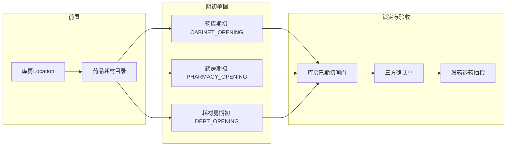

# 药库 / 药房 / 耗材房上线前初始化方案（独立期初单据）

> 一句话：新增独立「库存期初」单据，将药库、药房、耗材房实物结存与追溯码一并写入 HIS，对账签字后按库房锁定。  
> 选型：**已采用独立期初单据**（原方案 C）  
> 状态：**§5 决策已全部确认**（可进入详细设计 / 排期开发）  
> 版本：v0.16 · 2026-07-31  
> 相关 Checklist：[同一医院/00-上线前Checklist.md](../../同一医院/00-上线前Checklist.md) §F · [吉林朝阳中医院/00-上线前Checklist.md](../../吉林朝阳中医院/00-上线前Checklist.md) §F  
> 参考：国基 HIS `StockIniController` / `receiptType=7` + `Organization.stockinistatus`  
> **应用服务**：AS-BAS-INV-001 · AS-BAS-INV-001  
> **朝阳院点清库**：期初已同意后清测试流水用 [`期初后清库.md`](../../吉林朝阳中医院/sql/期初后清库.md)（保留 OPENING/库存/批号价等）；**禁止**直接套用 [`上线前清库-表清单.md`](../../吉林朝阳中医院/sql/上线前清库-表清单.md)（会删库存）。清库前 TEMPLATE 备份 `whale-pro`→`whale-bak`。

---

## 1. 目标与边界

### 1.1 目标

- 药库、药房、耗材房在切换日具备可扣减的真实库存（批号、效期、数量、进价/售价）。
- **追溯码可随期初便捷建档入库**（对齐进货扫码体验），切换后发药/扣减能直接用码。
- 台账与实物盘点表、财务确认金额一致。
- 期初有独立单据语义与审计痕迹，与日常进货、盘点、损益严格区分。
- 库房期初**关闭后**（或已有非期初业务单）不可再录期初；纠错走日常损益/盘点。
- 同库期初真源以**最后一张已同意单**为准；支持**从上一张复制**后再改再审。

### 1.2 边界

| 在范围内                                   | 不在范围内                           |
| -------------------------------------- | ------------------------------- |
| 独立 `SupplyType` 期初单据 + Excel 导入 + 同意入账 | 目录/物价/人员主数据（Checklist D/E，前置完成） |
| 写 `InventoryItem` 与批号进价/售价             | 日常进货、盘点、损益（期初完成后回归日常单据）         |
| 期初行追溯码录入/导入/扫码 → 同意时写追溯主档+流水   | 医保进销存 / 350x（**期初不调用**）           |
| 库房（或机构）一次性期初闸门                         | 用进货/盘点「冒充」期初作为产品主路径             |
| HIS 台账与院内追溯开账（仅本系统）                    | —                               |

### 1.3 术语映射（ZXPlat）

| 业务说法 | ZXPlat 模型                                                                                    |
| ---- | ------------------------------------------------------------------------------------------- |
| 药库   | `LocationForm.WAREHOUSE`                                                                    |
| 药房   | `LocationForm.PHARMACY`                                                                     |
| 耗材房  | `LocationForm.DEPARTMENT_PHARMACY`（科室药房）；非第四种库房形态                                           |
| 库存事实 | `wkf_inventory_item`（库位 + 品规 + 批号）                                                          |
| 期初单据 | `wkf_supply_request`，新增 `type_enum`：`CABINET_OPENING` / `PHARMACY_OPENING` / `DEPT_OPENING` |
| 目标库房 | 写入 **`purpose_location_id`**（与进货「入到哪」同语义） |
| 行追溯码 | 供应行 `trace_no`（逗号串，宽列）；贴码单位取药典（供应表无 `trace_unit_code`）；同意时走 **DM-CUS-010** 追溯写主档 |
| 台账语义 | `InventoryLedgerBusinessType.INBOUND_OR_INIT`                                               |

**现状**：当前 `SupplyType` 无独立期初类型；Checklist §F 仍写进货/盘点。本方案落地后 Checklist 主路径改为期初单。

---

## 2. 业务总览

### 2.1 三房各自开账

药库、药房、耗材房共用**基础数据**下同一菜单「库存期初」；单据头选择目标库房后建单/导入；可从该库**上一张已同意单或历史作废单复制**明细再修改；新单同意后成为唯一真源。单据类型仍按库房形态区分（见 §3.1）。

### 2.2 推荐上线顺序

1. 建立 Location（总库 / 门诊药房 / 住院药房 / 耗材房）
2. 药品、耗材目录与价格就绪
3. 整理并签字《期初明细表》Excel（含需建档的追溯码，见 §3.7）
4. **药库、药房、耗材房必须各自做期初** → 可复制上一张再改 → 提交同意（后单覆盖前单）→ 抽检
5. （可选）药库出库仅用于上线后日常补货演示，**不替代**药房/耗材房本库期初
6. **关闭期初**（必做）：人工关闭前须先处理完该库「审核中」期初单；或该库已出现非期初业务单后自动不可再做期初；其后纠错走损益/盘点
7. 药库 + 药房 + 财务三方《库存期初确认单》
8. 发药 / 退药 / 耗材扣减冒烟（含带追溯码发药；期初流程至此结束；不调用医保）

---

## 3. 功能设计讨论

### 3.1 单据类型与生命周期

| `SupplyType`       | 库房       | 说明         |
| ------------------ | -------- | ---------- |
| `CABINET_OPENING`  | 药库       | 药库期初       |
| `PHARMACY_OPENING` | 药房       | 药房期初       |
| `DEPT_OPENING`     | 耗材房/科室药房 | 耗材/科室备用药期初 |

生命周期对齐现有库存单：

`草稿 → 提交 → 同意 | 驳回`；同意后写库存；**撤回完全对齐进货/盘点现网**（复用同一套 `withdrawApproval` 语义，不另开特例）。

同意时：

- **以本张为唯一真源**：若同库已有其它 `AGREE` 期初单，先**整单回滚并作废**之，再按本单写入库存/批号价/追溯（见 §3.2）
- 前有效单已回滚后，按匹配键 `(locationId, itemTable, itemId, lotNumber)` **无则建、有则加**（加量为本单行量；非与前单累加）
- 写入批号成本 / 售价（以本单为准）
- 台账记为入库/初始化语义
- **若行上有 `trace_no`**：写/更新追溯主档 + `HOSPITAL_IO` IN；码已在院则**覆盖更新主档**；**不调医保**

### 3.2 最后一张为准、可复制与关闭闸门

| 讨论点  | 结论                | 说明                    |
| ---- | ----------------- | --------------------- |
| 粒度   | **按库房（Location）** | 门诊药房已期初不影响住院药房        |
| 多单关系 | **以最后一张已同意单为准** | 新单同意 → 前同意单作废并整库期初结果替换 |
| 复制   | **支持从上一张复制** | 服务端建新草稿；源可为当前 AGREE 或历史作废单 |
| 关闭期初 | **本期必做** | 关前须无审核中单；可空关；见 §3.2.1 |
| 重开关闭后 | 仅实施/超管 + 审计日志     | 产品默认不提供业务侧重开          |

**多初始化单据规则（已确认）：**

1. **最后一张为准**：同库同时最多一张「当前有效」`AGREE` 期初单；新单**同意**成功后，成为该库期初真源。
2. **覆盖前单**：同意新单的同一事务内：回滚前同意单造成的库存/追溯影响 → 前单置 `EXPIRED_INVALIDATED` → 再按新单入账（批号价由新单重写；手工作废后批号价**保留**）。
3. **从上一张复制（本期必做）**：未关闭前，服务端将源单明细拷入**新草稿**并返回新 `bus_no`（源单不变）。源单可为同库**当前 `AGREE`**，或指定**历史已作废**期初单（只读复制）。真正覆盖发生在新单**同意**时。
4. **分批盘库用法**：第一张录一部分并同意 → 复制出第二张 → 在副本上补全/改正 → 再同意（覆盖第一张）。列表突出「当前有效」。
5. **草稿 / 驳回 / 已作废**：可并存；同库**审核中最多一张**（第二张提交拒绝）；同意时对库房串行，防双计入账。
6. **跨库房**：各库独立，互不影响。
7. **覆盖/新建仅在「未关闭且无非期初业务单」时允许**。
8. **手工作废当前有效单（本期仍做）**：关闭前可作废当前 `AGREE` 并回滚入账；关闭后禁止，纠错走损益/盘点。
9. **单内唯一键**：同一张单内禁止重复 `(品规, 批号)`。
10. **空明细**：允许建空草稿；**提交**时必须至少一行。

#### 3.2.1 关闭期初与业务单据封锁（已确认）

**显式关闭（必做功能）**

- 入口：基础数据「库存期初」页，按库房操作「关闭期初」（关闭态存**独立表**，仅三房形态可写，见 AS Gap-002）。
- **关闭前提**：该库不得仍有「审核中」期初单（须先撤回或驳回处理完）；**允许**从未同意过期初就关闭（空关）。
- 效果：之后禁止该库期初新建/提交/同意/复制。
- 关闭前：允许「复制 → 改 → 再同意覆盖」。
- 关闭后纠错：日常损益 / 盘点。

**业务单据自动封锁（必做）**

- 规则：该库房一旦出现**除期初以外的任何业务单据**，不允许再做期初，并**必须自动写关闭行**（与显式关闭同态）。
- 「其他业务单据」口径：
  1. 非 OPENING 供应单（已提交及以上；**纯草稿不挡**）；
  2. **发放类（窄口径）**：本库已生效的门诊/住院发药 OUT、退药回库、科室领用/退回（动可用库存者）。
- **禁止**用库存>0 判定。
- 提示文案示例：「该库房已发生业务单据，不可再做库存期初」。

参考国基：`Organization.stockinistatus`；ZXPlat 关闭态见独立表方案。

### 3.3 Excel 导入

必选能力（期初明细量大）：

| 字段      | 必填     | 说明                          |
| ------- | ------ | --------------------------- |
| 库房编码/名称 | 是      | 对应 Location；也可由单据头选定库房后明细省略 |
| 药品或耗材编码 | 是      | 目录须已存在                      |
| 批号      | 是      | 与库存匹配键一致                    |
| 效期      | 是      | **禁止空值**                      |
| 数量      | 是      | 单位与目录库存单位一致；有码时与应扫数按 ceil(拆零/每码追溯拆零) 对齐（半盒允许，见 AS） |
| 进价      | **药库硬必填**；药房/耗材房可空 | 批号成本；药库无进价拒建单/拒同意 |
| 售价      | 按院方    | 批号售价                        |
| 供应商     | **是**   | 裁决 1A：行级硬必填（三房）；同意建库存域不变量 |
| 追溯码     | 条件必填*  | 逗号分隔多码；西药/中成药必填；中草药、耗材可不填 |
| 追溯码单位   | —       | **单据不采集**；取药典 `trace_unit_code`+`trace_unit_ratio`（半盒应扫数 ceil） |

导入校验失败 → **整单失败**（不部分入库）；返回全部错误行便于改正后重导。

校验项含：编码不存在、批号空、数量 ≤0、**效期空/非法**、**同单内品规+批号重复**、追溯码格式非法/行内重复/跨行重复、西药中成药缺码、**码个数与数量不一致**。

\* 西药、中成药强制有码；中草药、耗材不强制。

### 3.4 前端与菜单

- **菜单**：挂在 **基础数据** 下，**仅一个菜单项**（建议名称：库存期初），不按药库/药房/耗材房拆菜单
- **页面路径建议**：`views/basic/inventory-opening/`（或同等 basic 子目录）
- **库房选择**：单据头选择目标 Location（`WAREHOUSE` / `PHARMACY` / `DEPARTMENT_PHARMACY`），系统据此落对应 `SupplyType`；目标库写入 `purpose_location_id`
- 交互对齐进货/盘点：列表、详情、编辑、导入、提交、同意/驳回；列表可按库房、单据状态筛选
- **关闭期初**：页内按库房提供「关闭期初」；已关闭、有审核中期初单、或已有非期初业务单时按钮禁用并提示
- **从上一张复制**：服务端直接建新草稿返回单号；可选当前有效单或指定历史作废单为源
- **列表**：突出「当前有效」标记（同库唯一 `AGREE`）
- **追溯码录入**：行上支持逗号串；工具栏复用进货同款「扫追溯码」批量弹窗；支持 Excel 带码导入（见 §3.7）
- 权限：与基础数据「库存期初」**菜单同权**（能进页即可关闭/作废；不另拆权限码）

### 3.5 后端落点（实现时）

- 枚举：`SupplyType` 三类 OPENING（见 AS Gap-001）
- AppService：`BasicInventoryOpeningAppService`（**AS-BAS-INV-001** / SDD）
- Domain：同意时先作废回滚前有效单，再按本单写入库存+批号价；有码则写/覆盖追溯主档；复制见 IF-16
- 文档：Checklist §F 主路径改为期初单；先关闭 AS §3 Gap 再成码

### 3.6 与医保进销存

**期初不调用医保。**

- 草稿 / 提交 / 同意 / 驳回全流程均不调 350x，不联动进销存批初始化。
- 本方案只负责 HIS 台账与院内追溯开账；医保侧若需对齐，由进销存运维另行处理，不挂在期初单据上。

### 3.7 追溯码便捷初始化（已确认需求）

目标：上线切库时，**不必先走日常进货**也能把在库实物码建进 `cus_trace_number`，且操作体验不弱于药库进货。

| 能力 | 说明 |
| --- | --- |
| 行内粘贴 | 明细行 `trace_no` 支持逗号串多码（宽列口径同进货） |
| 扫码弹窗 | 复用进货「批量扫追溯码」组件；扫完回写当前行 |
| Excel 带码 | 模板含「追溯码」列；大批量一次导入数量+码 |
| 同意建档 | 与进货同意同路径：拆码 → 建/更新主档 + `HOSPITAL_IO` IN；`operation_type` = 期初 `SupplyType` |
| 码单位 | 支持 `trace_unit_code`（缺省包装单位） |
| 数量核对 | **严格一致**：码个数与行数量（按包装单位换算）必须一致，否则整单/该次同意失败 |
| 无码行 | **西药、中成药禁止无码**；**中草药、耗材允许无码** |
| 已存在码 | **真覆盖**：主档库位/剩余量等置成与本单一致（必要时先冲平再记本单 `HOSPITAL_IO` IN）；不因「已在院」拒绝；禁止仅做增量 IN 叠量 |

**便利性验收口径**：实施人员应能「选库房 → 导 Excel（含码）或扫码 → 同意」完成库存+追溯一次开账，无需再开进货单仅为灌码。

---

## 4. 验收标准

| ID   | 标准                           |
| ---- | ---------------------------- |
| V-01 | 基础数据「库存期初」可对三房建单；同意后库存明细 = Excel/盘点表 |
| V-02 | 批号、效期、进价/售价可查且发药可选中正确批号      |
| V-03 | 同库新单同意后，前同意单作废；库存/追溯以最后同意单为准 |
| V-03a | 可显式「关闭期初」（可空关）；有审核中单时不可关；关闭后不可再建/审期初 |
| V-03b | 该库一旦有非期初业务单据，不可再做期初（提示明确） |
| V-03c | 可从当前有效或历史作废单复制出新草稿，改后同意可覆盖 |
| V-03d | 手工作废当前有效单后该库期初库存回滚；关闭后不可作废 |
| V-03e | 同库审核中最多一张；列表标当前有效；单内品规+批号不重复 |
| V-04 | 财务可按期初单据类型汇总金额（与进货、盘点区分）     |
| V-05 | 开药→收费→发药库存减；退药回增；耗材领用可扣      |
| V-06 | Checklist §F 已改为期初单主路径       |
| V-07 | 期初同意后追溯主档在库、库位正确；发药可扫该码扣减 |
| V-08 | Excel 带码导入与扫码弹窗均可完成灌码；无需另开进货单 |

---

## 5. 已确认决策

| #   | 决策项                | 选项                               | 结论              |
| --- | ------------------ | -------------------------------- | --------------- |
| 1   | 药房 / 耗材房是否必须各自做期初单 | — | **是，必须各自开账（已确认）** |
| 2   | 多单关系                 | — | **以最后一张已同意为准；同意时作废并回滚前单（已确认）** |
| 3   | 从上一张复制              | — | **支持（本期必做）（已确认）** |
| 3a  | 同批号跨单进价/效期冲突         | — | **不适用（整单替换，以本张为准）** |
| 4   | Excel 失败策略         | — | **整单失败（已确认）** |
| 5   | 效期空值               | — | **不允许（已确认）** |
| 6   | 期初是否调用医保             | —                                | **否（已确认）**       |
| 7   | 菜单入口                 | —                                | **基础数据下单一菜单「库存期初」（已确认）** |
| 8   | 追溯码便捷初始化           | —                                | **要（扫码+Excel+同意建档，已确认）** |
| 9   | 启用追溯品种是否强制有码     | — | **西药/中成药强制；中草药、耗材不强制（已确认）** |
| 10  | 码个数与数量一致性         | — | **严格一致（已确认）** |
| 11  | 显式「关闭期初」闸门         | — | **本期必做（已确认）** |
| 12  | 手工作废当前有效单           | — | **关闭前可做；关闭后禁止（已确认）** |
| 13  | 有非期初业务单后是否禁期初     | — | **禁止再做期初（已确认）** |
| 14  | 目标库字段 | — | **`purpose_location_id`（已确认）** |
| 15  | 并发防双计 | — | **同库审核中仅一张 + 同意时库房串行（已确认）** |
| 16  | 单内品规+批号重复 | — | **禁止（已确认）** |
| 17  | 空明细 | — | **可建空草稿；提交须有行（已确认）** |
| 18  | 复制接口 | — | **服务端直接建草稿返 busNo（已确认）** |
| 19  | 复制源 | — | **当前 AGREE 或指定历史作废单（已确认）** |
| 20  | 列表当前有效 | — | **要标记（已确认）** |
| 21  | 关闭与审核中 | — | **关闭前须处理完审核中单（已确认）** |
| 22  | 空关 | — | **允许从未同意就关闭（已确认）** |
| 23  | 码已在院 | — | **真覆盖主档（置成与本单一致；已确认）** |
| 24  | 业务封锁后写关闭行 | — | **必须自动写（已确认）** |
| 25  | 发放类封锁白名单 | — | **窄：发药 OUT/退药/科室领用退回（已确认）** |
| 26  | 回滚领域门面 | — | **`voidOpening` 内聚回滚（已确认）** |
| 27  | 财务审批岗 | — | **不走财务审批（已确认）** |
| 28  | 药库进价 | — | **硬必填（已确认）** |
| 29  | 撤回语义 | — | **完全对齐进货/盘点现网（已确认）** |
| 30  | 关闭/作废权限 | — | **与菜单同权（已确认）** |

---

## 6. 修订记录

| 版本   | 日期         | 说明                               |
| ---- | ---------- | -------------------------------- |
| v0.16 | 2026-07-31 | 朝阳院点：期初后清库口径（保留入账真源）；清库前 `whale-pro`→`whale-bak`；对齐 AS/SDD BR-023/R-014 |
| v0.15 | 2026-07-21 | 拍板 U1～U8：码真覆盖、封锁窄口径+必写关闭、voidOpening、无财务审、药库进价必填、撤回对齐现网、关/作废同菜单权 |
| v0.14 | 2026-07-21 | 拍板 Q1～Q10：目的库字段、并发、行唯一、空草稿、复制建草稿/可拷作废、当前有效、关前清审核中、可空关、码覆盖更新 |
| v0.1 | 2026-07-21 | 初稿：多方案对比                         |
| v0.2 | 2026-07-21 | 确认采用独立期初单据；删除其他方案，仅保留本方案讨论与待确认细节 |
| v0.3 | 2026-07-21 | §3.6 明确：期初全流程不调用医保 |
| v0.4 | 2026-07-21 | 菜单改为基础数据下单一「库存期初」入口 |
| v0.5 | 2026-07-21 | 增加追溯码便捷初始化：扫码/Excel/同意建档（对齐进货） |
| v0.6 | 2026-07-21 | §3.2：多期初单不以最后一张为准；建议同库仅一张已同意 |
| v0.7 | 2026-07-21 | §3.2 改：最后审批为准；前单作废；库存追溯整库替换 |
| v0.8 | 2026-07-21 | §3.2.1：关闭期初必做；有非期初业务单后禁止再做期初 |
| v0.9 | 2026-07-21 | §3.2 改：多张已同意叠加（分批盘库），取消后单覆盖 |
| v0.10 | 2026-07-21 | 同批号效期/进价以最新为准；单张作废回滚本期必做 |
| v0.11 | 2026-07-21 | 补全 §5：三房各自开账；Excel 整单失败；效期必填；西药中成药强制码；码数严格一致 |
| v0.12 | 2026-07-21 | 关联 AS-BAS-INV-001 / SDD；后端落点指向基础数据库存期初 AppService |
| v0.13 | 2026-07-21 | 改回「最后一张为准」+ 支持从上一张复制；取消叠加 |

