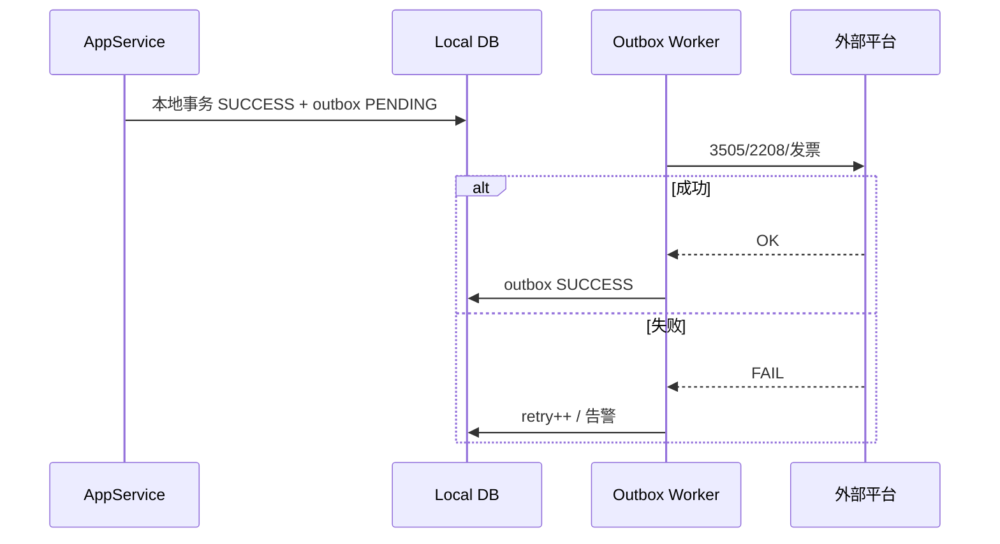

# SYS-IMP-011 外部集成最终一致性与补偿

> **问题类型**：外部集成与分布式顺序 · [本类索引](./README.md) · [总索引](../README.md)
>
> **来源**：2026-06 代码审查（`OutpatientRegistrationAppService` booking Client、`ChsOutpatientSettlementFacadeImpl`、`ChsInventoryAppService` 3505/3502、`InsuranceInventoryAppService`、LIS/PACS AS 标注）。
>
> **关联 AS**：`AS-OP-FIN-002/003`（医保）、进销存 3505/3506；Booking AS；外部接口 AS（LIS/PACS 多标非目标/Gap）
>
> **关联**：`SYS-IMP-006` GAP-CHS-001～008；`SYS-IMP-005` GAP-INV-007；`SYS-IMP-008` GAP-ACL-006；`SYS-IMP-013` GAP-REG-003（核发追溯 vs 3505）
>
> **状态**：待实施

---

## 1. 背景与结论摘要

ZXPlat 与外部系统的交互模式大致三类：

| 模式 | 示例 | 一致性 |
| --- | --- | --- |
| **同步强一致** | 医保 confirm 与本地结算同事务/紧耦合 | IMP-006 已覆盖 |
| **本地成功 + 异步上报** | 3505 销售、3502 库存变更 | **半成功态** |
| **可选模块 Client** | `Booking`QueryReader`（规划） | **静默降级** |

**结论**：

- IMP-006 聚焦 **2206/2207/2304** 与本地 Payment 顺序；本文件扩展 **Booking、3505/3502、电子发票、LIS/PACS** 等 **最终一致 + 补偿** 叙事。
- 多处注释/实现倾向：**本地核发/盘点成功不回滚平台失败** → 须 **Outbox + 对账任务 + 运维台** 闭合，否则 HIS 与监管平台长期分叉。

---

## 2. 问题清单总览

| ID | 标题 | 严重度 | 门/住 | 优先级 | 状态 |
| --- | --- | --- | --- | --- | --- |
| GAP-INT-001 | 3505/3502 本地成功后上传失败无强制补偿 | 中危 | 药库 | P1 | 待实施 |
| GAP-INT-002 | 3505 重复上传幂等键与 Dispense 锚点 | 低危～中危 | 药库 | P2 | 待评估 |
| GAP-INT-003 | booking Client 缺失时预约链静默跳过 | 中危 | 门诊 | P2 | 见 SYS-IMP-008 |
| GAP-INT-004 | 2201/就诊登记与挂号并发（半成功） | 中危 | 门诊 | P2 | 部分已有 |
| GAP-INT-005 | 电子发票开票/冲红与 Payment 顺序 | 中危 | 门+住 | P2 | 待实施 |
| GAP-INT-006 | LIS/PACS 申请单已签发外部未接单 | 低危（业务） | 门+住 | P3 | 文档化 |
| GAP-INT-007 | 外部回调/Webhook 无 idempotency | 中危 | 全局 | P2 | 待评估 |
| GAP-INT-008 | 集成失败无运维对账台 | 中危 | 全局 | P1 | 待实施 |

---

## 3. 分项：问题与修改方案

### GAP-INT-001 3505 半成功态

| 维度 | 说明 |
| --- | --- |
| **严重度** | 中危（监管账与 HIS 账不一致） |
| **关联 IF/BR** | 3505/3502 进销存上传；**SYS-IMP-005 GAP-INV-007** |
| **现象** | 发药/盘点本地 `COMPLETED` 后，`ChsInventoryAppService#uploadSale3505` 逐行调平台；单行失败 **不回滚** 本地库存与 Dispense；失败行可能仅日志/结果列表。 |
| **根因** | 分布式事务不可行；缺统一 **Integration Outbox** 与重试。 |
| **业务影响** | 医保进销存监管平台缺单；飞检对不上。 |

**修改方案（推荐）**

1. **Outbox 表** `int_outbox`：`(sourceType, sourceLineId, infNo, payload, status, retryCount)`；
2. 本地成功后 **同事务** 写 outbox PENDING；异步 worker 调 3505，SUCCESS 标记；FAIL 指数退避；
3. **运维台**：按 encounter/dispense 查上传态，支持手工重传；
4. 与盘点同意（IMP-005）共用 worker。

**涉及代码**

- `ChsInventoryAppService.java`
- `InventoryUploadContextLoader.java`
- 新建 `IntegrationOutboxWorker`

**验收用例**

- 模拟平台 500 → 本地仍 COMPLETED，outbox RETRY → 最终 SUCCESS。
- 重传幂等：同 sourceLineId 不双上传。

**工作量**：4～5 人天

---

### GAP-INT-002 3505 幂等

| 维度 | 说明 |
| --- | --- |
| **严重度** | 低危～中危 |
| **现象** | `processSaleLine3505` 有落库 `yb_inv_upload`；双发药重试可能重复行 — 需 `(sourceLineId, infNo)` 唯一。 |
| **修改方案** | DB 唯一 + 重复返回上次结果。 |

**工作量**：1 人天

---

### GAP-INT-003 Booking 可选 Client

| 维度 | 说明 |
| --- | --- |
| **修改方案** | 见 **SYS-IMP-008 GAP-ACL-006**。 |

---

### GAP-INT-004 2201 与挂号半成功

| 维度 | 说明 |
| --- | --- |
| **严重度** | 中危 |
| **关联** | `OutpatientRegistrationInsuranceExtension`；**GAP-CHS-005** |
| **现象** | 本地 encounter 已创建，2201 失败 — 后续收费可能无医保登记。 |
| **修改方案** | 挂号事务：2201 失败策略可配置（阻断 vs 标记待补登记）；Outbox 补 2201；收费 Gate 检查登记态。 |

**工作量**：2 人天

---

### GAP-INT-005 电子发票顺序

| 维度 | 说明 |
| --- | --- |
| **严重度** | 中危 |
| **现象** | 正式结算触发开票草稿；退费/反结需冲红 — 若冲红失败本地已 REFUNDED，票账不一致。 |
| **修改方案** | 与退费 Saga 绑定：冲红 SUCCESS → 本地 REFUND SUCCESS；失败进 outbox；禁止跳过冲红直接 REFUND（可配置应急 role）。 |

**涉及代码**

- `InvoiceDomainService`、门诊/住院退费 AppService

**工作量**：3 人天

---

### GAP-INT-006 LIS/PACS 闭环

| 维度 | 说明 |
| --- | --- |
| **严重度** | 低危（业务/流程） |
| **现象** | 检查/检验申请 ServiceRequest 已 VERIFIED，外部系统未接单 — AS 多标非目标。 |
| **修改方案** | 文档化 **已知限制**；若集成上线：申请单状态 `SENT/ACCEPTED/REPORTED` + 超时告警。 |

**状态**：文档化

---

### GAP-INT-007 外部回调幂等

| 维度 | 说明 |
| --- | --- |
| **严重度** | 中危 |
| **现象** | 第三方重复 POST 报告/支付回调可能双写。 |
| **修改方案** | 全局 `ExternalCallbackIdempotencyStore`（messageId 唯一）。 |

**状态**：待评估

---

### GAP-INT-008 运维对账台

| 维度 | 说明 |
| --- | --- |
| **严重度** | 中危 |
| **现象** | 半成功态分散在 yb_*、outbox、日志，无统一视图。 |
| **修改方案** | 管理端「集成对账」：医保结算/3505/2201/发票 四 Tab；支持按日导出差异清单。 |

**工作量**：3～5 人天（含 UI）

---

## 4. Saga / Outbox 目标架构

---

## 5. 推荐实施顺序

| 顺序 | ID | 内容 | 人天 |
| --- | --- | --- | --- |
| 1 | GAP-INT-001 + 002 | 3505 Outbox + 幂等 | 4～6 |
| 2 | GAP-INT-008 | 对账台 | 3～5 |
| 3 | GAP-INT-005 | 发票 Saga | 3 |
| 4 | GAP-INT-004 | 2201 补登记 | 2 |
| 5 | GAP-INT-003/006/007 | 文档/评估 | 按需 |

---

## 6. 不建议的做法

| 做法 | 原因 |
| --- | --- |
| 平台失败回滚已发药 | 临床不可撤销；应 Outbox |
| 无 retry 上限无限打平台 | 需 DLQ + 人工 |
| 各集成各写一套 retry | 维护成本高 |

---

## 7. 回归测试矩阵

| # | 场景 | 期望 |
| --- | --- | --- |
| T1 | 3505 平台超时 | 本地成功，outbox 重试成功 |
| T2 | 双次 upload 同 line | 幂等 |
| T3 | 退费平台冲红失败 | 本地不 REFUND SUCCESS |
| T4 | 2201 失败挂号 | 可配置阻断或待补 |

---

## 8. 修订记录

| 版本 | 日期 | 说明 |
| --- | --- | --- |
| v1.0 | 2026-06-21 | 初稿：外部集成最终一致性与补偿审查 |
