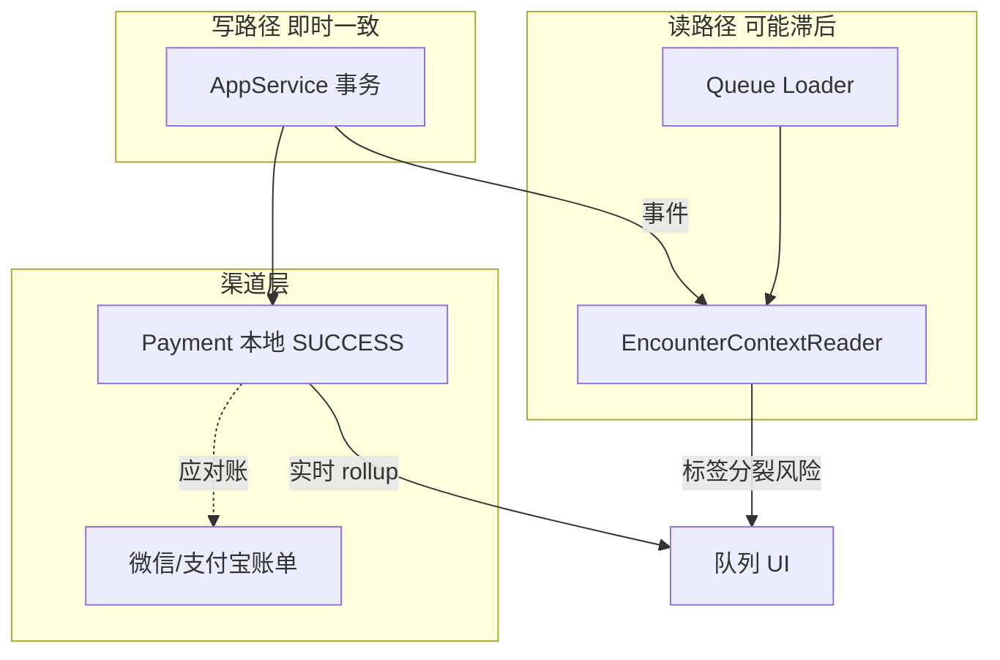

# SYS-IMP-014 渠道对账、读模型滞后与全局幂等边界

> **问题类型**：读模型、渠道与全局架构 · [本类索引](./README.md) · [总索引](../README.md)
>
> **来源**：2026-06 代码审查（`PaymentChannelGate`、`OutpatientDailySettlementReportDatasetService`、`OutpatientChargeAppService#applyQueueLabelCodes`、`EncounterContextReader`、各 `*Extension.isEnabled()`、`whale-audit`、`OutpatientRegistrationAppService` 可选 Client 模式）。
>
> **关联 AS**：`AS-OP-FIN-004`（日结待成码）、支付渠道字典；队列读模型 AS
>
> **关联**：`SYS-IMP-010` GAP-BAT-004/005；`SYS-IMP-008` GAP-ACL-006；`SYS-IMP-007` BND-STALE-004；`SYS-IMP-002` GAP-FIN-001（分散幂等）
>
> **状态**：待实施

---

## 1. 背景与结论摘要

IMP-001～012 主要解决 **写路径并发与业务 Gate**。本文件覆盖 **第三类不一致**：

| 类型 | 与 IMP-007 Stale 区别 | 典型表现 |
| --- | --- | --- |
| **读模型滞后** | 非「用户持旧页」，而是 **投影/队列未追上写库** | 写成功但队列仍待收/仍显示旧标签 |
| **渠道账 vs 本地账** | 非 Charge 双结，而是 **微信/支付宝账单 ≠ Payment** | 掉单、多账、日结平不了 |
| **全局幂等/配置** | 非单接口 TOCTOU，而是 **缺统一中间层** | API 重放、模块关导致 Gate 消失 |

**结论**：

- `PaymentChannelGate` 仅校验 **枚举合法 + 用户可选**（CASH/WECHAT/ALIPAY 等），**无**与第三方支付平台对账、掉单补偿。
- 门诊收费队列 `applyQueueLabelCodes` **实时读** Payment + Charge rollup，但 **Encounter 分页** 走 `EncounterContextReader` 读模型 — 存在 **列表来源分裂**。
- 各业务幂等（confirm 幂等键等）分散在 IMP-002/006 **建议**中，**网关层无统一** Idempotency-Key。
- 可选 Extension（CHS、Booking、Insurance、Trace）**无启动功能矩阵自检**（IMP-008 ACL-006 仅 Booking）。

---

## 2. 问题清单总览

| ID | 标题 | 严重度 | 门/住 | 优先级 | 状态 |
| --- | --- | --- | --- | --- | --- |
| GAP-ARCH-001 | 微信/支付宝渠道账单与本地 Payment 无对账 | 中危 | 门诊 | P1 | 待实施 |
| GAP-ARCH-002 | 收银班结/换班与日结边界不清 | 中危 | 门+住 | P2 | 待实施 |
| GAP-ARCH-003 | Encounter 队列读模型与 Charge/Payment 实时态分裂 | 中危 | 门+住 | P1 | 待实施 |
| GAP-ARCH-004 | 取消执行/退费后列表标签滞后（投影 lag） | 中危 | 门+住 | P2 | 见 IMP-007 |
| GAP-ARCH-005 | 无全局 API Idempotency-Key 中间层 | 中危 | 全局 | P1 | 待实施 |
| GAP-ARCH-006 | 可选模块 Extension 无功能矩阵启动自检 | 中危 | 全局 | P1 | 待实施 |
| GAP-ARCH-007 | 框架审计未覆盖全部敏感写操作 | 低危～中危 | 全局 | P2 | 待评估 |
| GAP-ARCH-008 | 母婴分账（baby_no）与 Charge 归属 | 低危～中危 | 住 | P3 | 待评估 |
| GAP-ARCH-009 | 手术/输血专科闭环 | 低危（业务） | 住 | P3 | 已知限制 |

---

## 3. 分项：问题与修改方案

### GAP-ARCH-001 第三方支付对账缺失

| 维度 | 说明 |
| --- | --- |
| **严重度** | 中危 |
| **关联 IF/BR** | IF-OPC-07 支付明细；报表 WECHAT/ALIPAY 汇总 |
| **现象** | 正式结算写本地 `PaymentReconciliation` SUCCESS + `payEnum=WECHAT/ALIPAY`；**无**拉取微信/支付宝商户对账单与本地逐笔核对、掉单补单/退单流程。 |
| **根因** | 当前为 **记账型** 渠道码，非 **联机型** 支付。 |
| **业务影响** | 用户已付、本地未 SUCCESS；或本地 SUCCESS、渠道无单；日结 C 类报表与渠道实收不符。 |

**修改方案（推荐）**

1. **联机支付 Adapter**（若上线扫码付）：预下单 → 回调 → 本地 SUCCESS，回调 **幂等**；
2. **对账 Job**：T+1 拉渠道 bill → 匹配 `merchantOrderNo` ↔ `payment.busNo` → 差异表；
3. **掉单补偿**：渠道有、本地无 → 补记或告警；本地有、渠道无 → 冻结退费直至核实；
4. 与 **IMP-010 BAT-005** 报表 snapshot 共用 `fin_recon_channel_line`。

**涉及代码**

- `PaymentReconciliationDomainService`
- 新建 `ChannelReconciliationAppService` / Job
- `OutpatientDailySettlementReportDatasetService`（读 snapshot）

**验收用例**

- 模拟回调重复 → 1 条 SUCCESS。
- 对账 Job 发现差异 → 进差异表。

**工作量**：5～8 人天（含渠道 SDK）

---

### GAP-ARCH-002 班结 vs 日结

| 维度 | 说明 |
| --- | --- |
| **严重度** | 中危 |
| **现象** | IMP-010 偏 **收费员日结**；**换班未交班** 时同 operator 连续收银、班结窗口内退费责任 — AS 待成码部分覆盖。 |
| **修改方案** | 1. `CashierShiftSession`：上班 OPEN → 交班 CLOSE 挂载 payment；2. 退费默认限当前 shift 或原 shift 授权；3. 与日结 `daily_close_id` 层级：shift ⊂ day。 |

**状态**：待实施（依赖日结成码）

**工作量**：3～5 人天

---

### GAP-ARCH-003 队列读模型分裂

| 维度 | 说明 |
| --- | --- |
| **严重度** | 中危 |
| **现象** | `pageOutpatientChargeQueue`：分页 id 来自 `outpatientChargeEncounterQueueLoader`，详情来自 `encounterContextFacade`；标签来自 **实时** `applyQueueLabelCodes`（Charge + Payment）。若 Context 投影滞后，**行展示与标签/写 Gate 不一致**。 |
| **根因** | CQRS：写库即时、读模型 eventual；队列未统一 **单一事实源**。 |
| **业务影响** | 列表无该就诊但能 loadPending；或仍显示待收已结清。 |

**修改方案**

1. **短期**：写成功后 API 返回 `invalidateEncounterIds`；前端强制刷新（IMP-007 §8）；
2. **中期**：队列分页 **以 Charge 事实表驱动**（`pageEncounterIdsByChargeStatus`），Context 仅展示字段；
3. **长期**：投影 consumer 监控 lag；超阈值告警。

**涉及代码**

- `OutpatientChargeAppService#pageOutpatientChargeQueue`
- `OutpatientChargeEncounterQueueLoader`
- `EncounterContextReader`
- 住院 `pageInpatientSettleQueue` 对称

**验收用例**

- 结算成功后 5s 内队列 tab=待收 **不含**该 encounter（或标已结）。

**工作量**：3～4 人天

---

### GAP-ARCH-004 投影 lag（取消/退费后列表）

| 维度 | 说明 |
| --- | --- |
| **严重度** | 中危 |
| **关联** | IMP-007 BND-STALE-004 |
| **现象** | 取消执行 CANCEL Procedure 后，执行列表读组装仍可能显示「已执行」直到刷新。 |
| **修改方案** | 1. 写路径发布 `EncounterClinicalStateChangedEvent`；2. 读侧短 TTL 缓存失效；3. 关键 Query **写后读** 走主库（`@Transactional(readOnly)` 同连接可见）。 |

**工作量**：2～3 人天

---

### GAP-ARCH-005 全局 API 幂等

| 维度 | 说明 |
| --- | --- |
| **严重度** | 中危 |
| **现象** | IMP-002 FIN-001、IMP-006 CHS-001 等 **各自**建议 Idempotency-Key；**无**网关/AppService 层统一 `(tenant, operator, key, api)` 表。 |
| **修改方案** | 1. `AppServiceAspect` 或 Filter 解析 `Idempotency-Key`；2. 首次执行落库 response 快照；3. 重复请求返回相同 outcome（HTTP 200 + 同 paymentId）；4. 覆盖：正式结算、confirm 医保、核发、滚费 Job 触发接口。 |

**涉及代码**

- `whale-framework` 或 `health-application` 新建 `IdempotencySupport`
- 各 P0 AppService 标注 `@Idempotent`

**验收用例**

- 同 key 双 POST confirm → 1 条 SUCCESS。

**工作量**：3～4 人天

---

### GAP-ARCH-006 功能矩阵启动自检

| 维度 | 说明 |
| --- | --- |
| **严重度** | 中危 |
| **现象** | `bookingQueryPort==null`、`dispenseTraceGateExtension.isEnabled()==false`、`chargeInsuranceExtension.isEnabled()==false` 等 **静默降级**；运维难以发现配置错误。 |
| **修改方案** | 1. `application.yml` 声明 **requiredModules**: `[booking, chs, trace-gate]`；2. `ModuleHealthIndicator` 启动时校验 Bean + Client；3. 管理端展示功能矩阵（绿/黄/红）。 |

**涉及代码**

- Spring Boot `ApplicationRunner` 或 Actuator
- 对齐 IMP-008 ACL-006、IMP-013 REG-001

**验收用例**

- required 含 booking 但 Client 缺失 → 启动失败或 WARN 升级 FAIL。

**工作量**：2 人天

---

### GAP-ARCH-007 业务审计覆盖

| 维度 | 说明 |
| --- | --- |
| **严重度** | 低危～中危 |
| **现象** | `whale-audit` 通用审计存在；**改价、override 核发、反结、mergePatient** 是否全部 `@Audited` — 需清单验收。 |
| **修改方案** | 敏感操作清单 + 强制审计注解；与 IMP-013 REG-006 补打审计合并。 |

**状态**：待评估

---

### GAP-ARCH-008 母婴分账

| 维度 | 说明 |
| --- | --- |
| **严重度** | 低危～中危 |
| **现象** | `VitalSign.babyNo` 等域有婴儿序号；**Charge/结算是否按母婴拆分** 未成文。 |
| **修改方案** | 产品确认：单 encounter 母婴同账 vs 子 encounter；Charge 增加 `babyNo` 维度或子就诊 id。 |

**状态**：待评估

---

### GAP-ARCH-009 手术/输血专科

| 维度 | 说明 |
| --- | --- |
| **严重度** | 低危（业务） |
| **现象** | `ServiceRequest` 含 PROCEDURE、METACHYSIS；LIS/用血 AS 多非目标。 |
| **修改方案** | 文档化 **已知限制**；上线集成时单独立项。 |

**状态**：已知限制

---

## 4. 架构关系图

---

## 5. 推荐实施顺序

| 顺序 | ID | 内容 | 人天 |
| --- | --- | --- | --- |
| 1 | GAP-ARCH-006 | 功能矩阵自检 | 2 |
| 2 | GAP-ARCH-005 | 全局幂等 | 3～4 |
| 3 | GAP-ARCH-003 + 004 | 队列单一事实源 + 投影 lag | 5～7 |
| 4 | GAP-ARCH-001 + 002 | 渠道对账 + 班结 | 8～13 |
| 5 | GAP-ARCH-007/008/009 | 评估/已知限制 | 按需 |

---

## 6. 不建议的做法

| 做法 | 原因 |
| --- | --- |
| 队列只信 Context 投影 | 与 Charge 态易分裂 |
| 扫码付无回调幂等 | 掉单难补 |
| 各模块各自 isEnabled 无文档 | 运维踩坑 |

---

## 7. 回归测试矩阵

| # | 场景 | 期望 |
| --- | --- | --- |
| T1 | 结算后队列刷新 | 已结 tab |
| T2 | 同 Idempotency-Key 双 confirm | 1 SUCCESS |
| T3 | required booking 缺失 | 启动 FAIL |
| T4 | 渠道对账差异 | 进差异表 |
| T5 | 取消执行后列表 | ≤N 秒内状态正确 |

---

## 8. 修订记录

| 版本 | 日期 | 说明 |
| --- | --- | --- |
| v1.0 | 2026-06-21 | 初稿：渠道对账、读模型滞后与全局幂等边界审查 |
