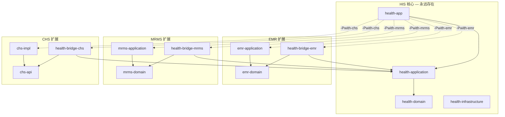
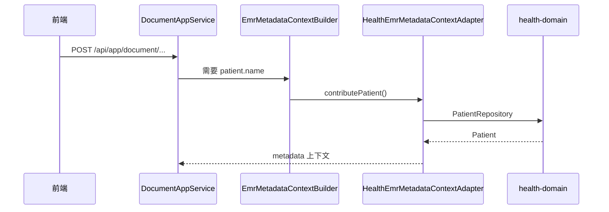

# whale-health 可选扩展模块架构

> **文档性质**：架构说明 — HIS 核心与 EMR / MRMS / CHS 等扩展模块的解耦与按需装配  
> **适用范围**：`whale-sever/whale-health` 及同仓库下的 `whale-emr`、`whale-mrms`、`whale-chs`  
> **版本**：v1.1 | **日期**：2026-05-30

---

## 1. 设计目标

| 目标 | 说明 |
|------|------|
| **HIS 可独立运行** | 无 EMR/MRMS/CHS 源码或 JAR 时，`health-application` 可编译、`health-app` 可启动 |
| **扩展可任意组合** | `-Pwith-emr`、`-Pwith-mrms`、`-Pwith-chs` 互不绑定，可叠加或 `-Pfull` 一次全开 |
| **三扩展行为一致** | 每个扩展均为「扩展包 + bridge + Maven Profile + Spring AutoConfiguration」同一套路 |
| **开源仓友好** | 默认构建不含商业/可选扩展；`-Popensource` 仅含 HIS 核心 |

---

## 2. 总体结构

```text
whale-sever/
├── whale-framework/                 # 必选：Whale 框架
├── whale-health/                    # 必选：HIS 核心
│   ├── health-domain-shared
│   ├── health-domain
│   ├── health-application           # ★ 零扩展依赖
│   ├── health-infrastructure
│   ├── health-bridge-emr            # 可选：HIS↔EMR 集成
│   ├── health-bridge-mrms           # 可选：HIS↔MRMS 集成
│   ├── health-bridge-chs            # 可选：HIS→CHS 编排
│   └── health-app                   # 启动模块；扩展由 Profile 挂载
├── whale-emr/                       # 可选扩展
├── whale-mrms/                      # 可选扩展
└── whale-chs/                       # 可选扩展
```

### 2.1 分层关系



**依赖方向（硬约束）**：

- `health-application` **不依赖** 任何扩展模块，**不 import** `com.openhis.whale.emr.*` / `mrms.*` / `chs.*`。
- `health-bridge-*` 仅依赖 `health-application` + 扩展的 **Port/API 层**（`*-domain` 或 `chs-api`）。
- 扩展 **实现 JAR**（`*-application` / `chs-impl`）仅在 `health-app` 的 Maven Profile 中引入。
- 扩展包 **不依赖** `health-*`（CHS/MRMS/EMR 均遵守）。

**Bridge 定位**：扩展定义「要什么」（Port / 网关接口），Bridge 负责「HIS 怎么给 / 怎么编排」——从 health 域读数据或调网关，**不**承载扩展自身核心业务（病历模板、病案首页、医保 HTTP 等）。

---

## 3. 三扩展对照表

| 维度 | EMR | MRMS | CHS |
|------|-----|------|-----|
| 扩展仓库 | `whale-emr` | `whale-mrms` | `whale-chs` |
| Port / API 层 | `emr-domain` | `mrms-domain` | `chs-api` |
| 运行时实现 | `emr-application` | `mrms-application` | `chs-impl` |
| HIS 桥接模块 | `health-bridge-emr` | `health-bridge-mrms` | `health-bridge-chs` |
| 桥接代码包 | `application/emr/**` | `application/mrms/**` | `application/insurance/**` |
| 集成模式 | Port 回调（扩展调 HIS） | Port 回调 + 事件驱动（HIS 调 MRMS） | 主动编排（bridge 调网关） |
| 扩展 AutoConfiguration | `EmrAutoConfiguration` | `MrmsAutoConfiguration` | `ChsAutoConfiguration` |
| 桥接 AutoConfiguration | `HealthEmrBridgeAutoConfiguration` | `HealthMrmsBridgeAutoConfiguration` | `HealthChsBridgeAutoConfiguration` |
| Maven Profile | `with-emr` | `with-mrms` | `with-chs` |
| Spring 启用 profile | `extensions-emr` | `extensions-mrms` | `extensions-chs` |
| 配置开关 | `openhis.modules.emr.enabled` | `openhis.modules.mrms.enabled` | `openhis.modules.chs.enabled` |
| Flyway 追加路径 | （暂无独立 migration） | `db/migration/mrms` | `db/migration/chs` |

> Flyway：**独立 history 表**（`flyway_schema_history_mrms` / `_chs`），各模块 **V1、V2 互不影响**。见 [Flyway多模块版本约定.md](./Flyway多模块版本约定.md)。

> **命名说明**：CHS 的运行时 artifact 为 `chs-impl`（网关实现），角色上等同于 EMR/MRMS 的 `*-application`。

---

## 4. Bridge 模块职责

每个 bridge 含两类代码：

| 部分 | 包路径 | 作用 |
|------|--------|------|
| 装配类 | `com.openhis.health.bridge.{emr\|mrms\|chs}.config.*` | AutoConfiguration，按条件扫描并注册业务 Bean |
| 业务代码 | `com.openhis.health.application.{emr\|mrms\|insurance}/**` | 从 health-application 迁出的集成逻辑 |

### 4.1 health-bridge-emr

**职责**：EMR 写病历、解析元数据时，从 HIS 读取患者 / 就诊 / 诊断等信息。

| 类 | 职责 |
|----|------|
| `HealthEmrMetadataContextAdapter` | 实现 `EmrMetadataContextPort`；读 `PatientRepository`、`EncounterRepository` 等，写入 EMR 元数据上下文（`patient.name`、`encounter.deptName` 等） |
| `EmrDiagnosisMetadataContributor` | 补充诊断类元数据键（如 `diagnosis.primaryDisplay`） |
| `HealthEmrBridgeAutoConfiguration` | 在 EMR NoOp 占位之前注册上述 Bean |

### 4.2 health-bridge-mrms

**职责**：MRMS 做病案首页、自动填充、建病案主档时，向 HIS 索取人口学 / 诊断 / ICD / 转科等信息；并在离院时触发建档。

| 类 | 职责 |
|----|------|
| `HealthMrmsPatientEncounterAdapter` | 实现 `PatientEncounterPort` |
| `HealthMrmsDiagnosisProcedureAdapter` | 实现 `DiagnosisProcedurePort` |
| `HealthMrmsIcdSearchAdapter` | 实现 `IcdSearchPort` |
| `HealthMrmsEncounterHistoryAdapter` | 实现 `EncounterHistoryPort` |
| `DischargeCaseRecordBootstrapListener` | 监听 HIS `DischargeMilestoneRecordedEvent`，调用 MRMS `CaseRecordManager.createIfAbsent` |
| `HealthMrmsBridgeAutoConfiguration` | 先于 MRMS 注册 Port 实现 |

### 4.3 health-bridge-chs

**职责**：HIS 侧医保业务编排——组报文、调网关、写本地目录库；**不**拼 HTTP（由 `chs-impl` 负责）。

| 类 / 包 | 职责 |
|---------|------|
| `InsuranceContractResolver` | 按 `fin_contract.bus_no` 解析费用契约 |
| `InsuranceSessionAppService` | 9001 签到 |
| `InsuranceNationalCatalogAppService` | 1312 国家目录：调网关 → 写入 `yb_*` 表 → 本地分页 |
| `JilinCatalog1312InputAssembler` | 吉林省 1312 入参组装 |
| `catalog/request/*`、`catalog/response/*` | 目录 API DTO |
| `HealthChsBridgeAutoConfiguration` | 网关 Bean 就绪后扫描 `application.insurance` |

### 4.4 不在 Bridge 里的内容

| 内容 | 所在模块 |
|------|----------|
| 病历模板、文档、PDF | `emr-application` |
| 病案首页 CRUD、质控、归档 | `mrms-application` |
| 医保 HTTP、ContractConfig、加解密 | `chs-impl` |
| `yb_*` 表实体与域服务 | `health-domain`（HIS 核心） |
| 挂号、收费、住院等主流程 | `health-application` |

---

## 5. HIS 与扩展的集成与调用

### 5.1 同进程，非 RPC

扩展 jar 经 Profile 进入 classpath 后，由各自 `AutoConfiguration` 注册为 **同一 Spring 容器** 内的 Bean。默认 **local 模式**（同 JVM），不经 HTTP 跨进程调扩展。

### 5.2 对外 API：Whale AppService 统一路由

Whale 框架 `AppServiceControllerRegistrar`（`whale-web`）扫描所有 `@Service` 且类名以 `AppService` 结尾的 Bean，暴露为：

```text
POST /api/app/{serviceName}/{methodName}
```

| 扩展 | 示例 API | 对应 Bean |
|------|----------|-----------|
| EMR | `/api/app/document/saveAs` | `DocumentAppService` |
| MRMS | `/api/app/caseRecordHomepage/getHomepage` | `CaseRecordHomepageAppService` |
| CHS | `/api/app/insuranceNationalCatalog/queryNationalCatalogPage` | `InsuranceNationalCatalogAppService` |

**前端 / 工作站通常直接调扩展 AppService**，不经过 HIS 核心的某个「总线」转发。HIS 与扩展的 AppService 在同一网关下并列注册。

### 5.3 对内集成：三种模式

#### 模式 A — Port 回调（扩展调 HIS）：EMR、MRMS 主路径

扩展定义 Port 接口，bridge 实现 Port；扩展在处理自身业务时 **回头向 HIS 要数据**。



MRMS 同理：`CaseRecordHomepageManager` 注入 `PatientEncounterPort` → 实际为 `HealthMrmsPatientEncounterAdapter`。

#### 模式 B — 事件驱动（HIS 调扩展）：MRMS 离院建病案

HIS 域发布事件，bridge 监听器 **主动注入并调用** MRMS 域服务：

```text
DischargeMilestoneRecordedEvent（HIS 离院里程碑）
  → DischargeCaseRecordBootstrapListener（bridge-mrms）
  → CaseRecordManager.createIfAbsent(encounterId)
```

这是目前 **HIS 主动调扩展** 的主要现成例子。

#### 模式 C — 网关编排（bridge 调 CHS）：医保

bridge AppService 注入 `InsuranceGatewayClient`（`chs-api` 接口），由 `chs-impl` 提供实现：

```text
InsuranceNationalCatalogAppService（bridge-chs）
  → InsuranceGatewayClient.invoke(...)
  → InsuranceGatewayClientLocalImpl（chs-impl）
  → HTTP 调医保平台
  → 结果写入 health-domain 的 yb_* 表
```

### 5.4 调用关系总览

| 扩展 | health-application 是否直接调用 | 实际链路 | 典型入口 |
|------|--------------------------------|----------|----------|
| EMR | 否 | 扩展调 Port ← bridge 读 HIS | 前端 → `/api/app/document/*` |
| MRMS | 否（离院监听除外） | Port 回调 + 事件 → `CaseRecordManager` | 前端 → `/api/app/caseRecordHomepage/*` |
| CHS | 否（在 bridge 内） | bridge → `InsuranceGatewayClient` | 前端 → `/api/app/insurance*` |

> **说明**：`health-application` 中已有「转医保账户」等 HIS 域逻辑（如 `switchEncounterChargeItemsToInsurance`），属于费用性质 / 账户切换，尚未接 `InsuranceGatewayClient`；门诊医保结算将按 CHS 文档在 bridge 协同单中挂接收费流程。

### 5.5 Bean 装配顺序（`-Pfull` 示例）

```text
1. ChsAutoConfiguration              → InsuranceGatewayClient
2. HealthChsBridgeAutoConfiguration → insurance AppService
3. EmrAutoConfiguration              → EMR 域 / 应用 Bean
4. HealthEmrBridgeAutoConfiguration  → EmrMetadataContextPort（覆盖 NoOp）
5. MrmsAutoConfiguration             → MRMS + NoOp Port
6. HealthMrmsBridgeAutoConfiguration → 真实 Port 适配器
7. AppServiceControllerRegistrar     → 全部 *AppService → /api/app/*
```

---

## 6. Maven Profile

### 6.1 whale-sever 根 POM（控制扩展仓库是否参与 reactor 构建）

默认 modules：`whale-framework` + `whale-health`。

| Profile | 追加 modules |
|---------|--------------|
| `with-emr` | `whale-emr` |
| `with-mrms` | `whale-mrms` |
| `with-chs` | `whale-chs` |
| `full` | 上述三者 |
| `opensource` | 仅 `whale-health`（无 framework 源码场景） |

### 6.2 whale-health POM（控制 bridge 模块是否参与构建）

默认 modules **不含** `health-bridge-*`；激活 Profile 时追加对应 bridge：

| Profile | 追加 module |
|---------|-------------|
| `with-emr` | `health-bridge-emr` |
| `with-mrms` | `health-bridge-mrms` |
| `with-chs` | `health-bridge-chs` |
| `full` | 三个 bridge |

### 6.3 health-app POM（控制运行时 classpath）

| Profile | 追加依赖 |
|---------|----------|
| `with-emr` | `health-bridge-emr` + `emr-application` |
| `with-mrms` | `health-bridge-mrms` + `mrms-application` |
| `with-chs` | `health-bridge-chs` + `chs-impl` |
| `full` | 上述全部 |

Profile 可叠加，例如：`-Pwith-mrms,with-chs`。

---

## 7. 构建与启动

### 7.1 构建命令

```bash
# 纯 HIS（默认，无需扩展仓库）
cd whale-sever/whale-health
mvn -pl health-app -am package

# 从 sever 根目录构建单扩展（三命令结构相同）
cd whale-sever
mvn -Pwith-emr  -pl whale-health/health-app -am package
mvn -Pwith-mrms  -pl whale-health/health-app -am package
mvn -Pwith-chs  -pl whale-health/health-app -am package

# 全扩展
mvn -Pfull -pl whale-health/health-app -am package

# 组合扩展
mvn -Pwith-emr,with-mrms -pl whale-health/health-app -am package
```

### 7.2 启动与 Spring Profile

Maven Profile 决定 **classpath 里有哪些 JAR**；Spring Profile 决定 **运行时是否启用** 与 **Flyway 路径**。

| 场景 | 建议 `SPRING_PROFILES_ACTIVE` |
|------|-------------------------------|
| 纯 HIS | `dev`（默认 `openhis.modules.*.enabled=false`） |
| 仅 EMR | `dev,extensions-emr` |
| 仅 MRMS | `dev,extensions-mrms` |
| 仅 CHS | `dev,extensions-chs` |
| 全扩展 | `dev,extensions-full` |

示例：

```bash
SPRING_PROFILES_ACTIVE=dev,extensions-full java -jar health-app/target/health-app-2.0.0-SNAPSHOT.jar
```

### 7.3 配置文件

| 文件 | 作用 |
|------|------|
| `application.yml` | 默认：仅 `framework` + `health` Flyway；三扩展 `enabled: false` |
| `application-extensions-emr.yml` | 启用 EMR 模块 |
| `application-extensions-mrms.yml` | 启用 MRMS + 追加 `db/migration/mrms` |
| `application-extensions-chs.yml` | 启用 CHS + 追加 `db/migration/chs` |
| `application-extensions-full.yml` | 启用全部扩展 |

---

## 8. Spring 装配

### 8.1 HealthApplication（仅扫描 HIS 核心）

```java
@SpringBootApplication(scanBasePackages = {
    "com.openhis.whale",
    "com.openhis.health.domain",
    "com.openhis.health.application",
    "com.openhis.health.infrastructure",
    "com.openhis.health.config"
})
@EntityScan(basePackages = { "com.openhis.whale", "com.openhis.health.domain" })
@EnableJpaRepositories(basePackages = { "com.openhis.whale", "com.openhis.health.domain" })
```

**禁止**在启动类硬编码 `com.openhis.chs`、`com.openhis.whale.emr.*`、`com.openhis.whale.mrms.*`。

### 8.1.1 院点工程（health-project-H*）

| 项 | 约定 |
|----|------|
| Flyway | 依赖 **`health-infrastructure`**（脚本 + `infrastructure.config` 配置类），扫描 `com.openhis.health.infrastructure`（**不要**在 `health-app` 重复 Flyway 配置） |
| 初始化器 | 仍可依赖 `health-app` 并扫描 `com.openhis.health.config`（如管理员密码初始化） |
| 扩展模块 | 与 §8.2 相同，由 AutoConfiguration + `openhis.modules.*.enabled` 控制 |

### 8.2 扩展模块自装配

各扩展 JAR 通过 `META-INF/spring/org.springframework.boot.autoconfigure.AutoConfiguration.imports` 注册：

| 类 | 职责 |
|----|------|
| `EmrAutoConfiguration` | 扫描 EMR 包、注册 EMR 实体与 Repository |
| `MrmsAutoConfiguration` | 扫描 MRMS 包、注册 MRMS 实体与 Repository |
| `ChsAutoConfiguration` | 扫描 `com.openhis.chs`、注册网关 Bean |

### 8.3 Bridge 装配顺序

| Bridge | 条件 | 顺序 |
|--------|------|------|
| `HealthEmrBridgeAutoConfiguration` | `@ConditionalOnClass(EmrMetadataContextPort)` | `@AutoConfigureBefore(EmrAutoConfiguration)` — 先注册 HIS 适配器，避免 NoOp 占位 |
| `HealthMrmsBridgeAutoConfiguration` | `@ConditionalOnClass(PatientEncounterPort)` | `@AutoConfigureBefore(MrmsAutoConfiguration)` |
| `HealthChsBridgeAutoConfiguration` | `@ConditionalOnProperty(chs.enabled=true)` | `@AutoConfigureAfter(ChsAutoConfiguration)`；禁止与 `@ComponentScan` 同用 `@ConditionalOnBean` |

所有 bridge 均受 `openhis.modules.{name}.enabled` 控制（classpath 存在且配置为 `true` 时生效）。

### 8.4 降级策略

| 扩展在 classpath | Bridge 在 classpath | 行为 |
|----------------|---------------------|------|
| 否 | 否 | 无扩展 API，HIS 主流程正常 |
| 是 | 否 | EMR/MRMS 使用内置 NoOp Port；CHS 无 insurance AppService |
| 是 | 是 | 全功能 |

---

## 9. 运行时行为矩阵

| Maven 构建 | Spring Profile | EMR | MRMS | CHS |
|------------|----------------|-----|------|-----|
| 默认 | `dev` | — | — | — |
| `-Pwith-emr` | `dev,extensions-emr` | ✅ | — | — |
| `-Pwith-mrms` | `dev,extensions-mrms` | — | ✅ | — |
| `-Pwith-chs` | `dev,extensions-chs` | — | — | ✅ |
| `-Pfull` | `dev,extensions-full` | ✅ | ✅ | ✅ |

---

## 10. 医院项目（health-project-*）

独立启动类（如 `H13010800833AppService`）与 `HealthApplication` 相同：**只扫描 `com.openhis.health.*`**，不硬编码扩展包。

若医院项目 POM 直接依赖 `health-app` 且需要医保等扩展，在 **同一 Maven Profile** 下追加 bridge + 实现依赖，例如：

```xml
<profile>
    <id>with-chs</id>
    <dependencies>
        <dependency>
            <groupId>com.openhis</groupId>
            <artifactId>health-bridge-chs</artifactId>
        </dependency>
        <dependency>
            <groupId>com.openhis</groupId>
            <artifactId>chs-impl</artifactId>
        </dependency>
    </dependencies>
</profile>
```

构建：`mvn -Pwith-chs -pl health-project-H13010800833 -am package`

---

## 11. 新增扩展模块（模板）

以 hypothetical `whale-xxx` 为例，按以下 checklist 落地：

### 11.1 仓库与 Maven

1. 在 `whale-sever/` 下新建 `whale-xxx/`，内含 `xxx-domain`（Port/DTO）+ `xxx-application`（实现）。
2. `whale-sever/pom.xml` 增加 Profile `with-xxx` → `<module>whale-xxx</module>`。
3. `whale-health/pom.xml`：
   - `dependencyManagement` 声明 `xxx-domain`、`xxx-application` 版本；
   - Profile `with-xxx` → `<module>health-bridge-xxx</module>`。

### 11.2 Bridge 模块

1. 新建 `health-bridge-xxx/pom.xml`：
   - 依赖 `health-application` + `xxx-domain`；
   - **不依赖** `xxx-application`。
2. 将 HIS 侧适配/编排代码迁入 `health-bridge-xxx`（禁止留在 `health-application`）。
3. 新增 `HealthXxxBridgeAutoConfiguration` + `AutoConfiguration.imports`。
4. 明确集成模式：Port 回调 / 事件驱动 / 主动调接口，三选一或组合。

### 11.3 扩展自装配

1. 在 `xxx-application` 中新增 `XxxAutoConfiguration`（ComponentScan、EntityScan、EnableJpaRepositories）。
2. 扩展包 **不得** import `com.openhis.health.*`。
3. 对外 API 通过 `*AppService` 暴露，由 `AppServiceControllerRegistrar` 自动注册路由。

### 11.4 health-app

1. Profile `with-xxx` 追加 `health-bridge-xxx` + `xxx-application`。
2. 将 `with-xxx` 并入 `full` Profile。
3. 新增 `application-extensions-xxx.yml` 与 `openhis.modules.xxx.enabled`。

### 11.5 验证

```bash
# 无扩展时 HIS 仍可编译
mvn -pl health-app -am compile

# 新扩展
mvn -Pwith-xxx -pl whale-health/health-app -am compile
```

---

## 12. 常见问题

**Q：只加了 Maven `-Pwith-emr`，启动后 EMR 接口 404？**  
A：检查 `SPRING_PROFILES_ACTIVE` 是否包含 `extensions-emr`，且 `openhis.modules.emr.enabled=true`。

**Q：HIS 核心怎么调用 EMR/MRMS？**  
A：`health-application` **不直接调用**扩展 AppService。前端走 `/api/app/*` 调扩展；扩展通过 Port 回调 bridge 读 HIS；MRMS 离院场景由 bridge 监听 HIS 事件后调 `CaseRecordManager`。

**Q：bridge 模块为何不在默认 modules 里？**  
A：bridge 编译依赖 `*-domain` / `chs-api`。默认不构建 bridge，保证无扩展仓库时 `health-application` 仍可单独编译。

**Q：`-Pfull` 与 `-Pwith-emr,with-mrms,with-chs` 有区别吗？**  
A：Maven 层面等价；`full` 是预设组合，便于 CI 与文档引用。

**Q：HIS 域里的 `yb_*` 表与 `domain/insurance` 为何留在 core？**  
A：它们是 HIS 侧本地数据模型（如国家目录缓存），不 import 扩展包；网关调用编排在 `health-bridge-chs`。

**Q：Flyway 报 `Found more than one migration with version 1`？**  
A：勿共用一个 `flyway_schema_history`。启用 `openhis.flyway.modular.enabled=true`（默认），见 [Flyway多模块版本约定.md](./Flyway多模块版本约定.md)。

**Q：Flyway 报找不到 `db/migration/mrms`？**  
A：未启用 MRMS 或未把 `mrms-application` 打入 classpath 时，从 `flyway.locations` 去掉 `db/migration/mrms`。

---

## 13. 相关文档

| 文档 | 路径 |
|------|------|
| 医保模块说明 | `whale-chs/docs/README.md` |
| CHS 架构 | `whale-chs/docs/02-Whale吉林省医保模块-架构设计.md` |
| MRMS 架构 | `whale-mrms/docs/01-架构设计.md` |
| EMR 元数据 Port | `whale-emr/emr-domain/.../EmrMetadataContextPort.java` |
| AppService 路由 | `whale-framework/whale-web/.../AppServiceControllerRegistrar.java` |

---

## 14. 变更记录

| 版本 | 日期 | 说明 |
|------|------|------|
| v1.0 | 2026-05-30 | 初版：EMR/MRMS/CHS 三扩展 bridge + Profile + AutoConfiguration 落地 |
| v1.1 | 2026-05-30 | 补充 §4 Bridge 职责、§5 HIS 与扩展集成调用（Port / 事件 / 网关、AppService 路由） |
