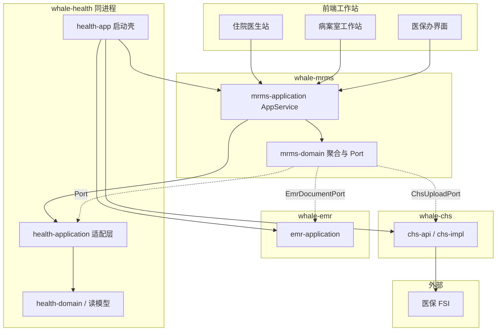
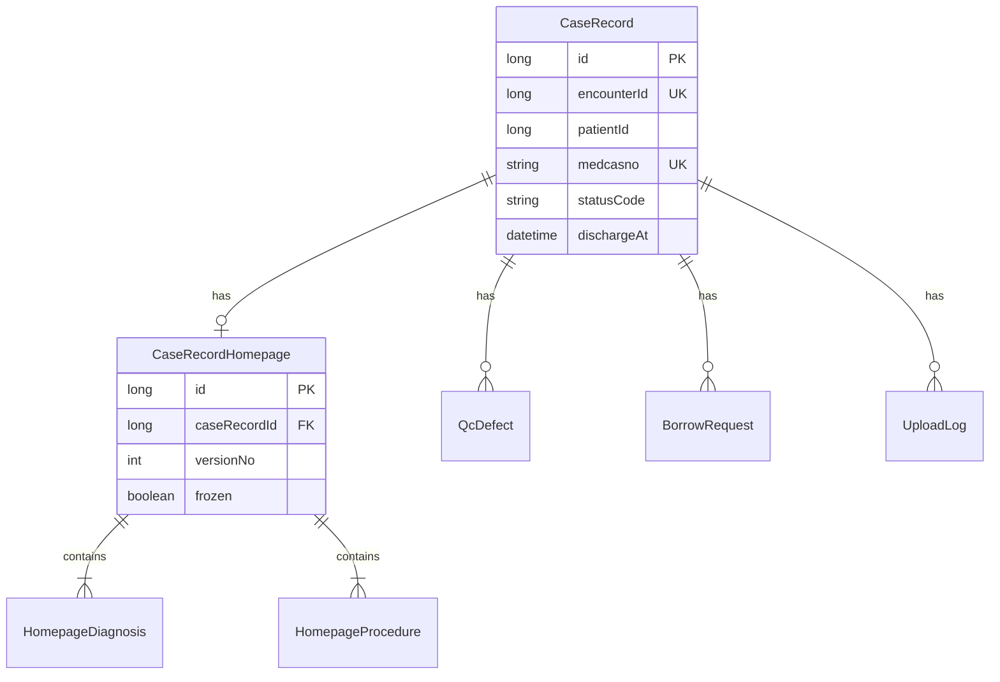
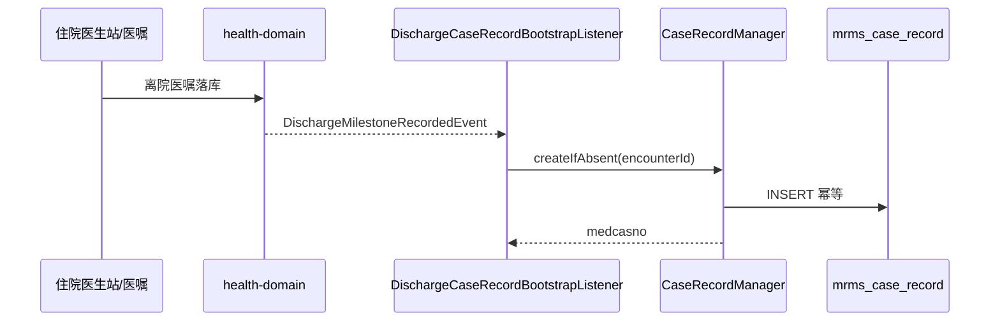
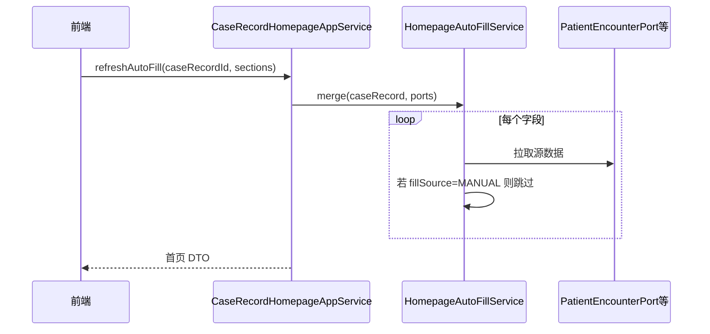

# Whale 病案管理模块 — 架构设计

> **文档性质**：指导后续编码的架构设计（ADR + 模块边界 + 集成契约）  
> **适用范围**：`whale-mrms`（病案引擎）+ `whale-health`（HIS 集成适配）+ 前端工作站  
> **上游**：[00-功能清单.md](./00-功能清单.md)  
> **下游**：`02-概要设计.md`（表结构、类清单、时序）  
> **版本**：v1.0 | **日期**：2026-05-29

---

## 1. 背景与目标

### 1.1 现状

| 代码库 | 角色 | 现状 |
|--------|------|------|
| **whale-mrms** | 病案管理引擎 | 已建 `mrms-domain` / `mrms-application` 骨架；尚无业务实体与 API |
| **whale-emr** | 电子病历 | 文书 CRUD、模板、OpenPDF；病案首页/归档在功能清单中**划归 MRMS** |
| **whale-health** | HIS 主系统 | 患者/就诊/诊断/费用；已通过 `EmrMetadataContextPort` 适配 EMR；**尚无 MRMS 依赖与适配** |
| **whale-chs** | 医保网关 | `InsuranceGatewayClient` + 4401 接口文档；病案首页上传逻辑在旧 openhis 中散落，待迁入 MRMS |
| **openhis-pro-ui** | 前端 | 住院医生站有病历树「病案首页」入口；病案室工作站页面待建 |

### 1.2 目标

- 在 Whale 上实现**住院病案全生命周期**：主档 → 首页 → 编码 → 提交/接收 → 质控 → 归档 → 检索 → 借阅 → 医保上报。
- **可插拔**：`whale-mrms` 作为独立 Maven 聚合，与 `whale-emr` 同模式被 `health-app` 引用。
- **边界清晰**：MRMS 不写 HIS 主数据；HIS 不直接拼 4401 报文；EMR 不承载病案状态机。
- **分 Wave 交付**：Wave 1 覆盖功能清单 MVP（主档 + 首页 + 提交接收 + 检索）。

### 1.3 非目标（与功能清单一致）

- 门诊病案、纸质扫描 OCR、DRG 分组引擎、实体库房 WMS。
- 4401 以外医保交易（4701 电子病历上传仍由 EMR/协同方案负责）。
- 首期不做完整工作流引擎（借阅审批用轻量状态机即可）。

---

## 2. 总体架构

### 2.1 系统上下文



### 2.2 分层图（运行时）

```
┌──────────────────────────────────────────────────────────────────────┐
│ 前端（openhis-pro-ui）                                               │
│  住院医生站：病案首页编辑 / 提交                                      │
│  病案室工作站：接收、质控、归档、检索、借阅                           │
└───────────────────────────────┬──────────────────────────────────────┘
                                │ POST /api/app/{CaseRecord*AppService}/{method}
┌───────────────────────────────▼──────────────────────────────────────┐
│ whale-mrms / mrms-application                                        │
│  CaseRecord*AppService    对外 API（Whale 自动暴露）                   │
│  assembler/*              首页 ↔ DTO、4401 DTO 组装                   │
│  support/*                校验汇总、PDF 编排、定时预警                  │
└───────────────────────────────┬──────────────────────────────────────┘
                                │
┌───────────────────────────────▼──────────────────────────────────────┐
│ whale-mrms / mrms-domain                                             │
│  entity / repository / service   病案聚合、状态机、发号、质控规则       │
│  port/*                        对外依赖抽象（由 health 实现）          │
└───────────────────────────────┬──────────────────────────────────────┘
          Port 实现              │ 直接调用
┌─────────▼─────────────────────┴──────────────────────────────────────┐
│ whale-health                                                         │
│  application/mrms/*Adapter     PatientEncounterPort 等实现            │
│  health-domain + 读模型        患者、就诊、诊断、费用、EncounterHistory │
│  application/emr/*             已有 EMR 元数据适配（与 MRMS 并列）      │
└───────────────────────────────┬──────────────────────────────────────┘
                                │
┌───────────────────────────────▼──────────────────────────────────────┐
│ whale-emr（文书）              whale-chs（医保 4401）                   │
│  DocumentAppService / PDF      InsuranceGatewayClient                 │
└──────────────────────────────────────────────────────────────────────┘
```

### 2.3 与 whale-emr / whale-chs 的对比

| 维度 | whale-emr | whale-mrms | whale-chs |
|------|-----------|------------|-----------|
| 定位 | 病历书写引擎 | 病案生命周期引擎 | 医保通信网关 |
| 子模块 | domain + application | domain + application | api + domain + impl |
| 集成方式 | Port + health 适配器 | **同左** | health 依赖 api；impl 在 health-app |
| 对外 API | `DocumentAppService` 等 | `CaseRecord*AppService` 等 | 无业务 API，仅 `InsuranceGatewayClient` |
| 持久化 | emr_* 表 | mrms_* 表（Flyway 独立目录） | chs 协同/配置表 |

---

## 3. 模块边界（硬约束）

| 层 | 允许 | 禁止 |
|----|------|------|
| **mrms-domain** | 病案聚合、状态机、仓储接口、Port 定义、领域事件声明 | 依赖 health-domain 具体实体；直接 HTTP；拼 4401 报文外壳 |
| **mrms-application** | AppService、DTO、Assembler、调 Port/Repository | 直接 `@Autowired` health Repository（必须经 Port） |
| **health-application/mrms** | 实现 Port；读 RM/Repository；订阅领域事件创建病案 | 病案状态机、首页字段校验逻辑 |
| **whale-emr** | 文书内容、单文书 PDF、按 encounter 列文书 | 病案号、归档状态、4401 字段映射 |
| **whale-chs** | 4401 invoke、国密、签到 | 读病案表、首页业务校验 |
| **前端** | 调 MRMS AppService；展示 HIS 就诊上下文 | 本地维护病案状态；直接调 chs |

---

## 4. 架构决策（ADR）

| # | 议题 | 决策 | 编码含义 |
|---|------|------|----------|
| 1 | 部署形态 | **与 whale-health 同进程**（与 emr/chs 一致） | `health-app` 依赖 `mrms-application`；扫描 `com.openhis.whale.mrms` |
| 2 | 病案与就诊关系 | **1 encounter : 1 CaseRecord**（住院） | `encounter_id` 唯一索引；创建幂等 |
| 3 | 病案主档创建时机 | **离院里程碑或出院结算事件**（可配置） | 监听器在 health 或 mrms；默认订阅 `DischargeMilestoneRecordedEvent` |
| 4 | 首页数据模型 | **结构化表 + 子表**（非 EMR JSON） | 对齐国标首页分段；与 EMR 文书可选联动 |
| 5 | 自动取值 | **Port 拉取 + 字段级 fillSource** | `MANUAL` / `AUTO` / `MIXED`；刷新不覆盖 MANUAL |
| 6 | 编码字典 | **首期复用 health 术语/ICD 主数据** | `IcdSearchPort` 由 health 实现；MRMS 只存选中行 |
| 7 | 质控规则 | **内置规则包 + 规则元数据表**（首期不引入规则引擎产品） | `QcRuleExecutor` 在 domain；规则可 JSON 配置 |
| 8 | 归档锁定 | **病案状态 + 领域事件通知 EMR** | 发布 `CaseRecordArchivedEvent`；health/EMR 监听设文书只读 |
| 9 | 卷宗 PDF | **MRMS 编排 + EMR OpenPDF** | `EmrDocumentPort.exportPdf`；MRMS 合并流 |
| 10 | 4401 上报 | **MRMS 组装 input DTO → chs-api** | 与门诊结算相同：`contractId` + `InsuranceGatewayClient` |
| 11 | 借阅审批 | **轻量状态机**（非 Flowable） | `BorrowRequest` 实体 + 管理员审批方法 |
| 12 | 检索列表 | **Wave 1 主档冗余摘要字段**；数据量大后引入读模型 | 避免首期过度 CQRS |
| 13 | 独立售卖 | **支持** | 与 emr 相同：单独 `mvn install` 后被他方引用 |
| 14 | DDL 归属 | **mrms 独立 Flyway 目录** `db/migration/mrms/` | 与 chs/emr 策略一致；health Init 不膨胀 |

---

## 5. 核心领域模型（架构级）

### 5.1 聚合划分



| 聚合根 | 职责 | 关键不变量 |
|--------|------|------------|
| **CaseRecord** | 病案主档、状态机、病案号、归档元数据 | 一 encounter 一主档；已归档不可编辑首页 |
| **CaseRecordHomepage** | 首页各段字段、版本、冻结 | 提交前可改；归档后 `frozen=true` |
| **QcDefect** | 质控缺陷（可独立聚合或 CaseRecord 子实体） | 归档前开放缺陷需闭环或强制归档理由 |
| **BorrowRequest** | 借阅/复印申请 | 审批前不可调阅 |
| **UploadLog** | 4401 上传记录 | 可重试；保留平台响应 |

### 5.2 病案状态机

```
                    ┌──────────┐
         创建        │  DRAFT   │◄────────────────┐
        ──────────► │  草稿    │                 │ 退回
                    └────┬─────┘                 │
                         │ 医生提交                 │
                         ▼                       │
                    ┌──────────┐                 │
                    │ SUBMITTED│─────────────────┤
                    │ 已提交   │                 │
                    └────┬─────┘                 │
                         │ 病案室接收               │
                         ▼                       │
                    ┌──────────┐   退回医生        │
                    │ RECEIVED │─────────────────┘
                    │ 已接收   │
                    └────┬─────┘
                         │ 进入质控
                         ▼
                    ┌──────────┐
                    │ QCING    │
                    │ 质控中   │
                    └────┬─────┘
                         │ 质控通过
                         ▼
                    ┌──────────┐   解档(高权限)    ┌──────────┐
                    │ ARCHIVED │───────────────► │ DRAFT/   │
                    │ 已归档   │                 │ RECEIVED │
                    └──────────┘                 └──────────┘
```

| 状态 code | 含义 | 首页可编辑 | 可提交医保 |
|-----------|------|------------|------------|
| `draft` | 草稿 | 是 | 否 |
| `submitted` | 已提交 | 否（除非退回） | 否 |
| `returned` | 已退回 | 是 | 否 |
| `received` | 已接收 | 否 | 否 |
| `qcing` | 质控中 | 否 | 否 |
| `archived` | 已归档 | 否 | 是 |

持久化：**枚举存 code 字符串**（与 Whale 通用规范 B.10.8.1 一致）。

---

## 6. 集成设计

### 6.1 Port 契约（mrms-domain/port）

MRMS 对外部系统的依赖**全部**通过 Port 表达；`mrms-application` 仅注入 Port 接口。

| Port | 提供方（health-application） | 用途 |
|------|------------------------------|------|
| `PatientEncounterPort` | `HealthMrmsPatientEncounterAdapter` | 患者/就诊人口学、入出院、科室、医护人员 |
| `DiagnosisProcedurePort` | `HealthMrmsDiagnosisProcedureAdapter` | 入出院诊断、手术操作列表 |
| `EncounterHistoryPort` | `HealthMrmsEncounterHistoryAdapter` | 转科路径、出院方式（DM-CUS-004） |
| `FeeSummaryPort` | `HealthMrmsFeeSummaryAdapter` | 首页费用段（Wave 2+） |
| `EmrDocumentPort` | `HealthMrmsEmrDocumentAdapter` | 按 encounter 列文书、导出 PDF、文书完整性检查 |
| `IcdSearchPort` | `HealthMrmsIcdSearchAdapter` | ICD-10 / ICD-9-CM-3 检索 |
| `ChsUploadPort` | `HealthMrmsChsUploadAdapter` | 封装 `InsuranceGatewayClient.invoke("4401", …)` |
| `NotificationPort` | `HealthMrmsNotificationAdapter` | 逾期预警通知主治医生（Wave 2+） |

**NoOp 策略**：与 EMR 的 `NoOpEmrMetadataContextPort` 相同，MRMS application 层为每个 Port 提供 `@ConditionalOnMissingBean` 的 NoOp，便于单测与独立编译。

### 6.2 health 侧适配层包规划

```text
health-application/src/main/java/com/openhis/health/application/mrms/
├── adapter/
│   ├── HealthMrmsPatientEncounterAdapter.java
│   ├── HealthMrmsDiagnosisProcedureAdapter.java
│   ├── HealthMrmsEncounterHistoryAdapter.java
│   ├── HealthMrmsEmrDocumentAdapter.java
│   ├── HealthMrmsIcdSearchAdapter.java
│   └── HealthMrmsChsUploadAdapter.java
├── listener/
│   └── DischargeCaseRecordBootstrapListener.java   # 出院创建病案主档
└── package-info.java
```

适配器**只做数据读取与协议转换**，不包含病案业务规则。

### 6.3 与 whale-emr 的协作

| 场景 | 方向 | 机制 |
|------|------|------|
| 文书完整性质控 | MRMS → EMR | `EmrDocumentPort.listByEncounter` + 必写类型配置 |
| 卷宗 PDF | MRMS → EMR | 批量 `exportPdf` → MRMS 合并 |
| 首页数据元（可选） | MRMS → EMR | 按数据项名读取病案首页文书 JSON（Wave 2+） |
| 归档锁定 | MRMS → EMR | `CaseRecordArchivedEvent` → EMR 监听将 encounter 下文书置只读 |
| 医生站 UI | 前端 | 首页表单调 MRMS；病程文书调 EMR（同一 encounter 上下文） |

### 6.4 与 whale-chs 的协作（4401）

```
CaseRecordUploadAppService
  → CaseRecord4401Assembler（mrms-application）
  → ChsUploadPort.upload4401(contractId, caseRecordId)
       → HealthMrmsChsUploadAdapter
            → InsuranceGatewayClient.invoke(contractId, "4401", input, context)
  → UploadLog 持久化（成功/失败/可重试）
```

- **contractId**：由前端或任务传入（与医保结算相同，来自 `fin_contract`）。
- **字段真源**：`4401` 字段映射表在 `05-对外上报-详细设计.md` 维护；架构层仅约定「MRMS 组装、chs 发送」。

### 6.5 与 EncounterHistory（DM-CUS-004）的关系

EncounterHistory 是**读侧事实投影**；MRMS **不写入**该表。

| 消费方式 | 说明 |
|----------|------|
| **查询** | `EncounterHistoryPort.listByEncounter(encounterId)` 取转科序、离院方式 |
| **事件（可选）** | 除离院创建病案外，转科事件不驱动 MRMS 写库；仅首页刷新时拉取 |

---

## 7. 关键业务流程

### 7.1 出院创建病案（P0）



### 7.2 首页自动取值（P1）



### 7.3 提交 → 接收（Wave 1）

```
医生 submit → 校验必填 → status=submitted
病案室 receive → status=received
病案室 return → status=returned + reason
```

### 7.4 归档与锁定（Wave 2）

```
质控通过 → archive → status=archived + frozen
  → publish CaseRecordArchivedEvent
  → EMR 文书只读
  → 允许 4401 上传
```

---

## 8. Maven 与运行时配置

### 8.1 模块依赖

```text
health-app
  └── mrms-application
        └── mrms-domain
              └── whale-core

health-application
  └── mrms-domain（仅 Port 接口编译期可见，可选）
  └── emr-domain / chs-api（适配器实现）

mrms-application
  └── 不依赖 health-domain / chs-impl
```

### 8.2 启动扫描（health-app 增量）

与 EMR 并列追加：

```java
@SpringBootApplication(scanBasePackages = {
    // ... 现有 ...
    "com.openhis.whale.mrms.domain",
    "com.openhis.whale.mrms.application"
})
@EntityScan(basePackages = {
    // ... 现有 ...
    "com.openhis.whale.mrms.domain.entity"
})
@EnableJpaRepositories(basePackages = {
    // ... 现有 ...
    "com.openhis.whale.mrms.domain.repository"
})
```

### 8.3 Flyway

```text
mrms-application/src/main/resources/db/migration/mrms/
  V1__Mrms_Init.sql      # mrms_* 表（history: flyway_schema_history_mrms）
  V2__Mrms_Seed.sql      # 质控规则种子、必写文书类型配置等（可选）
```

`application.yml` 增加 locations（与 chs 并列）：

```yaml
spring:
  flyway:
    locations:
      - classpath:db/migration/framework
      - classpath:db/migration/health
      - classpath:db/migration/chs
      - classpath:db/migration/mrms
```

### 8.4 API 暴露约定

- AppService 类名：`CaseRecordAppService`、`CaseRecordHomepageAppService` 等。
- 路径：`POST /api/app/caseRecord/{method}`（Whale 默认驼峰转路径，以实现为准）。
- 请求/响应：独立 `request` / `dto` 包；**禁止**把 JPA Entity 透出 HTTP。

---

## 9. 安全、审计与多租户

| 项 | 策略 |
|----|------|
| 多租户 | 实体 `tenantId`；病案号发号按租户隔离 |
| RBAC | 复用 whale-permission；病案查询/预览/解档单独权限码（二期细化） |
| 科室数据范围 | 医生站：本科室就诊；病案室：全院（可配置） |
| 审计 | 查询、预览、导出、借阅、解档、4401 上传记审计（whale-audit 或 mrms_audit_log） |
| 隐私 | 列表脱敏（证件号中间位）；预览水印（Wave 2+） |

---

## 10. 实施 Wave（与功能清单对齐）

| Wave | 范围 | 架构交付物 |
|------|------|------------|
| **Wave 1** | 功能清单 §七 MVP | CaseRecord + Homepage 表；核心 Port（Patient/Encounter/Diagnosis/ICD）；6 个 AppService 中的 3 个；health 适配器；Flyway V1 |
| **Wave 2** | 质控 + 归档 + 预警 | QcDefect、规则执行器、`CaseRecordArchivedEvent`、EmrDocumentPort、定时任务 |
| **Wave 3** | 借阅 + 4401 | BorrowRequest、ChsUploadPort、UploadLog |
| **Wave 4** | 统计 + DRG 预留 | 读模型 / 报表 API |

---

## 11. 文档与代码追溯

```text
00-功能清单.md  →  01-架构设计.md（本文）  →  02-概要设计.md
                                              ├─ 03-病案首页-详细设计.md
                                              ├─ 04-归档与质控-详细设计.md
                                              └─ 05-对外上报-详细设计.md
                                                        ↓
                                              mrms-domain / mrms-application
                                              health-application/mrms/*
```

| 功能清单章节 | 架构章节 |
|--------------|----------|
| §4.1 病案主档 | §5.1、§7.1、§5.2 |
| §4.2～4.4 首页与编码 | §5.1、§6.1、§7.2 |
| §4.5 提交接收 | §7.3 |
| §4.6～4.7 质控归档 | §5.2、§7.4、§6.3 |
| §4.10 4401 | §6.4 |
| §六 Port/AppService 预览 | §6.1、§8 |

---

## 12. 修订记录

| 版本 | 日期 | 说明 |
|------|------|------|
| v1.0 | 2026-05-29 | 初稿：上下文、边界、ADR、聚合、Port、Wave |
