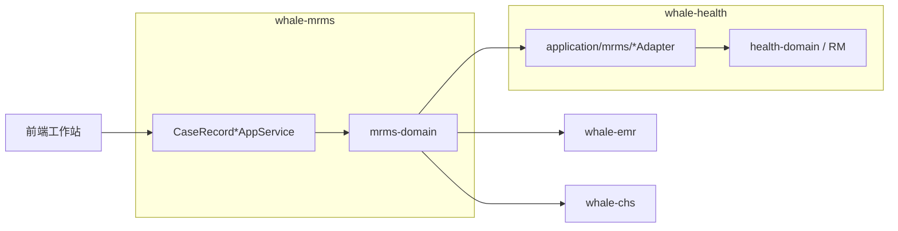
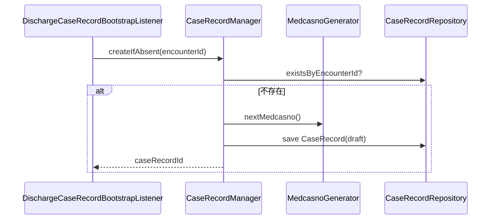
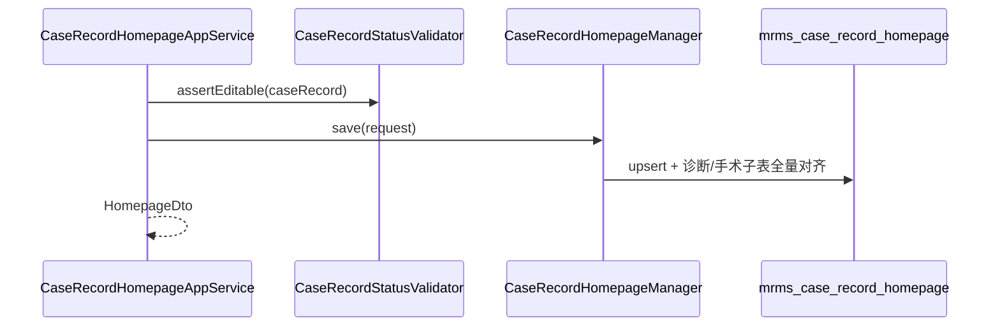

# Whale 病案管理模块 — 概要设计

> **文档性质**：概要设计（HLD），指导表结构、类清单、Port/AppService 契约与主流程编码  
> **上游**：[01-架构设计.md](./01-架构设计.md)、[00-功能清单.md](./00-功能清单.md)  
> **下游**：`03-病案首页-详细设计.md`（首页全字段）、`04-归档与质控-详细设计.md`、`05-对外上报-详细设计.md`  
> **版本**：v1.0 | **日期**：2026-05-29

---

## 1. 文档关系

```text
00 功能清单  →  01 架构设计  →  02 概要设计（本文）  →  03~05 详细设计  →  代码
     │               │                  │
  做什么           边界/ADR          表/类/API 契约      字段级映射/规则
```

---

## 2. 系统上下文（摘要）



| 依赖 | 交互 | MRMS 侧入口 |
|------|------|-------------|
| whale-health | Port 读患者/就诊/诊断/费用/里程碑 | `mrms-domain/port/*` |
| whale-emr | 列文书、导出 PDF、归档锁定 | `EmrDocumentPort` |
| whale-chs | 4401 invoke | `ChsUploadPort` |
| PostgreSQL | JPA + Flyway `db/migration/mrms` | `mrms_*` 表 |

---

## 3. Maven 模块与包规划

### 3.1 whale-mrms

#### mrms-domain

| 包 | 类（Wave 1 必建） | 说明 |
|----|-------------------|------|
| `entity` | `CaseRecord` | 病案主档聚合根 |
| `entity` | `CaseRecordHomepage` | 病案首页 |
| `entity` | `HomepageDiagnosis` | 首页诊断行 |
| `entity` | `HomepageProcedure` | 首页手术操作行 |
| `entity` | `MedcasnoSequence` | 病案号序列表 |
| `enums` | `CaseRecordStatus` | 主档状态（`getCode()` 持久化） |
| `enums` | `HomepageDiagType` | 主诊/次诊/病理/损伤中毒 |
| `enums` | `FieldFillSource` | `manual` / `auto` / `mixed` |
| `repository` | `CaseRecordRepository` 等 | Spring Data JPA 接口 |
| `service` | `CaseRecordManager` | 创建、状态迁移、发号 |
| `service` | `CaseRecordHomepageManager` | 首页保存、版本、冻结 |
| `service` | `HomepageAutoFillMerger` | Port 数据合并与 fillSource |
| `service` | `CaseRecordStatusValidator` | 状态迁移合法性 |
| `port` | `PatientEncounterPort` 等 | 见 §7 |
| `port.model` | `PatientSnapshot`、`EncounterSnapshot` 等 | Port 返回值 DTO |
| `event` | `CaseRecordCreatedEvent`、`CaseRecordArchivedEvent` | 领域事件（Wave 2 归档事件） |

#### mrms-application

| 包 | 类（Wave 1 必建） | 说明 |
|----|-------------------|------|
| `CaseRecordAppService` | 主档查询、列表 | → `/api/app/caseRecord/*` |
| `CaseRecordHomepageAppService` | 首页 CRUD、自动取值、提交 | → `/api/app/caseRecordHomepage/*` |
| `CaseRecordCodingAppService` | ICD 检索代理、编码行维护 | → `/api/app/caseRecordCoding/*` |
| `request` | `QueryCaseRecordRequest`、`SaveHomepageRequest`… | 入参 |
| `dto` | `CaseRecordSummaryDto`、`HomepageDto`… | 出参 |
| `assembler` | `CaseRecordAssembler`、`HomepageAssembler` | Entity ↔ DTO |
| `support` | `HomepageSubmitValidator` | 提交前校验汇总 |
| `support.noop` | `NoOpPatientEncounterPort` 等 | `@ConditionalOnMissingBean` |

**Wave 2+ 追加**：`CaseRecordQcAppService`、`CaseRecordArchiveAppService`、`CaseRecordBorrowAppService`、`CaseRecordUploadAppService`、`QcRuleExecutor`、`CaseRecord4401Assembler`。

### 3.2 whale-health（集成层，非 mrms 仓库）

| 模块 | 包 | 类 |
|------|-----|-----|
| health-application | `application.mrms.adapter` | `HealthMrmsPatientEncounterAdapter` 等 |
| health-application | `application.mrms.listener` | `DischargeCaseRecordBootstrapListener` |
| health-app | `HealthApplication` | 扫描 `com.openhis.whale.mrms` |
| health-app | `pom.xml` | 依赖 `mrms-application` |

---

## 4. 领域模型

### 4.1 聚合：CaseRecord（病案主档）

```text
CaseRecord（聚合根）
  ├── CaseRecordHomepage（1:1，可懒创建）
  │     ├── HomepageDiagnosis[]（1:N）
  │     └── HomepageProcedure[]（1:N）
  ├── QcDefect[]（1:N，Wave 2）
  ├── BorrowRequest[]（1:N，Wave 3）
  └── UploadLog[]（1:N，Wave 3）
```

**不变量：**

1. `tenant_id + encounter_id` 在 `is_deleted=false` 时唯一。
2. `medcasno` 在租户内唯一（含软删策略：仅活跃行唯一）。
3. `status=archived` 时首页 `frozen=true`，禁止 `saveHomepage`。
4. 仅 `draft` / `returned` 允许医生编辑首页；`submitted` 及之后仅病案室可操作状态迁移（解档除外）。

### 4.2 枚举

#### CaseRecordStatus

```java
public enum CaseRecordStatus {
    DRAFT("draft", "草稿"),
    SUBMITTED("submitted", "已提交"),
    RETURNED("returned", "已退回"),
    RECEIVED("received", "已接收"),
    QCING("qcing", "质控中"),
    ARCHIVED("archived", "已归档");

    private final String code;
    private final String display;
    public String getCode() { return code; }
}
```

#### HomepageDiagType

```java
public enum HomepageDiagType {
    ADMISSION_MAIN("admission_main", "入院主诊断"),
    ADMISSION_OTHER("admission_other", "入院其他诊断"),
    DISCHARGE_MAIN("discharge_main", "出院主诊断"),
    DISCHARGE_OTHER("discharge_other", "出院其他诊断"),
    PATHOLOGY("pathology", "病理诊断"),
    INJURY_POISON("injury_poison", "损伤中毒外部原因");
}
```

#### FieldFillSource

```java
public enum FieldFillSource {
    MANUAL("manual"),
    AUTO("auto"),
    MIXED("mixed");
}
```

持久化：枚举列统一存 **`getCode()` 字符串**。

### 4.3 状态迁移表

| 当前状态 | 动作 | 目标状态 | 执行角色 |
|----------|------|----------|----------|
| — | `create` | `draft` | 系统（离院监听） |
| `draft` | `submit` | `submitted` | 医生 |
| `returned` | `submit` | `submitted` | 医生 |
| `submitted` | `receive` | `received` | 病案室 |
| `submitted` | `return` | `returned` | 病案室 |
| `received` | `return` | `returned` | 病案室 |
| `received` | `startQc` | `qcing` | 病案室（Wave 2） |
| `qcing` | `archive` | `archived` | 病案室（Wave 2） |
| `archived` | `unarchive` | `received` | 高权限（Wave 3） |

`CaseRecordManager.transition(caseRecordId, action, reason)` 统一入口。

---

## 5. 数据库设计

> Flyway：`mrms-application/.../mrms/V1__Mrms_Init.sql`（history 表 `flyway_schema_history_mrms`，见 Flyway多模块版本约定）  
> 审计列与 EMR 一致：`id`、`tenant_id`、`created_at`、`updated_at`、`created_by`、`updated_by`、`is_deleted`。

### 5.1 mrms_case_record（病案主档）

```sql
CREATE TABLE IF NOT EXISTS mrms_case_record (
    id                      BIGINT PRIMARY KEY,
    encounter_id            BIGINT       NOT NULL,
    patient_id              BIGINT       NOT NULL,
    medcasno                VARCHAR(40)  NOT NULL,
    status_code             VARCHAR(32)  NOT NULL DEFAULT 'draft',
    patn_ipt_cnt            INTEGER,
    inpatient_no            VARCHAR(32),
    patient_name            VARCHAR(100),
    gender_code             VARCHAR(16),
    admission_at            TIMESTAMP,
    discharge_at            TIMESTAMP,
    dept_code               VARCHAR(64),
    dept_name               VARCHAR(200),
    attending_practitioner_id BIGINT,
    attending_practitioner_name VARCHAR(100),
    primary_diagnosis_text  VARCHAR(500),
    return_reason           VARCHAR(500),
    archived_at             TIMESTAMP,
    archived_by             BIGINT,
    quality_grade_code      VARCHAR(16),
    tenant_id               BIGINT       NOT NULL,
    created_at              TIMESTAMP    NOT NULL,
    updated_at              TIMESTAMP,
    created_by              BIGINT,
    updated_by              BIGINT,
    is_deleted              BOOLEAN      NOT NULL DEFAULT FALSE
);

CREATE UNIQUE INDEX IF NOT EXISTS uk_mrms_case_encounter
    ON mrms_case_record (tenant_id, encounter_id)
    WHERE is_deleted = FALSE;

CREATE UNIQUE INDEX IF NOT EXISTS uk_mrms_case_medcasno
    ON mrms_case_record (tenant_id, medcasno)
    WHERE is_deleted = FALSE;

CREATE INDEX IF NOT EXISTS idx_mrms_case_list
    ON mrms_case_record (tenant_id, discharge_at, status_code, dept_code);
```

> `patient_name` 等冗余字段用于 Wave 1 列表检索；出院时写入，首页刷新时可更新。

### 5.2 mrms_medcasno_sequence（病案号发号）

```sql
CREATE TABLE IF NOT EXISTS mrms_medcasno_sequence (
    id              BIGINT PRIMARY KEY,
    year_no         INTEGER      NOT NULL,
    last_value      BIGINT       NOT NULL DEFAULT 0,
    tenant_id       BIGINT       NOT NULL,
    created_at      TIMESTAMP    NOT NULL,
    updated_at      TIMESTAMP,
    UNIQUE (tenant_id, year_no)
);
```

发号规则（默认）：`{yyyy}{5位流水}`，如 `202600001`；规则类 `MedcasnoGenerator` 可配置。

### 5.3 mrms_case_record_homepage（病案首页）

Wave 1 落**核心标量字段** + `field_sources_json`（字段级 fillSource）；全量国标字段在 `03-病案首页-详细设计.md` 增量扩展列或 `extension_json`。

```sql
CREATE TABLE IF NOT EXISTS mrms_case_record_homepage (
    id                      BIGINT PRIMARY KEY,
    case_record_id          BIGINT       NOT NULL UNIQUE REFERENCES mrms_case_record(id),
    version_no              INTEGER      NOT NULL DEFAULT 1,
    frozen                  BOOLEAN      NOT NULL DEFAULT FALSE,
  -- 基本信息（Wave 1 子集）
    psn_name                VARCHAR(100),
    gend_code               VARCHAR(16),
    brdy                    DATE,
    certno                  VARCHAR(50),
    ntly_code               VARCHAR(16),
    naty_code               VARCHAR(16),
    prfs_code               VARCHAR(16),
    mrg_stas_code           VARCHAR(16),
    curr_addr               VARCHAR(500),
    psn_tel                 VARCHAR(50),
    coner_name              VARCHAR(100),
    coner_tel               VARCHAR(50),
    coner_addr              VARCHAR(500),
  -- 诊疗信息
    ipt_no                  VARCHAR(32),
    adm_way_code            VARCHAR(16),
    adm_caty_code           VARCHAR(64),
    adm_caty_name           VARCHAR(200),
    dscg_caty_code          VARCHAR(64),
    dscg_caty_name          VARCHAR(200),
    adm_time                TIMESTAMP,
    dscg_time               TIMESTAMP,
    act_ipt_days            INTEGER,
    dscg_way_code           VARCHAR(16),
    transfer_dept_summary   VARCHAR(1000),
  -- 医护人员
    dept_director_name      VARCHAR(100),
    chfdr_name              VARCHAR(100),
    atddr_name              VARCHAR(100),
    ipt_dr_name             VARCHAR(100),
    resp_nurs_name          VARCHAR(100),
  -- 扩展与溯源
    field_sources_json      TEXT,
    extension_json          TEXT,
    tenant_id               BIGINT       NOT NULL,
    created_at              TIMESTAMP    NOT NULL,
    updated_at              TIMESTAMP,
    created_by              BIGINT,
    updated_by              BIGINT,
    is_deleted              BOOLEAN      NOT NULL DEFAULT FALSE
);
```

`field_sources_json` 示例：

```json
{
  "psn_name": "auto",
  "dscg_way_code": "manual",
  "transfer_dept_summary": "auto"
}
```

### 5.4 mrms_homepage_diagnosis（首页诊断行）

```sql
CREATE TABLE IF NOT EXISTS mrms_homepage_diagnosis (
    id                  BIGINT PRIMARY KEY,
    case_record_id      BIGINT       NOT NULL REFERENCES mrms_case_record(id),
    diag_type_code      VARCHAR(32)  NOT NULL,
    sort_no             INTEGER      NOT NULL DEFAULT 0,
    diag_code           VARCHAR(32),
    diag_name           VARCHAR(500),
    adm_cond_code       VARCHAR(16),
    tenant_id           BIGINT       NOT NULL,
    created_at          TIMESTAMP    NOT NULL,
    updated_at          TIMESTAMP,
    is_deleted          BOOLEAN      NOT NULL DEFAULT FALSE
);

CREATE INDEX IF NOT EXISTS idx_mrms_hpg_diag_cr
    ON mrms_homepage_diagnosis (case_record_id, diag_type_code, sort_no);
```

### 5.5 mrms_homepage_procedure（首页手术操作行）

```sql
CREATE TABLE IF NOT EXISTS mrms_homepage_procedure (
    id                  BIGINT PRIMARY KEY,
    case_record_id      BIGINT       NOT NULL REFERENCES mrms_case_record(id),
    sort_no             INTEGER      NOT NULL DEFAULT 0,
    oprn_oprt_code      VARCHAR(32),
    oprn_oprt_name      VARCHAR(500),
    oprn_date           DATE,
    oprn_level_code     VARCHAR(16),
    oprn_incision_code  VARCHAR(16),
    heal_grade_code     VARCHAR(16),
    anst_way_code       VARCHAR(16),
    tenant_id           BIGINT       NOT NULL,
    created_at          TIMESTAMP    NOT NULL,
    updated_at          TIMESTAMP,
    is_deleted          BOOLEAN      NOT NULL DEFAULT FALSE
);
```

### 5.6 Wave 2 表（质控）

```sql
CREATE TABLE IF NOT EXISTS mrms_qc_rule (
    id              BIGINT PRIMARY KEY,
    rule_code       VARCHAR(64)  NOT NULL,
    rule_name       VARCHAR(200) NOT NULL,
    severity_code   VARCHAR(16)  NOT NULL,
    enabled         BOOLEAN      NOT NULL DEFAULT TRUE,
    expression_json TEXT,
    tenant_id       BIGINT       NOT NULL,
    UNIQUE (tenant_id, rule_code)
);

CREATE TABLE IF NOT EXISTS mrms_qc_defect (
    id              BIGINT PRIMARY KEY,
    case_record_id  BIGINT       NOT NULL REFERENCES mrms_case_record(id),
    rule_code       VARCHAR(64),
    defect_message  VARCHAR(1000) NOT NULL,
    severity_code   VARCHAR(16)  NOT NULL,
    status_code     VARCHAR(32)  NOT NULL DEFAULT 'open',
    responsible_practitioner_id BIGINT,
    rectified_at    TIMESTAMP,
    closed_at       TIMESTAMP,
    tenant_id       BIGINT       NOT NULL,
    created_at      TIMESTAMP    NOT NULL,
    updated_at      TIMESTAMP,
    is_deleted      BOOLEAN      NOT NULL DEFAULT FALSE
);

CREATE TABLE IF NOT EXISTS mrms_required_doc_type (
    id                  BIGINT PRIMARY KEY,
    document_type_code  VARCHAR(32) NOT NULL,
    encounter_class_code VARCHAR(32),
    required            BOOLEAN NOT NULL DEFAULT TRUE,
    tenant_id           BIGINT NOT NULL,
    UNIQUE (tenant_id, document_type_code, encounter_class_code)
);
```

### 5.7 Wave 3 表（借阅与上传）

```sql
CREATE TABLE IF NOT EXISTS mrms_borrow_request (
    id              BIGINT PRIMARY KEY,
    case_record_id  BIGINT       NOT NULL REFERENCES mrms_case_record(id),
    request_type_code VARCHAR(16) NOT NULL,
    applicant_id    BIGINT       NOT NULL,
    applicant_dept  VARCHAR(200),
    purpose         VARCHAR(500) NOT NULL,
    status_code     VARCHAR(32)  NOT NULL DEFAULT 'pending',
    approved_by     BIGINT,
    approved_at     TIMESTAMP,
    borrowed_at     TIMESTAMP,
    returned_at     TIMESTAMP,
    copy_pages      INTEGER,
    tenant_id       BIGINT       NOT NULL,
    created_at      TIMESTAMP    NOT NULL,
    updated_at      TIMESTAMP,
    is_deleted      BOOLEAN      NOT NULL DEFAULT FALSE
);

CREATE TABLE IF NOT EXISTS mrms_upload_log (
    id              BIGINT PRIMARY KEY,
    case_record_id  BIGINT       NOT NULL REFERENCES mrms_case_record(id),
    contract_id     BIGINT       NOT NULL,
    infno           VARCHAR(16)  NOT NULL DEFAULT '4401',
    status_code     VARCHAR(32)  NOT NULL,
    msgid           VARCHAR(64),
    request_digest  VARCHAR(128),
    response_snapshot TEXT,
    error_msg       VARCHAR(1000),
    tenant_id       BIGINT       NOT NULL,
    created_at      TIMESTAMP    NOT NULL,
    created_by      BIGINT
);
```

---

## 6. 核心组件职责

### 6.1 mrms-domain 领域服务

| 类 | 职责 |
|----|------|
| `CaseRecordManager` | `createIfAbsent(encounterId)`、`transition(action)`、写冗余摘要 |
| `MedcasnoGenerator` | 租户内发号，事务内 `SELECT FOR UPDATE` 序列表 |
| `CaseRecordHomepageManager` | 保存首页、递增 `version_no`、`freeze()` |
| `HomepageAutoFillMerger` | 调 Port，按 `field_sources_json` 合并 |
| `CaseRecordStatusValidator` | 校验动作与角色（应用层传入角色上下文） |
| `QcRuleExecutor`（W2） | 加载规则、写 `mrms_qc_defect` |

### 6.2 mrms-application AppService

| 类 | 职责 |
|----|------|
| `CaseRecordAppService` | 列表、详情、按 encounter 查询 |
| `CaseRecordHomepageAppService` | 获取/保存首页、`refreshAutoFill`、`submit` |
| `CaseRecordCodingAppService` | ICD 搜索代理、诊断/手术行 CRUD |
| `CaseRecordQcAppService`（W2） | 执行质控、缺陷列表、整改复核 |
| `CaseRecordArchiveAppService`（W2） | 归档、卷宗目录、PDF 编排 |
| `CaseRecordBorrowAppService`（W3） | 借阅复印流程 |
| `CaseRecordUploadAppService`（W3） | 4401 上传与日志 |

---

## 7. Port 契约

> 接口定义在 `mrms-domain`；实现类在 `health-application`。

### 7.1 PatientEncounterPort

```java
public interface PatientEncounterPort {
    Optional<PatientSnapshot> findPatient(long patientId);
    Optional<EncounterSnapshot> findEncounter(long encounterId);
    int countInpatientAdmissions(long patientId, long beforeEncounterId);
}
```

**EncounterSnapshot** 字段：`inpatientNo`、`admissionAt`、`dischargeAt`、`deptCode`、`deptName`、`attendingPractitionerId/Name`、`deptDirectorName`、`chiefDoctorName` 等。

### 7.2 DiagnosisProcedurePort

```java
public interface DiagnosisProcedurePort {
    List<DiagnosisLineSnapshot> listAdmissionDiagnoses(long encounterId);
    List<DiagnosisLineSnapshot> listDischargeDiagnoses(long encounterId);
    List<ProcedureLineSnapshot> listProcedures(long encounterId);
}
```

### 7.3 EncounterHistoryPort

```java
public interface EncounterHistoryPort {
    List<TransferLineSnapshot> listTransfers(long encounterId);
    Optional<String> resolveDischargeWayCode(long encounterId);
}
```

### 7.4 EmrDocumentPort

```java
public interface EmrDocumentPort {
    List<EmrDocumentSummary> listByEncounter(long encounterId);
    byte[] exportPdf(long documentId);
    boolean isDocumentTypePresent(long encounterId, String documentTypeCode);
}
```

### 7.5 IcdSearchPort

```java
public interface IcdSearchPort {
    List<IcdItemSnapshot> searchIcd10(String keyword, int limit);
    List<IcdItemSnapshot> searchIcd9Cm3(String keyword, int limit);
}
```

### 7.6 ChsUploadPort（W3）

```java
public interface ChsUploadPort {
    ChsUploadResult upload4401(long contractId, Object inputDto, long operatorId);
}
```

### 7.7 FeeSummaryPort / NotificationPort（W2+）

```java
public interface FeeSummaryPort {
    Optional<FeeSummarySnapshot> summarize(long encounterId);
}

public interface NotificationPort {
    void notifyOverdueArchive(long caseRecordId, long attendingPractitionerId, String message);
}
```

---

## 8. AppService API 契约（Wave 1）

> 路径约定：`POST /api/app/{serviceName}/{methodName}`，驼峰服务名与 EMR 一致。

### 8.1 CaseRecordAppService

| 方法 | 入参 | 出参 | 说明 |
|------|------|------|------|
| `getById` | `LongValueRequest` | `CaseRecordDetailDto` | 主档 + 状态 |
| `getByEncounterId` | `LongValueRequest` | `CaseRecordDetailDto` | 医生站入口 |
| `queryPage` | `QueryCaseRecordRequest` | `PagedResult<CaseRecordSummaryDto>` | 病案室列表 |

**QueryCaseRecordRequest** 字段：

| 字段 | 类型 | 说明 |
|------|------|------|
| `keyword` | String | 姓名/住院号/病案号模糊 |
| `statusCode` | String | 可选 |
| `deptCode` | String | 可选 |
| `dischargeFrom` / `dischargeTo` | LocalDate | 出院日期范围 |
| `pageNo` / `pageSize` | int | 分页 |

### 8.2 CaseRecordHomepageAppService

| 方法 | 入参 | 出参 | 说明 |
|------|------|------|------|
| `getHomepage` | `LongValueRequest`（caseRecordId） | `HomepageDto` | 含诊断/手术行 |
| `saveHomepage` | `SaveHomepageRequest` | `HomepageDto` | 校验可编辑状态 |
| `refreshAutoFill` | `RefreshAutoFillRequest` | `HomepageDto` | `sections[]` 控制刷新段 |
| `submit` | `SubmitHomepageRequest` | `CaseRecordDetailDto` | 医生提交 |

**SaveHomepageRequest**：首页标量 + `diagnoses[]` + `procedures[]`；保存时未出现在请求中且原 `fillSource=manual` 的字段保持不动。

### 8.3 CaseRecordCodingAppService

| 方法 | 入参 | 出参 | 说明 |
|------|------|------|------|
| `searchIcd10` | `SearchIcdRequest` | `List<IcdItemDto>` | 代理 `IcdSearchPort` |
| `searchIcd9Cm3` | `SearchIcdRequest` | `List<IcdItemDto>` | 同上 |
| `saveDiagnosisLines` | `SaveDiagnosisLinesRequest` | `List<DiagnosisLineDto>` | 覆盖某 `diagType` 行 |
| `saveProcedureLines` | `SaveProcedureLinesRequest` | `List<ProcedureLineDto>` | 覆盖手术行 |

### 8.4 CaseRecordWorkflowAppService（Wave 1 病案室）

| 方法 | 入参 | 出参 | 说明 |
|------|------|------|------|
| `receive` | `CaseRecordActionRequest` | `CaseRecordDetailDto` | `submitted` → `received` |
| `returnToDoctor` | `CaseRecordActionRequest` | `CaseRecordDetailDto` | 需 `reason` |

> 可与 `CaseRecordAppService` 合并；独立类便于权限切面。

---

## 9. 主流程时序

### 9.1 离院创建病案



**监听器位置**：`health-application`；调用 `CaseRecordManager`（`mrms-domain` `@Service`）。

### 9.2 保存首页



### 9.3 医生提交

```
submit → HomepageSubmitValidator → CaseRecordManager.transition(SUBMIT)
  → status=submitted → 返回详情
```

---

## 10. health 集成清单

### 10.1 health-app 变更

**pom.xml** 增加：

```xml
<dependency>
    <groupId>com.openhis</groupId>
    <artifactId>mrms-application</artifactId>
    <version>${whale.mrms.version}</version>
</dependency>
```

**HealthApplication** 扫描追加：

```java
"com.openhis.whale.mrms.domain",
"com.openhis.whale.mrms.application"
// EntityScan / EnableJpaRepositories 同步追加 mrms 包
```

**whale-health/pom.xml** `dependencyManagement` 增加 `mrms-domain`、`mrms-application` 版本 `${whale.mrms.version}`。

### 10.2 application.yml

```yaml
spring:
  flyway:
    locations:
      - classpath:db/migration/framework
      - classpath:db/migration/health
      - classpath:db/migration/chs
      - classpath:db/migration/mrms
```

### 10.3 DischargeCaseRecordBootstrapListener

```java
@Component
@ConditionalOnBean(CaseRecordManager.class)
public class DischargeCaseRecordBootstrapListener {
    @TransactionalEventListener(phase = AFTER_COMMIT)
    public void onDischarge(DischargeMilestoneRecordedEvent event) {
        caseRecordManager.createIfAbsent(event.getEncounterId());
    }
}
```

> 若出院事件尚未在 health 落地，Wave 1 可临时提供 `CaseRecordAppService.createForEncounter` 供集成测试。

---

## 11. 与 whale-emr 协作（Wave 2 归档）

| 步骤 | 组件 |
|------|------|
| 1 | `CaseRecordArchiveAppService.archive` → `transition(ARCHIVED)` |
| 2 | `CaseRecordHomepageManager.freeze()` |
| 3 | 发布 `CaseRecordArchivedEvent(encounterId)` |
| 4 | `health-application` 或 `emr-application` 监听 → 将该 encounter 下文书 `status=LOCKED` |
| 5 | `EmrDocumentPort.listByEncounter` + `exportPdf` 生成卷宗 |

---

## 12. Wave 实施检查表

### Wave 1（MVP）

| # | 交付项 | 模块 |
|---|--------|------|
| 1 | Flyway `V1__Mrms_Init.sql`（§5.1～5.5） | mrms-application |
| 2 | 实体 + Repository + `CaseRecordManager` | mrms-domain |
| 3 | 3 个 AppService + Request/DTO | mrms-application |
| 4 | Port 接口 + NoOp 实现 | mrms-domain / application |
| 5 | `HealthMrms*Adapter`（Patient/Diagnosis/ICD） | health-application |
| 6 | `DischargeCaseRecordBootstrapListener` | health-application |
| 7 | health-app 依赖与扫描 | health-app |
| 8 | 前端：病案管理菜单 + 全屏首页（见 [06-病案首页-前端设计.md](./06-病案首页-前端设计.md)） | openhis-pro-ui |

### Wave 2

质控表、规则种子、`CaseRecordQcAppService`、`CaseRecordArchiveAppService`、`EmrDocumentPort` 实现、逾期定时任务。

### Wave 3

借阅表、`CaseRecordBorrowAppService`、`ChsUploadPort`、`CaseRecordUploadAppService`、`mrms_upload_log`。

---

## 13. 文档追溯

| 概要设计章节 | 功能清单 | 架构设计 |
|--------------|----------|----------|
| §5 表结构 | §4.1～4.4 | §5.1、§8.3 |
| §7 Port | §4.3 | §6.1 |
| §8 API | §4.5、§8.1 | §8.4 |
| §9 时序 | §七 MVP | §7 |
| §12 Wave | §七 | §10 |

---

## 14. 修订记录

| 版本 | 日期 | 说明 |
|------|------|------|
| v1.0 | 2026-05-29 | 初稿：表结构、类清单、Port/API、Wave 1 契约 |
