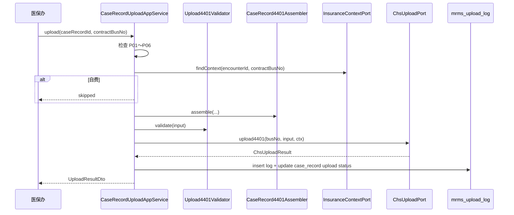

# 对外上报 — 详细设计（医保 4401）

> **文档性质**：详细设计（LLD），指导住院病案首页医保上传（4401）组装、调用、日志与批次任务  
> **上游**：[03-病案首页-详细设计.md](./03-病案首页-详细设计.md) §10、[04-归档与质控-详细设计.md](./04-归档与质控-详细设计.md) §7、[01-架构设计.md](./01-架构设计.md) §6.4  
> **接口真源**：`whale-chs/docs/apis/44xx/4401-住院病案首页信息.md`  
> **版本**：v1.0 | **日期**：2026-05-29

---

## 1. 范围

### 1.1 覆盖

| 功能清单 | 说明 |
|----------|------|
| §4.10.1 | 4401 数据组装 |
| §4.10.2 | 4401 上传 invoke |
| §4.10.3 | 上传批次与日志、失败重试 |

### 1.2 Wave

| Wave | 内容 |
|------|------|
| **Wave 3** | 单条上传、上传日志、列表展示状态、手动重试 |
| **Wave 3+** | 按日批量任务、医保办批量界面 |

### 1.3 非目标

| 项 | 说明 |
|----|------|
| 4701 电子病历上传 | 归 EMR / 协同方案，不在 MRMS |
| 非医保患者 | 无 `mdtrt_id` 跳过上传，界面提示「自费无需上传」 |
| chs-impl HTTP/国密 | 已由 whale-chs 实现，本文不重复 |

---

## 2. 架构与职责

```text
┌─────────────────────────────────────────────────────────────┐
│ CaseRecordUploadAppService（mrms-application）               │
│   upload / retry / queryUploadLogs / batchUpload（可选）     │
└────────────┬───────────────────────────────┬────────────────┘
             │ assemble                       │ persist log
             ▼                                ▼
┌────────────────────────────┐    ┌──────────────────────────┐
│ CaseRecord4401Assembler     │    │ mrms_upload_log           │
│ + InsuranceContextPort      │    │ mrms_case_record 上传状态 │
└────────────┬───────────────┘    └──────────────────────────┘
             │ Chs4401Input
             ▼
┌────────────────────────────┐
│ ChsUploadPort（mrms-domain）│
│ 实现：HealthMrmsChsUploadAdapter（health-application）        │
└────────────┬───────────────┘
             │ InsuranceGatewayClient.invoke(busNo, "4401", input, ctx)
             ▼
┌────────────────────────────┐
│ whale-chs / chs-impl        │
│ 签到 9001 + ChsHttpAccessor │
└────────────────────────────┘
```

| 层 | 职责 |
|----|------|
| **mrms-application** | 门禁、组装、写日志、更新病案上传状态 |
| **mrms-domain/port** | `ChsUploadPort`、`InsuranceContextPort` 接口 |
| **health-application** | 读住院医保登记、解析 `ResultBody`、调 `InsuranceGatewayClient` |
| **chs-api** | `Chs4401Input` 等国家 DTO（JSON 序列化字段名对齐 4401） |
| **chs-impl** | 传输层，不读 MRMS 表 |

---

## 3. 上传前置条件

| # | 条件 | 失败提示 |
|---|------|----------|
| P01 | `case_record.status_code = archived` | 未归档不可上传 |
| P02 | 首页 `frozen = true` | 首页未冻结 |
| P03 | `InsuranceContextPort` 返回有效 `mdtrt_id`（医保住院） | 非医保住院/未登记 |
| P04 | `homepage.ipt_medcas_hmpg_sn` 非空 | 首页流水号缺失 |
| P05 | `medcasno` 非空 | 病案号缺失 |
| P06 | `contractBusNo` 有效且 `fin_contract` 为医保合同 | 合同无效 |
| P07 | 4401 必填 baseinfo 字段齐全 | 组装校验汇总（见 §6） |

自费患者：`InsuranceContextPort.isInsuranceInpatient(encounterId)=false` → API 返回 `skipped`，不写失败日志。

---

## 4. chs-api DTO 规划

> 包：`com.openhis.chs.api.dto.national.medcas`  
> 使用 `@JSONField(name = "snake_case")` 与医保 JSON 一致；Fastjson2 序列化。

### 4.1 根对象

```java
@Data
public class Chs4401Input {
    private Chs4401BaseInfo baseinfo;
    private List<Chs4401DiseInfo> diseinfo;
    private List<Chs4401OprnInfo> oprninfo;
    private List<Chs4401IcuInfo> icuinfo;
}
```

### 4.2 ChsInfNo 扩展

```java
// chs-api ChsInfNo.java
public static final String MEDCAS_HOMEPAGE = "4401";
```

### 4.3 子对象（字段与 4401 文档同名）

| 类 | JSON 节点 | 主要字段 |
|----|-----------|----------|
| `Chs4401BaseInfo` | `baseinfo`（单行） | `mdtrt_sn`、`mdtrt_id`、`psn_no`、`medcasno`、`psn_name`、`gend`、`adm_date`、`dscg_date`、`medfee_sumamt`、`fixmedins_code`、`vali_flag`… |
| `Chs4401DiseInfo` | `diseinfo[]` | `ipt_medcas_hmpg_sn`、`diag_code`、`maindiag_flag`、`ipt_patn_disediag_type_code`… |
| `Chs4401OprnInfo` | `oprninfo[]` | `oprn_oprt_code`、`oprn_oprt_date`、`main_oprn_flag`… |
| `Chs4401IcuInfo` | `icuinfo[]` | `icu_codeid`、`inpool_icu_time`、`out_icu_time`… |

完整字段清单见 **§8 映射总表**；实现时 DTO 属性与 4401 参数代码一一对应。

---

## 5. Port 契约

### 5.1 InsuranceContextPort（mrms-domain）

由 health 实现，提供医保就诊上下文（**不**在 MRMS 读医保表）。

```java
public interface InsuranceContextPort {
    boolean isInsuranceInpatient(long encounterId);
    Optional<InsuranceEncounterContext> findContext(long encounterId, String contractBusNo);
}

@Data
public class InsuranceEncounterContext {
    private String mdtrtId;
    private String psnNo;
    private String mdtrtSn;           // fixmedins_code + ipt_no
    private String fixmedinsCode;
    private String fixmedinsName;
    private String insuplcAdmdvs;     // 参保地，invoke 外壳可能需要
}
```

数据来源（health 侧）：住院医保登记 / 结算记录（对齐旧 openhis `InpatientReg` + `mdtrt_id`）；具体表名在 health 概要设计中落地，MRMS 仅依赖 Port。

### 5.2 ChsUploadPort

```java
public interface ChsUploadPort {
    ChsUploadResult upload4401(String contractBusNo, Chs4401Input input, InvokeContext context);
}

@Data
public class ChsUploadResult {
    private boolean success;
    private String infcode;
    private String errMsg;
    private String warnMsg;
    private String output;
    private String msgid;           // 由 chs-impl 生成时可回传或从日志解析
}
```

**HealthMrmsChsUploadAdapter**：

```java
ResultBody body = gateway.invoke(contractBusNo, ChsInfNo.MEDCAS_HOMEPAGE, input, context);
return mapResult(body);
```

`invoke` **不在** MRMS 的 DB 事务内（与医保概要设计 §事务约定一致）：先 `assemble`，再短事务写 log。

---

## 6. CaseRecord4401Assembler

### 6.1 入口

```java
public Chs4401Input assemble(long caseRecordId, InsuranceEncounterContext insCtx) {
    CaseRecord cr = ...
    CaseRecordHomepage hp = ...
    List<HomepageDiagnosis> diags = ...
    List<HomepageProcedure> procs = ...
    List<HomepageIcu> icus = ...   // 可空列表
    return build(cr, hp, diags, procs, icus, insCtx);
}
```

### 6.2 baseinfo 组装规则

| 逻辑 | 说明 |
|------|------|
| 标量字段 | 首页列 → DTO 同名属性（§8.1） |
| 日期 | `LocalDateTime` → `yyyy-MM-dd` 字符串 |
| 数值 | `BigDecimal` 保留 2 位 |
| 费用分项 | 从 `extension_json` 读入 baseinfo 对应属性 |
| `mdtrt_sn` | 优先 `insCtx.mdtrtSn`；否则 `fixmedinsCode + ipt_no` |
| `patn_ipt_cnt` | `case_record.patn_ipt_cnt` 转字符串 |
| `vali_flag` | 固定 `"1"` |
| `fixmedins_code` | `insCtx.fixmedinsCode` |

### 6.3 diseinfo 组装

- 遍历 `mrms_homepage_diagnosis`（`is_deleted=false`，按 `diag_type_code`、`sort_no`）。
- 跳过 `diag_code` 为空的行（或上传前校验报错）。
- `ipt_patn_disediag_type_code`：按 [03-病案首页 §5.1](./03-病案首页-详细设计.md) 映射。
- 每行带 `ipt_medcas_hmpg_sn`、`mdtrt_sn`、`fixmedins_code`。

### 6.4 oprninfo / icuinfo

- 手术：来自 `mrms_homepage_procedure`；无手术时传**空数组** `[]`（不传 null）。
- ICU：来自 `mrms_homepage_icu`；无 ICU 时传 `[]`（旧 openhis 曾传占位空行——**改为空数组**，若现场医保要求至少一行再配置开关）。

### 6.5 组装后校验（Upload4401Validator）

| 规则 | 说明 |
|------|------|
| U01 | `baseinfo.medcasno`、`psn_name`、`medfee_sumamt` 必填 |
| U02 | `diseinfo` 至少 1 行且含 `maindiag_flag=1` |
| U03 | 医保患者 `mdtrt_id`、`psn_no` 非空 |
| U04 | 日期字段格式合法 |

---

## 7. 上传流程

### 7.1 单条上传时序



### 7.2 InvokeContext

```java
InvokeContext ctx = InvokeContext.builder()
    .operatorId(currentUser.getUserId())
    .operatorName(currentUser.getUserName())
    .insuplcAdmdvs(insCtx.getInsuplcAdmdvs())
    .build();
```

签到：`InsuranceGatewayClientLocalImpl` 在 invoke 前自动 `ensureSigned`。

### 7.3 成功判定

```text
success = "0".equals(resultBody.getInfcode())
```

失败：`err_msg` 写入 `mrms_upload_log.error_msg`；`case_record.chs_upload_status_code = failed`。

### 7.4 重试

- `retryUpload(uploadLogId)` 或 `upload(caseRecordId)` 再次调用。
- 4401 **无输出报文**，平台侧一般为覆盖上传；同一 `medcasno` + `ipt_medcas_hmpg_sn` 可重入。
- 每次重试**新增**一条 `mrms_upload_log`（保留审计链）。

---

## 8. 字段映射总表

> **真源**：4401 文档 + [03-病案首页](./03-病案首页-详细设计.md)。下表为编码索引；DTO 属性名与 4401 `参数代码` 一致（驼峰）。

### 8.1 baseinfo（节选，Wave 3 首批实现）

| 4401 参数 | 来源表.列 / 逻辑 |
|-----------|------------------|
| mdtrt_sn | `InsuranceContextPort` / `fixmedins + ipt_no` |
| mdtrt_id | `InsuranceContextPort.mdtrtId` |
| psn_no | `InsuranceContextPort.psnNo` |
| patn_ipt_cnt | `mrms_case_record.patn_ipt_cnt` |
| ipt_no | `homepage.ipt_no` |
| medcasno | `mrms_case_record.medcasno` |
| psn_name | `homepage.psn_name` |
| gend | `homepage.gend_code` |
| brdy | `homepage.brdy` |
| ntly / naty / certno / prfs / mrg_stas | 首页同名列 |
| curr_addr / psn_tel / coner_* | 首页同名列 |
| adm_way_code | `homepage.adm_way_code` |
| adm_caty / dscg_caty | `homepage.adm_caty_code` / `dscg_caty_code` |
| adm_date / dscg_date | `homepage.adm_time` / `dscg_time` |
| ipt_days | `homepage.ipt_days` |
| dscg_way | `homepage.dscg_way_code` |
| deptdrt_name … resp_nurs_name | `homepage.dept_director_name` 等 |
| medfee_sumamt / selfpay_amt | `homepage` 或 `extension_json` |
| medfee_paymtd_code | `homepage.medfee_paymtd_code` |
| ordn_med_servfee … oth_fee | `extension_json` 同名键 |
| fixmedins_code | `InsuranceContextPort` |
| vali_flag | 常量 `1` |

未列字段按 03 文档 §4 注册表与 `extension_json` 补齐；二期迭代 DTO 属性。

### 8.2 diseinfo 行

| 4401 参数 | 来源 |
|-----------|------|
| ipt_medcas_hmpg_sn | `homepage.ipt_medcas_hmpg_sn` |
| mdtrt_sn / fixmedins_code | 同 baseinfo |
| ipt_patn_disediag_type_code | `HomepageDiagType` 映射 |
| maindiag_flag | `homepage_diagnosis` 或类型推导 |
| diag_code / diag_name | 诊断行 |
| adm_cond_code | `homepage_diagnosis.adm_cond_code` |
| vali_flag | 默认 `1` |

### 8.3 oprninfo 行

| 4401 参数 | 来源列 |
|-----------|--------|
| oprn_oprt_date | `oprn_date` |
| oprn_oprt_code / oprn_oprt_name | 手术行 |
| oprn_lv_code | `oprn_level_code` |
| sinc_heal_lv_code | `sinc_heal_lv_code` |
| anst_mtd_code | `anst_mtd_code` |
| oper_name / asit_1_name / asit_name2 | 手术行 |
| main_oprn_flag | `main_oprn_flag` |
| vali_flag | 默认 `1` |

### 8.4 icuinfo 行

| 4401 参数 | 来源列 |
|-----------|--------|
| icu_codeid | `mrms_homepage_icu.icu_codeid` |
| inpool_icu_time / out_icu_time | 同表 |
| nurscare_lv_code / nurscare_days | 同表 |
| vali_flag | 默认 `1` |

---

## 9. 持久化

### 9.1 mrms_upload_log（概要设计 §5.7）

| 列 | 说明 |
|----|------|
| `status_code` | `success` / `failed` / `skipped` |
| `msgid` | 发送方报文 ID（chs 生成） |
| `request_digest` | SHA-256 前 128 字符（脱敏摘要，非全文明文） |
| `response_snapshot` | `infcode` + `err_msg` JSON |
| `contract_id` | 业务合同主键（展示用） |
| `infno` | 固定 `4401` |

### 9.2 mrms_case_record 冗余（列表展示）

```sql
ALTER TABLE mrms_case_record ADD COLUMN IF NOT EXISTS chs_upload_status_code VARCHAR(32);
ALTER TABLE mrms_case_record ADD COLUMN IF NOT EXISTS chs_upload_at TIMESTAMP;
ALTER TABLE mrms_case_record ADD COLUMN IF NOT EXISTS chs_upload_error VARCHAR(500);
```

| chs_upload_status_code | 含义 |
|------------------------|------|
| `pending` | 已归档未上传 |
| `success` | 最近上传成功 |
| `failed` | 最近上传失败 |
| `skipped` | 自费/无需上传 |
| `null` | 未归档或旧数据 |

### 9.3 枚举

```java
public enum ChsUploadStatus {
    PENDING("pending"),
    SUCCESS("success"),
    FAILED("failed"),
    SKIPPED("skipped");
}
```

---

## 10. API（CaseRecordUploadAppService）

> `/api/app/caseRecordUpload/{method}`

| 方法 | 入参 | 出参 | 说明 |
|------|------|------|------|
| `upload` | `Upload4401Request` | `UploadResultDto` | 单条上传 |
| `retry` | `LongValueRequest`（logId） | `UploadResultDto` | 按日志重试 |
| `listUploadLogs` | `ListUploadLogsRequest` | `List<UploadLogDto>` | 某病案历史上传 |
| `previewAssembled` | `Upload4401Request` | `Chs4401Input`（或 JSON） | 调试/医保办预检，**不 invoke** |
| `queryUploadPage` | `QueryUploadPageRequest` | `PagedResult<CaseRecordUploadSummaryDto>` | 医保办待传/失败列表 |

**Upload4401Request**：

| 字段 | 类型 | 必填 |
|------|------|------|
| `caseRecordId` | long | Y |
| `contractBusNo` | String | Y（`fin_contract.bus_no`） |

**UploadResultDto**：

| 字段 | 说明 |
|------|------|
| `statusCode` | success / failed / skipped |
| `uploadLogId` | 日志 ID |
| `infcode` / `errMsg` | 平台返回 |
| `assembledAt` | 组装时间 |

**CaseRecordUploadSummaryDto**：病案号、姓名、出院日期、归档时间、`chs_upload_status_code`、最近错误。

---

## 11. 批量上传（Wave 3+）

### 11.1 定时任务

```yaml
mrms:
  upload:
    batch-enabled: true
    cron: "0 30 1 * * ?"    # 每日凌晨 1:30，对齐 4401「定时/每天」
    contract-bus-no: ${默认医保合同 bus_no}
```

```java
public class CaseRecord4401BatchUploadJob {
    // 条件：archived + chs_upload_status in (pending, failed) + 医保
    // 逐条 upload，失败继续下一条，写汇总日志
}
```

### 11.2 批次记录（可选）

```sql
CREATE TABLE IF NOT EXISTS mrms_upload_batch (
    id BIGINT PRIMARY KEY,
    batch_date DATE NOT NULL,
    total_count INT,
    success_count INT,
    failed_count INT,
    skipped_count INT,
    finished_at TIMESTAMP,
    tenant_id BIGINT NOT NULL
);
```

首期可用日志统计代替独立批次表。

---

## 12. 前端（医保办）

| 功能 | API |
|------|-----|
| 待上传列表 | `queryUploadPage`（status=pending/failed） |
| 单条上传 | `upload` |
| 查看平台错误 | `listUploadLogs` |
| 预检 JSON | `previewAssembled` |
| 病案列表列 | 展示 `chs_upload_status_code` |

住院患者医保界面可嵌入「上传病案首页」按钮，传入当前 `contractBusNo`。

---

## 13. 安全与审计

| 项 | 策略 |
|----|------|
| 权限 | 医保办角色；`upload` / `previewAssembled` 分权（预览可放宽） |
| 审计 | `MRMS_CHS_4401_UPLOAD`；记录 caseRecordId、contractBusNo、infcode |
| 脱敏 | 日志不存完整 `Chs4401Input`；仅 `request_digest` + 失败 err_msg |
| 合同密钥 | 仅在 chs-contract.properties，MRMS 不持有 |

---

## 14. 模块交付清单

| # | 交付项 | 模块 |
|---|--------|------|
| 1 | `ChsInfNo.MEDCAS_HOMEPAGE` + `Chs4401Input` 等 DTO | chs-api |
| 2 | `InsuranceContextPort` + `ChsUploadPort` | mrms-domain |
| 3 | `CaseRecord4401Assembler`、`Upload4401Validator` | mrms-application |
| 4 | `CaseRecordUploadAppService` | mrms-application |
| 5 | `HealthMrmsChsUploadAdapter`、`HealthMrmsInsuranceContextAdapter` | health-application |
| 6 | Flyway：`mrms_upload_log` + case_record 上传列 | mrms-application |
| 7 | `CaseRecord4401BatchUploadJob`（可选） | mrms-application |
| 8 | 医保办前端页 | openhis-pro-ui |

---

## 15. 测试要点

| 场景 | 预期 |
|------|------|
| 未归档上传 | 拒绝 P01 |
| 自费住院 | `skipped`，不写 failed |
| 缺 mdtrt_id | 组装校验 U03 失败 |
| 平台 infcode≠0 | log=failed，主档 `chs_upload_status_code=failed` |
| 成功后再传 | 新 log 行，状态仍 success |
| 签到过期 | chs `ensureSigned` 自动重签后重试 invoke |

金样例：从旧 openhis `Yb4401InputDto` 脱敏导出 JSON，与 Assembler 输出 diff。

---

## 16. 文档追溯

| 本文档 | 功能清单 | 其他文档 |
|--------|----------|----------|
| §6～§8 组装 | §4.10.1 | 03 §10 |
| §7 流程 | §4.10.2 | 01 §6.4 |
| §9～§11 日志批次 | §4.10.3 | 02 §5.7 |
| §5 Port | — | 02 §7.6 |

---

## 17. 修订记录

| 版本 | 日期 | 说明 |
|------|------|------|
| v1.0 | 2026-05-29 | 初稿：4401 DTO、Port、组装、上传流程、映射表、API |
