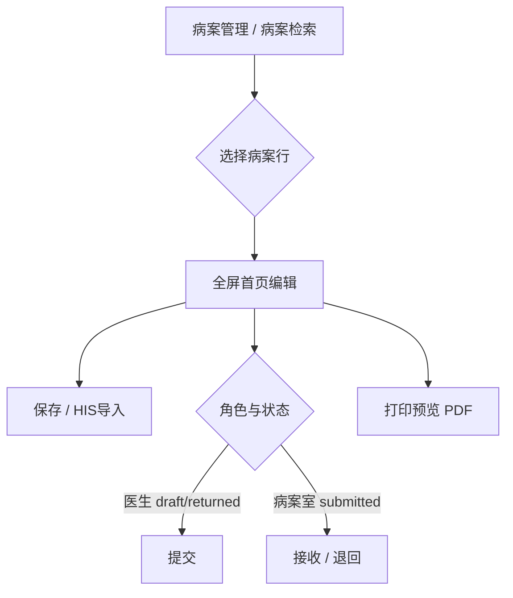

# 病案首页 — 前端设计（openhis-pro-ui）

> **文档性质**：前端详细设计（FED），指导 `openhis-pro-ui` 病案管理菜单、列表、全屏首页编辑、编码选择与打印预览  
> **上游**：[03-病案首页-详细设计.md](./03-病案首页-详细设计.md)、[02-概要设计.md](./02-概要设计.md) §8、[00-功能清单.md](./00-功能清单.md) §七 MVP  
> **代码仓库**：`openhis-pro-ui/apps/web-ele`（API：`#/api/mrms/*`；页面：`#/views/mrms/*`）  
> **版本**：v1.0 | **日期**：2026-05-29 | **状态**：已评审待编码

---

## 1. 已确认决策摘要

| # | 决策 | 说明 |
|---|------|------|
| 1 | **不在住院医生站嵌入病案首页** | 医生、病案室均在一级菜单 **「病案管理」** 内完成填报与审核 |
| 2 | **整页保存** | 单次 `saveHomepage` 提交标量 + 诊断/手术子表全量 |
| 3 | **左锚点 + 右长表单** | 左侧章节定位器（`ElAnchor`），右侧单一滚动区展示完整首页 |
| 4 | **诊断编码数据源** | Wave 1 以 **`ConditionDefinition`（国临 ICD-10 目录）为唯一数据源**；MRMS 自建诊断 Picker，走 `searchIcd10`；国临/医保对照表后续迭代 |
| 5 | **独立一级菜单** | 「病案管理」→ 病案列表 → 全屏编辑页 |
| 6 | **列表跳转全屏编辑** | 无医生站嵌入面板 |
| 7 | **列表默认筛选** | **医生**：本人主治 + 本科出院；**病案室**：全院（见 §5.2） |
| 8 | **HIS 导入** | 顶栏 **「全部导入」** + 各章节标题旁 **「导入本章」** |
| 9 | **打印** | 后端 **OpenPDF** 渲染；Wave 1 为 **简化国标表格** 版式（非 1:1 纸质扫描版），后续精调 |

---

## 2. 页面类型与规范

| 页面 | 主类型 | 附加 | 规范 Skill |
|------|--------|------|------------|
| 病案列表 | **T3**（带操作列表） | — | `frontend-page-type-and-style-standards` + `frontend-codegen` |
| 病案首页编辑 | **T4**（表单页） | **T5**（诊断/手术行编辑表） | 表单对齐住院挂号；T5 表格对齐 `warehouse/purchase/detail/edit.vue` 的 `useVbenVxeGrid` |

**样式基线**：列表与表单视觉对齐 `views/inpatient/charge/register/`；偏差仅收敛在 `views/mrms/**` 业务组件内。

---

## 3. 信息架构与路由

### 3.1 菜单

```text
病案管理（一级菜单）
└── 病案检索          → /mrms/case-record
    └── （行操作）打开首页 → /mrms/case-record/homepage/:caseRecordId
```

- 编辑页 **不单独挂菜单**，由列表跳转进入。
- 路由 `name` 建议：`MrmsCaseRecordList`、`MrmsCaseRecordHomepage`。
- 菜单与权限码由后台配置；前端按角色控制按钮显隐（§8）。

### 3.2 用户流



**不在范围内**：住院医生站 Tab、病历树「病案首页」节点联动（保持 EMR 树现状，不接入 MRMS 填报）。

---

## 4. 病案首页编辑页布局

### 4.1 线框

```text
┌──────────────────────────────────────────────────────────────────┐
│ 顶栏：病案号 | 患者 | 状态 Tag | v{versionNo} | [保存][全部导入][提交/接收/退回][打印] │
├────────────┬─────────────────────────────────────────────────────┤
│ ElAnchor   │  scroll-container（右侧唯一滚动区）                    │
│ (sticky)   │  #sec-basic      + SectionTitle「基本信息」 [导入本章] │
│            │  #sec-inpatient  + SectionTitle「住院信息」 [导入本章] │
│  · 基本信息 │  #sec-diagnosis  + SectionTitle「诊断编码」 [导入本章] │
│  · 住院信息 │  #sec-procedure  + SectionTitle「手术操作」 [导入本章] │
│  · 诊断编码 │  #sec-staff      + SectionTitle「医护人员」 [导入本章] │
│  · 手术操作 │                                                     │
│  · 医护人员 │                                                     │
└────────────┴─────────────────────────────────────────────────────┘
```

### 4.2 实现约束

| 项 | 约定 |
|----|------|
| 锚点 | `ElAnchor` + `ElAnchorLink`，`href="#sec-*"`；`container` 指向右侧 `ref` 滚动元素 |
| 表单模型 | **单一 SSOT**：`formModel` + `diagnosisRows` + `procedureRows`（`use-case-record-context`） |
| 章节 | Wave 1 五段：`basic` / `inpatient` / `diagnosis` / `procedure` / `staff`（与 `RefreshAutoFillRequest.sections` 一致） |
| 字段来源展示 | `fieldSources[fieldKey]==='auto'` 显示「HIS」标签；手工修改为「手工」 |
| 脏数据 | 路由离开 / 列表切行前 `formDirty` → `ElMessageBox` 确认 |
| 键盘 | T4 表单区接入 `use-form-keyboard-navigation` |

### 4.3 Wave 1 表单字段（与后端 V1 DTO 对齐）

与 [03-病案首页-详细设计.md](./03-病案首页-详细设计.md) §4 一致，仅实现 **V1 已落库列**（不含 V2 扩列、`extension_json` 费用分项）。

| 章节 | section | 主要字段（camelCase） |
|------|---------|------------------------|
| A 基本信息 | `basic` | `psnName`, `gendCode`, `brdy`, `certno`, `ntlyCode`, `natyCode`, `prfsCode`, `mrgStasCode`, `currAddr`, `psnTel`, `conerName`, `conerTel`, `conerAddr` |
| B 住院信息 | `inpatient` | `iptNo`, `admWayCode`, `admCatyCode/Name`, `dscgCatyCode/Name`, `admTime`, `dscgTime`, `actIptDays`, `dscgWayCode`, `transferDeptSummary` |
| C 诊断编码 | `diagnosis` | T5 表；`diagTypeCode` 分区见 §6 |
| D 手术操作 | `procedure` | T5 表；`oprnOprtCode/Name`, `oprnDate`, 等级/切口/愈合/麻醉等 |
| E 医护人员 | `staff` | `deptDirectorName`, `chfdrName`, `atddrName`, `iptDrName`, `respNursName` |

字典项（性别、入院途径、离院方式等）：Wave 1 可用静态 options（对齐住院挂号常量模式），后续接术语/CodeSystem。

---

## 5. 病案列表（T3）

### 5.1 查询与表格

**API**：`POST /api/app/caseRecord/queryPage` → `QueryCaseRecordRequest`

| 查询字段 | 控件 |
|----------|------|
| `keyword` | 姓名 / 住院号 / 病案号 |
| `statusCode` | 多选或单选：draft / submitted / received / returned … |
| `deptCode` | 科室（Wave 1 可组织 ID 或编码文本） |
| `dischargeFrom` / `dischargeTo` | 出院日期范围 |
| `pageNo` / `pageSize` | `TableLayout` 分页 |

| 列 | 字段 |
|----|------|
| 病案号 | `medcasno` |
| 姓名 | `patientName` |
| 住院号 | `inpatientNo` |
| 科室 | `deptName` |
| 入院/出院 | `admissionAt` / `dischargeAt` |
| 状态 | `statusCode` → `ElTag` |
| 操作 | 「打开首页」→ 路由跳转 |

### 5.2 默认筛选（决策 A）

| 角色 | 默认行为 | 实现要点 |
|------|----------|----------|
| **住院医生** | 本人主治 + 本科出院患者 | 列表请求增加：`attendingPractitionerId=当前用户关联 practitionerId`（或后端扩展 `QueryCaseRecordRequest`）；`deptCode=当前登录科室`；默认 `statusCode` 含 `draft`/`returned`；出院日期默认近 30 天（可配置） |
| **病案室** | 全院 | 不限制主治/科室；默认可筛 `submitted`/`received`；出院日期默认近 7 天 |

> **后端缺口（编码前需对齐）**：若 `QueryCaseRecordRequest` 尚无 `attendingPractitionerId`，在 Wave 1 前端联调前于 `02-概要设计` / 后端补字段；或病案室/医生共用 `deptCode` + 前端仅医生默认写入当前科室。

### 5.3 组件

- 根布局：`Page` + `TableLayout`（`show-top-query: true`）
- 路径：`views/mrms/case-record/index.vue`
- 常量：`case-record.constants.ts`（状态码中文、Tag 类型、默认 query）

---

## 6. 诊断 / 手术编码

### 6.1 数据源（决策 D）

| 类型 | Wave 1 数据源 | API | 说明 |
|------|---------------|-----|------|
| ICD-10（诊断） | **`ConditionDefinition`** | `caseRecordCoding/searchIcd10` | 后端 `HealthMrmsIcdSearchAdapter` → `ConditionDefinitionQueryService`；存 `diagCode`= `conditionCode`，`diagName`= `name` |
| ICD-9-CM3（手术） | 暂空目录 | `searchIcd9Cm3` | UI 预留列与 Picker；后端 Wave 1 可返回空列表 |

**不复用**医生站 `diagnosis-picker-dialog`（写就诊诊断、API 与保存语义不同）。

### 6.2 MRMS 诊断 Picker

**组件**：`mrms-diagnosis-picker.vue`

| 项 | 约定 |
|----|------|
| 触发 | 诊断表「编码」列 `SelectTable` 或弹窗 |
| 检索 | `searchIcd10Api({ keyword, limit: 20 })` |
| 列 | 编码、名称、拼音 |
| 回填 | `diagCode`, `diagName`；不单独调就诊诊断 API |
| 对照 | 国临/医保对照 **不在 Wave 1**；后续可增加 `conditionDefinitionId` 入 `extension` |

### 6.3 诊断 T5 分区

| 显示块 | `diagTypeCode` | 提交必填 |
|--------|----------------|----------|
| 出院主诊断 | `discharge_main` | ≥1 条且 `diagCode` 非空 |
| 出院其他诊断 | `discharge_other` | 否 |
| 入院主/其他 | `admission_main` / `admission_other` | 否 |
| 病理 / 损伤中毒 | `pathology` / `injury_poison` | 否 |

保存：整页 `saveHomepage` 携带 `diagnoses[]` 全量；或章节内改完后由整页保存一并提交（**不**按类型单独 `saveDiagnosisLines`，除非后续优化为增量接口）。

### 6.4 手术 T5

列与 [02-概要设计.md](./02-概要设计.md) §5.5 一致；编码列预留 `mrms-procedure-picker.vue`（`searchIcd9Cm3`）。

---

## 7. HIS 自动取值（决策 B）

| 入口 | `sections` | `forceOverwrite` |
|------|------------|------------------|
| 顶栏「全部导入」 | `['all']` | 默认 `false`；高级弹窗可勾选强制覆盖 |
| 章节「导入本章」 | 当前章，如 `['basic']` | 同上 |

成功后用返回 `HomepageDto` **整体覆盖**本地 `formModel`（保留 `caseRecordId`），并 `ElMessage.success`。

---

## 8. 操作与只读规则

### 8.1 状态与编辑权限

| `caseRecord.statusCode` | 医生编辑 | 病案室操作 |
|-------------------------|----------|------------|
| `draft` | ✅ | — |
| `returned` | ✅ | — |
| `submitted` | ❌ | 接收、退回 |
| `received` | ❌ | 退回 |
| 其他 | ❌ | 按 Wave 2+ 扩展 |

附加：`homepage.frozen === true` → **整页只读**（归档后）。

### 8.2 顶栏按钮

| 按钮 | 条件 |
|------|------|
| 保存 | 可编辑态 |
| 全部导入 | 可编辑态 |
| 提交 | 医生 + `draft`/`returned` |
| 接收 | 病案室 + `submitted` |
| 退回 | 病案室 + `submitted`/`received`；`AppDialog` 必填 `reason` |
| 打印预览 | 有 `caseRecordId`；有脏数据时提示先保存（见 §9） |

---

## 9. 打印（OpenPDF，决策 C）

### 9.1 原则

- 病案首页为 **结构化数据**，不复用 EMR Tiptap → PDF 管线。
- 复用 **whale-emr** 的 OpenPDF 技术栈与 `PdfGenerateResultDto` 响应形态；**模板独立**于 MRMS。

### 9.2 后端（待实现，与前端 F5 对齐）

| 项 | 说明 |
|----|------|
| 服务 | `CaseRecordHomepageAppService.generateHomepagePdf`（或 `CaseRecordPrintAppService`） |
| 入参 | `LongValueRequest`（`caseRecordId`） |
| 出参 | `PdfGenerateResultDto`：`pdfBase64`、`pageCount`（与 EMR `generatePdf` 一致） |
| 渲染类 | `mrms-application` · `HomepageOpenPdfRenderer`（OpenPDF/iText） |
| Wave 1 版式 | **简化国标表格**：A4 竖版、表格式分区 A～E；**非** 1:1 纸质扫描版；字段以后端 V1 为准 |
| 数据 | `CaseRecord` + `HomepageDto` + 诊断/手术子表 |

### 9.3 前端

| 项 | 说明 |
|----|------|
| API 文件 | `#/api/mrms/case-record-print.ts` |
| 方法 | `generateHomepagePdfApi` → `/caseRecordHomepage/generateHomepagePdf` |
| 交互 | `pdfBase64` → `Blob` → 新标签预览 → 浏览器打印 |
| 脏数据 | `formDirty` 时 `ElMessageBox`：「请先保存再打印」或提供「保存并打印」 |

---

## 10. API 层映射

路径前缀：`publicRequestClient` 已含 `/api/app`，方法名为驼峰服务名。

| 前端函数 | 后端方法 | 用途 |
|----------|----------|------|
| `queryCaseRecordPageApi` | `caseRecord/queryPage` | 列表 |
| `getCaseRecordByIdApi` | `caseRecord/getById` | 编辑页加载主档 |
| `getHomepageApi` | `caseRecordHomepage/getHomepage` | 加载首页 |
| `saveHomepageApi` | `caseRecordHomepage/saveHomepage` | 整页保存 |
| `refreshAutoFillApi` | `caseRecordHomepage/refreshAutoFill` | HIS 导入 |
| `submitHomepageApi` | `caseRecordHomepage/submit` | 医生提交 |
| `searchIcd10Api` | `caseRecordCoding/searchIcd10` | 诊断 Picker |
| `searchIcd9Cm3Api` | `caseRecordCoding/searchIcd9Cm3` | 手术 Picker（预留） |
| `receiveCaseRecordApi` | `caseRecordWorkflow/receive` | 接收 |
| `returnCaseRecordApi` | `caseRecordWorkflow/returnToDoctor` | 退回 |
| `generateHomepagePdfApi` | `caseRecordHomepage/generateHomepagePdf` | 打印（后端待建） |

**ID 类型**：雪花 ID 一律 **`string`**（`preserveApiIdForRequest`）。

---

## 11. 前端目录结构

```text
openhis-pro-ui/apps/web-ele/src/
├── api/mrms/
│   ├── case-record.ts
│   ├── case-record-homepage.ts
│   ├── case-record-coding.ts
│   ├── case-record-print.ts
│   ├── types.ts
│   └── index.ts
└── views/mrms/
    └── case-record/
        ├── index.vue
        ├── case-record.constants.ts
        └── homepage/
            ├── index.vue
            ├── composables/
            │   ├── use-case-record-context.ts
            │   └── use-homepage-anchor.ts
            ├── components/
            │   ├── homepage-header-bar.vue
            │   ├── homepage-section-basic.vue
            │   ├── homepage-section-inpatient.vue
            │   ├── homepage-section-staff.vue
            │   ├── homepage-diagnosis-grid.vue
            │   ├── homepage-procedure-grid.vue
            │   ├── mrms-diagnosis-picker.vue
            │   └── mrms-procedure-picker.vue
            └── homepage-form.util.ts
```

---

## 12. 状态架构（SSOT）

| 分层 | 状态 | 写入方 |
|------|------|--------|
| 业务 | `caseRecordId`, `caseRecord`, `homepage`, `formModel`, 子表行 | `use-case-record-context` |
| 视图 | `activeAnchor`, 列表 `queryParams` | 页面 / composable |
| 临时 | `formDirty`, `saving`, `loadSeq` | 页面 |

**加载顺序**：`getById(caseRecordId)` ∥ 可选 → `getHomepage(caseRecordId)` → 填充 `formModel`。

**竞态**：`loadSeq` 递增；旧请求返回丢弃。

---

## 13. 实施顺序与验收

| 阶段 | 交付 | 验收 |
|------|------|------|
| **F1** | `api/mrms/*`、路由与菜单占位 | 接口可调通 |
| **F2** | 列表 + 默认筛选（A） | 医生/病案室默认条件正确 |
| **F3** | 全屏编辑：左锚点 + A/B/E + 整页保存 | 保存回显、锚点跳转 |
| **F4** | C/D 诊断手术 T5 + `mrms-diagnosis-picker` + HIS 导入（B） | 编码检索、导入本章/全部 |
| **F5** | 提交 / 接收 / 退回 | MVP 状态闭环 |
| **F6** | 后端 `generateHomepagePdf` + 前端打印（C） | PDF 预览可打印简化国标表 |

**MVP 业务验收**（对齐 [00-功能清单.md](./00-功能清单.md) §七）：

1. 病案室可按关键字/日期/状态检索并打开首页  
2. 医生在「病案管理」内可填写并保存首页  
3. 医生可提交；病案室可接收/退回  
4. 诊断编码来自 ConditionDefinition 检索  
5. 可打印简化版病案首页 PDF  

---

## 14. 文档追溯

| 本文档章节 | 后端 / 产品文档 |
|------------|-----------------|
| §4 字段与章节 | [03-病案首页-详细设计.md](./03-病案首页-详细设计.md) §2、§4 |
| §5 列表 API | [02-概要设计.md](./02-概要设计.md) §8.1 |
| §6 编码 | [02-概要设计.md](./02-概要设计.md) §8.3；`HealthMrmsIcdSearchAdapter` |
| §7 导入 | [03-病案首页-详细设计.md](./03-病案首页-详细设计.md) §7 |
| §8 状态机 | [02-概要设计.md](./02-概要设计.md) §4.3 |
| §9 打印 | EMR `OpenPdfRenderer` 模式；4401 字段见 [03](./03-病案首页-详细设计.md) §10 |

---

## 15. 修订记录

| 版本 | 日期 | 说明 |
|------|------|------|
| v1.0 | 2026-05-29 | 初稿：菜单/布局/列表默认/HIS导入/ConditionDefinition/OpenPDF 打印；评审结论落地 |
